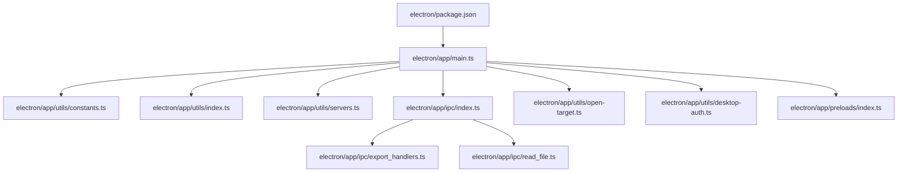
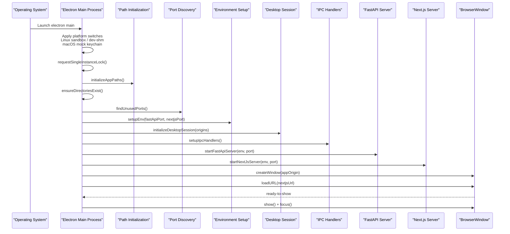
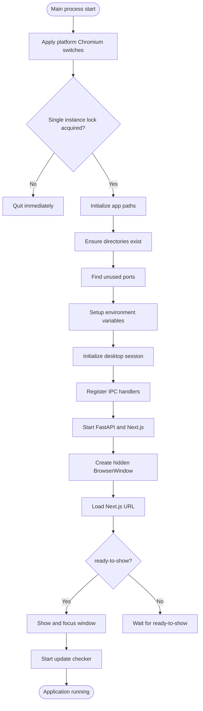
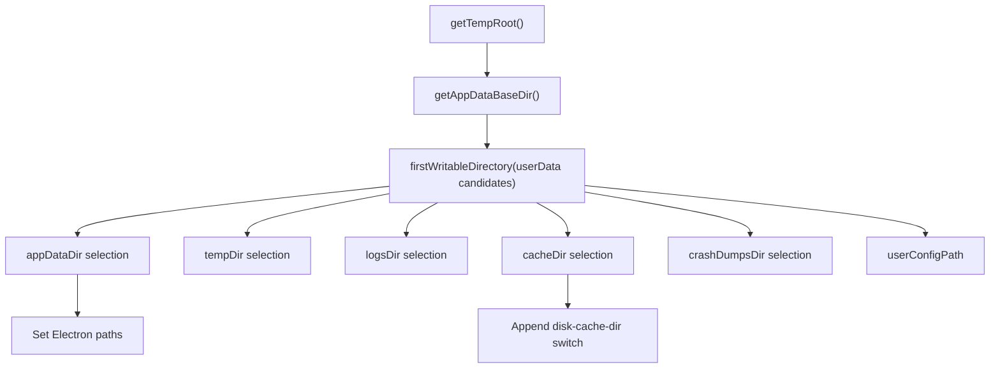
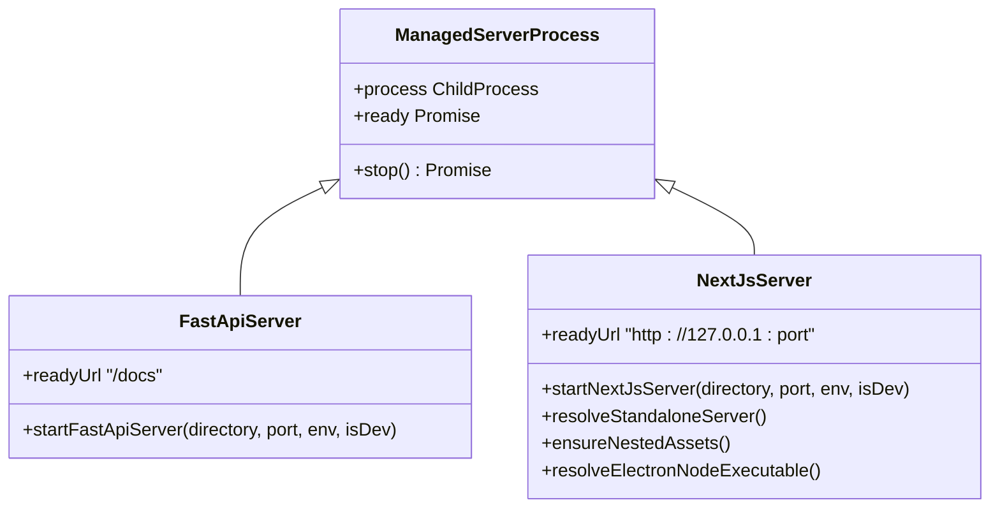
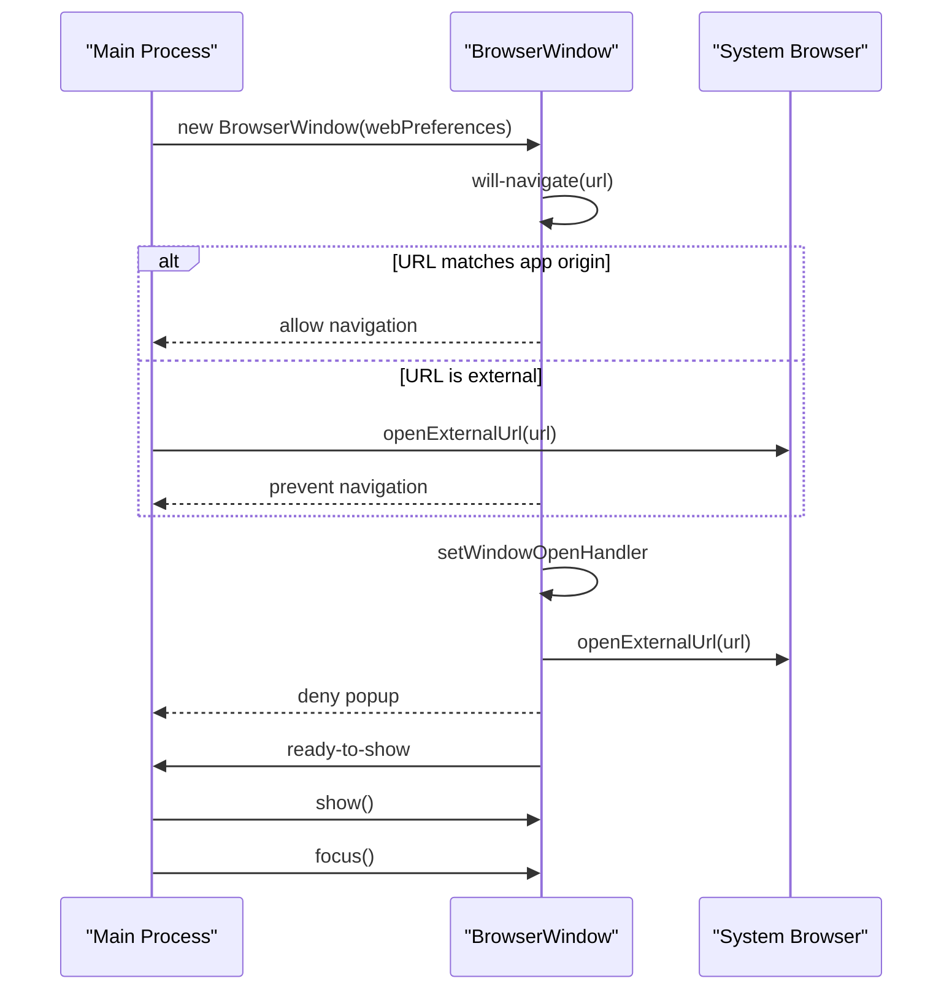
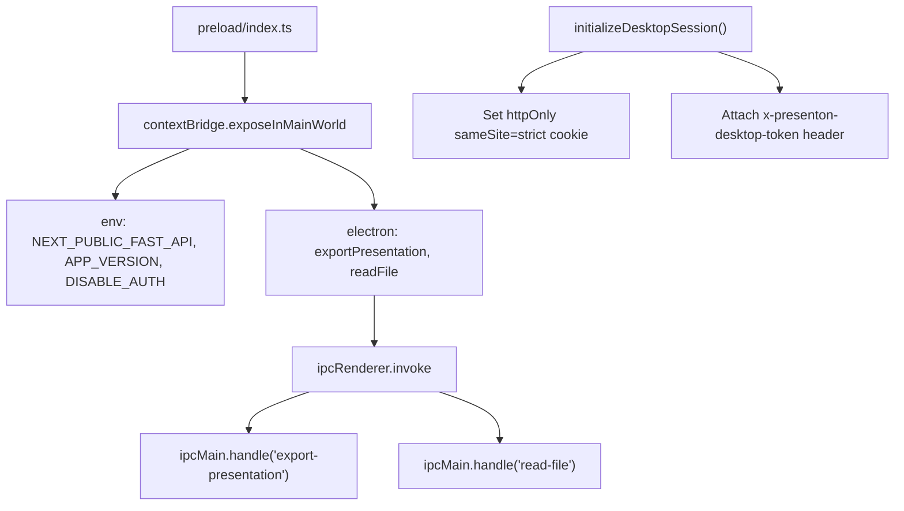
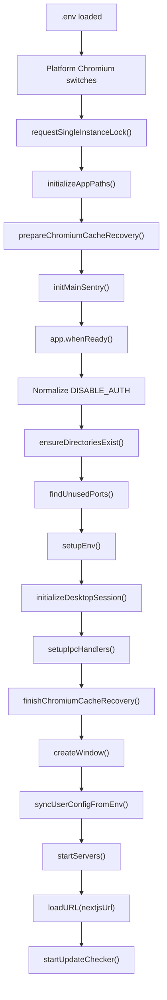
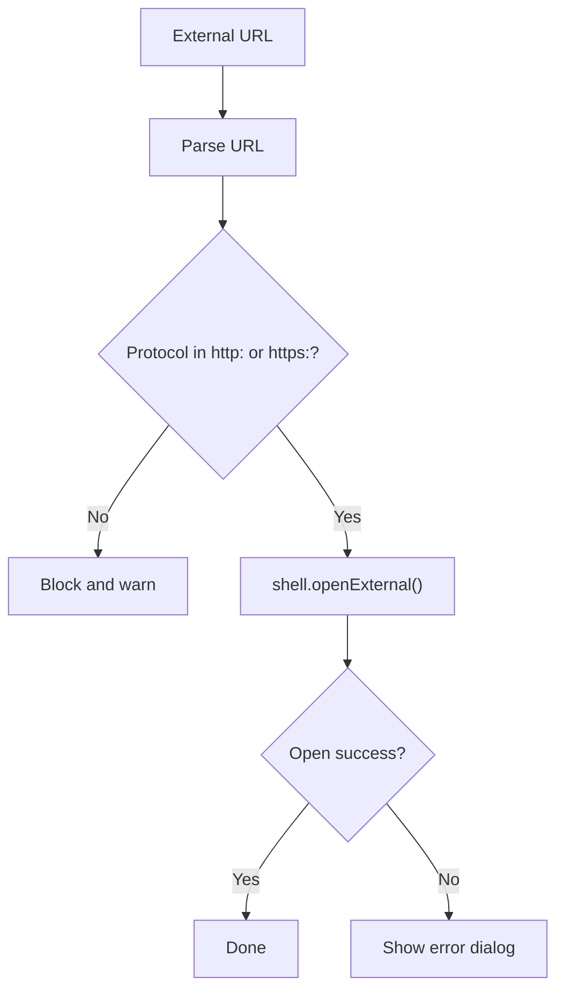
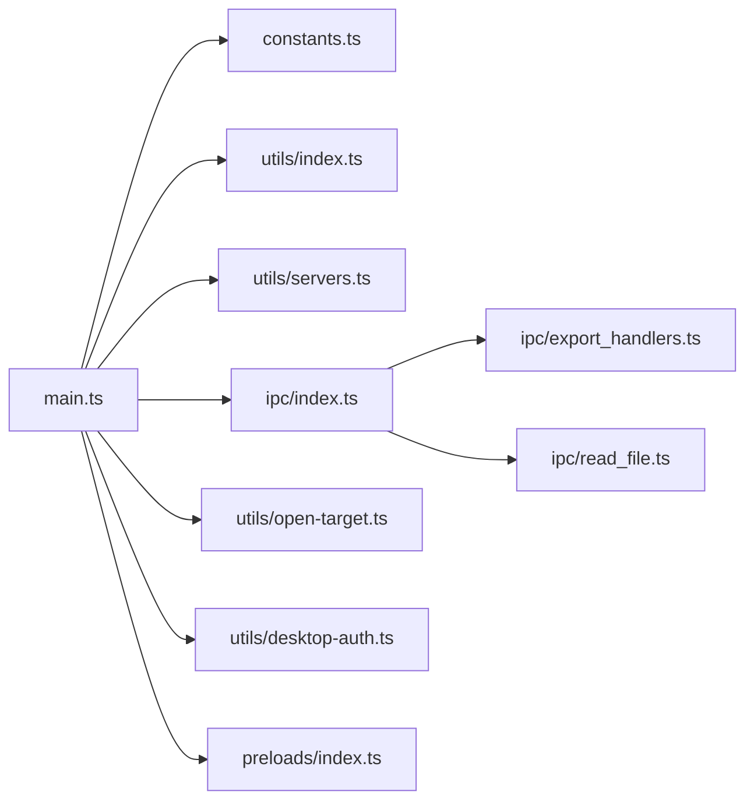

# Electron Architecture

<cite>
**Referenced Files in This Document**   
- [main.ts](file://electron/app/main.ts)
- [constants.ts](file://electron/app/utils/constants.ts)
- [index.ts (utils)](file://electron/app/utils/index.ts)
- [servers.ts](file://electron/app/utils/servers.ts)
- [lifecycle.ts](file://electron/app/utils/lifecycle.ts)
- [index.ts (preloads)](file://electron/app/preloads/index.ts)
- [index.ts (ipc)](file://electron/app/ipc/index.ts)
- [export_handlers.ts](file://electron/app/ipc/export_handlers.ts)
- [read_file.ts](file://electron/app/ipc/read_file.ts)
- [open-target.ts](file://electron/app/utils/open-target.ts)
- [desktop-auth.ts](file://electron/app/utils/desktop-auth.ts)
- [package.json](file://electron/package.json)
</cite>

## Table of Contents
1. [Introduction](#introduction)
2. [Project Structure](#project-structure)
3. [Core Components](#core-components)
4. [Architecture Overview](#architecture-overview)
5. [Detailed Component Analysis](#detailed-component-analysis)
6. [Dependency Analysis](#dependency-analysis)
7. [Performance Considerations](#performance-considerations)
8. [Troubleshooting Guide](#troubleshooting-guide)
9. [Conclusion](#conclusion)

## Introduction
This document explains the Electron application architecture for Presenton. It covers the main process lifecycle, window management, process isolation, startup sequence, security model, single-instance behavior, external URL handling, and integration with embedded FastAPI and Next.js servers. Platform-specific considerations for Linux sandboxing, macOS keychain behavior, and Windows path resolution are also documented.

## Project Structure
The Electron application is implemented under `electron/app`. The compiled entry point is declared in the Electron package configuration, while development and production server locations are resolved dynamically.

**Diagram sources**
- [main.ts:1-56](file://electron/app/main.ts#L1-L56)
- [constants.ts:1-18](file://electron/app/utils/constants.ts#L1-L18)
- [index.ts (utils):5-22](file://electron/app/utils/index.ts#L5-L22)
- [servers.ts:127-196](file://electron/app/utils/servers.ts#L127-L196)
- [index.ts (ipc):1-7](file://electron/app/ipc/index.ts#L1-L7)
- [export_handlers.ts:57-180](file://electron/app/ipc/export_handlers.ts#L57-L180)
- [read_file.ts:4-14](file://electron/app/ipc/read_file.ts#L4-L14)
- [open-target.ts:20-46](file://electron/app/utils/open-target.ts#L20-L46)
- [desktop-auth.ts:12-50](file://electron/app/utils/desktop-auth.ts#L12-L50)
- [package.json:11-11](file://electron/package.json#L11-L11)

**Section sources**
- [package.json:1-11](file://electron/package.json#L1-L11)
- [main.ts:1-56](file://electron/app/main.ts#L1-L56)
- [constants.ts:1-18](file://electron/app/utils/constants.ts#L1-L18)

## Core Components
- Main process bootstrap and lifecycle control.
- Directory and path initialization for user data, app data, temporary files, logs, cache, and crash dumps.
- Embedded server orchestration for FastAPI and Next.js.
- Window creation, navigation guards, and focus management.
- Security configuration using preload scripts and context isolation.
- IPC handlers for export and file reading.
- External URL validation and system browser delegation.
- Desktop session token and cookie injection for internal service communication.

**Section sources**
- [main.ts:93-328](file://electron/app/main.ts#L93-L328)
- [constants.ts:22-33](file://electron/app/utils/constants.ts#L22-L33)
- [servers.ts:11-15](file://electron/app/utils/servers.ts#L11-L15)
- [index.ts (preloads):1-15](file://electron/app/preloads/index.ts#L1-L15)
- [index.ts (ipc):1-7](file://electron/app/ipc/index.ts#L1-L7)
- [open-target.ts:6-46](file://electron/app/utils/open-target.ts#L6-L46)
- [desktop-auth.ts:1-50](file://electron/app/utils/desktop-auth.ts#L1-L50)

## Architecture Overview
The main process initializes platform-specific Chromium switches, acquires a single-instance lock, resolves application paths, sets up Sentry, prepares directories, discovers ports, configures environment variables, initializes the desktop session, registers IPC handlers, starts FastAPI and Next.js, creates a hidden BrowserWindow, loads the Next.js UI, and finally shows the window after it is ready to display.

**Diagram sources**
- [main.ts:59-91](file://electron/app/main.ts#L59-L91)
- [main.ts:189-203](file://electron/app/main.ts#L189-L203)
- [main.ts:454-530](file://electron/app/main.ts#L454-L530)
- [constants.ts:236-293](file://electron/app/utils/constants.ts#L236-L293)
- [index.ts (utils):5-22](file://electron/app/utils/index.ts#L5-L22)
- [desktop-auth.ts:12-50](file://electron/app/utils/desktop-auth.ts#L12-L50)
- [servers.ts:127-196](file://electron/app/utils/servers.ts#L127-L196)
- [servers.ts:198-335](file://electron/app/utils/servers.ts#L198-L335)

## Detailed Component Analysis

### Main Process Lifecycle
The main process performs these responsibilities:
- Loads environment variables from `.env`.
- Applies Chromium command-line switches for Linux sandboxing and macOS keychain behavior.
- Acquires a single-instance lock; if another instance exists, it focuses the existing window instead of starting a new one.
- Initializes application paths and ensures required directories exist.
- Sets up error reporting and memory logging.
- Resolves runtime ports and publishes them through environment variables before creating the renderer.
- Initializes the desktop session with loopback origins.
- Registers IPC handlers.
- Starts FastAPI and Next.js servers and waits for readiness.
- Creates a hidden BrowserWindow, loads the Next.js URL, and reveals the window on `ready-to-show`.
- Handles graceful shutdown by unregistering shortcuts, stopping active exports, and stopping servers.

**Diagram sources**
- [main.ts:57-91](file://electron/app/main.ts#L57-L91)
- [main.ts:189-203](file://electron/app/main.ts#L189-L203)
- [main.ts:454-530](file://electron/app/main.ts#L454-L530)

**Section sources**
- [main.ts:57-91](file://electron/app/main.ts#L57-L91)
- [main.ts:189-203](file://electron/app/main.ts#L189-L203)
- [main.ts:454-530](file://electron/app/main.ts#L454-L530)

### Directory Initialization and Path Resolution
Directory resolution prioritizes writable locations across platforms:
- Temporary root selection considers environment variables, Electron temp path, OS temp directory, and platform-specific fallbacks.
- Application data directory selection differs per platform: Windows uses `APPDATA`/`LOCALAPPDATA`, macOS uses `~/Library/Application Support`, and Linux uses XDG or `~/.config`.
- User data, logs, cache, crash dumps, and session data directories are created under a stable user data location.
- Downloads directory resolution reads XDG user directories on Linux and falls back to Electron downloads or an app-scoped exports directory.

**Diagram sources**
- [constants.ts:114-172](file://electron/app/utils/constants.ts#L114-L172)
- [constants.ts:174-218](file://electron/app/utils/constants.ts#L174-L218)
- [constants.ts:236-293](file://electron/app/utils/constants.ts#L236-L293)

**Section sources**
- [constants.ts:114-172](file://electron/app/utils/constants.ts#L114-L172)
- [constants.ts:174-218](file://electron/app/utils/constants.ts#L174-L218)
- [constants.ts:236-293](file://electron/app/utils/constants.ts#L236-L293)

### Server Orchestration: FastAPI and Next.js
The main process spawns two child processes:
- FastAPI runs either via `uv run python server.py` in development or a packaged `fastapi`/`fastapi.exe` binary in production.
- Next.js runs via `npm run dev` in development or a standalone Node server in production.
- Both servers are wrapped in a managed process abstraction that provides a readiness promise, cleanup listeners, and a stop method.
- Readiness is detected by polling HTTP endpoints until a successful status code is received or a timeout occurs.
- Environment variables include app data directories, temporary directories, database migration flags, authentication toggles, ImageMagick runtime configuration, LiteParse runner paths, Puppeteer cache directories, and optional exported Chromium executable paths.

**Diagram sources**
- [servers.ts:11-15](file://electron/app/utils/servers.ts#L11-L15)
- [servers.ts:17-32](file://electron/app/utils/servers.ts#L17-L32)
- [servers.ts:34-62](file://electron/app/utils/servers.ts#L34-L62)
- [servers.ts:64-87](file://electron/app/utils/servers.ts#L64-L87)
- [servers.ts:89-125](file://electron/app/utils/servers.ts#L89-L125)
- [servers.ts:127-196](file://electron/app/utils/servers.ts#L127-L196)
- [servers.ts:198-335](file://electron/app/utils/servers.ts#L198-L335)

**Section sources**
- [servers.ts:127-196](file://electron/app/utils/servers.ts#L127-L196)
- [servers.ts:198-335](file://electron/app/utils/servers.ts#L198-L335)
- [main.ts:330-423](file://electron/app/main.ts#L330-L423)

### Window Management and Focus Control
Window management includes:
- Creating a BrowserWindow with explicit webPreferences: context isolation enabled, Node integration disabled, sandbox disabled, and a preload script path.
- Guarding frame navigation to allow only the configured application origin; other URLs are opened externally.
- Handling `window-open` requests by opening supported URLs in the system browser.
- Showing and focusing the window only after `ready-to-show`.
- Providing a focus helper that restores minimized windows and brings the main window to the foreground.
- Handling second-instance events to focus the existing window.

**Diagram sources**
- [main.ts:247-310](file://electron/app/main.ts#L247-L310)
- [main.ts:312-328](file://electron/app/main.ts#L312-L328)
- [open-target.ts:20-46](file://electron/app/utils/open-target.ts#L20-L46)

**Section sources**
- [main.ts:247-310](file://electron/app/main.ts#L247-L310)
- [main.ts:312-328](file://electron/app/main.ts#L312-L328)

### Process Isolation and Security Model
Security configuration follows a least-privilege approach:
- Renderer processes use `contextIsolation: true` and `nodeIntegration: false`.
- A preload script exposes a minimal API surface to the renderer via `contextBridge`.
- The exposed API includes environment values needed by the frontend and IPC-invoked functions for exporting presentations and reading local files.
- IPC handlers validate inputs and perform privileged operations in the main process.
- Desktop session tokens are generated at runtime, stored only in process memory, and attached to internal requests between the Next.js and FastAPI services.
- Cookies are scoped to exact application origins and stripped from cross-origin requests.

**Diagram sources**
- [index.ts (preloads):1-15](file://electron/app/preloads/index.ts#L1-L15)
- [index.ts (ipc):1-7](file://electron/app/ipc/index.ts#L1-L7)
- [export_handlers.ts:57-180](file://electron/app/ipc/export_handlers.ts#L57-L180)
- [read_file.ts:4-14](file://electron/app/ipc/read_file.ts#L4-L14)
- [desktop-auth.ts:12-50](file://electron/app/utils/desktop-auth.ts#L12-L50)

**Section sources**
- [main.ts:247-272](file://electron/app/main.ts#L247-L272)
- [index.ts (preloads):1-15](file://electron/app/preloads/index.ts#L1-L15)
- [index.ts (ipc):1-7](file://electron/app/ipc/index.ts#L1-L7)
- [export_handlers.ts:57-180](file://electron/app/ipc/export_handlers.ts#L57-L180)
- [read_file.ts:4-14](file://electron/app/ipc/read_file.ts#L4-L14)
- [desktop-auth.ts:12-50](file://electron/app/utils/desktop-auth.ts#L12-L50)

### Startup Sequence
The startup sequence proceeds as follows:
1. Load `.env` and install safe console wrappers.
2. Apply platform-specific Chromium switches.
3. Acquire single-instance lock.
4. Initialize application paths and prepare Chromium cache recovery.
5. Initialize Sentry and log startup memory.
6. On `whenReady`:
   - Normalize authentication settings into environment variables.
   - Ensure directories exist.
   - Discover unused ports for FastAPI and Next.js.
   - Publish environment variables including internal FastAPI URL and Next.js URL.
   - Initialize desktop session with loopback origins.
   - Register IPC handlers.
   - Finish Chromium cache recovery.
   - Create the main window.
   - Sync user configuration from environment.
   - Start FastAPI and Next.js servers.
   - Load the Next.js URL into the main window.
   - Start the update checker.

**Diagram sources**
- [main.ts:57-91](file://electron/app/main.ts#L57-L91)
- [main.ts:189-203](file://electron/app/main.ts#L189-L203)
- [main.ts:454-530](file://electron/app/main.ts#L454-L530)

**Section sources**
- [main.ts:57-91](file://electron/app/main.ts#L57-L91)
- [main.ts:189-203](file://electron/app/main.ts#L189-L203)
- [main.ts:454-530](file://electron/app/main.ts#L454-L530)

### External URL Handling
External URL handling enforces protocol allowlisting and delegates unsupported links to the system browser:
- Only `http:` and `https:` protocols are allowed for external opening.
- If opening fails, the user sees a dialog explaining that the link could not be opened.
- Navigation guards prevent the main window from navigating to non-application origins.

**Diagram sources**
- [open-target.ts:6-46](file://electron/app/utils/open-target.ts#L6-L46)
- [main.ts:222-245](file://electron/app/main.ts#L222-L245)

**Section sources**
- [open-target.ts:6-46](file://electron/app/utils/open-target.ts#L6-L46)
- [main.ts:213-245](file://electron/app/main.ts#L213-L245)

### Single Instance Lock and Window Focus
- The main process calls `requestSingleInstanceLock()` and quits if it does not acquire the lock.
- When a second instance is launched, the existing window is restored from minimization, shown, and focused.
- This prevents multiple concurrent application instances and keeps user state centralized.

**Section sources**
- [main.ts:189-192](file://electron/app/main.ts#L189-L192)
- [main.ts:312-328](file://electron/app/main.ts#L312-L328)

### Integration Between Electron Main Process and Embedded Servers
The main process acts as an orchestrator:
- It discovers free loopback ports and publishes them through environment variables.
- It passes application data directories, temporary directories, configuration paths, and feature flags to FastAPI.
- It passes Next.js runtime configuration, including internal FastAPI URL, app root, and Puppeteer paths.
- It waits for both servers to respond successfully before loading the UI.
- It cleans up server processes during application shutdown.

**Section sources**
- [index.ts (utils):5-22](file://electron/app/utils/index.ts#L5-L22)
- [main.ts:330-423](file://electron/app/main.ts#L330-L423)
- [servers.ts:127-196](file://electron/app/utils/servers.ts#L127-L196)
- [servers.ts:198-335](file://electron/app/utils/servers.ts#L198-L335)

### Platform-Specific Considerations

#### Linux Sandbox Configuration
- If the `chrome-sandbox` binary exists but is not root-owned with mode `4755`, the main process disables the Chromium sandbox.
- If `chrome-sandbox` is missing, the sandbox is also disabled.
- If `/dev/shm` is not writable or accessible, the main process disables shared memory usage to avoid renderer failures.

**Section sources**
- [main.ts:65-91](file://electron/app/main.ts#L65-L91)

#### macOS Keychain Handling
- For local and ad-hoc signed builds, the main process adds a Chromium switch to use a mock keychain. This avoids repeated keychain prompts when Chromium initializes encrypted session storage.

**Section sources**
- [main.ts:59-63](file://electron/app/main.ts#L59-L63)

#### Windows Path Resolution
- Windows path resolution considers `APPDATA`, `LOCALAPPDATA`, and `HOMEDRIVE`/`HOMEPATH` combinations.
- ImageMagick environment variable construction uses `Path` on Windows and `PATH` on other platforms.
- Next.js development spawning uses `npm.cmd` with shell mode on Windows to avoid ENOENT errors.
- Exported file path normalization handles Windows-style `file:` URLs that begin with a leading slash.

**Section sources**
- [constants.ts:138-172](file://electron/app/utils/constants.ts#L138-L172)
- [main.ts:171-180](file://electron/app/main.ts#L171-L180)
- [servers.ts:207-218](file://electron/app/utils/servers.ts#L207-L218)
- [export_handlers.ts:451-474](file://electron/app/ipc/export_handlers.ts#L451-L474)

## Dependency Analysis
The main process depends on utilities for path resolution, environment setup, server management, lifecycle helpers, IPC registration, external URL handling, and desktop authentication. The preloads expose a small bridge to the main process, and IPC handlers implement privileged operations.

**Diagram sources**
- [main.ts:1-56](file://electron/app/main.ts#L1-L56)
- [index.ts (ipc):1-7](file://electron/app/ipc/index.ts#L1-L7)

**Section sources**
- [main.ts:1-56](file://electron/app/main.ts#L1-L56)
- [index.ts (ipc):1-7](file://electron/app/ipc/index.ts#L1-L7)

## Performance Considerations
- Disabling hardware acceleration can reduce startup white-screen issues on some Linux drivers but may affect rendering performance.
- Disabling the Chromium sandbox on Linux improves compatibility at the cost of reduced isolation.
- Using a mock keychain on macOS avoids interactive prompts but changes how Chromium stores encrypted session data.
- Server readiness polling uses HTTP requests with timeouts; slow backend startup can delay UI loading.
- Export tasks spawn separate Node or Electron processes and manage their lifecycle carefully to avoid resource leaks.

[No sources needed since this section provides general guidance]

## Troubleshooting Guide
Common issues and where to investigate:
- **Servers fail to start**: Check server logs written to the logs directory and review the main process error output. Verify that FastAPI and Next.js ports were discovered and that environment variables were set correctly.
- **Export fails due to missing runtime**: Confirm that the export runtime and Chromium binaries are available. Review export handler logs and verify Puppeteer cache directories.
- **External links blocked**: Verify that the URL uses `http:` or `https:` and that the system has a registered handler for the protocol.
- **Linux rendering problems**: Inspect whether the sandbox was disabled and whether `/dev/shm` access caused Chromium to disable shared memory usage.
- **macOS keychain prompts**: Ensure the mock keychain switch is applied for local builds.

**Section sources**
- [servers.ts:146-183](file://electron/app/utils/servers.ts#L146-L183)
- [servers.ts:219-248](file://electron/app/utils/servers.ts#L219-L248)
- [export_handlers.ts:57-180](file://electron/app/ipc/export_handlers.ts#L57-L180)
- [open-target.ts:20-46](file://electron/app/utils/open-target.ts#L20-L46)
- [main.ts:65-91](file://electron/app/main.ts#L65-L91)

## Conclusion
Presenton’s Electron architecture separates privileged operations from the renderer through strict process isolation, a minimal preload bridge, and controlled IPC channels. The main process manages platform-specific Chromium behavior, application directories, embedded server lifecycles, window visibility, and secure internal communication. This design balances usability, security, and cross-platform reliability while providing clear extension points for future enhancements.

[No sources needed since this section summarizes without analyzing specific files]