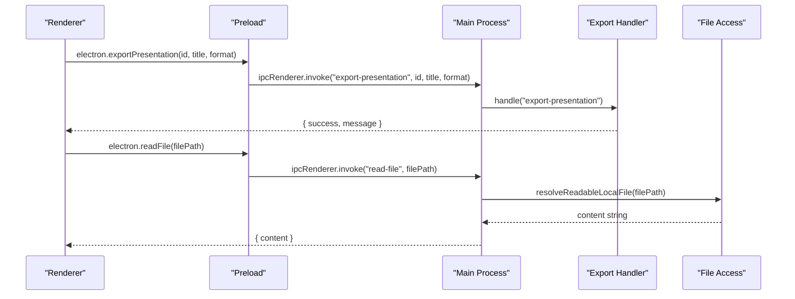
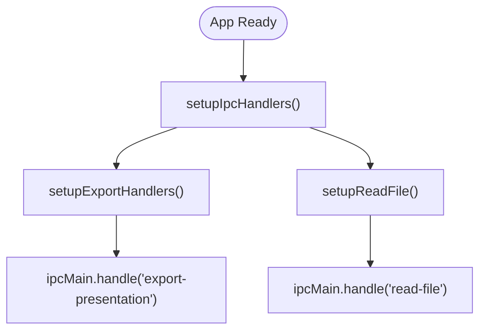
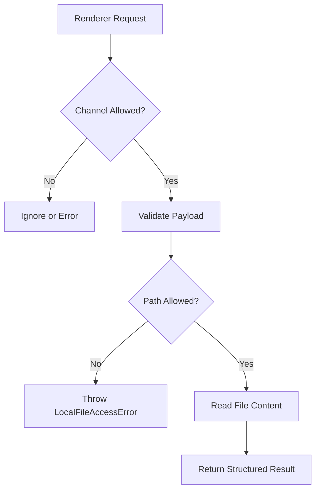
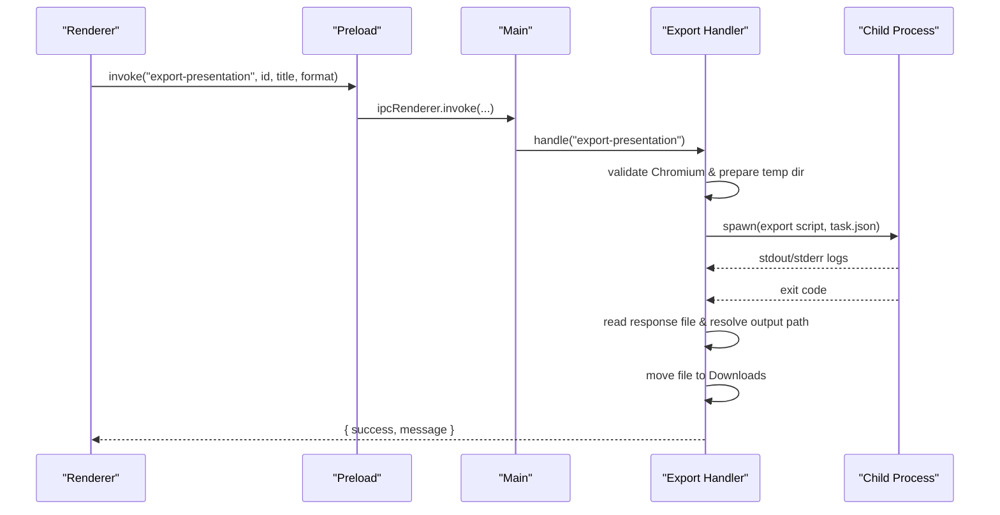
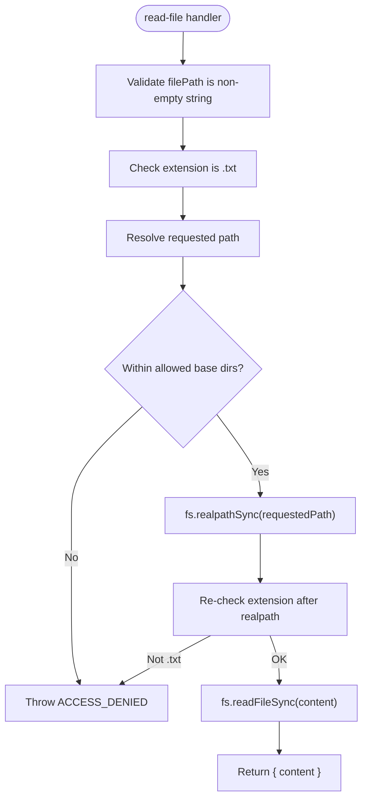
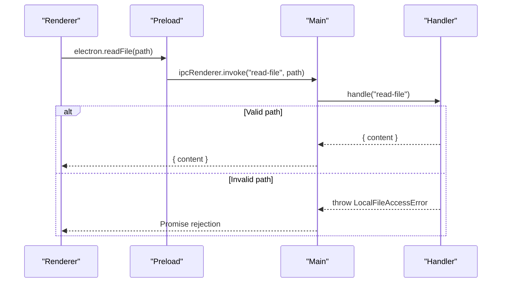
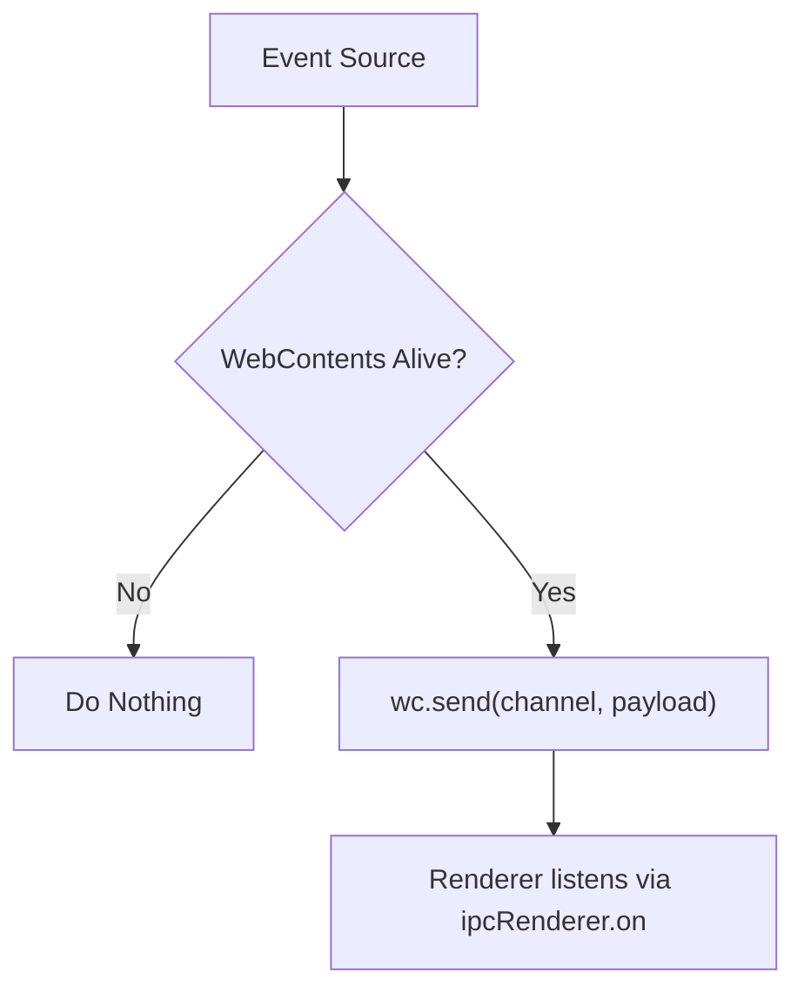
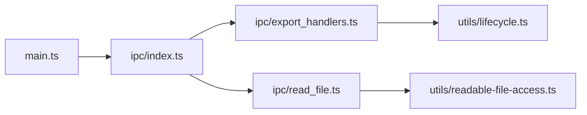

# IPC Communication

<cite>
**Referenced Files in This Document**   
- [main.ts](file://electron/app/main.ts)
- [index.ts](file://electron/app/preloads/index.ts)
- [ipc_index.ts](file://electron/app/ipc/index.ts)
- [export_handlers.ts](file://electron/app/ipc/export_handlers.ts)
- [read_file.ts](file://electron/app/ipc/read_file.ts)
- [readable-file-access.ts](file://electron/app/utils/readable-file-access.ts)
- [lifecycle.ts](file://electron/app/utils/lifecycle.ts)
</cite>

## Table of Contents
1. [Introduction](#introduction)
2. [Project Structure](#project-structure)
3. [Core Components](#core-components)
4. [Architecture Overview](#architecture-overview)
5. [Detailed Component Analysis](#detailed-component-analysis)
6. [Dependency Analysis](#dependency-analysis)
7. [Performance Considerations](#performance-considerations)
8. [Troubleshooting Guide](#troubleshooting-guide)
9. [Conclusion](#conclusion)

## Introduction
This document explains the Inter-Process Communication (IPC) patterns between the Electron main process and renderer processes in the project. It covers how handlers are registered, how messages are routed, how events are handled, and how security is enforced through context isolation and explicit channel exposure. It also documents the export and file reading IPC modules, async promise-based APIs, error propagation strategies, channel naming conventions, and debugging techniques for IPC issues.

## Project Structure
The IPC implementation is centered around three layers:
- Main entry point initializes the app, creates the BrowserWindow with a preload script, and registers IPC handlers.
- Preload script exposes a minimal, secure API surface to the renderer via `contextBridge`.
- Renderer calls the exposed API using `ipcRenderer.invoke`, which routes to main-process handlers.

```mermaid
graph TB
subgraph "Main Process"
MAIN["main.ts<br/>App bootstrap"]
IPC_INDEX["ipc/index.ts<br/>Handler registration"]
EXPORT_HANDLER["ipc/export_handlers.ts<br/>Export handler"]
READ_FILE_HANDLER["ipc/read_file.ts<br/>File read handler"]
FILE_ACCESS["utils/readable-file-access.ts<br/>Safe file access"]
end
subgraph "Preload Script"
PRELOAD["preloads/index.ts<br/>contextBridge API"]
end
subgraph "Renderer Process"
RENDERER["Renderer UI"]
end
RENDERER --> |invoke("export-presentation")| PRELOAD
RENDERER --> |invoke("read-file")| PRELOAD
PRELOAD --> |ipcRenderer.invoke| IPC_INDEX
IPC_INDEX --> EXPORT_HANDLER
IPC_INDEX --> READ_FILE_HANDLER
READ_FILE_HANDLER --> FILE_ACCESS
MAIN --> IPC_INDEX
```

**Diagram sources**
- [main.ts:247-272](file://electron/app/main.ts#L247-L272)
- [ipc_index.ts:1-7](file://electron/app/ipc/index.ts#L1-L7)
- [export_handlers.ts:57-179](file://electron/app/ipc/export_handlers.ts#L57-L179)
- [read_file.ts:4-14](file://electron/app/ipc/read_file.ts#L4-L14)
- [readable-file-access.ts:45-74](file://electron/app/utils/readable-file-access.ts#L45-L74)
- [index.ts:10-14](file://electron/app/preloads/index.ts#L10-L14)

**Section sources**
- [main.ts:247-272](file://electron/app/main.ts#L247-L272)
- [ipc_index.ts:1-7](file://electron/app/ipc/index.ts#L1-L7)
- [index.ts:10-14](file://electron/app/preloads/index.ts#L10-L14)

## Core Components
- Main process bootstrap:
  - Creates the BrowserWindow with strict webPreferences: contextIsolation enabled, nodeIntegration disabled, and a preload script path.
  - Initializes environment variables, starts internal servers, and registers IPC handlers before loading the application URL.
- Preload script:
  - Exposes a small, typed API surface to the renderer: `env` for runtime configuration and `electron.exportPresentation` / `electron.readFile` for IPC calls.
- IPC handler registry:
  - Centralizes handler setup by calling module-specific setup functions.
- Export handler:
  - Validates Chromium availability, spawns an external export task, manages child process lifecycle, writes/reads response files, moves output to downloads, and shows user feedback.
- File read handler:
  - Delegates to a safe file reader that validates allowed directories, file extensions, and resolves symlinks safely.

**Section sources**
- [main.ts:247-272](file://electron/app/main.ts#L247-L272)
- [main.ts:454-484](file://electron/app/main.ts#L454-L484)
- [index.ts:10-14](file://electron/app/preloads/index.ts#L10-L14)
- [ipc_index.ts:1-7](file://electron/app/ipc/index.ts#L1-L7)
- [export_handlers.ts:57-179](file://electron/app/ipc/export_handlers.ts#L57-L179)
- [read_file.ts:4-14](file://electron/app/ipc/read_file.ts#L4-L14)
- [readable-file-access.ts:45-74](file://electron/app/utils/readable-file-access.ts#L45-L74)

## Architecture Overview
The IPC architecture follows a secure, explicit channel model:
- The renderer cannot directly access Node or Electron APIs; it uses the preload-exposed API.
- Each IPC channel is explicitly named and registered in the main process.
- Handlers validate inputs and return structured results or throw errors that propagate back as rejected promises in the renderer.



**Diagram sources**
- [index.ts:10-14](file://electron/app/preloads/index.ts#L10-L14)
- [export_handlers.ts:57-179](file://electron/app/ipc/export_handlers.ts#L57-L179)
- [read_file.ts:4-14](file://electron/app/ipc/read_file.ts#L4-L14)
- [readable-file-access.ts:45-74](file://electron/app/utils/readable-file-access.ts#L45-L74)

## Detailed Component Analysis

### IPC Registration and Message Routing
- Handler registration:
  - `setupIpcHandlers` imports and invokes module-specific setup functions to register channels.
- Channels:
  - `export-presentation`: triggers presentation export workflow.
  - `read-file`: reads allowed text files from permitted directories.



**Diagram sources**
- [ipc_index.ts:1-7](file://electron/app/ipc/index.ts#L1-L7)
- [export_handlers.ts:57-179](file://electron/app/ipc/export_handlers.ts#L57-L179)
- [read_file.ts:4-14](file://electron/app/ipc/read_file.ts#L4-L14)

**Section sources**
- [ipc_index.ts:1-7](file://electron/app/ipc/index.ts#L1-L7)

### Security Model for IPC Channels
- WebPreferences:
  - `contextIsolation: true` isolates the renderer from Node APIs.
  - `nodeIntegration: false` prevents direct Node access in the renderer.
  - `sandbox: false` allows preload to use Node APIs while keeping the renderer sandboxed from native capabilities.
- Preload-only API:
  - Only explicitly exposed methods on `window.electron` are available to the renderer.
- Channel validation:
  - File reading enforces allowed base directories, extension checks, symlink resolution, and real-path verification.
- External URL handling:
  - Navigation guards prevent navigation outside the app origin and open supported URLs externally.



**Diagram sources**
- [main.ts:254-271](file://electron/app/main.ts#L254-L271)
- [index.ts:10-14](file://electron/app/preloads/index.ts#L10-L14)
- [readable-file-access.ts:24-69](file://electron/app/utils/readable-file-access.ts#L24-L69)

**Section sources**
- [main.ts:254-271](file://electron/app/main.ts#L254-L271)
- [index.ts:10-14](file://electron/app/preloads/index.ts#L10-L14)
- [readable-file-access.ts:24-69](file://electron/app/utils/readable-file-access.ts#L24-L69)

### Export Operations IPC Module
Responsibilities:
- Validate Chromium availability for export.
- Build export task payload and temporary directory.
- Spawn external export script with appropriate environment variables.
- Manage child process lifecycle, logging, and cleanup.
- Move exported file to Downloads and show user notification.
- Return structured result with success flag and message.

Key behaviors:
- Runtime fallback: tries multiple Node/Electron runtimes when spawn fails due to missing binaries or permissions.
- Puppeteer cache repair: detects broken Chrome folder and removes it before retrying.
- Response parsing: reads response file written by the export process and resolves absolute file paths.



**Diagram sources**
- [export_handlers.ts:57-179](file://electron/app/ipc/export_handlers.ts#L57-L179)
- [export_handlers.ts:182-304](file://electron/app/ipc/export_handlers.ts#L182-L304)
- [export_handlers.ts:331-449](file://electron/app/ipc/export_handlers.ts#L331-L449)
- [export_handlers.ts:451-486](file://electron/app/ipc/export_handlers.ts#L451-L486)

**Section sources**
- [export_handlers.ts:57-179](file://electron/app/ipc/export_handlers.ts#L57-L179)
- [export_handlers.ts:182-304](file://electron/app/ipc/export_handlers.ts#L182-L304)
- [export_handlers.ts:331-449](file://electron/app/ipc/export_handlers.ts#L331-L449)
- [export_handlers.ts:451-486](file://electron/app/ipc/export_handlers.ts#L451-L486)

### File Reading IPC Module
Responsibilities:
- Accept a file path from the renderer.
- Validate input type and extension.
- Resolve and verify the path against allowed base directories.
- Read file content and return it wrapped in a structured result.

Security controls:
- Only `.txt` files are readable.
- Paths must be within allowed directories under app data or temp.
- Symlinks are resolved to their real paths to prevent escape.



**Diagram sources**
- [read_file.ts:4-14](file://electron/app/ipc/read_file.ts#L4-L14)
- [readable-file-access.ts:45-74](file://electron/app/utils/readable-file-access.ts#L45-L74)

**Section sources**
- [read_file.ts:4-14](file://electron/app/ipc/read_file.ts#L4-L14)
- [readable-file-access.ts:45-74](file://electron/app/utils/readable-file-access.ts#L45-L74)

### Async Communication Patterns and Promise-Based APIs
- Renderer-side:
  - Uses `ipcRenderer.invoke` to call main-process handlers and receives Promises.
- Main-side:
  - Uses `ipcMain.handle` to define async handlers returning structured results or throwing errors.
- Error propagation:
  - Errors thrown in handlers become rejected promises in the renderer.
  - Export handler wraps failures into `{ success: false, message }` for user-friendly responses.
  - File read handler throws typed errors (`LocalFileAccessError`) with specific codes.



**Diagram sources**
- [index.ts:10-14](file://electron/app/preloads/index.ts#L10-L14)
- [read_file.ts:4-14](file://electron/app/ipc/read_file.ts#L4-L14)
- [readable-file-access.ts:45-74](file://electron/app/utils/readable-file-access.ts#L45-L74)

**Section sources**
- [index.ts:10-14](file://electron/app/preloads/index.ts#L10-L14)
- [read_file.ts:4-14](file://electron/app/ipc/read_file.ts#L4-L14)
- [readable-file-access.ts:45-74](file://electron/app/utils/readable-file-access.ts#L45-L74)

### Custom IPC Handlers and Channel Naming Conventions
- Channel naming:
  - Use kebab-case strings for clarity and consistency: `"export-presentation"`, `"read-file"`.
- Handler structure:
  - Each handler function should validate inputs, perform side effects in the main process, and return structured results.
- Extensibility:
  - Add new handlers by creating a module, exporting a setup function, and registering it in `setupIpcHandlers`.

Best practices:
- Keep channels narrow and purpose-specific.
- Avoid exposing raw filesystem or system APIs directly; wrap them in validated handlers.
- Return consistent result shapes: `{ success, message?, data? }`.

**Section sources**
- [ipc_index.ts:1-7](file://electron/app/ipc/index.ts#L1-L7)
- [export_handlers.ts:57-179](file://electron/app/ipc/export_handlers.ts#L57-L179)
- [read_file.ts:4-14](file://electron/app/ipc/read_file.ts#L4-L14)

### Event Handling Mechanisms
- While this repository primarily uses request/response IPC via `ipcRenderer.invoke` and `ipcMain.handle`, there are utilities for event-style communication:
  - `safeSendToWebContents` sends events to a WebContents if it is alive.
  - Window and process lifecycle events are monitored to record breadcrumbs and capture exceptions.



**Diagram sources**
- [lifecycle.ts:14-28](file://electron/app/utils/lifecycle.ts#L14-L28)

**Section sources**
- [lifecycle.ts:14-28](file://electron/app/utils/lifecycle.ts#L14-L28)

## Dependency Analysis
The IPC layer depends on utility modules for safe operations and lifecycle management:



**Diagram sources**
- [main.ts:22-23](file://electron/app/main.ts#L22-L23)
- [ipc_index.ts:1-7](file://electron/app/ipc/index.ts#L1-L7)
- [export_handlers.ts:1-27](file://electron/app/ipc/export_handlers.ts#L1-L27)
- [read_file.ts:1-2](file://electron/app/ipc/read_file.ts#L1-L2)
- [readable-file-access.ts:1-3](file://electron/app/utils/readable-file-access.ts#L1-L3)
- [lifecycle.ts:1-56](file://electron/app/utils/lifecycle.ts#L1-L56)

**Section sources**
- [main.ts:22-23](file://electron/app/main.ts#L22-L23)
- [ipc_index.ts:1-7](file://electron/app/ipc/index.ts#L1-L7)
- [export_handlers.ts:1-27](file://electron/app/ipc/export_handlers.ts#L1-L27)
- [read_file.ts:1-2](file://electron/app/ipc/read_file.ts#L1-L2)
- [readable-file-access.ts:1-3](file://electron/app/utils/readable-file-access.ts#L1-L3)
- [lifecycle.ts:1-56](file://electron/app/utils/lifecycle.ts#L1-L56)

## Performance Considerations
- Export tasks spawn external processes; ensure efficient resource usage and avoid unnecessary retries.
- Child process stdio streams are bounded using a text buffer to limit memory growth during long-running exports.
- Cleanup routines remove temporary directories and destroy child process stdio handles to prevent leaks.
- File reading is synchronous but limited to small text files within allowed directories.

[No sources needed since this section provides general guidance]

## Troubleshooting Guide
Common IPC issues and resolutions:
- Renderer cannot call IPC methods:
  - Verify preload script is correctly set in BrowserWindow webPreferences and that `contextBridge.exposeInMainWorld` is used.
- Export fails due to missing Chromium:
  - Ensure the export runtime is installed and available; check logs for runtime candidates and error codes.
- File read returns access denied:
  - Confirm the file path is within allowed directories and has a `.txt` extension.
- Child process exits unexpectedly:
  - Inspect stderr/stdout captured by the export handler and check exit codes.
- Navigation blocked:
  - External links are guarded; ensure URLs are supported and opened externally.

Debugging techniques:
- Use main-process logging utilities to trace IPC flows and child process behavior.
- Monitor window and process lifecycle events to detect crashes or unexpected closures.
- Validate environment variables and paths used by export and file access modules.

**Section sources**
- [main.ts:247-272](file://electron/app/main.ts#L247-L272)
- [export_handlers.ts:57-179](file://electron/app/ipc/export_handlers.ts#L57-L179)
- [export_handlers.ts:331-449](file://electron/app/ipc/export_handlers.ts#L331-L449)
- [readable-file-access.ts:45-74](file://electron/app/utils/readable-file-access.ts#L45-L74)

## Conclusion
The IPC architecture in this project emphasizes security, explicit channel definitions, and robust error handling. The renderer accesses only a minimal API surface provided by the preload script, while the main process validates inputs and performs privileged operations safely. Export and file reading modules demonstrate best practices for async communication, child process management, and path validation. Following the documented patterns ensures reliable and secure IPC interactions across Electron’s main and renderer processes.

[No sources needed since this section summarizes without analyzing specific files]