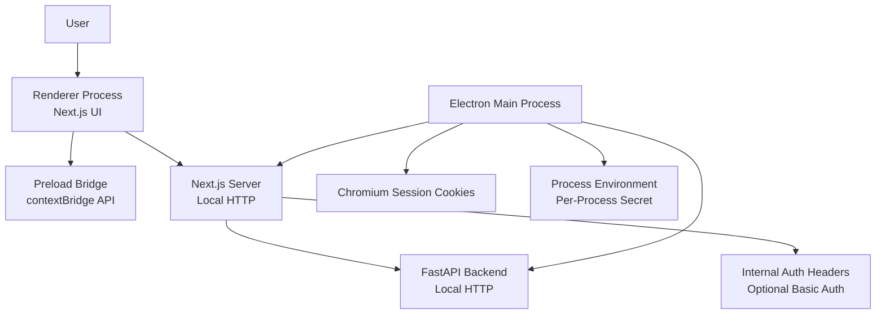
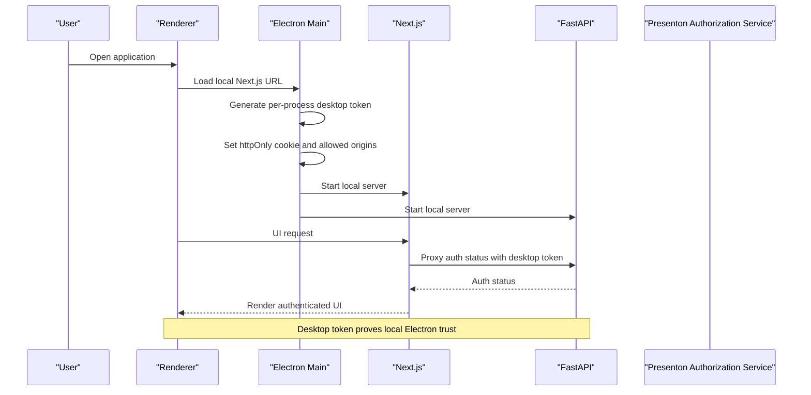
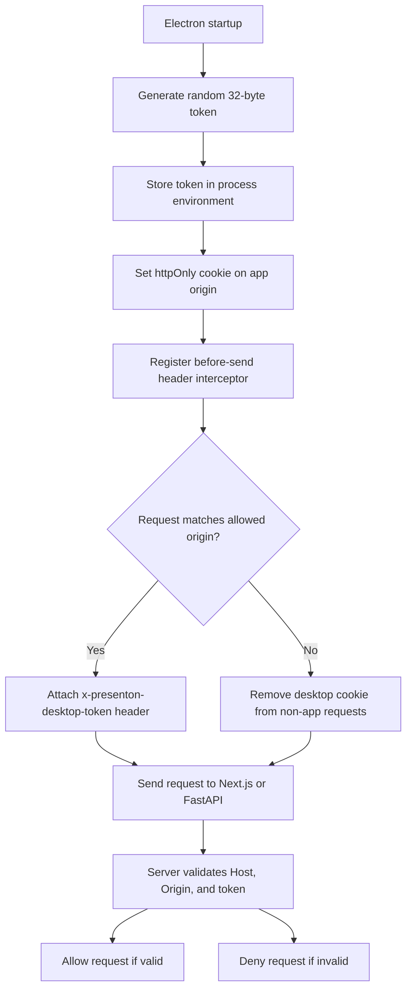
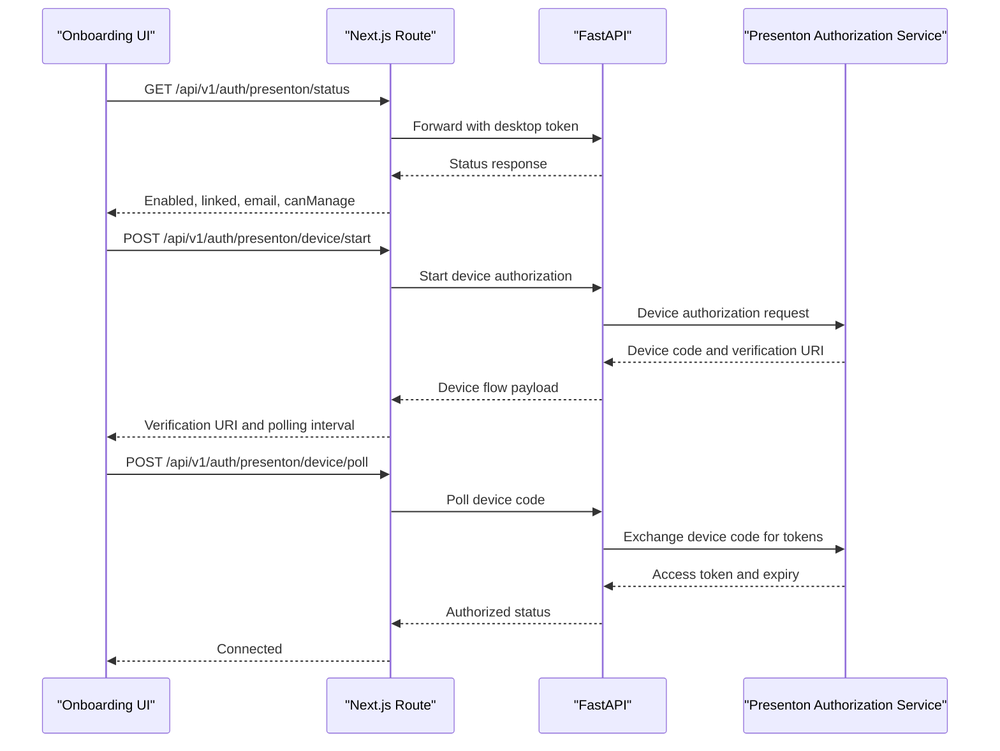
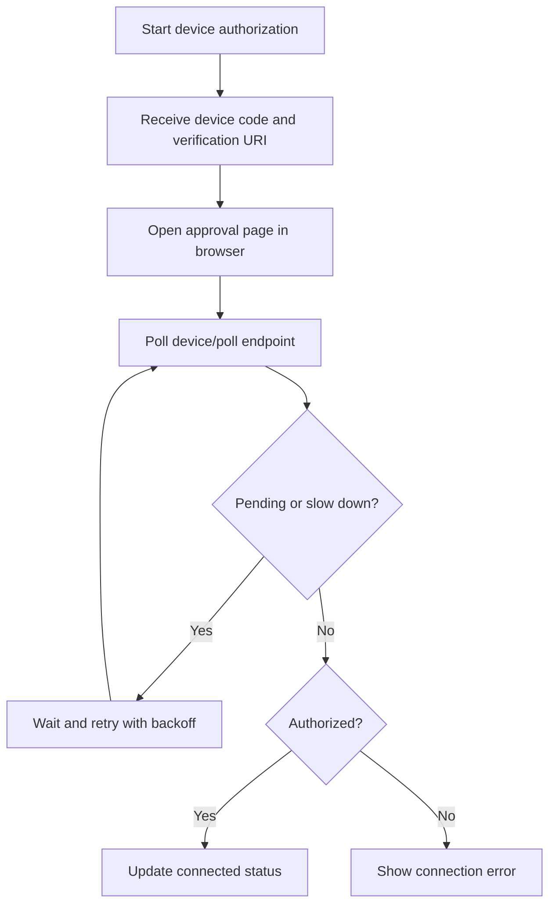
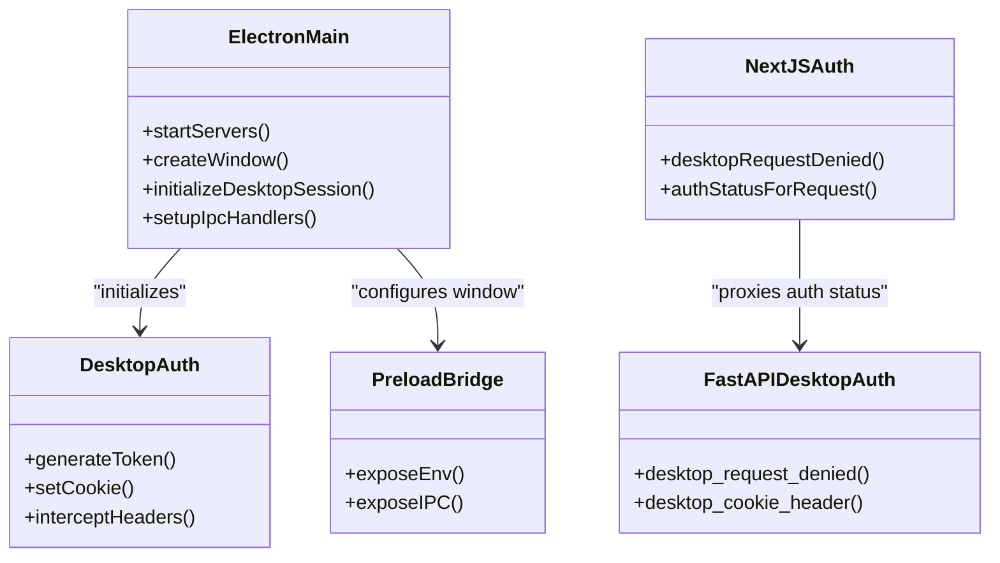
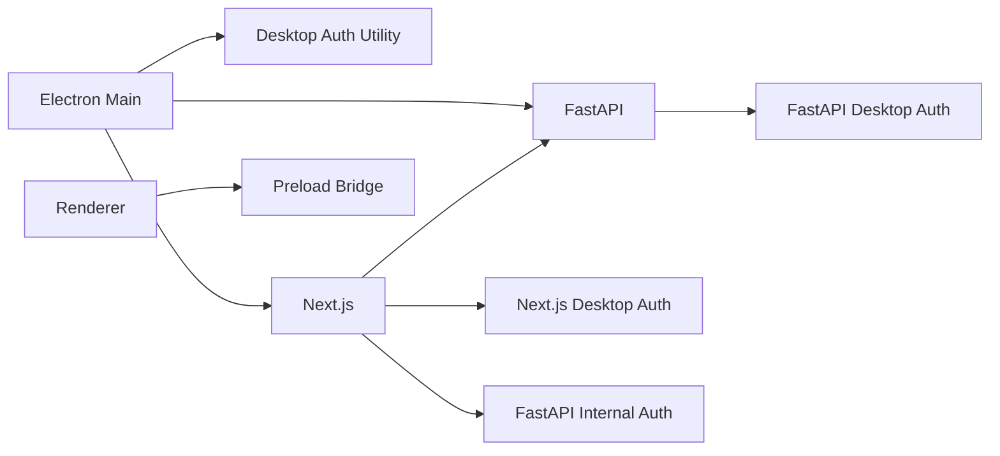

# Desktop Authentication and Session Management

<cite>
**Referenced Files in This Document**
- [main.ts](file://electron/app/main.ts)
- [desktop-auth.ts](file://electron/app/utils/desktop-auth.ts)
- [index.ts](file://electron/app/preloads/index.ts)
- [desktop.py](file://servers/fastapi/api/v1/auth/desktop.py)
- [desktop-auth.ts](file://servers/nextjs/lib/desktop-auth.ts)
- [server-auth-role.ts](file://servers/nextjs/lib/server-auth-role.ts)
- [fastapi-internal.ts](file://servers/nextjs/lib/fastapi-internal.ts)
- [OnboardingPresentonAccount.tsx](file://servers/nex tjs/components/OnBoarding/OnboardingPresentonAccount.tsx)
- [presenton_oauth.py](file://servers/fastapi/api/v1/auth/presenton_oauth.py)
- [desktop-security.test.mjs](file://servers/nex tjs/tests/desktop-security.test.mjs)
</cite>

## Table of Contents
1. [Introduction](#introduction)
2. [Project Structure](#project-structure)
3. [Core Components](#core-components)
4. [Architecture Overview](#architecture-overview)
5. [Detailed Component Analysis](#detailed-component-analysis)
6. [Dependency Analysis](#dependency-analysis)
7. [Performance Considerations](#performance-considerations)
8. [Troubleshooting Guide](#troubleshooting-guide)
9. [Conclusion](#conclusion)

## Introduction
This document explains how the desktop application authenticates users, bridges web-based authentication into a native Electron context, and manages sessions securely across local services. It covers:

- The desktop-specific trust boundary between the Electron main process, renderer, Next.js frontend, and FastAPI backend.
- How a short-lived, per-process desktop token is created, attached to requests, and validated.
- How user account authentication uses an OAuth device flow through the Presenton authorization service.
- Where credentials are stored, what is intentionally not persisted, and how session state survives application restarts.
- Token refresh behavior for provider connections.
- Security best practices and common troubleshooting steps.

## Project Structure
The desktop authentication system spans four runtime layers:

| Layer | Responsibility | Key Files |
|---|---|---|
| Electron main process | Starts local servers, creates secure session tokens, configures request interception, and launches the UI window | [main.ts](file://electron/app/main.ts), [desktop-auth.ts](file://electron/app/utils/desktop-auth.ts) |
| Preload bridge | Exposes safe environment variables and IPC methods to the renderer without exposing Node or secrets | [index.ts](file://electron/app/preloads/index.ts) |
| Next.js server | Validates desktop-originated requests, proxies auth status to FastAPI, and renders the UI | [desktop-auth.ts](file://servers/nextjs/lib/desktop-auth.ts), [server-auth-role.ts](file://servers/nextjs/lib/server-auth-role.ts), [fastapi-internal.ts](file://servers/nextjs/lib/fastapi-internal.ts) |
| FastAPI backend | Authenticates the owning Electron client independently of user login and implements provider OAuth flows | [desktop.py](file://servers/fastapi/api/v1/auth/desktop.py), [presenton_oauth.py](file://servers/fastapi/api/v1/auth/presenton_oauth.py) |

**Diagram sources**
- [main.ts:247-310](file://electron/app/main.ts#L247-L310)
- [main.ts:454-484](file://electron/app/main.ts#L454-L484)
- [desktop-auth.ts:12-49](file://electron/app/utils/desktop-auth.ts#L12-L49)
- [index.ts:1-14](file://electron/app/preloads/index.ts#L1-L14)
- [desktop-auth.ts:14-44](file://servers/nextjs/lib/desktop-auth.ts#L14-L44)
- [desktop.py:25-48](file://servers/fastapi/api/v1/auth/desktop.py#L25-L48)
- [fastapi-internal.ts:19-50](file://servers/nextjs/lib/fastapi-internal.ts#L19-L50)

**Section sources**
- [main.ts:1-548](file://electron/app/main.ts#L1-L548)
- [desktop-auth.ts:1-51](file://electron/app/utils/desktop-auth.ts#L1-L51)
- [index.ts:1-15](file://electron/app/preloads/index.ts#L1-L15)
- [desktop.py:1-49](file://servers/fastapi/api/v1/auth/desktop.py#L1-L49)
- [desktop-auth.ts:1-45](file://servers/nextjs/lib/desktop-auth.ts#L1-L45)
- [server-auth-role.ts:1-71](file://servers/nextjs/lib/server-auth-role.ts#L1-L71)
- [fastapi-internal.ts:1-52](file://servers/nextjs/lib/fastapi-internal.ts#L1-L52)

## Core Components
This section summarizes the most important parts of the desktop authentication and session system.

### Electron Desktop Session Token
- A cryptographically random 32-byte hex token is generated once per Electron process.
- The token is stored only in process environment variables and Chromium session cookies.
- It is never written to `userConfig.json` and never exposed through the preload bridge.
- The cookie is marked `httpOnly`, `sameSite=strict`, and scoped to the application origin.
- The main process attaches the token as both a header and a cookie only for exact allowed origins.

**Security implications:**
- The token is ephemeral and process-scoped.
- Cross-port fetches from the renderer are handled by the main process because renderers may omit credentials.
- External URLs and non-app origins do not receive the token.

**Section sources**
- [desktop-auth.ts:4-50](file://electron/app/utils/desktop-auth.ts#L4-L50)
- [desktop-security.test.mjs:201-219](file://servers/nex tjs/tests/desktop-security.test.mjs#L201-L219)

### Next.js Desktop Request Validation
- The Next.js layer checks whether the request comes from an Electron runtime.
- It validates the `Host` and optional `Origin` headers against the allowed origins list.
- It compares the supplied token using constant-time comparison to prevent timing attacks.
- If validation fails, it returns explicit error responses such as unauthorized or forbidden.

**Section sources**
- [desktop-auth.ts:14-44](file://servers/nextjs/lib/desktop-auth.ts#L14-L44)

### FastAPI Desktop Request Validation
- The FastAPI layer performs the same desktop-origin and token validation as the Next.js layer.
- It rejects DNS rebinding by checking the actual `Host` header rather than trusting forwarded host values.
- It supports both header and cookie transport for the desktop token.
- It allows preflight CORS requests when they match the exact origin policy.

**Section sources**
- [desktop.py:10-48](file://servers/fastapi/api/v1/auth/desktop.py#L10-L48)

### Preload Bridge
- The preload script exposes only a small, intentional API surface to the renderer.
- It exposes environment variables needed by the UI, such as the FastAPI URL, app version, and whether authentication is disabled.
- It does not expose the desktop token or sensitive Electron APIs.

**Section sources**
- [index.ts:1-14](file://electron/app/preloads/index.ts#L1-L14)

### Internal Service Authentication
- Next.js can call FastAPI using optional Basic authentication derived from environment variables or the user configuration file.
- This is separate from the desktop token; it protects internal service-to-service communication.

**Section sources**
- [fastapi-internal.ts:19-50](file://servers/nextjs/lib/fastapi-internal.ts#L19-L50)

## Architecture Overview
The desktop authentication architecture separates two concerns:

1. **Desktop trust identity:** Proves that a request originates from the trusted Electron application running locally.
2. **User identity:** Proves that the logged-in user has permission to use features such as Presenton Cloud providers.

**Diagram sources**
- [main.ts:454-484](file://electron/app/main.ts#L454-L484)
- [desktop-auth.ts:12-49](file://electron/app/utils/desktop-auth.ts#L12-L49)
- [server-auth-role.ts:20-54](file://servers/nextjs/lib/server-auth-role.ts#L20-L54)
- [desktop.py:25-48](file://servers/fastapi/api/v1/auth/desktop.py#L25-L48)

## Detailed Component Analysis

### Desktop Trust Flow
The desktop trust flow ensures that only the local Electron application can access protected local endpoints.

**Diagram sources**
- [desktop-auth.ts:12-49](file://electron/app/utils/desktop-auth.ts#L12-L49)
- [desktop-auth.ts:14-44](file://servers/nextjs/lib/desktop-auth.ts#L14-L44)
- [desktop.py:25-48](file://servers/fastapi/api/v1/auth/desktop.py#L25-L48)

**Section sources**
- [desktop-auth.ts:12-49](file://electron/app/utils/desktop-auth.ts#L12-L49)
- [desktop-auth.ts:14-44](file://servers/nextjs/lib/desktop-auth.ts#L14-L44)
- [desktop.py:25-48](file://servers/fastapi/api/v1/auth/desktop.py#L25-L48)

### Web-Based Authentication Bridged to Desktop
The desktop UI uses the same web-based authentication mechanisms as the browser version, but the desktop trust layer adds an extra boundary.

**Diagram sources**
- [OnboardingPresentonAccount.tsx:80-100](file://servers/nex tjs/components/OnBoarding/OnboardingPresentonAccount.tsx#L80-L100)
- [OnboardingPresentonAccount.tsx:131-173](file://servers/nex tjs/components/OnBoarding/OnboardingPresentonAccount.tsx#L131-L173)
- [OnboardingPresentonAccount.tsx:245-316](file://servers/nex tjs/components/OnBoarding/OnboardingPresentonAccount.tsx#L245-L316)
- [presenton_oauth.py:217-257](file://servers/fastapi/api/v1/auth/presenton_oauth.py#L217-L257)

**Section sources**
- [OnboardingPresentonAccount.tsx:80-100](file://servers/nex tjs/components/OnBoarding/OnboardingPresentonAccount.tsx#L80-L100)
- [OnboardingPresentonAccount.tsx:131-173](file://servers/nex tjs/components/OnBoarding/OnboardingPresentonAccount.tsx#L131-L173)
- [OnboardingPresentonAccount.tsx:245-316](file://servers/nex tjs/components/OnBoarding/OnboardingPresentonAccount.tsx#L245-L316)
- [presenton_oauth.py:217-257](file://servers/fastapi/api/v1/auth/presenton_oauth.py#L217-L257)

### Session Persistence Across Restarts
The current implementation focuses on per-process security rather than long-term persistence of the desktop trust token.

| Data | Persistence Strategy | Notes |
|---|---|---|
| Desktop trust token | Process environment variable and Chromium session cookie | Not persisted to disk; regenerated each Electron process start |
| Allowed origins | Process environment variable | Set at startup from resolved local ports |
| User account connection state | FastAPI session and provider storage | Managed by backend and authorization service |
| Provider access tokens | Backend-managed provider state | Refreshed through provider exchange during device polling |
| Application settings | User configuration file path passed to services | Used for non-secret configuration and optional internal auth |

**Important distinction:**
- The desktop token is intentionally not persistent.
- User account linkage and provider tokens are managed by the backend and external authorization service.
- The UI polls for provider authorization until success, expiration, or failure.

**Section sources**
- [desktop-auth.ts:16-19](file://electron/app/utils/desktop-auth.ts#L16-L19)
- [main.ts:468-484](file://electron/app/main.ts#L468-L484)
- [OnboardingPresentonAccount.tsx:245-316](file://servers/nex tjs/components/OnBoarding/OnboardingPresentonAccount.tsx#L245-L316)
- [presenton_oauth.py:222-257](file://servers/fastapi/api/v1/auth/presenton_oauth.py#L222-L257)

### Token Refresh Strategies
The repository implements provider-level token handling through the OAuth device flow rather than a simple bearer token refresh loop in the renderer.

- The UI starts a device authorization flow and receives a device code, user code, verification URI, expiration time, and polling interval.
- The UI opens the approval page in the system browser or denies child windows in Electron.
- The UI polls `/api/v1/auth/presenton/device/poll` until the provider responds with authorization.
- The backend exchanges the device code for an access token and expiration information.
- On slow-down or pending states, the backend returns a pollable response so the UI can continue waiting.

**Diagram sources**
- [OnboardingPresentonAccount.tsx:131-173](file://servers/nex tjs/components/OnBoarding/OnboardingPresentonAccount.tsx#L131-L173)
- [OnboardingPresentonAccount.tsx:245-316](file://servers/nex tjs/components/OnBoarding/OnboardingPresentonAccount.tsx#L245-L316)
- [presenton_oauth.py:217-257](file://servers/fastapi/api/v1/auth/presenton_oauth.py#L217-L257)

**Section sources**
- [OnboardingPresentonAccount.tsx:131-173](file://servers/nex tjs/components/OnBoarding/OnboardingPresentonAccount.tsx#L131-L173)
- [OnboardingPresentonAccount.tsx:245-316](file://servers/nex tjs/components/OnBoarding/OnboardingPresentonAccount.tsx#L245-L316)
- [presenton_oauth.py:217-257](file://servers/fastapi/api/v1/auth/presenton_oauth.py#L217-L257)

### Integration with Main Process and Preload Scripts
The main process controls the lifecycle of local servers and the renderer window. The preload script provides a minimal, auditable bridge to the renderer.

Key responsibilities:
- Resolve unused ports and publish environment variables before creating the renderer.
- Initialize the desktop session with exact localhost origins.
- Configure IPC handlers for export and file operations.
- Load the Next.js UI only after local services are ready.
- Restrict navigation to the application origin and open unsupported links externally.

**Diagram sources**
- [main.ts:454-484](file://electron/app/main.ts#L454-L484)
- [desktop-auth.ts:12-49](file://electron/app/utils/desktop-auth.ts#L12-L49)
- [index.ts:1-14](file://electron/app/preloads/index.ts#L1-L14)
- [desktop-auth.ts:14-44](file://servers/nextjs/lib/desktop-auth.ts#L14-L44)
- [server-auth-role.ts:20-54](file://servers/nextjs/lib/server-auth-role.ts#L20-L54)
- [desktop.py:25-48](file://servers/fastapi/api/v1/auth/desktop.py#L25-L48)

**Section sources**
- [main.ts:247-310](file://electron/app/main.ts#L247-L310)
- [main.ts:454-484](file://electron/app/main.ts#L454-L484)
- [index.ts:1-14](file://electron/app/preloads/index.ts#L1-L14)

## Dependency Analysis
The desktop authentication system has clear boundaries and limited coupling:

| Dependency | Direction | Purpose |
|---|---|---|
| Electron main → Desktop auth utility | One-way | Create and scope the desktop token |
| Electron main → Local servers | One-way | Start FastAPI and Next.js |
| Renderer → Preload bridge | One-way | Access safe environment and IPC |
| Next.js → Desktop auth helper | One-way | Validate desktop-originated requests |
| Next.js → FastAPI | One-way | Fetch auth status and provider endpoints |
| FastAPI → Desktop auth helper | One-way | Validate desktop-originated requests |
| Next.js → FastAPI internal auth | Optional | Protect internal service calls |

**Diagram sources**
- [main.ts:454-484](file://electron/app/main.ts#L454-L484)
- [desktop-auth.ts:12-49](file://electron/app/utils/desktop-auth.ts#L12-L49)
- [desktop-auth.ts:14-44](file://servers/nextjs/lib/desktop-auth.ts#L14-L44)
- [desktop.py:25-48](file://servers/fastapi/api/v1/auth/desktop.py#L25-L48)
- [fastapi-internal.ts:19-50](file://servers/nextjs/lib/fastapi-internal.ts#L19-L50)

**Section sources**
- [main.ts:454-484](file://electron/app/main.ts#L454-L484)
- [desktop-auth.ts:12-49](file://electron/app/utils/desktop-auth.ts#L12-L49)
- [desktop-auth.ts:14-44](file://servers/nextjs/lib/desktop-auth.ts#L14-L44)
- [desktop.py:25-48](file://servers/fastapi/api/v1/auth/desktop.py#L25-L48)
- [fastapi-internal.ts:19-50](file://servers/nextjs/lib/fastapi-internal.ts#L19-L50)

## Performance Considerations
- The desktop token is generated once per Electron process, avoiding repeated cryptographic work.
- Header interception runs only for outgoing requests and filters by exact origin.
- Constant-time token comparison prevents timing side channels without significant overhead.
- Polling for provider authorization uses configurable intervals and backoff on slow-down responses.
- Disabling hardware acceleration and sandbox adjustments are platform-specific startup optimizations unrelated to authentication but affect overall desktop stability.

[No sources needed since this section provides general guidance]

## Troubleshooting Guide

### Common Issues and Resolutions

| Symptom | Likely Cause | Resolution |
|---|---|---|
| Requests return unauthorized when calling local APIs from the renderer | Desktop token missing or stripped | Ensure the request targets an allowed localhost origin and that the Electron main process initialized the desktop session |
| External URLs receive the desktop cookie | Incorrect origin filtering | Verify that only exact application origins receive the token and that non-app requests strip the desktop cookie |
| DNS rebinding bypass attempt | Forging `Host` or `Origin` headers | Servers validate the actual `Host` header and reject mismatched origins |
| Provider connection never completes | Network failure, expired device code, or authorization service error | Restart the device flow and check network connectivity |
| UI cannot reach FastAPI | Internal service auth misconfiguration | Check `AUTH_USERNAME`/`AUTH_PASSWORD` or user configuration file for internal FastAPI access |
| Authentication appears disabled unexpectedly | `DISABLE_AUTH` or `ELECTRON_DISABLE_AUTH` set | Review environment variables controlling authentication mode |

**Section sources**
- [desktop-auth.ts:30-49](file://electron/app/utils/desktop-auth.ts#L30-L49)
- [desktop-auth.ts:14-44](file://servers/nextjs/lib/desktop-auth.ts#L14-L44)
- [desktop.py:25-48](file://servers/fastapi/api/v1/auth/desktop.py#L25-L48)
- [OnboardingPresentonAccount.tsx:245-316](file://servers/nex tjs/components/OnBoarding/OnboardingPresentonAccount.tsx#L245-L316)
- [fastapi-internal.ts:19-50](file://servers/nextjs/lib/fastapi-internal.ts#L19-L50)

### Security Best Practices for Desktop Applications
- Keep secrets out of preload scripts and renderer memory.
- Use process-scoped environment variables for short-lived capabilities.
- Prefer `httpOnly` cookies with strict same-site policies for browser-facing tokens.
- Validate both `Host` and `Origin` to prevent DNS rebinding and cross-origin confusion.
- Use constant-time comparison for secret validation.
- Limit IPC exposure to the smallest necessary API surface.
- Avoid persisting capability tokens in user configuration files.
- Treat provider access tokens as backend-managed secrets, not renderer-visible data.

**Section sources**
- [desktop-auth.ts:16-19](file://electron/app/utils/desktop-auth.ts#L16-L19)
- [desktop-auth.ts:20-27](file://electron/app/utils/desktop-auth.ts#L20-L27)
- [desktop-auth.ts:30-49](file://electron/app/utils/desktop-auth.ts#L30-L49)
- [desktop-auth.ts:34-42](file://servers/nextjs/lib/desktop-auth.ts#L34-L42)
- [desktop.py:34-47](file://servers/fastapi/api/v1/auth/desktop.py#L34-L47)
- [index.ts:1-14](file://electron/app/preloads/index.ts#L1-L14)

## Conclusion
The desktop authentication system separates local trust from user identity. The Electron main process generates a per-process desktop token, scopes it to exact localhost origins, and attaches it only to trusted requests. The Next.js and FastAPI layers validate that token along with strict origin checks. User authentication uses a standard OAuth device flow, with the backend managing provider tokens and the UI polling for completion.

This design avoids exposing sensitive tokens to the renderer, limits credential persistence to the process lifetime, and enforces strong origin validation to protect against common desktop attack vectors. When extending the system, preserve these boundaries: keep capability tokens in the main process, validate origins on every server, and avoid writing transient secrets to disk.