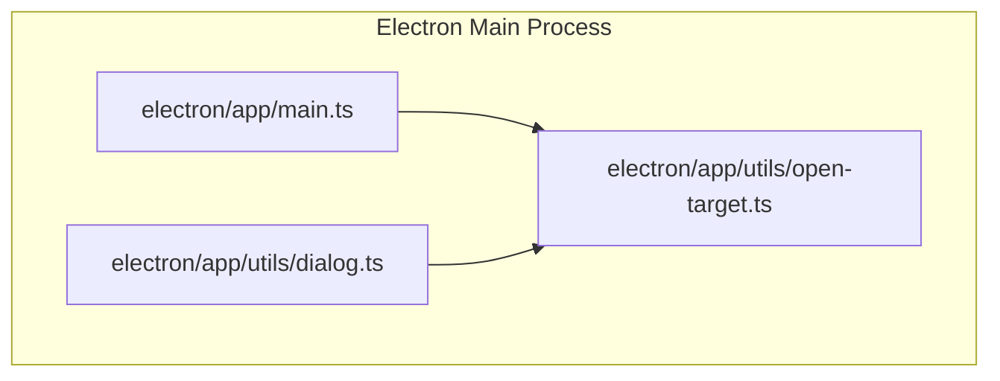
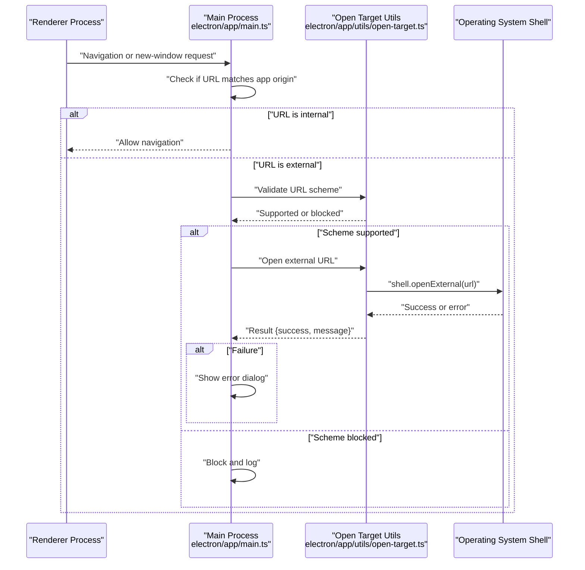
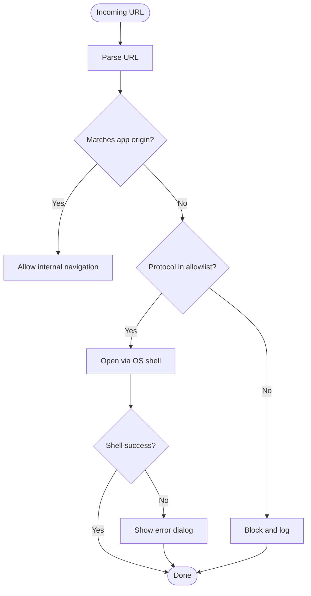
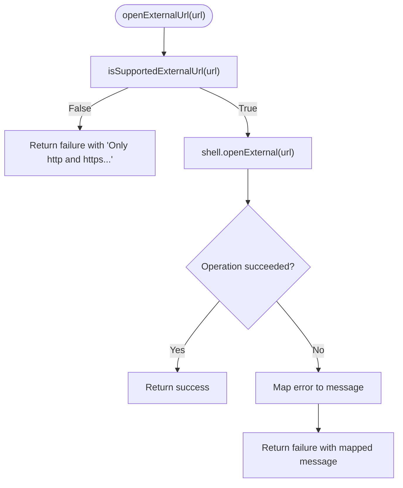
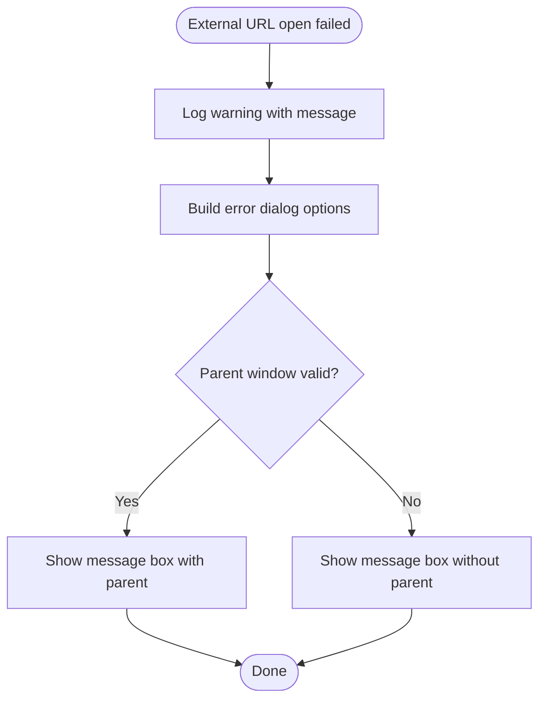
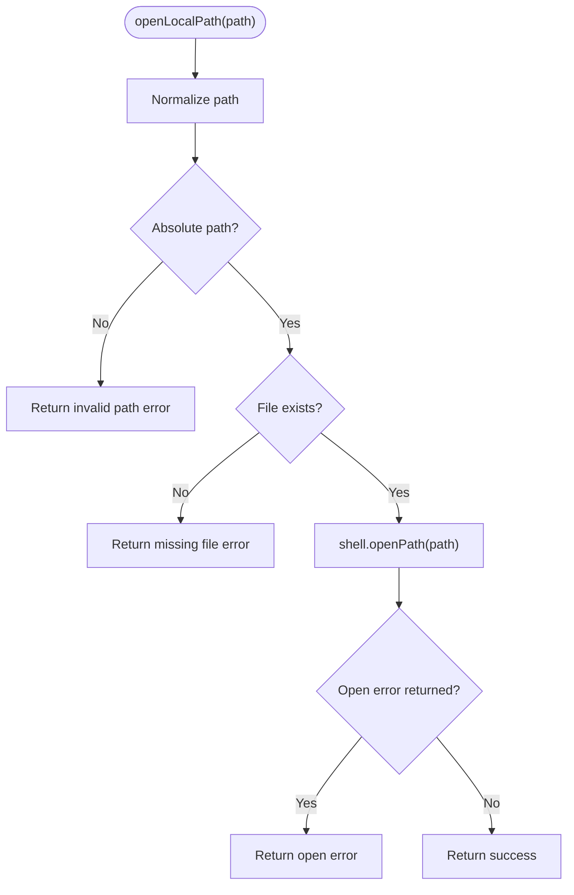
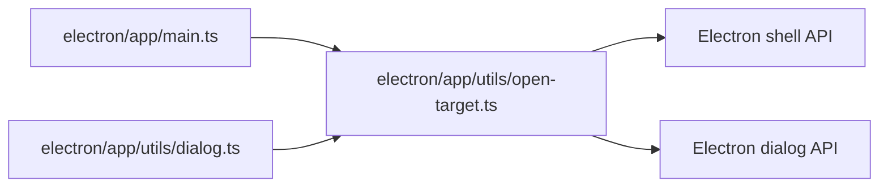

# External URL Handling and Browser Integration

<cite>
**Referenced Files in This Document**
- [main.ts](file://electron/app/main.ts)
- [open-target.ts](file://electron/app/utils/open-target.ts)
- [dialog.ts](file://electron/app/utils/dialog.ts)
</cite>

## Table of Contents
1. [Introduction](#introduction)
2. [Project Structure](#project-structure)
3. [Core Components](#core-components)
4. [Architecture Overview](#architecture-overview)
5. [Detailed Component Analysis](#detailed-component-analysis)
6. [Dependency Analysis](#dependency-analysis)
7. [Performance Considerations](#performance-considerations)
8. [Troubleshooting Guide](#troubleshooting-guide)
9. [Conclusion](#conclusion)

## Introduction
This document explains how the application handles external URLs and integrates with the operating system’s default browser. It focuses on the secure URL opening mechanism, target resolution logic for different URL schemes, error handling when no default application is registered, platform-specific behaviors, and security considerations to prevent malicious URL execution.

The implementation is centered around Electron’s main process, where navigation events are intercepted, validated, and delegated to a safe external opener that uses the OS shell to launch the appropriate handler.

## Project Structure
External URL handling lives in the Electron main process:

- The main window creation and navigation guards are defined in the Electron entry point.
- A dedicated utility module provides URL validation, external URL opening, local path opening, and user-facing error dialogs.
- A dialog helper reuses the same error presentation for file-related operations.

**Diagram sources**
- [main.ts:285-300](file://electron/app/main.ts#L285-L300)
- [open-target.ts:20-46](file://electron/app/utils/open-target.ts#L20-L46)
- [dialog.ts:1-43](file://electron/app/utils/dialog.ts#L1-L43)

**Section sources**
- [main.ts:285-300](file://electron/app/main.ts#L285-L300)
- [open-target.ts:20-46](file://electron/app/utils/open-target.ts#L20-L46)
- [dialog.ts:1-43](file://electron/app/utils/dialog.ts#L1-L43)

## Core Components
- Secure URL validation: Only explicitly allowed web protocols are permitted for external opening.
- Target resolution: The system determines whether a URL should remain inside the app or be opened externally based on origin and protocol rules.
- OS integration: The OS shell is used to open supported URLs in the default browser.
- Error handling: User-friendly error dialogs are shown when an operation fails, including cases where no default application is registered.

Key responsibilities:
- Navigation guard: Prevents navigation outside the app unless it is a supported external URL.
- External opener: Validates and opens URLs via the OS shell.
- Local path opener: Opens files and folders through the OS shell with validation.
- Dialog helper: Presents consistent error messages to users.

**Section sources**
- [main.ts:213-245](file://electron/app/main.ts#L213-L245)
- [open-target.ts:6-46](file://electron/app/utils/open-target.ts#L6-L46)
- [open-target.ts:48-83](file://electron/app/utils/open-target.ts#L48-L83)
- [open-target.ts:85-116](file://electron/app/utils/open-target.ts#L85-L116)
- [dialog.ts:1-43](file://electron/app/utils/dialog.ts#L1-L43)

## Architecture Overview
The external URL flow is orchestrated by the Electron main process. When a navigation event occurs, the app checks if the URL belongs to the trusted application origin. If not, it validates the URL scheme and delegates to the OS shell to open it in the default browser. Failures are surfaced to the user through a standardized error dialog.

**Diagram sources**
- [main.ts:285-300](file://electron/app/main.ts#L285-L300)
- [main.ts:222-245](file://electron/app/main.ts#L222-L245)
- [open-target.ts:20-46](file://electron/app/utils/open-target.ts#L20-L46)

## Detailed Component Analysis

### Secure URL Validation and Target Resolution
The application enforces strict boundaries for external links:

- Internal navigation check: URLs whose origin matches the running application origin are allowed to navigate within the app.
- External URL allowlist: Only HTTP and HTTPS schemes are permitted for external opening. Other schemes (for example, mailto, file, custom protocols) are blocked from being opened by this component.
- Origin isolation: The main window is configured with context isolation and disabled Node integration in the renderer, reducing the risk of executing untrusted content.

**Diagram sources**
- [main.ts:213-220](file://electron/app/main.ts#L213-L220)
- [main.ts:285-300](file://electron/app/main.ts#L285-L300)
- [open-target.ts:6-27](file://electron/app/utils/open-target.ts#L6-L27)

**Section sources**
- [main.ts:213-220](file://electron/app/main.ts#L213-L220)
- [main.ts:285-300](file://electron/app/main.ts#L285-L300)
- [open-target.ts:6-27](file://electron/app/utils/open-target.ts#L6-L27)

### External URL Opening Mechanism
When a URL is determined to be external:

- Protocol validation: The URL is parsed and checked against the allowed set of protocols.
- OS shell invocation: The OS shell is used to open the URL, delegating to the default browser or registered handler.
- Result handling: Success returns immediately; failures return a structured result with a human-readable message.

**Diagram sources**
- [open-target.ts:20-46](file://electron/app/utils/open-target.ts#L20-L46)

**Section sources**
- [open-target.ts:20-46](file://electron/app/utils/open-target.ts#L20-L46)

### Error Handling and User Feedback
If opening an external URL fails:

- Logging: Failures are logged using the safe logging utilities.
- User dialog: A standardized error dialog is displayed with a clear title, message, and detail containing the original URL.
- Parent window safety: The dialog safely handles cases where the parent window may be destroyed.

**Diagram sources**
- [main.ts:228-245](file://electron/app/main.ts#L228-L245)
- [open-target.ts:85-116](file://electron/app/utils/open-target.ts#L85-L116)

**Section sources**
- [main.ts:228-245](file://electron/app/main.ts#L228-L245)
- [open-target.ts:85-116](file://electron/app/utils/open-target.ts#L85-L116)

### Local Path Opening and Reuse of Error Dialogs
The same utilities also support opening local files and folders:

- Path normalization and existence checks ensure only absolute, existing paths are attempted.
- Errors from the OS shell are captured and returned as structured results.
- The shared error dialog is reused for file-related failures, providing consistent messaging.

**Diagram sources**
- [open-target.ts:48-83](file://electron/app/utils/open-target.ts#L48-L83)
- [dialog.ts:27-35](file://electron/app/utils/dialog.ts#L27-L35)

**Section sources**
- [open-target.ts:48-83](file://electron/app/utils/open-target.ts#L48-L83)
- [dialog.ts:1-43](file://electron/app/utils/dialog.ts#L1-L43)

### Platform-Specific Behaviors
- Linux sandboxing: The main process conditionally disables Chromium sandboxing when the expected sandbox binary permissions are incorrect, and may disable dev-shm usage when necessary. These switches can affect how external processes are launched and interact with the desktop environment.
- macOS keychain: On macOS, a command-line switch is added to avoid Keychain prompts during encrypted session storage initialization.
- GTK version: A GTK version switch is applied, which can influence desktop integration behavior on Linux.

These behaviors are part of the broader Electron runtime configuration and can impact how the OS shell resolves handlers and presents UI.

**Section sources**
- [main.ts:59-91](file://electron/app/main.ts#L59-L91)

## Dependency Analysis
The following diagram shows how the components depend on each other:

**Diagram sources**
- [main.ts:39-43](file://electron/app/main.ts#L39-L43)
- [open-target.ts:1-4](file://electron/app/utils/open-target.ts#L1-L4)
- [dialog.ts:1-4](file://electron/app/utils/dialog.ts#L1-L4)

**Section sources**
- [main.ts:39-43](file://electron/app/main.ts#L39-L43)
- [open-target.ts:1-4](file://electron/app/utils/open-target.ts#L1-L4)
- [dialog.ts:1-4](file://electron/app/utils/dialog.ts#L1-L4)

## Performance Considerations
- URL parsing and validation are lightweight and executed synchronously before any asynchronous shell calls.
- External URL opening is asynchronous and non-blocking; failures are handled asynchronously without blocking the UI thread.
- Error dialogs are guarded against destroyed parent windows to avoid unnecessary overhead.

[No sources needed since this section provides general guidance]

## Troubleshooting Guide
Common issues and resolutions:

- Unsupported URL scheme:
  - Symptom: Link is blocked and a warning is logged.
  - Cause: The URL scheme is not in the allowed list (only http and https are supported).
  - Action: Ensure the link uses http or https.

- No default application registered:
  - Symptom: Error dialog appears stating that the link could not be opened.
  - Cause: The OS cannot find a handler for the URL scheme or the shell call fails.
  - Action: Verify the default browser is set correctly and the URL scheme is supported.

- File or folder cannot be opened:
  - Symptom: Error dialog indicates the item could not be opened.
  - Cause: The path is invalid, does not exist, or the OS shell reports an error.
  - Action: Confirm the file or folder exists and the path is absolute.

- Renderer-origin mismatch:
  - Symptom: Navigation is prevented for URLs not matching the app origin.
  - Cause: The URL is considered external and must be opened outside the app.
  - Action: Use the provided external opening mechanism rather than navigating directly.

**Section sources**
- [open-target.ts:20-46](file://electron/app/utils/open-target.ts#L20-L46)
- [open-target.ts:48-83](file://electron/app/utils/open-target.ts#L48-L83)
- [open-target.ts:85-116](file://electron/app/utils/open-target.ts#L85-L116)
- [main.ts:222-245](file://electron/app/main.ts#L222-L245)

## Conclusion
The application implements a secure and predictable external URL handling strategy:

- Strict allowlisting of URL schemes prevents arbitrary protocol execution.
- Origin checks keep internal navigation within the trusted app boundary.
- OS shell integration ensures links are opened in the user’s default browser or registered handler.
- Robust error handling and consistent dialogs improve user experience when operations fail.
- Platform-specific Electron switches provide stability across operating systems while maintaining security boundaries.

For safe external link handling, always validate URLs before opening them, restrict schemes to a minimal allowlist, and present clear feedback when operations cannot complete.

[No sources needed since this section summarizes without analyzing specific files]