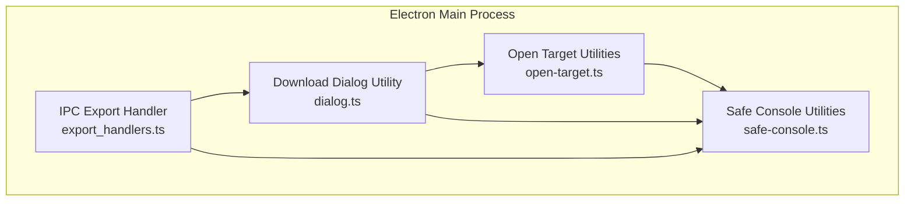
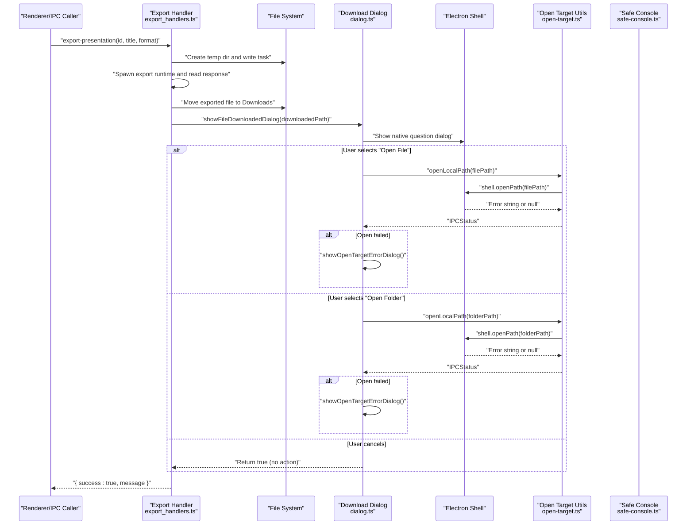
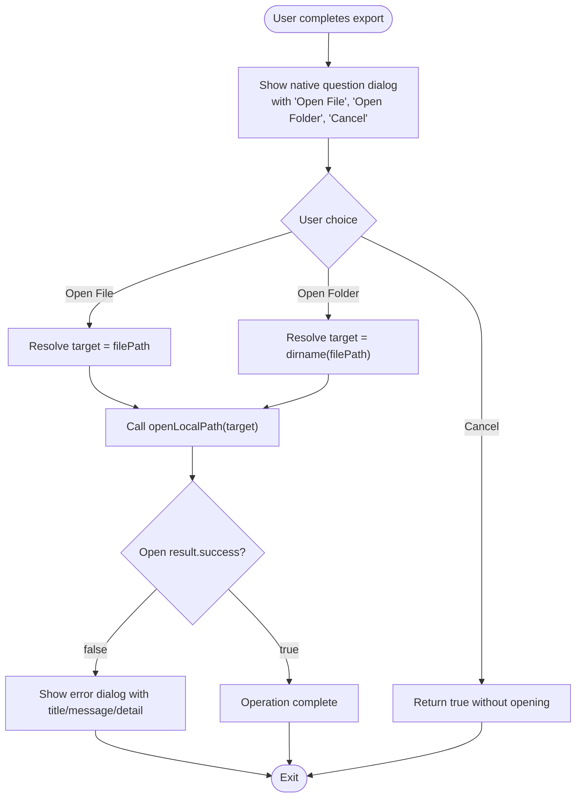
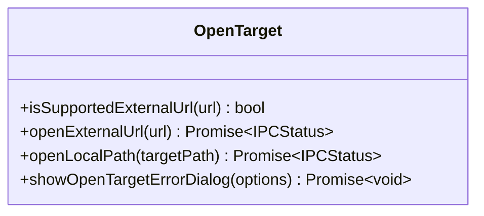
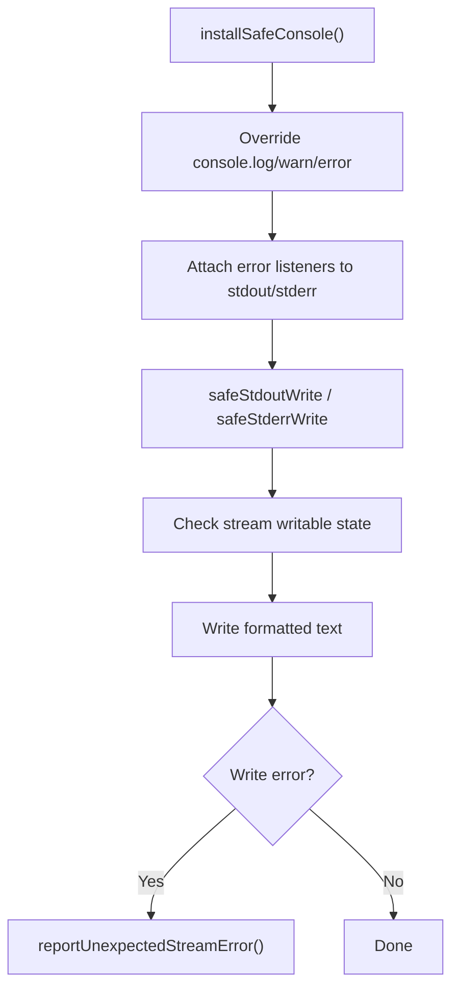
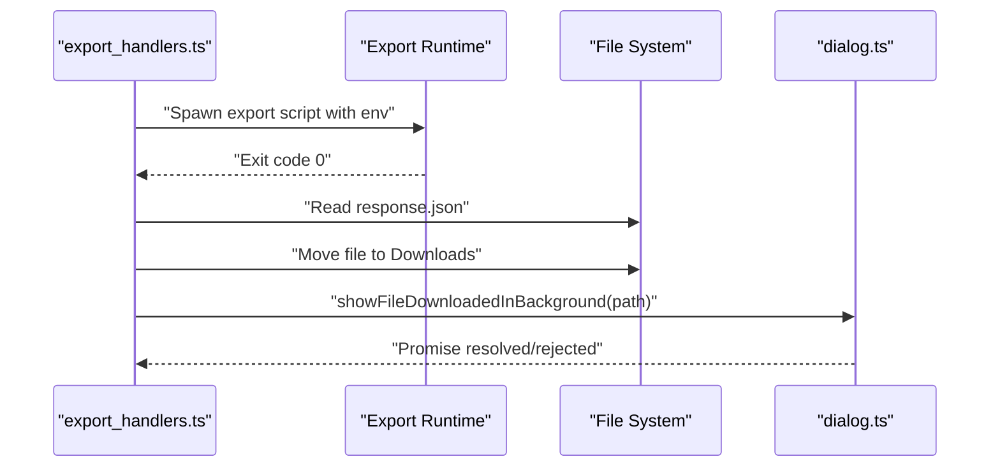
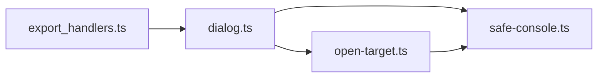

# Native Dialogs and User Interface

<cite>
**Referenced Files in This Document**
- [dialog.ts](file://electron/app/utils/dialog.ts)
- [open-target.ts](file://electron/app/utils/open-target.ts)
- [safe-console.ts](file://electron/app/utils/safe-console.ts)
- [export_handlers.ts](file://electron/app/ipc/export_handlers.ts)
</cite>

## Table of Contents
1. [Introduction](#introduction)
2. [Project Structure](#project-structure)
3. [Core Components](#core-components)
4. [Architecture Overview](#architecture-overview)
5. [Detailed Component Analysis](#detailed-component-analysis)
6. [Dependency Analysis](#dependency-analysis)
7. [Performance Considerations](#performance-considerations)
8. [Troubleshooting Guide](#troubleshooting-guide)
9. [Conclusion](#conclusion)

## Introduction
This document explains the native dialog and user interface behavior for file downloads in the desktop application. It focuses on:
- The post-export download dialog that lets users open the exported file or its containing folder.
- Error handling when opening files or folders fails, including missing file associations.
- Integration with Electron’s native dialog API, message box configuration, button layout, and interaction patterns.
- Safe console logging utilities used for debugging and error reporting.
- Cross-platform considerations and best practices for robust native interactions.

## Project Structure
The relevant implementation is located under the Electron main process utilities and IPC handlers:
- `electron/app/utils/dialog.ts` provides the post-export download dialog.
- `electron/app/utils/open-target.ts` handles opening local paths and external URLs, plus a reusable error dialog helper.
- `electron/app/utils/safe-console.ts` provides safe stdout/stderr writing and overrides for `console.log`, `console.warn`, and `console.error`.
- `electron/app/ipc/export_handlers.ts` orchestrates export tasks and triggers the download dialog after successful exports.

**Diagram sources**
- [export_handlers.ts:57-179](file://electron/app/ipc/export_handlers.ts#L57-L179)
- [dialog.ts:6-43](file://electron/app/utils/dialog.ts#L6-L43)
- [open-target.ts:48-116](file://electron/app/utils/open-target.ts#L48-L116)
- [safe-console.ts:76-100](file://electron/app/utils/safe-console.ts#L76-L100)

**Section sources**
- [dialog.ts:1-44](file://electron/app/utils/dialog.ts#L1-L44)
- [open-target.ts:1-117](file://electron/app/utils/open-target.ts#L1-L117)
- [safe-console.ts:1-101](file://electron/app/utils/safe-console.ts#L1-L101)
- [export_handlers.ts:1-487](file://electron/app/ipc/export_handlers.ts#L1-L487)

## Core Components
- Download dialog utility: Presents a native question dialog with options to open the exported file, open its folder, or cancel. It then delegates opening to the open-target utilities and shows an error dialog if opening fails.
- Open target utilities: Validate and open local paths using Electron’s shell API, and provide a standardized error dialog for failures. Also includes URL validation and opening helpers.
- Safe console utilities: Provide robust logging by guarding against broken pipes and destroyed streams, and optionally override global console methods.
- Export IPC handler: Coordinates export execution, moves the output to the user’s Downloads folder, and asynchronously shows the download dialog.

**Section sources**
- [dialog.ts:6-43](file://electron/app/utils/dialog.ts#L6-L43)
- [open-target.ts:48-116](file://electron/app/utils/open-target.ts#L48-L116)
- [safe-console.ts:76-100](file://electron/app/utils/safe-console.ts#L76-L100)
- [export_handlers.ts:57-179](file://electron/app/ipc/export_handlers.ts#L57-L179)

## Architecture Overview
The export flow integrates IPC, file system operations, and native dialogs:

**Diagram sources**
- [export_handlers.ts:57-179](file://electron/app/ipc/export_handlers.ts#L57-L179)
- [dialog.ts:6-43](file://electron/app/utils/dialog.ts#L6-L43)
- [open-target.ts:48-116](file://electron/app/utils/open-target.ts#L48-L116)

## Detailed Component Analysis

### Post-Export Download Dialog
The download dialog presents a native question dialog with three buttons:
- Open File
- Open Folder
- Cancel

It computes the target path based on the user’s selection and attempts to open it via the open-target utilities. If opening fails, it displays a structured error dialog with a title, message, and detail text that includes the saved location.

**Diagram sources**
- [dialog.ts:6-43](file://electron/app/utils/dialog.ts#L6-L43)
- [open-target.ts:48-83](file://electron/app/utils/open-target.ts#L48-L83)
- [open-target.ts:85-116](file://electron/app/utils/open-target.ts#L85-L116)

Key behaviors:
- Uses Electron’s `dialog.showMessageBox` with a question type and explicit button labels.
- Normalizes folder targets using Node’s `path.dirname`.
- Delegates opening to `openLocalPath`, which validates existence and uses `shell.openPath`.
- On failure, calls `showOpenTargetErrorDialog` with contextual information.

**Section sources**
- [dialog.ts:6-43](file://electron/app/utils/dialog.ts#L6-L43)
- [open-target.ts:48-116](file://electron/app/utils/open-target.ts#L48-L116)

### Open Target Utilities
These utilities encapsulate safe opening of local paths and external URLs, and provide a consistent error dialog helper.

Highlights:
- Path validation ensures absolute paths exist before attempting to open them.
- Errors from `shell.openPath` are captured and returned as structured status objects.
- A reusable error dialog helper configures an error-type message box with OK and optional parent window binding.
- External URL opening is restricted to allowed protocols (`http:` and `https:`).

**Diagram sources**
- [open-target.ts:20-46](file://electron/app/utils/open-target.ts#L20-L46)
- [open-target.ts:48-83](file://electron/app/utils/open-target.ts#L48-L83)
- [open-target.ts:85-116](file://electron/app/utils/open-target.ts#L85-L116)

**Section sources**
- [open-target.ts:1-117](file://electron/app/utils/open-target.ts#L1-L117)

### Safe Console Logging Utilities
The safe console utilities protect logging operations from failing due to broken or closed streams. They:
- Detect ignorable pipe/stream errors such as broken pipes or writes after stream destruction.
- Provide `safeLog`, `safeWarn`, and `safeError` wrappers around stdout/stderr writes.
- Optionally install replacements for `console.log`, `console.warn`, and `console.error`.

**Diagram sources**
- [safe-console.ts:14-27](file://electron/app/utils/safe-console.ts#L14-L27)
- [safe-console.ts:29-66](file://electron/app/utils/safe-console.ts#L29-L66)
- [safe-console.ts:76-100](file://electron/app/utils/safe-console.ts#L76-L100)

**Section sources**
- [safe-console.ts:1-101](file://electron/app/utils/safe-console.ts#L1-L101)

### Export IPC Handler and Dialog Integration
The export handler coordinates the entire export lifecycle:
- Validates export runtime availability.
- Creates a temporary directory and writes an export task configuration.
- Spawns an export script with environment variables pointing to Chromium and cache directories.
- Reads the response file to determine the exported file path.
- Moves the exported file to the user’s Downloads directory.
- Asynchronously shows the download dialog in the background.

**Diagram sources**
- [export_handlers.ts:57-179](file://electron/app/ipc/export_handlers.ts#L57-L179)
- [dialog.ts:6-43](file://electron/app/utils/dialog.ts#L6-L43)

Important notes:
- The download dialog is shown asynchronously using `setImmediate` to avoid blocking the IPC response.
- Errors during dialog display are caught and logged via safe console utilities.

**Section sources**
- [export_handlers.ts:57-179](file://electron/app/ipc/export_handlers.ts#L57-L179)
- [export_handlers.ts:37-43](file://electron/app/ipc/export_handlers.ts#L37-L43)

## Dependency Analysis
The components interact through well-defined boundaries:
- `export_handlers.ts` depends on `dialog.ts` to present the post-export prompt.
- `dialog.ts` depends on `open-target.ts` for opening paths and showing error dialogs.
- Both `dialog.ts` and `open-target.ts` use `safe-console.ts` for robust logging.
- All components rely on Electron APIs (`dialog`, `shell`) and Node.js standard libraries (`fs`, `path`).

**Diagram sources**
- [export_handlers.ts:13-16](file://electron/app/ipc/export_handlers.ts#L13-L16)
- [dialog.ts:1-4](file://electron/app/utils/dialog.ts#L1-L4)
- [open-target.ts:1-4](file://electron/app/utils/open-target.ts#L1-L4)

**Section sources**
- [export_handlers.ts:1-487](file://electron/app/ipc/export_handlers.ts#L1-L487)
- [dialog.ts:1-44](file://electron/app/utils/dialog.ts#L1-L44)
- [open-target.ts:1-117](file://electron/app/utils/open-target.ts#L1-L117)
- [safe-console.ts:1-101](file://electron/app/utils/safe-console.ts#L1-L101)

## Performance Considerations
- The download dialog is invoked asynchronously to avoid delaying the IPC response.
- Stream-safe logging prevents performance degradation or crashes caused by broken pipes or destroyed streams.
- Opening local paths uses synchronous checks followed by asynchronous shell operations; ensure large numbers of concurrent opens do not overwhelm the OS shell integration layer.

[No sources needed since this section provides general guidance]

## Troubleshooting Guide
Common issues and resolutions:
- Missing file association:
  - Symptom: The system cannot open the exported file or folder.
  - Behavior: The app shows an error dialog with a title indicating whether it was a file or folder, a message explaining the failure, and detail text including the saved location.
  - Resolution: Ensure the appropriate application is associated with the file type or manually navigate to the folder and open the file.

- File no longer exists:
  - Symptom: Attempting to open a path returns an error indicating the item does not exist.
  - Behavior: The open-target utilities return a failure status with a descriptive message.
  - Resolution: Verify the file still exists in the Downloads folder or re-export the presentation.

- Broken pipe or stream errors during logging:
  - Symptom: Logs disappear or crash the process when stdout/stderr is unavailable.
  - Behavior: Safe console utilities detect and ignore ignorable stream errors and safely write logs when possible.
  - Resolution: No user action required; the app continues operating while protecting against stream-related crashes.

- Export runtime or Chromium issues:
  - Symptom: Export fails before reaching the download dialog.
  - Behavior: The export handler logs detailed errors and may attempt runtime fallbacks or cache repairs.
  - Resolution: Follow the error messages, reinstall the desktop runtime if necessary, or restart the application.

**Section sources**
- [dialog.ts:27-43](file://electron/app/utils/dialog.ts#L27-L43)
- [open-target.ts:48-83](file://electron/app/utils/open-target.ts#L48-L83)
- [open-target.ts:85-116](file://electron/app/utils/open-target.ts#L85-L116)
- [safe-console.ts:14-27](file://electron/app/utils/safe-console.ts#L14-L27)
- [export_handlers.ts:57-179](file://electron/app/ipc/export_handlers.ts#L57-L179)

## Conclusion
The desktop application implements a robust, cross-platform native dialog workflow for post-export file handling. It leverages Electron’s native dialog and shell APIs to offer intuitive user choices, gracefully handles missing file associations and other open failures, and uses safe console utilities to maintain stability during debugging and error reporting. By separating concerns into focused modules—download dialog, open target utilities, safe console, and export IPC handler—the system remains maintainable and resilient across platforms.

[No sources needed since this section summarizes without analyzing specific files]