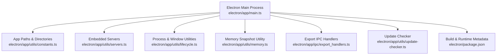
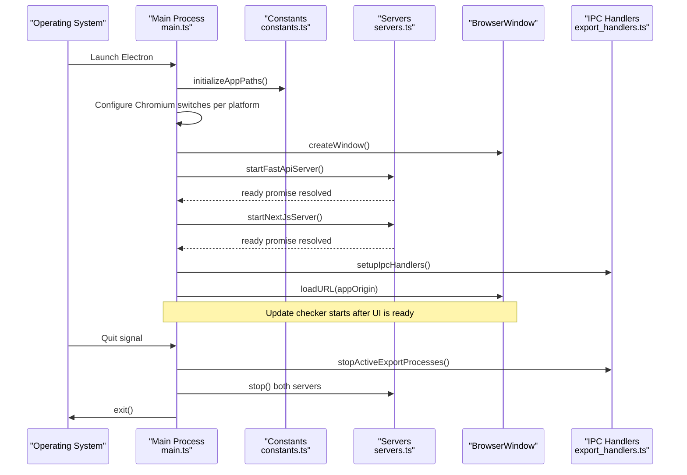
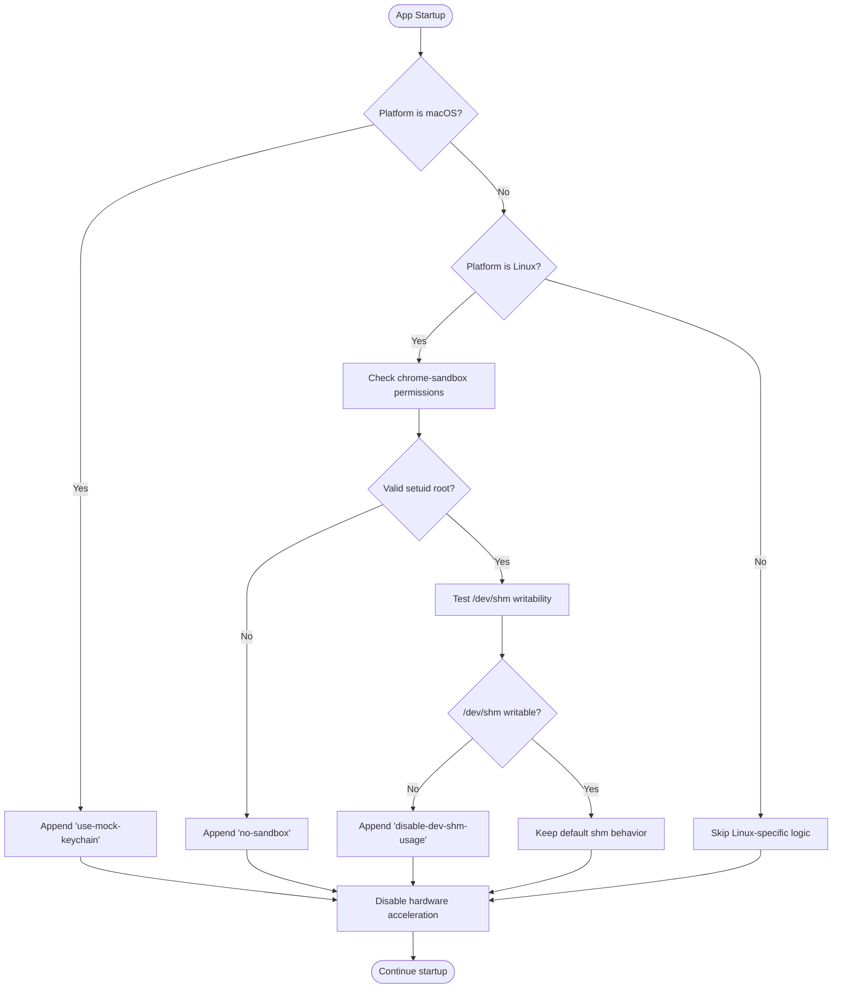
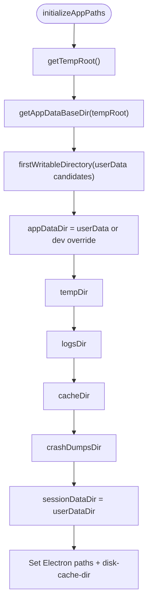
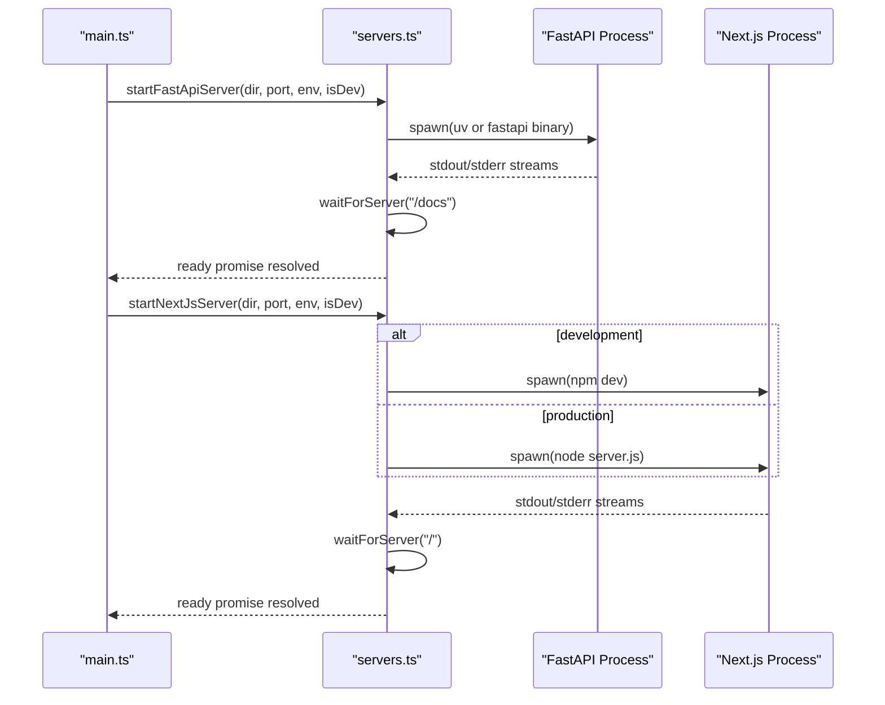
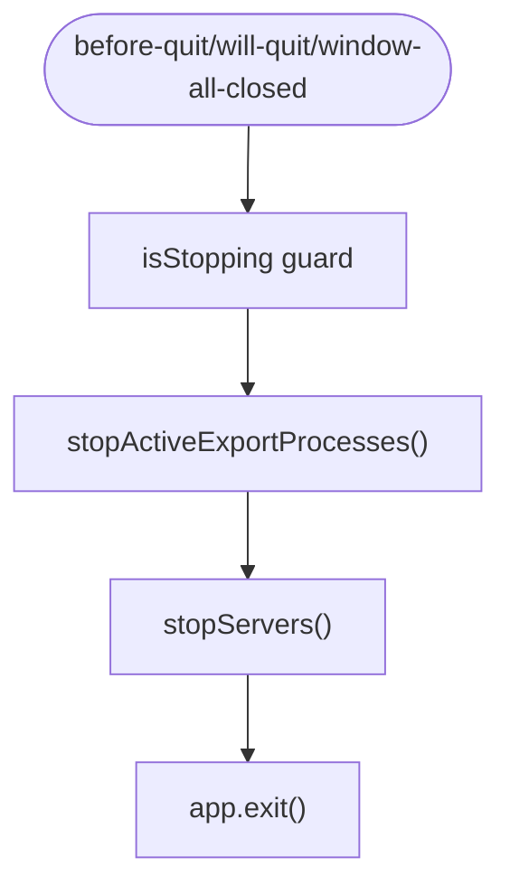
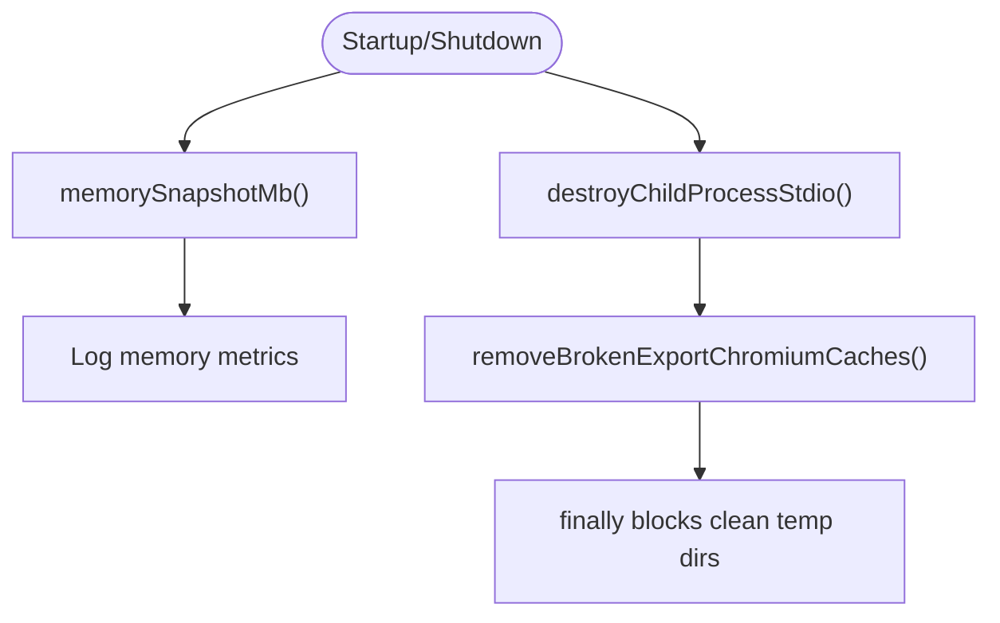
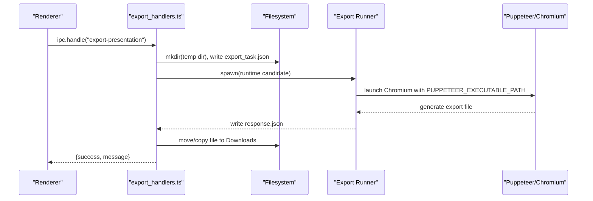
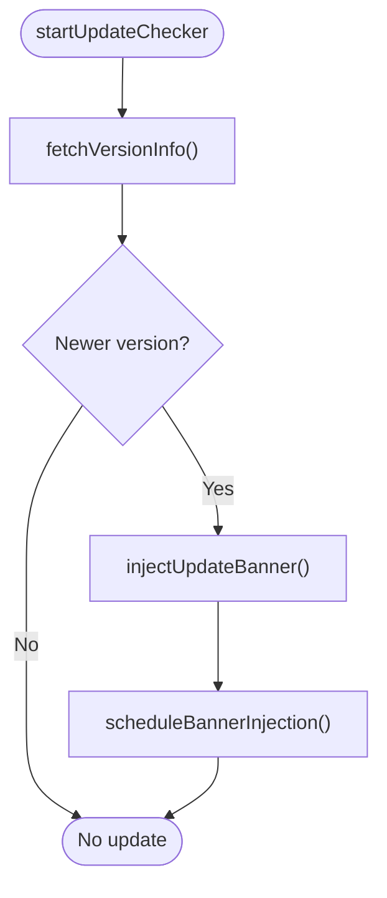
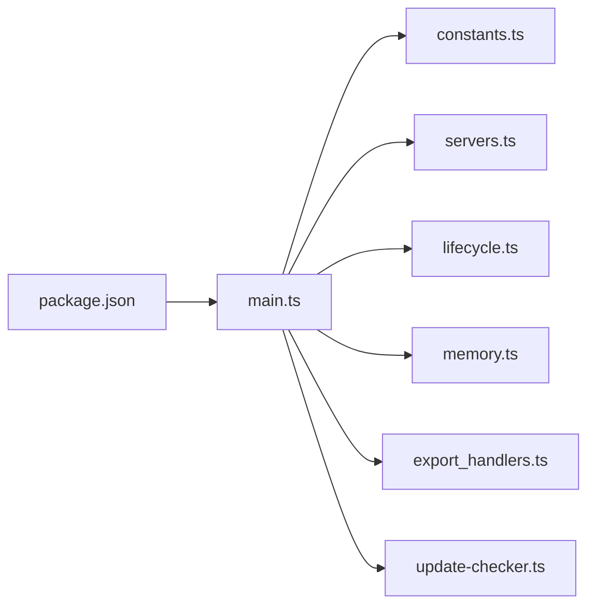

# Platform-Specific System Integrations

<cite>
**Referenced Files in This Document**
- [main.ts](file://electron/app/main.ts)
- [constants.ts](file://electron/app/utils/constants.ts)
- [servers.ts](file://electron/app/utils/servers.ts)
- [lifecycle.ts](file://electron/app/utils/lifecycle.ts)
- [memory.ts](file://electron/app/utils/memory.ts)
- [export_handlers.ts](file://electron/app/ipc/export_handlers.ts)
- [update-checker.ts](file://electron/app/utils/update-checker.ts)
- [package.json](file://electron/package.json)
</cite>

## Table of Contents
1. [Introduction](#introduction)
2. [Project Structure](#project-structure)
3. [Core Components](#core-components)
4. [Architecture Overview](#architecture-overview)
5. [Detailed Component Analysis](#detailed-component-analysis)
6. [Dependency Analysis](#dependency-analysis)
7. [Performance Considerations](#performance-considerations)
8. [Troubleshooting Guide](#troubleshooting-guide)
9. [Conclusion](#conclusion)

## Introduction
This document explains how the desktop application integrates with platform-specific system features and manages its lifecycle across Windows, macOS, and Linux. It covers startup procedures, graceful shutdown, environment and path resolution, child process management, memory monitoring, update checking, and export runtime behavior. The goal is to help developers understand where platform differences are handled and how to test or extend these behaviors safely.

## Project Structure
The Electron main process coordinates:
- Platform initialization and Chromium switches
- Application data and cache directories
- Embedded FastAPI and Next.js servers
- IPC handlers for exports and other desktop operations
- Update checker and Sentry integration
- Graceful shutdown and resource cleanup

**Diagram sources**
- [main.ts:1-548](file://electron/app/main.ts#L1-L548)
- [constants.ts:1-338](file://electron/app/utils/constants.ts#L1-L338)
- [servers.ts:1-429](file://electron/app/utils/servers.ts#L1-L429)
- [lifecycle.ts:1-148](file://electron/app/utils/lifecycle.ts#L1-L148)
- [memory.ts:1-39](file://electron/app/utils/memory.ts#L1-L39)
- [export_handlers.ts:1-487](file://electron/app/ipc/export_handlers.ts#L1-L487)
- [update-checker.ts:169-313](file://electron/app/utils/update-checker.ts#L169-L313)
- [package.json:1-100](file://electron/package.json#L1-L100)

**Section sources**
- [main.ts:1-548](file://electron/app/main.ts#L1-L548)
- [package.json:1-100](file://electron/package.json#L1-L100)

## Core Components
- Platform initialization and Chromium flags:
  - macOS keychain workaround
  - Linux sandbox and shared memory handling
  - Hardware acceleration disabled for stability on some Linux drivers
- App paths and directories:
  - Cross-platform user data, app data, temp, logs, cache, crash dumps, downloads
- Server orchestration:
  - Start/stop FastAPI and Next.js with readiness checks
  - Node executable selection (including macOS helper)
- Lifecycle utilities:
  - Safe window/webContents operations
  - Child process termination with graceful and forced signals
- Memory monitoring:
  - RSS, heap, external buffers, array buffers
- Export pipeline:
  - Spawns an export task using a resilient runtime fallback strategy
  - Manages Puppeteer cache repair and cross-device file moves
- Update checker:
  - Polls version info and injects an in-app banner when updates are available

**Section sources**
- [main.ts:59-91](file://electron/app/main.ts#L59-L91)
- [constants.ts:114-218](file://electron/app/utils/constants.ts#L114-L218)
- [servers.ts:34-62](file://electron/app/utils/servers.ts#L34-L62)
- [lifecycle.ts:45-146](file://electron/app/utils/lifecycle.ts#L45-L146)
- [memory.ts:1-39](file://electron/app/utils/memory.ts#L1-L39)
- [export_handlers.ts:45-55](file://electron/app/ipc/export_handlers.ts#L45-L55)
- [update-checker.ts:169-313](file://electron/app/utils/update-checker.ts#L169-L313)

## Architecture Overview
The main process bootstraps the app, resolves platform-specific settings, initializes directories, starts embedded servers, creates the main BrowserWindow, and wires IPC handlers. On quit, it stops active exports and servers before exiting.

**Diagram sources**
- [main.ts:189-203](file://electron/app/main.ts#L189-L203)
- [main.ts:247-310](file://electron/app/main.ts#L247-L310)
- [main.ts:330-423](file://electron/app/main.ts#L330-L423)
- [main.ts:425-452](file://electron/app/main.ts#L425-L452)
- [main.ts:454-530](file://electron/app/main.ts#L454-L530)
- [main.ts:532-546](file://electron/app/main.ts#L532-L546)
- [servers.ts:127-196](file://electron/app/utils/servers.ts#L127-L196)
- [servers.ts:198-335](file://electron/app/utils/servers.ts#L198-L335)
- [export_handlers.ts:45-55](file://electron/app/ipc/export_handlers.ts#L45-L55)

## Detailed Component Analysis

### Platform Initialization and Chromium Flags
- macOS:
  - Uses a mock keychain switch to avoid Keychain prompts during encrypted session storage initialization.
- Linux:
  - Detects chrome-sandbox permissions; disables sandbox if invalid.
  - Disables /dev/shm usage when not writable.
  - Disables hardware acceleration to mitigate white-screen issues on certain driver combinations.

**Diagram sources**
- [main.ts:59-91](file://electron/app/main.ts#L59-L91)

**Section sources**
- [main.ts:59-91](file://electron/app/main.ts#L59-L91)

### App Paths and Directory Resolution
- Resolves user data, app data, temporary files, logs, cache, crash dumps, and downloads.
- Uses platform-specific defaults:
  - Windows: APPDATA/LOCALAPPDATA
  - macOS: ~/Library/Application Support
  - Linux: XDG_CONFIG_HOME or ~/.config
- Downloads directory prefers Electron’s configured downloads, then platform-specific locations, finally a fallback under user data.

**Diagram sources**
- [constants.ts:236-294](file://electron/app/utils/constants.ts#L236-L294)

**Section sources**
- [constants.ts:114-218](file://electron/app/utils/constants.ts#L114-L218)
- [constants.ts:236-294](file://electron/app/utils/constants.ts#L236-L294)
- [constants.ts:304-337](file://electron/app/utils/constants.ts#L304-L337)

### Embedded Server Orchestration
- FastAPI:
  - Development uses uv run python server.py with reload.
  - Production spawns a bundled fastapi/fastapi.exe binary.
  - Streams stdout/stderr to log files and console.
- Next.js:
  - Development runs npm dev with host/port arguments.
  - Production runs a standalone server via Node; on macOS, uses the signed Electron Helper to avoid Dock icons.
  - Ensures static/public assets are present next to the server script.
- Readiness:
  - HTTP polling until the server responds with a success status code within a timeout.

**Diagram sources**
- [servers.ts:127-196](file://electron/app/utils/servers.ts#L127-L196)
- [servers.ts:198-335](file://electron/app/utils/servers.ts#L198-L335)
- [servers.ts:365-428](file://electron/app/utils/servers.ts#L365-L428)

**Section sources**
- [servers.ts:34-62](file://electron/app/utils/servers.ts#L34-L62)
- [servers.ts:127-196](file://electron/app/utils/servers.ts#L127-L196)
- [servers.ts:198-335](file://electron/app/utils/servers.ts#L198-L335)
- [servers.ts:365-428](file://electron/app/utils/servers.ts#L365-L428)

### Lifecycle Utilities and Graceful Shutdown
- Window safety:
  - Checks whether windows/webContents are destroyed before sending messages or closing.
- Child processes:
  - Alive checks based on pid, exitCode, signalCode, killed flag.
  - Graceful termination with SIGTERM followed by SIGKILL if needed.
  - Stdio stream destruction to prevent leaks.
- Application shutdown:
  - Unregisters global shortcuts, stops update checker, stops active exports, stops servers, then exits.

**Diagram sources**
- [main.ts:441-452](file://electron/app/main.ts#L441-L452)
- [main.ts:532-546](file://electron/app/main.ts#L532-L546)
- [lifecycle.ts:45-146](file://electron/app/utils/lifecycle.ts#L45-L146)
- [export_handlers.ts:45-55](file://electron/app/ipc/export_handlers.ts#L45-L55)

**Section sources**
- [lifecycle.ts:10-53](file://electron/app/utils/lifecycle.ts#L10-L53)
- [lifecycle.ts:110-146](file://electron/app/utils/lifecycle.ts#L110-L146)
- [main.ts:441-452](file://electron/app/main.ts#L441-L452)
- [main.ts:532-546](file://electron/app/main.ts#L532-L546)

### Memory Management and Resource Cleanup
- Memory snapshots:
  - Captures RSS, heap used/total, external, and array buffers in MB for logging and diagnostics.
- Bounded text buffer:
  - Limits captured stdout/stderr tails to avoid unbounded growth.
- Resource cleanup:
  - Destroys child process stdio streams during shutdown.
  - Removes broken export Chromium caches at startup.
  - Cleans up temporary export directories in finally blocks.

**Diagram sources**
- [memory.ts:1-39](file://electron/app/utils/memory.ts#L1-L39)
- [export_handlers.ts:174-178](file://electron/app/ipc/export_handlers.ts#L174-L178)
- [lifecycle.ts:86-108](file://electron/app/utils/lifecycle.ts#L86-L108)

**Section sources**
- [memory.ts:1-39](file://electron/app/utils/memory.ts#L1-L39)
- [export_handlers.ts:174-178](file://electron/app/ipc/export_handlers.ts#L174-L178)
- [lifecycle.ts:86-108](file://electron/app/utils/lifecycle.ts#L86-L108)

### Export Pipeline and Platform-Specific Behavior
- Export flow:
  - Validates export Chromium availability.
  - Prepares a task JSON and writes it to a temp directory.
  - Spawns an export runner with multiple runtime candidates (node, node.exe, node.cmd, /usr/bin/node, etc.), falling back to Electron-as-node if necessary.
  - Repairs broken Puppeteer browser cache when detected.
  - Moves output to the user’s Downloads folder and shows a “file downloaded” dialog.
- Platform specifics:
  - Windows hides child windows by default.
  - Path normalization for file URLs on Windows.
  - Uses electron-squirrel-startup metadata from package.json for Windows installer integration.

**Diagram sources**
- [export_handlers.ts:57-179](file://electron/app/ipc/export_handlers.ts#L57-L179)
- [export_handlers.ts:182-275](file://electron/app/ipc/export_handlers.ts#L182-L275)
- [export_handlers.ts:277-304](file://electron/app/ipc/export_handlers.ts#L277-L304)
- [export_handlers.ts:331-449](file://electron/app/ipc/export_handlers.ts#L331-L449)
- [export_handlers.ts:451-487](file://electron/app/ipc/export_handlers.ts#L451-L487)
- [package.json:82-87](file://electron/package.json#L82-L87)

**Section sources**
- [export_handlers.ts:57-179](file://electron/app/ipc/export_handlers.ts#L57-L179)
- [export_handlers.ts:182-275](file://electron/app/ipc/export_handlers.ts#L182-L275)
- [export_handlers.ts:277-304](file://electron/app/ipc/export_handlers.ts#L277-L304)
- [export_handlers.ts:331-449](file://electron/app/ipc/export_handlers.ts#L331-L449)
- [export_handlers.ts:451-487](file://electron/app/ipc/export_handlers.ts#L451-L487)
- [package.json:82-87](file://electron/package.json#L82-L87)

### Update Checker and In-App Notifications
- Polls a version endpoint up to a maximum number of attempts with delays between attempts.
- If a newer version is found, injects an HTML banner into the main window with a “View details” action.
- Stops polling when the window is destroyed or the checker is stopped.

**Diagram sources**
- [update-checker.ts:169-313](file://electron/app/utils/update-checker.ts#L169-L313)

**Section sources**
- [update-checker.ts:169-313](file://electron/app/utils/update-checker.ts#L169-L313)

### Auto-Start, System Tray, and Notification Center
- Auto-start:
  - Not implemented in the analyzed files.
- System tray:
  - Not implemented in the analyzed files.
- Notification center:
  - Not implemented in the analyzed files.

[No sources needed since this section does not analyze specific files]

## Dependency Analysis
Key dependencies and relationships:
- main.ts depends on:
  - constants.ts for paths and environment
  - servers.ts for embedded server lifecycle
  - lifecycle.ts for safe process/window operations
  - memory.ts for diagnostics
  - export_handlers.ts for IPC export functionality
  - update-checker.ts for update notifications
- package.json provides build scripts and metadata consumed by the Electron runtime.

**Diagram sources**
- [main.ts:1-548](file://electron/app/main.ts#L1-L548)
- [constants.ts:1-338](file://electron/app/utils/constants.ts#L1-L338)
- [servers.ts:1-429](file://electron/app/utils/servers.ts#L1-L429)
- [lifecycle.ts:1-148](file://electron/app/utils/lifecycle.ts#L1-L148)
- [memory.ts:1-39](file://electron/app/utils/memory.ts#L1-L39)
- [export_handlers.ts:1-487](file://electron/app/ipc/export_handlers.ts#L1-L487)
- [update-checker.ts:169-313](file://electron/app/utils/update-checker.ts#L169-L313)
- [package.json:1-100](file://electron/package.json#L1-L100)

**Section sources**
- [main.ts:1-548](file://electron/app/main.ts#L1-L548)
- [package.json:1-100](file://electron/package.json#L1-L100)

## Performance Considerations
- Avoid unnecessary re-spawning of servers by caching managed server instances and stopping them only once.
- Use bounded buffers for child process logs to prevent memory growth.
- Prefer graceful termination signals before forcing process kills to allow background tasks to finish.
- Reuse Chromium caches for exports to reduce repeated downloads.
- Monitor memory snapshots at critical points (startup, export start/end) to detect regressions.

[No sources needed since this section provides general guidance]

## Troubleshooting Guide
Common issues and resolutions:
- Linux sandbox or /dev/shm problems:
  - Ensure chrome-sandbox has correct permissions or allow no-sandbox mode.
  - Verify /dev/shm is writable; otherwise disable-dev-shm-usage is applied automatically.
- Missing export Chromium:
  - Reinstall the app or run the desktop runtime setup steps.
  - Check that PUPPETEER_EXECUTABLE_PATH is set correctly.
- Broken Puppeteer cache:
  - The exporter will attempt to remove a corrupted browser folder and retry.
- Server startup failures:
  - Review FastAPI and Next.js logs in the app’s logs directory.
  - Confirm ports are free and environment variables are set.
- Graceful shutdown hangs:
  - Inspect active export processes and ensure they terminate; check kill signals and timeouts.

**Section sources**
- [main.ts:66-91](file://electron/app/main.ts#L66-L91)
- [export_handlers.ts:57-70](file://electron/app/ipc/export_handlers.ts#L57-L70)
- [export_handlers.ts:318-329](file://electron/app/ipc/export_handlers.ts#L318-L329)
- [servers.ts:146-183](file://electron/app/utils/servers.ts#L146-L183)
- [servers.ts:219-248](file://electron/app/utils/servers.ts#L219-L248)
- [lifecycle.ts:110-146](file://electron/app/utils/lifecycle.ts#L110-L146)

## Conclusion
The desktop application implements robust platform-specific integrations for Windows, macOS, and Linux through careful Chromium configuration, cross-platform path resolution, and resilient child process management. Its lifecycle hooks ensure a smooth startup and a controlled shutdown, while memory and resource cleanup strategies help maintain stability. Although auto-start, system tray, and notification center features are not present in the analyzed code, the existing architecture provides clear extension points for adding such capabilities in a platform-aware manner.