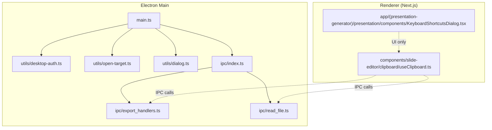
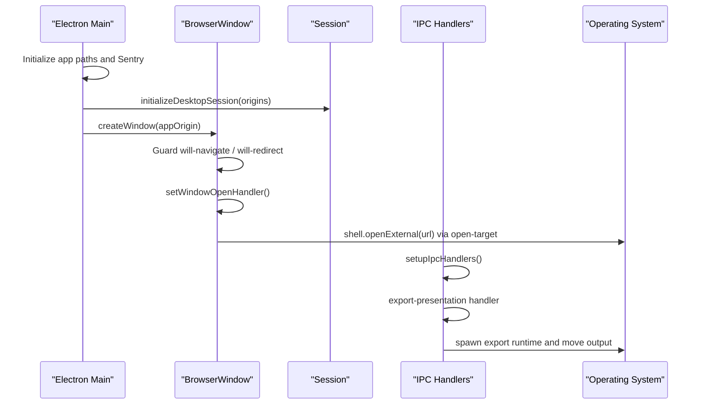
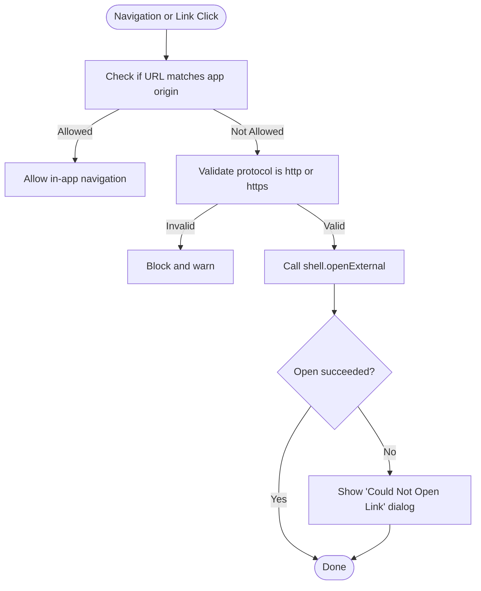
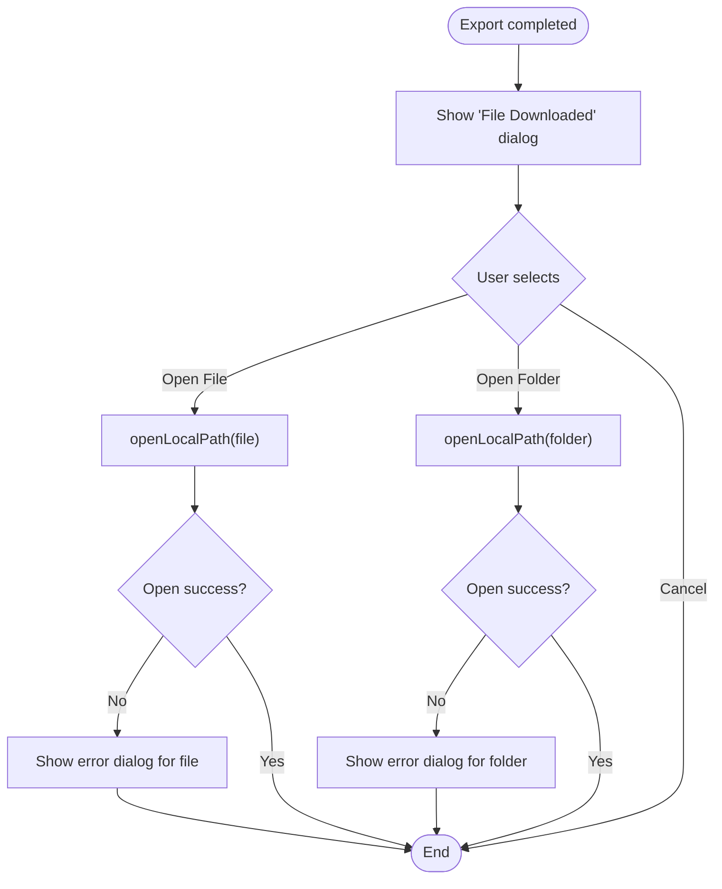
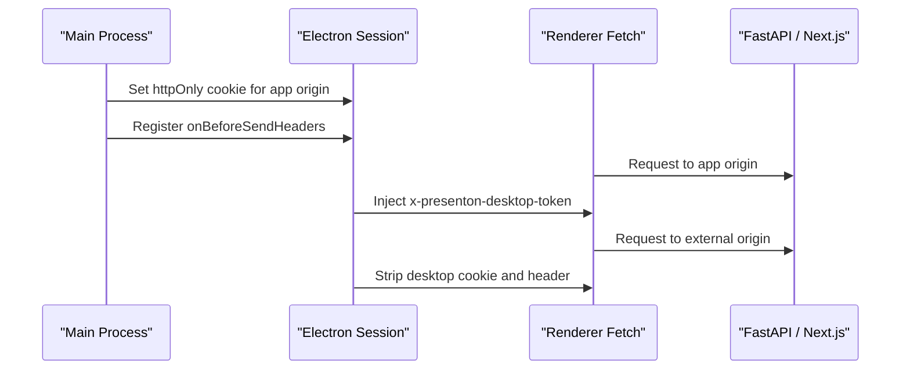
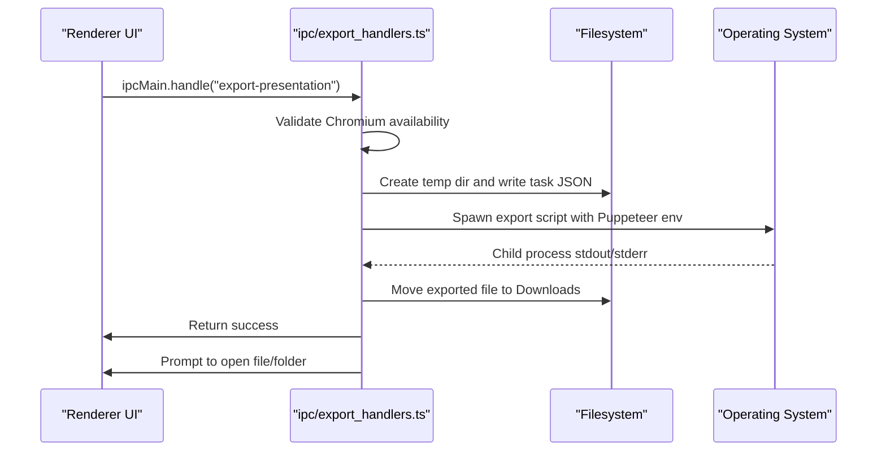
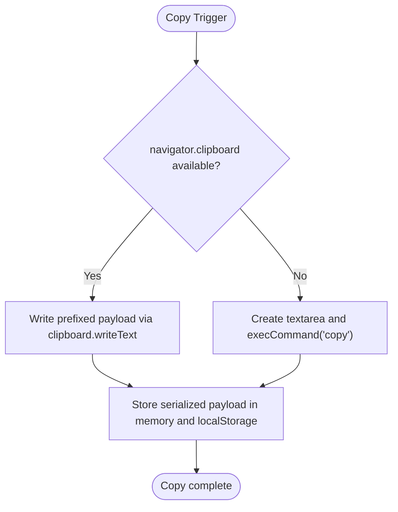
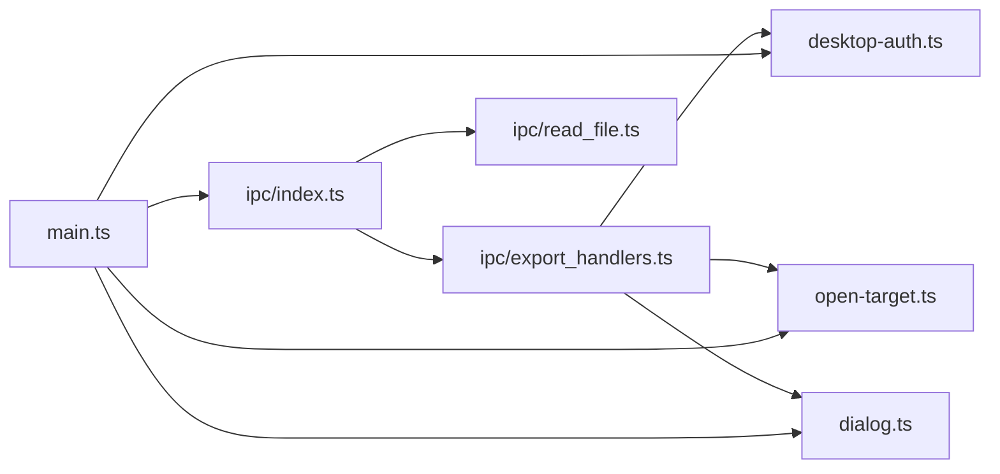

# System Integration

<cite>
**Referenced Files in This Document**
- [main.ts](file://electron/app/main.ts)
- [desktop-auth.ts](file://electron/app/utils/desktop-auth.ts)
- [open-target.ts](file://electron/app/utils/open-target.ts)
- [dialog.ts](file://electron/app/utils/dialog.ts)
- [ipc/index.ts](file://electron/app/ipc/index.ts)
- [ipc/export_handlers.ts](file://electron/app/ipc/export_handlers.ts)
- [ipc/read_file.ts](file://electron/app/ipc/read_file.ts)
- [useClipboard.ts](file://servers/nextjs/components/slide-editor/clipboard/useClipboard.ts)
- [KeyboardShortcutsDialog.tsx](file://servers/nextjs/app/(presentation-generator)/presentation/components/KeyboardShortcutsDialog.tsx)
</cite>

## Table of Contents
1. [Introduction](#introduction)
2. [Project Structure](#project-structure)
3. [Core Components](#core-components)
4. [Architecture Overview](#architecture-overview)
5. [Detailed Component Analysis](#detailed-component-analysis)
6. [Dependency Analysis](#dependency-analysis)
7. [Performance Considerations](#performance-considerations)
8. [Troubleshooting Guide](#troubleshooting-guide)
9. [Conclusion](#conclusion)

## Introduction
This document explains the desktop application’s system integration features with a focus on security, platform behavior, and user experience. It covers native dialog usage for file operations, external URL opening with protocol validation, desktop authentication and session handling, clipboard operations, global shortcuts, and platform-specific behaviors such as macOS Keychain mocking and Linux sandbox adjustments. The goal is to help developers understand how the Electron main process, preload layer, IPC handlers, and Next.js renderer collaborate while maintaining strict security boundaries around system-level operations.

## Project Structure
The relevant system integration code lives primarily under the Electron app directory and the Next.js server UI:

- Electron main entry point initializes the app, manages windows, configures Chromium switches, starts embedded servers, sets up IPC, and controls external link handling.
- Utility modules provide secure helpers for opening URLs and local paths, showing dialogs, and managing desktop sessions.
- IPC handlers expose controlled capabilities to the renderer, including presentation export and safe file reading.
- The Next.js frontend implements clipboard operations and keyboard shortcut documentation.

**Diagram sources**
- [main.ts:1-548](file://electron/app/main.ts#L1-L548)
- [desktop-auth.ts:1-51](file://electron/app/utils/desktop-auth.ts#L1-L51)
- [open-target.ts:1-117](file://electron/app/utils/open-target.ts#L1-L117)
- [dialog.ts:1-44](file://electron/app/utils/dialog.ts#L1-L44)
- [ipc/index.ts:1-8](file://electron/app/ipc/index.ts#L1-L8)
- [ipc/export_handlers.ts:1-487](file://electron/app/ipc/export_handlers.ts#L1-L487)
- [ipc/read_file.ts:1-15](file://electron/app/ipc/read_file.ts#L1-L15)
- [useClipboard.ts:37-204](file://servers/nextjs/components/slide-editor/clipboard/useClipboard.ts#L37-L204)
- [KeyboardShortcutsDialog.tsx:79-179](file://servers/nextjs/app/(presentation-generator)/presentation/components/KeyboardShortcutsDialog.tsx#L79-L179)

**Section sources**
- [main.ts:1-548](file://electron/app/main.ts#L1-L548)
- [ipc/index.ts:1-8](file://electron/app/ipc/index.ts#L1-L8)

## Core Components
- Desktop session and credential injection: Generates a random token, stores it in memory-only environment variables, sets an httpOnly cookie scoped to application origins, and injects a capability header into internal requests.
- External URL and local path opening: Validates allowed protocols before delegating to the operating system; provides consistent error dialogs when opening fails.
- Native dialogs: Presents user choices after file exports and surfaces errors when the OS cannot open the target.
- IPC capabilities: Exposes export-presentation and read-file handlers that perform privileged operations safely in the main process.
- Clipboard and shortcuts: Renderer-side clipboard utilities and keyboard shortcut UI for cross-platform editing workflows.

**Section sources**
- [desktop-auth.ts:1-51](file://electron/app/utils/desktop-auth.ts#L1-L51)
- [open-target.ts:1-117](file://electron/app/utils/open-target.ts#L1-L117)
- [dialog.ts:1-44](file://electron/app/utils/dialog.ts#L1-L44)
- [ipc/export_handlers.ts:1-487](file://electron/app/ipc/export_handlers.ts#L1-L487)
- [ipc/read_file.ts:1-15](file://electron/app/ipc/read_file.ts#L1-L15)
- [useClipboard.ts:37-204](file://servers/nextjs/components/slide-editor/clipboard/useClipboard.ts#L37-L204)
- [KeyboardShortcutsDialog.tsx:79-179](file://servers/nextjs/app/(presentation-generator)/presentation/components/KeyboardShortcutsDialog.tsx#L79-L179)

## Architecture Overview
The desktop app uses a layered architecture:

- Main process: Bootstraps Electron, configures Chromium switches, starts embedded FastAPI and Next.js servers, creates the BrowserWindow, and registers IPC handlers.
- Preload and context bridge: Provides a minimal, explicit API surface to the renderer.
- IPC handlers: Encapsulate sensitive operations like exporting presentations and reading files.
- Renderer: Implements UI logic, clipboard operations, and keyboard shortcuts.

**Diagram sources**
- [main.ts:213-300](file://electron/app/main.ts#L213-L300)
- [main.ts:454-530](file://electron/app/main.ts#L454-L530)
- [desktop-auth.ts:12-50](file://electron/app/utils/desktop-auth.ts#L12-L50)
- [open-target.ts:20-46](file://electron/app/utils/open-target.ts#L20-L46)
- [ipc/index.ts:4-7](file://electron/app/ipc/index.ts#L4-L7)
- [ipc/export_handlers.ts:57-179](file://electron/app/ipc/export_handlers.ts#L57-L179)

## Detailed Component Analysis

### External URL Opening and Security Validation
The application restricts external link opening to safe protocols and routes all navigation outside the app through a controlled flow.

Key behaviors:
- Only http and https are allowed for external links.
- Navigation within the window is restricted to the known application origin; other URLs are opened externally.
- Errors from the OS are surfaced through a standardized error dialog.

**Diagram sources**
- [main.ts:213-245](file://electron/app/main.ts#L213-L245)
- [open-target.ts:20-46](file://electron/app/utils/open-target.ts#L20-L46)

**Section sources**
- [main.ts:213-300](file://electron/app/main.ts#L213-L300)
- [open-target.ts:1-117](file://electron/app/utils/open-target.ts#L1-L117)

### Native Dialogs for File Operations
After exporting a presentation, the app offers the user options to open the exported file or its containing folder. If the OS cannot open the target, a clear error dialog is shown.

**Diagram sources**
- [dialog.ts:6-43](file://electron/app/utils/dialog.ts#L6-L43)
- [open-target.ts:48-83](file://electron/app/utils/open-target.ts#L48-L83)

**Section sources**
- [dialog.ts:1-44](file://electron/app/utils/dialog.ts#L1-L44)
- [open-target.ts:48-83](file://electron/app/utils/open-target.ts#L48-L83)

### Desktop Authentication Setup, Session Management, and Credential Storage
The desktop session mechanism ensures that internal communication between the renderer and backend services is authenticated without persisting credentials in user configuration or exposing them through the preload layer.

Security properties:
- A random token is generated per session and stored only in process.env.
- An httpOnly, sameSite=strict cookie is set for the first application origin.
- A capability header is injected only for requests whose origin matches the configured application origins.
- The desktop cookie is stripped from non-application requests to prevent leakage across loopback services or redirects.

**Diagram sources**
- [desktop-auth.ts:12-50](file://electron/app/utils/desktop-auth.ts#L12-L50)
- [main.ts:471-474](file://electron/app/main.ts#L471-L474)

**Section sources**
- [desktop-auth.ts:1-51](file://electron/app/utils/desktop-auth.ts#L1-L51)
- [main.ts:454-530](file://electron/app/main.ts#L454-L530)

### IPC Capabilities: Export and Read File
The renderer interacts with the main process through IPC handlers. Two key handlers are exposed:

- export-presentation: Orchestrates a background export using a bundled Chromium runtime, writes results to the user’s Downloads folder, and prompts the user to open the result.
- read-file: Safely reads readable local files based on validated input.

**Diagram sources**
- [ipc/export_handlers.ts:57-179](file://electron/app/ipc/export_handlers.ts#L57-L179)
- [ipc/export_handlers.ts:331-449](file://electron/app/ipc/export_handlers.ts#L331-L449)
- [ipc/export_handlers.ts:476-486](file://electron/app/ipc/export_handlers.ts#L476-L486)

**Section sources**
- [ipc/index.ts:1-8](file://electron/app/ipc/index.ts#L1-L8)
- [ipc/export_handlers.ts:1-487](file://electron/app/ipc/export_handlers.ts#L1-L487)
- [ipc/read_file.ts:1-15](file://electron/app/ipc/read_file.ts#L1-L15)

### Clipboard Operations
The slide editor implements robust clipboard handling:

- Uses the modern Clipboard API when available.
- Falls back to legacy document.execCommand-based copying when needed.
- Caches copied content in memory and localStorage to support paste even when browser permissions are unavailable.
- Supports both direct MIME data and plain text payloads with a prefix marker.

**Diagram sources**
- [useClipboard.ts:93-125](file://servers/nextjs/components/slide-editor/clipboard/useClipboard.ts#L93-L125)
- [useClipboard.ts:136-186](file://servers/nextjs/components/slide-editor/clipboard/useClipboard.ts#L136-L186)

**Section sources**
- [useClipboard.ts:37-204](file://servers/nextjs/components/slide-editor/clipboard/useClipboard.ts#L37-L204)

### Global Shortcuts and Keyboard Shortcuts UI
- The Electron main process unregisters all global shortcuts during shutdown to ensure clean exit.
- The renderer provides a keyboard shortcuts dialog that adapts labels for macOS versus Windows/Linux, helping users discover supported shortcuts.

Note: No global shortcuts are registered in the analyzed code; the focus is on graceful cleanup and UI guidance.

**Section sources**
- [main.ts:441-452](file://electron/app/main.ts#L441-L452)
- [KeyboardShortcutsDialog.tsx:79-179](file://servers/nextjs/app/(presentation-generator)/presentation/components/KeyboardShortcutsDialog.tsx#L79-L179)

### Platform-Specific Integrations
- macOS Keychain: The app adds a Chromium switch to use a mock keychain during startup to avoid prompting for Keychain access on local builds.
- Linux sandbox and shared memory: The app checks the Chrome sandbox binary ownership and mode, disabling the sandbox when invalid, and disables /dev/shm usage when not writable.
- GPU acceleration: Hardware acceleration is disabled to mitigate white-screen issues on some Linux/driver combinations.

These settings improve stability and reduce friction during startup on specific platforms.

**Section sources**
- [main.ts:59-91](file://electron/app/main.ts#L59-L91)
- [main.ts:183-187](file://electron/app/main.ts#L183-L187)

## Dependency Analysis
The following diagram shows how core integration components depend on each other:

**Diagram sources**
- [main.ts:1-548](file://electron/app/main.ts#L1-L548)
- [desktop-auth.ts:1-51](file://electron/app/utils/desktop-auth.ts#L1-L51)
- [open-target.ts:1-117](file://electron/app/utils/open-target.ts#L1-L117)
- [dialog.ts:1-44](file://electron/app/utils/dialog.ts#L1-L44)
- [ipc/index.ts:1-8](file://electron/app/ipc/index.ts#L1-L8)
- [ipc/export_handlers.ts:1-487](file://electron/app/ipc/export_handlers.ts#L1-L487)
- [ipc/read_file.ts:1-15](file://electron/app/ipc/read_file.ts#L1-L15)

**Section sources**
- [main.ts:1-548](file://electron/app/main.ts#L1-L548)
- [ipc/index.ts:1-8](file://electron/app/ipc/index.ts#L1-L8)

## Performance Considerations
- Export pipeline: Spawns a separate Node/Electron process for rendering and conversion, isolating heavy work from the main thread. It retries multiple runtimes and repairs broken Puppeteer caches automatically.
- Memory tracking: Logs memory snapshots at key points (startup, child process lifecycle) to aid diagnostics.
- Startup guards: Disables hardware acceleration and adjusts sandbox flags to avoid renderer crashes that would degrade performance.

[No sources needed since this section provides general guidance]

## Troubleshooting Guide
Common issues and recommended actions:

- External links fail to open:
  - Ensure the URL uses http or https.
  - Verify the OS has a default browser or handler registered.
  - Inspect the “Could Not Open Link” dialog details for the exact failure message.

- Export fails due to missing Chromium runtime:
  - Reinstall the desktop application or run the desktop runtime setup command in development.
  - Check logs for messages indicating the export browser was not found.

- Export process exits unexpectedly:
  - Review stderr/stdout captured by the export handler.
  - Look for Puppeteer cache corruption; the app attempts automatic repair but may require manual cache deletion.

- Desktop authentication not working:
  - Confirm the request originates from one of the configured application origins.
  - Ensure the desktop cookie is present and httpOnly, and that the capability header is attached only for internal requests.

- macOS Keychain prompts:
  - Local builds intentionally use a mock keychain switch; verify you are running a local or ad-hoc signed build.

- Linux sandbox or shared memory errors:
  - The app may disable the sandbox or /dev/shm usage automatically; check logs for no-sandbox or disable-dev-shm-usage switches being applied.

**Section sources**
- [open-target.ts:29-46](file://electron/app/utils/open-target.ts#L29-L46)
- [open-target.ts:85-116](file://electron/app/utils/open-target.ts#L85-L116)
- [ipc/export_handlers.ts:57-179](file://electron/app/ipc/export_handlers.ts#L57-L179)
- [ipc/export_handlers.ts:318-329](file://electron/app/ipc/export_handlers.ts#L318-L329)
- [desktop-auth.ts:12-50](file://electron/app/utils/desktop-auth.ts#L12-L50)
- [main.ts:59-91](file://electron/app/main.ts#L59-L91)

## Conclusion
The desktop application integrates tightly with the operating system while enforcing strong security boundaries. External URLs and local paths are validated and opened through controlled flows. Desktop authentication relies on ephemeral tokens and strict origin scoping. IPC handlers encapsulate privileged operations such as exporting presentations and reading files. Clipboard and shortcut features enhance productivity in the renderer. Platform-specific adjustments improve reliability on macOS and Linux. Together, these components deliver a secure, stable, and user-friendly desktop experience.