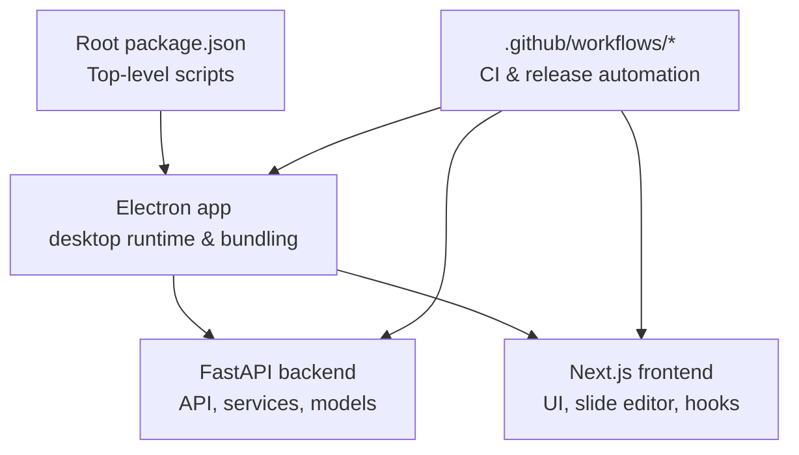
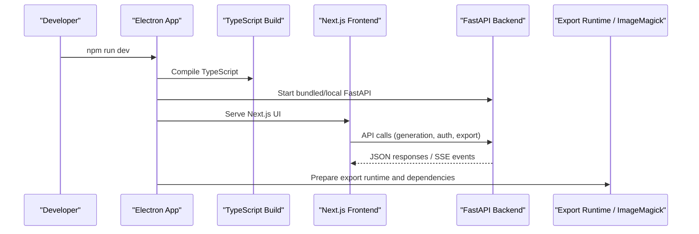
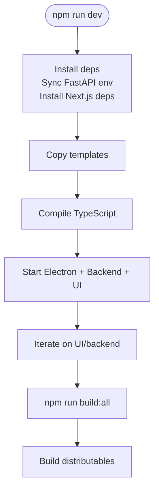
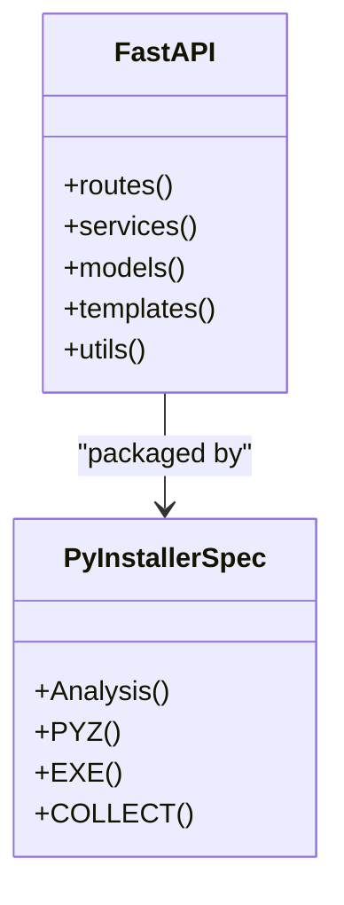
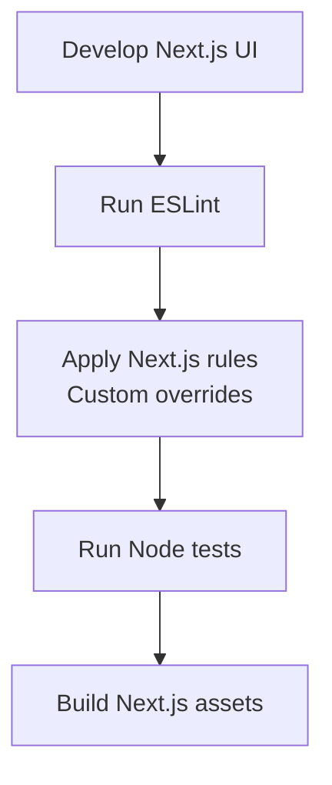
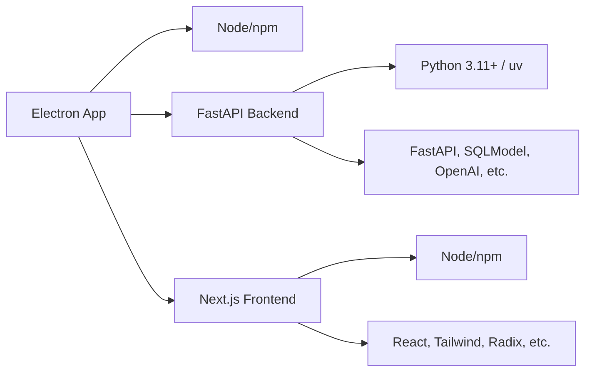
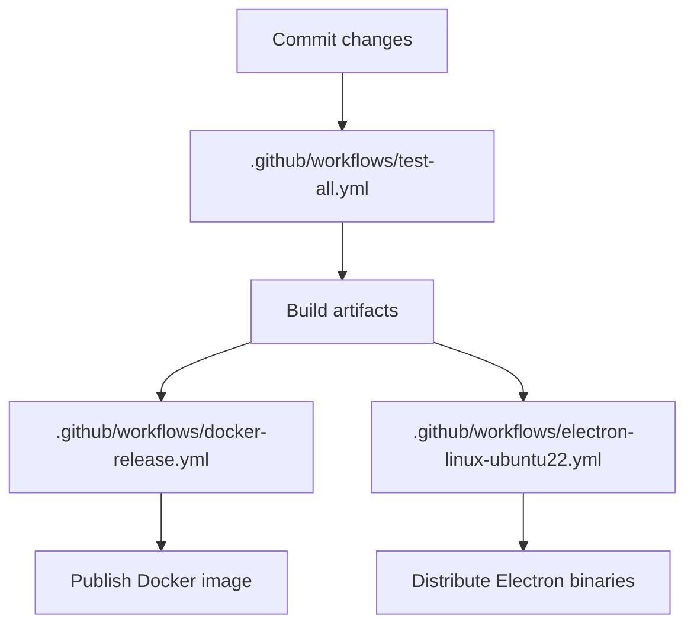

# Developer Guide

<cite>
**Referenced Files in This Document**
- [README.md](file://README.md)
- [CONTRIBUTING.md](file://CONTRIBUTING.md)
- [CODE_OF_CONDUCT.md](file://CODE_OF_CONDUCT.md)
- [package.json](file://package.json)
- [electron/package.json](file://electron/package.json)
- [servers/fastapi/pyproject.toml](file://servers/fastapi/pyproject.toml)
- [servers/nextjs/package.json](file://servers/nextjs/package.json)
- [servers/nextjs/eslint.config.mjs](file://servers/nextjs/eslint.config.mjs)
- [servers/fastapi/server.spec](file://servers/fastapi/server.spec)
- [.github/workflows/docker-release.yml](file://.github/workflows/docker-release.yml)
- [.github/workflows/electron-linux-ubuntu22.yml](file://.github/workflows/electron-linux-ubuntu22.yml)
- [.github/workflows/test-all.yml](file://.github/workflows/test-all.yml)
</cite>

## Table of Contents
1. [Introduction](#introduction)
2. [Project Structure](#project-structure)
3. [Core Components](#core-components)
4. [Architecture Overview](#architecture-overview)
5. [Detailed Component Analysis](#detailed-component-analysis)
6. [Dependency Analysis](#dependency-analysis)
7. [Performance Considerations](#performance-considerations)
8. [Troubleshooting Guide](#troubleshooting-guide)
9. [Contribution Workflow and Code Review](#contribution-workflow-and-code-review)
10. [Code Style, Linting, and Formatting](#code-style-linting-and-formatting)
11. [Testing Strategy](#testing-strategy)
12. [Release Process and Versioning](#release-process-and-versioning)
13. [Extending Functionality and Backward Compatibility](#extending-functionality-and-backward-compatibility)
14. [Community and Support](#community-and-support)
15. [Conclusion](#conclusion)

## Introduction
This guide explains how to set up the development environment, run Presenton locally, contribute code, follow project conventions, test changes, and participate in releases. It focuses on the Electron application that bundles the FastAPI backend and Next.js frontend, as well as the shared scripts and configuration used across the repository.

## Project Structure
Presenton is organized into clear layers:
- Root package metadata and top-level scripts for template conversion and export synchronization.
- Electron app packaging and desktop runtime orchestration.
- FastAPI backend with API routes, services, models, templates, and tests.
- Next.js frontend with UI components, slide editor, and client-side utilities.
- GitHub Actions workflows for CI and release automation.

**Diagram sources**
- [package.json:1-21](file://package.json#L1-L21)
- [electron/package.json:1-100](file://electron/package.json#L1-L100)
- [servers/fastapi/pyproject.toml:1-86](file://servers/fastapi/pyproject.toml#L1-L86)
- [servers/nextjs/package.json:1-94](file://servers/nextjs/package.json#L1-L94)
- [.github/workflows/docker-release.yml](file://.github/workflows/docker-release.yml)
- [.github/workflows/electron-linux-ubuntu22.yml](file://.github/workflows/electron-linux-ubuntu22.yml)
- [.github/workflows/test-all.yml](file://.github/workflows/test-all.yml)

**Section sources**
- [README.md:267-341](file://README.md#L267-L341)
- [CONTRIBUTING.md:16-25](file://CONTRIBUTING.md#L16-L25)

## Core Components
- Electron application: orchestrates the desktop experience, compiles TypeScript, starts the backend and UI, and builds distributables.
- FastAPI backend: provides REST and MCP endpoints, manages data, integrates with LLMs and image providers, and serves presentation generation logic.
- Next.js frontend: renders the editor, dashboard, and presentation generation flows; communicates with the backend via internal APIs.
- Shared scripts: convert templates, sync presentation export assets, and manage environment variables.

Key responsibilities:
- Desktop runtime setup and dependency installation.
- Backend build and packaging with PyInstaller.
- Frontend linting and type checking.
- Test execution across Python and Node toolchains.

**Section sources**
- [electron/package.json:32-68](file://electron/package.json#L32-L68)
- [servers/fastapi/pyproject.toml:1-86](file://servers/fastapi/pyproject.toml#L1-L86)
- [servers/nextjs/package.json:6-11](file://servers/nextjs/package.json#L6-L11)
- [package.json:7-14](file://package.json#L7-L14)

## Architecture Overview
The Electron app acts as a host process that:
- Compiles TypeScript and prepares resources.
- Starts the FastAPI server (bundled or local).
- Serves the Next.js frontend within the desktop window.
- Coordinates background tasks such as presentation export and asset preparation.

**Diagram sources**
- [electron/package.json:32-68](file://electron/package.json#L32-L68)
- [README.md:276-311](file://README.md#L276-L311)

## Detailed Component Analysis

### Electron Application
Responsibilities:
- Install and synchronize dependencies for backend and frontend.
- Copy templates and prepare external tools (ImageMagick, Chromium export runtime).
- Run development mode with live compilation and desktop runtime.
- Build distributables for Windows, macOS, and Linux, including signing flows.

Development workflow:
- Setup environment once per branch or after major changes.
- Run development server to iterate quickly.
- Build all components when preparing a release candidate.

**Diagram sources**
- [electron/package.json:32-68](file://electron/package.json#L32-L68)
- [CONTRIBUTING.md:63-115](file://CONTRIBUTING.md#L63-L115)

**Section sources**
- [electron/package.json:32-68](file://electron/package.json#L32-L68)
- [CONTRIBUTING.md:63-115](file://CONTRIBUTING.md#L63-L115)

### FastAPI Backend
Responsibilities:
- Provide REST and MCP endpoints for authentication, presentation generation, and export.
- Manage user accounts, provider settings, and async tasks.
- Integrate with multiple LLM and image providers.
- Package the server into a standalone executable using PyInstaller.

Packaging details:
- The PyInstaller spec collects dynamic imports and data assets required by vector stores, ONNX runtime, PPTX handling, spaCy, and Mem0.

**Diagram sources**
- [servers/fastapi/pyproject.toml:1-86](file://servers/fastapi/pyproject.toml#L1-L86)
- [servers/fastapi/server.spec:1-136](file://servers/fastapi/server.spec#L1-L136)

**Section sources**
- [servers/fastapi/pyproject.toml:1-86](file://servers/fastapi/pyproject.toml#L1-L86)
- [servers/fastapi/server.spec:1-136](file://servers/fastapi/server.spec#L1-L136)

### Next.js Frontend
Responsibilities:
- Render the slide editor, dashboard, and presentation generation flows.
- Manage state, UI interactions, and client-side validation.
- Lint code and run tests through Node toolchain.

Linting configuration:
- Uses Next.js ESLint presets with custom rule overrides to preserve existing baseline while migrating off deprecated commands.

**Diagram sources**
- [servers/nextjs/package.json:6-11](file://servers/nextjs/package.json#L6-L11)
- [servers/nextjs/eslint.config.mjs:1-43](file://servers/nextjs/eslint.config.mjs#L1-L43)

**Section sources**
- [servers/nextjs/package.json:6-11](file://servers/nextjs/package.json#L6-L11)
- [servers/nextjs/eslint.config.mjs:1-43](file://servers/nextjs/eslint.config.mjs#L1-L43)

## Dependency Analysis
High-level dependencies:
- Electron depends on Node toolchain and packages for building and distributing the desktop app.
- FastAPI depends on Python libraries for web framework, database access, LLM clients, document processing, and packaging.
- Next.js depends on React ecosystem, UI primitives, and build tooling.

**Diagram sources**
- [electron/package.json:75-98](file://electron/package.json#L75-L98)
- [servers/fastapi/pyproject.toml:11-39](file://servers/fastapi/pyproject.toml#L11-L39)
- [servers/nextjs/package.json:13-70](file://servers/nextjs/package.json#L13-L70)

**Section sources**
- [electron/package.json:75-98](file://electron/package.json#L75-L98)
- [servers/fastapi/pyproject.toml:11-39](file://servers/fastapi/pyproject.toml#L11-L39)
- [servers/nextjs/package.json:13-70](file://servers/nextjs/package.json#L13-L70)

## Performance Considerations
- Use GPU acceleration for local Ollama models when running Dockerized deployments.
- Enable parallel image generation where provider rate limits allow.
- Adjust LLM generation profiles and output token limits to balance speed and quality.
- For large presentations, consider adjusting outline word limits and verbosity settings.

[No sources needed since this section provides general guidance]

## Troubleshooting Guide
Common issues and resolutions:
- Missing dependencies: Re-run the Electron setup script to install Node, FastAPI, and Next.js dependencies.
- Backend not starting: Ensure Python environment is synced with uv and required packages are installed.
- Export failures: Verify ImageMagick and Chromium export runtime preparation steps have completed.
- Lint errors: Run the Next.js linter and fix reported issues before committing.

Operational tips:
- Use the provided scripts to clean builds and rebuild resources.
- Check environment variables for provider configuration if features fail at runtime.

**Section sources**
- [CONTRIBUTING.md:63-115](file://CONTRIBUTING.md#L63-L115)
- [electron/package.json:32-68](file://electron/package.json#L32-L68)
- [README.md:345-447](file://README.md#L345-L447)

## Contribution Workflow and Code Review
Scope:
- Contributions should be made inside the Electron directory. Changes outside may not be accepted at this time.

Process:
- Fork the repository and create a focused branch.
- Implement changes and ensure they run locally in both development and build environments.
- Open a pull request with a clear description of what and why.
- Sign the Contributor License Agreement (CLA) promptly; PRs open longer than 30 days without CLA may be closed.

Guidelines:
- Keep PRs small and focused.
- Include screenshots for UI changes.
- Mention AI-assisted contributions and confirm you reviewed generated code.

Communication:
- Use GitHub Issues and Discussions for bugs and feature proposals.
- Join Discord for community support.

**Section sources**
- [CONTRIBUTING.md:16-25](file://CONTRIBUTING.md#L16-L25)
- [CONTRIBUTING.md:29-59](file://CONTRIBUTING.md#L29-L59)
- [CONTRIBUTING.md:117-147](file://CONTRIBUTING.md#L117-L147)
- [CONTRIBUTING.md:163-168](file://CONTRIBUTING.md#L163-L168)

## Code Style, Linting, and Formatting
Frontend:
- ESLint uses Next.js core web vitals and TypeScript presets.
- Custom rule overrides preserve an existing baseline during migration.
- Generated and test files are ignored by global ignores.

Backend:
- Python project uses Pyright with type checking disabled in configuration.
- Tests are configured under pytest with coverage reporting.

Recommendations:
- Run the frontend linter before committing changes.
- Follow existing patterns in services, models, and utils for consistency.

**Section sources**
- [servers/nextjs/eslint.config.mjs:1-43](file://servers/nextjs/eslint.config.mjs#L1-L43)
- [servers/fastapi/pyproject.toml:56-86](file://servers/fastapi/pyproject.toml#L56-L86)

## Testing Strategy
Node tests:
- Top-level scripts include tests for template conversion, package metadata, presentation export synchronization, and user config environment.
- Next.js includes a Node test runner command.

Python tests:
- Pytest discovers tests under the servers/fastapi/tests directory.
- Coverage excludes tests, virtual environments, Alembic migrations, and scripts.

Execution:
- Use the root package scripts to run Node tests.
- Use uv or pytest to run Python tests and generate coverage reports.

**Section sources**
- [package.json:7-14](file://package.json#L7-L14)
- [servers/nextjs/package.json:6-11](file://servers/nextjs/package.json#L6-L11)
- [servers/fastapi/pyproject.toml:59-86](file://servers/fastapi/pyproject.toml#L59-L86)

## Release Process and Versioning
Versioning:
- Root package.json defines the application version and presentation export version.
- Electron package.json mirrors the application version and includes export-related metadata.

Build and distribution:
- Electron scripts provide targets for building all components, generating versions, and producing platform-specific installers.
- Signing flows exist for macOS DMG and Mac App Store variants.

CI and automation:
- GitHub Actions workflows define Docker release, Linux Electron builds, and test execution.

**Diagram sources**
- [package.json:1-21](file://package.json#L1-L21)
- [electron/package.json:1-100](file://electron/package.json#L1-L100)
- [.github/workflows/docker-release.yml](file://.github/workflows/docker-release.yml)
- [.github/workflows/electron-linux-ubuntu22.yml](file://.github/workflows/electron-linux-ubuntu22.yml)
- [.github/workflows/test-all.yml](file://.github/workflows/test-all.yml)

**Section sources**
- [package.json:1-21](file://package.json#L1-L21)
- [electron/package.json:1-100](file://electron/package.json#L1-L100)
- [.github/workflows/docker-release.yml](file://.github/workflows/docker-release.yml)
- [.github/workflows/electron-linux-ubuntu22.yml](file://.github/workflows/electron-linux-ubuntu22.yml)
- [.github/workflows/test-all.yml](file://.github/workflows/test-all.yml)

## Extending Functionality and Backward Compatibility
Adding new features:
- Extend FastAPI services and models following existing patterns.
- Add corresponding Next.js UI components and hooks.
- Update environment variables and documentation if new configuration is required.

Backward compatibility:
- Preserve existing API contracts unless breaking changes are explicitly planned.
- Use migrations for schema changes and maintain compatibility with older clients.
- Avoid removing legacy environment variables without deprecation notices.

Security considerations:
- Validate inputs and sanitize outputs.
- Respect user-scoped isolation for assets and data.
- Follow the security guidelines documented in the README regarding asset directories and file access.

**Section sources**
- [README.md:605-662](file://README.md#L605-L662)

## Community and Support
Channels:
- GitHub Issues and Discussions for bug reports and feature proposals.
- Discord for real-time community interaction.
- Official website and documentation for guides and examples.

Code of Conduct:
- All participants must adhere to the community guidelines.
- Reports of violations can be sent privately to the maintainer email.

**Section sources**
- [CONTRIBUTING.md:163-168](file://CONTRIBUTING.md#L163-L168)
- [CODE_OF_CONDUCT.md:1-154](file://CODE_OF_CONDUCT.md#L1-L154)

## Conclusion
This guide consolidates the development environment setup, contribution workflow, code style expectations, testing strategy, and release processes for Presenton. By following these practices, contributors can collaborate effectively, maintain high quality, and help grow the project sustainably.