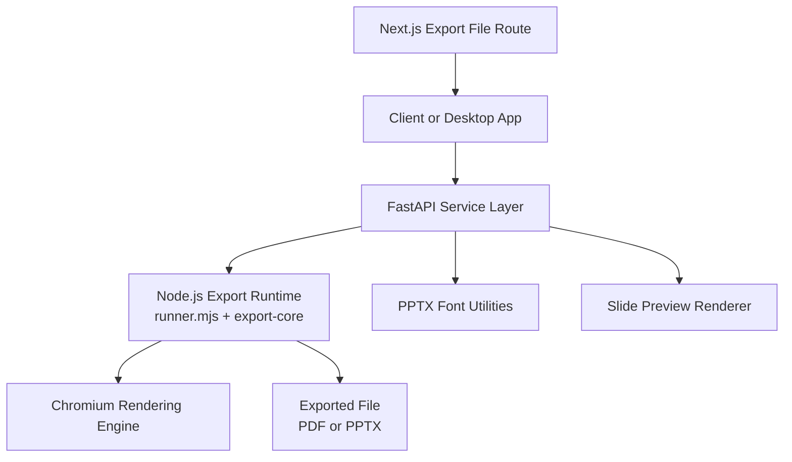
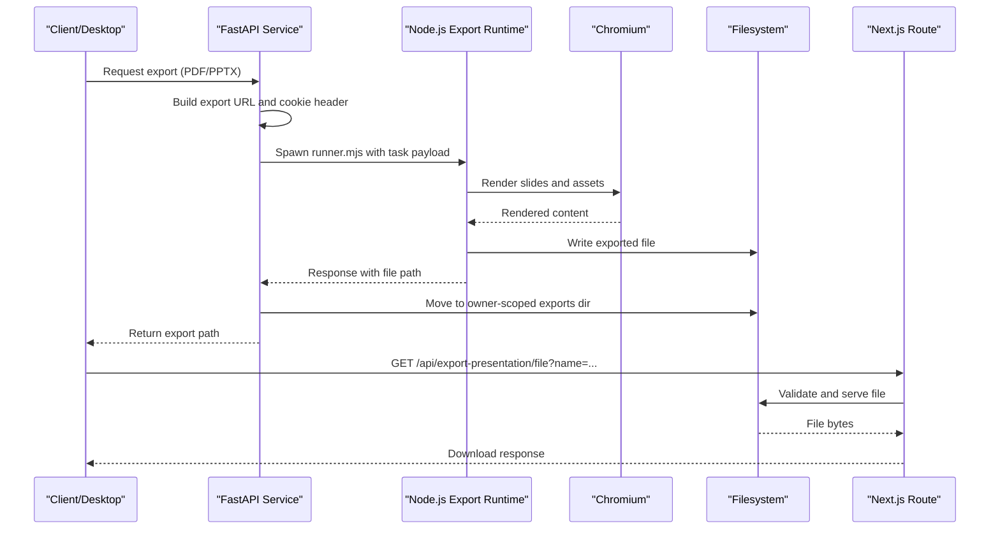
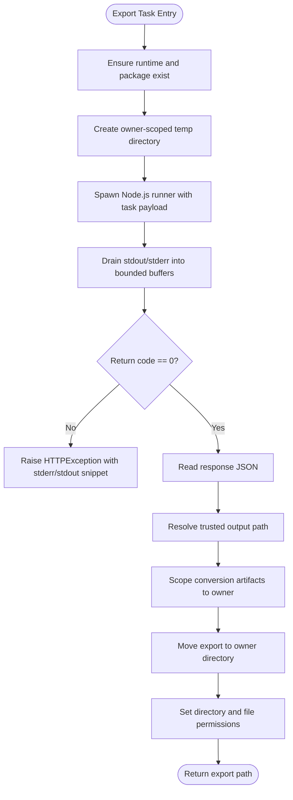
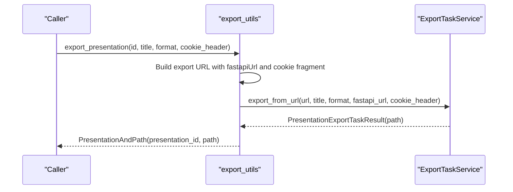
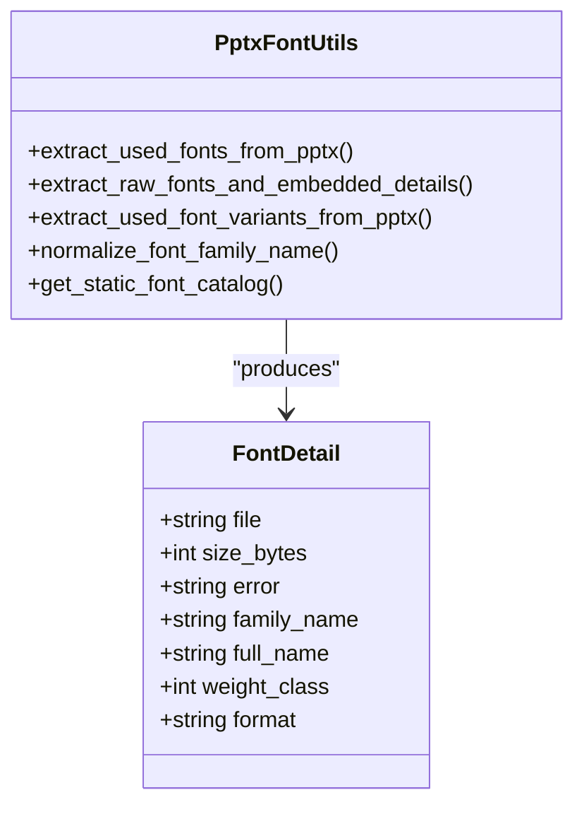
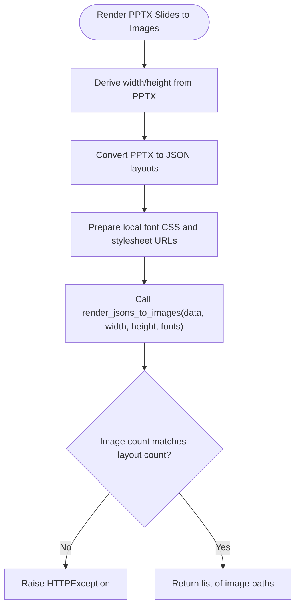
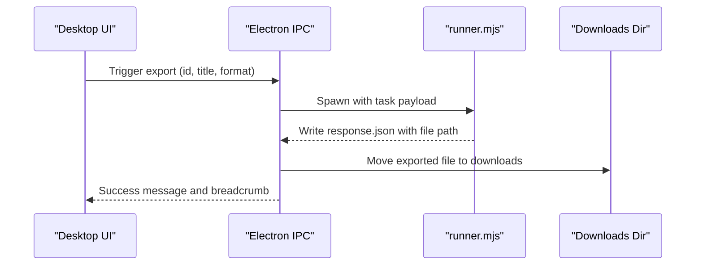
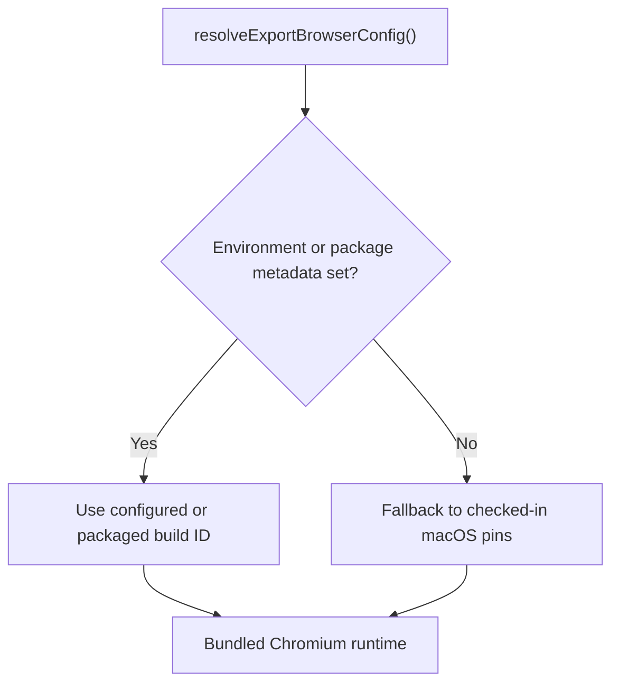
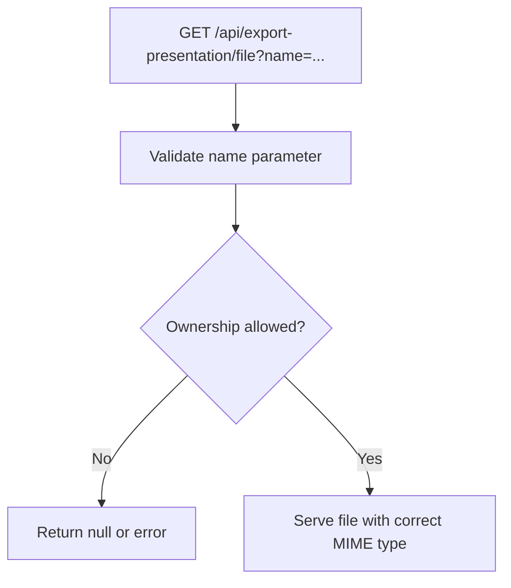
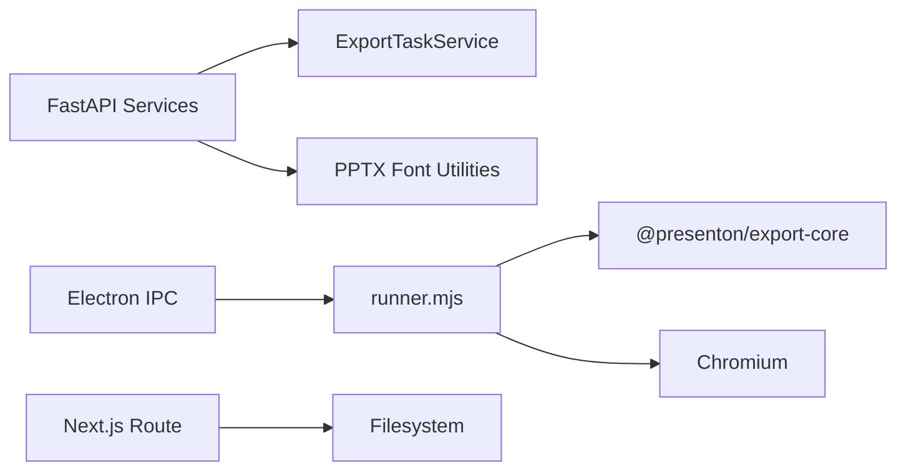

# Export System

<cite>
**Referenced Files in This Document**
- [export_task_service.py](file://servers/fastapi/services/export_task_service.py)
- [export_utils.py](file://servers/fastapi/utils/export_utils.py)
- [pptx_font_utils.py](file://servers/fastapi/templates/pptx_font_utils.py)
- [fonts_and_slides_preview.py](file://servers/fastapi/templates/fonts_and_slides_preview.py)
- [export_handlers.ts](file://electron/app/ipc/export_handlers.ts)
- [export-chromium.ts](file://electron/app/utils/export-chromium.ts)
- [run-bundled-presentation-export.ts](file://servers/nxtjs/lib/run-bundled-presentation-export.ts)
- [route.ts](file://servers/nextjs/app/api/export-presentation/file/route.ts)
- [run-presentation-export.mjs](file://scripts/run-presentation-export.mjs)
</cite>

## Table of Contents
1. [Introduction](#introduction)
2. [Project Structure](#project-structure)
3. [Core Components](#core-components)
4. [Architecture Overview](#architecture-overview)
5. [Detailed Component Analysis](#detailed-component-analysis)
6. [Dependency Analysis](#dependency-analysis)
7. [Performance Considerations](#performance-considerations)
8. [Troubleshooting Guide](#troubleshooting-guide)
9. [Conclusion](#conclusion)

## Introduction
This document explains Presenton’s export system that converts presentations into PowerPoint (PPTX) and PDF formats. It covers the end-to-end pipeline from slide data processing to final file generation, the Chromium-based rendering engine used for consistent output across platforms, font embedding and asset handling, asynchronous task management, progress and error handling strategies, customization options, template preservation, compatibility considerations, performance optimizations, and troubleshooting guidance.

The system is composed of:
- A FastAPI service layer that orchestrates exports and conversion tasks.
- An Electron desktop integration that spawns a Node.js export runtime with a pinned Chromium build.
- A Node.js export runtime entrypoint that performs rendering and file generation.
- Utilities for PPTX font analysis and slide preview rendering.
- Next.js API routes for serving exported files securely.

## Project Structure
The export system spans multiple layers:
- FastAPI services manage task execution, environment setup, security scoping, and result validation.
- Electron IPC handlers coordinate desktop-side spawning, logging, and download flow.
- The Node.js export runtime is invoked via a runner script and uses a bundled export-core package.
- Font utilities analyze PPTX content to determine required fonts and variants.
- Preview utilities convert PPTX layouts to images using the same rendering pipeline.
- Next.js provides secure endpoints for downloading generated exports.

**Diagram sources**
- [export_task_service.py:122-201](file://servers/fastapi/services/export_task_service.py#L122-L201)
- [export_handlers.ts:74-111](file://electron/app/ipc/export_handlers.ts#L74-L111)
- [run-presentation-export.mjs:97-112](file://scripts/run-presentation-export.mjs#L97-L112)
- [route.ts:14-48](file://servers/nextjs/app/api/export-presentation/file/route.ts#L14-L48)

**Section sources**
- [export_task_service.py:122-201](file://servers/fastapi/services/export_task_service.py#L122-L201)
- [export_handlers.ts:74-111](file://electron/app/ipc/export_handlers.ts#L74-L111)
- [run-presentation-export.mjs:97-112](file://scripts/run-presentation-export.mjs#L97-L112)
- [route.ts:14-48](file://servers/nextjs/app/api/export-presentation/file/route.ts#L14-L48)

## Core Components
- ExportTaskService: Orchestrates all export operations, manages child process execution, validates outputs, scopes artifacts by owner, and ensures safe file permissions.
- Presentation export URL builder: Constructs presentation export URLs with optional FastAPI base URL and cookie headers for authenticated desktop flows.
- PPTX font utilities: Analyzes PPTX XML to extract used fonts, theme mappings, placeholders, chart fonts, and embedded font details.
- Slide preview renderer: Converts PPTX layouts to images using JSON-to-image rendering with font injection and dimension derivation.
- Electron export handlers: Spawn the export runtime, capture logs, handle errors, and move results to user downloads.
- Bundled export runtime resolver: Locates the runner script and checks availability of the bundled export-core package.
- Next.js export file route: Serves exported files with strict path validation and ownership checks.

**Section sources**
- [export_task_service.py:122-201](file://servers/fastapi/services/export_task_service.py#L122-L201)
- [export_utils.py:27-75](file://servers/fastapi/utils/export_utils.py#L27-L75)
- [pptx_font_utils.py:271-307](file://servers/fastapi/templates/pptx_font_utils.py#L271-L307)
- [fonts_and_slides_preview.py:763-831](file://servers/fastapi/templates/fonts_and_slides_preview.py#L763-L831)
- [export_handlers.ts:74-111](file://electron/app/ipc/export_handlers.ts#L74-L111)
- [run-bundled-presentation-export.ts:40-47](file://servers/nxtjs/lib/run-bundled-presentation-export.ts#L40-L47)
- [route.ts:14-48](file://servers/nextjs/app/api/export-presentation/file/route.ts#L14-L48)

## Architecture Overview
The export pipeline follows a clear sequence:
1. Client or desktop app requests an export (PDF or PPTX).
2. FastAPI builds an export URL and invokes ExportTaskService.export_from_url.
3. ExportTaskService spawns the Node.js export runtime with a bounded child process, passing a task payload.
4. The runtime renders slides using Chromium and writes the final file to a scoped temp directory.
5. Results are validated, moved under the owner’s export directory, and made readable.
6. Next.js serves the exported file through a secure endpoint when requested.

**Diagram sources**
- [export_utils.py:27-75](file://servers/fastapi/utils/export_utils.py#L27-L75)
- [export_task_service.py:420-453](file://servers/fastapi/services/export_task_service.py#L420-L453)
- [export_task_service.py:294-352](file://servers/fastapi/services/export_task_service.py#L294-L352)
- [route.ts:14-48](file://servers/nextjs/app/api/export-presentation/file/route.ts#L14-L48)

## Detailed Component Analysis

### Export Task Service
ExportTaskService is the central orchestrator for all export operations. Responsibilities include:
- Resolving the export package root and runner entrypoint.
- Building Node.js environment variables for app data, temp directories, Puppeteer cache, and Chromium executable selection.
- Spawning bounded child processes with timeouts, capturing stdout/stderr safely, and validating return codes.
- Validating and resolving output paths within allowed roots (app data and temp directories).
- Scoping conversion artifacts per owner and rewriting asset URLs to backend-served paths.
- Moving final exports to the owner’s export directory and ensuring readable permissions.

Key methods and behaviors:
- _build_node_env: Sets APP_DATA_DIRECTORY, TEMP_DIRECTORY, PUPPETEER_TMP_DIR, PUPPETEER_CACHE_DIR, ASSETS_BASE_URL, and enforces Electron Chromium constraints.
- _run_bounded_child: Creates subprocesses with bounded text buffers, handles timeouts, kills processes on timeout, and returns structured results.
- export_from_url: Invokes the runtime with export parameters, resolves output, moves to owner scope, and sets permissions.
- convert_pptx_to_html: Converts PPTX to HTML with localized image assets and scoped artifact directories.
- render_html_to_image / render_json_to_image / render_jsons_to_images / render_htmls_to_images: Renders single or batch images with fallback logic for unsupported task types.
- convert_pptx_to_json: Converts PPTX to JSON layout representation with asset URL absolutization and scoping.
- _absolutize_conversion_asset_urls: Rewrites relative asset paths to backend-served URLs based on session and root naming.
- _move_export_to_owner: Moves exports into the owner-scoped directory while preventing path traversal and cross-user access.
- _scope_conversion_artifacts: Ensures conversion outputs reside under the correct owner-scoped path and rewrites internal references.

**Diagram sources**
- [export_task_service.py:203-222](file://servers/fastapi/services/export_task_service.py#L203-L222)
- [export_task_service.py:294-352](file://servers/fastapi/services/export_task_service.py#L294-L352)
- [export_task_service.py:771-802](file://servers/fastapi/services/export_task_service.py#L771-L802)
- [export_task_service.py:804-857](file://servers/fastapi/services/export_task_service.py#L804-L857)

**Section sources**
- [export_task_service.py:122-201](file://servers/fastapi/services/export_task_service.py#L122-L201)
- [export_task_service.py:294-352](file://servers/fastapi/services/export_task_service.py#L294-L352)
- [export_task_service.py:420-453](file://servers/fastapi/services/export_task_service.py#L420-L453)
- [export_task_service.py:455-517](file://servers/fastapi/services/export_task_service.py#L455-L517)
- [export_task_service.py:519-683](file://servers/fastapi/services/export_task_service.py#L519-L683)
- [export_task_service.py:685-724](file://servers/fastapi/services/export_task_service.py#L685-L724)
- [export_task_service.py:726-768](file://servers/fastapi/services/export_task_service.py#L726-L768)
- [export_task_service.py:771-857](file://servers/fastapi/services/export_task_service.py#L771-L857)

### Presentation Export URL Builder and Utility
The utility constructs export URLs for the PDF maker interface, optionally including FastAPI base URL and cookie headers for authenticated desktop sessions. It then calls ExportTaskService.export_from_url with sanitized filenames and memory logging.

**Diagram sources**
- [export_utils.py:27-75](file://servers/fastapi/utils/export_utils.py#L27-L75)
- [export_task_service.py:420-453](file://servers/fastapi/services/export_task_service.py#L420-L453)

**Section sources**
- [export_utils.py:27-75](file://servers/fastapi/utils/export_utils.py#L27-L75)

### PPTX Font Utilities
These utilities analyze PPTX files to determine which fonts are used, including theme typefaces, placeholder styles, chart fonts, and embedded font metadata. They support:
- Extracting font names from OXML nodes.
- Mapping theme major/minor fonts.
- Collecting font variants (regular, bold, italic, bold_italic) from run properties and defaults.
- Iterating slide shapes, layouts, masters, and charts.
- Extracting embedded font details and handling corrupted or unreadable fonts gracefully.

**Diagram sources**
- [pptx_font_utils.py:39-74](file://servers/fastapi/templates/pptx_font_utils.py#L39-L74)
- [pptx_font_utils.py:271-307](file://servers/fastapi/templates/pptx_font_utils.py#L271-L307)
- [pptx_font_utils.py:365-800](file://servers/fastapi/templates/pptx_font_utils.py#L365-L800)

**Section sources**
- [pptx_font_utils.py:271-307](file://servers/fastapi/templates/pptx_font_utils.py#L271-L307)
- [pptx_font_utils.py:365-800](file://servers/fastapi/templates/pptx_font_utils.py#L365-L800)

### Slide Preview Renderer
The preview renderer converts PPTX layouts to images using the same rendering pipeline as exports:
- Derives canvas dimensions from PPTX slide size.
- Converts PPTX to JSON layouts via ExportTaskService.convert_pptx_to_json.
- Injects local font CSS and stylesheet URLs into the rendering task.
- Calls ExportTaskService.render_jsons_to_images with width/height and fonts.
- Validates that the number of rendered images matches the number of layouts.

**Diagram sources**
- [fonts_and_slides_preview.py:184-197](file://servers/fastapi/templates/fonts_and_slides_preview.py#L184-L197)
- [fonts_and_slides_preview.py:763-831](file://servers/fastapi/templates/fonts_and_slides_preview.py#L763-L831)
- [export_task_service.py:578-622](file://servers/fastapi/services/export_task_service.py#L578-L622)

**Section sources**
- [fonts_and_slides_preview.py:184-197](file://servers/fastapi/templates/fonts_and_slides_preview.py#L184-L197)
- [fonts_and_slides_preview.py:763-831](file://servers/fastapi/templates/fonts_and_slides_preview.py#L763-L831)

### Electron Export Handlers
Electron coordinates desktop-side export workflows:
- Builds the export URL with NEXT_PUBLIC_URL and optional NEXT_PUBLIC_FAST_API.
- Spawns the packaged runner.mjs with a task payload containing url, format, title, fastapiUrl, and cookieHeader.
- Captures stdout/stderr into bounded buffers, tracks process lifecycle, and logs breadcrumbs.
- Reads the response file, resolves the exported file path, moves it to the user’s downloads directory, and shows a background notification.
- Handles errors and records detailed diagnostics.

**Diagram sources**
- [export_handlers.ts:74-111](file://electron/app/ipc/export_handlers.ts#L74-L111)
- [export_handlers.ts:141-175](file://electron/app/ipc/export_handlers.ts#L141-L175)
- [export_handlers.ts:358-442](file://electron/app/ipc/export_handlers.ts#L358-L442)

**Section sources**
- [export_handlers.ts:74-111](file://electron/app/ipc/export_handlers.ts#L74-L111)
- [export_handlers.ts:141-175](file://electron/app/ipc/export_handlers.ts#L141-L175)
- [export_handlers.ts:358-442](file://electron/app/ipc/export_handlers.ts#L358-L442)

### Chromium Configuration and Bundled Runtime
The Electron side selects a pinned Chromium build for consistent rendering:
- Uses environment variables and packaged metadata to resolve browser type and build ID.
- Falls back to checked-in pins for development or partially packaged trees.
- Ensures the bundled export-core package exists and is synchronized during build.

**Diagram sources**
- [export-chromium.ts:42-62](file://electron/app/utils/export-chromium.ts#L42-L62)
- [run-bundled-presentation-export.ts:40-47](file://servers/nxtjs/lib/run-bundled-presentation-export.ts#L40-L47)

**Section sources**
- [export-chromium.ts:42-62](file://electron/app/utils/export-chromium.ts#L42-L62)
- [run-bundled-presentation-export.ts:40-47](file://servers/nxtjs/lib/run-bundled-presentation-export.ts#L40-L47)

### Next.js Export File Route
The Next.js route serves exported files securely:
- Requires APP_DATA_DIRECTORY to be set.
- Validates the requested filename against path traversal patterns.
- Enforces ownership rules for user-scoped exports.
- Returns appropriate MIME types for PDF, PPTX, and ZIP.

**Diagram sources**
- [route.ts:14-48](file://servers/nextjs/app/api/export-presentation/file/route.ts#L14-L48)

**Section sources**
- [route.ts:14-48](file://servers/nextjs/app/api/export-presentation/file/route.ts#L14-L48)

## Dependency Analysis
The export system has clear boundaries and dependencies:
- FastAPI depends on ExportTaskService for orchestration and on font utilities for analysis.
- Electron IPC depends on the packaged runner.mjs and export-core package.
- The Node.js runtime depends on Chromium for rendering and writes files to scoped directories.
- Next.js depends on filesystem access and environment configuration to serve exports.

**Diagram sources**
- [export_task_service.py:122-201](file://servers/fastapi/services/export_task_service.py#L122-L201)
- [export_handlers.ts:102-111](file://electron/app/ipc/export_handlers.ts#L102-L111)
- [run-presentation-export.mjs:97-112](file://scripts/run-presentation-export.mjs#L97-L112)
- [route.ts:14-48](file://servers/nextjs/app/api/export-presentation/file/route.ts#L14-L48)

**Section sources**
- [export_task_service.py:122-201](file://servers/fastapi/services/export_task_service.py#L122-L201)
- [export_handlers.ts:102-111](file://electron/app/ipc/export_handlers.ts#L102-L111)
- [run-presentation-export.mjs:97-112](file://scripts/run-presentation-export.mjs#L97-L112)
- [route.ts:14-48](file://servers/nextjs/app/api/export-presentation/file/route.ts#L14-L48)

## Performance Considerations
- Bounded child processes: Subprocess stdout/stderr are drained into bounded buffers to prevent unbounded memory growth.
- Timeout enforcement: Child processes are killed after a configurable timeout to avoid hanging exports.
- Memory logging: Memory snapshots are logged around spawn and exit points for observability.
- Batch rendering: JSON-to-images and HTML-to-images support batch rendering to reduce overhead; fallback logic ensures robustness if batch tasks are unavailable.
- Asset localization: Image assets are converted to data URIs when needed to avoid network calls during headless rendering.
- Owner scoping: Conversion artifacts are moved to owner-scoped directories to minimize contention and improve cleanup.
- Permission hardening: Output directories and files are set to restrictive modes to prevent unintended access.

[No sources needed since this section provides general guidance]

## Troubleshooting Guide
Common issues and resolutions:
- Export runtime not found: Ensure runner.mjs and export-core dist/index.js exist at the resolved export directory.
- Invalid JSON output: Validate that the runtime produces well-formed JSON responses; check stderr/stdout snippets for errors.
- Path outside allowed roots: Outputs must reside under APP_DATA_DIRECTORY or TEMP_DIRECTORY; verify scoping logic and environment variables.
- Missing APP_DATA_DIRECTORY: Required for PPTX-to-HTML export and conversion artifacts; ensure it is set before invoking exports.
- Electron Chromium unavailable: In Electron mode, a pinned Chromium executable must be present; otherwise, the export refuses to proceed.
- HTML-to-images fallback: If batch HTML-to-images is unavailable or fails, the service falls back to one task per HTML document.
- File permission errors: After export completion, the service attempts to set directory and file permissions; failures raise HTTP exceptions.

**Section sources**
- [export_task_service.py:203-222](file://servers/fastapi/services/export_task_service.py#L203-L222)
- [export_task_service.py:323-350](file://servers/fastapi/services/export_task_service.py#L323-L350)
- [export_task_service.py:243-267](file://servers/fastapi/services/export_task_service.py#L243-L267)
- [export_task_service.py:154-201](file://servers/fastapi/services/export_task_service.py#L154-L201)
- [export_task_service.py:624-683](file://servers/fastapi/services/export_task_service.py#L624-L683)
- [export_task_service.py:269-278](file://servers/fastapi/services/export_task_service.py#L269-L278)

## Conclusion
Presenton’s export system provides a robust, secure, and consistent pipeline for generating PDF and PPTX exports. It leverages a bounded Node.js runtime with pinned Chromium for reliable rendering, comprehensive font analysis for accurate typography, and strict filesystem scoping for multi-user safety. The architecture supports batch rendering, fallback mechanisms, and detailed diagnostics, making it suitable for large presentations and diverse deployment environments. Proper configuration of environment variables, runtime packages, and Chromium binaries is essential for optimal performance and reliability.

[No sources needed since this section summarizes without analyzing specific files]