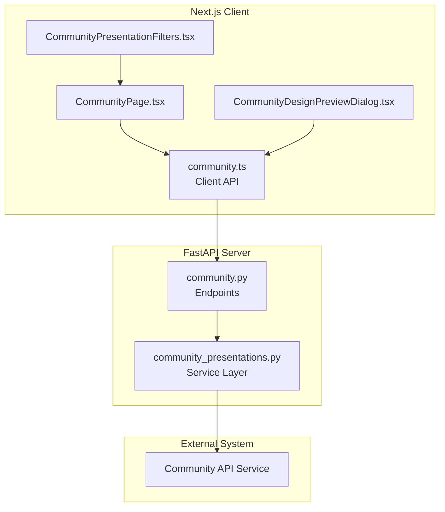
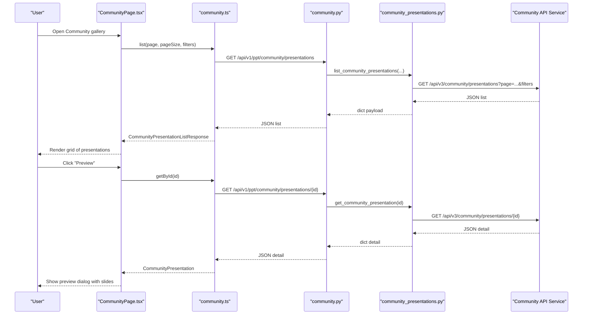
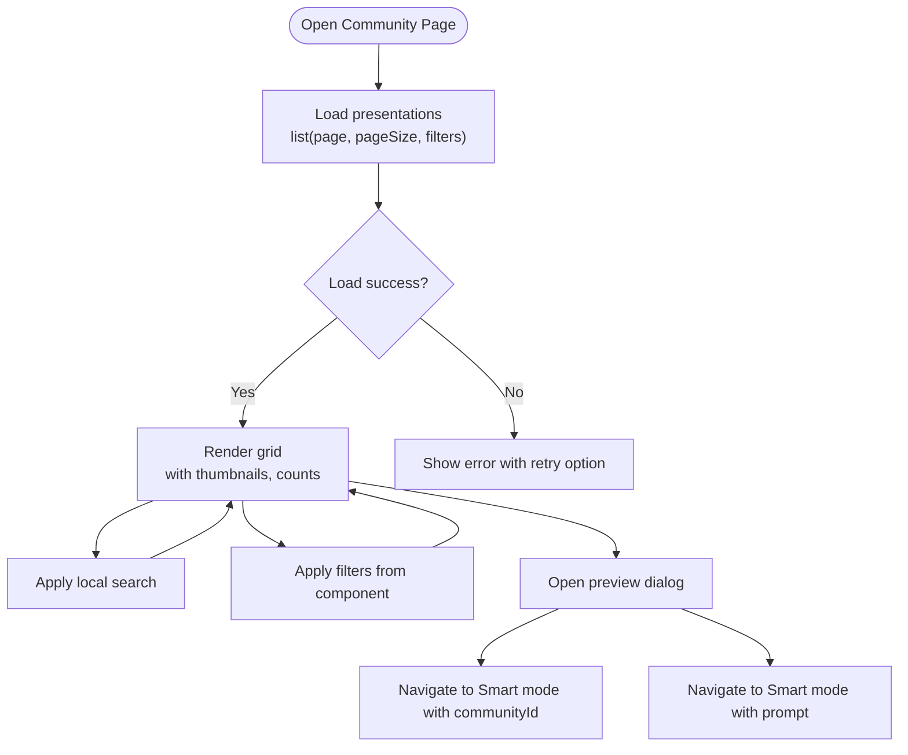
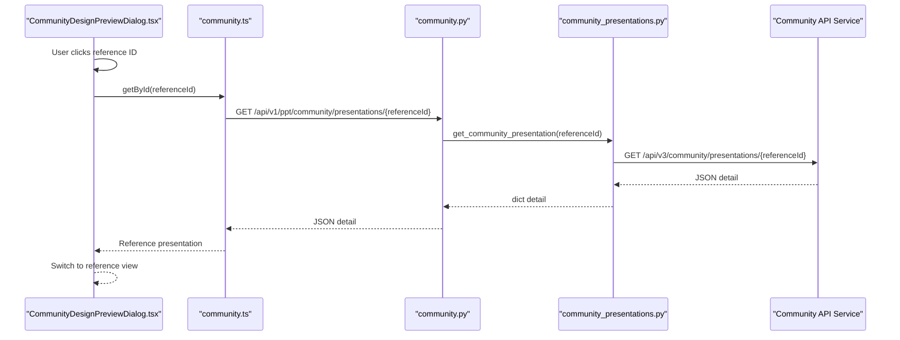
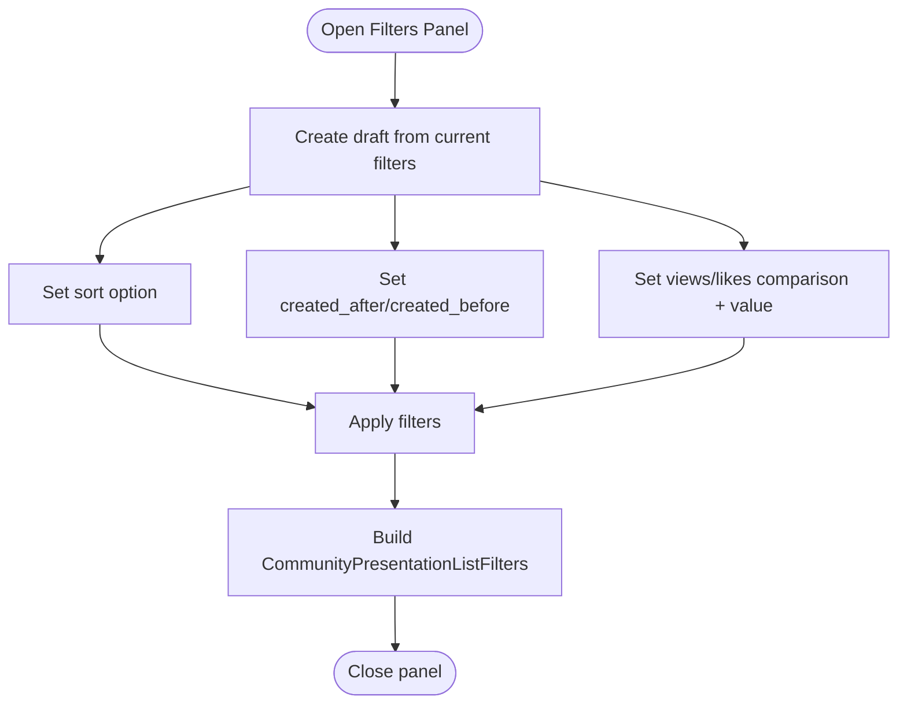
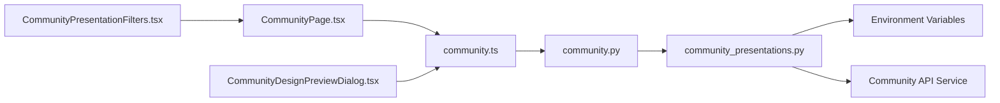

# Community Module

<cite>
**Referenced Files in This Document**
- [community.ts](file://servers/nex tjs/app/(presentation-generator)/services/api/community.ts)
- [CommunityPage.tsx](file://servers/nextjs/app/(presentation-generator)/(dashboard)/community/components/CommunityPage.tsx)
- [CommunityDesignPreviewDialog.tsx](file://servers/nextjs/app/(presentation-generator)/(dashboard)/community/components/CommunityDesignPreviewDialog.tsx)
- [CommunityPresentationFilters.tsx](file://servers/nextjs/app/(presentation-generator)/upload/components/CommunityPresentationFilters.tsx)
- [community.py](file://servers/fastapi/api/v1/ppt/endpoints/community.py)
- [community_presentations.py](file://servers/fastapi/services/community_presentations.py)
- [README.md](file://README.md)
</cite>

## Table of Contents
1. [Introduction](#introduction)
2. [Project Structure](#project-structure)
3. [Core Components](#core-components)
4. [Architecture Overview](#architecture-overview)
5. [Detailed Component Analysis](#detailed-component-analysis)
6. [Dependency Analysis](#dependency-analysis)
7. [Performance Considerations](#performance-considerations)
8. [Troubleshooting Guide](#troubleshooting-guide)
9. [Conclusion](#conclusion)

## Introduction
This document explains the Community module that enables users to discover, preview, and reuse community-shared presentations and prompts. It covers:
- The gallery interface for browsing and filtering community presentations
- Preview functionality for slide decks and reference presentations
- Sharing mechanisms via design usage and prompt reuse
- Backend integration with the external Community API service
- Configuration controls, error handling, and operational constraints

The module is implemented as a Next.js frontend integrated with a FastAPI backend that proxies requests to an external Community API.

## Project Structure
The Community feature spans both the Next.js client and the FastAPI server:
- Next.js client:
  - Gallery page and components for browsing, filtering, and previewing
  - API client types and methods for listing and fetching presentations
- FastAPI server:
  - REST endpoints for listing and retrieving community presentations
  - Service layer that calls the external Community API with robust error mapping

**Diagram sources**
- [CommunityPage.tsx:58-131](file://servers/nextjs/app/(presentation-generator)/(dashboard)/community/components/CommunityPage.tsx#L58-L131)
- [CommunityDesignPreviewDialog.tsx:86-119](file://servers/nextjs/app/(presentation-generator)/(dashboard)/community/components/CommunityDesignPreviewDialog.tsx#L86-L119)
- [CommunityPresentationFilters.tsx:106-150](file://servers/nextjs/app/(presentation-generator)/upload/components/CommunityPresentationFilters.tsx#L106-L150)
- [community.ts:98-135](file://servers/nex tjs/app/(presentation-generator)/services/api/community.ts#L98-L135)
- [community.py:14-49](file://servers/fastapi/api/v1/ppt/endpoints/community.py#L14-L49)
- [community_presentations.py:286-355](file://servers/fastapi/services/community_presentations.py#L286-L355)

**Section sources**
- [CommunityPage.tsx:58-131](file://servers/nextjs/app/(presentation-generator)/(dashboard)/community/components/CommunityPage.tsx#L58-L131)
- [community.ts:98-135](file://servers/nex tjs/app/(presentation-generator)/services/api/community.ts#L98-L135)
- [community.py:14-49](file://servers/fastapi/api/v1/ppt/endpoints/community.py#L14-L49)
- [community_presentations.py:286-355](file://servers/fastapi/services/community_presentations.py#L286-L355)

## Core Components
- Community gallery page:
  - Displays paginated cards with thumbnails, titles, authors, views, and likes
  - Supports search and advanced filters (date range, views, likes)
  - Provides “Use design” and “Use prompt” actions
- Preview dialog:
  - Renders full slide previews using shared HTML slides
  - Shows AI setup providers and optional reference presentations
  - Allows copying prompts and navigating between references
- Filters component:
  - Sort by default/newest/oldest/most viewed/least viewed/most liked/least liked/featured
  - Date range and numeric comparisons for views and likes
- Client API:
  - Typed interfaces for presentation data and list responses
  - Methods for listing and fetching by ID with consistent error handling
- Server endpoints:
  - List and get endpoints under /api/v1/ppt/community/presentations
- Service layer:
  - Proxies requests to the external Community API
  - Normalizes errors and enforces configuration flags

**Section sources**
- [CommunityPage.tsx:58-389](file://servers/nextjs/app/(presentation-generator)/(dashboard)/community/components/CommunityPage.tsx#L58-L389)
- [CommunityDesignPreviewDialog.tsx:46-399](file://servers/nextjs/app/(presentation-generator)/(dashboard)/community/components/CommunityDesignPreviewDialog.tsx#L46-L399)
- [CommunityPresentationFilters.tsx:106-291](file://servers/nextjs/app/(presentation-generator)/upload/components/CommunityPresentationFilters.tsx#L106-L291)
- [community.ts:5-162](file://servers/nex tjs/app/(presentation-generator)/services/api/community.ts#L5-L162)
- [community.py:14-49](file://servers/fastapi/api/v1/ppt/endpoints/community.py#L14-L49)
- [community_presentations.py:149-355](file://servers/fastapi/services/community_presentations.py#L149-L355)

## Architecture Overview
The Community module follows a layered architecture:
- Presentation layer (Next.js): UI components and state management
- API client layer (Next.js): Typed HTTP calls and response normalization
- Routing layer (FastAPI): Endpoint definitions and parameter validation
- Service layer (FastAPI): External API communication and error translation
- External system: Community API service hosting shared presentations

**Diagram sources**
- [CommunityPage.tsx:82-131](file://servers/nextjs/app/(presentation-generator)/(dashboard)/community/components/CommunityPage.tsx#L82-L131)
- [community.ts:98-135](file://servers/nex tjs/app/(presentation-generator)/services/api/community.ts#L98-L135)
- [community.py:14-49](file://servers/fastapi/api/v1/ppt/endpoints/community.py#L14-L49)
- [community_presentations.py:286-355](file://servers/fastapi/services/community_presentations.py#L286-L355)

## Detailed Component Analysis

### Community Page (Gallery)
Responsibilities:
- Fetch and display paginated community presentations
- Apply local search across title, description, prompt, and author
- Provide sorting and filtering via the filters component
- Handle loading, empty states, and retryable errors
- Trigger analytics events for page view, load success/failure, and interactions
- Navigate to Smart mode with either design or prompt

Key behaviors:
- Uses AbortController to cancel stale requests on filter/page changes
- Updates local list when preview loads updated metadata
- Offers “Use design” to open Smart mode with communityId
- Offers “Use prompt” to open Smart mode with prompt text

**Diagram sources**
- [CommunityPage.tsx:79-131](file://servers/nextjs/app/(presentation-generator)/(dashboard)/community/components/CommunityPage.tsx#L79-L131)
- [CommunityPage.tsx:133-146](file://servers/nextjs/app/(presentation-generator)/(dashboard)/community/components/CommunityPage.tsx#L133-L146)
- [CommunityPage.tsx:152-240](file://servers/nextjs/app/(presentation-generator)/(dashboard)/community/components/CommunityPage.tsx#L152-L240)

**Section sources**
- [CommunityPage.tsx:58-389](file://servers/nextjs/app/(presentation-generator)/(dashboard)/community/components/CommunityPage.tsx#L58-L389)

### Preview Dialog
Responsibilities:
- Render all slides from the selected presentation
- Display AI setup providers and model hints
- Allow viewing linked reference presentations
- Copy shared prompt to clipboard
- Provide “Use Design” action to start Smart mode

Key behaviors:
- Lazy-loads referenced presentations by ID
- Maintains safe request ordering with a ref counter
- Handles network errors gracefully with user notifications

**Diagram sources**
- [CommunityDesignPreviewDialog.tsx:86-119](file://servers/nextjs/app/(presentation-generator)/(dashboard)/community/components/CommunityDesignPreviewDialog.tsx#L86-L119)
- [community.ts:129-135](file://servers/nex tjs/app/(presentation-generator)/services/api/community.ts#L129-L135)
- [community.py:45-49](file://servers/fastapi/api/v1/ppt/endpoints/community.py#L45-L49)
- [community_presentations.py:335-355](file://servers/fastapi/services/community_presentations.py#L335-L355)

**Section sources**
- [CommunityDesignPreviewDialog.tsx:46-399](file://servers/nextjs/app/(presentation-generator)/(dashboard)/community/components/CommunityDesignPreviewDialog.tsx#L46-L399)

### Filters Component
Responsibilities:
- Manage sort options and advanced filters
- Convert UI inputs into API-compatible query parameters
- Track active filter count and provide clear/reset behavior

Supported filters:
- Sort: Default, Newest, Oldest, Most viewed, Least viewed, Most liked, Least liked, Featured first, Featured last
- Date range: Created after/before (ISO datetime boundaries)
- Counts: Views/Likes with Any/Exactly/More than/Fewer than

**Diagram sources**
- [CommunityPresentationFilters.tsx:106-150](file://servers/nextjs/app/(presentation-generator)/upload/components/CommunityPresentationFilters.tsx#L106-L150)
- [CommunityPresentationFilters.tsx:369-435](file://servers/nextjs/app/(presentation-generator)/upload/components/CommunityPresentationFilters.tsx#L369-L435)

**Section sources**
- [CommunityPresentationFilters.tsx:106-291](file://servers/nextjs/app/(presentation-generator)/upload/components/CommunityPresentationFilters.tsx#L106-L291)
- [CommunityPresentationFilters.tsx:369-435](file://servers/nextjs/app/(presentation-generator)/upload/components/CommunityPresentationFilters.tsx#L369-L435)

### Client API Types and Methods
Responsibilities:
- Define typed models for community presentations and list responses
- Normalize error states for UI consumption
- Provide list and getById methods with consistent headers and caching settings

Key types:
- CommunityPresentation: id, title, description, created_by, likes, views, slides, fonts, prompt, v2_presentation, community_reference_ids, setup
- CommunityPresentationSetup: text_provider, text_model, image_provider, web_search_provider
- CommunityPresentationListResponse: total_pages, page, page_size, results
- CommunityPresentationListFilters: date bounds, views/likes filters, order_by, order

Utility functions:
- getCommunityErrorState: maps errors to message and retryable flag
- getCommunityPresentationTitle/Author: safe fallbacks
- getCommunityReferenceIds: normalizes and deduplicates reference IDs

**Section sources**
- [community.ts:5-162](file://servers/nex tjs/app/(presentation-generator)/services/api/community.ts#L5-L162)

### Server Endpoints
Responsibilities:
- Expose REST endpoints for listing and retrieving community presentations
- Validate query parameters and path parameters
- Delegate business logic to the service layer

Endpoints:
- GET /api/v1/ppt/community/presentations?page, page_size, created_at_gt, created_at_lt, views, views_gt, views_lt, likes, likes_gt, likes_lt, order_by, order
- GET /api/v1/ppt/community/presentations/{community_id}

**Section sources**
- [community.py:14-49](file://servers/fastapi/api/v1/ppt/endpoints/community.py#L14-L49)

### Service Layer and External Integration
Responsibilities:
- Enforce deployment-level feature flag
- Call external Community API with timeouts and headers
- Normalize upstream errors into structured HTTP exceptions
- Validate and sanitize payloads

Key behaviors:
- require_community_enabled(): blocks access when disabled
- _cloud_get(): performs HTTP GET with error mapping for timeouts, connectivity, invalid URL, and invalid JSON
- list_community_presentations(): forwards filters and pagination
- get_community_presentation(): validates positive integer ID and returns detail
- Constants: default API URL, max references, max slides per reference, character limits

Configuration:
- PRESENTON_COMMUNITY_API_URL overrides default endpoint
- PRESENTON_COMMUNITY_ENABLED toggles feature availability

**Section sources**
- [community_presentations.py:14-21](file://servers/fastapi/services/community_presentations.py#L14-L21)
- [community_presentations.py:149-164](file://servers/fastapi/services/community_presentations.py#L149-L164)
- [community_presentations.py:204-284](file://servers/fastapi/services/community_presentations.py#L204-L284)
- [community_presentations.py:286-355](file://servers/fastapi/services/community_presentations.py#L286-L355)
- [README.md:357-378](file://README.md#L357-L378)

## Dependency Analysis

**Diagram sources**
- [CommunityPage.tsx:58-131](file://servers/nextjs/app/(presentation-generator)/(dashboard)/community/components/CommunityPage.tsx#L58-L131)
- [CommunityDesignPreviewDialog.tsx:86-119](file://servers/nextjs/app/(presentation-generator)/(dashboard)/community/components/CommunityDesignPreviewDialog.tsx#L86-L119)
- [CommunityPresentationFilters.tsx:106-150](file://servers/nextjs/app/(presentation-generator)/upload/components/CommunityPresentationFilters.tsx#L106-L150)
- [community.ts:98-135](file://servers/nex tjs/app/(presentation-generator)/services/api/community.ts#L98-L135)
- [community.py:14-49](file://servers/fastapi/api/v1/ppt/endpoints/community.py#L14-L49)
- [community_presentations.py:149-164](file://servers/fastapi/services/community_presentations.py#L149-L164)

**Section sources**
- [community.ts:98-135](file://servers/nex tjs/app/(presentation-generator)/services/api/community.ts#L98-L135)
- [community.py:14-49](file://servers/fastapi/api/v1/ppt/endpoints/community.py#L14-L49)
- [community_presentations.py:149-164](file://servers/fastapi/services/community_presentations.py#L149-L164)

## Performance Considerations
- Pagination:
  - Client uses PAGE_SIZE = 20 for the gallery; backend defaults to page_size = 8 with allowed range 1–24
- Request cancellation:
  - AbortController prevents race conditions during filter/page updates
- Error resilience:
  - Retryable errors surfaced to UI with explicit retry buttons
- External latency:
  - 30-second timeout on external API calls; non-retryable errors for invalid URLs and authentication failures
- Rendering:
  - Slide previews are rendered as HTML without script execution to avoid overhead and security risks

[No sources needed since this section provides general guidance]

## Troubleshooting Guide
Common issues and resolutions:
- Community disabled:
  - Symptom: Requests return a not-found or disabled error
  - Cause: Feature flag PRESENTON_COMMUNITY_ENABLED is false
  - Resolution: Enable the flag in environment configuration
- Upstream unreachable:
  - Symptom: Network or connection errors
  - Causes: Invalid URL, DNS/network issues, or service down
  - Resolution: Verify PRESENTON_COMMUNITY_API_URL and network access
- Rate limiting:
  - Symptom: Temporary failure due to too many requests
  - Resolution: Retry after a short delay
- Invalid response:
  - Symptom: Unreadable JSON from upstream
  - Resolution: Check upstream service health and response format
- Invalid ID:
  - Symptom: Bad request for non-positive integer IDs
  - Resolution: Ensure valid positive integer IDs are passed

Operational notes:
- Error codes include descriptive messages and retryable flags for UI handling
- Authentication failures from upstream are mapped to specific error codes indicating misconfiguration

**Section sources**
- [community_presentations.py:85-146](file://servers/fastapi/services/community_presentations.py#L85-L146)
- [community_presentations.py:204-284](file://servers/fastapi/services/community_presentations.py#L204-L284)
- [community_presentations.py:335-355](file://servers/fastapi/services/community_presentations.py#L335-L355)
- [README.md:357-378](file://README.md#L357-L378)

## Conclusion
The Community module provides a polished gallery experience for discovering and reusing community-shared presentations. It integrates cleanly with an external Community API through a robust FastAPI proxy, offering strong error handling, configurable feature toggles, and rich UI interactions including previews, filters, and direct use of designs or prompts in Smart mode. For deployments requiring isolation, the feature can be disabled entirely via environment configuration.

[No sources needed since this section summarizes without analyzing specific files]