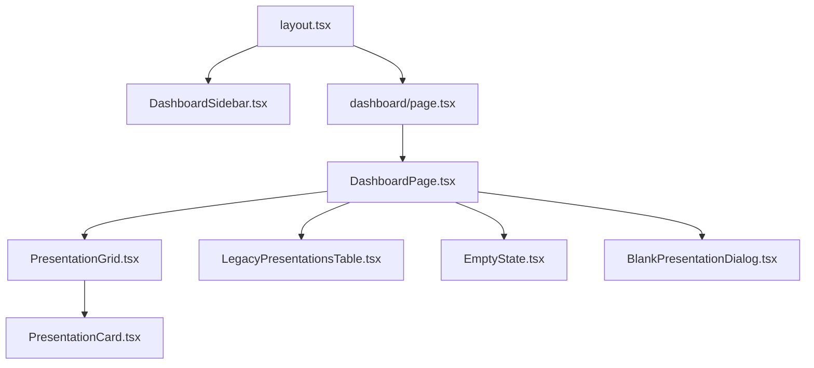
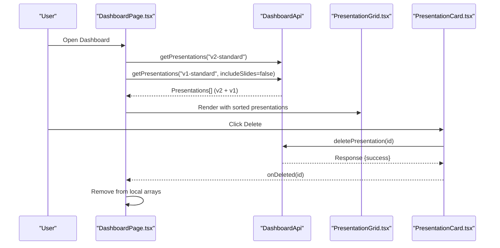
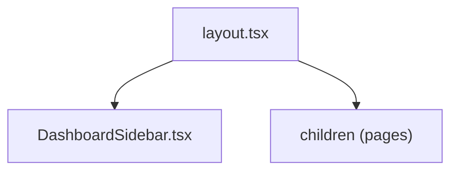
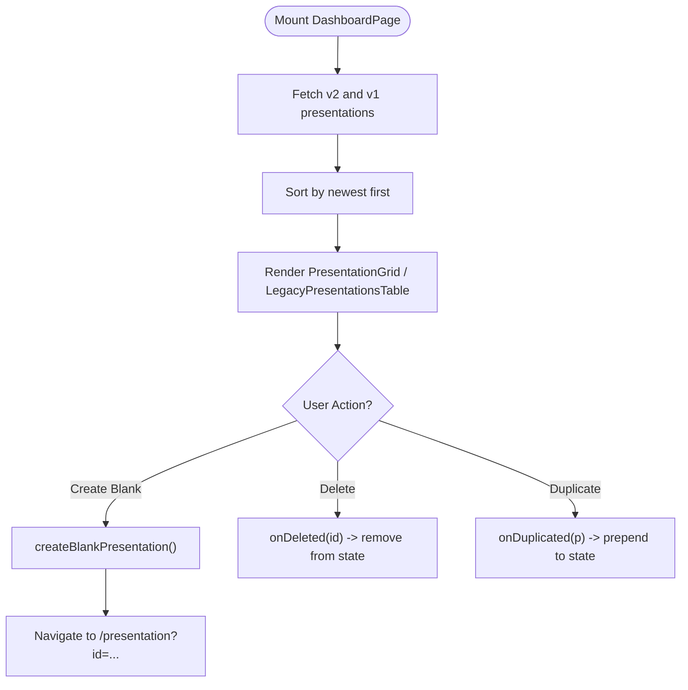
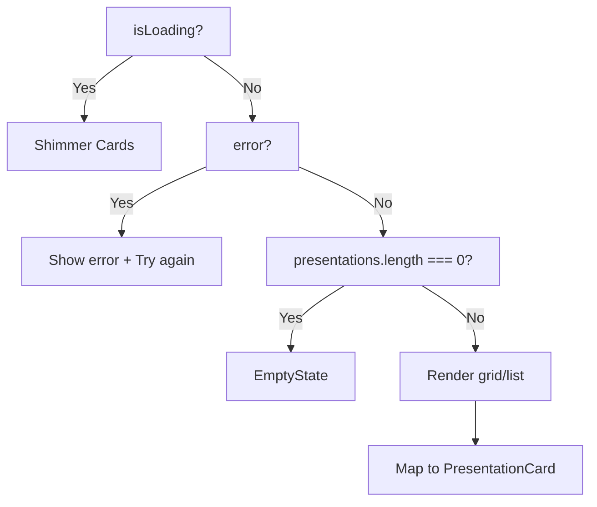
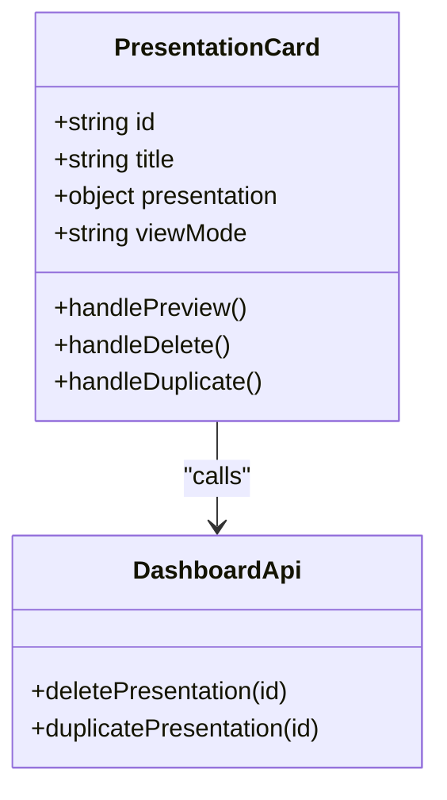
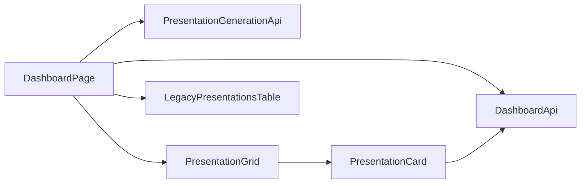

# Dashboard Module

<cite>
**Referenced Files in This Document**
- [layout.tsx](file://servers/nextjs/app/(presentation-generator)/(dashboard)/layout.tsx)
- [DashboardSidebar.tsx](file://servers/nextjs/app/(presentation-generator)/(dashboard)/Components/DashboardSidebar.tsx)
- [page.tsx](file://servers/nextjs/app/(presentation-generator)/(dashboard)/dashboard/page.tsx)
- [DashboardPage.tsx](file://servers/nextjs/app/(presentation-generator)/(dashboard)/dashboard/components/DashboardPage.tsx)
- [PresentationGrid.tsx](file://servers/nextjs/app/(presentation-generator)/(dashboard)/dashboard/components/PresentationGrid.tsx)
- [PresentationCard.tsx](file://servers/nextjs/app/(presentation-generator)/(dashboard)/dashboard/components/PresentationCard.tsx)
- [LegacyPresentationsTable.tsx](file://servers/nextjs/app/(presentation-generator)/(dashboard)/dashboard/components/LegacyPresentationsTable.tsx)
- [EmptyState.tsx](file://servers/nextjs/app/(presentation-generator)/(dashboard)/dashboard/components/EmptyState.tsx)
- [BlankPresentationDialog.tsx](file://servers/nextjs/app/(presentation-generator)/(dashboard)/dashboard/components/BlankPresentationDialog.tsx)
- [dashboard API](file://servers/nextjs/app/(presentation-generator)/services/api/dashboard.ts)
- [presentation generation API](file://servers/nextjs/app/(presentation-generator)/services/api/presentation-generation.ts)
</cite>

## Table of Contents
1. [Introduction](#introduction)
2. [Project Structure](#project-structure)
3. [Core Components](#core-components)
4. [Architecture Overview](#architecture-overview)
5. [Detailed Component Analysis](#detailed-component-analysis)
6. [Dependency Analysis](#dependency-analysis)
7. [Performance Considerations](#performance-considerations)
8. [Troubleshooting Guide](#troubleshooting-guide)
9. [Conclusion](#conclusion)

## Introduction
This document describes the dashboard module that serves as the main presentation management interface. It covers the layout, presentation grid and list views, presentation cards with metadata display, search and filtering capabilities (as implemented), bulk operations, state management for presentations data, API integrations for CRUD operations, user interactions (create, edit via navigation, delete, duplicate), component hierarchy, data flow patterns, and performance optimizations for large presentation collections.

## Project Structure
The dashboard is a Next.js client-side feature under the presentation generator route group. The layout composes a sidebar and page content; the dashboard page renders action cards, a deck section with grid/list toggling, and optional legacy presentations table.

**Diagram sources**
- [layout.tsx:1-26](file://servers/nextjs/app/(presentation-generator)/(dashboard)/layout.tsx#L1-L26)
- [page.tsx:1-11](file://servers/nextjs/app/(presentation-generator)/(dashboard)/dashboard/page.tsx#L1-L11)
- [DashboardPage.tsx:392-620](file://servers/nextjs/app/(presentation-generator)/(dashboard)/dashboard/components/DashboardPage.tsx#L392-L620)
- [PresentationGrid.tsx:1-98](file://servers/nextjs/app/(presentation-generator)/(dashboard)/dashboard/components/PresentationGrid.tsx#L1-L98)
- [PresentationCard.tsx:31-299](file://servers/nextjs/app/(presentation-generator)/(dashboard)/dashboard/components/PresentationCard.tsx#L31-L299)
- [LegacyPresentationsTable.tsx:12-56](file://servers/nextjs/app/(presentation-generator)/(dashboard)/dashboard/components/LegacyPresentationsTable.tsx#L12-L56)
- [EmptyState.tsx:15-15](file://servers/nextjs/app/(presentation-generator)/(dashboard)/dashboard/components/EmptyState.tsx#L15-L15)
- [BlankPresentationDialog.tsx:1-200](file://servers/nextjs/app/(presentation-generator)/(dashboard)/dashboard/components/BlankPresentationDialog.tsx#L1-L200)

**Section sources**
- [layout.tsx:1-26](file://servers/nextjs/app/(presentation-generator)/(dashboard)/layout.tsx#L1-L26)
- [page.tsx:1-11](file://servers/nextjs/app/(presentation-generator)/(dashboard)/dashboard/page.tsx#L1-L11)

## Core Components
- DashboardPage: Orchestrates data fetching, view mode (grid/list), creation flow, and delegates rendering to PresentationGrid and LegacyPresentationsTable.
- PresentationGrid: Renders either grid or list layout, handles loading/error/empty states, and maps items to PresentationCard.
- PresentationCard: Displays slide preview, title, date, slide count, type badge, and actions (duplicate, delete). Handles navigation to presentation editor.
- LegacyPresentationsTable: Manages legacy v1-standard presentations including deletion.
- EmptyState: Provides an empty-state UI when no presentations are available.
- BlankPresentationDialog: Presents options to create a blank presentation with or without a template.

Key responsibilities:
- State management for presentations arrays (supported v2 and legacy v1).
- Sorting by newest first.
- View mode toggle between grid and list.
- Creation flow via PresentationGenerationApi.
- Deletion and duplication via DashboardApi.

**Section sources**
- [DashboardPage.tsx:392-620](file://servers/nextjs/app/(presentation-generator)/(dashboard)/dashboard/components/DashboardPage.tsx#L392-L620)
- [PresentationGrid.tsx:1-98](file://servers/nextjs/app/(presentation-generator)/(dashboard)/dashboard/components/PresentationGrid.tsx#L1-L98)
- [PresentationCard.tsx:31-299](file://servers/nextjs/app/(presentation-generator)/(dashboard)/dashboard/components/PresentationCard.tsx#L31-L299)
- [LegacyPresentationsTable.tsx:12-56](file://servers/nextjs/app/(presentation-generator)/(dashboard)/dashboard/components/LegacyPresentationsTable.tsx#L12-L56)
- [EmptyState.tsx:15-15](file://servers/nextjs/app/(presentation-generator)/(dashboard)/dashboard/components/EmptyState.tsx#L15-L15)
- [BlankPresentationDialog.tsx:1-200](file://servers/nextjs/app/(presentation-generator)/(dashboard)/dashboard/components/BlankPresentationDialog.tsx#L1-L200)

## Architecture Overview
The dashboard follows a unidirectional data flow:
- DashboardPage fetches data from two endpoints (v2 and v1) and stores them locally.
- Data is sorted and passed down to PresentationGrid.
- PresentationGrid renders PresentationCard instances.
- User actions on cards trigger API calls through DashboardApi and update local state via callbacks.

**Diagram sources**
- [DashboardPage.tsx:420-450](file://servers/nextjs/app/(presentation-generator)/(dashboard)/dashboard/components/DashboardPage.tsx#L420-L450)
- [PresentationGrid.tsx:75-96](file://servers/nextjs/app/(presentation-generator)/(dashboard)/dashboard/components/PresentationGrid.tsx#L75-L96)
- [PresentationCard.tsx:78-98](file://servers/nextjs/app/(presentation-generator)/(dashboard)/dashboard/components/PresentationCard.tsx#L78-L98)
- [dashboard API](file://servers/nextjs/app/(presentation-generator)/services/api/dashboard.ts)

## Detailed Component Analysis

### DashboardLayout and Navigation
- The layout composes DashboardSidebar and page children. It conditionally shows community/templates based on environment flags.
- DashboardSidebar provides navigation entries and highlights the active section.

**Diagram sources**
- [layout.tsx:1-26](file://servers/nextjs/app/(presentation-generator)/(dashboard)/layout.tsx#L1-L26)
- [DashboardSidebar.tsx:1-117](file://servers/nextjs/app/(presentation-generator)/(dashboard)/Components/DashboardSidebar.tsx#L1-L117)

**Section sources**
- [layout.tsx:1-26](file://servers/nextjs/app/(presentation-generator)/(dashboard)/layout.tsx#L1-L26)
- [DashboardSidebar.tsx:1-117](file://servers/nextjs/app/(presentation-generator)/(dashboard)/Components/DashboardSidebar.tsx#L1-L117)

### DashboardPage
Responsibilities:
- Fetch supported (v2) and legacy (v1) presentations concurrently.
- Sort by created_at descending.
- Provide actions: upload new presentation, create blank presentation (with or without template).
- Manage view mode (grid/list) and pass it to PresentationGrid.
- Handle deletion and duplication callbacks to keep local state consistent.

Data flow:
- Uses DashboardApi.getPresentations for both versions.
- Uses PresentationGenerationApi.createBlankPresentation for creation.
- Tracks analytics events for page views, creation attempts, and failures.

**Diagram sources**
- [DashboardPage.tsx:420-450](file://servers/nextjs/app/(presentation-generator)/(dashboard)/dashboard/components/DashboardPage.tsx#L420-L450)
- [DashboardPage.tsx:452-490](file://servers/nextjs/app/(presentation-generator)/(dashboard)/dashboard/components/DashboardPage.tsx#L452-L490)
- [DashboardPage.tsx:597-614](file://servers/nextjs/app/(presentation-generator)/(dashboard)/dashboard/components/DashboardPage.tsx#L597-L614)

**Section sources**
- [DashboardPage.tsx:392-620](file://servers/nextjs/app/(presentation-generator)/(dashboard)/dashboard/components/DashboardPage.tsx#L392-L620)

### PresentationGrid
Responsibilities:
- Display shimmer placeholders while loading.
- Show error state with retry option.
- Render EmptyState when no presentations exist.
- Switch between grid and list layouts.
- Map each presentation to PresentationCard.

**Diagram sources**
- [PresentationGrid.tsx:23-53](file://servers/nextjs/app/(presentation-generator)/(dashboard)/dashboard/components/PresentationGrid.tsx#L23-L53)
- [PresentationGrid.tsx:55-73](file://servers/nextjs/app/(presentation-generator)/(dashboard)/dashboard/components/PresentationGrid.tsx#L55-L73)
- [PresentationGrid.tsx:75-96](file://servers/nextjs/app/(presentation-generator)/(dashboard)/dashboard/components/PresentationGrid.tsx#L75-L96)

**Section sources**
- [PresentationGrid.tsx:1-98](file://servers/nextjs/app/(presentation-generator)/(dashboard)/dashboard/components/PresentationGrid.tsx#L1-L98)

### PresentationCard
Responsibilities:
- Render slide preview using SlideScale or TemplateV2HtmlSlidePreview depending on slide/template version.
- Display metadata: title (Markdown rendered), created date, slide count, type badge (smart/standard).
- Provide actions: Duplicate and Delete via popover menu.
- Navigate to presentation editor on card click.
- Track analytics for open, duplicate, and delete events.

**Diagram sources**
- [PresentationCard.tsx:31-299](file://servers/nextjs/app/(presentation-generator)/(dashboard)/dashboard/components/PresentationCard.tsx#L31-L299)
- [dashboard API](file://servers/nextjs/app/(presentation-generator)/services/api/dashboard.ts)

**Section sources**
- [PresentationCard.tsx:31-299](file://servers/nextjs/app/(presentation-generator)/(dashboard)/dashboard/components/PresentationCard.tsx#L31-L299)

### LegacyPresentationsTable
Responsibilities:
- Display legacy v1-standard presentations in a table format.
- Support deletion of multiple items.
- Update local state via callback provided by DashboardPage.

**Section sources**
- [LegacyPresentationsTable.tsx:12-56](file://servers/nextjs/app/(presentation-generator)/(dashboard)/dashboard/components/LegacyPresentationsTable.tsx#L12-L56)

### EmptyState
Responsibilities:
- Provide a friendly empty-state UI when there are no presentations to show.

**Section sources**
- [EmptyState.tsx:15-15](file://servers/nextjs/app/(presentation-generator)/(dashboard)/dashboard/components/EmptyState.tsx#L15-L15)

### BlankPresentationDialog
Responsibilities:
- Allow users to choose creating a blank presentation with or without a template.
- Coordinate creation flow with DashboardPage.

**Section sources**
- [BlankPresentationDialog.tsx:1-200](file://servers/nextjs/app/(presentation-generator)/(dashboard)/dashboard/components/BlankPresentationDialog.tsx#L1-L200)

## Dependency Analysis
- DashboardPage depends on:
  - DashboardApi for listing and mutating presentations.
  - PresentationGenerationApi for creating blank presentations.
  - PresentationGrid and LegacyPresentationsTable for rendering.
- PresentationGrid depends on PresentationCard and EmptyState.
- PresentationCard depends on DashboardApi for delete/duplicate and uses SlideScale/TemplateV2HtmlSlidePreview for previews.

**Diagram sources**
- [DashboardPage.tsx:11-17](file://servers/nextjs/app/(presentation-generator)/(dashboard)/dashboard/components/DashboardPage.tsx#L11-L17)
- [PresentationGrid.tsx:1-4](file://servers/nextjs/app/(presentation-generator)/(dashboard)/dashboard/components/PresentationGrid.tsx#L1-L4)
- [PresentationCard.tsx:4-28](file://servers/nextjs/app/(presentation-generator)/(dashboard)/dashboard/components/PresentationCard.tsx#L4-L28)
- [dashboard API](file://servers/nextjs/app/(presentation-generator)/services/api/dashboard.ts)
- [presentation generation API](file://servers/nextjs/app/(presentation-generator)/services/api/presentation-generation.ts)

**Section sources**
- [DashboardPage.tsx:11-17](file://servers/nextjs/app/(presentation-generator)/(dashboard)/dashboard/components/DashboardPage.tsx#L11-L17)
- [PresentationGrid.tsx:1-4](file://servers/nextjs/app/(presentation-generator)/(dashboard)/dashboard/components/PresentationGrid.tsx#L1-L4)
- [PresentationCard.tsx:4-28](file://servers/nextjs/app/(presentation-generator)/(dashboard)/dashboard/components/PresentationCard.tsx#L4-L28)

## Performance Considerations
- Concurrent fetching: DashboardPage fetches v2 and v1 presentations in parallel to reduce total load time.
- Memoization: Sorted lists are computed with useMemo to avoid unnecessary re-sorting on re-renders.
- Conditional rendering: PresentationGrid shows shimmer skeletons during loading and avoids heavy render until data arrives.
- Lightweight previews: PresentationCard chooses between lightweight HTML preview for template v2 slides or SlideScale for other cases.
- Local state updates: Deletions and duplications update local arrays immediately for responsive UI, minimizing re-fetch overhead.

[No sources needed since this section provides general guidance]

## Troubleshooting Guide
Common issues and resolutions:
- Loading errors: If fetching fails, PresentationGrid displays an error state with a retry button. Revisit network connectivity and authentication.
- Unsupported presentations: v1-standard decks cannot be opened in newer versions; the card indicates unsupported status and prevents opening.
- Creation failures: When creating a blank presentation, errors are tracked and surfaced via notifications. Check provider configuration and quotas.
- Deletion failures: If delete returns non-success, an error notification is shown. Verify permissions and backend availability.

Operational tips:
- Use the “Try again” button in error state to reload data.
- For unsupported decks, consider upgrading/downgrading to a compatible version as indicated by the warning.

**Section sources**
- [PresentationGrid.tsx:55-68](file://servers/nextjs/app/(presentation-generator)/(dashboard)/dashboard/components/PresentationGrid.tsx#L55-L68)
- [PresentationCard.tsx:58-75](file://servers/nextjs/app/(presentation-generator)/(dashboard)/dashboard/components/PresentationCard.tsx#L58-L75)
- [DashboardPage.tsx:476-490](file://servers/nextjs/app/(presentation-generator)/(dashboard)/dashboard/components/DashboardPage.tsx#L476-L490)
- [PresentationCard.tsx:78-98](file://servers/nextjs/app/(presentation-generator)/(dashboard)/dashboard/components/PresentationCard.tsx#L78-L98)

## Conclusion
The dashboard module provides a comprehensive interface for managing presentations with clear separation of concerns: DashboardPage orchestrates data and actions, PresentationGrid manages layout and stateful UI, and PresentationCard encapsulates per-item behavior. The architecture leverages concurrent API calls, memoized sorting, and conditional rendering to ensure responsiveness even with large collections. Users can create, navigate to, duplicate, and delete presentations, with robust error handling and analytics tracking throughout the flow.