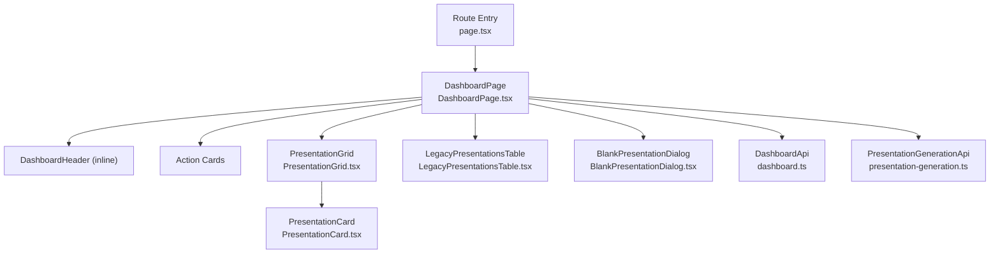
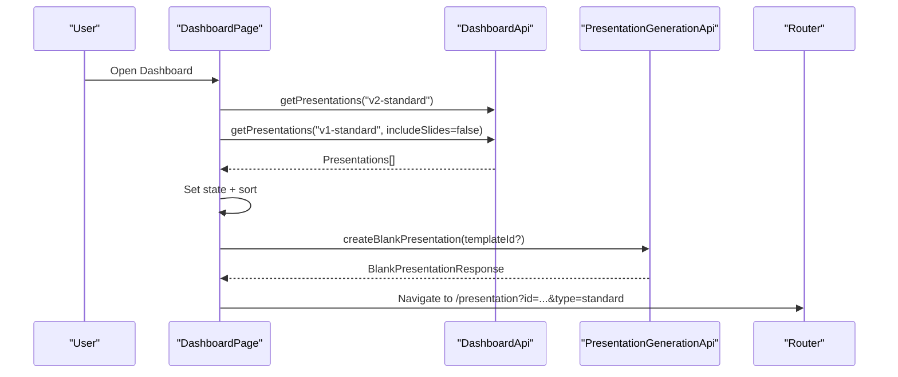
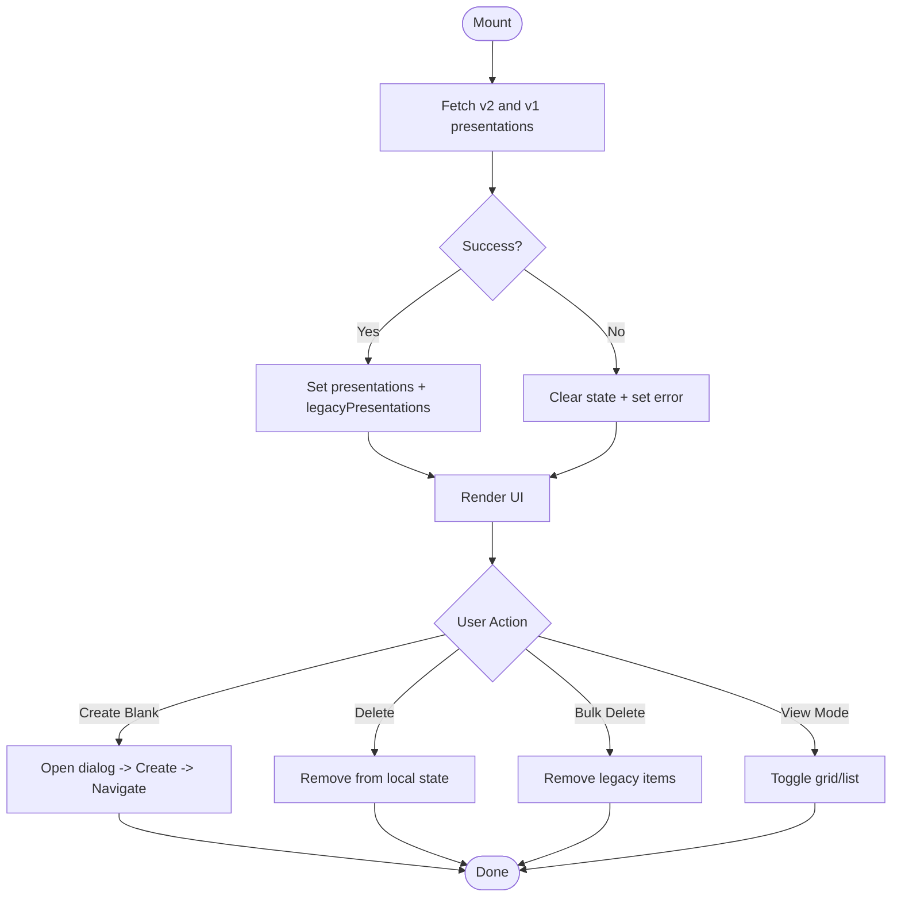
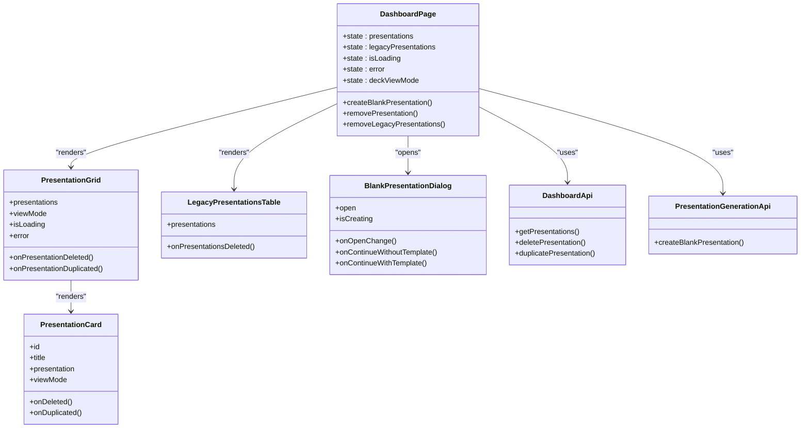

# Dashboard Page Component

<cite>
**Referenced Files in This Document**
- [DashboardPage.tsx](file://servers/nextjs/app/(presentation-generator)/(dashboard)/dashboard/components/DashboardPage.tsx)
- [page.tsx](file://servers/nextjs/app/(presentation-generator)/(dashboard)/dashboard/page.tsx)
- [PresentationGrid.tsx](file://servers/nextjs/app/(presentation-generator)/(dashboard)/dashboard/components/PresentationGrid.tsx)
- [LegacyPresentationsTable.tsx](file://servers/nextjs/app/(presentation-generator)/(dashboard)/dashboard/components/LegacyPresentationsTable.tsx)
- [BlankPresentationDialog.tsx](file://servers/nextjs/app/(presentation-generator)/(dashboard)/dashboard/components/BlankPresentationDialog.tsx)
- [PresentationCard.tsx](file://servers/nextjs/app/(presentation-generator)/(dashboard)/dashboard/components/PresentationCard.tsx)
- [dashboard.ts](file://servers/nextjs/app/(presentation-generator)/services/api/dashboard.ts)
- [presentation-generation.ts](file://servers/nextjs/app/(presentation-generator)/services/api/presentation-generation.ts)
</cite>

## Table of Contents
1. [Introduction](#introduction)
2. [Project Structure](#project-structure)
3. [Core Components](#core-components)
4. [Architecture Overview](#architecture-overview)
5. [Detailed Component Analysis](#detailed-component-analysis)
6. [Dependency Analysis](#dependency-analysis)
7. [Performance Considerations](#performance-considerations)
8. [Troubleshooting Guide](#troubleshooting-guide)
9. [Conclusion](#conclusion)

## Introduction
This document explains the DashboardPage component, which is the main dashboard interface for browsing and managing presentations. It covers the component’s structure, state management, data fetching patterns, integration with presentation services, error handling, loading indicators, user interactions, props, hooks usage, lifecycle behavior, and performance considerations such as sorting, view modes, and strategies for large collections.

## Project Structure
The dashboard page is a client-side Next.js component rendered by a route entry point. The page composes several subcomponents:
- Header actions and navigation
- Action cards to create new presentations
- Presentation grid for modern presentations
- Legacy presentations table for older format decks
- A dialog flow for creating blank presentations with or without templates

**Diagram sources**
- [page.tsx:1-10](file://servers/nextjs/app/(presentation-generator)/(dashboard)/dashboard/page.tsx#L1-L10)
- [DashboardPage.tsx:1-621](file://servers/nextjs/app/(presentation-generator)/(dashboard)/dashboard/components/DashboardPage.tsx#L1-L621)
- [PresentationGrid.tsx:1-98](file://servers/nextjs/app/(presentation-generator)/(dashboard)/dashboard/components/PresentationGrid.tsx#L1-L98)
- [LegacyPresentationsTable.tsx:1-218](file://servers/nextjs/app/(presentation-generator)/(dashboard)/dashboard/components/LegacyPresentationsTable.tsx#L1-L218)
- [BlankPresentationDialog.tsx:1-267](file://servers/nextjs/app/(presentation-generator)/(dashboard)/dashboard/components/BlankPresentationDialog.tsx#L1-L267)
- [PresentationCard.tsx:1-299](file://servers/nextjs/app/(presentation-generator)/(dashboard)/dashboard/components/PresentationCard.tsx#L1-L299)
- [dashboard.ts:1-128](file://servers/nextjs/app/(presentation-generator)/services/api/dashboard.ts#L1-L128)
- [presentation-generation.ts:1-361](file://servers/nextjs/app/(presentation-generator)/services/api/presentation-generation.ts#L1-L361)

**Section sources**
- [page.tsx:1-10](file://servers/nextjs/app/(presentation-generator)/(dashboard)/dashboard/page.tsx#L1-L10)
- [DashboardPage.tsx:1-621](file://servers/nextjs/app/(presentation-generator)/(dashboard)/dashboard/components/DashboardPage.tsx#L1-L621)

## Core Components
- DashboardPage: Main container that manages state, fetches presentations, handles creation flows, and renders UI sections.
- PresentationGrid: Renders the deck list in grid or list mode, shows loading skeletons, errors, and empty states.
- LegacyPresentationsTable: Displays legacy-format presentations with bulk delete support.
- BlankPresentationDialog: Two-step dialog to start a blank presentation with or without a template.
- PresentationCard: Individual card with preview, duplicate, and delete actions.

Key responsibilities:
- Data fetching: Loads both v2 and v1 presentations concurrently.
- State: Tracks presentations, legacy presentations, loading, error, view mode, and creation flow.
- User interactions: Create blank presentation, open presentations, duplicate, delete, switch view mode.
- Analytics: Tracks navigation and key events via Mixpanel.

**Section sources**
- [DashboardPage.tsx:392-621](file://servers/nextjs/app/(presentation-generator)/(dashboard)/dashboard/components/DashboardPage.tsx#L392-L621)
- [PresentationGrid.tsx:1-98](file://servers/nextjs/app/(presentation-generator)/(dashboard)/dashboard/components/PresentationGrid.tsx#L1-L98)
- [LegacyPresentationsTable.tsx:1-218](file://servers/nextjs/app/(presentation-generator)/(dashboard)/dashboard/components/LegacyPresentationsTable.tsx#L1-L218)
- [BlankPresentationDialog.tsx:1-267](file://servers/nextjs/app/(presentation-generator)/(dashboard)/dashboard/components/BlankPresentationDialog.tsx#L1-L267)
- [PresentationCard.tsx:1-299](file://servers/nextjs/app/(presentation-generator)/(dashboard)/dashboard/components/PresentationCard.tsx#L1-L299)

## Architecture Overview
The dashboard integrates with two primary API clients:
- DashboardApi: Fetches all presentations, deletes, duplicates, and retrieves single presentations.
- PresentationGenerationApi: Creates blank presentations and other generation-related operations.

Data flow:
- On mount, DashboardPage calls DashboardApi.getPresentations twice in parallel for v2 and v1 formats.
- Results are stored in local state and sorted by newest first.
- PresentationGrid renders the v2 presentations; LegacyPresentationsTable renders v1 presentations.
- Creation flows call PresentationGenerationApi.createBlankPresentation and navigate to the editor.

**Diagram sources**
- [DashboardPage.tsx:420-490](file://servers/nextjs/app/(presentation-generator)/(dashboard)/dashboard/components/DashboardPage.tsx#L420-L490)
- [dashboard.ts:35-68](file://servers/nextjs/app/(presentation-generator)/services/api/dashboard.ts#L35-L68)
- [presentation-generation.ts:146-175](file://servers/nextjs/app/(presentation-generator)/services/api/presentation-generation.ts#L146-L175)

## Detailed Component Analysis

### DashboardPage
Responsibilities:
- Manages state for presentations, legacy presentations, loading, error, view mode, and creation flow.
- Sorts presentations by created_at descending using a memoized helper.
- Fetches presentations on mount and tracks analytics.
- Handles creation of blank presentations with optional template selection.
- Renders header, action cards, presentation grid, and legacy table.

State and hooks:
- useState for presentations, legacyPresentations, isLoading, isCreatingBlankPresentation, isBlankPresentationDialogOpen, error, deckViewMode.
- useRef to prevent duplicate creation requests.
- useMemo for sorted lists.
- useCallback for stable handlers.
- useEffect to trigger initial data load.

Error and loading:
- Sets isLoading during fetch and clears error before request.
- Catches errors and sets empty arrays; analytics track failure.
- PresentationGrid displays skeleton loaders and error retry UI.

User interactions:
- Opens blank presentation dialog.
- Creates blank presentation and navigates to editor.
- Removes single or multiple legacy presentations.
- Switches between grid and list views.

Props:
- None; it is the root component for this route.

Lifecycle:
- Mounts once per route instance, triggers fetchPresentations.
- Subsequent re-renders rely on memoization and stable callbacks.

**Diagram sources**
- [DashboardPage.tsx:392-621](file://servers/nextjs/app/(presentation-generator)/(dashboard)/dashboard/components/DashboardPage.tsx#L392-L621)

**Section sources**
- [DashboardPage.tsx:392-621](file://servers/nextjs/app/(presentation-generator)/(dashboard)/dashboard/components/DashboardPage.tsx#L392-L621)

### PresentationGrid
Responsibilities:
- Renders presentations in grid or list layout.
- Shows shimmer skeletons while loading.
- Displays an error message with a reload option.
- Delegates individual item rendering to PresentationCard.

Props:
- presentations: Array of PresentationResponse.
- viewMode: "grid" | "list".
- isLoading: boolean.
- error: string | null.
- onPresentationDeleted: callback to remove a presentation.
- onPresentationDuplicated: callback to prepend duplicated presentation.

Behavior:
- If isLoading, returns skeleton cards.
- If error, returns error UI with reload button.
- If no presentations, returns EmptyState.
- Otherwise maps over presentations to render PresentationCard.

**Section sources**
- [PresentationGrid.tsx:1-98](file://servers/nextjs/app/(presentation-generator)/(dashboard)/dashboard/components/PresentationGrid.tsx#L1-L98)

### LegacyPresentationsTable
Responsibilities:
- Lists legacy-format presentations with metadata.
- Provides bulk delete confirmation and execution.
- Uses DashboardApi.deletePresentation for each item.

Props:
- presentations: Array of PresentationResponse.
- onPresentationsDeleted: callback to remove deleted IDs from parent state.

Behavior:
- Hides itself if there are no legacy presentations.
- Confirms deletion via dialog.
- Executes parallel deletions and reports success/failure via notifications.

**Section sources**
- [LegacyPresentationsTable.tsx:1-218](file://servers/nextjs/app/(presentation-generator)/(dashboard)/dashboard/components/LegacyPresentationsTable.tsx#L1-L218)

### BlankPresentationDialog
Responsibilities:
- Guides users through starting a blank presentation with or without a template.
- Integrates with template listing UI and hook.
- Prevents closing during creation.

Props:
- open: boolean.
- isCreating: boolean.
- onOpenChange: (open: boolean) => void.
- onContinueWithoutTemplate: () => void.
- onContinueWithTemplate: (template) => void.

Behavior:
- Step 1: Choice between with/without template.
- Step 2: Template picker with default and custom templates.
- Disables interactions while creating.
- Supports retry when template loading fails.

**Section sources**
- [BlankPresentationDialog.tsx:1-267](file://servers/nextjs/app/(presentation-generator)/(dashboard)/dashboard/components/BlankPresentationDialog.tsx#L1-L267)

### PresentationCard
Responsibilities:
- Renders a single presentation card with preview and actions.
- Handles opening, duplicating, and deleting presentations.
- Adapts preview based on template version and slide content.

Props:
- id: string.
- title: string.
- presentation: any.
- viewMode: "grid" | "list".
- onDeleted?: (id: string) => void.
- onDuplicated?: (presentation: any) => void.

Behavior:
- Blocks opening unsupported legacy presentations.
- Tracks analytics on open.
- Calls DashboardApi.duplicatePresentation and DashboardApi.deletePresentation.
- Shows delete confirmation dialog.

**Section sources**
- [PresentationCard.tsx:1-299](file://servers/nextjs/app/(presentation-generator)/(dashboard)/dashboard/components/PresentationCard.tsx#L1-L299)

## Dependency Analysis
High-level dependencies:
- DashboardPage depends on:
  - DashboardApi for listing, deleting, duplicating presentations.
  - PresentationGenerationApi for creating blank presentations.
  - PresentationGrid and LegacyPresentationsTable for rendering lists.
  - BlankPresentationDialog for creation flow.
  - PresentationCard for individual deck interactions.

API contracts:
- DashboardApi.getPresentations(version?, options?): Promise<PresentationResponse[]>
- DashboardApi.deletePresentation(id): Promise<{ success: boolean; message?: string }>
- DashboardApi.duplicatePresentation(id): Promise<PresentationResponse>
- PresentationGenerationApi.createBlankPresentation(templateId?): Promise<BlankPresentationResponse>

**Diagram sources**
- [DashboardPage.tsx:392-621](file://servers/nextjs/app/(presentation-generator)/(dashboard)/dashboard/components/DashboardPage.tsx#L392-L621)
- [PresentationGrid.tsx:1-98](file://servers/nextjs/app/(presentation-generator)/(dashboard)/dashboard/components/PresentationGrid.tsx#L1-L98)
- [LegacyPresentationsTable.tsx:1-218](file://servers/nextjs/app/(presentation-generator)/(dashboard)/dashboard/components/LegacyPresentationsTable.tsx#L1-L218)
- [BlankPresentationDialog.tsx:1-267](file://servers/nextjs/app/(presentation-generator)/(dashboard)/dashboard/components/BlankPresentationDialog.tsx#L1-L267)
- [PresentationCard.tsx:1-299](file://servers/nextjs/app/(presentation-generator)/(dashboard)/dashboard/components/PresentationCard.tsx#L1-L299)
- [dashboard.ts:35-128](file://servers/nextjs/app/(presentation-generator)/services/api/dashboard.ts#L35-L128)
- [presentation-generation.ts:146-175](file://servers/nextjs/app/(presentation-generator)/services/api/presentation-generation.ts#L146-L175)

**Section sources**
- [dashboard.ts:35-128](file://servers/nextjs/app/(presentation-generator)/services/api/dashboard.ts#L35-L128)
- [presentation-generation.ts:146-175](file://servers/nextjs/app/(presentation-generator)/services/api/presentation-generation.ts#L146-L175)

## Performance Considerations
Current optimizations:
- Concurrent fetching: Both v2 and v1 presentation lists are fetched in parallel using Promise.all to reduce total load time.
- Memoization: Sorted lists are computed with useMemo to avoid unnecessary recomputation.
- Stable callbacks: Handlers are wrapped in useCallback to minimize child re-renders.
- View mode toggle: Local state avoids re-fetching data when switching between grid and list.
- Skeleton UI: PresentationGrid uses lightweight shimmer placeholders instead of heavy components during loading.

Strategies for large collections:
- Pagination: Introduce server-side pagination parameters (page, pageSize) and update DashboardApi.getPresentations accordingly. Update DashboardPage to manage current page and append or replace results.
- Virtualization: For very large lists, consider virtualizing rows/cards to render only visible items.
- Lazy loading: Load thumbnails or previews lazily using IntersectionObserver or React.lazy for heavy preview components.
- Caching:
  - Client-side cache: Use a simple in-memory cache keyed by version and includeSlides flag to avoid refetching identical requests.
  - Browser cache: Leverage Request cache policies where appropriate (e.g., stale-while-revalidate) for read-only endpoints.
  - Debounce refresh: Debounce manual refresh actions to prevent excessive network calls.
- Sorting optimization: Keep sorting client-side but ensure data is normalized and indexed by created_at to speed up comparisons.

[No sources needed since this section provides general guidance]

## Troubleshooting Guide
Common issues and resolutions:
- Presentations not loading:
  - Check network requests to /api/v1/ppt/presentation/all.
  - Verify authentication headers and backend availability.
  - Review error state in PresentationGrid and try reloading.
- Error creating blank presentation:
  - Inspect console logs and toast notifications.
  - Ensure PresentationGenerationApi.createBlankPresentation succeeds and returns a valid id.
- Duplicate or delete actions failing:
  - Confirm DashboardApi methods return expected responses.
  - Validate user permissions and presentation ownership.
- Legacy presentations inaccessible:
  - These require an older version of the application; follow the provided link to download the compatible release.

Operational tips:
- Use browser dev tools to inspect fetch calls and response payloads.
- Add logging around fetchPresentations and createBlankPresentation to trace failures.
- Monitor Mixpanel events for navigation and creation flows to validate analytics tracking.

**Section sources**
- [DashboardPage.tsx:420-490](file://servers/nextjs/app/(presentation-generator)/(dashboard)/dashboard/components/DashboardPage.tsx#L420-L490)
- [PresentationGrid.tsx:45-69](file://servers/nextjs/app/(presentation-generator)/(dashboard)/dashboard/components/PresentationGrid.tsx#L45-L69)
- [PresentationCard.tsx:78-121](file://servers/nextjs/app/(presentation-generator)/(dashboard)/dashboard/components/PresentationCard.tsx#L78-L121)
- [LegacyPresentationsTable.tsx:49-78](file://servers/nextjs/app/(presentation-generator)/(dashboard)/dashboard/components/LegacyPresentationsTable.tsx#L49-L78)

## Conclusion
DashboardPage serves as the central hub for presenting and managing presentations. It coordinates data fetching, state management, user interactions, and analytics while delegating rendering to focused subcomponents. With concurrent fetching, memoization, and clear error/loading states, it provides a responsive experience. For scaling to larger datasets, adopting pagination, virtualization, lazy loading, and caching will further improve performance and usability.