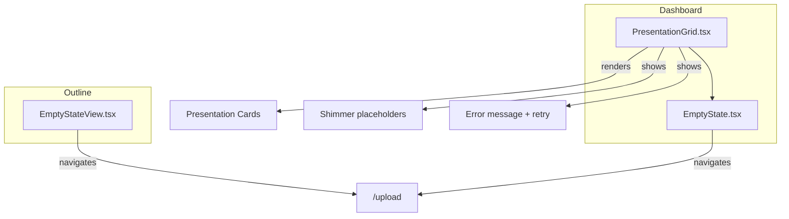
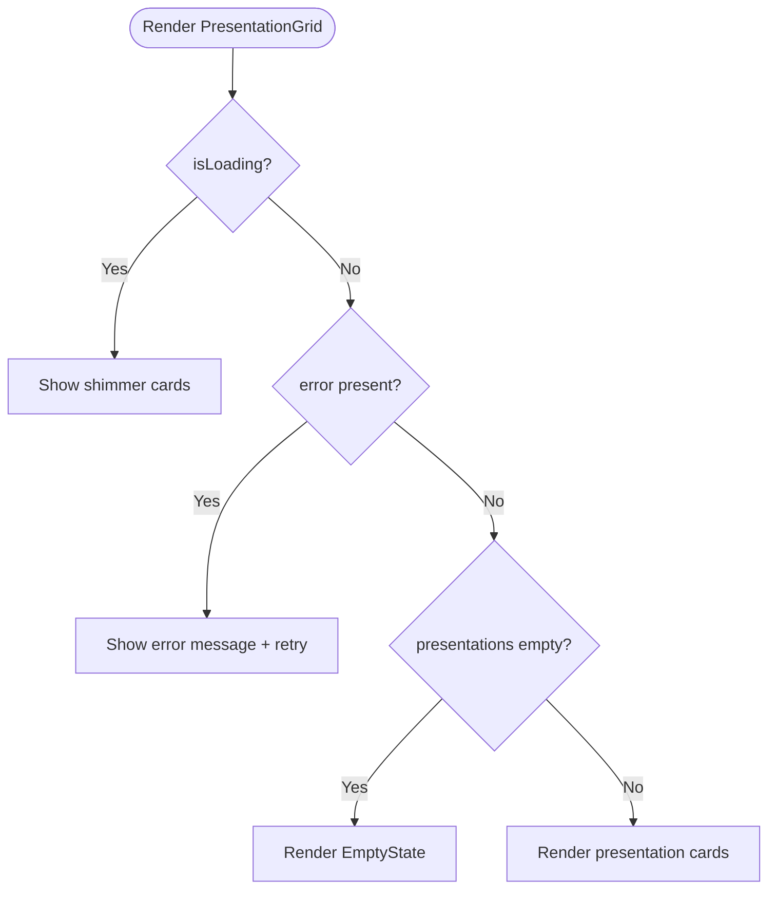
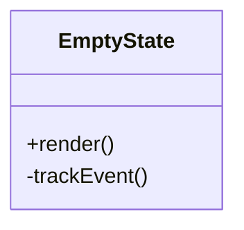
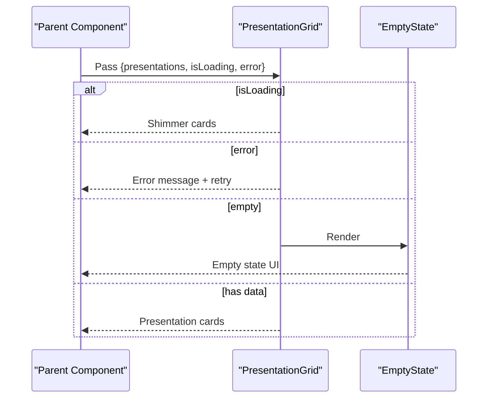
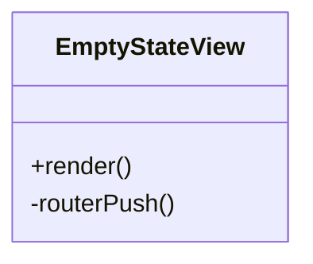
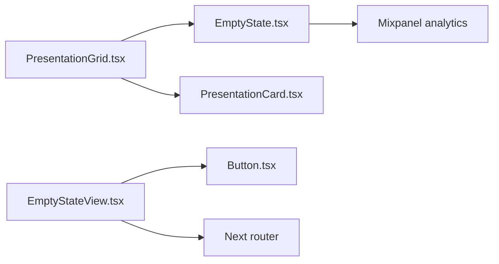

# Empty State Handling

<cite>
**Referenced Files in This Document**
- [EmptyState.tsx](file://servers/nextjs/app/(presentation-generator)/(dashboard)/dashboard/components/EmptyState.tsx)
- [PresentationGrid.tsx](file://servers/nextjs/app/(presentation-generator)/(dashboard)/dashboard/components/PresentationGrid.tsx)
- [EmptyStateView.tsx](file://servers/nextjs/app/(presentation-generator)/outline/components/EmptyStateView.tsx)
</cite>

## Table of Contents
1. [Introduction](#introduction)
2. [Project Structure](#project-structure)
3. [Core Components](#core-components)
4. [Architecture Overview](#architecture-overview)
5. [Detailed Component Analysis](#detailed-component-analysis)
6. [Dependency Analysis](#dependency-analysis)
7. [Performance Considerations](#performance-considerations)
8. [Troubleshooting Guide](#troubleshooting-guide)
9. [Conclusion](#conclusion)

## Introduction
This document explains how the application handles empty states when no presentations are available. It focuses on two primary UI surfaces:
- Dashboard presentation list: shows a friendly “no presentations yet” state and guides users to create their first presentation.
- Outline view: shows a “No Presentation Found” state with guidance to create a new presentation.

It also documents how loading and error states are handled around these components, clarifies call-to-action elements, accessibility considerations, localization status, and customization options for different empty scenarios.

## Project Structure
The empty-state behavior is implemented in Next.js client components under the presentation generator app:
- Dashboard empty state component renders a link to start creating a presentation when the list is empty.
- The dashboard grid decides which state to render (loading, error, empty, or content).
- Outline view provides a dedicated empty state for missing presentations.

**Diagram sources**
- [PresentationGrid.tsx:45-73](file://servers/nextjs/app/(presentation-generator)/(dashboard)/dashboard/components/PresentationGrid.tsx#L45-L73)
- [EmptyState.tsx:7-35](file://servers/nextjs/app/(presentation-generator)/(dashboard)/dashboard/components/EmptyState.tsx#L7-L35)
- [EmptyStateView.tsx:7-55](file://servers/nextjs/app/(presentation-generator)/outline/components/EmptyStateView.tsx#L7-L55)

**Section sources**
- [PresentationGrid.tsx:1-98](file://servers/nextjs/app/(presentation-generator)/(dashboard)/dashboard/components/PresentationGrid.tsx#L1-L98)
- [EmptyState.tsx:1-36](file://servers/nextjs/app/(presentation-generator)/(dashboard)/dashboard/components/EmptyState.tsx#L1-L36)
- [EmptyStateView.tsx:1-55](file://servers/nextjs/app/(presentation-generator)/outline/components/EmptyStateView.tsx#L1-L55)

## Core Components
- Dashboard EmptyState: A client component that displays an illustration and a prominent link to create a new presentation. It includes analytics tracking and accessibility attributes.
- PresentationGrid: A container that chooses between loading, error, empty, and content views based on props.
- Outline EmptyStateView: A full-page view indicating that a specific presentation was not found, with a button to create a new one.

Key responsibilities:
- Present clear messaging for each empty scenario.
- Provide actionable next steps (navigation to creation flows).
- Maintain consistent accessibility and analytics integration.

**Section sources**
- [EmptyState.tsx:7-35](file://servers/nextjs/app/(presentation-generator)/(dashboard)/dashboard/components/EmptyState.tsx#L7-L35)
- [PresentationGrid.tsx:15-73](file://servers/nextjs/app/(presentation-generator)/(dashboard)/dashboard/components/PresentationGrid.tsx#L15-L73)
- [EmptyStateView.tsx:7-55](file://servers/nextjs/app/(presentation-generator)/outline/components/EmptyStateView.tsx#L7-L55)

## Architecture Overview
The empty-state architecture follows a simple decision tree in the grid component, delegating visual rendering to specialized components per scenario.

**Diagram sources**
- [PresentationGrid.tsx:45-73](file://servers/nextjs/app/(presentation-generator)/(dashboard)/dashboard/components/PresentationGrid.tsx#L45-L73)

**Section sources**
- [PresentationGrid.tsx:15-98](file://servers/nextjs/app/(presentation-generator)/(dashboard)/dashboard/components/PresentationGrid.tsx#L15-L98)

## Detailed Component Analysis

### Dashboard EmptyState Component
Purpose:
- Display a welcoming empty state when there are no presentations.
- Encourage users to create their first presentation via a prominent link.
- Track user interactions for analytics.

Behavior:
- Renders a centered card-like link with an illustration and text.
- Navigates to the upload/create flow when clicked.
- Emits an analytics event on click.

Accessibility:
- Uses aria-label on the interactive element to describe its purpose.
- Decorative image is marked as hidden from assistive technologies.

Customization points:
- Text content can be localized by replacing static strings.
- Styling classes allow theme adjustments.
- Analytics event name and payload can be extended.

**Diagram sources**
- [EmptyState.tsx:7-35](file://servers/nextjs/app/(presentation-generator)/(dashboard)/dashboard/components/EmptyState.tsx#L7-L35)

**Section sources**
- [EmptyState.tsx:1-36](file://servers/nextjs/app/(presentation-generator)/(dashboard)/dashboard/components/EmptyState.tsx#L1-L36)

### PresentationGrid State Management
Purpose:
- Decide which view to show based on data and state.
- Provide consistent UX across loading, error, empty, and content states.

Scenarios:
- Loading: Shows animated placeholder cards.
- Error: Displays an error message with a retry action.
- Empty: Delegates to EmptyState.
- Content: Renders presentation cards.

**Diagram sources**
- [PresentationGrid.tsx:45-73](file://servers/nextjs/app/(presentation-generator)/(dashboard)/dashboard/components/PresentationGrid.tsx#L45-L73)

**Section sources**
- [PresentationGrid.tsx:15-98](file://servers/nextjs/app/(presentation-generator)/(dashboard)/dashboard/components/PresentationGrid.tsx#L15-L98)

### Outline EmptyStateView
Purpose:
- Inform users that a requested presentation could not be found.
- Guide them to create a new presentation.

Behavior:
- Displays a large icon, headline, explanatory text, and a primary action button.
- Navigates to the upload/create flow on button click.

Accessibility:
- Uses semantic headings and descriptive text.
- Button is keyboard-focusable and visually distinct.

Customization points:
- Headline and body text can be localized.
- Button styling and icons can be adjusted.

**Diagram sources**
- [EmptyStateView.tsx:7-55](file://servers/nextjs/app/(presentation-generator)/outline/components/EmptyStateView.tsx#L7-L55)

**Section sources**
- [EmptyStateView.tsx:1-55](file://servers/nextjs/app/(presentation-generator)/outline/components/EmptyStateView.tsx#L1-L55)

## Dependency Analysis
- PresentationGrid depends on EmptyState for the empty scenario and on PresentationCard for content rendering.
- EmptyState uses Next.js Link for navigation and Mixpanel for analytics.
- EmptyStateView uses Next.js router for navigation and a shared Button component.

**Diagram sources**
- [PresentationGrid.tsx:1-4](file://servers/nextjs/app/(presentation-generator)/(dashboard)/dashboard/components/PresentationGrid.tsx#L1-L4)
- [EmptyState.tsx:3-5](file://servers/nextjs/app/(presentation-generator)/(dashboard)/dashboard/components/EmptyState.tsx#L3-L5)
- [EmptyStateView.tsx:1-5](file://servers/nextjs/app/(presentation-generator)/outline/components/EmptyStateView.tsx#L1-L5)

**Section sources**
- [PresentationGrid.tsx:1-98](file://servers/nextjs/app/(presentation-generator)/(dashboard)/dashboard/components/PresentationGrid.tsx#L1-L98)
- [EmptyState.tsx:1-36](file://servers/nextjs/app/(presentation-generator)/(dashboard)/dashboard/components/EmptyState.tsx#L1-L36)
- [EmptyStateView.tsx:1-55](file://servers/nextjs/app/(presentation-generator)/outline/components/EmptyStateView.tsx#L1-L55)

## Performance Considerations
- EmptyState and EmptyStateView are lightweight; they do not perform heavy computations.
- PresentationGrid defers expensive rendering until data is available, showing shimmer placeholders during loading to improve perceived performance.
- Avoid unnecessary re-renders by keeping EmptyState pure and stateless.

[No sources needed since this section provides general guidance]

## Troubleshooting Guide
Common issues and resolutions:
- Empty state not appearing: Ensure the parent passes an empty array or null for presentations and that the condition checking emptiness is correct.
- Retry not working: Verify the error handler triggers a reload or refetch operation.
- Navigation not triggering: Confirm that the href or router.push target exists and is accessible.

Relevant implementation references:
- Empty state trigger in grid: [PresentationGrid.tsx:71-73](file://servers/nextjs/app/(presentation-generator)/(dashboard)/dashboard/components/PresentationGrid.tsx#L71-L73)
- Error handling and retry: [PresentationGrid.tsx:55-69](file://servers/nextjs/app/(presentation-generator)/(dashboard)/dashboard/components/PresentationGrid.tsx#L55-L69)
- Navigation to create flow: [EmptyState.tsx:10-18](file://servers/nextjs/app/(presentation-generator)/(dashboard)/dashboard/components/EmptyState.tsx#L10-L18), [EmptyStateView.tsx:39-46](file://servers/nextjs/app/(presentation-generator)/outline/components/EmptyStateView.tsx#L39-L46)

**Section sources**
- [PresentationGrid.tsx:45-73](file://servers/nextjs/app/(presentation-generator)/(dashboard)/dashboard/components/PresentationGrid.tsx#L45-L73)
- [EmptyState.tsx:10-18](file://servers/nextjs/app/(presentation-generator)/(dashboard)/dashboard/components/EmptyState.tsx#L10-L18)
- [EmptyStateView.tsx:39-46](file://servers/nextjs/app/(presentation-generator)/outline/components/EmptyStateView.tsx#L39-L46)

## Conclusion
The application provides clear, actionable empty states for both the dashboard and outline views. Users are guided to create new presentations through prominent links/buttons, while loading and error conditions are handled distinctly. Accessibility is considered with appropriate labels and hidden decorative assets. Localization is not currently integrated into these components, but the structure allows straightforward updates to support multiple languages. Customization is possible via styling and text replacement, enabling teams to tailor the experience to different contexts.

[No sources needed since this section summarizes without analyzing specific files]