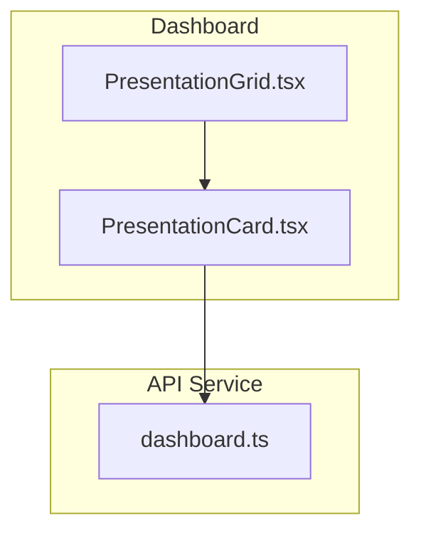
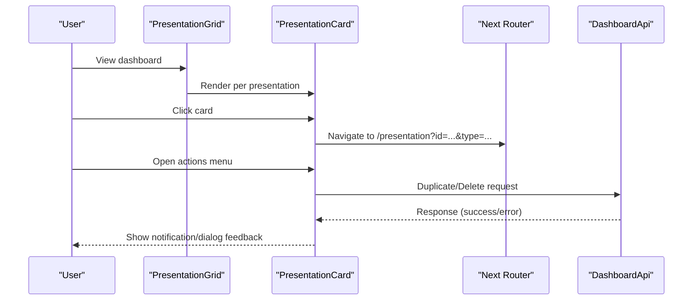
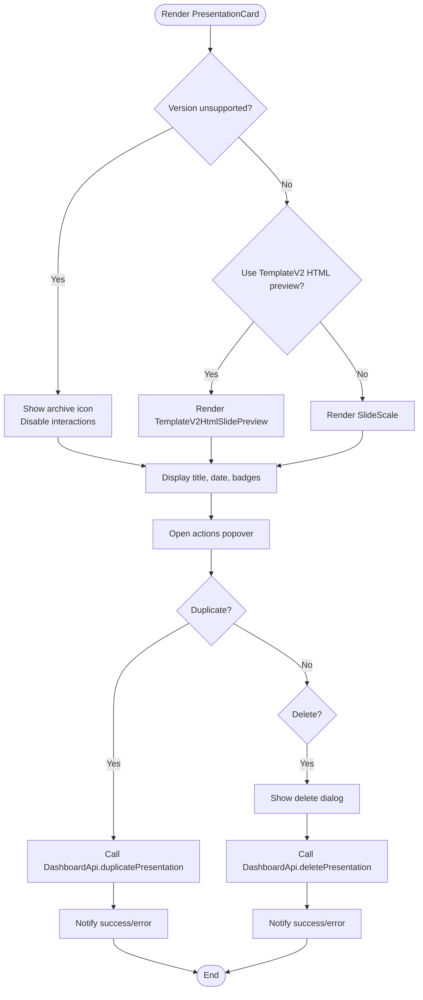
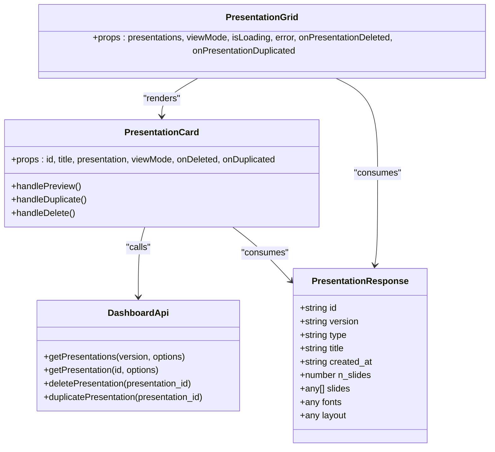

# Presentation Card Component

<cite>
**Referenced Files in This Document**
- [PresentationCard.tsx](file://servers/nextjs/app/(presentation-generator)/(dashboard)/dashboard/components/PresentationCard.tsx)
- [PresentationGrid.tsx](file://servers/nextjs/app/(presentation-generator)/(dashboard)/dashboard/components/PresentationGrid.tsx)
- [dashboard.ts](file://servers/nextjs/app/(presentation-generator)/services/api/dashboard.ts)
</cite>

## Table of Contents
1. [Introduction](#introduction)
2. [Project Structure](#project-structure)
3. [Core Components](#core-components)
4. [Architecture Overview](#architecture-overview)
5. [Detailed Component Analysis](#detailed-component-analysis)
6. [Dependency Analysis](#dependency-analysis)
7. [Performance Considerations](#performance-considerations)
8. [Troubleshooting Guide](#troubleshooting-guide)
9. [Conclusion](#conclusion)

## Introduction
This document provides comprehensive documentation for the PresentationCard component, which renders individual presentations in both grid and list views within the dashboard. It covers visual design, metadata display (title, date, author), thumbnail rendering, action buttons, interactive states (hover, selected, disabled), accessibility features, keyboard navigation, screen reader support, customization options, styling theming, and responsive behavior across screen sizes.

## Project Structure
The PresentationCard is part of the Next.js presentation generator dashboard:
- The card itself lives under the dashboard components directory.
- It is rendered by a parent grid container that supports switching between grid and list layouts.
- Data and API operations are provided via a dedicated service module.

**Diagram sources**
- [PresentationGrid.tsx:1-98](file://servers/nextjs/app/(presentation-generator)/(dashboard)/dashboard/components/PresentationGrid.tsx#L1-L98)
- [PresentationCard.tsx:1-299](file://servers/nextjs/app/(presentation-generator)/(dashboard)/dashboard/components/PresentationCard.tsx#L1-L299)
- [dashboard.ts:1-128](file://servers/nextjs/app/(presentation-generator)/services/api/dashboard.ts#L1-L128)

**Section sources**
- [PresentationGrid.tsx:1-98](file://servers/nextjs/app/(presentation-generator)/(dashboard)/dashboard/components/PresentationGrid.tsx#L1-L98)
- [PresentationCard.tsx:1-299](file://servers/nextjs/app/(presentation-generator)/(dashboard)/dashboard/components/PresentationCard.tsx#L1-L299)
- [dashboard.ts:1-128](file://servers/nextjs/app/(presentation-generator)/services/api/dashboard.ts#L1-L128)

## Core Components
- PresentationCard: Renders a single presentation item with thumbnail preview, metadata, and actions (duplicate, delete). Supports grid and list modes and handles unsupported versions gracefully.
- PresentationGrid: Container that renders multiple PresentationCard instances in either a responsive grid or a compact list layout. Provides loading, error, and empty states.
- DashboardApi: Provides methods to fetch, duplicate, and delete presentations, returning structured responses consumed by UI components.

Key responsibilities:
- Visual composition: background image, slide thumbnail, type badge, slide count, title, creation date, and actions menu.
- Interactions: click-to-preview, duplicate, delete with confirmation dialog.
- State management: local state for actions, deletion dialog, and duplication/deletion progress indicators.
- Accessibility: aria-disabled for unsupported cards, descriptive titles, and accessible dialogs/popovers from shared UI primitives.

**Section sources**
- [PresentationCard.tsx:31-299](file://servers/nextjs/app/(presentation-generator)/(dashboard)/dashboard/components/PresentationCard.tsx#L31-L299)
- [PresentationGrid.tsx:15-97](file://servers/nextjs/app/(presentation-generator)/(dashboard)/dashboard/components/PresentationGrid.tsx#L15-L97)
- [dashboard.ts:35-128](file://servers/nextjs/app/(presentation-generator)/services/api/dashboard.ts#L35-L128)

## Architecture Overview
The PresentationCard integrates with the dashboard’s data layer and routing:
- Rendering pipeline: PresentationGrid maps over presentations and renders PresentationCard for each item.
- Thumbnail rendering: Uses either a template v2 HTML preview or a slide renderer depending on slide content and version.
- Actions: Duplicate and Delete trigger API calls through DashboardApi and show user feedback via notifications.
- Navigation: Clicking the card navigates to the presentation editor with appropriate query parameters.

**Diagram sources**
- [PresentationGrid.tsx:75-97](file://servers/nextjs/app/(presentation-generator)/(dashboard)/dashboard/components/PresentationGrid.tsx#L75-L97)
- [PresentationCard.tsx:58-75](file://servers/nextjs/app/(presentation-generator)/(dashboard)/dashboard/components/PresentationCard.tsx#L58-L75)
- [PresentationCard.tsx:78-121](file://servers/nextjs/app/(presentation-generator)/(dashboard)/dashboard/components/PresentationCard.tsx#L78-L121)
- [dashboard.ts:91-126](file://servers/nextjs/app/(presentation-generator)/services/api/dashboard.ts#L91-L126)

## Detailed Component Analysis

### PresentationCard
Purpose:
- Display a single presentation with its first slide as a thumbnail.
- Show metadata: title, creation date, slide count, and type badge (standard/smart).
- Provide actions: duplicate and delete, with confirmation dialog for delete.
- Handle unsupported versions by disabling interaction and showing an archive icon.

Props:
- id: string — unique identifier for the presentation.
- title: string — displayed title (may contain markdown).
- presentation: object — full presentation payload including slides, fonts, layout, version, generation_mode/type, created_at, n_slides.
- viewMode: "grid" | "list" — controls layout orientation and sizing.
- onDeleted?: (id) => void — callback when a presentation is deleted.
- onDuplicated?: (presentation) => void — callback when a presentation is duplicated.

Visual Design:
- Background: subtle background image overlay for depth.
- Thumbnail area: aspect-video container; uses TemplateV2HtmlSlidePreview when applicable, otherwise SlideScale.
- Badges: type badge (smart/standard) and slide count badge.
- Metadata section: title rendered via MarkdownRenderer; creation date formatted using locale date formatting.
- Actions: Popover menu with Duplicate and Delete options.

Interactive States:
- Hover: adds shadow and pointer cursor for clickable cards.
- Selected: not explicitly implemented; selection is typically handled at the parent level if needed.
- Disabled: unsupported versions set aria-disabled and prevent navigation; shows “Preview unavailable” placeholder.

Accessibility:
- aria-disabled on the root card for unsupported presentations.
- Descriptive title attribute for unsupported cards.
- Icons use aria-hidden where appropriate.
- Dialog and Popover rely on shared UI primitives for focus management and ARIA attributes.

Keyboard Navigation:
- Card click triggers navigation; ensure focus remains on the card element for keyboard users.
- Popover and Dialog should be operable via keyboard (Esc to close, Enter/Space to activate).
- Buttons inside the popover have explicit onClick handlers; ensure they receive focus and are visible to assistive technologies.

Error Handling:
- Duplicate/Delete operations show success or error notifications.
- Unsupported versions block navigation and show a warning message.

Customization and Theming:
- Styling uses Tailwind utility classes; theme integration is supported via slide-theme class on the card root.
- Title and metadata text colors and typography are defined inline; consider extracting into theme tokens for consistency.

Responsive Behavior:
- In list mode, the thumbnail becomes a fixed-width left column with metadata to the right.
- In grid mode, the thumbnail spans full width above metadata.
- Grid container adapts columns based on breakpoints.

**Diagram sources**
- [PresentationCard.tsx:52-75](file://servers/nextjs/app/(presentation-generator)/(dashboard)/dashboard/components/PresentationCard.tsx#L52-L75)
- [PresentationCard.tsx:122-176](file://servers/nextjs/app/(presentation-generator)/(dashboard)/dashboard/components/PresentationCard.tsx#L122-L176)
- [PresentationCard.tsx:178-241](file://servers/nextjs/app/(presentation-generator)/(dashboard)/dashboard/components/PresentationCard.tsx#L178-L241)
- [PresentationCard.tsx:78-121](file://servers/nextjs/app/(presentation-generator)/(dashboard)/dashboard/components/PresentationCard.tsx#L78-L121)
- [dashboard.ts:91-126](file://servers/nextjs/app/(presentation-generator)/services/api/dashboard.ts#L91-L126)

**Section sources**
- [PresentationCard.tsx:31-299](file://servers/nextjs/app/(presentation-generator)/(dashboard)/dashboard/components/PresentationCard.tsx#L31-L299)

### PresentationGrid
Purpose:
- Render a collection of PresentationCard components.
- Support two view modes: grid and list.
- Provide loading skeleton, error state, and empty state.

Responsibilities:
- Map over presentations array and pass required props to PresentationCard.
- Apply responsive grid classes for different breakpoints.
- Handle isLoading, error, and empty conditions before rendering cards.

Responsive Behavior:
- Grid mode: 1 column on small screens, 2 on medium, 4 on large.
- List mode: single-column layout optimized for compact viewing.

**Section sources**
- [PresentationGrid.tsx:15-97](file://servers/nextjs/app/(presentation-generator)/(dashboard)/dashboard/components/PresentationGrid.tsx#L15-L97)

### Data Model and API Integration
PresentationResponse:
- Contains all fields used by the card: id, version, type/generation_mode, title, created_at, n_slides, slides, fonts, layout, etc.
- Used by PresentationGrid to render cards and by PresentationCard to compute presentation type and thumbnail rendering strategy.

DashboardApi Methods:
- getPresentations: fetches list of presentations with optional include_slides flag.
- getPresentation: fetches a single presentation by id.
- deletePresentation: deletes a presentation and returns success status.
- duplicatePresentation: duplicates a presentation and returns the new presentation object.

**Diagram sources**
- [dashboard.ts:9-33](file://servers/nextjs/app/(presentation-generator)/services/api/dashboard.ts#L9-L33)
- [dashboard.ts:35-128](file://servers/nextjs/app/(presentation-generator)/services/api/dashboard.ts#L35-L128)
- [PresentationCard.tsx:31-45](file://servers/nextjs/app/(presentation-generator)/(dashboard)/dashboard/components/PresentationCard.tsx#L31-L45)
- [PresentationGrid.tsx:6-13](file://servers/nextjs/app/(presentation-generator)/(dashboard)/dashboard/components/PresentationGrid.tsx#L6-L13)

**Section sources**
- [dashboard.ts:9-128](file://servers/nextjs/app/(presentation-generator)/services/api/dashboard.ts#L9-L128)

## Dependency Analysis
- PresentationCard depends on:
  - Shared UI primitives: Card, Popover, Dialog, Tooltip, Sonner notifications.
  - Routing: Next.js router and pathname hooks.
  - Analytics: Mixpanel event tracking.
  - Rendering: SlideScale and TemplateV2HtmlSlidePreview for thumbnails.
  - MarkdownRenderer for title rendering.
- PresentationGrid depends on:
  - PresentationCard for rendering items.
  - EmptyState for empty list handling.
  - Tailwind CSS for responsive layout.

Coupling and Cohesion:
- PresentationCard encapsulates all presentation-specific logic and UI, maintaining high cohesion.
- PresentationGrid focuses purely on layout and state orchestration, keeping coupling low.

External Dependencies:
- API endpoints for CRUD operations on presentations.
- Third-party icons via lucide-react.
- Notification system via sonner.

Potential Circular Dependencies:
- None observed; dependencies flow from Grid to Card to API.

**Section sources**
- [PresentationCard.tsx:1-30](file://servers/nextjs/app/(presentation-generator)/(dashboard)/dashboard/components/PresentationCard.tsx#L1-L30)
- [PresentationGrid.tsx:1-13](file://servers/nextjs/app/(presentation-generator)/(dashboard)/dashboard/components/PresentationGrid.tsx#L1-L13)

## Performance Considerations
- Thumbnail rendering:
  - Use TemplateV2HtmlSlidePreview only when appropriate to avoid heavy DOM operations.
  - Consider lazy-loading thumbnails below the fold in large lists.
- Memoization:
  - Wrap PresentationCard with React.memo to prevent unnecessary re-renders when props do not change.
- Image optimization:
  - Ensure background images and thumbnails are optimized and cached appropriately.
- API calls:
  - Debounce duplicate/delete actions to prevent rapid successive requests.
  - Use optimistic updates for better perceived performance, with rollback on failure.

[No sources needed since this section provides general guidance]

## Troubleshooting Guide
Common issues and resolutions:
- Unsupported presentation:
  - Symptom: Card shows archive icon and disables navigation.
  - Cause: Version field indicates older format incompatible with current app.
  - Resolution: Upgrade/downgrade Presenton as indicated by the warning message.
- Duplicate operation fails:
  - Symptom: Error notification after clicking Duplicate.
  - Cause: Network error or server-side validation failure.
  - Resolution: Retry the operation; check network connectivity and backend logs.
- Delete operation fails:
  - Symptom: Error notification after confirming deletion.
  - Cause: Permission issues or transient server error.
  - Resolution: Re-attempt deletion; verify user permissions and backend availability.
- Thumbnail not rendering:
  - Symptom: Placeholder or blank thumbnail.
  - Cause: Missing slide data or unsupported slide structure.
  - Resolution: Verify presentation.slides contains valid first slide; fallback to SlideScale.

**Section sources**
- [PresentationCard.tsx:58-75](file://servers/nextjs/app/(presentation-generator)/(dashboard)/dashboard/components/PresentationCard.tsx#L58-L75)
- [PresentationCard.tsx:78-121](file://servers/nextjs/app/(presentation-generator)/(dashboard)/dashboard/components/PresentationCard.tsx#L78-L121)

## Conclusion
The PresentationCard component provides a robust, accessible, and customizable way to represent individual presentations in both grid and list views. It integrates seamlessly with the dashboard’s data layer, supports key interactions like duplicate and delete, and adapts responsively across devices. By following the guidelines and recommendations outlined here, developers can extend and maintain the component effectively while ensuring a consistent user experience.

[No sources needed since this section summarizes without analyzing specific files]