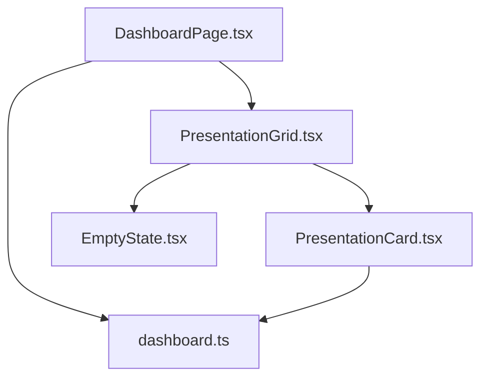
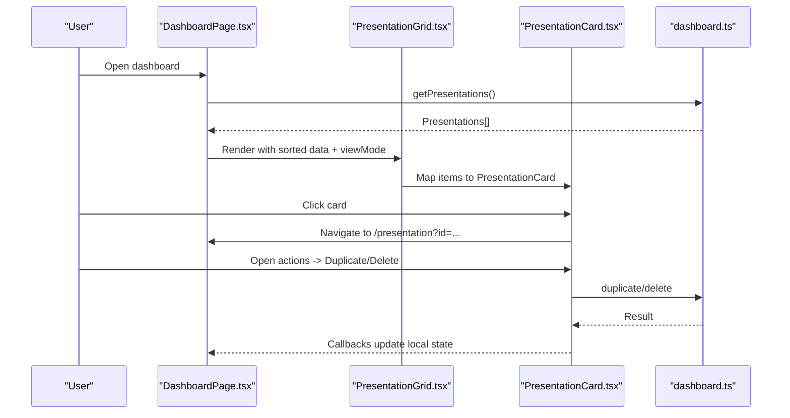
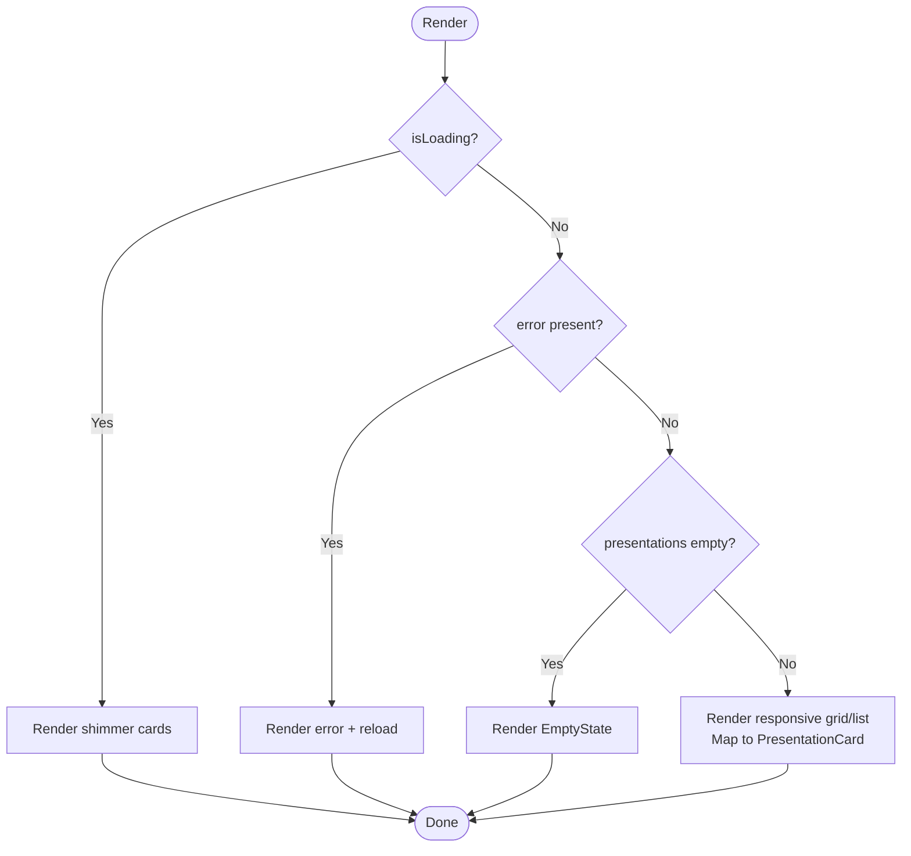
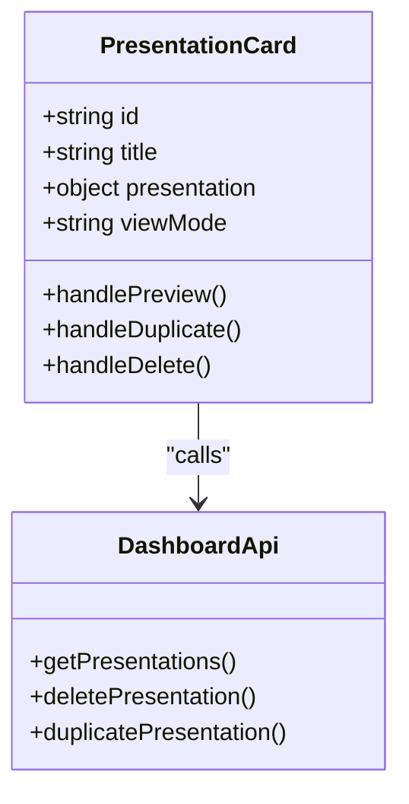
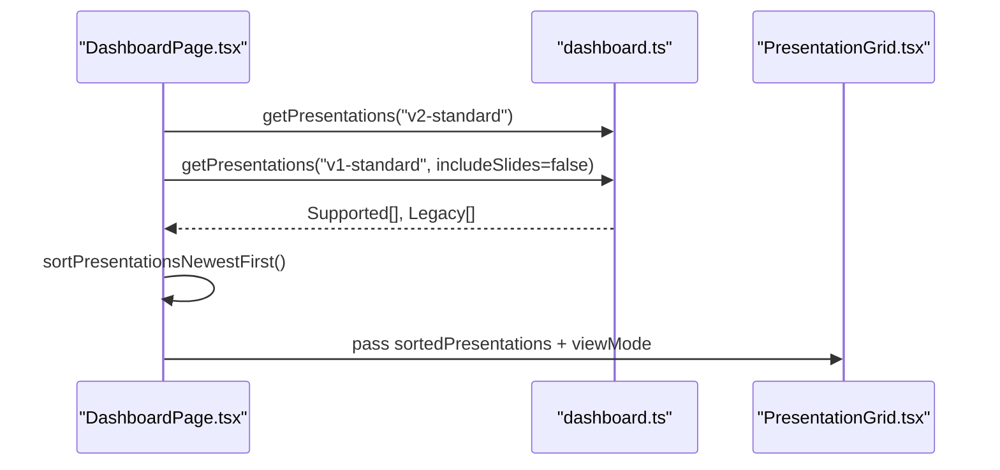
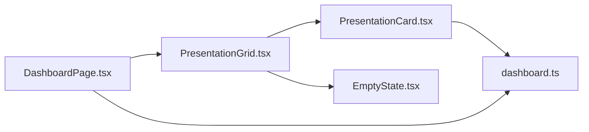

# Presentation Grid View

<cite>
**Referenced Files in This Document**
- [PresentationGrid.tsx](file://servers/nextjs/app/(presentation-generator)/(dashboard)/dashboard/components/PresentationGrid.tsx)
- [PresentationCard.tsx](file://servers/nextjs/app/(presentation-generator)/(dashboard)/dashboard/components/PresentationCard.tsx)
- [DashboardPage.tsx](file://servers/nextjs/app/(presentation-generator)/(dashboard)/dashboard/components/DashboardPage.tsx)
- [EmptyState.tsx](file://servers/nextjs/app/(presentation-generator)/(dashboard)/dashboard/components/EmptyState.tsx)
- [dashboard.ts](file://servers/nextjs/app/(presentation-generator)/services/api/dashboard.ts)
</cite>

## Table of Contents
1. [Introduction](#introduction)
2. [Project Structure](#project-structure)
3. [Core Components](#core-components)
4. [Architecture Overview](#architecture-overview)
5. [Detailed Component Analysis](#detailed-component-analysis)
6. [Dependency Analysis](#dependency-analysis)
7. [Performance Considerations](#performance-considerations)
8. [Troubleshooting Guide](#troubleshooting-guide)
9. [Conclusion](#conclusion)

## Introduction
This document explains the PresentationGrid component and its surrounding UI for displaying presentations in a grid or list layout on the dashboard. It covers rendering logic, responsive design, hover and click behavior, selection states (via view mode), virtualization considerations for large datasets, image optimization strategies, accessibility features, sorting and filtering integration points, and empty state handling.

## Project Structure
The presentation grid is part of the Next.js dashboard within the presentation generator app. The key files are:
- Dashboard page that fetches data and controls view mode
- PresentationGrid that renders cards in a responsive grid/list
- PresentationCard that handles per-presentation interactions and preview
- EmptyState for the no-data scenario
- Dashboard API service for fetching, duplicating, and deleting presentations

**Diagram sources**
- [DashboardPage.tsx:392-620](file://servers/nextjs/app/(presentation-generator)/(dashboard)/dashboard/components/DashboardPage.tsx#L392-L620)
- [PresentationGrid.tsx:15-97](file://servers/nextjs/app/(presentation-generator)/(dashboard)/dashboard/components/PresentationGrid.tsx#L15-L97)
- [PresentationCard.tsx:31-299](file://servers/nextjs/app/(presentation-generator)/(dashboard)/dashboard/components/PresentationCard.tsx#L31-L299)
- [EmptyState.tsx:7-35](file://servers/nextjs/app/(presentation-generator)/(dashboard)/dashboard/components/EmptyState.tsx#L7-L35)
- [dashboard.ts:35-127](file://servers/nextjs/app/(presentation-generator)/services/api/dashboard.ts#L35-L127)

**Section sources**
- [DashboardPage.tsx:392-620](file://servers/nextjs/app/(presentation-generator)/(dashboard)/dashboard/components/DashboardPage.tsx#L392-L620)
- [PresentationGrid.tsx:15-97](file://servers/nextjs/app/(presentation-generator)/(dashboard)/dashboard/components/PresentationGrid.tsx#L15-L97)
- [PresentationCard.tsx:31-299](file://servers/nextjs/app/(presentation-generator)/(dashboard)/dashboard/components/PresentationCard.tsx#L31-L299)
- [EmptyState.tsx:7-35](file://servers/nextjs/app/(presentation-generator)/(dashboard)/dashboard/components/EmptyState.tsx#L7-L35)
- [dashboard.ts:35-127](file://servers/nextjs/app/(presentation-generator)/services/api/dashboard.ts#L35-L127)

## Core Components
- PresentationGrid: Renders a responsive grid or list of presentations, handles loading, error, and empty states, and delegates card rendering to PresentationCard.
- PresentationCard: Displays a thumbnail preview, metadata, and actions (duplicate, delete). Handles navigation to the presentation editor and analytics tracking.
- DashboardPage: Fetches presentations, sorts them by creation date, toggles between grid and list views, and wires up deletion/duplication callbacks.
- EmptyState: Provides an empty-state screen with a call-to-action link to create a new presentation.
- DashboardApi: Client-side API for listing, duplicating, and deleting presentations.

Key responsibilities:
- Responsive grid layout using CSS grid classes
- Loading skeleton (shimmer) and error retry UI
- Empty state with actionable link
- Per-card interactions: preview, duplicate, delete
- Sorting by newest first at the parent level

**Section sources**
- [PresentationGrid.tsx:15-97](file://servers/nextjs/app/(presentation-generator)/(dashboard)/dashboard/components/PresentationGrid.tsx#L15-L97)
- [PresentationCard.tsx:31-299](file://servers/nextjs/app/(presentation-generator)/(dashboard)/dashboard/components/PresentationCard.tsx#L31-L299)
- [DashboardPage.tsx:392-620](file://servers/nextjs/app/(presentation-generator)/(dashboard)/dashboard/components/DashboardPage.tsx#L392-L620)
- [EmptyState.tsx:7-35](file://servers/nextjs/app/(presentation-generator)/(dashboard)/dashboard/components/EmptyState.tsx#L7-L35)
- [dashboard.ts:35-127](file://servers/nextjs/app/(presentation-generator)/services/api/dashboard.ts#L35-L127)

## Architecture Overview
The dashboard orchestrates data fetching and view mode, while PresentationGrid focuses purely on rendering and state branching (loading/error/empty/data). PresentationCard encapsulates all per-item logic including preview rendering and destructive actions.

**Diagram sources**
- [DashboardPage.tsx:420-450](file://servers/nextjs/app/(presentation-generator)/(dashboard)/dashboard/components/DashboardPage.tsx#L420-L450)
- [PresentationGrid.tsx:75-95](file://servers/nextjs/app/(presentation-generator)/(dashboard)/dashboard/components/PresentationGrid.tsx#L75-L95)
- [PresentationCard.tsx:58-121](file://servers/nextjs/app/(presentation-generator)/(dashboard)/dashboard/components/PresentationCard.tsx#L58-L121)
- [dashboard.ts:37-127](file://servers/nextjs/app/(presentation-generator)/services/api/dashboard.ts#L37-L127)

## Detailed Component Analysis

### PresentationGrid
Responsibilities:
- Accepts a list of presentations, view mode, loading, and error props
- Renders shimmer placeholders when loading
- Shows a user-friendly error message with a reload action
- Delegates to EmptyState when there are no presentations
- Renders a responsive grid or list based on viewMode
- Maps each presentation to a PresentationCard

Responsive design patterns:
- Uses CSS grid with breakpoints: single column on small screens, two columns on medium, four columns on large
- Adjusts gaps and layout for list mode

Accessibility:
- Error state includes a visible “Try again” button
- Empty state provides an accessible link with aria-label

Performance characteristics:
- No built-in virtualization; renders all items in memory
- Shimmer uses lightweight placeholder elements

Sorting and filtering:
- Does not implement sorting/filtering itself; relies on parent-provided data

Error handling:
- Displays error message and reload option

Empty state handling:
- Renders EmptyState when the array is empty or undefined

**Diagram sources**
- [PresentationGrid.tsx:45-95](file://servers/nextjs/app/(presentation-generator)/(dashboard)/dashboard/components/PresentationGrid.tsx#L45-L95)

**Section sources**
- [PresentationGrid.tsx:15-97](file://servers/nextjs/app/(presentation-generator)/(dashboard)/dashboard/components/PresentationGrid.tsx#L15-L97)

### PresentationCard
Responsibilities:
- Renders a card with a slide preview, title, date, slide count, and type badge
- Supports two preview renderers: TemplateV2 HTML preview or SlideScale
- Provides a popover menu with Duplicate and Delete actions
- Navigates to the presentation editor on click
- Tracks analytics events for open, duplicate, and delete actions
- Disables interaction for unsupported legacy presentations

Hover effects:
- Hover shadow and cursor changes indicate interactivity
- Popover trigger has hover/focus styles

Click handlers:
- Card click navigates to the presentation route
- Duplicate triggers duplication API and updates parent state via callback
- Delete opens a confirmation dialog and calls delete API

Selection states:
- No explicit selection state; view mode acts as a global selection context

Image optimization:
- Uses static background images and slide previews
- Avoids heavy client-side image processing

Accessibility:
- Uses aria-disabled for unsupported cards
- Dialog and popover provide keyboard and focus management through shared UI primitives

**Diagram sources**
- [PresentationCard.tsx:31-299](file://servers/nextjs/app/(presentation-generator)/(dashboard)/dashboard/components/PresentationCard.tsx#L31-L299)
- [dashboard.ts:35-127](file://servers/nextjs/app/(presentation-generator)/services/api/dashboard.ts#L35-L127)

**Section sources**
- [PresentationCard.tsx:31-299](file://servers/nextjs/app/(presentation-generator)/(dashboard)/dashboard/components/PresentationCard.tsx#L31-L299)

### DashboardPage
Responsibilities:
- Fetches supported and legacy presentations concurrently
- Sorts both lists by newest first using useMemo
- Toggles between grid and list view modes
- Wires up deletion and duplication callbacks to update local state
- Renders PresentationGrid with current props

Sorting and filtering:
- Implements sorting by created_at descending
- Filtering is not implemented here; can be integrated by transforming the dataset before passing to PresentationGrid

View mode:
- Controls whether PresentationGrid renders a grid or list layout

Data flow:
- On load, sets isLoading, then populates presentations and legacyPresentations
- On delete, removes item from both arrays
- On duplicate, prepends the new presentation to the list

**Diagram sources**
- [DashboardPage.tsx:420-450](file://servers/nextjs/app/(presentation-generator)/(dashboard)/dashboard/components/DashboardPage.tsx#L420-L450)
- [DashboardPage.tsx:200-210](file://servers/nextjs/app/(presentation-generator)/(dashboard)/dashboard/components/DashboardPage.tsx#L200-L210)
- [DashboardPage.tsx:597-606](file://servers/nextjs/app/(presentation-generator)/(dashboard)/dashboard/components/DashboardPage.tsx#L597-L606)

**Section sources**
- [DashboardPage.tsx:200-210](file://servers/nextjs/app/(presentation-generator)/(dashboard)/dashboard/components/DashboardPage.tsx#L200-L210)
- [DashboardPage.tsx:392-620](file://servers/nextjs/app/(presentation-generator)/(dashboard)/dashboard/components/DashboardPage.tsx#L392-L620)

### EmptyState
Responsibilities:
- Displays a friendly empty-state illustration and text
- Provides a prominent link to start creating a presentation
- Tracks analytics when clicked

Accessibility:
- Link includes aria-label for screen readers

**Section sources**
- [EmptyState.tsx:7-35](file://servers/nextjs/app/(presentation-generator)/(dashboard)/dashboard/components/EmptyState.tsx#L7-L35)

### DashboardApi
Responsibilities:
- Lists presentations with optional version and include_slides parameters
- Deletes and duplicates presentations
- Normalizes responses and errors

Integration points:
- Used by DashboardPage for initial data load
- Used by PresentationCard for duplicate and delete actions

**Section sources**
- [dashboard.ts:35-127](file://servers/nextjs/app/(presentation-generator)/services/api/dashboard.ts#L35-L127)

## Dependency Analysis
- DashboardPage depends on PresentationGrid and DashboardApi
- PresentationGrid depends on PresentationCard and EmptyState
- PresentationCard depends on DashboardApi and various UI primitives
- All components rely on Next.js routing and analytics utilities

**Diagram sources**
- [DashboardPage.tsx:392-620](file://servers/nextjs/app/(presentation-generator)/(dashboard)/dashboard/components/DashboardPage.tsx#L392-L620)
- [PresentationGrid.tsx:15-97](file://servers/nextjs/app/(presentation-generator)/(dashboard)/dashboard/components/PresentationGrid.tsx#L15-L97)
- [PresentationCard.tsx:31-299](file://servers/nextjs/app/(presentation-generator)/(dashboard)/dashboard/components/PresentationCard.tsx#L31-L299)
- [dashboard.ts:35-127](file://servers/nextjs/app/(presentation-generator)/services/api/dashboard.ts#L35-L127)

**Section sources**
- [DashboardPage.tsx:392-620](file://servers/nextjs/app/(presentation-generator)/(dashboard)/dashboard/components/DashboardPage.tsx#L392-L620)
- [PresentationGrid.tsx:15-97](file://servers/nextjs/app/(presentation-generator)/(dashboard)/dashboard/components/PresentationGrid.tsx#L15-L97)
- [PresentationCard.tsx:31-299](file://servers/nextjs/app/(presentation-generator)/(dashboard)/dashboard/components/PresentationCard.tsx#L31-L299)
- [dashboard.ts:35-127](file://servers/nextjs/app/(presentation-generator)/services/api/dashboard.ts#L35-L127)

## Performance Considerations
Current implementation notes:
- Rendering: Presents all items in-memory without virtualization. For very large datasets, consider implementing windowed/virtualized rendering to limit DOM nodes.
- Sorting: Uses useMemo to avoid recomputation on every render.
- Data fetching: Loads supported and legacy presentations in parallel to reduce latency.
- Image strategy: Uses static backgrounds and slide previews; ensure thumbnails are appropriately sized and cached.

Recommendations for large datasets:
- Introduce virtualization (e.g., react-window or similar) to render only visible rows/cards.
- Paginate or lazy-load additional items if server supports it.
- Debounce search/filter inputs and perform server-side filtering where possible.
- Use React.memo for PresentationCard to prevent unnecessary re-renders when props do not change.
- Preload critical assets and leverage browser caching for static images.

[No sources needed since this section provides general guidance]

## Troubleshooting Guide
Common issues and resolutions:
- No presentations shown:
  - Verify API returns data and check for 404 handling which maps to empty results.
  - Ensure DashboardPage successfully sets state after fetch.
- Error state persists:
  - Confirm network requests succeed and ApiResponseHandler resolves correctly.
  - Use the “Try again” button to reload the page.
- Duplicate or delete actions fail:
  - Check API endpoints and headers.
  - Inspect toast notifications for error messages returned by the API.
- Preview not rendering:
  - Unsupported legacy presentations show a disabled state; upgrade or use a compatible version.
  - Validate slide structure for template v2 HTML preview path.

**Section sources**
- [PresentationGrid.tsx:55-73](file://servers/nextjs/app/(presentation-generator)/(dashboard)/dashboard/components/PresentationGrid.tsx#L55-L73)
- [PresentationCard.tsx:58-121](file://servers/nextjs/app/(presentation-generator)/(dashboard)/dashboard/components/PresentationCard.tsx#L58-L121)
- [dashboard.ts:37-127](file://servers/nextjs/app/(presentation-generator)/services/api/dashboard.ts#L37-L127)

## Conclusion
PresentationGrid provides a clean, responsive grid/list interface for browsing presentations, with clear loading, error, and empty states. Interactions such as preview, duplicate, and delete are handled within PresentationCard, while DashboardPage manages data fetching, sorting, and view mode. For scalability with large datasets, consider adding virtualization, pagination, and memoization optimizations. Accessibility is addressed through ARIA attributes and keyboard-friendly UI primitives.

[No sources needed since this section summarizes without analyzing specific files]