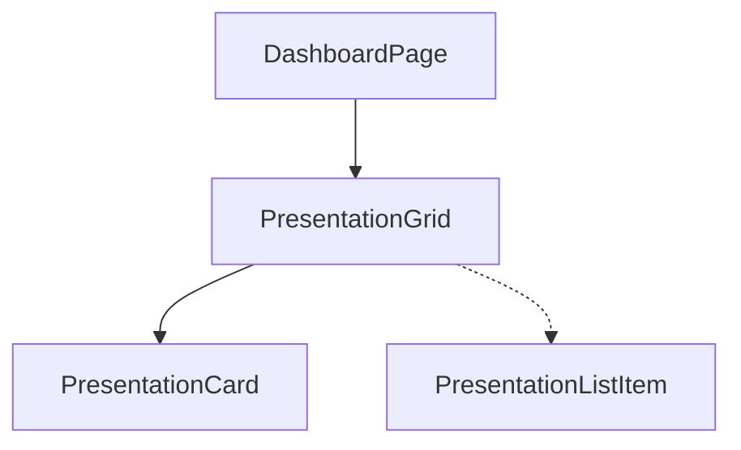
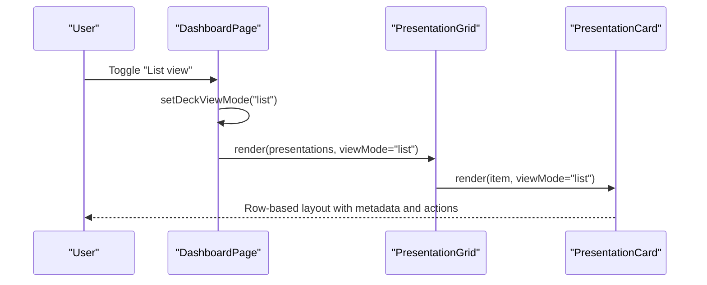
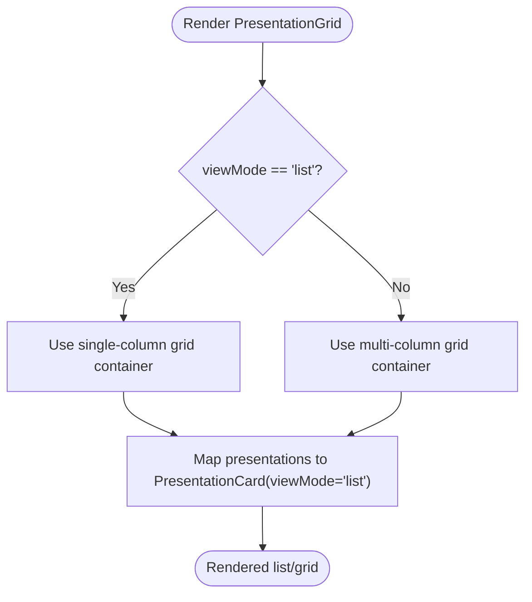
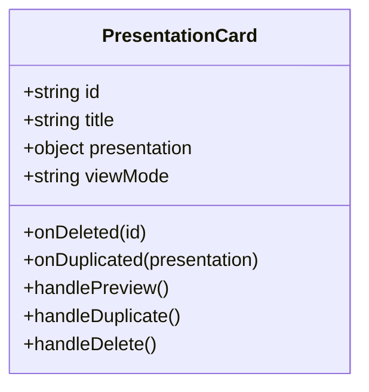
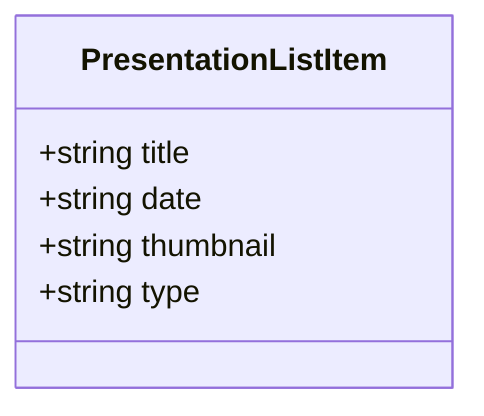
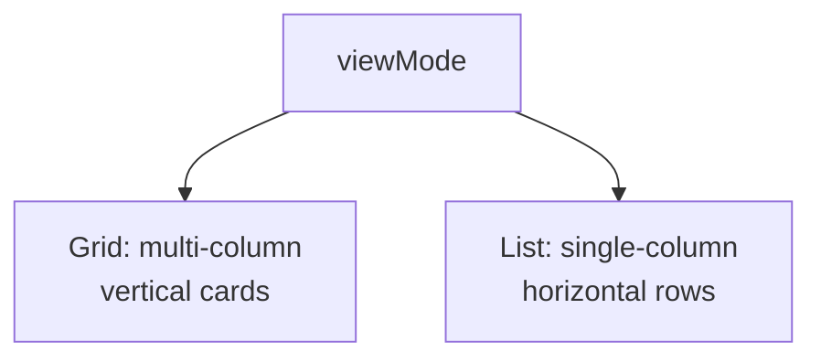
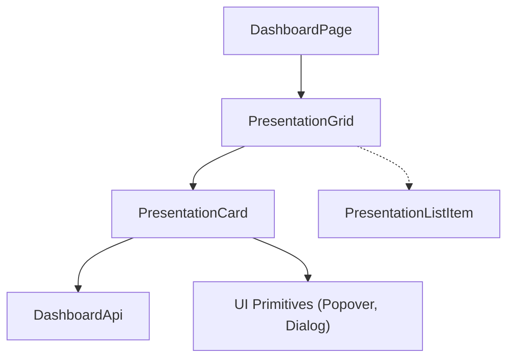

# Presentation List View

<cite>
**Referenced Files in This Document**
- [DashboardPage.tsx](file://servers/nextjs/app/(presentation-generator)/(dashboard)/dashboard/components/DashboardPage.tsx)
- [PresentationGrid.tsx](file://servers/nextjs/app/(presentation-generator)/(dashboard)/dashboard/components/PresentationGrid.tsx)
- [PresentationCard.tsx](file://servers/nextjs/app/(presentation-generator)/(dashboard)/dashboard/components/PresentationCard.tsx)
- [PresentationListItem.tsx](file://servers/nextjs/app/(presentation-generator)/(dashboard)/dashboard/components/PresentationListItem.tsx)
</cite>

## Table of Contents
1. [Introduction](#introduction)
2. [Project Structure](#project-structure)
3. [Core Components](#core-components)
4. [Architecture Overview](#architecture-overview)
5. [Detailed Component Analysis](#detailed-component-analysis)
6. [Dependency Analysis](#dependency-analysis)
7. [Performance Considerations](#performance-considerations)
8. [Troubleshooting Guide](#troubleshooting-guide)
9. [Conclusion](#conclusion)

## Introduction
This document explains the list view implementation for presentations, focusing on how the dashboard renders a row-based list alternative to the default grid view. It covers rendering logic, layout differences between list and grid modes, metadata display, actions, status indicators, keyboard navigation, selection handling, bulk operations support, and performance considerations for long lists and large datasets.

## Project Structure
The presentation list view is implemented within the dashboard area:
- DashboardPage controls data fetching, sorting, view mode toggling, and passes state to the list/grid renderer.
- PresentationGrid renders either a grid or a single-column list layout and delegates each item to PresentationCard.
- PresentationCard adapts its layout based on the viewMode prop and provides per-item actions (duplicate, delete).
- PresentationListItem is a separate, simpler list item component that can be used as an alternative lightweight row representation.

**Diagram sources**
- [DashboardPage.tsx:506-616](file://servers/nextjs/app/(presentation-generator)/(dashboard)/dashboard/components/DashboardPage.tsx#L506-L616)
- [PresentationGrid.tsx:15-97](file://servers/nextjs/app/(presentation-generator)/(dashboard)/dashboard/components/PresentationGrid.tsx#L15-L97)
- [PresentationCard.tsx:31-299](file://servers/nextjs/app/(presentation-generator)/(dashboard)/dashboard/components/PresentationCard.tsx#L31-L299)
- [PresentationListItem.tsx:6-44](file://servers/nextjs/app/(presentation-generator)/(dashboard)/dashboard/components/PresentationListItem.tsx#L6-L44)

**Section sources**
- [DashboardPage.tsx:392-616](file://servers/nextjs/app/(presentation-generator)/(dashboard)/dashboard/components/DashboardPage.tsx#L392-L616)
- [PresentationGrid.tsx:1-98](file://servers/nextjs/app/(presentation-generator)/(dashboard)/dashboard/components/PresentationGrid.tsx#L1-L98)
- [PresentationCard.tsx:1-299](file://servers/nextjs/app/(presentation-generator)/(dashboard)/dashboard/components/PresentationCard.tsx#L1-L299)
- [PresentationListItem.tsx:1-44](file://servers/nextjs/app/(presentation-generator)/(dashboard)/dashboard/components/PresentationListItem.tsx#L1-L44)

## Core Components
- DashboardPage
  - Manages presentation data loading, sorting by newest first, and view mode state ("grid" | "list").
  - Renders a toggle control for switching between grid and list views.
  - Passes sorted presentations and viewMode to PresentationGrid.
- PresentationGrid
  - Accepts presentations, viewMode, loading/error states, and callbacks for deletion/duplication.
  - Renders a responsive grid when viewMode is "grid", or a single-column list when viewMode is "list".
  - Delegates each item to PresentationCard with viewMode propagated.
- PresentationCard
  - Adapts layout for list vs grid via CSS classes controlled by viewMode.
  - Displays slide preview, type badge, slide count, title, date, and actions (duplicate/delete).
  - Handles duplicate and delete flows with user feedback and analytics tracking.
- PresentationListItem
  - A minimal list item showing thumbnail, title, and type indicator icon.
  - Intended as a lightweight alternative row representation.

**Section sources**
- [DashboardPage.tsx:569-606](file://servers/nextjs/app/(presentation-generator)/(dashboard)/dashboard/components/DashboardPage.tsx#L569-L606)
- [PresentationGrid.tsx:15-97](file://servers/nextjs/app/(presentation-generator)/(dashboard)/dashboard/components/PresentationGrid.tsx#L15-L97)
- [PresentationCard.tsx:31-299](file://servers/nextjs/app/(presentation-generator)/(dashboard)/dashboard/components/PresentationCard.tsx#L31-L299)
- [PresentationListItem.tsx:6-44](file://servers/nextjs/app/(presentation-generator)/(dashboard)/dashboard/components/PresentationListItem.tsx#L6-L44)

## Architecture Overview
The dashboard orchestrates data flow and UI state, while PresentationGrid and PresentationCard handle rendering and interactions. The list view is achieved by passing viewMode="list" to PresentationGrid, which then renders items in a single-column layout. PresentationCard switches from vertical card layout to horizontal row layout when in list mode.

**Diagram sources**
- [DashboardPage.tsx:574-594](file://servers/nextjs/app/(presentation-generator)/(dashboard)/dashboard/components/DashboardPage.tsx#L574-L594)
- [PresentationGrid.tsx:75-95](file://servers/nextjs/app/(presentation-generator)/(dashboard)/dashboard/components/PresentationGrid.tsx#L75-L95)
- [PresentationCard.tsx:141-190](file://servers/nextjs/app/(presentation-generator)/(dashboard)/dashboard/components/PresentationCard.tsx#L141-L190)

## Detailed Component Analysis

### PresentationGrid: List Rendering Logic and Layout
- Props include presentations, viewMode, isLoading, error, and callbacks for deletion/duplication.
- When viewMode is "list", it uses a single-column grid container with consistent spacing.
- Each presentation is rendered as a PresentationCard with viewMode passed down.

**Diagram sources**
- [PresentationGrid.tsx:75-95](file://servers/nextjs/app/(presentation-generator)/(dashboard)/dashboard/components/PresentationGrid.tsx#L75-L95)

**Section sources**
- [PresentationGrid.tsx:15-97](file://servers/nextjs/app/(presentation-generator)/(dashboard)/dashboard/components/PresentationGrid.tsx#L15-L97)

### PresentationCard: Row-Based Layout and Metadata Display
- In list mode, the card switches to a horizontal row layout using flexbox and fixed-width thumbnail sizing.
- Displays:
  - Slide preview (either HTML template preview or SlideScale).
  - Type badge ("smart" or "standard").
  - Slide count badge.
  - Title (Markdown-rendered) and creation date.
  - Actions popover with Duplicate and Delete.
- Status indicators:
  - Unsupported version shows archive icon and disabled state.
  - Loading states for duplicate/delete operations.

**Diagram sources**
- [PresentationCard.tsx:31-299](file://servers/nextjs/app/(presentation-generator)/(dashboard)/dashboard/components/PresentationCard.tsx#L31-L299)

**Section sources**
- [PresentationCard.tsx:127-242](file://servers/nextjs/app/(presentation-generator)/(dashboard)/dashboard/components/PresentationCard.tsx#L127-L242)

### PresentationListItem: Lightweight Alternative Row
- Renders a compact row with thumbnail, title, and type indicator icon.
- Suitable for simple list displays without full action menus.

**Diagram sources**
- [PresentationListItem.tsx:6-44](file://servers/nextjs/app/(presentation-generator)/(dashboard)/dashboard/components/PresentationListItem.tsx#L6-L44)

**Section sources**
- [PresentationListItem.tsx:1-44](file://servers/nextjs/app/(presentation-generator)/(dashboard)/dashboard/components/PresentationListItem.tsx#L1-L44)

### Comparison: List View vs Grid View
- Grid view: Multi-column responsive grid; cards stack vertically with bottom metadata bar.
- List view: Single-column rows; thumbnails are fixed width and placed left; metadata and actions align horizontally.
- Both views share the same data model and actions; only layout and styling differ via viewMode.

**Diagram sources**
- [PresentationGrid.tsx:75-95](file://servers/nextjs/app/(presentation-generator)/(dashboard)/dashboard/components/PresentationGrid.tsx#L75-L95)
- [PresentationCard.tsx:141-190](file://servers/nextjs/app/(presentation-generator)/(dashboard)/dashboard/components/PresentationCard.tsx#L141-L190)

**Section sources**
- [PresentationGrid.tsx:75-95](file://servers/nextjs/app/(presentation-generator)/(dashboard)/dashboard/components/PresentationGrid.tsx#L75-L95)
- [PresentationCard.tsx:141-190](file://servers/nextjs/app/(presentation-generator)/(dashboard)/dashboard/components/PresentationCard.tsx#L141-L190)

### Keyboard Navigation and Selection Handling
- The dashboard does not implement custom keyboard navigation or selection handling for the list/grid itself.
- Arrow key navigation exists in the presentation editor context, not in the dashboard list view.
- No built-in selection state or bulk operation handlers are present in the list components.

**Section sources**
- [PresentationPage.tsx:621-656](file://servers/nextjs/app/(presentation-generator)/presentation/components/PresentationPage.tsx#L621-L656)

### Bulk Operations Support
- There is no explicit bulk selection or bulk operations UI in the current list/grid implementation.
- Per-item actions (duplicate, delete) are available via the actions popover.
- To add bulk operations, you would need to introduce selection state at the grid level and expose batch action buttons.

**Section sources**
- [PresentationCard.tsx:201-238](file://servers/nextjs/app/(presentation-generator)/(dashboard)/dashboard/components/PresentationCard.tsx#L201-L238)

## Dependency Analysis
- DashboardPage depends on PresentationGrid for rendering decks and manages viewMode state.
- PresentationGrid depends on PresentationCard for individual item rendering.
- PresentationCard depends on API services for duplication/deletion and UI primitives for dialogs/popovers.
- PresentationListItem is independent and can be used as a lightweight alternative.

**Diagram sources**
- [DashboardPage.tsx:597-606](file://servers/nextjs/app/(presentation-generator)/(dashboard)/dashboard/components/DashboardPage.tsx#L597-L606)
- [PresentationGrid.tsx:83-93](file://servers/nextjs/app/(presentation-generator)/(dashboard)/dashboard/components/PresentationGrid.tsx#L83-L93)
- [PresentationCard.tsx:78-121](file://servers/nextjs/app/(presentation-generator)/(dashboard)/dashboard/components/PresentationCard.tsx#L78-L121)

**Section sources**
- [DashboardPage.tsx:597-606](file://servers/nextjs/app/(presentation-generator)/(dashboard)/dashboard/components/DashboardPage.tsx#L597-L606)
- [PresentationGrid.tsx:83-93](file://servers/nextjs/app/(presentation-generator)/(dashboard)/dashboard/components/PresentationGrid.tsx#L83-L93)
- [PresentationCard.tsx:78-121](file://servers/nextjs/app/(presentation-generator)/(dashboard)/dashboard/components/PresentationCard.tsx#L78-L121)

## Performance Considerations
- Rendering all items at once:
  - For large datasets, consider virtualization (windowing) to render only visible rows.
  - Memoize expensive computations (e.g., sorting) and avoid unnecessary re-renders.
- Image and preview rendering:
  - Thumbnails and slide previews can be heavy; use lazy loading and optimized image formats.
  - Avoid rendering complex previews for off-screen rows.
- State management:
  - Keep viewMode and selection state local to relevant components.
  - Debounce search/filter operations if added later.
- Memory management:
  - Unmount off-screen items to free resources.
  - Avoid retaining large objects in component state; prefer derived data where possible.

[No sources needed since this section provides general guidance]

## Troubleshooting Guide
- Unsupported presentations:
  - Cards show an archive icon and are disabled; users cannot open them.
- Duplicate/Delete failures:
  - Error notifications are shown; ensure API responses are handled and user feedback is displayed.
- View mode not updating:
  - Verify that deckViewMode state is correctly toggled and passed to PresentationGrid.

**Section sources**
- [PresentationCard.tsx:152-163](file://servers/nextjs/app/(presentation-generator)/(dashboard)/dashboard/components/PresentationCard.tsx#L152-L163)
- [PresentationCard.tsx:78-121](file://servers/nextjs/app/(presentation-generator)/(dashboard)/dashboard/components/PresentationCard.tsx#L78-L121)
- [DashboardPage.tsx:574-594](file://servers/nextjs/app/(presentation-generator)/(dashboard)/dashboard/components/DashboardPage.tsx#L574-L594)

## Conclusion
The presentation list view is implemented by passing viewMode="list" through DashboardPage to PresentationGrid, which renders items in a single-column layout. PresentationCard adapts to list mode by switching to a horizontal row layout and continues to provide metadata and actions. While the current implementation lacks keyboard navigation and bulk operations in the dashboard list, it offers a solid foundation for extending these features. Performance best practices such as virtualization and lazy loading should be considered for large datasets.