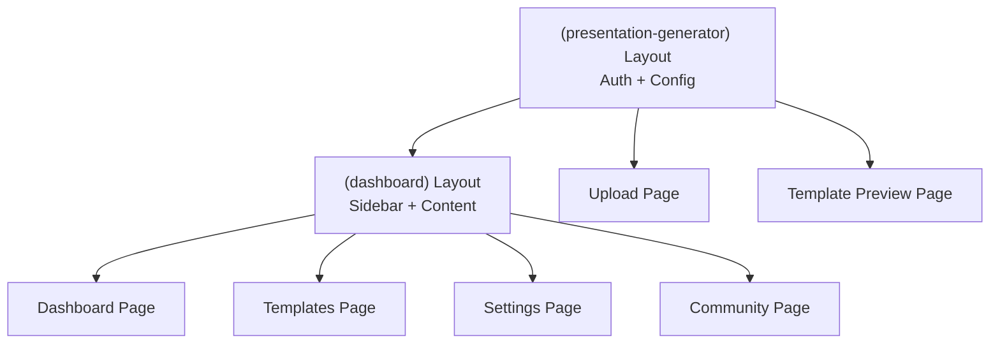
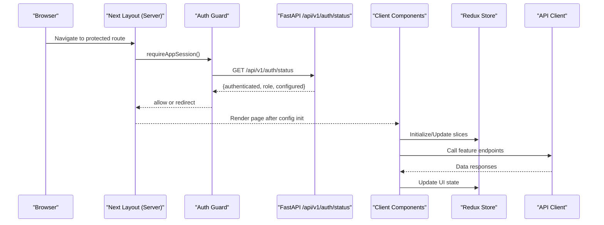
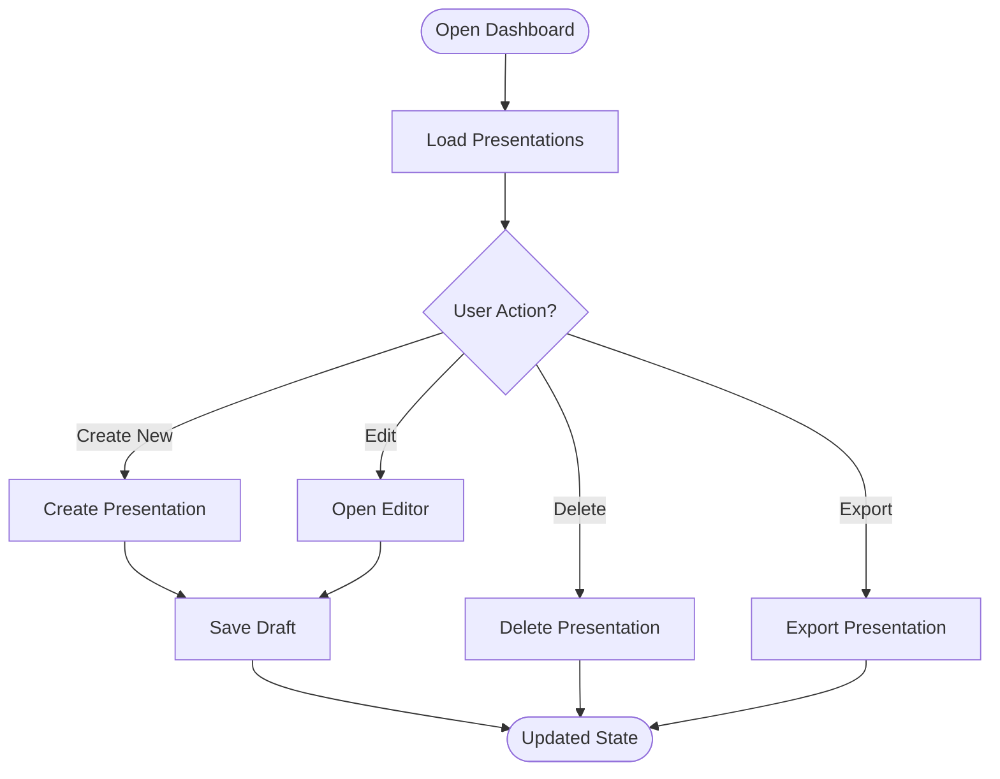
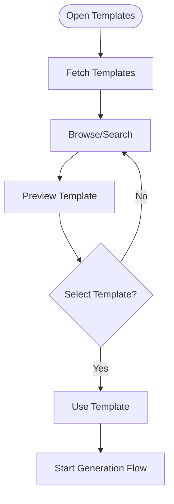
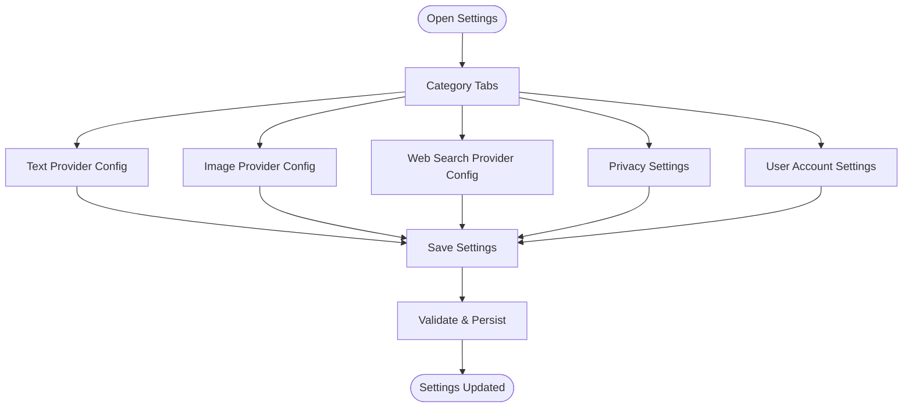
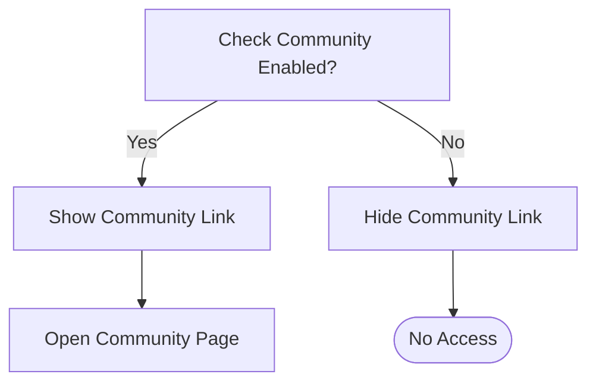
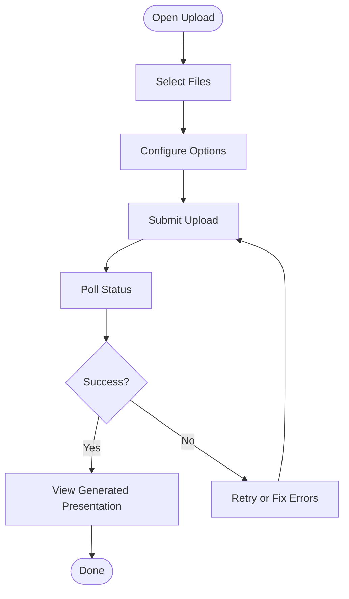
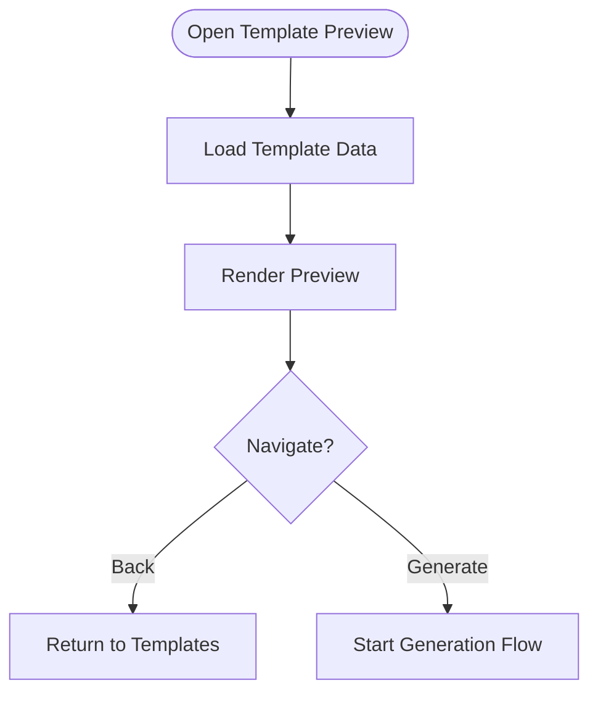
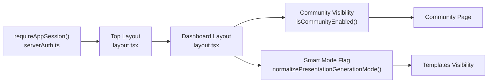

# Feature Modules & Pages

<cite>
**Referenced Files in This Document**
- [layout.tsx](file://servers/nextjs/app/(presentation-generator)/layout.tsx)
- [dashboard layout.tsx](file://servers/nextjs/app/(presentation-generator)/(dashboard)/layout.tsx)
- [serverAuth.ts](file://servers/nextjs/utils/serverAuth.ts)
- [dashboard page.tsx](file://servers/nextjs/app/(presentation-generator)/(dashboard)/dashboard/page.tsx)
- [templates page.tsx](file://servers/nextjs/app/(presentation-generator)/(dashboard)/templates/page.tsx)
- [settings page.tsx](file://servers/nextjs/app/(presentation-generator)/(dashboard)/settings/page.tsx)
- [community page.tsx](file://servers/nextjs/app/(presentation-generator)/(dashboard)/community/page.tsx)
- [upload page.tsx](file://servers/nextjs/app/(presentation-generator)/upload/page.tsx)
- [template-preview page.tsx](file://servers/nextjs/app/(presentation-generator)/template-preview/page.tsx)
- [store.ts](file://servers/nextjs/store/store.ts)
- [presentationGeneration.ts](file://servers/nextjs/store/slices/presentationGeneration.ts)
- [presentationGenUpload.ts](file://servers/nextjs/store/slices/presentationGenUpload.ts)
- [userConfig.ts](file://servers/nextjs/store/slices/userConfig.ts)
- [api.ts](file://servers/nextjs/utils/api.ts)
- [auth.ts](file://servers/nextjs/utils/auth.ts)
- [community.ts](file://servers/nextjs/utils/community.ts)
- [presentationGenerationMode.ts](file://servers/nextjs/utils/presentationGenerationMode.ts)
</cite>

## Table of Contents
1. [Introduction](#introduction)
2. [Project Structure](#project-structure)
3. [Core Components](#core-components)
4. [Architecture Overview](#architecture-overview)
5. [Detailed Component Analysis](#detailed-component-analysis)
6. [Dependency Analysis](#dependency-analysis)
7. [Performance Considerations](#performance-considerations)
8. [Troubleshooting Guide](#troubleshooting-guide)
9. [Conclusion](#conclusion)

## Introduction
This document explains the main feature modules and application pages for presentation management, template browsing and creation, settings configuration, community features, and upload workflows. It covers routing structure, page-specific state management, API integrations, user workflow diagrams, component hierarchies, interaction patterns, authentication requirements, permission checks, and navigation flows between sections.

## Project Structure
The Next.js frontend is organized into route groups:
- (presentation-generator): Top-level layout that enforces authentication and initializes runtime configuration.
- (dashboard): Dashboard shell with sidebar and sub-routes for dashboard content, templates, settings, and community.
- Upload and template preview are sibling routes under (presentation-generator).

**Diagram sources**
- [layout.tsx:6-12](file://servers/nextjs/app/(presentation-generator)/layout.tsx#L6-L12)
- [dashboard layout.tsx:6-22](file://servers/nextjs/app/(presentation-generator)/(dashboard)/layout.tsx#L6-L22)

**Section sources**
- [layout.tsx:6-12](file://servers/nextjs/app/(presentation-generator)/layout.tsx#L6-L12)
- [dashboard layout.tsx:6-22](file://servers/nextjs/app/(presentation-generator)/(dashboard)/layout.tsx#L6-L22)

## Core Components
- Authentication gate and session enforcement at the top-level layout ensure users are authenticated before accessing any page.
- The dashboard layout renders a persistent sidebar and delegates rendering to child pages.
- Feature pages (dashboard, templates, settings, community) implement their own UI and state logic.
- Upload and template preview provide focused workflows for creating presentations from documents or previewing templates.

Key responsibilities:
- Server-side auth guard and redirects.
- Runtime configuration initialization.
- Conditional visibility of features based on environment flags.

**Section sources**
- [layout.tsx:6-12](file://servers/nextjs/app/(presentation-generator)/layout.tsx#L6-L12)
- [dashboard layout.tsx:6-22](file://servers/nextjs/app/(presentation-generator)/(dashboard)/layout.tsx#L6-L22)

## Architecture Overview
The app uses Next.js App Router with route groups. Server components enforce authentication and initialize configuration. Client components manage UI state via Redux slices. APIs are called through a centralized client utility.

**Diagram sources**
- [layout.tsx:6-12](file://servers/nextjs/app/(presentation-generator)/layout.tsx#L6-L12)
- [serverAuth.ts:37-108](file://servers/nextjs/utils/serverAuth.ts#L37-L108)

## Detailed Component Analysis

### Dashboard Interface (Presentation Management)
Purpose:
- Present the user’s presentations list and actions.
- Provide entry points to create, edit, and export presentations.

Routing:
- Route path: /dashboard
- Renders within the dashboard layout which includes the sidebar.

State and data:
- Uses Redux slices for presentation generation and related UI state.
- Calls backend APIs via the API client to fetch and update presentation data.

User interactions:
- List presentations, open editor, create new, delete, rename, export.

**Diagram sources**
- [dashboard page.tsx](file://servers/nextjs/app/(presentation-generator)/(dashboard)/dashboard/page.tsx)
- [presentationGeneration.ts](file://servers/nextjs/store/slices/presentationGeneration.ts)
- [api.ts](file://servers/nextjs/utils/api.ts)

**Section sources**
- [dashboard page.tsx](file://servers/nextjs/app/(presentation-generator)/(dashboard)/dashboard/page.tsx)
- [presentationGeneration.ts](file://servers/nextjs/store/slices/presentationGeneration.ts)
- [api.ts](file://servers/nextjs/utils/api.ts)

### Template Library Browsing and Creation
Purpose:
- Browse available templates.
- Preview and select templates for presentation generation.
- Optionally create custom templates.

Routing:
- Route path: /templates
- Renders within the dashboard layout.

Features:
- Filter/search templates.
- Preview template layouts and themes.
- Select template to start generation flow.

**Diagram sources**
- [templates page.tsx](file://servers/nextjs/app/(presentation-generator)/(dashboard)/templates/page.tsx)
- [template-preview page.tsx](file://servers/nextjs/app/(presentation-generator)/template-preview/page.tsx)
- [api.ts](file://servers/nextjs/utils/api.ts)

**Section sources**
- [templates page.tsx](file://servers/nextjs/app/(presentation-generator)/(dashboard)/templates/page.tsx)
- [template-preview page.tsx](file://servers/nextjs/app/(presentation-generator)/template-preview/page.tsx)
- [api.ts](file://servers/nextjs/utils/api.ts)

### Settings Configuration Panels
Purpose:
- Configure LLM providers, image providers, web search providers, privacy, and user account settings.

Routing:
- Route path: /settings
- Renders within the dashboard layout.

Configuration categories:
- Text provider (LLM) settings.
- Image provider settings.
- Web search provider settings.
- Privacy settings.
- User account settings.

**Diagram sources**
- [settings page.tsx](file://servers/nextjs/app/(presentation-generator)/(dashboard)/settings/page.tsx)
- [userConfig.ts](file://servers/nextjs/store/slices/userConfig.ts)
- [api.ts](file://servers/nextjs/utils/api.ts)

**Section sources**
- [settings page.tsx](file://servers/nextjs/app/(presentation-generator)/(dashboard)/settings/page.tsx)
- [userConfig.ts](file://servers/nextjs/store/slices/userConfig.ts)
- [api.ts](file://servers/nextjs/utils/api.ts)

### Community Features
Purpose:
- Access community-driven content and collaboration features when enabled.

Routing:
- Route path: /community
- Renders within the dashboard layout.

Visibility:
- Controlled by an environment flag; the dashboard layout conditionally shows the community link.

**Diagram sources**
- [dashboard layout.tsx:13-16](file://servers/nextjs/app/(presentation-generator)/(dashboard)/layout.tsx#L13-L16)
- [community.ts](file://servers/nextjs/utils/community.ts)
- [community page.tsx](file://servers/nextjs/app/(presentation-generator)/(dashboard)/community/page.tsx)

**Section sources**
- [dashboard layout.tsx:13-16](file://servers/nextjs/app/(presentation-generator)/(dashboard)/layout.tsx#L13-L16)
- [community.ts](file://servers/nextjs/utils/community.ts)
- [community page.tsx](file://servers/nextjs/app/(presentation-generator)/(dashboard)/community/page.tsx)

### Upload Workflows
Purpose:
- Allow users to upload documents to generate presentations.

Routing:
- Route path: /upload
- Renders directly under (presentation-generator), not inside the dashboard layout.

Workflow:
- Select files, configure generation options, submit upload job, monitor progress, view results.

**Diagram sources**
- [upload page.tsx](file://servers/nextjs/app/(presentation-generator)/upload/page.tsx)
- [presentationGenUpload.ts](file://servers/nextjs/store/slices/presentationGenUpload.ts)
- [api.ts](file://servers/nextjs/utils/api.ts)

**Section sources**
- [upload page.tsx](file://servers/nextjs/app/(presentation-generator)/upload/page.tsx)
- [presentationGenUpload.ts](file://servers/nextjs/store/slices/presentationGenUpload.ts)
- [api.ts](file://servers/nextjs/utils/api.ts)

### Template Preview
Purpose:
- Preview selected templates before using them for generation.

Routing:
- Route path: /template-preview
- Renders directly under (presentation-generator).

Interaction:
- Load template metadata and assets, render preview, navigate back to templates or start generation.

**Diagram sources**
- [template-preview page.tsx](file://servers/nextjs/app/(presentation-generator)/template-preview/page.tsx)
- [api.ts](file://servers/nextjs/utils/api.ts)

**Section sources**
- [template-preview page.tsx](file://servers/nextjs/app/(presentation-generator)/template-preview/page.tsx)
- [api.ts](file://servers/nextjs/utils/api.ts)

## Dependency Analysis
Authentication and environment-based feature toggles influence routing and UI visibility.

**Diagram sources**
- [serverAuth.ts:94-108](file://servers/nextjs/utils/serverAuth.ts#L94-L108)
- [layout.tsx:6-12](file://servers/nextjs/app/(presentation-generator)/layout.tsx#L6-L12)
- [dashboard layout.tsx:7-16](file://servers/nextjs/app/(presentation-generator)/(dashboard)/layout.tsx#L7-L16)
- [community.ts](file://servers/nextjs/utils/community.ts)
- [presentationGenerationMode.ts](file://servers/nextjs/utils/presentationGenerationMode.ts)

**Section sources**
- [serverAuth.ts:94-108](file://servers/nextjs/utils/serverAuth.ts#L94-L108)
- [layout.tsx:6-12](file://servers/nextjs/app/(presentation-generator)/layout.tsx#L6-L12)
- [dashboard layout.tsx:7-16](file://servers/nextjs/app/(presentation-generator)/(dashboard)/layout.tsx#L7-L16)
- [community.ts](file://servers/nextjs/utils/community.ts)
- [presentationGenerationMode.ts](file://servers/nextjs/utils/presentationGenerationMode.ts)

## Performance Considerations
- Prefer server-side auth checks to avoid unnecessary client-side redirects.
- Defer heavy template previews until selection to reduce initial load.
- Paginate or virtualize large lists (presentations, templates) to improve rendering performance.
- Cache static template assets and theme data where possible.
- Batch API calls and use optimistic updates for better perceived responsiveness.

## Troubleshooting Guide
Common issues and resolutions:
- Unauthorized redirects: Ensure the backend auth service is reachable and cookies are present. The server layout redirects to the root if authentication is unavailable or unconfigured.
- Missing community link: Verify the community feature flag is enabled in environment variables.
- Smart mode restrictions: When smart generation mode is active, templates may be hidden; adjust mode or enable templates accordingly.
- Settings not persisting: Confirm API client configuration and that user config slices are updated correctly.

Relevant checks:
- Server-side auth status resolution and redirects.
- Environment flags for community and generation mode.

**Section sources**
- [serverAuth.ts:37-108](file://servers/nextjs/utils/serverAuth.ts#L37-L108)
- [dashboard layout.tsx:7-16](file://servers/nextjs/app/(presentation-generator)/(dashboard)/layout.tsx#L7-L16)

## Conclusion
The application organizes core features behind a secure, configurable layout system. The dashboard provides presentation management, while templates, settings, and community offer complementary capabilities. Upload and template preview routes support focused workflows. Authentication is enforced server-side, and feature visibility is controlled by environment flags. State is managed centrally via Redux slices, and all feature pages integrate with the backend through a unified API client.