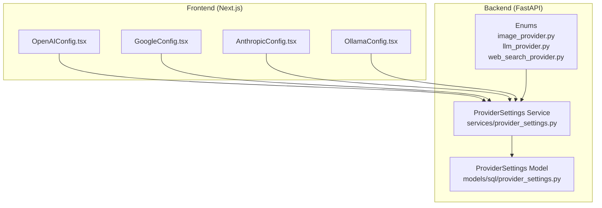
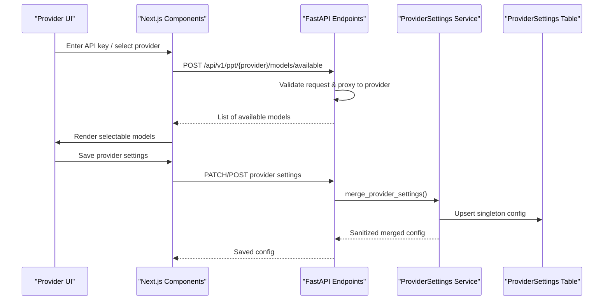
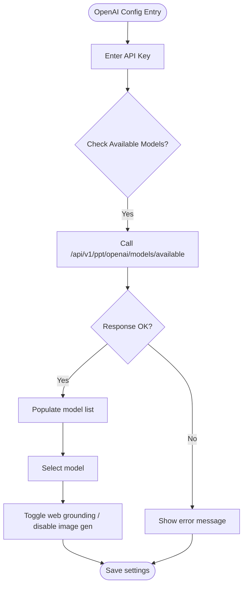
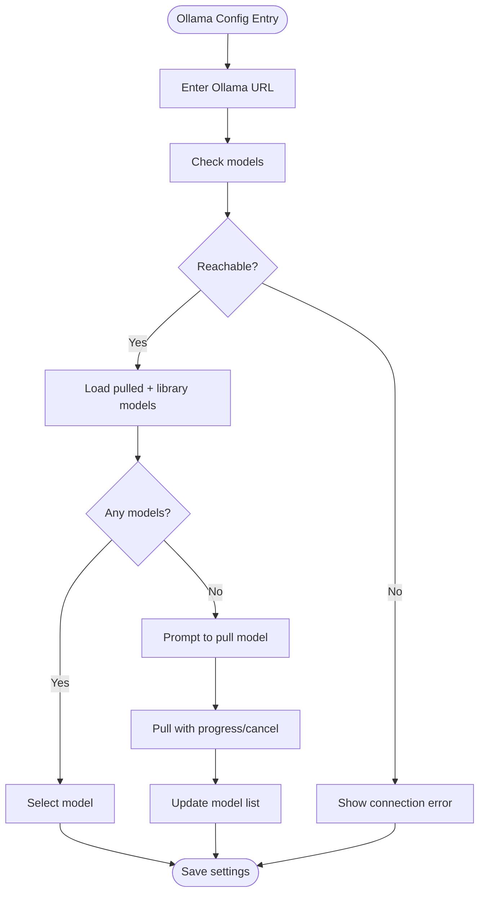
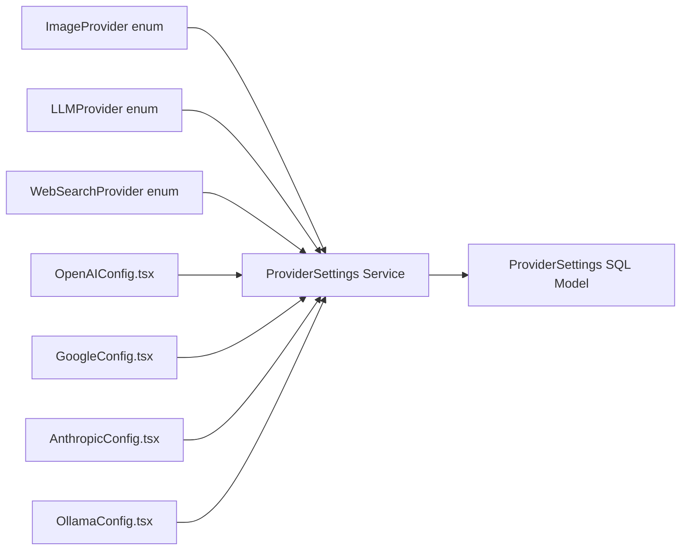

# AI Provider Settings

<cite>
**Referenced Files in This Document**
- [image_provider.py](file://servers/fastapi/enums/image_provider.py)
- [llm_provider.py](file://servers/fastapi/enums/llm_provider.py)
- [web_search_provider.py](file://servers/fastapi/enums/web_search_provider.py)
- [provider_settings.py](file://servers/fastapi/services/provider_settings.py)
- [provider_settings.sql.py](file://servers/fastapi/models/sql/provider_settings.py)
- [OpenAIConfig.tsx](file://servers/nxtjs/components/OpenAIConfig.tsx)
- [GoogleConfig.tsx](file://servers/nxtjs/components/GoogleConfig.tsx)
- [AnthropicConfig.tsx](file://servers/nxtjs/components/AnthropicConfig.tsx)
- [OllamaConfig.tsx](file://servers/nxtjs/components/OllamaConfig.tsx)
</cite>

## Table of Contents
1. [Introduction](#introduction)
2. [Project Structure](#project-structure)
3. [Core Components](#core-components)
4. [Architecture Overview](#architecture-overview)
5. [Detailed Component Analysis](#detailed-component-analysis)
6. [Dependency Analysis](#dependency-analysis)
7. [Performance Considerations](#performance-considerations)
8. [Troubleshooting Guide](#troubleshooting-guide)
9. [Conclusion](#conclusion)

## Introduction
This document explains how to configure AI providers for text generation, image generation, web search, and Codex integration. It covers the provider settings panel, API key management, connection testing, model selection, validation rules, error handling, and security considerations for sensitive credentials. The configuration is persisted securely and mirrored for compatibility with legacy code paths.

## Project Structure
The provider configuration spans:
- Backend enums that define supported providers
- A database-backed singleton for provider settings
- Frontend components for each provider’s configuration UI

**Diagram sources**
- [image_provider.py:4-14](file://servers/fastapi/enums/image_provider.py#L4-L14)
- [llm_provider.py:4-21](file://servers/fastapi/enums/llm_provider.py#L4-L21)
- [web_search_provider.py:4-12](file://servers/fastapi/enums/web_search_provider.py#L4-L12)
- [provider_settings.py:52-82](file://servers/fastapi/services/provider_settings.py#L52-L82)
- [provider_settings.sql.py:10-24](file://servers/fastapi/models/sql/provider_settings.py#L10-L24)

**Section sources**
- [image_provider.py:4-14](file://servers/fastapi/enums/image_provider.py#L4-L14)
- [llm_provider.py:4-21](file://servers/fastapi/enums/llm_provider.py#L4-L21)
- [web_search_provider.py:4-12](file://servers/fastapi/enums/web_search_provider.py#L4-L12)
- [provider_settings.py:52-82](file://servers/fastapi/services/provider_settings.py#L52-L82)
- [provider_settings.sql.py:10-24](file://servers/fastapi/models/sql/provider_settings.py#L10-L24)

## Core Components
- Image providers: Pexels, Pixabay, Gemini Flash, Nano Banana Pro, GPT Image 2, GPT Image 1.5, ComfyUI, Open WebUI, OpenAI-compatible endpoints.
- Text providers (LLMs): Ollama, DeepSeek, OpenAI, Google, Vertex, Azure, Bedrock, OpenRouter, Fireworks, Together, Cerebras, Anthropic, LiteLLM, LM Studio, Custom, Codex.
- Web search providers: Auto, Native, SearXNG, Tavily, Exa, Brave, Serper.
- Provider settings persistence: Singleton row storing a JSON config map with sanitization, merging, and legacy file mirroring.

Key behaviors:
- Legacy auth fields are stripped from stored settings.
- OAuth-managed fields are preserved or removed according to existing state.
- Empty values for specific advanced fields are preserved when absent in incoming updates.
- Optional advanced fields are pruned if empty.

**Section sources**
- [image_provider.py:4-14](file://servers/fastapi/enums/image_provider.py#L4-L14)
- [llm_provider.py:4-21](file://servers/fastapi/enums/llm_provider.py#L4-L21)
- [web_search_provider.py:4-12](file://servers/fastapi/enums/web_search_provider.py#L4-L12)
- [provider_settings.py:52-82](file://servers/fastapi/services/provider_settings.py#L52-L82)

## Architecture Overview
The frontend provider panels collect credentials and options, then call backend endpoints to validate connectivity and list available models. The backend persists settings via a service layer into a SQL table and mirrors them to a legacy user config file for backward compatibility.

**Diagram sources**
- [OpenAIConfig.tsx:55-94](file://servers/nxtjs/components/OpenAIConfig.tsx#L55-L94)
- [GoogleConfig.tsx:49-87](file://servers/nxtjs/components/GoogleConfig.tsx#L49-L87)
- [AnthropicConfig.tsx:52-90](file://servers/nxtjs/components/AnthropicConfig.tsx#L52-L90)
- [provider_settings.py:137-155](file://servers/fastapi/services/provider_settings.py#L137-L155)
- [provider_settings.sql.py:10-24](file://servers/fastapi/models/sql/provider_settings.py#L10-L24)

## Detailed Component Analysis

### Image Provider Settings Panel
Supported image providers include stock photo services and generative image endpoints. Configuration typically includes:
- Provider selection
- API keys where applicable
- Endpoint URLs for OpenAI-compatible image services
- Optional toggles for features like disabling image generation at runtime

Validation and behavior:
- When an OpenAI-compatible endpoint is used, the UI exposes additional fields for base URL and API key.
- Providers without credentials (e.g., stock photo APIs) may require only enabling/disabling.

Security:
- Credentials are stored locally and not shared.
- Avoid logging secrets; use masked display in UIs.

**Section sources**
- [image_provider.py:4-14](file://servers/fastapi/enums/image_provider.py#L4-L14)

### Text Provider Configurations (LLMs)

#### OpenAI
- Inputs: API key, selected model, optional web grounding toggle, optional disable image generation toggle.
- Connection test: Fetches available models via a backend endpoint using the provided key and default OpenAI base URL.
- Error handling: Displays user-friendly messages on failure and resets model selection.

**Diagram sources**
- [OpenAIConfig.tsx:55-94](file://servers/nxtjs/components/OpenAIConfig.tsx#L55-L94)
- [OpenAIConfig.tsx:242-277](file://servers/nxtjs/components/OpenAIConfig.tsx#L242-L277)

**Section sources**
- [OpenAIConfig.tsx:20-48](file://servers/nxtjs/components/OpenAIConfig.tsx#L20-L48)
- [OpenAIConfig.tsx:55-94](file://servers/nxtjs/components/OpenAIConfig.tsx#L55-L94)
- [OpenAIConfig.tsx:242-277](file://servers/nxtjs/components/OpenAIConfig.tsx#L242-L277)

#### Google
- Inputs: API key, selected model, optional web grounding toggle.
- Connection test: Lists available models through a backend endpoint using the provided key.
- Error handling: Shows errors and resets model selection on failure.

**Section sources**
- [GoogleConfig.tsx:19-47](file://servers/nxtjs/components/GoogleConfig.tsx#L19-L47)
- [GoogleConfig.tsx:49-87](file://servers/nxtjs/components/GoogleConfig.tsx#L49-L87)
- [GoogleConfig.tsx:223-245](file://servers/nxtjs/components/GoogleConfig.tsx#L223-L245)

#### Anthropic
- Inputs: API key, selected model, optional extended reasoning toggle (UI present), optional web grounding toggle.
- Connection test: Lists available models via a backend endpoint using the provided key.
- Error handling: Displays errors and resets model selection on failure.

**Section sources**
- [AnthropicConfig.tsx:19-50](file://servers/nxtjs/components/AnthropicConfig.tsx#L19-L50)
- [AnthropicConfig.tsx:52-90](file://servers/nxtjs/components/AnthropicConfig.tsx#L52-L90)
- [AnthropicConfig.tsx:226-258](file://servers/nxtjs/components/AnthropicConfig.tsx#L226-L258)

#### Ollama (Local Models)
- Inputs: Ollama server URL, selected model.
- Features:
  - Detect reachable Ollama instances and auto-resolve URL fallbacks.
  - Combine locally pulled models with library suggestions.
  - Pull models directly from the UI with progress tracking and cancellation.
- Validation:
  - If no models are found, prompts to pull one or check connectivity.
  - Updates selected model automatically when possible.

**Diagram sources**
- [OllamaConfig.tsx:84-176](file://servers/nxtjs/components/OllamaConfig.tsx#L84-L176)
- [OllamaConfig.tsx:178-254](file://servers/nxtjs/components/OllamaConfig.tsx#L178-L254)

**Section sources**
- [OllamaConfig.tsx:49-83](file://servers/nxtjs/components/OllamaConfig.tsx#L49-L83)
- [OllamaConfig.tsx:84-176](file://servers/nxtjs/components/OllamaConfig.tsx#L84-L176)
- [OllamaConfig.tsx:178-254](file://servers/nxtjs/components/OllamaConfig.tsx#L178-L254)
- [OllamaConfig.tsx:362-408](file://servers/nxtjs/components/OllamaConfig.tsx#L362-L408)

### Web Search Provider Options
Available providers include Auto, Native, SearXNG, Tavily, Exa, Brave, and Serper. Selection affects how the system performs web-grounded searches during content generation.

Configuration guidance:
- Choose Auto to let the system decide based on environment and capabilities.
- For self-hosted setups, prefer Native or SearXNG.
- For cloud-based search, configure the appropriate provider and credentials.

**Section sources**
- [web_search_provider.py:4-12](file://servers/fastapi/enums/web_search_provider.py#L4-L12)

### Codex Integration Settings
Codex-related fields are managed by OAuth flows and are treated specially:
- Managed fields include access tokens, refresh tokens, expiration, account info, and status flags.
- These fields are preserved or cleared based on existing state and OAuth lifecycle.
- A dedicated field allows selecting the active Codex model.

Security:
- Tokens are handled by OAuth-managed logic and should never be exposed in logs or UIs.

**Section sources**
- [provider_settings.py:17-35](file://servers/fastapi/services/provider_settings.py#L17-L35)

### API Key Management and Connection Testing
- Each provider component collects API keys and triggers a “check models” flow against backend endpoints.
- On success, the UI populates a searchable dropdown of available models.
- On failure, the UI shows actionable error messages and resets selections.

Best practices:
- Always test connectivity before saving settings.
- Keep API keys minimal and scoped to required permissions.
- Use environment variables or secure storage mechanisms where possible.

**Section sources**
- [OpenAIConfig.tsx:55-94](file://servers/nxtjs/components/OpenAIConfig.tsx#L55-L94)
- [GoogleConfig.tsx:49-87](file://servers/nxtjs/components/GoogleConfig.tsx#L49-L87)
- [AnthropicConfig.tsx:52-90](file://servers/nxtjs/components/AnthropicConfig.tsx#L52-L90)

### Model Selection
- Cloud providers (OpenAI, Google, Anthropic) expose dynamic model lists fetched after validating the API key.
- Local providers (Ollama) combine installed models with library suggestions and support in-app pulling.

Selection rules:
- If the current model disappears from the list, the UI attempts to select another available model.
- For Ollama, pulling a model automatically selects it upon completion.

**Section sources**
- [OpenAIConfig.tsx:160-232](file://servers/nxtjs/components/OpenAIConfig.tsx#L160-L232)
- [GoogleConfig.tsx:145-218](file://servers/nxtjs/components/GoogleConfig.tsx#L145-L218)
- [AnthropicConfig.tsx:148-221](file://servers/nxtjs/components/AnthropicConfig.tsx#L148-L221)
- [OllamaConfig.tsx:113-138](file://servers/nxtjs/components/OllamaConfig.tsx#L113-L138)
- [OllamaConfig.tsx:269-280](file://servers/nxtjs/components/OllamaConfig.tsx#L269-L280)

### Rate Limiting Configuration
- No explicit per-provider rate limit controls are exposed in the referenced files.
- Rate limiting is typically enforced by the provider’s own quotas or by higher-level orchestration layers.
- To manage costs and stability:
  - Prefer smaller models or faster variants when available.
  - Disable non-essential features (e.g., image generation) when not needed.
  - Use local models (Ollama) to avoid external rate limits.

[No sources needed since this section provides general guidance]

### Validation Rules and Error Handling
Validation and merging rules:
- Legacy auth fields are stripped from stored settings.
- OAuth-managed fields are preserved or removed based on existing state.
- Empty values for certain advanced fields are preserved when absent in incoming updates.
- Optional advanced fields are pruned if empty.

Error handling patterns:
- Provider model listing failures show user-friendly messages and reset selections.
- Ollama connection issues surface clear errors and allow retry.

Security considerations:
- Credentials are stored locally and not shared.
- OAuth-managed tokens are handled by managed fields and should not be manually edited.

**Section sources**
- [provider_settings.py:52-82](file://servers/fastapi/services/provider_settings.py#L52-L82)
- [OpenAIConfig.tsx:70-94](file://servers/nxtjs/components/OpenAIConfig.tsx#L70-L94)
- [GoogleConfig.tsx:64-87](file://servers/nxtjs/components/GoogleConfig.tsx#L64-L87)
- [AnthropicConfig.tsx:67-90](file://servers/nxtjs/components/AnthropicConfig.tsx#L67-L90)
- [OllamaConfig.tsx:161-176](file://servers/nxtjs/components/OllamaConfig.tsx#L161-L176)

## Dependency Analysis
Provider configuration depends on:
- Enum definitions for supported providers
- Service layer for safe merging and persistence
- Database model for the singleton settings row
- Frontend components for user interaction and validation

**Diagram sources**
- [image_provider.py:4-14](file://servers/fastapi/enums/image_provider.py#L4-L14)
- [llm_provider.py:4-21](file://servers/fastapi/enums/llm_provider.py#L4-L21)
- [web_search_provider.py:4-12](file://servers/fastapi/enums/web_search_provider.py#L4-L12)
- [provider_settings.py:52-82](file://servers/fastapi/services/provider_settings.py#L52-L82)
- [provider_settings.sql.py:10-24](file://servers/fastapi/models/sql/provider_settings.py#L10-L24)

**Section sources**
- [image_provider.py:4-14](file://servers/fastapi/enums/image_provider.py#L4-L14)
- [llm_provider.py:4-21](file://servers/fastapi/enums/llm_provider.py#L4-L21)
- [web_search_provider.py:4-12](file://servers/fastapi/enums/web_search_provider.py#L4-L12)
- [provider_settings.py:52-82](file://servers/fastapi/services/provider_settings.py#L52-L82)
- [provider_settings.sql.py:10-24](file://servers/fastapi/models/sql/provider_settings.py#L10-L24)

## Performance Considerations
- Dynamic model listing adds network latency; cache results where appropriate.
- Ollama model pulls can be long-running; provide progress feedback and cancellation.
- Disabling image generation reduces downstream calls and improves responsiveness.
- Prefer local models for high-throughput scenarios to avoid external rate limits.

[No sources needed since this section provides general guidance]

## Troubleshooting Guide
Common issues and resolutions:
- Cannot list models:
  - Verify API key validity and permissions.
  - Ensure the backend endpoint is reachable.
  - Check for provider-specific restrictions (quotas, regions).
- Ollama unreachable:
  - Confirm the URL resolves correctly (localhost vs host.docker.internal).
  - Ensure the Ollama service is running and accessible.
- No models found:
  - For cloud providers, confirm account access to models.
  - For Ollama, pull a model from the library or install one externally.

Operational tips:
- Use the “Check models” button to validate connectivity before saving.
- Reset model selection when the chosen model disappears from the list.
- Review error messages displayed by the UI for actionable hints.

**Section sources**
- [OpenAIConfig.tsx:70-94](file://servers/nxtjs/components/OpenAIConfig.tsx#L70-L94)
- [GoogleConfig.tsx:64-87](file://servers/nxtjs/components/GoogleConfig.tsx#L64-L87)
- [AnthropicConfig.tsx:67-90](file://servers/nxtjs/components/AnthropicConfig.tsx#L67-L90)
- [OllamaConfig.tsx:161-176](file://servers/nxtjs/components/OllamaConfig.tsx#L161-L176)

## Conclusion
Provider settings in this application are designed for clarity, safety, and extensibility. The UI guides users through credential entry, connectivity checks, and model selection, while the backend ensures robust persistence and compatibility. By following the validation rules, error handling patterns, and security recommendations outlined here, you can reliably configure text, image, web search, and Codex integrations across diverse environments.