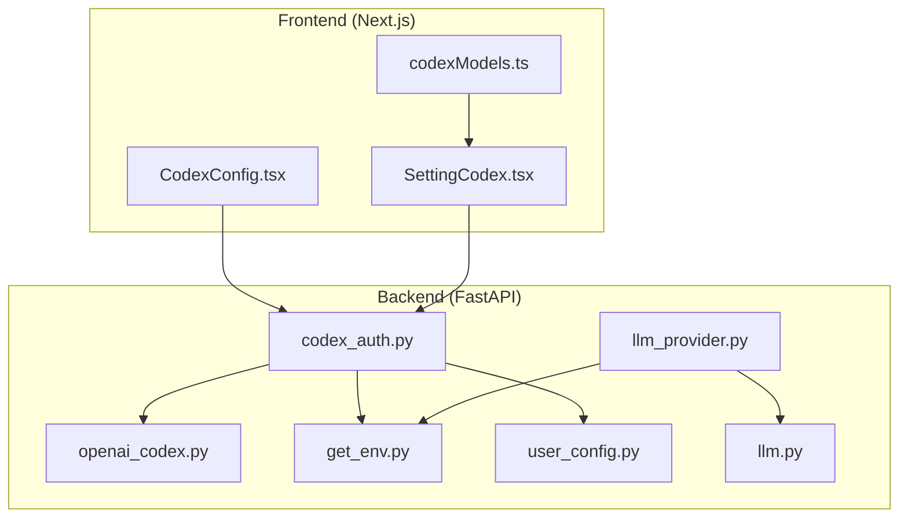
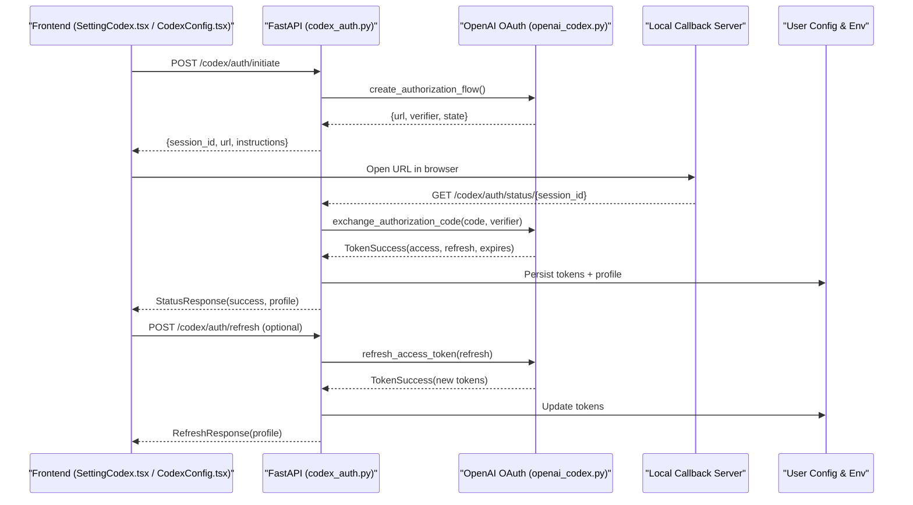
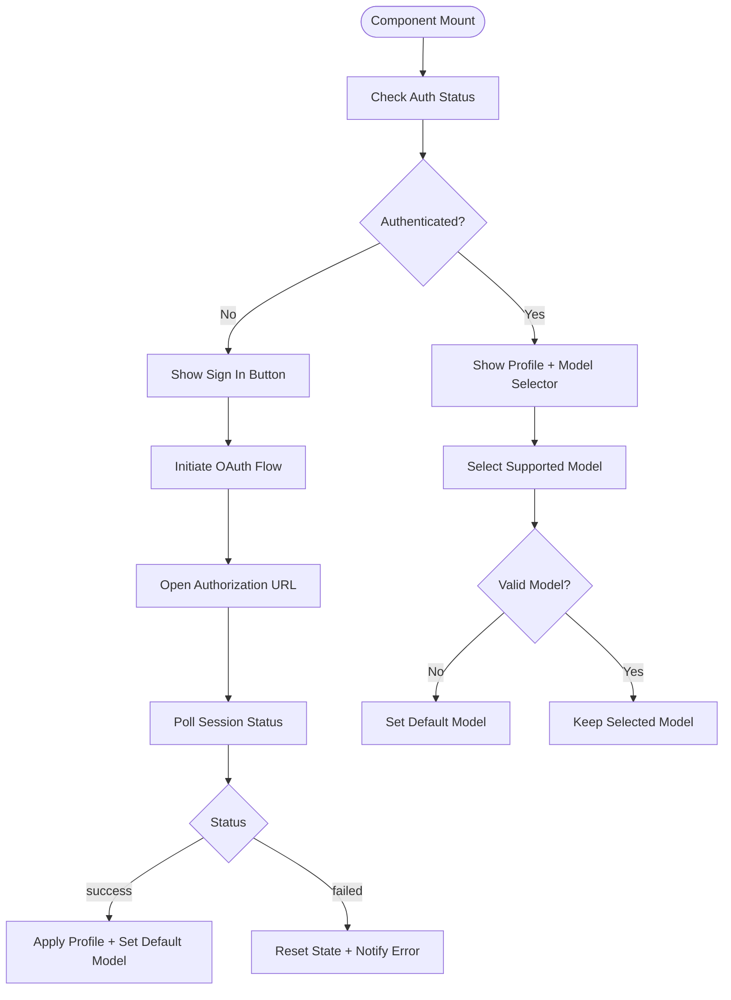
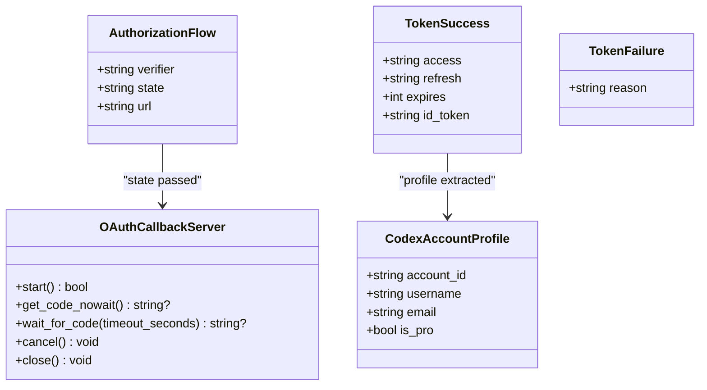
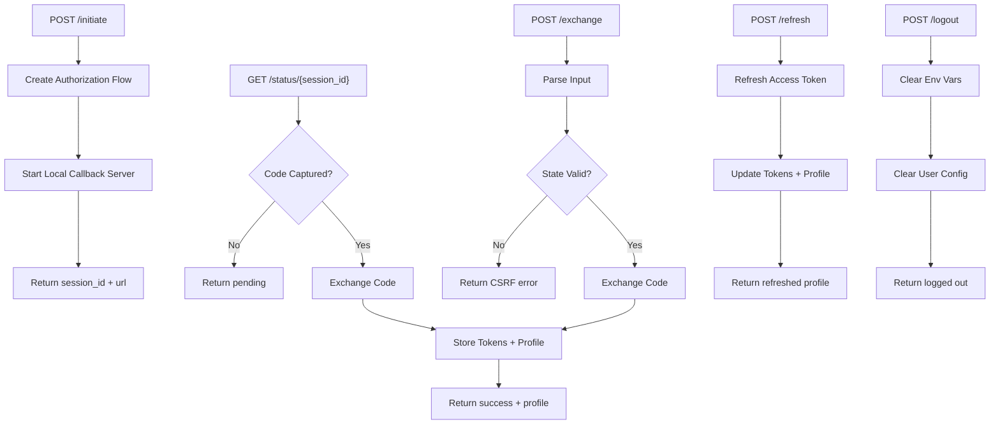
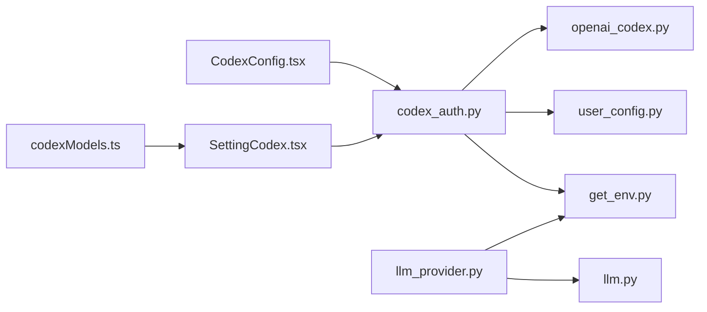

# Codex Integration Settings

<cite>
**Referenced Files in This Document**
- [SettingCodex.tsx](file://servers/nxtjs/app/(presentation-generator)/(dashboard)/settings/SettingCodex.tsx)
- [CodexConfig.tsx](file://servers/nxtjs/components/CodexConfig.tsx)
- [codexModels.ts](file://servers/nxtjs/utils/codexModels.ts)
- [openai_codex.py](file://servers/fastapi/utils/oauth/openai_codex.py)
- [codex_auth.py](file://servers/fastapi/api/v1/ppt/endpoints/codex_auth.py)
- [llm_provider.py](file://servers/fastapi/utils/llm_provider.py)
- [llm_config.py](file://servers/fastapi/utils/llm_config.py)
- [get_env.py](file://servers/fastapi/utils/get_env.py)
- [user_config.py](file://servers/fastapi/models/user_config.py)
- [llm.py](file://servers/fastapi/constants/llm.py)
</cite>

## Table of Contents
1. [Introduction](#introduction)
2. [Project Structure](#project-structure)
3. [Core Components](#core-components)
4. [Architecture Overview](#architecture-overview)
5. [Detailed Component Analysis](#detailed-component-analysis)
6. [Dependency Analysis](#dependency-analysis)
7. [Performance Considerations](#performance-considerations)
8. [Troubleshooting Guide](#troubleshooting-guide)
9. [Conclusion](#conclusion)

## Introduction
This document explains the Codex integration configuration settings for Presenton, focusing on the SettingCodex component and its specialized configuration for OpenAI Codex models. It covers:
- OAuth flow setup with PKCE and a local callback server
- Permission scopes used by the OpenAI authorization endpoint
- Model access configuration and supported model list
- Code generation parameters through provider selection and model choice
- Examples of authentication, model selection, and output formatting behavior
- Security considerations for OAuth tokens and code execution permissions

The goal is to help you configure, operate, and troubleshoot the Codex integration end-to-end.

## Project Structure
The Codex integration spans both the Next.js frontend and FastAPI backend:
- Frontend components manage user interaction, model selection, and OAuth status polling.
- Backend endpoints implement the OAuth flow, token exchange, refresh, and persistence.
- Shared utilities provide environment variable accessors, model constants, and user config persistence.

**Diagram sources**
- [SettingCodex.tsx:100-120](file://servers/nxtjs/app/(presentation-generator)/(dashboard)/settings/SettingCodex.tsx#L100-L120)
- [CodexConfig.tsx:88-112](file://servers/nxtjs/components/CodexConfig.tsx#L88-L112)
- [codexModels.ts:6-22](file://servers/nxtjs/utils/codexModels.ts#L6-L22)
- [codex_auth.py:133-167](file://servers/fastapi/api/v1/ppt/endpoints/codex_auth.py#L133-L167)
- [openai_codex.py:22-29](file://servers/fastapi/utils/oauth/openai_codex.py#L22-L29)
- [llm_provider.py:162-164](file://servers/fastapi/utils/llm_provider.py#L162-L164)
- [get_env.py:449-450](file://servers/fastapi/utils/get_env.py#L449-L450)
- [user_config.py:155-163](file://servers/fastapi/models/user_config.py#L155-L163)
- [llm.py:17-26](file://servers/fastapi/constants/llm.py#L17-L26)

**Section sources**
- [SettingCodex.tsx:100-120](file://servers/nxtjs/app/(presentation-generator)/(dashboard)/settings/SettingCodex.tsx#L100-L120)
- [CodexConfig.tsx:88-112](file://servers/nxtjs/components/CodexConfig.tsx#L88-L112)
- [codexModels.ts:6-22](file://servers/nxtjs/utils/codexModels.ts#L6-L22)
- [codex_auth.py:133-167](file://servers/fastapi/api/v1/ppt/endpoints/codex_auth.py#L133-L167)
- [openai_codex.py:22-29](file://servers/fastapi/utils/oauth/openai_codex.py#L22-L29)
- [llm_provider.py:162-164](file://servers/fastapi/utils/llm_provider.py#L162-L164)
- [get_env.py:449-450](file://servers/fastapi/utils/get_env.py#L449-L450)
- [user_config.py:155-163](file://servers/fastapi/models/user_config.py#L155-L163)
- [llm.py:17-26](file://servers/fastapi/constants/llm.py#L17-L26)

## Core Components
- SettingCodex: The primary settings UI for selecting the Codex provider, signing in via ChatGPT OAuth, refreshing tokens, logging out, and choosing a Codex model.
- CodexConfig: A secondary UI component that also supports sign-in flows and model validation.
- openai_codex.py: Implements PKCE-based OAuth, local callback server, token exchange, refresh, and profile extraction from JWTs.
- codex_auth.py: FastAPI endpoints orchestrating the OAuth lifecycle and persisting tokens and account metadata.
- llm_provider.py and llm.py: Resolve the active Codex model using environment variables and supported model constants.
- get_env.py and user_config.py: Provide environment accessors and persistent storage keys for Codex tokens and model selection.

Key responsibilities:
- Authentication: Initiate, poll, exchange, refresh, logout.
- Authorization: PKCE, state handling, local callback server on port 1455.
- Model selection: Validate against supported models; default fallback.
- Persistence: Save tokens and selected model to user config.

**Section sources**
- [SettingCodex.tsx:122-199](file://servers/nxtjs/app/(presentation-generator)/(dashboard)/settings/SettingCodex.tsx#L122-L199)
- [CodexConfig.tsx:114-186](file://servers/nxtjs/components/CodexConfig.tsx#L114-L186)
- [openai_codex.py:357-375](file://servers/fastapi/utils/oauth/openai_codex.py#L357-L375)
- [codex_auth.py:133-167](file://servers/fastapi/api/v1/ppt/endpoints/codex_auth.py#L133-L167)
- [llm_provider.py:162-164](file://servers/fastapi/utils/llm_provider.py#L162-L164)
- [llm.py:17-26](file://servers/fastapi/constants/llm.py#L17-L26)
- [get_env.py:449-450](file://servers/fastapi/utils/get_env.py#L449-L450)
- [user_config.py:155-163](file://servers/fastapi/models/user_config.py#L155-L163)

## Architecture Overview
The Codex integration uses an OAuth 2.0 PKCE flow with OpenAI’s authorization server. The frontend initiates the flow, opens a browser tab, and polls the backend until the local callback server captures the authorization code. Tokens are exchanged, stored in environment variables, and persisted to user config. The selected model is validated against a supported set and defaults to a safe value if invalid.

**Diagram sources**
- [SettingCodex.tsx:122-199](file://servers/nxtjs/app/(presentation-generator)/(dashboard)/settings/SettingCodex.tsx#L122-L199)
- [CodexConfig.tsx:114-186](file://servers/nxtjs/components/CodexConfig.tsx#L114-L186)
- [codex_auth.py:133-167](file://servers/fastapi/api/v1/ppt/endpoints/codex_auth.py#L133-L167)
- [codex_auth.py:170-209](file://servers/fastapi/api/v1/ppt/endpoints/codex_auth.py#L170-L209)
- [codex_auth.py:261-297](file://servers/fastapi/api/v1/ppt/endpoints/codex_auth.py#L261-L297)
- [openai_codex.py:357-375](file://servers/fastapi/utils/oauth/openai_codex.py#L357-L375)
- [openai_codex.py:508-544](file://servers/fastapi/utils/oauth/openai_codex.py#L508-L544)
- [openai_codex.py:547-574](file://servers/fastapi/utils/oauth/openai_codex.py#L547-L574)

## Detailed Component Analysis

### SettingCodex Component
Purpose:
- Manage Codex provider selection and authentication state.
- Initiate OAuth flow, poll for completion, handle manual code exchange, refresh tokens, and log out.
- Select a supported Codex model and validate it against the allowed set.

Key behaviors:
- On mount, checks current auth status via backend.
- Initiates sign-in by calling the backend initiate endpoint and opening the authorization URL.
- Polls the session status endpoint every few seconds until success or failure.
- Supports manual code paste when automatic redirect does not occur.
- Provides refresh and logout actions, clearing stored tokens and resetting UI state.
- Validates and normalizes the selected model to a supported value.

Model selection:
- Uses a popover combobox to select among predefined Codex models.
- Tracks analytics events for model selection.
- Ensures the selected model is valid; otherwise resets to default.

**Diagram sources**
- [SettingCodex.tsx:100-120](file://servers/nxtjs/app/(presentation-generator)/(dashboard)/settings/SettingCodex.tsx#L100-L120)
- [SettingCodex.tsx:122-199](file://servers/nxtjs/app/(presentation-generator)/(dashboard)/settings/SettingCodex.tsx#L122-L199)
- [SettingCodex.tsx:452-511](file://servers/nxtjs/app/(presentation-generator)/(dashboard)/settings/SettingCodex.tsx#L452-L511)

**Section sources**
- [SettingCodex.tsx:100-120](file://servers/nxtjs/app/(presentation-generator)/(dashboard)/settings/SettingCodex.tsx#L100-L120)
- [SettingCodex.tsx:122-199](file://servers/nxtjs/app/(presentation-generator)/(dashboard)/settings/SettingCodex.tsx#L122-L199)
- [SettingCodex.tsx:452-511](file://servers/nxtjs/app/(presentation-generator)/(dashboard)/settings/SettingCodex.tsx#L452-L511)

### CodexConfig Component
Purpose:
- Alternative UI for Codex authentication and model selection.
- Similar flow to SettingCodex but tailored for different contexts (e.g., onboarding).

Key differences:
- Emphasizes onboarding analytics and simplified UX.
- Also validates model support and sets default when needed.

**Section sources**
- [CodexConfig.tsx:88-112](file://servers/nxtjs/components/CodexConfig.tsx#L88-L112)
- [CodexConfig.tsx:114-186](file://servers/nxtjs/components/CodexConfig.tsx#L114-L186)

### OAuth Flow Implementation (openai_codex.py)
Responsibilities:
- Generate PKCE verifier/challenge and authorization URL.
- Host a local HTTP server on port 1455 to capture the authorization code.
- Exchange the authorization code for access and refresh tokens.
- Refresh tokens when needed.
- Extract account profile information from JWT claims.

Security notes:
- Uses PKCE to prevent authorization code interception.
- Handles state mismatch gracefully in the local callback handler.
- Stores tokens securely in environment variables and persists them to user config.

Scopes:
- openid, profile, email, offline_access.

**Diagram sources**
- [openai_codex.py:258-271](file://servers/fastapi/utils/oauth/openai_codex.py#L258-L271)
- [openai_codex.py:357-375](file://servers/fastapi/utils/oauth/openai_codex.py#L357-L375)
- [openai_codex.py:437-502](file://servers/fastapi/utils/oauth/openai_codex.py#L437-L502)
- [openai_codex.py:508-544](file://servers/fastapi/utils/oauth/openai_codex.py#L508-L544)
- [openai_codex.py:547-574](file://servers/fastapi/utils/oauth/openai_codex.py#L547-L574)

**Section sources**
- [openai_codex.py:22-29](file://servers/fastapi/utils/oauth/openai_codex.py#L22-L29)
- [openai_codex.py:357-375](file://servers/fastapi/utils/oauth/openai_codex.py#L357-L375)
- [openai_codex.py:437-502](file://servers/fastapi/utils/oauth/openai_codex.py#L437-L502)
- [openai_codex.py:508-544](file://servers/fastapi/utils/oauth/openai_codex.py#L508-L544)
- [openai_codex.py:547-574](file://servers/fastapi/utils/oauth/openai_codex.py#L547-L574)

### Backend Endpoints (codex_auth.py)
Endpoints:
- POST /codex/auth/initiate: Starts the OAuth flow and returns an authorization URL plus a session ID.
- GET /codex/auth/status/{session_id}: Polls for completion; exchanges code and stores tokens on success.
- POST /codex/auth/exchange: Manual fallback to exchange a pasted code or redirect URL.
- POST /codex/auth/refresh: Refreshes the stored access token using the refresh token.
- GET /codex/auth/status: Returns current authentication status and profile.
- POST /codex/auth/logout: Clears all stored credentials and model selection.

Persistence:
- Tokens and profile fields are saved into environment variables and user config.

Error handling:
- Returns appropriate HTTP statuses and messages for missing sessions, failed exchanges, and expired tokens.

**Diagram sources**
- [codex_auth.py:133-167](file://servers/fastapi/api/v1/ppt/endpoints/codex_auth.py#L133-L167)
- [codex_auth.py:170-209](file://servers/fastapi/api/v1/ppt/endpoints/codex_auth.py#L170-L209)
- [codex_auth.py:212-258](file://servers/fastapi/api/v1/ppt/endpoints/codex_auth.py#L212-L258)
- [codex_auth.py:261-297](file://servers/fastapi/api/v1/ppt/endpoints/codex_auth.py#L261-L297)
- [codex_auth.py:300-332](file://servers/fastapi/api/v1/ppt/endpoints/codex_auth.py#L300-L332)
- [codex_auth.py:335-349](file://servers/fastapi/api/v1/ppt/endpoints/codex_auth.py#L335-L349)

**Section sources**
- [codex_auth.py:133-167](file://servers/fastapi/api/v1/ppt/endpoints/codex_auth.py#L133-L167)
- [codex_auth.py:170-209](file://servers/fastapi/api/v1/ppt/endpoints/codex_auth.py#L170-L209)
- [codex_auth.py:212-258](file://servers/fastapi/api/v1/ppt/endpoints/codex_auth.py#L212-L258)
- [codex_auth.py:261-297](file://servers/fastapi/api/v1/ppt/endpoints/codex_auth.py#L261-L297)
- [codex_auth.py:300-332](file://servers/fastapi/api/v1/ppt/endpoints/codex_auth.py#L300-L332)
- [codex_auth.py:335-349](file://servers/fastapi/api/v1/ppt/endpoints/codex_auth.py#L335-L349)

### Model Selection and Validation
- Supported models are defined in constants and mirrored in the frontend.
- If an unsupported model is selected, the system falls back to the default model.
- The selected model is read from environment variables and validated at runtime.

Supported models include:
- gpt-5.6-sol
- gpt-5.6-terra
- gpt-5.6-luna
- gpt-5.5
- gpt-5.4
- gpt-5.4-mini
- gpt-5.3-codex-spark

Default model:
- gpt-5.6-luna

**Section sources**
- [llm.py:17-26](file://servers/fastapi/constants/llm.py#L17-L26)
- [codexModels.ts:6-22](file://servers/nxtjs/utils/codexModels.ts#L6-L22)
- [llm_provider.py:162-164](file://servers/fastapi/utils/llm_provider.py#L162-L164)

### Environment Variables and Persistence
Environment variables:
- CODEX_MODEL: Selected model identifier.
- CODEX_ACCESS_TOKEN: OAuth access token.
- CODEX_REFRESH_TOKEN: OAuth refresh token.
- CODEX_TOKEN_EXPIRES: Expiration timestamp (milliseconds).
- CODEX_ACCOUNT_ID: Account identifier extracted from tokens.
- CODEX_USERNAME: Username from profile.
- CODEX_EMAIL: Email from profile.
- CODEX_IS_PRO: Boolean indicating Pro plan status.

Persistence:
- Tokens and profile fields are saved to user config to survive restarts.
- Logout clears both environment variables and user config.

**Section sources**
- [get_env.py:441-450](file://servers/fastapi/utils/get_env.py#L441-L450)
- [user_config.py:155-163](file://servers/fastapi/models/user_config.py#L155-L163)
- [llm_config.py:153-166](file://servers/fastapi/utils/llm_config.py#L153-L166)

## Dependency Analysis
The following diagram shows how components depend on each other:

**Diagram sources**
- [SettingCodex.tsx:100-120](file://servers/nxtjs/app/(presentation-generator)/(dashboard)/settings/SettingCodex.tsx#L100-L120)
- [CodexConfig.tsx:88-112](file://servers/nxtjs/components/CodexConfig.tsx#L88-L112)
- [codexModels.ts:6-22](file://servers/nxtjs/utils/codexModels.ts#L6-L22)
- [codex_auth.py:133-167](file://servers/fastapi/api/v1/ppt/endpoints/codex_auth.py#L133-L167)
- [openai_codex.py:357-375](file://servers/fastapi/utils/oauth/openai_codex.py#L357-L375)
- [llm_provider.py:162-164](file://servers/fastapi/utils/llm_provider.py#L162-L164)
- [llm.py:17-26](file://servers/fastapi/constants/llm.py#L17-L26)
- [get_env.py:449-450](file://servers/fastapi/utils/get_env.py#L449-L450)
- [user_config.py:155-163](file://servers/fastapi/models/user_config.py#L155-L163)

**Section sources**
- [SettingCodex.tsx:100-120](file://servers/nxtjs/app/(presentation-generator)/(dashboard)/settings/SettingCodex.tsx#L100-L120)
- [CodexConfig.tsx:88-112](file://servers/nxtjs/components/CodexConfig.tsx#L88-L112)
- [codexModels.ts:6-22](file://servers/nxtjs/utils/codexModels.ts#L6-L22)
- [codex_auth.py:133-167](file://servers/fastapi/api/v1/ppt/endpoints/codex_auth.py#L133-L167)
- [openai_codex.py:357-375](file://servers/fastapi/utils/oauth/openai_codex.py#L357-L375)
- [llm_provider.py:162-164](file://servers/fastapi/utils/llm_provider.py#L162-L164)
- [llm.py:17-26](file://servers/fastapi/constants/llm.py#L17-L26)
- [get_env.py:449-450](file://servers/fastapi/utils/get_env.py#L449-L450)
- [user_config.py:155-163](file://servers/fastapi/models/user_config.py#L155-L163)

## Performance Considerations
- Polling interval: The frontend polls the session status endpoint every two seconds during the OAuth flow. This balances responsiveness with server load.
- Local callback server: Runs in a background thread with short request timeouts to avoid blocking the main process.
- Token refresh: Avoids unnecessary network calls by checking expiration timestamps before attempting refresh.
- Model validation: Constant-time lookup using a set of supported model IDs ensures fast validation.

[No sources needed since this section provides general guidance]

## Troubleshooting Guide
Common issues and resolutions:
- Port 1455 unavailable: The local callback server may fail to bind. Use the manual code exchange flow by pasting the redirect URL or code into the exchange endpoint.
- State mismatch: The callback handler treats state mismatches as soft warnings; retry the flow if necessary.
- Expired tokens: Call the refresh endpoint; if refresh fails, re-authenticate via the sign-in flow.
- Unsupported model: The UI will reset to the default model; ensure the selected model is in the supported list.
- Logout failures: Ensure all environment variables and user config entries are cleared; verify the logout endpoint response.

Security considerations:
- OAuth tokens are stored in environment variables and persisted to user config; protect these files and restrict access.
- Use HTTPS in production environments and secure the local callback server binding.
- Limit permissions to only required scopes (openid, profile, email, offline_access).
- Validate model selections to prevent unintended usage of unsupported models.

**Section sources**
- [codex_auth.py:133-167](file://servers/fastapi/api/v1/ppt/endpoints/codex_auth.py#L133-L167)
- [codex_auth.py:212-258](file://servers/fastapi/api/v1/ppt/endpoints/codex_auth.py#L212-L258)
- [codex_auth.py:261-297](file://servers/fastapi/api/v1/ppt/endpoints/codex_auth.py#L261-L297)
- [openai_codex.py:437-502](file://servers/fastapi/utils/oauth/openai_codex.py#L437-L502)
- [llm_provider.py:162-164](file://servers/fastapi/utils/llm_provider.py#L162-L164)

## Conclusion
The Codex integration in Presenton provides a secure, user-friendly way to authenticate with OpenAI’s ChatGPT service using PKCE and a local callback server. The SettingCodex component manages the full lifecycle of authentication, token refresh, logout, and model selection. Backend endpoints orchestrate the OAuth flow, persist tokens securely, and expose clean APIs for the frontend. Model selection is validated against a known set, ensuring predictable behavior. By following the guidance here, you can configure, operate, and troubleshoot the Codex integration effectively while maintaining security best practices.

[No sources needed since this section summarizes without analyzing specific files]