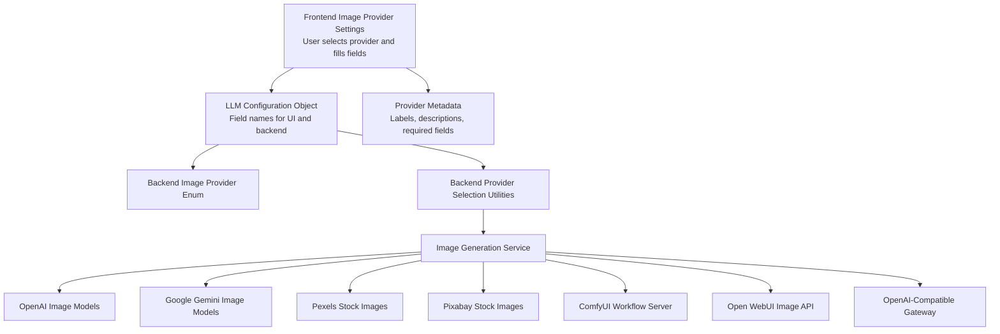
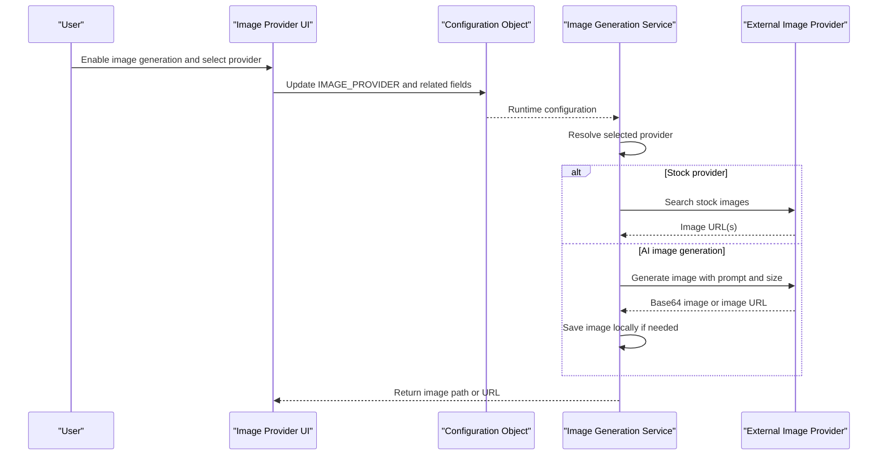
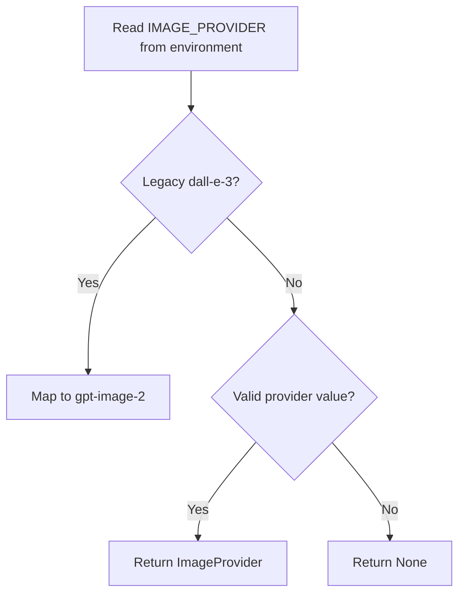
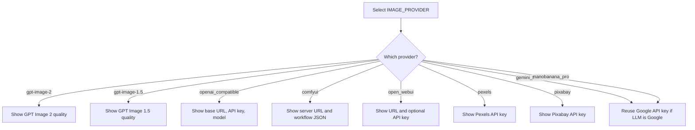
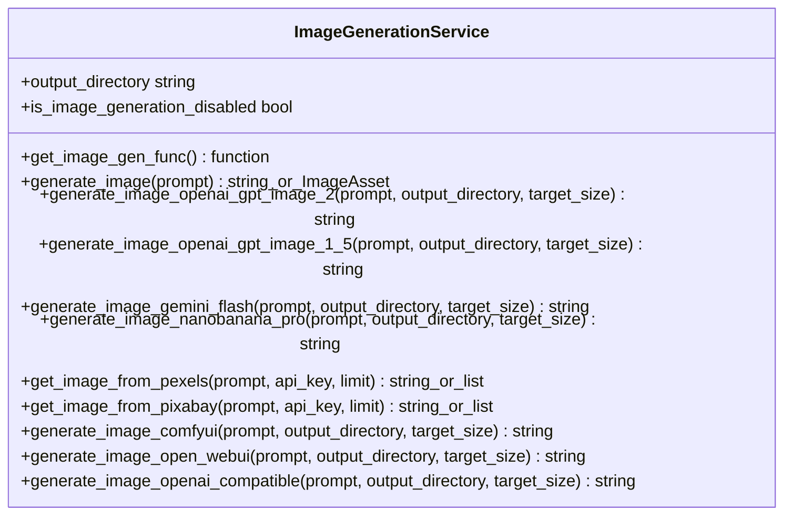
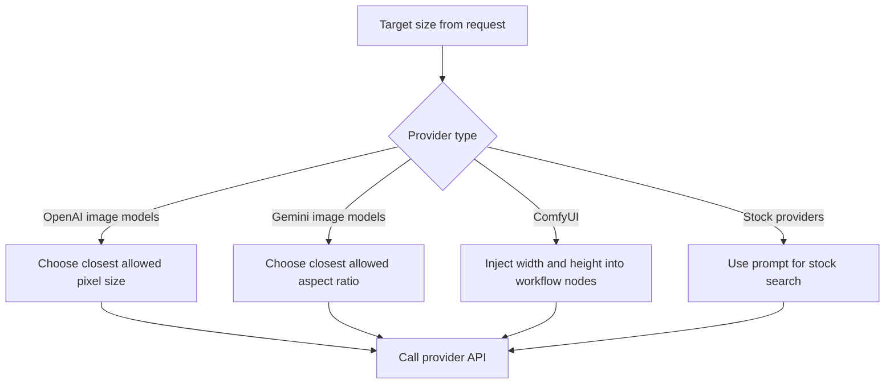
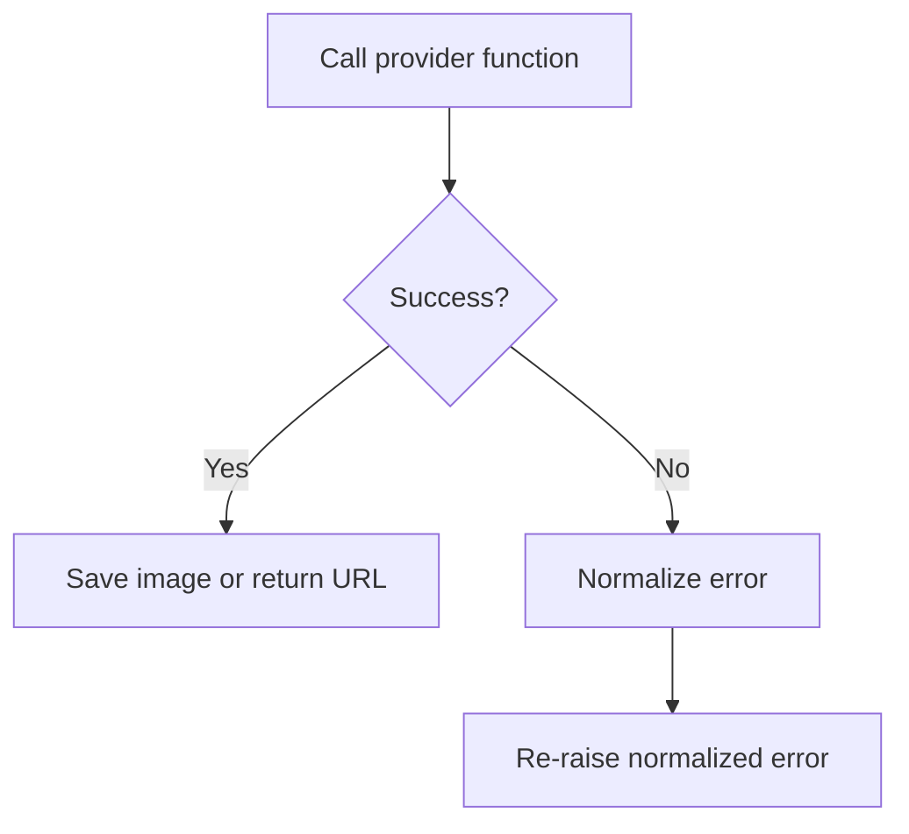
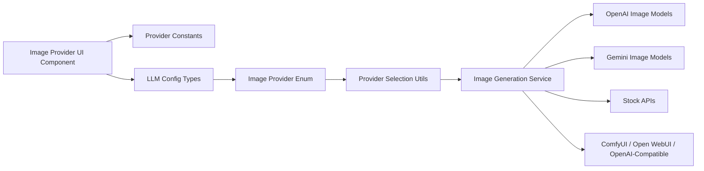

# Image Provider Settings

<cite>
**Referenced Files in This Document**
- [image_provider.py](file://servers/fastapi/enums/image_provider.py)
- [image_provider_utils.py](file://servers/fastapi/utils/image_provider.py)
- [image_generation_service.py](file://servers/fastapi/services/image_generation_service.py)
- [user_config_model.py](file://servers/fastapi/models/user_config.py)
- [llm_config_types.ts](file://servers/nxtjs/types/llm_config.ts)
- [provider_constants.ts](file://servers/nxtjs/utils/providerConstants.ts)
- [settings_image_provider_component.tsx](file://servers/nxtjs/app/(presentation-generator)/(dashboard)/settings/ImageProvider.tsx)
- [image_selection_config_component.tsx](file://servers/nxtjs/components/ImageSelectionConfig.tsx)
- [amazon_bedrock_documentation.md](file://docs/amazon-bedrock.md)
</cite>

## Table of Contents
1. [Introduction](#introduction)
2. [Project Structure](#project-structure)
3. [Core Components](#core-components)
4. [Architecture Overview](#architecture-overview)
5. [Detailed Component Analysis](#detailed-component-analysis)
6. [Dependency Analysis](#dependency-analysis)
7. [Performance Considerations](#performance-considerations)
8. [Troubleshooting Guide](#troubleshooting-guide)
9. [Security Considerations](#security-considerations)
10. [Conclusion](#conclusion)

## Introduction
This document explains the image provider configuration system used by Presenton for generating or selecting images during presentation creation. It covers:

- The supported image providers, including OpenAI DALL-E family models, Google Gemini image models, AWS Bedrock as a text LLM context, and compatible external services such as ComfyUI, Open WebUI, stock photo APIs, and OpenAI-compatible endpoints.
- How the frontend UI collects settings and how the backend selects and executes the correct image generation path.
- API key setup, model selection, resolution and aspect ratio handling, quality options, validation rules, connection testing behavior, and error handling.
- Security guidance for storing and transmitting API keys.

The documentation is organized so that both administrators configuring environment variables and users configuring the UI can understand the full lifecycle from settings to generated image.

## Project Structure
Image provider configuration spans three main layers:

- Frontend UI components collect user input, validate visible fields, and update the application configuration object.
- Backend constants and utilities define available providers and read environment-based configuration.
- Backend service implementations call external APIs, normalize errors, and return either local file paths or URLs.

**Diagram sources**
- [settings_image_provider_component.tsx:14-464](file://servers/nxtjs/app/(presentation-generator)/(dashboard)/settings/ImageProvider.tsx#L14-L464)
- [image_selection_config_component.tsx:104-394](file://servers/nxtjs/components/ImageSelectionConfig.tsx#L104-L394)
- [provider_constants.ts:91-180](file://servers/nxtjs/utils/providerConstants.ts#L91-L180)
- [image_provider.py:4-14](file://servers/fastapi/enums/image_provider.py#L4-L14)
- [image_provider_utils.py:49-61](file://servers/fastapi/utils/image_provider.py#L49-L61)
- [image_generation_service.py:132-160](file://servers/fastapi/services/image_generation_service.py#L132-L160)

**Section sources**
- [settings_image_provider_component.tsx:14-464](file://servers/nxtjs/app/(presentation-generator)/(dashboard)/settings/ImageProvider.tsx#L14-L464)
- [image_selection_config_component.tsx:104-394](file://servers/nxtjs/components/ImageSelectionConfig.tsx#L104-L394)
- [provider_constants.ts:91-180](file://servers/nxtjs/utils/providerConstants.ts#L91-L180)
- [image_provider.py:4-14](file://servers/fastapi/enums/image_provider.py#L4-L14)
- [image_provider_utils.py:49-61](file://servers/fastapi/utils/image_provider.py#L49-L61)
- [image_generation_service.py:132-160](file://servers/fastapi/services/image_generation_service.py#L132-L160)

## Core Components
The image provider system consists of:

| Layer | Responsibility | Key Files |
|---|---|---|
| Frontend UI | Provider selection, API key inputs, quality selectors, ComfyUI/Open WebUI/OpenAI-compatible field forms | `settings_image_provider_component.tsx`, `image_selection_config_component.tsx` |
| Frontend Metadata | Provider labels, descriptions, required API key field names, help links | `provider_constants.ts` |
| Frontend Types | Typed configuration shape for all providers and image-related fields | `llm_config_types.ts` |
| Backend Enum | Canonical list of supported image provider identifiers | `image_provider.py` |
| Backend Utilities | Environment-based provider selection and helper flags | `image_provider_utils.py` |
| Backend Service | Routing to provider-specific generators, size/ratio handling, error normalization, result persistence | `image_generation_service.py` |
| Backend User Config Model | Persistent configuration schema with migration support | `user_config_model.py` |

Supported image providers include:

- Pexels
- Pixabay
- GPT Image 2
- GPT Image 1.5
- Gemini Flash
- NanoBanana Pro
- ComfyUI
- Open WebUI
- OpenAI-compatible custom endpoint

AWS Bedrock is primarily documented as a text LLM provider; it does not have a dedicated image provider entry in the current image provider enum, but its configuration fields are present in the shared user configuration model.

**Section sources**
- [image_provider.py:4-14](file://servers/fastapi/enums/image_provider.py#L4-L14)
- [provider_constants.ts:91-180](file://servers/nxtjs/utils/providerConstants.ts#L91-L180)
- [llm_config_types.ts:89-111](file://servers/nxtjs/types/llm_config.ts#L89-L111)
- [user_config_model.py:104-126](file://servers/fastapi/models/user_config.py#L104-L126)

## Architecture Overview
The image generation flow starts when the user enables image generation and selects an image provider. The frontend updates the configuration object, which is then used by the backend to choose the correct implementation.

**Diagram sources**
- [settings_image_provider_component.tsx:117-404](file://servers/nxtjs/app/(presentation-generator)/(dashboard)/settings/ImageProvider.tsx#L117-L404)
- [image_generation_service.py:165-235](file://servers/fastapi/services/image_generation_service.py#L165-L235)
- [image_generation_service.py:478-563](file://servers/fastapi/services/image_generation_service.py#L478-L563)
- [image_generation_service.py:272-298](file://servers/fastapi/services/image_generation_service.py#L272-L298)
- [image_generation_service.py:456-476](file://servers/fastapi/services/image_generation_service.py#L456-L476)
- [image_generation_service.py:1038-1116](file://servers/fastapi/services/image_generation_service.py#L1038-L1116)

## Detailed Component Analysis

### Image Provider Enum and Selection
The backend defines a strict enumeration of supported image providers. This ensures consistent routing between environment configuration and service logic.

Key behaviors:

- The enum includes stock providers, OpenAI image models, Gemini image models, ComfyUI, Open WebUI, and OpenAI-compatible endpoints.
- The utility layer reads the active provider from environment configuration and maps legacy values such as removed model identifiers to current ones.
- Helper functions determine whether a specific provider is selected, allowing the service to dispatch to the correct generator.

**Diagram sources**
- [image_provider.py:4-14](file://servers/fastapi/enums/image_provider.py#L4-L14)
- [image_provider_utils.py:49-61](file://servers/fastapi/utils/image_provider.py#L49-L61)

**Section sources**
- [image_provider.py:4-14](file://servers/fastapi/enums/image_provider.py#L4-L14)
- [image_provider_utils.py:9-61](file://servers/fastapi/utils/image_provider.py#L9-L61)

### Frontend Image Provider Settings Component
The settings component renders:

- A toggle to enable or disable image generation.
- A searchable provider selector.
- Dynamic fields based on the selected provider.
- Quality selectors for OpenAI image models.
- Provider-specific configuration such as ComfyUI server URL and workflow JSON, Open WebUI URL and optional API key, and OpenAI-compatible base URL, API key, and model.

Important UI behaviors:

- When the provider is disabled, most provider fields are hidden.
- For OpenAI-compatible providers, the UI shows a warning when no models are found and allows manual model ID entry.
- For stock providers and Gemini/OpenAI providers, the UI may reuse the same API key as the text LLM provider where applicable.

**Diagram sources**
- [settings_image_provider_component.tsx:59-112](file://servers/nxtjs/app/(presentation-generator)/(dashboard)/settings/ImageProvider.tsx#L59-L112)
- [settings_image_provider_component.tsx:237-404](file://servers/nxtjs/app/(presentation-generator)/(dashboard)/settings/ImageProvider.tsx#L237-L404)
- [image_selection_config_component.tsx:29-102](file://servers/nxtjs/components/ImageSelectionConfig.tsx#L29-L102)
- [image_selection_config_component.tsx:206-233](file://servers/nxtjs/components/ImageSelectionConfig.tsx#L206-L233)

**Section sources**
- [settings_image_provider_component.tsx:14-464](file://servers/nxtjs/app/(presentation-generator)/(dashboard)/settings/ImageProvider.tsx#L14-L464)
- [image_selection_config_component.tsx:104-394](file://servers/nxtjs/components/ImageSelectionConfig.tsx#L104-L394)

### Provider Metadata and Field Mapping
Provider metadata controls what the UI displays and which configuration fields are required.

| Provider | Required Fields | Notes |
|---|---|---|
| Pexels | `PEXELS_API_KEY` | Stock image search via Pexels API. |
| Pixabay | `PIXABAY_API_KEY` | Stock image search via Pixabay API. |
| GPT Image 2 | `OPENAI_API_KEY` | Uses OpenAI image generation with quality setting. |
| GPT Image 1.5 | `OPENAI_API_KEY` | Uses OpenAI image generation with quality setting. |
| Gemini Flash | `GOOGLE_API_KEY` | Google Gemini image generation. |
| NanoBanana Pro | `GOOGLE_API_KEY` | Advanced Google Gemini image generation. |
| ComfyUI | `COMFYUI_URL`, `COMFYUI_WORKFLOW` | Self-hosted workflow engine. |
| Open WebUI | `OPEN_WEBUI_IMAGE_URL`, optional `OPEN_WEBUI_IMAGE_API_KEY` | External Open WebUI image API. |
| OpenAI-compatible | `OPENAI_COMPAT_IMAGE_BASE_URL`, `OPENAI_COMPAT_IMAGE_API_KEY`, `OPENAI_COMPAT_IMAGE_MODEL` | Generic OpenAI-compatible `/v1/images` gateway. |

**Section sources**
- [provider_constants.ts:91-180](file://servers/nxtjs/utils/providerConstants.ts#L91-L180)
- [llm_config_types.ts:89-111](file://servers/nxtjs/types/llm_config.ts#L89-L111)

### Backend Image Generation Service
The backend service is the central orchestrator for image generation. It:

- Disables image generation when configured.
- Chooses the correct provider function based on the selected provider.
- Normalizes target sizes into provider-specific sizes or aspect ratios.
- Handles stock image retrieval, AI image generation, workflow submission, and result saving.
- Normalizes provider errors before re-raising them.

**Diagram sources**
- [image_generation_service.py:132-160](file://servers/fastapi/services/image_generation_service.py#L132-L160)
- [image_generation_service.py:165-235](file://servers/fastapi/services/image_generation_service.py#L165-L235)
- [image_generation_service.py:272-298](file://servers/fastapi/services/image_generation_service.py#L272-L298)
- [image_generation_service.py:456-476](file://servers/fastapi/services/image_generation_service.py#L456-L476)
- [image_generation_service.py:478-563](file://servers/fastapi/services/image_generation_service.py#L478-L563)
- [image_generation_service.py:565-646](file://servers/fastapi/services/image_generation_service.py#L565-L646)
- [image_generation_service.py:1038-1116](file://servers/fastapi/services/image_generation_service.py#L1038-L1116)

**Section sources**
- [image_generation_service.py:132-235](file://servers/fastapi/services/image_generation_service.py#L132-L235)
- [image_generation_service.py:272-298](file://servers/fastapi/services/image_generation_service.py#L272-L298)
- [image_generation_service.py:456-476](file://servers/fastapi/services/image_generation_service.py#L456-L476)
- [image_generation_service.py:478-563](file://servers/fastapi/services/image_generation_service.py#L478-L563)
- [image_generation_service.py:565-646](file://servers/fastapi/services/image_generation_service.py#L565-L646)
- [image_generation_service.py:1038-1116](file://servers/fastapi/services/image_generation_service.py#L1038-L1116)

### Resolution, Aspect Ratio, and Size Handling
Resolution handling differs by provider:

- OpenAI image models use predefined pixel dimensions.
- Gemini image models use aspect ratios.
- ComfyUI attempts to inject width and height into suitable nodes in the workflow.
- Stock providers generally return available images without enforcing a strict target size.

**Diagram sources**
- [image_generation_service.py:61-105](file://servers/fastapi/services/image_generation_service.py#L61-L105)
- [image_generation_service.py:648-683](file://servers/fastapi/services/image_generation_service.py#L648-L683)

**Section sources**
- [image_generation_service.py:61-105](file://servers/fastapi/services/image_generation_service.py#L61-L105)
- [image_generation_service.py:648-683](file://servers/fastapi/services/image_generation_service.py#L648-L683)

### Quality Configuration
Quality settings apply to OpenAI image models:

- GPT Image 2 supports low, medium, and high quality options.
- GPT Image 1.5 supports low, medium, and high quality options.
- The backend reads quality from environment configuration and falls back to defaults when missing.

Validation and defaults:

- If quality is not set, the backend uses a safe default.
- The frontend exposes selectable quality options for these providers.

**Section sources**
- [settings_image_provider_component.tsx:59-112](file://servers/nxtjs/app/(presentation-generator)/(dashboard)/settings/ImageProvider.tsx#L59-L112)
- [image_selection_config_component.tsx:12-28](file://servers/nxtjs/components/ImageSelectionConfig.tsx#L12-L28)
- [image_generation_service.py:272-298](file://servers/fastapi/services/image_generation_service.py#L272-L298)

### Provider-Specific Field Configuration

#### OpenAI DALL-E Family
- Providers: `gpt-image-2`, `gpt-image-1.5`.
- Required configuration: OpenAI API key.
- Optional configuration: quality level.
- Behavior: Calls OpenAI image generation API, writes returned base64 image to disk, or handles URL fallbacks.

#### Google Imagen / Gemini Image Models
- Providers: `gemini_flash`, `nanobanana_pro`.
- Required configuration: Google API key.
- Behavior: Uses Gemini SDK to generate images, extracts inline image data, and saves to disk.

#### AWS Bedrock
- Role: Text LLM provider configuration is present in the shared user configuration model.
- Image role: No dedicated image provider entry exists in the current image provider enum.
- Guidance: Bedrock configuration fields exist for text generation; image generation should use one of the supported image providers.

#### ComfyUI
- Required configuration: ComfyUI server URL and exported workflow JSON.
- Behavior: Injects prompt and optionally target size into workflow nodes, submits workflow, polls completion, and downloads generated image.

#### Open WebUI
- Required configuration: Open WebUI URL.
- Optional configuration: API key.
- Behavior: Sends image generation request to Open WebUI API, handles base64 or URL responses, and downloads images when needed.

#### OpenAI-Compatible Custom Endpoint
- Required configuration: Base URL, API key, and model name.
- Behavior: Uses OpenAI client against a custom base URL, supports size fallback, and handles base64 or URL responses.

**Section sources**
- [provider_constants.ts:112-179](file://servers/nxtjs/utils/providerConstants.ts#L112-L179)
- [llm_config_types.ts:89-111](file://servers/nxtjs/types/llm_config.ts#L89-L111)
- [image_generation_service.py:272-298](file://servers/fastapi/services/image_generation_service.py#L272-L298)
- [image_generation_service.py:456-476](file://servers/fastapi/services/image_generation_service.py#L456-L476)
- [image_generation_service.py:565-646](file://servers/fastapi/services/image_generation_service.py#L565-L646)
- [image_generation_service.py:300-389](file://servers/fastapi/services/image_generation_service.py#L300-L389)
- [image_generation_service.py:1038-1116](file://servers/fastapi/services/image_generation_service.py#L1038-L1116)
- [user_config_model.py:42-49](file://servers/fastapi/models/user_config.py#L42-L49)

### Validation Rules
Validation occurs at multiple levels:

- Frontend metadata defines required fields per provider.
- Backend environment reading validates presence of required values for certain providers.
- Backend service raises clear errors when configuration is incomplete or invalid.
- User configuration model supports migration for legacy image provider values.

Examples:

- OpenAI-compatible provider requires base URL, API key, and model.
- ComfyUI requires server URL and valid workflow JSON.
- Legacy `dall-e-3` image provider is migrated to `gpt-image-2`.

**Section sources**
- [provider_constants.ts:91-180](file://servers/nxtjs/utils/providerConstants.ts#L91-L180)
- [image_generation_service.py:1044-1051](file://servers/fastapi/services/image_generation_service.py#L1044-L1051)
- [image_generation_service.py:591-606](file://servers/fastapi/services/image_generation_service.py#L591-L606)
- [user_config_model.py:5-15](file://servers/fastapi/models/user_config.py#L5-L15)

### Connection Testing
Connection testing is implicit rather than exposed as a dedicated “test connection” button for every provider:

- Stock providers return explicit authentication errors for invalid keys.
- Open WebUI returns HTTP status codes and helpful hints when the URL points to the wrong endpoint.
- OpenAI-compatible provider validates required fields and reports missing configuration.
- ComfyUI validates workflow JSON and reports submission or polling failures.
- The frontend warns when no models are found for OpenAI-compatible providers.

Recommended verification steps:

- Verify API keys with the provider’s own dashboard.
- Confirm URLs point to the correct API root.
- Ensure network access from the backend host to external services.
- Test with a simple prompt after enabling image generation.

**Section sources**
- [image_generation_service.py:492-499](file://servers/fastapi/services/image_generation_service.py#L492-L499)
- [image_generation_service.py:531-553](file://servers/fastapi/services/image_generation_service.py#L531-L553)
- [image_generation_service.py:335-346](file://servers/fastapi/services/image_generation_service.py#L335-L346)
- [image_generation_service.py:1044-1051](file://servers/fastapi/services/image_generation_service.py#L1044-L1051)
- [settings_image_provider_component.tsx:406-434](file://servers/nxtjs/app/(presentation-generator)/(dashboard)/settings/ImageProvider.tsx#L406-L434)

### Error Handling
Error handling normalizes provider errors and preserves meaningful diagnostics:

- Invalid stock API keys return authentication errors.
- Network or provider errors are wrapped with readable messages.
- OpenAI size/dimension errors trigger fallback to a default size.
- ComfyUI workflow submission, polling, and download errors are clearly reported.
- Missing configuration raises validation errors before calling external APIs.

**Diagram sources**
- [image_generation_service.py:189-224](file://servers/fastapi/services/image_generation_service.py#L189-L224)
- [image_generation_service.py:254-270](file://servers/fastapi/services/image_generation_service.py#L254-L270)
- [image_generation_service.py:1062-1078](file://servers/fastapi/services/image_generation_service.py#L1062-L1078)

**Section sources**
- [image_generation_service.py:189-224](file://servers/fastapi/services/image_generation_service.py#L189-L224)
- [image_generation_service.py:254-270](file://servers/fastapi/services/image_generation_service.py#L254-L270)
- [image_generation_service.py:1062-1078](file://servers/fastapi/services/image_generation_service.py#L1062-L1078)

## Dependency Analysis
The following diagram shows how configuration flows from frontend to backend and how providers are selected.

**Diagram sources**
- [settings_image_provider_component.tsx:14-464](file://servers/nxtjs/app/(presentation-generator)/(dashboard)/settings/ImageProvider.tsx#L14-L464)
- [provider_constants.ts:91-180](file://servers/nxtjs/utils/providerConstants.ts#L91-L180)
- [llm_config_types.ts:89-111](file://servers/nxtjs/types/llm_config.ts#L89-L111)
- [image_provider.py:4-14](file://servers/fastapi/enums/image_provider.py#L4-L14)
- [image_provider_utils.py:49-61](file://servers/fastapi/utils/image_provider.py#L49-L61)
- [image_generation_service.py:132-160](file://servers/fastapi/services/image_generation_service.py#L132-L160)

**Section sources**
- [settings_image_provider_component.tsx:14-464](file://servers/nxtjs/app/(presentation-generator)/(dashboard)/settings/ImageProvider.tsx#L14-L464)
- [provider_constants.ts:91-180](file://servers/nxtjs/utils/providerConstants.ts#L91-L180)
- [llm_config_types.ts:89-111](file://servers/nxtjs/types/llm_config.ts#L89-L111)
- [image_provider.py:4-14](file://servers/fastapi/enums/image_provider.py#L4-L14)
- [image_provider_utils.py:49-61](file://servers/fastapi/utils/image_provider.py#L49-L61)
- [image_generation_service.py:132-160](file://servers/fastapi/services/image_generation_service.py#L132-L160)

## Performance Considerations
- Parallel image generation can be enabled through environment configuration. When enabled, multiple image requests may run concurrently; otherwise, a lock serializes image generation calls.
- OpenAI image generation retries with a default size when a requested size is rejected.
- ComfyUI workflows poll for completion with a timeout, preventing indefinite waits.
- Stock image requests use timeouts to avoid hanging connections.

Recommendations:

- Keep parallel image generation disabled in constrained environments.
- Prefer appropriate quality levels to balance speed and cost.
- Use aspect ratios or preset sizes that match your template layout to reduce unnecessary resizing.
- Monitor external provider latency and rate limits.

**Section sources**
- [image_generation_service.py:189-198](file://servers/fastapi/services/image_generation_service.py#L189-L198)
- [image_generation_service.py:254-270](file://servers/fastapi/services/image_generation_service.py#L254-L270)
- [image_generation_service.py:935-983](file://servers/fastapi/services/image_generation_service.py#L935-L983)

## Troubleshooting Guide

### Common Issues and Fixes

| Symptom | Likely Cause | Fix |
|---|---|---|
| Image generation is disabled | `DISABLE_IMAGE_GENERATION` is enabled | Disable the toggle in the UI or unset the corresponding configuration. |
| Invalid Pexels API key | Missing or incorrect `PEXELS_API_KEY` | Set a valid Pexels API key. |
| Invalid Pixabay API key | Missing or incorrect `PIXABAY_API_KEY` | Set a valid Pixabay API key. |
| Open WebUI returns 404 or 405 | Wrong API root URL | Point `OPEN_WEBUI_IMAGE_URL` to the Open WebUI API root. |
| OpenAI-compatible provider reports missing configuration | Missing base URL, API key, or model | Set all three required fields. |
| ComfyUI workflow fails | Invalid workflow JSON or missing prompt node | Export a valid workflow and ensure it contains a writable prompt input. |
| Gemini image has unexpected aspect ratio | Target size not matching supported ratios | Use supported aspect ratios or let the backend choose the closest ratio. |
| OpenAI image generation rejects size | Unsupported pixel dimensions | Allow automatic fallback or use supported sizes. |

### AWS Bedrock Context
AWS Bedrock is primarily a text LLM provider. Its configuration fields exist in the shared user configuration model, but there is no dedicated image provider entry in the current image provider enum. If you need Bedrock for text generation while using another provider for images, configure Bedrock separately from the image provider.

**Section sources**
- [image_generation_service.py:492-499](file://servers/fastapi/services/image_generation_service.py#L492-L499)
- [image_generation_service.py:531-553](file://servers/fastapi/services/image_generation_service.py#L531-L553)
- [image_generation_service.py:335-346](file://servers/fastapi/services/image_generation_service.py#L335-L346)
- [image_generation_service.py:1044-1051](file://servers/fastapi/services/image_generation_service.py#L1044-L1051)
- [image_generation_service.py:591-606](file://servers/fastapi/services/image_generation_service.py#L591-L606)
- [user_config_model.py:42-49](file://servers/fastapi/models/user_config.py#L42-L49)
- [amazon_bedrock_documentation.md:1-177](file://docs/amazon-bedrock.md#L1-L177)

## Security Considerations
API keys are sensitive credentials and must be handled securely:

- Store API keys in environment variables or secure configuration stores rather than hardcoding them in source code.
- Restrict access to configuration files and secrets management systems.
- Use least-privilege IAM policies for cloud providers such as AWS Bedrock.
- Avoid logging API keys in application logs.
- Use HTTPS for all external API calls.
- Limit exposure of internal endpoints behind authentication and authorization.
- Rotate API keys regularly and revoke compromised keys immediately.
- For self-hosted providers like ComfyUI and Open WebUI, restrict network access and authenticate requests where possible.

Bedrock-specific security notes:

- Use either a Bedrock API key or AWS access key pair, not both simultaneously unless explicitly intended.
- Ensure IAM permissions allow only the required Bedrock operations.
- Match region and account configuration with the model or inference profile ARN.

**Section sources**
- [amazon_bedrock_documentation.md:24-44](file://docs/amazon-bedrock.md#L24-L44)
- [amazon_bedrock_documentation.md:151-174](file://docs/amazon-bedrock.md#L151-L174)
- [image_generation_service.py:316-318](file://servers/fastapi/services/image_generation_service.py#L316-L318)
- [image_generation_service.py:1092-1100](file://servers/fastapi/services/image_generation_service.py#L1092-L1100)

## Conclusion
Presenton’s image provider system provides a flexible way to generate or select images across multiple providers. The frontend collects provider-specific settings, the backend resolves the active provider, and the service routes requests to the correct implementation. Proper configuration of API keys, model names, quality, and resolution settings is essential for reliable operation. Security best practices should be applied to protect credentials, and troubleshooting should focus on provider connectivity, configuration completeness, and error messages returned by external services.