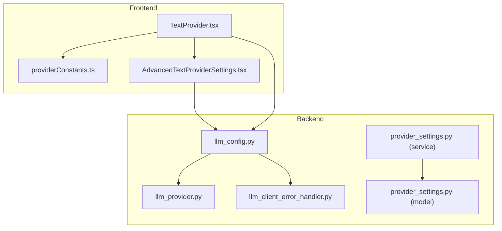
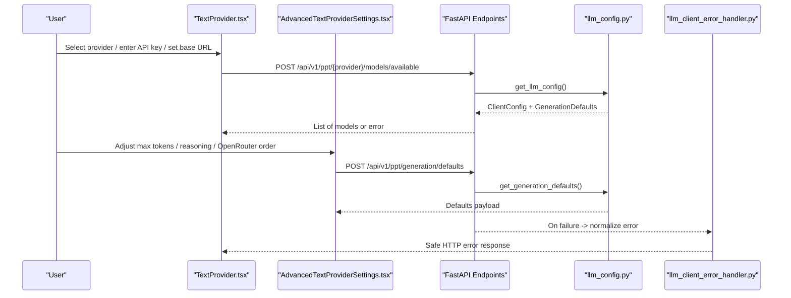
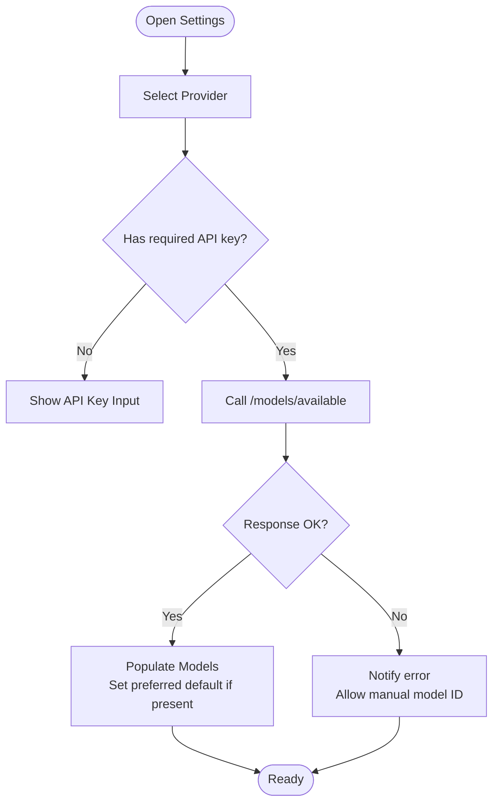
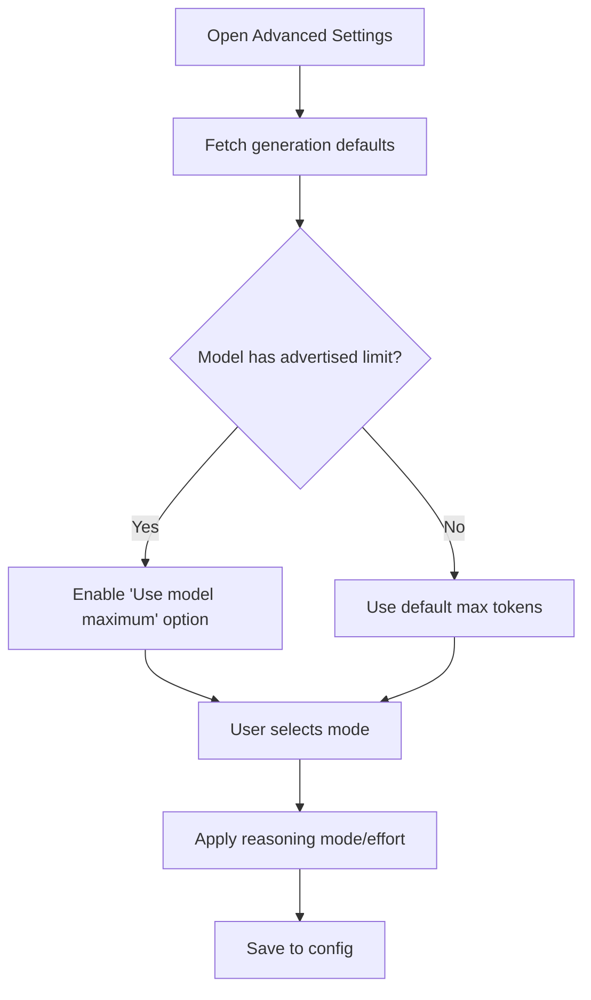
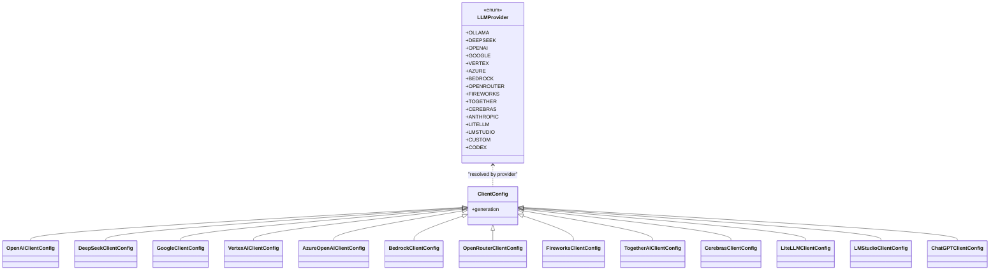
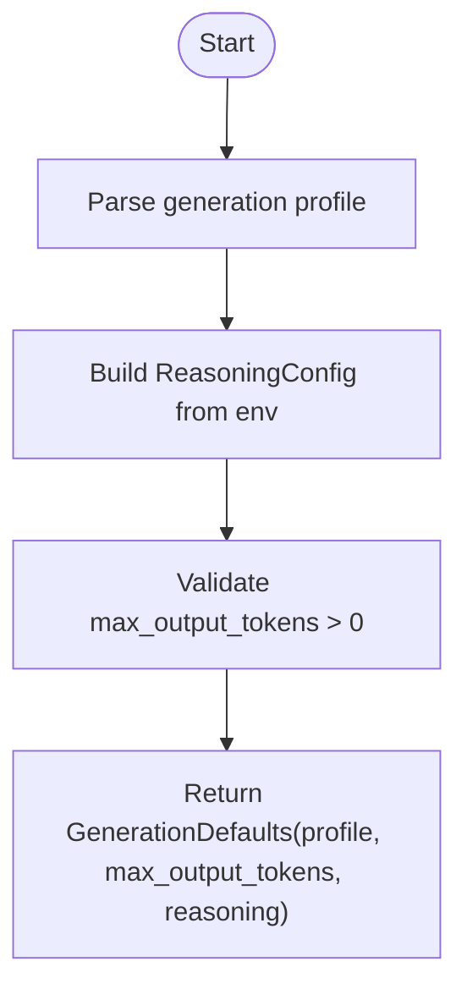
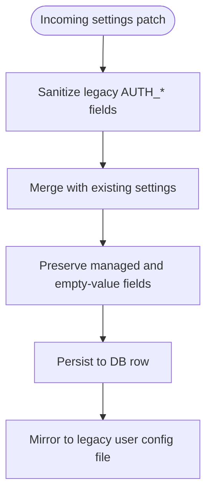
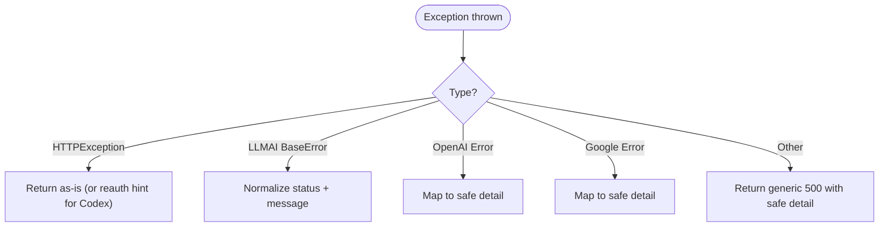
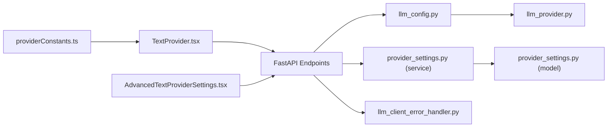

# Text Provider Settings

<cite>
**Referenced Files in This Document**
- [TextProvider.tsx](file://servers/nxtjs/app/(presentation-generator)/(dashboard)/settings/TextProvider.tsx)
- [AdvancedTextProviderSettings.tsx](file://servers/nxtjs/components/AdvancedTextProviderSettings.tsx)
- [providerConstants.ts](file://servers/nxtjs/utils/providerConstants.ts)
- [llm_config.py](file://servers/fastapi/utils/llm_config.py)
- [llm_provider.py](file://servers/fastapi/enums/llm_provider.py)
- [provider_settings.py (service)](file://servers/fastapi/services/provider_settings.py)
- [provider_settings.py (model)](file://servers/fastapi/models/sql/provider_settings.py)
- [llm_client_error_handler.py](file://servers/fastapi/utils/llm_client_error_handler.py)
</cite>

## Table of Contents
1. [Introduction](#introduction)
2. [Project Structure](#project-structure)
3. [Core Components](#core-components)
4. [Architecture Overview](#architecture-overview)
5. [Detailed Component Analysis](#detailed-component-analysis)
6. [Dependency Analysis](#dependency-analysis)
7. [Performance Considerations](#performance-considerations)
8. [Troubleshooting Guide](#troubleshooting-guide)
9. [Conclusion](#conclusion)

## Introduction
This document explains the Text Provider configuration system for selecting and tuning LLM services. It covers supported providers, API key management, model selection strategies, generation controls (including reasoning behavior and output token limits), context window considerations, and error handling. The UI is implemented in Next.js, while server-side provider configuration and validation are implemented in FastAPI.

## Project Structure
The text provider feature spans two layers:
- Frontend settings UI: provider selection, API key input, base URL overrides, model discovery, and advanced generation controls.
- Backend configuration: provider resolution, environment-based authentication, generation defaults, and error translation.

**Diagram sources**
- [TextProvider.tsx:1-800](file://servers/nxtjs/app/(presentation-generator)/(dashboard)/settings/TextProvider.tsx#L1-L800)
- [AdvancedTextProviderSettings.tsx:1-626](file://servers/nxtjs/components/AdvancedTextProviderSettings.tsx#L1-L626)
- [providerConstants.ts:182-305](file://servers/nxtjs/utils/providerConstants.ts#L182-L305)
- [llm_config.py:247-486](file://servers/fastapi/utils/llm_config.py#L247-L486)
- [llm_provider.py:1-21](file://servers/fastapi/enums/llm_provider.py#L1-L21)
- [provider_settings.py (service):52-155](file://servers/fastapi/services/provider_settings.py#L52-L155)
- [provider_settings.py (model):10-24](file://servers/fastapi/models/sql/provider_settings.py#L10-L24)
- [llm_client_error_handler.py:35-77](file://servers/fastapi/utils/llm_client_error_handler.py#L35-L77)

**Section sources**
- [TextProvider.tsx:1-800](file://servers/nxtjs/app/(presentation-generator)/(dashboard)/settings/TextProvider.tsx#L1-L800)
- [AdvancedTextProviderSettings.tsx:1-626](file://servers/nxtjs/components/AdvancedTextProviderSettings.tsx#L1-L626)
- [providerConstants.ts:182-305](file://servers/nxtjs/utils/providerConstants.ts#L182-L305)
- [llm_config.py:247-486](file://servers/fastapi/utils/llm_config.py#L247-L486)
- [llm_provider.py:1-21](file://servers/fastapi/enums/llm_provider.py#L1-L21)
- [provider_settings.py (service):52-155](file://servers/fastapi/services/provider_settings.py#L52-L155)
- [provider_settings.py (model):10-24](file://servers/fastapi/models/sql/provider_settings.py#L10-L24)
- [llm_client_error_handler.py:35-77](file://servers/fastapi/utils/llm_client_error_handler.py#L35-L77)

## Core Components
- TextProvider (UI): Presents provider selection, API keys, base URLs, model inputs, and triggers model discovery endpoints.
- AdvancedTextProviderSettings (UI): Provides advanced generation controls such as max output tokens, reasoning mode/effort, and OpenRouter routing preferences.
- Provider constants (UI): Declares available providers, labels, descriptions, icons, and default URLs.
- llm_config (backend): Resolves the active provider from environment variables, validates required fields, builds typed client configs, and applies generation defaults.
- llm_provider (backend enum): Enumerates supported providers.
- provider_settings (backend service/model): Persists provider/runtime settings to a database row and mirrors legacy user config files.
- llm_client_error_handler (backend): Normalizes provider errors into HTTP responses with safe messages.

**Section sources**
- [TextProvider.tsx:60-228](file://servers/nxtjs/app/(presentation-generator)/(dashboard)/settings/TextProvider.tsx#L60-L228)
- [AdvancedTextProviderSettings.tsx:168-456](file://servers/nxtjs/components/AdvancedTextProviderSettings.tsx#L168-L456)
- [providerConstants.ts:182-305](file://servers/nxtjs/utils/providerConstants.ts#L182-L305)
- [llm_config.py:189-244](file://servers/fastapi/utils/llm_config.py#L189-L244)
- [llm_provider.py:1-21](file://servers/fastapi/enums/llm_provider.py#L1-L21)
- [provider_settings.py (service):52-155](file://servers/fastapi/services/provider_settings.py#L52-L155)
- [provider_settings.py (model):10-24](file://servers/fastapi/models/sql/provider_settings.py#L10-L24)
- [llm_client_error_handler.py:35-77](file://servers/fastapi/utils/llm_client_error_handler.py#L35-L77)

## Architecture Overview
The frontend collects user inputs and calls backend endpoints for model discovery and generation defaults. The backend resolves the configured provider, validates credentials, constructs provider-specific client configurations, and returns normalized results or errors.

**Diagram sources**
- [TextProvider.tsx:266-423](file://servers/nxtjs/app/(presentation-generator)/(dashboard)/settings/TextProvider.tsx#L266-L423)
- [AdvancedTextProviderSettings.tsx:210-237](file://servers/nxtjs/components/AdvancedTextProviderSettings.tsx#L210-L237)
- [llm_config.py:247-486](file://servers/fastapi/utils/llm_config.py#L247-L486)
- [llm_client_error_handler.py:35-77](file://servers/fastapi/utils/llm_client_error_handler.py#L35-L77)

## Detailed Component Analysis

### TextProvider (UI)
Responsibilities:
- Provider selection and metadata rendering using provider constants.
- Per-provider API key input and optional base URL overrides (e.g., DeepSeek, LiteLLM, LM Studio, Fireworks, Together).
- Model discovery via backend endpoints; supports manual model entry when discovery fails.
- Special flows for Ollama (local URL), Codex (OAuth), Bedrock, Vertex/Azure manual fields, and Presenton Cloud.

Key behaviors:
- When switching providers, it resets model lists and clears checked state.
- For Google and Anthropic, it uses dedicated model listing endpoints; others use an OpenAI-compatible endpoint.
- If discovery fails, it shows a notification and still allows manual model IDs.

**Diagram sources**
- [TextProvider.tsx:266-423](file://servers/nxtjs/app/(presentation-generator)/(dashboard)/settings/TextProvider.tsx#L266-L423)

**Section sources**
- [TextProvider.tsx:60-228](file://servers/nxtjs/app/(presentation-generator)/(dashboard)/settings/TextProvider.tsx#L60-L228)
- [TextProvider.tsx:266-423](file://servers/nxtjs/app/(presentation-generator)/(dashboard)/settings/TextProvider.tsx#L266-L423)
- [providerConstants.ts:182-305](file://servers/nxtjs/utils/providerConstants.ts#L182-L305)

### AdvancedTextProviderSettings (UI)
Responsibilities:
- Max output tokens control with three modes: default, manual, or model maximum.
- Reasoning mode and effort toggles that map to backend reasoning configuration.
- Optional OpenRouter routing: discover providers, add/remove/reorder them.

Key behaviors:
- Fetches generation defaults for the selected provider/model to inform defaults.
- Resets all advanced fields to defaults on demand.
- Disables reasoning effort when reasoning mode is disabled.

**Diagram sources**
- [AdvancedTextProviderSettings.tsx:168-456](file://servers/nxtjs/components/AdvancedTextProviderSettings.tsx#L168-L456)

**Section sources**
- [AdvancedTextProviderSettings.tsx:168-456](file://servers/nxtjs/components/AdvancedTextProviderSettings.tsx#L168-L456)

### Provider Constants (UI)
- Defines all supported providers with labels, descriptions, icons, and default URLs where applicable.
- Includes providers like OpenAI, DeepSeek, Google, Vertex AI, Azure OpenAI, Amazon Bedrock, OpenRouter, Cerebras, LiteLLM, Fireworks, Together, LM Studio, Anthropic, Ollama, Custom, and ChatGPT (Codex).

**Section sources**
- [providerConstants.ts:182-305](file://servers/nxtjs/utils/providerConstants.ts#L182-L305)

### Backend Provider Resolution and Validation
- Enumerates supported providers and maps each to a typed client configuration.
- Validates required fields per provider (e.g., API keys, endpoints, deployments).
- Applies generation defaults including profile, max output tokens, and reasoning configuration.

Supported providers include:
- OpenAI, DeepSeek, Google, Vertex AI, Azure OpenAI, Amazon Bedrock, OpenRouter, Cerebras, LiteLLM, Fireworks, Together, LM Studio, Anthropic, Ollama, Custom, and ChatGPT (Codex).

**Diagram sources**
- [llm_provider.py:1-21](file://servers/fastapi/enums/llm_provider.py#L1-L21)
- [llm_config.py:247-486](file://servers/fastapi/utils/llm_config.py#L247-L486)

**Section sources**
- [llm_provider.py:1-21](file://servers/fastapi/enums/llm_provider.py#L1-L21)
- [llm_config.py:247-486](file://servers/fastapi/utils/llm_config.py#L247-L486)

### Generation Defaults and Reasoning Controls
- Generation profile can be balanced or model_max.
- Max output tokens can be unset (default), manually set, or bound to the model’s advertised maximum.
- Reasoning mode can be model_default, enabled, or disabled; reasoning effort can be model_default or explicit levels; budget tokens can be set non-negatively.
- Legacy flags disable_thinking and extended_reasoning influence defaults when no explicit reasoning settings are provided.

**Diagram sources**
- [llm_config.py:189-244](file://servers/fastapi/utils/llm_config.py#L189-L244)

**Section sources**
- [llm_config.py:189-244](file://servers/fastapi/utils/llm_config.py#L189-L244)

### Provider Settings Persistence
- Provider settings are stored in a single-row database table and mirrored to a legacy user config file for compatibility.
- Merge logic preserves OAuth-managed fields and optional advanced fields, and sanitizes legacy auth fields.

**Diagram sources**
- [provider_settings.py (service):52-155](file://servers/fastapi/services/provider_settings.py#L52-L155)
- [provider_settings.py (model):10-24](file://servers/fastapi/models/sql/provider_settings.py#L10-L24)

**Section sources**
- [provider_settings.py (service):52-155](file://servers/fastapi/services/provider_settings.py#L52-L155)
- [provider_settings.py (model):10-24](file://servers/fastapi/models/sql/provider_settings.py#L10-L24)

### Error Handling
- Provider client exceptions are translated into HTTP errors with safe, provider-aware messages.
- Special handling for ChatGPT (Codex) re-authentication flows.

**Diagram sources**
- [llm_client_error_handler.py:35-77](file://servers/fastapi/utils/llm_client_error_handler.py#L35-L77)

**Section sources**
- [llm_client_error_handler.py:35-77](file://servers/fastapi/utils/llm_client_error_handler.py#L35-L77)

## Dependency Analysis
- Frontend depends on provider constants for UI labels/icons and calls backend endpoints for model discovery and generation defaults.
- Backend depends on the provider enum to select the correct client configuration builder.
- Provider settings persistence bridges database storage and legacy file-based configuration.

**Diagram sources**
- [providerConstants.ts:182-305](file://servers/nxtjs/utils/providerConstants.ts#L182-L305)
- [TextProvider.tsx:266-423](file://servers/nxtjs/app/(presentation-generator)/(dashboard)/settings/TextProvider.tsx#L266-L423)
- [AdvancedTextProviderSettings.tsx:210-237](file://servers/nxtjs/components/AdvancedTextProviderSettings.tsx#L210-L237)
- [llm_config.py:247-486](file://servers/fastapi/utils/llm_config.py#L247-L486)
- [llm_provider.py:1-21](file://servers/fastapi/enums/llm_provider.py#L1-L21)
- [provider_settings.py (service):52-155](file://servers/fastapi/services/provider_settings.py#L52-L155)
- [provider_settings.py (model):10-24](file://servers/fastapi/models/sql/provider_settings.py#L10-L24)
- [llm_client_error_handler.py:35-77](file://servers/fastapi/utils/llm_client_error_handler.py#L35-L77)

**Section sources**
- [providerConstants.ts:182-305](file://servers/nxtjs/utils/providerConstants.ts#L182-L305)
- [TextProvider.tsx:266-423](file://servers/nxtjs/app/(presentation-generator)/(dashboard)/settings/TextProvider.tsx#L266-L423)
- [AdvancedTextProviderSettings.tsx:210-237](file://servers/nxtjs/components/AdvancedTextProviderSettings.tsx#L210-L237)
- [llm_config.py:247-486](file://servers/fastapi/utils/llm_config.py#L247-L486)
- [llm_provider.py:1-21](file://servers/fastapi/enums/llm_provider.py#L1-L21)
- [provider_settings.py (service):52-155](file://servers/fastapi/services/provider_settings.py#L52-L155)
- [provider_settings.py (model):10-24](file://servers/fastapi/models/sql/provider_settings.py#L10-L24)
- [llm_client_error_handler.py:35-77](file://servers/fastapi/utils/llm_client_error_handler.py#L35-L77)

## Performance Considerations
- Prefer model-maximum output tokens when available to avoid unnecessary truncation and retries.
- Disable reasoning when not needed to reduce latency and token usage.
- Use local providers (Ollama, LM Studio) for offline or low-latency scenarios.
- Avoid excessive concurrent requests to providers; rely on provider rate limits and backoff strategies at the application layer.

[No sources needed since this section provides general guidance]

## Troubleshooting Guide
Common issues and resolutions:
- Missing or invalid API key: Ensure the correct provider key is set; some providers allow optional keys (e.g., LiteLLM proxy without auth).
- Endpoint/base URL misconfiguration: Verify custom base URLs for DeepSeek, LiteLLM, LM Studio, Fireworks, Together, and OpenRouter.
- Model discovery failures: The UI will notify and allow manual model IDs; verify network connectivity and provider availability.
- Vertex/Azure ambiguous configuration: Configure either API key or project/location (Vertex), or ensure endpoint/base_url and deployment are set (Azure).
- Bedrock incomplete auth: Provide either BEDROCK_API_KEY or AWS access/secret keys.
- ChatGPT (Codex) session expired: Re-authenticate via the settings flow; the backend signals re-auth requirements.

Operational checks:
- Test provider connection by attempting model discovery or a simple generation call.
- Validate environment variables and persisted provider settings.
- Inspect normalized error messages returned by the error handler.

**Section sources**
- [TextProvider.tsx:266-423](file://servers/nxtjs/app/(presentation-generator)/(dashboard)/settings/TextProvider.tsx#L266-L423)
- [llm_config.py:277-373](file://servers/fastapi/utils/llm_config.py#L277-L373)
- [llm_client_error_handler.py:35-77](file://servers/fastapi/utils/llm_client_error_handler.py#L35-L77)

## Conclusion
The Text Provider system offers a flexible, multi-provider configuration experience. Users can choose from major cloud LLMs, local models, and OpenAI-compatible proxies, with robust validation, sensible defaults, and clear error reporting. Advanced controls let you tune output length and reasoning behavior, while provider settings are safely persisted and mirrored for compatibility.

[No sources needed since this section summarizes without analyzing specific files]