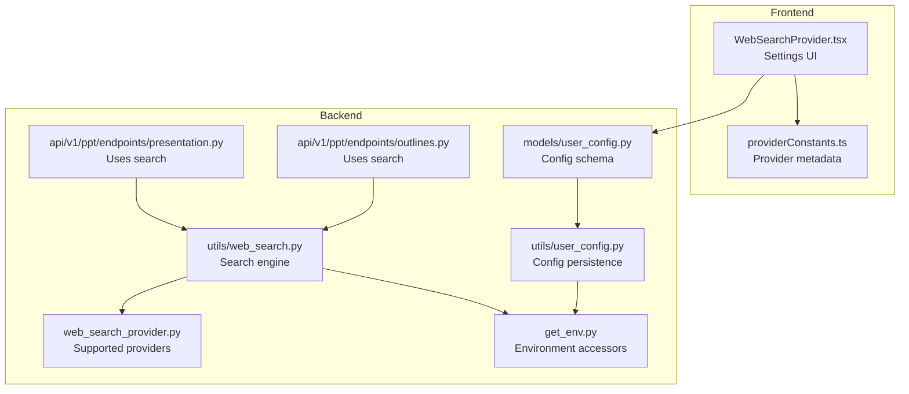
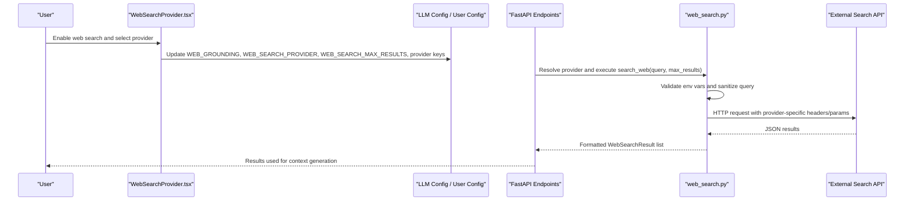
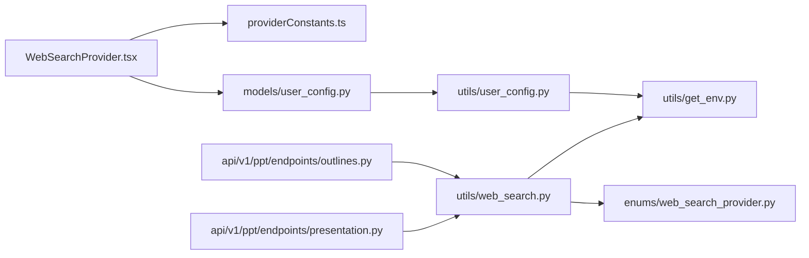

# Web Search Provider Settings

<cite>
**Referenced Files in This Document**   
- [WebSearchProvider.tsx](file://servers/nex tjs/app/(presentation-generator)/(dashboard)/settings/WebSearchProvider.tsx)
- [providerConstants.ts](file://servers/nex tjs/utils/providerConstants.ts)
- [web_search_provider.py](file://servers/fastapi/enums/web_search_provider.py)
- [web_search.py](file://servers/fastapi/utils/web_search.py)
- [get_env.py](file://servers/fastapi/utils/get_env.py)
- [user_config.py](file://servers/fastapi/models/user_config.py)
- [user_config.py](file://servers/fastapi/utils/user_config.py)
- [outlines.py](file://servers/fastapi/api/v1/ppt/endpoints/outlines.py)
- [presentation.py](file://servers/fastapi/api/v1/ppt/endpoints/presentation.py)
</cite>

## Table of Contents
1. [Introduction](#introduction)
2. [Project Structure](#project-structure)
3. [Core Components](#core-components)
4. [Architecture Overview](#architecture-overview)
5. [Detailed Component Analysis](#detailed-component-analysis)
6. [Dependency Analysis](#dependency-analysis)
7. [Performance Considerations](#performance-considerations)
8. [Troubleshooting Guide](#troubleshooting-guide)
9. [Conclusion](#conclusion)

## Introduction
This document explains how web search provider configuration works in the application. It covers:
- The WebSearchProvider settings component and its UI behavior
- Supported web search providers, including model-native grounding and external providers
- API key setup for each provider
- Query construction and result filtering
- Rate limiting and timeout behavior
- Error handling for failed searches
- How to select a provider, customize queries, process results, and handle errors

The system supports both model-native web grounding (when available) and external search providers such as SearXNG, Tavily, Exa, Brave, and Serper.

## Project Structure
The web search feature spans frontend configuration and backend execution:
- Frontend settings UI allows enabling web search, selecting a provider, entering provider-specific credentials, and setting maximum results.
- Backend enumerates supported providers, resolves the selected provider, validates environment variables, executes HTTP requests, and formats results.

**Diagram sources**
- [WebSearchProvider.tsx:1-262](file://servers/nex tjs/app/(presentation-generator)/(dashboard)/settings/WebSearchProvider.tsx#L1-L262)
- [providerConstants.ts:42-89](file://servers/nex tjs/utils/providerConstants.ts#L42-L89)
- [web_search_provider.py:4-11](file://servers/fastapi/enums/web_search_provider.py#L4-L11)
- [get_env.py:369-394](file://servers/fastapi/utils/get_env.py#L369-L394)
- [user_config.py:147-153](file://servers/fastapi/models/user_config.py#L147-L153)
- [user_config.py:340-352](file://servers/fastapi/utils/user_config.py#L340-L352)
- [web_search.py:97-157](file://servers/fastapi/utils/web_search.py#L97-L157)
- [outlines.py:38-101](file://servers/fastapi/api/v1/ppt/endpoints/outlines.py#L38-L101)
- [presentation.py:100-1732](file://servers/fastapi/api/v1/ppt/endpoints/presentation.py#L100-L1732)

**Section sources**
- [WebSearchProvider.tsx:1-262](file://servers/nex tjs/app/(presentation-generator)/(dashboard)/settings/WebSearchProvider.tsx#L1-L262)
- [providerConstants.ts:42-89](file://servers/nex tjs/utils/providerConstants.ts#L42-L89)
- [web_search_provider.py:4-11](file://servers/fastapi/enums/web_search_provider.py#L4-L11)
- [web_search.py:97-157](file://servers/fastapi/utils/web_search.py#L97-L157)
- [get_env.py:369-394](file://servers/fastapi/utils/get_env.py#L369-L394)
- [user_config.py:147-153](file://servers/fastapi/models/user_config.py#L147-L153)
- [user_config.py:340-352](file://servers/fastapi/utils/user_config.py#L340-L352)
- [outlines.py:38-101](file://servers/fastapi/api/v1/ppt/endpoints/outlines.py#L38-L101)
- [presentation.py:100-1732](file://servers/fastapi/api/v1/ppt/endpoints/presentation.py#L100-L1732)

## Core Components
- WebSearchProvider settings component: Enables/disables web search, selects a provider, shows provider-specific fields (URL or API key), and sets maximum results.
- Provider constants: Define available providers, labels, descriptions, and required fields.
- Backend provider enum: Defines supported provider values.
- Search engine: Resolves provider, validates configuration, performs HTTP requests, and formats results.
- Environment accessors: Read provider selection, max results, and provider credentials from environment variables.
- User config model and utilities: Persist and load web search settings across sessions.

Key responsibilities:
- UI: Collects user preferences and persists them into the LLM configuration object.
- Backend: Enforces provider constraints, reads environment variables, and executes provider-specific search logic.

**Section sources**
- [WebSearchProvider.tsx:33-74](file://servers/nex tjs/app/(presentation-generator)/(dashboard)/settings/WebSearchProvider.tsx#L33-L74)
- [providerConstants.ts:42-89](file://servers/nex tjs/utils/providerConstants.ts#L42-L89)
- [web_search_provider.py:4-11](file://servers/fastapi/enums/web_search_provider.py#L4-L11)
- [web_search.py:32-56](file://servers/fastapi/utils/web_search.py#L32-L56)
- [get_env.py:369-394](file://servers/fastapi/utils/get_env.py#L369-L394)
- [user_config.py:147-153](file://servers/fastapi/models/user_config.py#L147-L153)
- [user_config.py:340-352](file://servers/fastapi/utils/user_config.py#L340-L352)

## Architecture Overview
The web search flow integrates frontend configuration with backend execution:

**Diagram sources**
- [WebSearchProvider.tsx:82-253](file://servers/nex tjs/app/(presentation-generator)/(dashboard)/settings/WebSearchProvider.tsx#L82-L253)
- [web_search.py:97-157](file://servers/fastapi/utils/web_search.py#L97-L157)
- [get_env.py:369-394](file://servers/fastapi/utils/get_env.py#L369-L394)

## Detailed Component Analysis

### WebSearchProvider Settings Component
The WebSearchProvider component provides:
- A toggle to enable/disable web search
- A provider selector that includes “Default (Model)” and external providers
- Conditional fields based on provider:
  - URL field for self-hosted SearXNG
  - API key fields for Tavily, Exa, Brave, and Serper
- Maximum results input (1–10) when an external provider is selected

Behavior highlights:
- When enabled without a valid provider, it defaults to “auto”
- Selecting a provider updates WEB_GROUNDING and WEB_SEARCH_PROVIDER
- Provider metadata drives which fields are shown and their labels

Configuration fields managed by this component:
- WEB_GROUNDING: Boolean flag to enable web search
- WEB_SEARCH_PROVIDER: Selected provider value
- WEB_SEARCH_MAX_RESULTS: Number of results to return
- SEARXNG_BASE_URL: Base URL for SearXNG
- TAVILY_API_KEY, EXA_API_KEY, BRAVE_SEARCH_API_KEY, SERPER_API_KEY: Provider credentials

**Section sources**
- [WebSearchProvider.tsx:33-74](file://servers/nex tjs/app/(presentation-generator)/(dashboard)/settings/WebSearchProvider.tsx#L33-L74)
- [WebSearchProvider.tsx:109-253](file://servers/nex tjs/app/(presentation-generator)/(dashboard)/settings/WebSearchProvider.tsx#L109-L253)
- [providerConstants.ts:42-89](file://servers/nex tjs/utils/providerConstants.ts#L42-L89)

### Provider Metadata and Selection
Provider metadata defines:
- Available providers and their display labels/descriptions
- Required fields per provider (API key or base URL)
- Icons and documentation links where applicable

Supported providers include:
- Default (Model): Uses model-native web grounding when available
- SearXNG: Self-hosted instance requiring a base URL
- Tavily: AI-focused search API requiring an API key
- Exa: AI-native search with highlights requiring an API key
- Brave: Brave Search API requiring an API key
- Serper: Google search via Serper requiring an API key (backend-supported but commented out in UI constants)

**Section sources**
- [providerConstants.ts:42-89](file://servers/nex tjs/utils/providerConstants.ts#L42-L89)
- [web_search_provider.py:4-11](file://servers/fastapi/enums/web_search_provider.py#L4-L11)

### Backend Provider Resolution and Execution
The backend enforces provider selection and executes searches:
- get_selected_web_search_provider reads WEB_SEARCH_PROVIDER and validates it against the enum
- should_use_native_web_search determines if model-native grounding is preferred
- resolve_external_web_search_provider returns the selected external provider or None
- search_web sanitizes the query, enforces a maximum result limit, and calls the appropriate provider function
- Each provider function validates required environment variables and performs HTTP requests using aiohttp

Provider-specific endpoints and headers:
- SearXNG: GET /search?q=query&format=json
- Tavily: POST https://api.tavily.com/search with Authorization Bearer
- Exa: POST https://api.exa.ai/search with x-api-key header
- Brave: GET https://api.search.brave.com/res/v1/web/search with X-Subscription-Token
- Serper: POST https://google.serper.dev/search with X-API-KEY header

Result normalization:
- All providers return structured results mapped to title, url, and snippet
- Results are limited to the configured maximum (default 5, capped at 10)

**Section sources**
- [web_search.py:39-56](file://servers/fastapi/utils/web_search.py#L39-L56)
- [web_search.py:90-157](file://servers/fastapi/utils/web_search.py#L90-L157)
- [web_search.py:236-329](file://servers/fastapi/utils/web_search.py#L236-L329)

### Environment Variables and Configuration Persistence
Environment variables:
- WEB_SEARCH_PROVIDER: Selected provider
- WEB_SEARCH_MAX_RESULTS: Max results (1–10)
- SEARXNG_BASE_URL: SearXNG base URL
- TAVILY_API_KEY, EXA_API_KEY, BRAVE_SEARCH_API_KEY, SERPER_API_KEY: Provider credentials

Persistence:
- The user config model includes fields for all web search settings
- The user config utility loads these values from environment variables and persists changes back to the environment

**Section sources**
- [get_env.py:369-394](file://servers/fastapi/utils/get_env.py#L369-L394)
- [user_config.py:147-153](file://servers/fastapi/models/user_config.py#L147-L153)
- [user_config.py:340-352](file://servers/fastapi/utils/user_config.py#L340-L352)
- [user_config.py:548-560](file://servers/fastapi/utils/user_config.py#L548-L560)

### Query Construction and Result Processing
Query construction:
- build_web_search_query combines content and optional instructions, cleans whitespace, and truncates to 500 characters
- _clean_text normalizes HTML entities and collapses whitespace

Result processing:
- format_web_search_context converts a list of WebSearchResult into a readable context string
- _clean_outline_web_text removes markdown links and URLs from snippets

**Section sources**
- [web_search.py:186-200](file://servers/fastapi/utils/web_search.py#L186-L200)
- [web_search.py:172-183](file://servers/fastapi/utils/web_search.py#L172-L183)

### Integration Points
Endpoints use web search to enrich presentation generation:
- outlines endpoint logs selected provider and route
- presentation endpoint logs created presentation with web search status

These integrations ensure that web search context can be applied during outline and presentation generation workflows.

**Section sources**
- [outlines.py:38-101](file://servers/fastapi/api/v1/ppt/endpoints/outlines.py#L38-L101)
- [presentation.py:100-1732](file://servers/fastapi/api/v1/ppt/endpoints/presentation.py#L100-L1732)

## Dependency Analysis
The following diagram maps dependencies between components involved in web search configuration and execution:

**Diagram sources**
- [WebSearchProvider.tsx:1-262](file://servers/nex tjs/app/(presentation-generator)/(dashboard)/settings/WebSearchProvider.tsx#L1-L262)
- [providerConstants.ts:42-89](file://servers/nex tjs/utils/providerConstants.ts#L42-L89)
- [user_config.py:147-153](file://servers/fastapi/models/user_config.py#L147-L153)
- [user_config.py:340-352](file://servers/fastapi/utils/user_config.py#L340-L352)
- [get_env.py:369-394](file://servers/fastapi/utils/get_env.py#L369-L394)
- [web_search_provider.py:4-11](file://servers/fastapi/enums/web_search_provider.py#L4-L11)
- [web_search.py:97-157](file://servers/fastapi/utils/web_search.py#L97-L157)
- [outlines.py:38-101](file://servers/fastapi/api/v1/ppt/endpoints/outlines.py#L38-L101)
- [presentation.py:100-1732](file://servers/fastapi/api/v1/ppt/endpoints/presentation.py#L100-L1732)

**Section sources**
- [WebSearchProvider.tsx:1-262](file://servers/nex tjs/app/(presentation-generator)/(dashboard)/settings/WebSearchProvider.tsx#L1-L262)
- [providerConstants.ts:42-89](file://servers/nex tjs/utils/providerConstants.ts#L42-L89)
- [web_search_provider.py:4-11](file://servers/fastapi/enums/web_search_provider.py#L4-L11)
- [web_search.py:97-157](file://servers/fastapi/utils/web_search.py#L97-L157)
- [get_env.py:369-394](file://servers/fastapi/utils/get_env.py#L369-L394)
- [user_config.py:147-153](file://servers/fastapi/models/user_config.py#L147-L153)
- [user_config.py:340-352](file://servers/fastapi/utils/user_config.py#L340-L352)
- [outlines.py:38-101](file://servers/fastapi/api/v1/ppt/endpoints/outlines.py#L38-L101)
- [presentation.py:100-1732](file://servers/fastapi/api/v1/ppt/endpoints/presentation.py#L100-L1732)

## Performance Considerations
- Timeout: HTTP requests use a total timeout of 15 seconds to avoid hanging on slow providers.
- Result limits: Maximum results are clamped between 1 and 10; default is 5.
- Logging: Start/completion logs include provider, result count, and duration in milliseconds.
- No built-in rate limiting or retry logic is implemented in the search engine; callers should handle retries at higher layers if needed.

[No sources needed since this section provides general guidance]

## Troubleshooting Guide
Common issues and resolutions:
- Empty query: Web search is skipped and returns no results. Ensure content/instructions are provided.
- Missing provider credentials: Each provider requires specific environment variables; missing keys raise validation errors.
- Unsupported provider: If WEB_SEARCH_PROVIDER is not recognized, an error is raised.
- External search disabled: If auto/native mode is selected without native support, external search is disabled unless a specific external provider is chosen.
- Network failures: Exceptions during HTTP requests are logged and re-raised; check provider availability and credentials.

Operational checks:
- Verify WEB_SEARCH_PROVIDER matches a supported value
- Confirm WEB_SEARCH_MAX_RESULTS is within 1–10
- Ensure provider-specific environment variables are set correctly
- For SearXNG, verify SEARXNG_BASE_URL points to a valid /search endpoint

**Section sources**
- [web_search.py:97-157](file://servers/fastapi/utils/web_search.py#L97-L157)
- [web_search.py:203-206](file://servers/fastapi/utils/web_search.py#L203-L206)
- [web_search.py:236-329](file://servers/fastapi/utils/web_search.py#L236-L329)

## Conclusion
The web search provider configuration enables flexible integration with model-native grounding and multiple external search APIs. Users can configure provider selection, credentials, and result limits through the settings UI, while the backend enforces constraints, validates environment variables, and executes provider-specific searches. Proper setup of environment variables and careful handling of errors ensure reliable operation across different providers.

[No sources needed since this section summarizes without analyzing specific files]