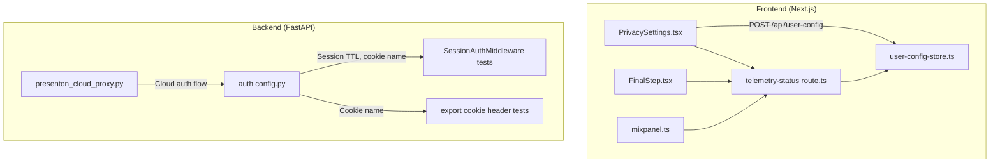
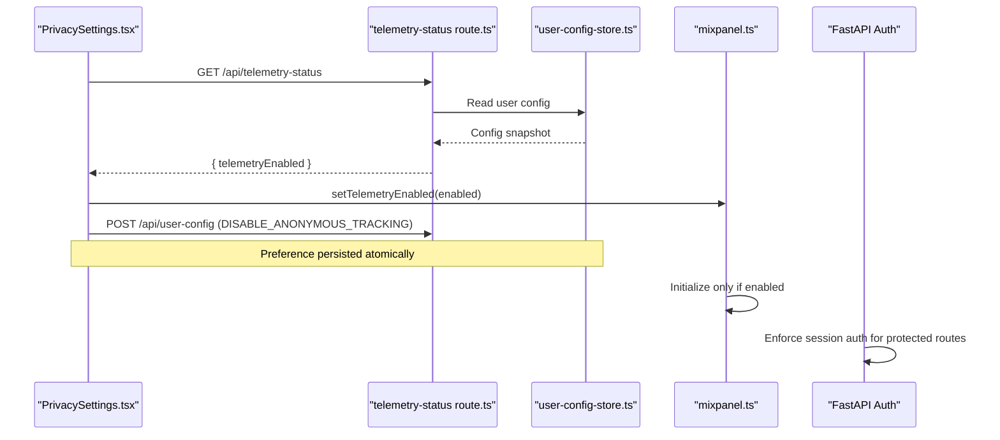
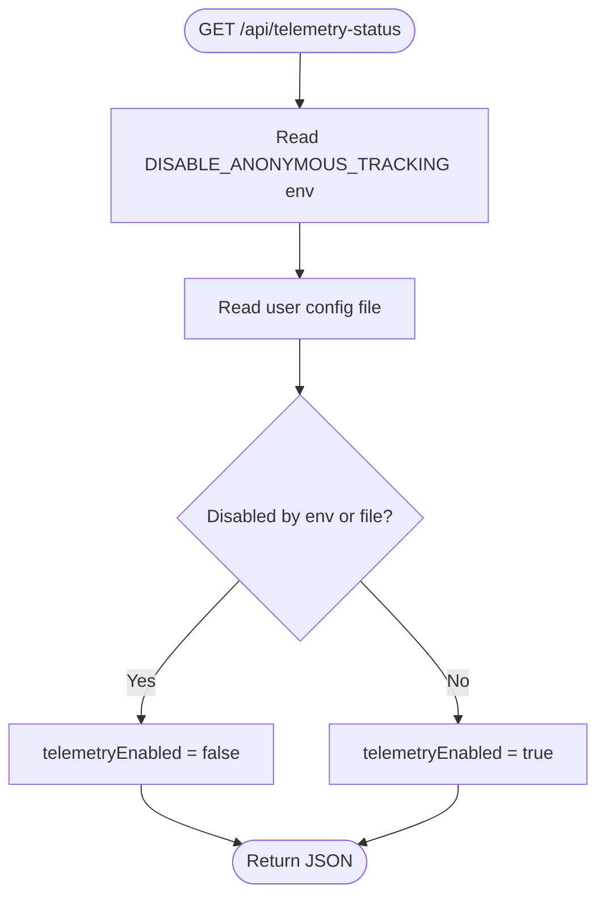
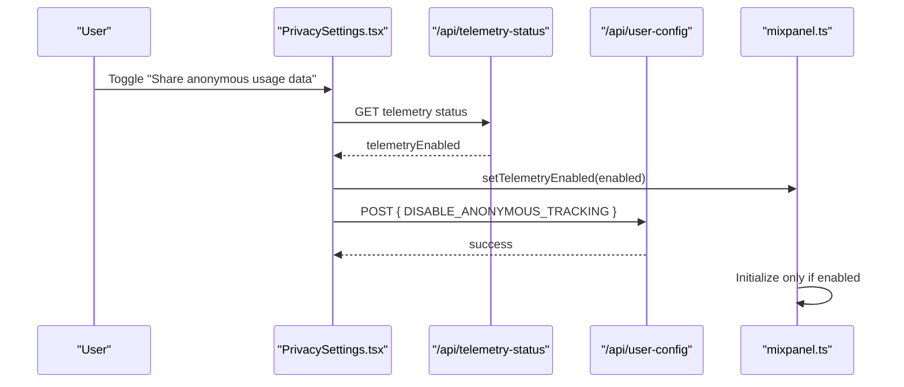
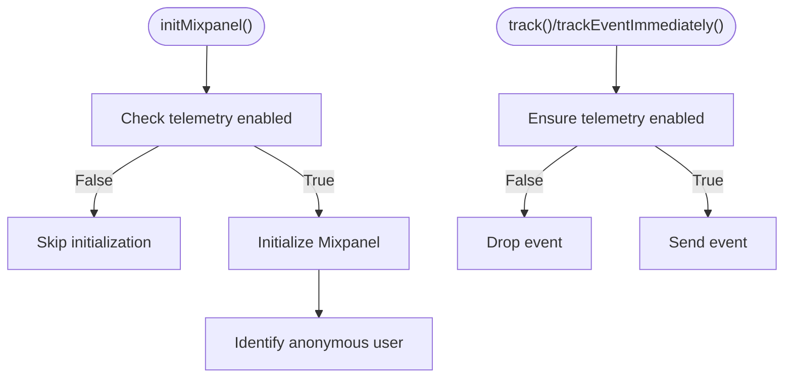
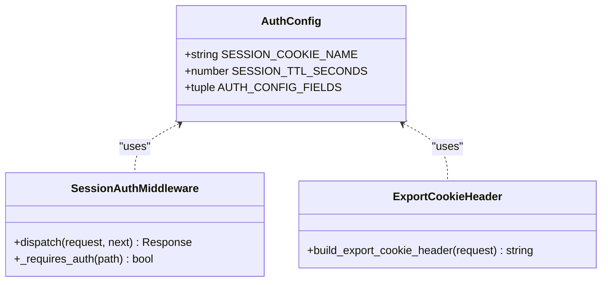
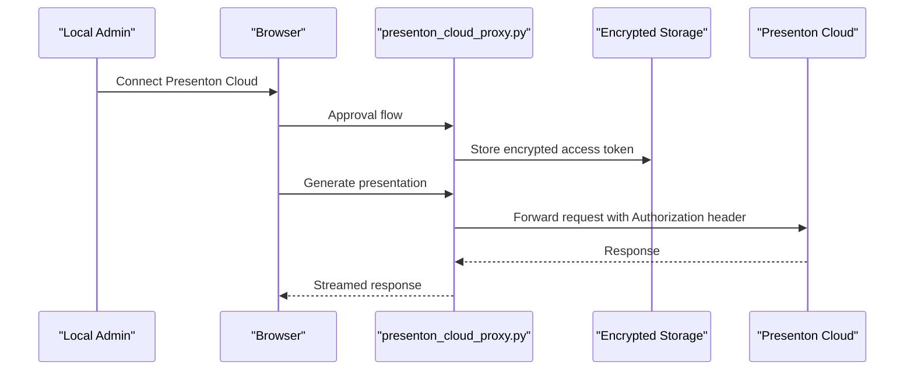
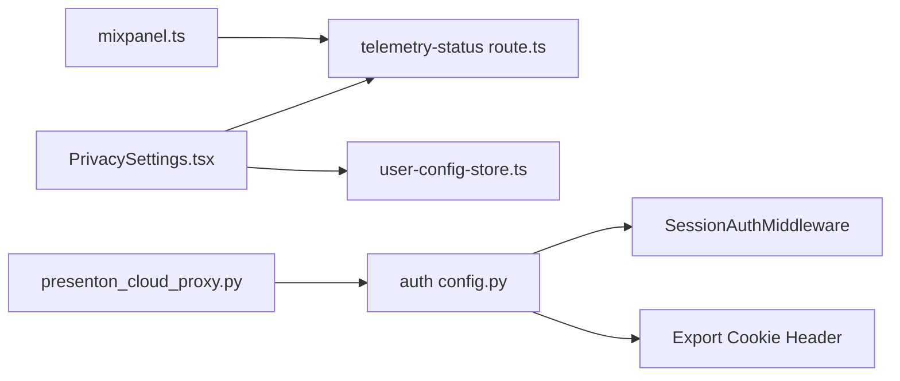

# Privacy & Security Settings

<cite>
**Referenced Files in This Document**
- [PrivacySettings.tsx](file://servers/nex tjs/app/(presentation-generator)/(dashboard)/settings/PrivacySettings.tsx)
- [FinalStep.tsx](file://servers/nex tjs/components/OnBoarding/FinalStep.tsx)
- [route.ts](file://servers/nex tjs/app/api/telemetry-status/route.ts)
- [user-config-store.ts](file://servers/nex tjs/lib/user-config-store.ts)
- [mixpanel.ts](file://servers/nex tjs/utils/mixpanel.ts)
- [config.py](file://servers/fastapi/api/v1/auth/config.py)
- [test_session_auth_middleware.py](file://servers/fastapi/tests/unit/test_session_auth_middleware.py)
- [test_export_cookie_header.py](file://servers/fastapi/tests/unit/test_export_cookie_header.py)
- [presenton_cloud_proxy.py](file://servers/fastapi/services/presenton_cloud_proxy.py)
- [README.md](file://README.md)
</cite>

## Table of Contents
1. [Introduction](#introduction)
2. [Project Structure](#project-structure)
3. [Core Components](#core-components)
4. [Architecture Overview](#architecture-overview)
5. [Detailed Component Analysis](#detailed-component-analysis)
6. [Dependency Analysis](#dependency-analysis)
7. [Performance Considerations](#performance-considerations)
8. [Troubleshooting Guide](#troubleshooting-guide)
9. [Conclusion](#conclusion)

## Introduction
This document explains the privacy and security configuration options available in the application, focusing on:
- Telemetry settings and anonymous usage analytics
- Data collection preferences and user tracking controls
- Session management and authentication options
- Data encryption for sensitive credentials
- Privacy controls for shared presentations and cloud storage
- Data retention considerations
- GDPR-related features and consent management

The guidance is grounded in the actual implementation across the Next.js frontend, FastAPI backend, and supporting utilities.

## Project Structure
Privacy and security are implemented across multiple layers:
- Frontend UI toggles for telemetry and onboarding consent flows
- API endpoints to read/write user configuration and telemetry status
- Backend session and authentication middleware
- Encrypted storage for provider credentials and session secrets
- Cloud proxy handling with secure token forwarding

**Diagram sources**
- [PrivacySettings.tsx:1-109](file://servers/nex tjs/app/(presentation-generator)/(dashboard)/settings/PrivacySettings.tsx#L1-L109)
- [FinalStep.tsx:44-78](file://servers/nex tjs/components/OnBoarding/FinalStep.tsx#L44-L78)
- [mixpanel.ts:203-339](file://servers/nex tjs/utils/mixpanel.ts#L203-L339)
- [route.ts:1-29](file://servers/nex tjs/app/api/telemetry-status/route.ts#L1-L29)
- [user-config-store.ts:210-232](file://servers/nex tjs/lib/user-config-store.ts#L210-L232)
- [config.py:11-13](file://servers/fastapi/api/v1/auth/config.py#L11-L13)
- [test_session_auth_middleware.py:14-36](file://servers/fastapi/tests/unit/test_session_auth_middleware.py#L14-L36)
- [test_export_cookie_header.py:22-50](file://servers/fastapi/tests/unit/test_export_cookie_header.py#L22-L50)
- [presenton_cloud_proxy.py:1-44](file://servers/fastapi/services/presenton_cloud_proxy.py#L1-L44)

**Section sources**
- [PrivacySettings.tsx:1-109](file://servers/nex tjs/app/(presentation-generator)/(dashboard)/settings/PrivacySettings.tsx#L1-L109)
- [FinalStep.tsx:44-78](file://servers/nex tjs/components/OnBoarding/FinalStep.tsx#L44-L78)
- [route.ts:1-29](file://servers/nex tjs/app/api/telemetry-status/route.ts#L1-L29)
- [user-config-store.ts:210-232](file://servers/nex tjs/lib/user-config-store.ts#L210-L232)
- [mixpanel.ts:203-339](file://servers/nex tjs/utils/mixpanel.ts#L203-L339)
- [config.py:11-13](file://servers/fastapi/api/v1/auth/config.py#L11-L13)
- [test_session_auth_middleware.py:14-36](file://servers/fastapi/tests/unit/test_session_auth_middleware.py#L14-L36)
- [test_export_cookie_header.py:22-50](file://servers/fastapi/tests/unit/test_export_cookie_header.py#L22-L50)
- [presenton_cloud_proxy.py:1-44](file://servers/fastapi/services/presenton_cloud_proxy.py#L1-L44)

## Core Components
- Telemetry status endpoint: Determines whether anonymous usage analytics are enabled based on environment variables and user configuration file.
- User configuration store: Provides durable, atomic writes and backups for user settings, including telemetry preferences.
- Frontend privacy controls: UI components that let users enable or disable anonymous usage data sharing during onboarding and in settings.
- Analytics client: Mixpanel integration that respects telemetry state and avoids sending events when disabled.
- Authentication and session configuration: Defines session cookie name, TTL, and core auth fields persisted securely.
- Session authorization middleware: Enforces authentication requirements for specific routes and assets.
- Cloud proxy: Handles Presenton Cloud interactions and forwards authenticated requests server-side.

**Section sources**
- [route.ts:1-29](file://servers/nex tjs/app/api/telemetry-status/route.ts#L1-L29)
- [user-config-store.ts:210-232](file://servers/nex tjs/lib/user-config-store.ts#L210-L232)
- [PrivacySettings.tsx:1-109](file://servers/nex tjs/app/(presentation-generator)/(dashboard)/settings/PrivacySettings.tsx#L1-L109)
- [FinalStep.tsx:44-78](file://servers/nex tjs/components/OnBoarding/FinalStep.tsx#L44-L78)
- [mixpanel.ts:203-339](file://servers/nex tjs/utils/mixpanel.ts#L203-L339)
- [config.py:11-13](file://servers/fastapi/api/v1/auth/config.py#L11-L13)
- [test_session_auth_middleware.py:14-36](file://servers/fastapi/tests/unit/test_session_auth_middleware.py#L14-L36)
- [presenton_cloud_proxy.py:1-44](file://servers/fastapi/services/presenton_cloud_proxy.py#L1-L44)

## Architecture Overview
The telemetry control flow spans the frontend and backend:
- The frontend reads telemetry status from a dedicated endpoint.
- Users toggle analytics via UI; changes are persisted to the user configuration file.
- The analytics library checks telemetry state before initializing or sending events.
- The backend enforces authentication and session policies for protected resources.
- Cloud integrations use server-side proxies to manage tokens securely.

**Diagram sources**
- [PrivacySettings.tsx:15-58](file://servers/nex tjs/app/(presentation-generator)/(dashboard)/settings/PrivacySettings.tsx#L15-L58)
- [route.ts:6-27](file://servers/nex tjs/app/api/telemetry-status/route.ts#L6-L27)
- [user-config-store.ts:210-232](file://servers/nex tjs/lib/user-config-store.ts#L210-L232)
- [mixpanel.ts:233-339](file://servers/nex tjs/utils/mixpanel.ts#L233-L339)
- [config.py:11-13](file://servers/fastapi/api/v1/auth/config.py#L11-L13)

## Detailed Component Analysis

### Telemetry Status and User Configuration
- Telemetry status endpoint computes whether anonymous tracking is enabled by combining:
  - Environment variable DISABLE_ANONYMOUS_TRACKING
  - User configuration file field DISABLE_ANONYMOUS_TRACKING
- The result is returned as telemetryEnabled for the frontend to render UI accordingly.
- User configuration updates are written atomically with backup support and locking to prevent corruption.

**Diagram sources**
- [route.ts:6-27](file://servers/nex tjs/app/api/telemetry-status/route.ts#L6-L27)
- [user-config-store.ts:210-232](file://servers/nex tjs/lib/user-config-store.ts#L210-L232)

**Section sources**
- [route.ts:1-29](file://servers/nex tjs/app/api/telemetry-status/route.ts#L1-L29)
- [user-config-store.ts:210-232](file://servers/nex tjs/lib/user-config-store.ts#L210-L232)

### Frontend Privacy Controls
- PrivacySettings component:
  - Fetches telemetry status on mount
  - Toggles anonymous usage data sharing
  - Persists preference via /api/user-config
  - Updates local telemetry state and prevents analytics initialization when disabled
- Onboarding FinalStep:
  - Mirrors the same flow during initial setup
  - Sends an immediate analytics event when disabling tracking (best-effort)

**Diagram sources**
- [PrivacySettings.tsx:15-58](file://servers/nex tjs/app/(presentation-generator)/(dashboard)/settings/PrivacySettings.tsx#L15-L58)
- [FinalStep.tsx:44-78](file://servers/nex tjs/components/OnBoarding/FinalStep.tsx#L44-L78)
- [mixpanel.ts:233-339](file://servers/nex tjs/utils/mixpanel.ts#L233-L339)

**Section sources**
- [PrivacySettings.tsx:1-109](file://servers/nex tjs/app/(presentation-generator)/(dashboard)/settings/PrivacySettings.tsx#L1-L109)
- [FinalStep.tsx:44-78](file://servers/nex tjs/components/OnBoarding/FinalStep.tsx#L44-L78)
- [mixpanel.ts:203-339](file://servers/nex tjs/utils/mixpanel.ts#L203-L339)

### Analytics Library Behavior
- Initializes Mixpanel only when telemetry is enabled
- Respects window-level telemetry flag and caches status
- Uses sendBeacon for critical events like disabling analytics
- Prevents tracking calls when telemetry is disabled

**Diagram sources**
- [mixpanel.ts:203-339](file://servers/nex tjs/utils/mixpanel.ts#L203-L339)

**Section sources**
- [mixpanel.ts:203-339](file://servers/nex tjs/utils/mixpanel.ts#L203-L339)

### Session Management and Authentication Options
- Session cookie name and TTL are defined centrally
- Session authorization middleware enforces authentication for protected routes and assets
- Export flows propagate session cookies consistently across internal and browser contexts

**Diagram sources**
- [config.py:11-13](file://servers/fastapi/api/v1/auth/config.py#L11-L13)
- [test_session_auth_middleware.py:14-36](file://servers/fastapi/tests/unit/test_session_auth_middleware.py#L14-L36)
- [test_export_cookie_header.py:22-50](file://servers/fastapi/tests/unit/test_export_cookie_header.py#L22-L50)

**Section sources**
- [config.py:11-13](file://servers/fastapi/api/v1/auth/config.py#L11-L13)
- [test_session_auth_middleware.py:14-36](file://servers/fastapi/tests/unit/test_session_auth_middleware.py#L14-L36)
- [test_export_cookie_header.py:22-50](file://servers/fastapi/tests/unit/test_export_cookie_header.py#L22-L50)

### Data Encryption Preferences and Cloud Storage
- Presenton Cloud credentials are encrypted at rest and managed server-side
- Browser never receives raw tokens; they are used internally for proxied requests
- Community and cloud presentation flows leverage secure token forwarding

**Diagram sources**
- [presenton_cloud_proxy.py:1-44](file://servers/fastapi/services/presenton_cloud_proxy.py#L1-L44)
- [README.md:557-567](file://README.md#L557-L567)

**Section sources**
- [presenton_cloud_proxy.py:1-44](file://servers/fastapi/services/presenton_cloud_proxy.py#L1-L44)
- [README.md:557-567](file://README.md#L557-L567)

### Privacy Controls for Shared Presentations and Data Retention
- Session-based authorization ensures that private assets under app_data require authentication unless explicitly allowed
- Export flows preserve session context to protect generated content
- No explicit data retention policy is exposed in the analyzed files; retention behavior should be reviewed in operational documentation or database lifecycle services not included here

**Section sources**
- [test_session_auth_middleware.py:14-36](file://servers/fastapi/tests/unit/test_session_auth_middleware.py#L14-L36)
- [test_export_cookie_header.py:22-50](file://servers/fastapi/tests/unit/test_export_cookie_header.py#L22-L50)

### GDPR Compliance Features and Consent Management
- Anonymous usage analytics can be disabled at any time via settings or onboarding
- Disabling analytics sends a best-effort event to record the opt-out action
- No personal information or presentation content is collected according to the UI messaging
- For full GDPR compliance, ensure deployment configurations respect user choices and avoid unnecessary data collection

**Section sources**
- [PrivacySettings.tsx:68-104](file://servers/nex tjs/app/(presentation-generator)/(dashboard)/settings/PrivacySettings.tsx#L68-L104)
- [FinalStep.tsx:58-78](file://servers/nex tjs/components/OnBoarding/FinalStep.tsx#L58-L78)
- [mixpanel.ts:284-297](file://servers/nex tjs/utils/mixpanel.ts#L284-L297)

## Dependency Analysis
Key dependencies among privacy and security components:
- Frontend privacy UI depends on telemetry-status endpoint and user-config persistence
- Analytics library depends on telemetry state and initializes conditionally
- Backend auth config influences session middleware behavior and export cookie propagation
- Cloud proxy relies on secure credential storage and forwards tokens server-side

**Diagram sources**
- [PrivacySettings.tsx:15-58](file://servers/nex tjs/app/(presentation-generator)/(dashboard)/settings/PrivacySettings.tsx#L15-L58)
- [route.ts:6-27](file://servers/nex tjs/app/api/telemetry-status/route.ts#L6-L27)
- [user-config-store.ts:210-232](file://servers/nex tjs/lib/user-config-store.ts#L210-L232)
- [mixpanel.ts:233-339](file://servers/nex tjs/utils/mixpanel.ts#L233-L339)
- [config.py:11-13](file://servers/fastapi/api/v1/auth/config.py#L11-L13)
- [test_session_auth_middleware.py:14-36](file://servers/fastapi/tests/unit/test_session_auth_middleware.py#L14-L36)
- [test_export_cookie_header.py:22-50](file://servers/fastapi/tests/unit/test_export_cookie_header.py#L22-L50)
- [presenton_cloud_proxy.py:1-44](file://servers/fastapi/services/presenton_cloud_proxy.py#L1-L44)

**Section sources**
- [PrivacySettings.tsx:15-58](file://servers/nex tjs/app/(presentation-generator)/(dashboard)/settings/PrivacySettings.tsx#L15-L58)
- [route.ts:6-27](file://servers/nex tjs/app/api/telemetry-status/route.ts#L6-L27)
- [user-config-store.ts:210-232](file://servers/nex tjs/lib/user-config-store.ts#L210-L232)
- [mixpanel.ts:233-339](file://servers/nex tjs/utils/mixpanel.ts#L233-L339)
- [config.py:11-13](file://servers/fastapi/api/v1/auth/config.py#L11-L13)
- [test_session_auth_middleware.py:14-36](file://servers/fastapi/tests/unit/test_session_auth_middleware.py#L14-L36)
- [test_export_cookie_header.py:22-50](file://servers/fastapi/tests/unit/test_export_cookie_header.py#L22-L50)
- [presenton_cloud_proxy.py:1-44](file://servers/fastapi/services/presenton_cloud_proxy.py#L1-L44)

## Performance Considerations
- Telemetry status checks are lightweight and cached in the browser to avoid repeated network calls
- Atomic writes and backups in user-config-store minimize I/O contention and reduce risk of corruption
- Analytics initialization is deferred until telemetry is confirmed enabled, preventing unnecessary overhead

[No sources needed since this section provides general guidance]

## Troubleshooting Guide
- Telemetry status returns unexpected values:
  - Verify environment variable DISABLE_ANONYMOUS_TRACKING
  - Check user configuration file for DISABLE_ANONYMOUS_TRACKING
  - Ensure user-config-store has permissions to read/write the config path
- Analytics not sending events:
  - Confirm telemetry is enabled in the UI and reflected in mixpanel state
  - Check that initialization occurs only when enabled
- Session authentication failures:
  - Validate session cookie name and TTL configuration
  - Review middleware rules for required authentication paths
  - Ensure export flows propagate correct session headers

**Section sources**
- [route.ts:6-27](file://servers/nex tjs/app/api/telemetry-status/route.ts#L6-L27)
- [user-config-store.ts:210-232](file://servers/nex tjs/lib/user-config-store.ts#L210-L232)
- [mixpanel.ts:233-339](file://servers/nex tjs/utils/mixpanel.ts#L233-L339)
- [config.py:11-13](file://servers/fastapi/api/v1/auth/config.py#L11-L13)
- [test_session_auth_middleware.py:14-36](file://servers/fastapi/tests/unit/test_session_auth_middleware.py#L14-L36)
- [test_export_cookie_header.py:22-50](file://servers/fastapi/tests/unit/test_export_cookie_header.py#L22-L50)

## Conclusion
The application provides robust privacy and security controls:
- Users can opt out of anonymous usage analytics at any time
- Telemetry state is respected across the frontend and analytics library
- Session management and authentication are enforced through centralized configuration and middleware
- Sensitive credentials are encrypted at rest and handled server-side for cloud integrations
- Operational data retention policies are not exposed in the analyzed code and should be addressed separately

[No sources needed since this section summarizes without analyzing specific files]