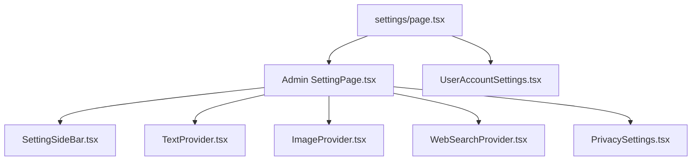
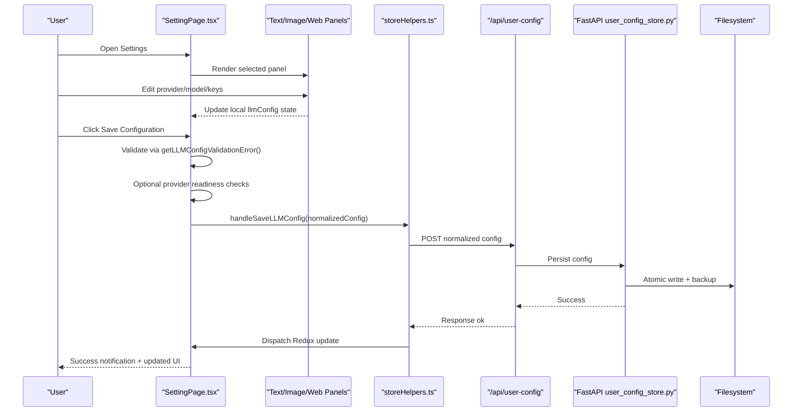
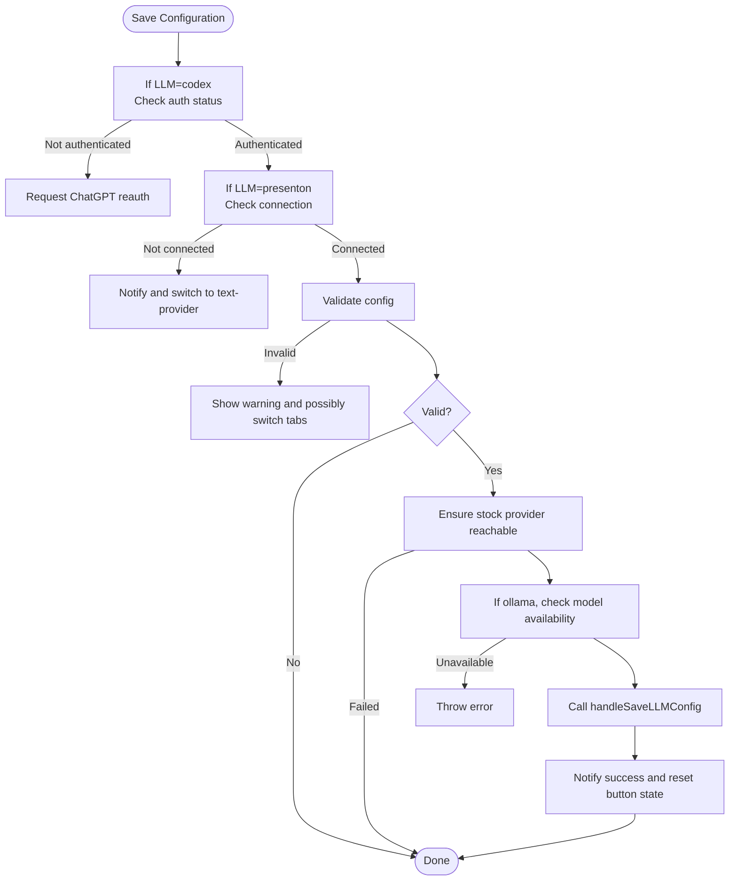
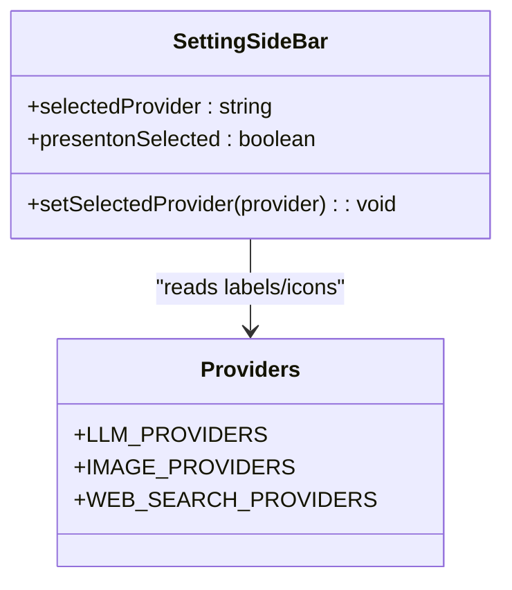
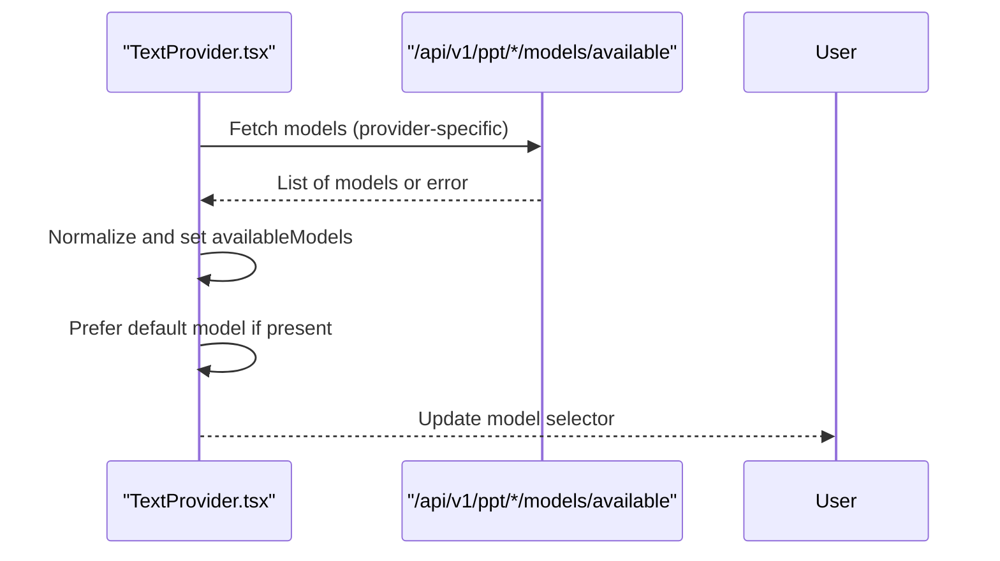
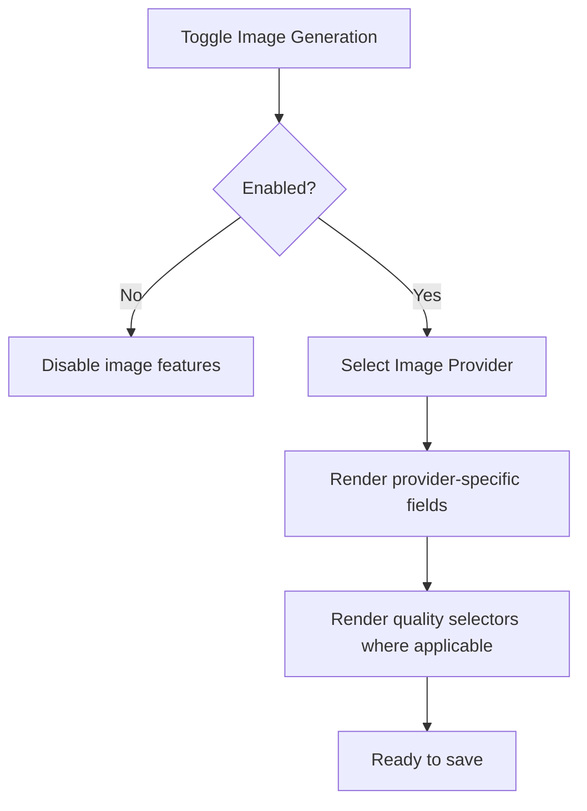
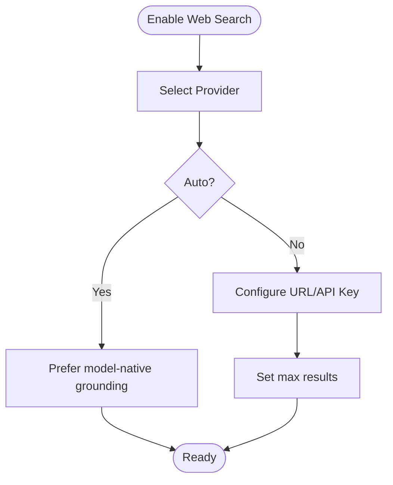
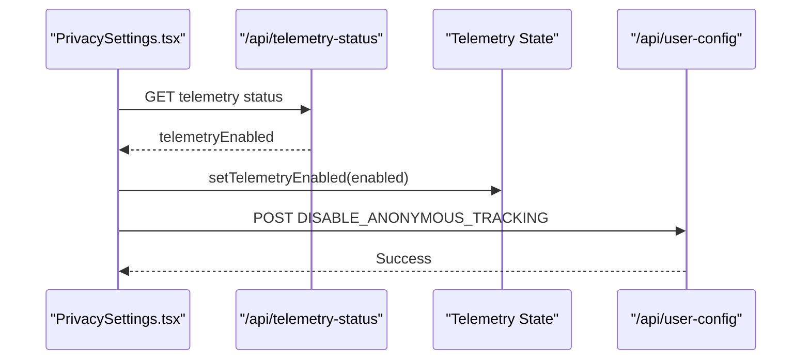
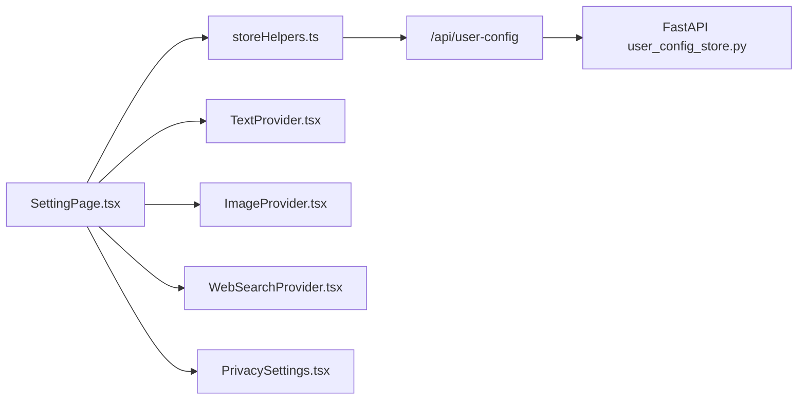

# Settings Module

<cite>
**Referenced Files in This Document**
- [page.tsx](file://servers/nextjs/app/(presentation-generator)/(dashboard)/settings/page.tsx)
- [SettingPage.tsx](file://servers/nextjs/app/(presentation-generator)/(dashboard)/settings/SettingPage.tsx)
- [SettingSideBar.tsx](file://servers/nextjs/app/(presentation-generator)/(dashboard)/settings/SettingSideBar.tsx)
- [TextProvider.tsx](file://servers/nextjs/app/(presentation-generator)/(dashboard)/settings/TextProvider.tsx)
- [ImageProvider.tsx](file://servers/nextjs/app/(presentation-generator)/(dashboard)/settings/ImageProvider.tsx)
- [WebSearchProvider.tsx](file://servers/nextjs/app/(presentation-generator)/(dashboard)/settings/WebSearchProvider.tsx)
- [PrivacySettings.tsx](file://servers/nextjs/app/(presentation-generator)/(dashboard)/settings/PrivacySettings.tsx)
- [UserAccountSettings.tsx](file://servers/nextjs/app/(presentation-generator)/(dashboard)/settings/UserAccountSettings.tsx)
- [storeHelpers.ts](file://servers/nextjs/utils/storeHelpers.ts)
- [user-config-store.ts (Next.js)](file://servers/nextjs/lib/user-config-store.ts)
- [user_config_store.py (FastAPI)](file://servers/fastapi/utils/user_config_store.py)
</cite>

## Table of Contents
1. [Introduction](#introduction)
2. [Project Structure](#project-structure)
3. [Core Components](#core-components)
4. [Architecture Overview](#architecture-overview)
5. [Detailed Component Analysis](#detailed-component-analysis)
6. [Dependency Analysis](#dependency-analysis)
7. [Performance Considerations](#performance-considerations)
8. [Troubleshooting Guide](#troubleshooting-guide)
9. [Conclusion](#conclusion)

## Introduction
This document explains the Settings module that manages application configuration and user preferences. It covers the settings page structure, sidebar navigation, and configuration panels for text providers, image generation, web search, privacy/analytics, and user account management. It also documents how settings are validated, persisted, and synchronized across the application, including security considerations for sensitive configuration data such as API keys.

## Project Structure
The Settings feature is implemented as a Next.js client-side dashboard with multiple sub-pages:
- A route entry that selects between admin and user views based on role.
- An admin-facing Settings page with a sidebar and multiple configuration panels.
- A simplified User Account Settings view for non-admin users.

**Diagram sources**
- [page.tsx:11-16](file://servers/nextjs/app/(presentation-generator)/(dashboard)/settings/page.tsx#L11-L16)
- [SettingPage.tsx:46-509](file://servers/nextjs/app/(presentation-generator)/(dashboard)/settings/SettingPage.tsx#L46-L509)
- [SettingSideBar.tsx:9-81](file://servers/nextjs/app/(presentation-generator)/(dashboard)/settings/SettingSideBar.tsx#L9-L81)
- [TextProvider.tsx:60-800](file://servers/nextjs/app/(presentation-generator)/(dashboard)/settings/TextProvider.tsx#L60-L800)
- [ImageProvider.tsx:14-464](file://servers/nextjs/app/(presentation-generator)/(dashboard)/settings/ImageProvider.tsx#L14-L464)
- [WebSearchProvider.tsx:33-262](file://servers/nextjs/app/(presentation-generator)/(dashboard)/settings/WebSearchProvider.tsx#L33-L262)
- [PrivacySettings.tsx:11-110](file://servers/nextjs/app/(presentation-generator)/(dashboard)/settings/PrivacySettings.tsx#L11-L110)
- [UserAccountSettings.tsx:9-99](file://servers/nextjs/app/(presentation-generator)/(dashboard)/settings/UserAccountSettings.tsx#L9-L99)

**Section sources**
- [page.tsx:1-20](file://servers/nextjs/app/(presentation-generator)/(dashboard)/settings/page.tsx#L1-L20)

## Core Components
- Route entry: Chooses between admin and user settings views based on server-authenticated role.
- Admin Settings Page: Orchestrates provider selection, validation, saving, and real-time UI updates.
- Sidebar: Renders navigation sections for text, image, web search, privacy, admin, and session controls.
- Panels:
  - Text Provider: Configure LLM provider, model discovery, base URLs, and advanced options.
  - Image Provider: Enable/disable image generation, select provider, configure credentials and models.
  - Web Search Provider: Toggle web grounding, choose provider, set URL/key and result limits.
  - Privacy Settings: Manage anonymous telemetry opt-in/out.
  - User Account Settings: Display signed-in user and sign-out action.

Key responsibilities:
- Validation: Centralized validation ensures required fields per provider before saving.
- Persistence: Normalized config is posted to /api/user-config; backend persists securely to disk.
- Real-time updates: Redux store updates reflect changes across the app immediately after save.

**Section sources**
- [SettingPage.tsx:46-509](file://servers/nextjs/app/(presentation-generator)/(dashboard)/settings/SettingPage.tsx#L46-L509)
- [storeHelpers.ts:100-425](file://servers/nextjs/utils/storeHelpers.ts#L100-L425)

## Architecture Overview
The Settings flow integrates UI state, validation, and persistence:

**Diagram sources**
- [SettingPage.tsx:166-254](file://servers/nextjs/app/(presentation-generator)/(dashboard)/settings/SettingPage.tsx#L166-L254)
- [storeHelpers.ts:405-422](file://servers/nextjs/utils/storeHelpers.ts#L405-L422)
- [user_config_store.py:173-219](file://servers/fastapi/utils/user_config_store.py#L173-L219)

## Detailed Component Analysis

### Settings Page Orchestration (Admin)
Responsibilities:
- Tracks selected section and updates analytics events.
- Enforces provider-specific pre-save validations (e.g., stock image provider reachability).
- Handles special flows for Codex and Presenton providers.
- Prevents accidental navigation when provider setup is incomplete.
- Renders panels conditionally based on current LLM provider.

Validation and save flow:
- Validates using centralized helper.
- Optionally verifies stock image provider connectivity.
- Checks Ollama model availability when applicable.
- Persists via handleSaveLLMConfig and updates Redux store.

**Diagram sources**
- [SettingPage.tsx:166-254](file://servers/nextjs/app/(presentation-generator)/(dashboard)/settings/SettingPage.tsx#L166-L254)

**Section sources**
- [SettingPage.tsx:46-509](file://servers/nextjs/app/(presentation-generator)/(dashboard)/settings/SettingPage.tsx#L46-L509)

### Sidebar Navigation
- Provides sections: Text Provider, Image Provider, Web Search Provider, Usage Analytics, Admin, Sign out.
- Hides Image and Web Search sections when Presenton is selected as the text provider.
- Reflects current selections and icons from provider constants.

**Diagram sources**
- [SettingSideBar.tsx:9-81](file://servers/nextjs/app/(presentation-generator)/(dashboard)/settings/SettingSideBar.tsx#L9-L81)

**Section sources**
- [SettingSideBar.tsx:1-82](file://servers/nextjs/app/(presentation-generator)/(dashboard)/settings/SettingSideBar.tsx#L1-L82)

### Text Provider Panel
Capabilities:
- Select provider from a searchable list.
- Input API key with show/hide toggle.
- For specific providers, expose base URLs or advanced fields.
- Discover available models via backend endpoints; fall back to manual input if discovery fails.
- Auto-select preferred default model when available.

Model discovery flow:
- Calls provider-specific endpoints to list models.
- Normalizes results and updates UI.
- On failure, notifies user and allows manual model ID entry.

**Diagram sources**
- [TextProvider.tsx:266-423](file://servers/nextjs/app/(presentation-generator)/(dashboard)/settings/TextProvider.tsx#L266-L423)

**Section sources**
- [TextProvider.tsx:60-800](file://servers/nextjs/app/(presentation-generator)/(dashboard)/settings/TextProvider.tsx#L60-L800)

### Image Provider Panel
Capabilities:
- Toggle image generation on/off.
- Select provider (OpenAI-compatible, ComfyUI, Open WebUI, stock providers, etc.).
- Configure provider-specific fields: base URL, API key, workflow JSON, quality options.
- Provide feedback when no models are discovered for OpenAI-compatible image endpoints.

**Diagram sources**
- [ImageProvider.tsx:14-464](file://servers/nextjs/app/(presentation-generator)/(dashboard)/settings/ImageProvider.tsx#L14-L464)

**Section sources**
- [ImageProvider.tsx:1-464](file://servers/nextjs/app/(presentation-generator)/(dashboard)/settings/ImageProvider.tsx#L1-L464)

### Web Search Provider Panel
Capabilities:
- Toggle web grounding on/off.
- Choose provider (auto or external services).
- Configure provider URL and API key where required.
- Set maximum results for external providers.

Behavior:
- When enabling, defaults to auto if no valid provider is selected.
- Tracks provider selection events for analytics.

**Diagram sources**
- [WebSearchProvider.tsx:33-262](file://servers/nextjs/app/(presentation-generator)/(dashboard)/settings/WebSearchProvider.tsx#L33-L262)

**Section sources**
- [WebSearchProvider.tsx:1-262](file://servers/nextjs/app/(presentation-generator)/(dashboard)/settings/WebSearchProvider.tsx#L1-L262)

### Privacy Settings Panel
Capabilities:
- Fetch telemetry status from backend.
- Toggle anonymous usage analytics.
- Persist preference by updating user config.
- Immediately disable telemetry locally even if analytics tracking fails.

**Diagram sources**
- [PrivacySettings.tsx:15-57](file://servers/nextjs/app/(presentation-generator)/(dashboard)/settings/PrivacySettings.tsx#L15-L57)

**Section sources**
- [PrivacySettings.tsx:1-110](file://servers/nextjs/app/(presentation-generator)/(dashboard)/settings/PrivacySettings.tsx#L1-L110)

### User Account Settings
- Displays signed-in username.
- Provides sign-out action.
- Simplified layout without provider configuration.

**Section sources**
- [UserAccountSettings.tsx:1-99](file://servers/nextjs/app/(presentation-generator)/(dashboard)/settings/UserAccountSettings.tsx#L1-L99)

## Dependency Analysis
- Settings page depends on:
  - Provider constants for labels, icons, and supported values.
  - Validation and normalization helpers for safe saving.
  - Redux store for global configuration state.
  - Backend APIs for model discovery, telemetry status, and user config persistence.

**Diagram sources**
- [SettingPage.tsx:46-509](file://servers/nextjs/app/(presentation-generator)/(dashboard)/settings/SettingPage.tsx#L46-L509)
- [storeHelpers.ts:405-422](file://servers/nextjs/utils/storeHelpers.ts#L405-L422)
- [user_config_store.py:173-219](file://servers/fastapi/utils/user_config_store.py#L173-L219)

**Section sources**
- [storeHelpers.ts:100-425](file://servers/nextjs/utils/storeHelpers.ts#L100-L425)

## Performance Considerations
- Model discovery calls are guarded by loading states and avoid duplicate requests.
- UI updates are batched through Redux to minimize re-renders.
- Atomic file writes and backups ensure durability without blocking UI.
- Avoid unnecessary network calls by checking provider prerequisites before save.

[No sources needed since this section provides general guidance]

## Troubleshooting Guide
Common issues and resolutions:
- Missing text provider: The system prevents leaving Settings until a provider is configured and saved.
- Invalid provider configuration: Validation errors surface with actionable messages; some panels redirect to the correct tab.
- Stock image provider unreachable: Save is blocked until the provider responds successfully.
- Ollama model not available: Save throws an error instructing to verify model presence at the configured URL.
- Telemetry toggle fails: Local state reverts to previous value; user can retry.

Operational tips:
- Use the show/hide toggles for API keys to verify inputs safely.
- If model discovery fails, manually enter a model ID where allowed.
- Ensure provider base URLs and credentials are correct before saving.

**Section sources**
- [SettingPage.tsx:166-254](file://servers/nextjs/app/(presentation-generator)/(dashboard)/settings/SettingPage.tsx#L166-L254)
- [storeHelpers.ts:100-425](file://servers/nextjs/utils/storeHelpers.ts#L100-L425)

## Conclusion
The Settings module provides a robust, secure, and user-friendly interface for configuring AI providers, image generation, web search, privacy, and account management. It enforces validation, protects sensitive data, persists configurations atomically, and keeps the application state synchronized in real time.

[No sources needed since this section summarizes without analyzing specific files]