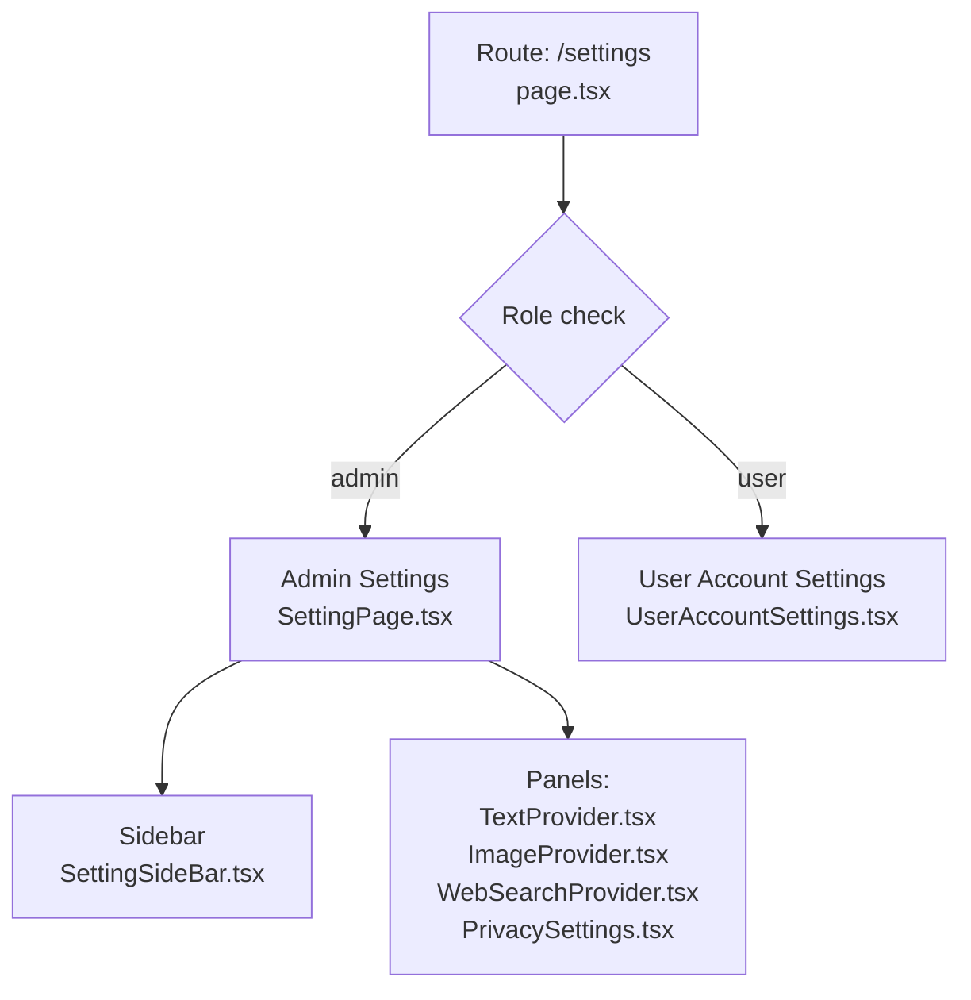
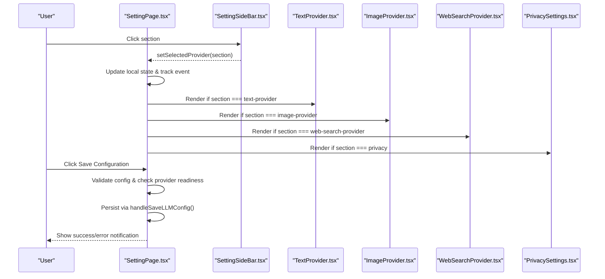
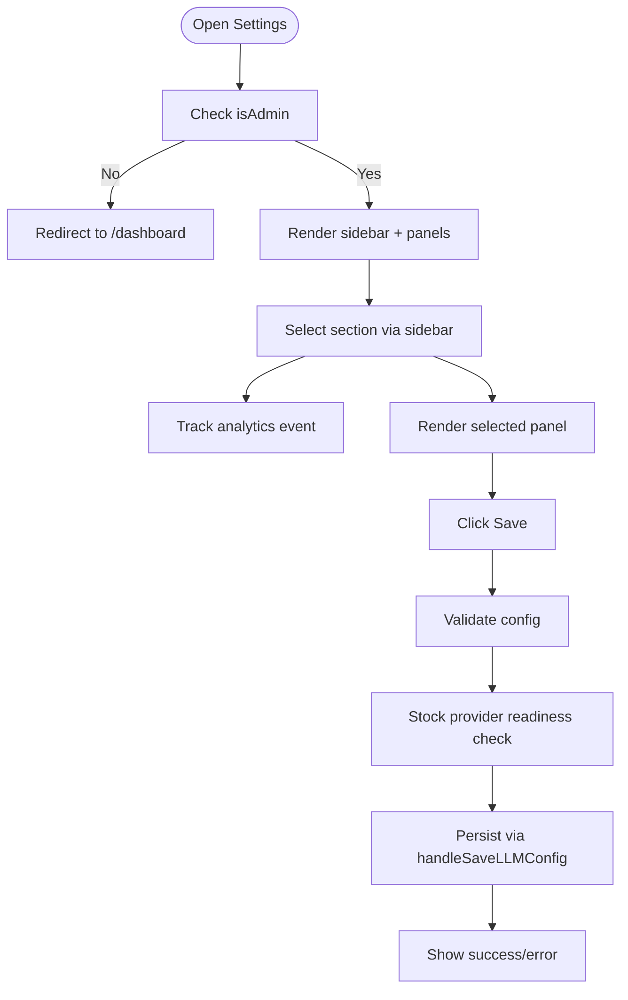
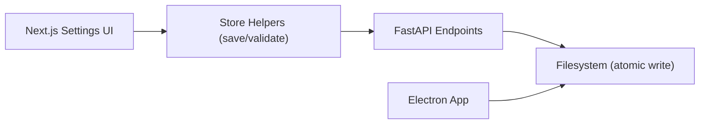

# Settings Page Structure

<cite>
**Referenced Files in This Document**
- [page.tsx](file://servers/nextjs/app/(presentation-generator)/(dashboard)/settings/page.tsx)
- [SettingPage.tsx](file://servers/nextjs/app/(presentation-generator)/(dashboard)/settings/SettingPage.tsx)
- [SettingSideBar.tsx](file://servers/nextjs/app/(presentation-generator)/(dashboard)/settings/SettingSideBar.tsx)
- [TextProvider.tsx](file://servers/nextjs/app/(presentation-generator)/(dashboard)/settings/TextProvider.tsx)
- [ImageProvider.tsx](file://servers/nextjs/app/(presentation-generator)/(dashboard)/settings/ImageProvider.tsx)
- [WebSearchProvider.tsx](file://servers/nextjs/app/(presentation-generator)/(dashboard)/settings/WebSearchProvider.tsx)
- [PrivacySettings.tsx](file://servers/nextjs/app/(presentation-generator)/(dashboard)/settings/PrivacySettings.tsx)
- [UserAccountSettings.tsx](file://servers/nextjs/app/(presentation-generator)/(dashboard)/settings/UserAccountSettings.tsx)
- [settingsAccess.ts](file://servers/nextjs/utils/settingsAccess.ts)
- [layout.tsx](file://servers/nextjs/app/(presentation-generator)/layout.tsx)
- [user-config-store.ts (Next.js)](file://servers/nextjs/lib/user-config-store.ts)
- [user-config-store.ts (Electron)](file://electron/app/utils/user-config-store.ts)
- [user_config_store.py (FastAPI)](file://servers/fastapi/utils/user_config_store.py)
</cite>

## Table of Contents
1. [Introduction](#introduction)
2. [Project Structure](#project-structure)
3. [Core Components](#core-components)
4. [Architecture Overview](#architecture-overview)
5. [Detailed Component Analysis](#detailed-component-analysis)
6. [Dependency Analysis](#dependency-analysis)
7. [Performance Considerations](#performance-considerations)
8. [Troubleshooting Guide](#troubleshooting-guide)
9. [Conclusion](#conclusion)

## Introduction
This document explains the settings page structure and navigation system for the application’s Next.js frontend. It covers:
- The main settings page component and how it renders different panels
- Sidebar navigation implementation and active section state management
- Routing logic that selects admin vs user account views
- How provider-specific panels are loaded and validated
- Layout, responsive design considerations, and accessibility features
- Settings persistence across client, server, and desktop layers

## Project Structure
The settings feature is implemented under the Next.js app directory with a dashboard route group. The entry point decides whether to render the full admin settings or a simplified user account view based on the authenticated role.

**Diagram sources**
- [page.tsx:11-17](file://servers/nextjs/app/(presentation-generator)/(dashboard)/settings/page.tsx#L11-L17)
- [SettingPage.tsx:46-508](file://servers/nextjs/app/(presentation-generator)/(dashboard)/settings/SettingPage.tsx#L46-L508)
- [SettingSideBar.tsx:9-79](file://servers/nextjs/app/(presentation-generator)/(dashboard)/settings/SettingSideBar.tsx#L9-L79)
- [UserAccountSettings.tsx:9-98](file://servers/nextjs/app/(presentation-generator)/(dashboard)/settings/UserAccountSettings.tsx#L9-L98)

**Section sources**
- [page.tsx:1-20](file://servers/nextjs/app/(presentation-generator)/(dashboard)/settings/page.tsx#L1-L20)
- [layout.tsx:6-12](file://servers/nextjs/app/(presentation-generator)/layout.tsx#L6-L12)

## Core Components
- Settings page entry: Determines which view to render based on the authenticated user’s role.
- Admin settings container: Manages active panel selection, validation, saving, and analytics tracking.
- Sidebar: Renders selectable sections and highlights the active one.
- Provider panels: Text, Image, Web Search, Privacy, and Admin panels.
- User account settings: Simplified view for non-admin users.

Key responsibilities:
- Role-based routing at the page level
- Local state for active section and configuration preview
- Validation and save flow for LLM/image/web search providers
- Persisting changes through shared store helpers and backend services

**Section sources**
- [page.tsx:11-17](file://servers/nextjs/app/(presentation-generator)/(dashboard)/settings/page.tsx#L11-L17)
- [SettingPage.tsx:46-508](file://servers/nextjs/app/(presentation-generator)/(dashboard)/settings/SettingPage.tsx#L46-L508)
- [SettingSideBar.tsx:9-79](file://servers/nextjs/app/(presentation-generator)/(dashboard)/settings/SettingSideBar.tsx#L9-L79)
- [UserAccountSettings.tsx:9-98](file://servers/nextjs/app/(presentation-generator)/(dashboard)/settings/UserAccountSettings.tsx#L9-L98)

## Architecture Overview
The settings UI follows a parent-child pattern where the admin settings page owns the active section state and conditionally renders provider panels. The sidebar updates this state and tracks analytics events. Saving triggers validation, optional provider readiness checks, and persists configuration via shared utilities.

**Diagram sources**
- [SettingPage.tsx:87-101](file://servers/nextjs/app/(presentation-generator)/(dashboard)/settings/SettingPage.tsx#L87-L101)
- [SettingPage.tsx:166-254](file://servers/nextjs/app/(presentation-generator)/(dashboard)/settings/SettingPage.tsx#L166-L254)
- [SettingSideBar.tsx:19-40](file://servers/nextjs/app/(presentation-generator)/(dashboard)/settings/SettingSideBar.tsx#L19-L40)
- [TextProvider.tsx:60-800](file://servers/nextjs/app/(presentation-generator)/(dashboard)/settings/TextProvider.tsx#L60-L800)
- [ImageProvider.tsx:14-464](file://servers/nextjs/app/(presentation-generator)/(dashboard)/settings/ImageProvider.tsx#L14-L464)
- [WebSearchProvider.tsx:33-262](file://servers/nextjs/app/(presentation-generator)/(dashboard)/settings/WebSearchProvider.tsx#L33-L262)
- [PrivacySettings.tsx](file://servers/nextjs/app/(presentation-generator)/(dashboard)/settings/PrivacySettings.tsx)

## Detailed Component Analysis

### Settings Page Entry (page.tsx)
- Server-side decision: Uses authentication status to choose between admin and user account views.
- Metadata: Sets page title and description.

Responsibilities:
- Route-level role gating
- Rendering either SettingPage or UserAccountSettings

**Section sources**
- [page.tsx:11-17](file://servers/nextjs/app/(presentation-generator)/(dashboard)/settings/page.tsx#L11-L17)

### Admin Settings Container (SettingPage.tsx)
State and behavior:
- Active section state: selectedProvider
- LLM configuration state synced from Redux store
- Admin-only guard: redirects non-admins
- Save flow:
  - Validates required fields per provider
  - Checks stock image provider connectivity when needed
  - Ensures Ollama model availability before saving
  - Persists via shared helper and shows notifications
- Analytics: Tracks tab switches, section entry, and save actions
- Navigation guards: Prevents leaving the page until a text provider is configured and saved

Layout:
- Two-column layout: fixed-width sidebar + scrollable content area
- Sticky header with summary badges showing current text/image/web search providers
- Fixed bottom “Save” button except for session/admin sections

Accessibility:
- aria-label attributes on interactive elements
- Alert banner with role="alert" for unconfigured provider state

Responsive considerations:
- Flexbox layout with overflow handling
- Scrollable content area with custom scrollbar styling
- Conditional rendering hides certain options when using cloud provider

**Diagram sources**
- [SettingPage.tsx:46-101](file://servers/nextjs/app/(presentation-generator)/(dashboard)/settings/SettingPage.tsx#L46-L101)
- [SettingPage.tsx:166-254](file://servers/nextjs/app/(presentation-generator)/(dashboard)/settings/SettingPage.tsx#L166-L254)
- [SettingPage.tsx:417-508](file://servers/nextjs/app/(presentation-generator)/(dashboard)/settings/SettingPage.tsx#L417-L508)

**Section sources**
- [SettingPage.tsx:46-508](file://servers/nextjs/app/(presentation-generator)/(dashboard)/settings/SettingPage.tsx#L46-L508)

### Sidebar Navigation (SettingSideBar.tsx)
Features:
- Defines available sections: text-provider, image-provider, web-search-provider, privacy, admin, session
- Highlights the active section
- Conditionally hides image/web search options when the cloud provider is selected
- Provides quick access to privacy/analytics and sign-out

Interaction:
- Emits setSelectedProvider callback to update parent state
- Uses icons and labels from provider constants

**Section sources**
- [SettingSideBar.tsx:9-79](file://servers/nextjs/app/(presentation-generator)/(dashboard)/settings/SettingSideBar.tsx#L9-L79)

### Text Provider Panel (TextProvider.tsx)
Capabilities:
- Provider selection via searchable combobox
- Dynamic API key input and visibility toggle
- Model discovery endpoints per provider
- Specialized inputs for Ollama, Codex, Bedrock, Vertex/Azure manual fields
- Advanced base URL inputs for several providers
- Default model selection when models are discovered

Validation and UX:
- Warns if model listing fails but allows manual model ID entry
- Tracks provider selection analytics

**Section sources**
- [TextProvider.tsx:60-800](file://servers/nextjs/app/(presentation-generator)/(dashboard)/settings/TextProvider.tsx#L60-L800)

### Image Provider Panel (ImageProvider.tsx)
Capabilities:
- Toggle to enable/disable image generation
- Provider selection combobox
- Support for OpenAI-compatible image endpoints, ComfyUI, Open WebUI, and others
- Quality selectors for specific GPT image models
- Optional API key inputs with visibility toggle

UX:
- Shows guidance when no models are found for openai_compatible
- Tracks provider selection analytics

**Section sources**
- [ImageProvider.tsx:14-464](file://servers/nextjs/app/(presentation-generator)/(dashboard)/settings/ImageProvider.tsx#L14-L464)

### Web Search Provider Panel (WebSearchProvider.tsx)
Capabilities:
- Toggle to enable web search
- Provider selection including auto mode
- Optional URL and API key inputs depending on provider
- Maximum results control for external providers

UX:
- Auto mode informational note
- Tracks provider selection analytics

**Section sources**
- [WebSearchProvider.tsx:33-262](file://servers/nextjs/app/(presentation-generator)/(dashboard)/settings/WebSearchProvider.tsx#L33-L262)

### Privacy Settings Panel (PrivacySettings.tsx)
Purpose:
- Configures usage analytics and privacy-related toggles within the settings context.

**Section sources**
- [PrivacySettings.tsx](file://servers/nextjs/app/(presentation-generator)/(dashboard)/settings/PrivacySettings.tsx)

### User Account Settings (UserAccountSettings.tsx)
Purpose:
- Displays signed-in username and provides sign-out action for non-admin users.

Layout:
- Minimal sidebar with account item highlighted
- Main content card with account info and logout action

**Section sources**
- [UserAccountSettings.tsx:9-98](file://servers/nextjs/app/(presentation-generator)/(dashboard)/settings/UserAccountSettings.tsx#L9-L98)

## Dependency Analysis
- Role-based routing depends on getServerAuthStatus and getSettingsView utility.
- Admin settings depend on Redux store for userConfig and shared helpers for validation and persistence.
- Provider panels depend on provider constants and analytics utilities.
- Persistence spans multiple layers:
  - Client store helpers call backend APIs
  - Backend FastAPI service writes to disk atomically
  - Electron layer mirrors persistence logic for desktop apps

**Diagram sources**
- [SettingPage.tsx:166-254](file://servers/nextjs/app/(presentation-generator)/(dashboard)/settings/SettingPage.tsx#L166-L254)
- [user_config_store.py:173-219](file://servers/fastapi/utils/user_config_store.py#L173-L219)
- [user-config-store.ts (Next.js):182-232](file://servers/nextjs/lib/user-config-store.ts#L182-L232)
- [user-config-store.ts (Electron):182-232](file://electron/app/utils/user-config-store.ts#L182-L232)

**Section sources**
- [settingsAccess.ts:1-7](file://servers/nextjs/utils/settingsAccess.ts#L1-L7)
- [user_config_store.py:173-219](file://servers/fastapi/utils/user_config_store.py#L173-L219)
- [user-config-store.ts (Next.js):182-232](file://servers/nextjs/lib/user-config-store.ts#L182-L232)
- [user-config-store.ts (Electron):182-232](file://electron/app/utils/user-config-store.ts#L182-L232)

## Performance Considerations
- Avoid unnecessary re-renders by keeping provider panels isolated and only rendering the active section.
- Debounce model discovery calls if provider endpoints are rate-limited.
- Cache provider metadata (labels/icons) to reduce repeated computations.
- Use lazy loading for heavy panels if needed (e.g., admin panel).
- Minimize network calls during save by validating locally first.

[No sources needed since this section provides general guidance]

## Troubleshooting Guide
Common issues and resolutions:
- Cannot save settings due to missing provider credentials:
  - Ensure the selected provider has valid API keys or URLs.
  - For stock image providers, verify connectivity before saving.
- Ollama model not available:
  - Confirm the model exists at the configured Ollama URL.
- ChatGPT/Codex re-authentication required:
  - Re-authenticate via the provided prompt and retry saving.
- Leaving settings without configuring a text provider:
  - Configure and save a text provider before navigating away.

**Section sources**
- [SettingPage.tsx:103-131](file://servers/nextjs/app/(presentation-generator)/(dashboard)/settings/SettingPage.tsx#L103-L131)
- [SettingPage.tsx:166-254](file://servers/nextjs/app/(presentation-generator)/(dashboard)/settings/SettingPage.tsx#L166-L254)
- [SettingPage.tsx:324-413](file://servers/nextjs/app/(presentation-generator)/(dashboard)/settings/SettingPage.tsx#L324-L413)

## Conclusion
The settings page provides a robust, role-aware interface for configuring text, image, and web search providers. It enforces validation and provider readiness, offers clear feedback, and persists changes securely across client, server, and desktop environments. The modular panel architecture supports extensibility while maintaining consistent UX and accessibility standards.

[No sources needed since this section summarizes without analyzing specific files]