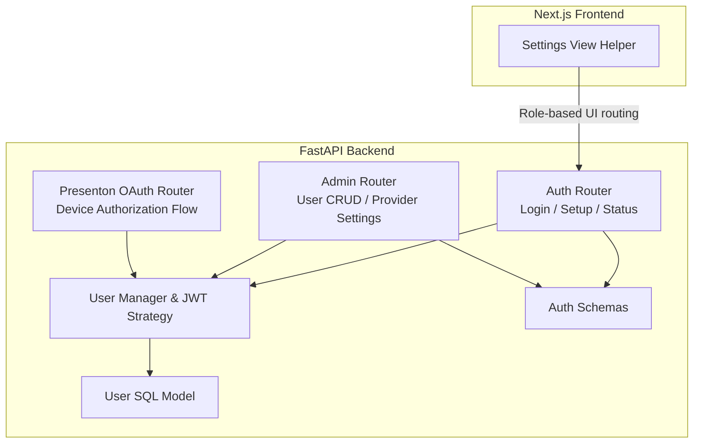
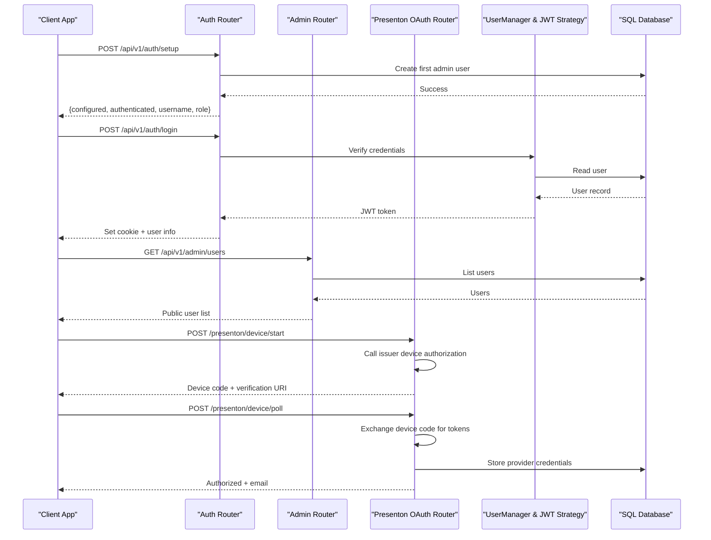
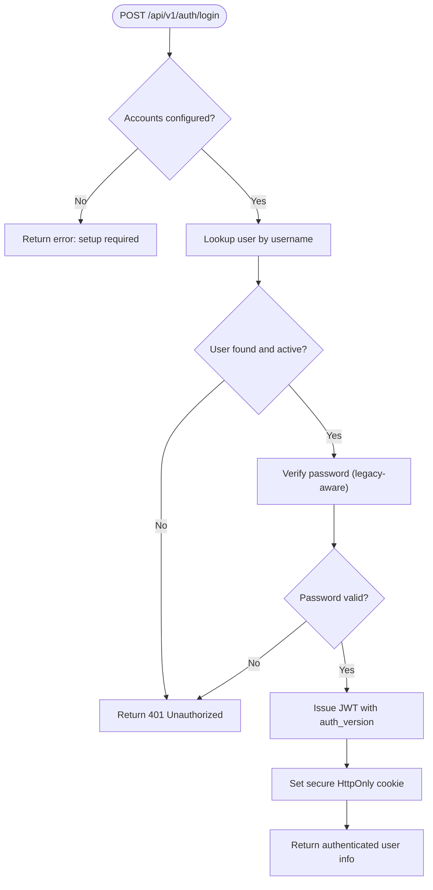
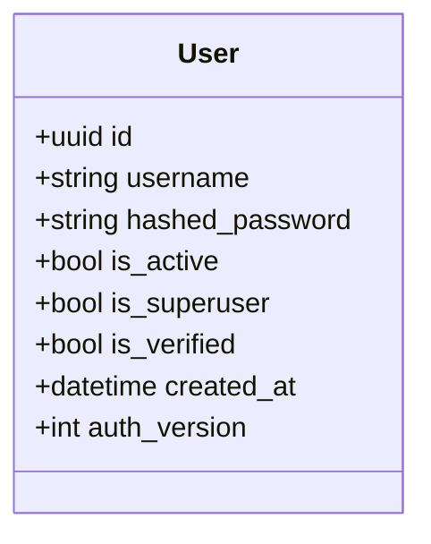
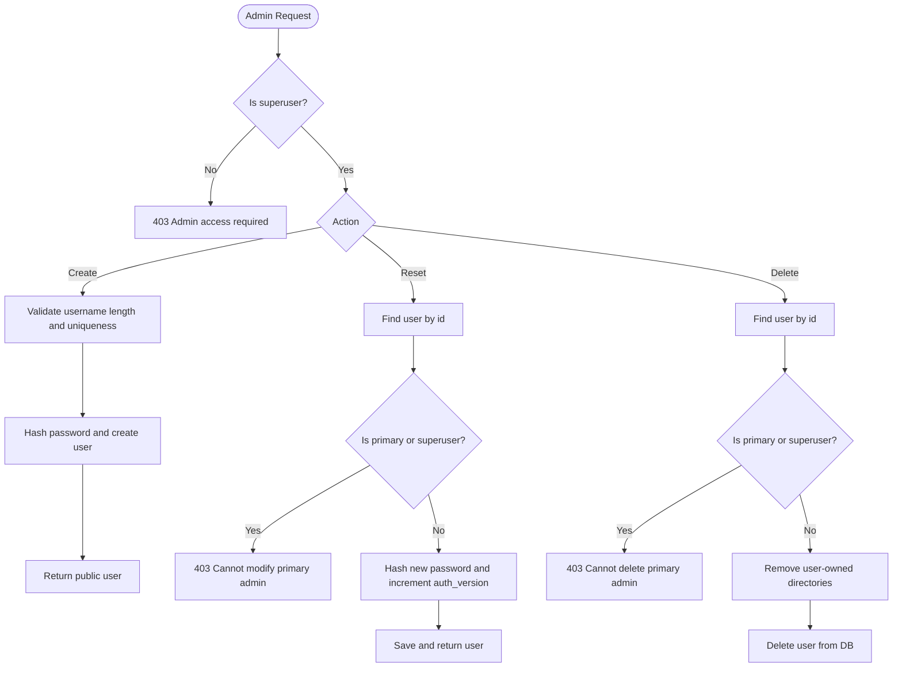
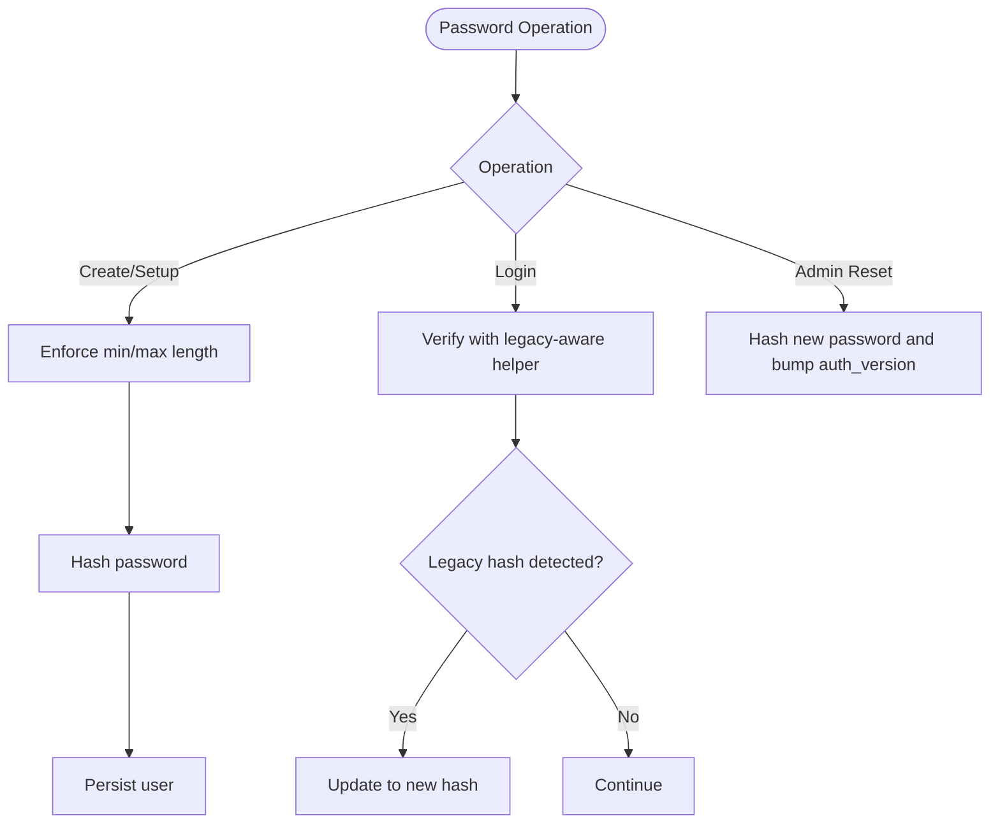
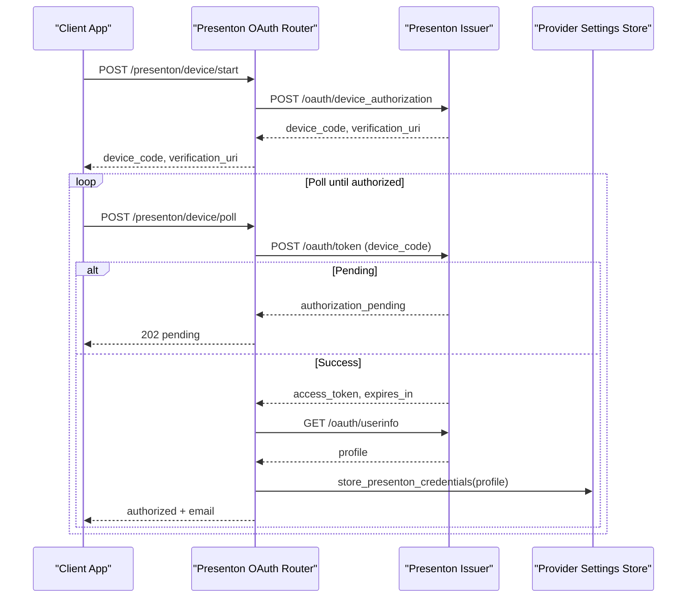
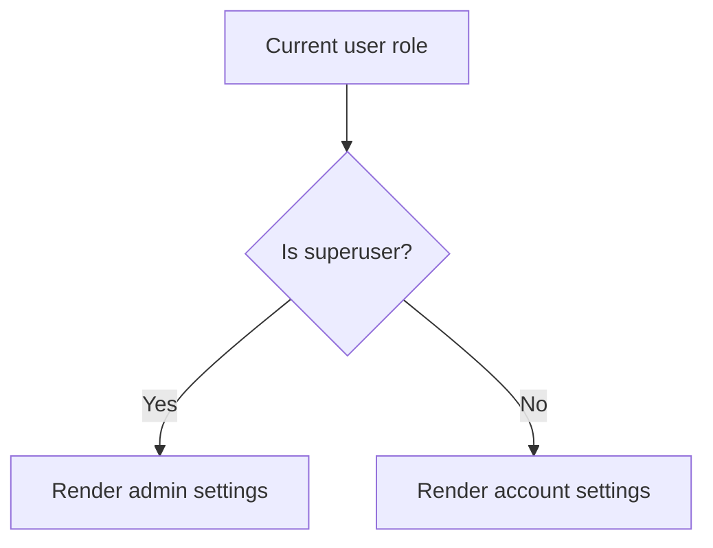
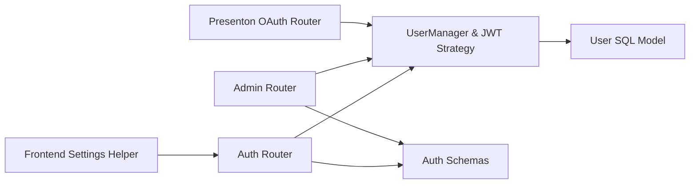

# User Account Management

<cite>
**Referenced Files in This Document**
- [router.py](file://servers/fastapi/api/v1/auth/router.py)
- [users.py](file://servers/fastapi/api/v1/auth/users.py)
- [user.py](file://servers/fastapi/models/sql/user.py)
- [schemas.py](file://servers/fastapi/api/v1/auth/schemas.py)
- [presenton_oauth.py](file://servers/fastapi/api/v1/auth/presenton_oauth.py)
- [router.py](file://servers/fastapi/api/v1/admin/router.py)
- [settingsAccess.ts](file://servers/nextjs/utils/settingsAccess.ts)
</cite>

## Table of Contents
1. [Introduction](#introduction)
2. [Project Structure](#project-structure)
3. [Core Components](#core-components)
4. [Architecture Overview](#architecture-overview)
5. [Detailed Component Analysis](#detailed-component-analysis)
6. [Dependency Analysis](#dependency-analysis)
7. [Performance Considerations](#performance-considerations)
8. [Troubleshooting Guide](#troubleshooting-guide)
9. [Conclusion](#conclusion)

## Introduction
This document explains the user account management features implemented in the project, including:
- Multi-user support with username-based accounts and role-based access control
- Profile information exposure and session handling
- Password creation, validation, login, logout, and admin-managed password resets
- Admin-only user lifecycle operations (create, reset password, delete)
- OAuth integration for linking a Presenton Cloud provider account
- Frontend settings view routing based on roles
- Notes on what is not currently supported (self-service profile editing, billing, subscriptions, external service linking beyond Presenton Cloud)

## Project Structure
The user account system spans FastAPI backend routes, authentication utilities, database models, API schemas, and Next.js frontend helpers.

**Diagram sources**
- [router.py:27-202](file://servers/fastapi/api/v1/auth/router.py#L27-L202)
- [router.py:41-265](file://servers/fastapi/api/v1/admin/router.py#L41-L265)
- [presenton_oauth.py:29-313](file://servers/fastapi/api/v1/auth/presenton_oauth.py#L29-L313)
- [users.py:107-234](file://servers/fastapi/api/v1/auth/users.py#L107-L234)
- [user.py:16-46](file://servers/fastapi/models/sql/user.py#L16-L46)
- [schemas.py:10-82](file://servers/fastapi/api/v1/auth/schemas.py#L10-L82)
- [settingsAccess.ts:1-7](file://servers/nextjs/utils/settingsAccess.ts#L1-L7)

**Section sources**
- [router.py:27-202](file://servers/fastapi/api/v1/auth/router.py#L27-L202)
- [router.py:41-265](file://servers/fastapi/api/v1/admin/router.py#L41-L265)
- [presenton_oauth.py:29-313](file://servers/fastapi/api/v1/auth/presenton_oauth.py#L29-L313)
- [users.py:107-234](file://servers/fastapi/api/v1/auth/users.py#L107-L234)
- [user.py:16-46](file://servers/fastapi/models/sql/user.py#L16-L46)
- [schemas.py:10-82](file://servers/fastapi/api/v1/auth/schemas.py#L10-L82)
- [settingsAccess.ts:1-7](file://servers/nextjs/utils/settingsAccess.ts#L1-L7)

## Core Components
- Authentication router handles initial setup, login, logout, status, and verification. It sets secure cookies and returns serialized user data when authenticated.
- Admin router exposes endpoints to list users, create users, reset passwords, revoke API keys, and delete users. It also manages provider settings and Presenton Cloud linkage.
- Presenton OAuth router implements device authorization flow to link a Presenton Cloud provider account.
- User manager and JWT strategy manage sessions, password hashing, token issuance, and versioned token validation.
- User SQL model defines the core user entity with fields such as username, hashed password, active status, superuser flag, and auth version.
- Auth schemas define request/response shapes for credentials, user objects, and API keys.
- Frontend helper determines whether to show admin or account settings views based on the current user’s role.

Key responsibilities:
- Multi-user support: Yes, via username-based accounts and admin user management.
- Role-based access control: Yes, via `is_superuser` and admin-only endpoints.
- Profile editing: Not exposed; only read-only serialization of id, username, role, and created_at.
- Password management: Creation during setup, login, admin reset; no self-service change endpoint.
- OAuth integration: Presenton Cloud provider linking via device code flow.
- External service linking: Only Presenton Cloud is integrated at the account level.
- Subscription/billing: Not present in the referenced files.

**Section sources**
- [router.py:58-202](file://servers/fastapi/api/v1/auth/router.py#L58-L202)
- [router.py:169-265](file://servers/fastapi/api/v1/admin/router.py#L169-L265)
- [presenton_oauth.py:120-313](file://servers/fastapi/api/v1/auth/presenton_oauth.py#L120-L313)
- [users.py:107-234](file://servers/fastapi/api/v1/auth/users.py#L107-L234)
- [user.py:16-46](file://servers/fastapi/models/sql/user.py#L16-L46)
- [schemas.py:10-82](file://servers/fastapi/api/v1/auth/schemas.py#L10-L82)
- [settingsAccess.ts:1-7](file://servers/nextjs/utils/settingsAccess.ts#L1-L7)

## Architecture Overview
The authentication architecture uses cookie-based JWT sessions with an explicit login flow and admin-managed user lifecycle. The Presenton Cloud provider can be linked by administrators or in desktop mode where authentication is disabled.

**Diagram sources**
- [router.py:110-202](file://servers/fastapi/api/v1/auth/router.py#L110-L202)
- [router.py:169-265](file://servers/fastapi/api/v1/admin/router.py#L169-L265)
- [presenton_oauth.py:164-313](file://servers/fastapi/api/v1/auth/presenton_oauth.py#L164-L313)
- [users.py:136-182](file://servers/fastapi/api/v1/auth/users.py#L136-L182)

## Detailed Component Analysis

### Authentication and Session Management
- Setup: Creates the first admin user if none exists, persists admin credentials, and returns configuration state.
- Login: Validates username/password, updates legacy hashes when needed, issues a JWT, and sets a secure cookie.
- Logout: Deletes the session cookie.
- Status and verify: Return authentication state and optionally validate asset access paths.

**Diagram sources**
- [router.py:155-188](file://servers/fastapi/api/v1/auth/router.py#L155-L188)
- [users.py:27-46](file://servers/fastapi/api/v1/auth/users.py#L27-L46)
- [users.py:136-182](file://servers/fastapi/api/v1/auth/users.py#L136-L182)

**Section sources**
- [router.py:58-202](file://servers/fastapi/api/v1/auth/router.py#L58-L202)
- [users.py:27-46](file://servers/fastapi/api/v1/auth/users.py#L27-L46)
- [users.py:136-182](file://servers/fastapi/api/v1/auth/users.py#L136-L182)

### User Model and Data Shape
- Fields include unique username, hashed password, active/superuser/verified flags, timestamps, and an auth version used to invalidate old tokens after password changes.
- Serialization exposes id, username, role, and created_at.

**Diagram sources**
- [user.py:16-46](file://servers/fastapi/models/sql/user.py#L16-L46)
- [users.py:227-234](file://servers/fastapi/api/v1/auth/users.py#L227-L234)

**Section sources**
- [user.py:16-46](file://servers/fastapi/models/sql/user.py#L16-L46)
- [users.py:227-234](file://servers/fastapi/api/v1/auth/users.py#L227-L234)

### Admin User Lifecycle
- List users: Returns public user metadata sorted by creation and username.
- Create user: Validates username uniqueness and length, hashes password, creates non-admin user.
- Reset password: Allows admins to set a new password and increments auth_version to invalidate existing sessions.
- Delete user: Prevents deleting the primary admin or superuser; deletes associated user-owned directories under app data and temp locations.

**Diagram sources**
- [router.py:169-265](file://servers/fastapi/api/v1/admin/router.py#L169-L265)

**Section sources**
- [router.py:169-265](file://servers/fastapi/api/v1/admin/router.py#L169-L265)

### Password Management
- Validation enforces minimum and maximum lengths.
- Legacy hash migration is supported during login verification.
- Admin password reset increments auth_version to force re-authentication.

**Diagram sources**
- [users.py:27-46](file://servers/fastapi/api/v1/auth/users.py#L27-L46)
- [users.py:116-128](file://servers/fastapi/api/v1/auth/users.py#L116-L128)
- [router.py:215-233](file://servers/fastapi/api/v1/admin/router.py#L215-L233)

**Section sources**
- [users.py:27-46](file://servers/fastapi/api/v1/auth/users.py#L27-L46)
- [users.py:116-128](file://servers/fastapi/api/v1/auth/users.py#L116-L128)
- [router.py:215-233](file://servers/fastapi/api/v1/admin/router.py#L215-L233)

### OAuth Integration with Presenton Cloud
- Device authorization flow:
  - Start: Requests device code and verification URI from the issuer.
  - Poll: Exchanges device code for tokens, fetches user info, validates profile, stores credentials, and returns authorized status.
- Disconnecting the provider clears stored credentials and may reset LLM provider selection to require a new choice.

**Diagram sources**
- [presenton_oauth.py:164-313](file://servers/fastapi/api/v1/auth/presenton_oauth.py#L164-L313)

**Section sources**
- [presenton_oauth.py:120-313](file://servers/fastapi/api/v1/auth/presenton_oauth.py#L120-L313)

### Role-Based Access Control and Settings Views
- Roles:
  - Superuser (admin): Full access to admin endpoints and provider settings.
  - Regular user: Limited access; cannot manage providers or perform admin actions.
- Frontend routing:
  - If the current user is admin, show admin settings; otherwise, show account settings.

**Diagram sources**
- [settingsAccess.ts:1-7](file://servers/nextjs/utils/settingsAccess.ts#L1-L7)
- [users.py:219-224](file://servers/fastapi/api/v1/auth/users.py#L219-L224)

**Section sources**
- [settingsAccess.ts:1-7](file://servers/nextjs/utils/settingsAccess.ts#L1-L7)
- [users.py:219-224](file://servers/fastapi/api/v1/auth/users.py#L219-L224)

### Profile Information Editing
- Current behavior:
  - Profile data is read-only from the client perspective; the API serializes id, username, role, and created_at.
  - There is no self-service endpoint to update profile fields such as display name or avatar.
- Recommendation:
  - Add a dedicated profile update endpoint that restricts writes to the authenticated user’s own record and excludes sensitive fields like hashed_password.

**Section sources**
- [users.py:227-234](file://servers/fastapi/api/v1/auth/users.py#L227-L234)

### Account Deletion Procedures
- Admin deletion:
  - Prevents deletion of the primary administrator or any superuser.
  - Removes user-owned directories under app data and temporary storage before deleting the database record.
- Self-service deletion:
  - Not implemented in the referenced files.

**Section sources**
- [router.py:236-265](file://servers/fastapi/api/v1/admin/router.py#L236-L265)

### Subscription Management, Billing Settings, and Usage Limits
- Not implemented in the referenced files.
- Related concepts:
  - API key management exists for programmatic access but does not imply subscription tiers or billing.
  - Provider settings control which LLM/image/web search providers are available, not usage quotas.

**Section sources**
- [router.py:44-128](file://servers/fastapi/api/v1/admin/router.py#L44-L128)
- [router.py:144-166](file://servers/fastapi/api/v1/admin/router.py#L144-L166)

## Dependency Analysis
The following diagram shows how components depend on each other for user account management.

**Diagram sources**
- [router.py:27-202](file://servers/fastapi/api/v1/auth/router.py#L27-L202)
- [router.py:41-265](file://servers/fastapi/api/v1/admin/router.py#L41-L265)
- [presenton_oauth.py:29-313](file://servers/fastapi/api/v1/auth/presenton_oauth.py#L29-L313)
- [users.py:107-234](file://servers/fastapi/api/v1/auth/users.py#L107-L234)
- [user.py:16-46](file://servers/fastapi/models/sql/user.py#L16-L46)
- [schemas.py:10-82](file://servers/fastapi/api/v1/auth/schemas.py#L10-L82)
- [settingsAccess.ts:1-7](file://servers/nextjs/utils/settingsAccess.ts#L1-L7)

**Section sources**
- [router.py:27-202](file://servers/fastapi/api/v1/auth/router.py#L27-L202)
- [router.py:41-265](file://servers/fastapi/api/v1/admin/router.py#L41-L265)
- [presenton_oauth.py:29-313](file://servers/fastapi/api/v1/auth/presenton_oauth.py#L29-L313)
- [users.py:107-234](file://servers/fastapi/api/v1/auth/users.py#L107-L234)
- [user.py:16-46](file://servers/fastapi/models/sql/user.py#L16-L46)
- [schemas.py:10-82](file://servers/fastapi/api/v1/auth/schemas.py#L10-L82)
- [settingsAccess.ts:1-7](file://servers/nextjs/utils/settingsAccess.ts#L1-L7)

## Performance Considerations
- Password hashing: Use a strong, configurable hashing algorithm; the legacy-aware helper ensures compatibility without performance regressions.
- Token validation: Versioned JWTs avoid scanning large datasets; validation is O(1) per request.
- Directory cleanup on user deletion: Deleting multiple directories can be I/O intensive; consider batching or background tasks for large environments.
- OAuth polling: Implement exponential backoff on the client side to reduce load during device code polling.

[No sources needed since this section provides general guidance]

## Troubleshooting Guide
Common issues and resolutions:
- “Credentials already configured”:
  - Occurs when attempting to run setup again. Resolve by logging in with existing credentials or resetting deployment state appropriately.
- “Login setup is required”:
  - Attempting to log in before creating the first admin user. Run setup first.
- “Unauthorized” on login:
  - Invalid username/password or inactive account. Verify credentials and account status.
- “Admin access required”:
  - Non-superuser attempted to call admin endpoints. Ensure the caller is a superuser.
- “Primary administrator cannot be deleted/reset”:
  - Primary admin protection prevents destructive operations on the first admin account. Manage it through deployment settings instead.
- Presenton Cloud connection failures:
  - Network errors or invalid responses from the issuer result in 502 or specific error details. Check issuer connectivity and client configuration.

**Section sources**
- [router.py:110-152](file://servers/fastapi/api/v1/auth/router.py#L110-L152)
- [router.py:155-188](file://servers/fastapi/api/v1/auth/router.py#L155-L188)
- [router.py:215-233](file://servers/fastapi/api/v1/admin/router.py#L215-L233)
- [router.py:236-265](file://servers/fastapi/api/v1/admin/router.py#L236-L265)
- [presenton_oauth.py:164-313](file://servers/fastapi/api/v1/auth/presenton_oauth.py#L164-L313)

## Conclusion
The system provides robust multi-user authentication with role-based access control, secure session handling, and admin-managed user lifecycle operations. Presenton Cloud integration allows administrators to link a cloud provider using a secure device authorization flow. Profile editing, self-service password changes, external service linking beyond Presenton Cloud, and subscription/billing features are not implemented in the referenced code. Future enhancements should consider adding self-service profile updates, secure password change flows, and clear boundaries for subscription and billing modules if needed.