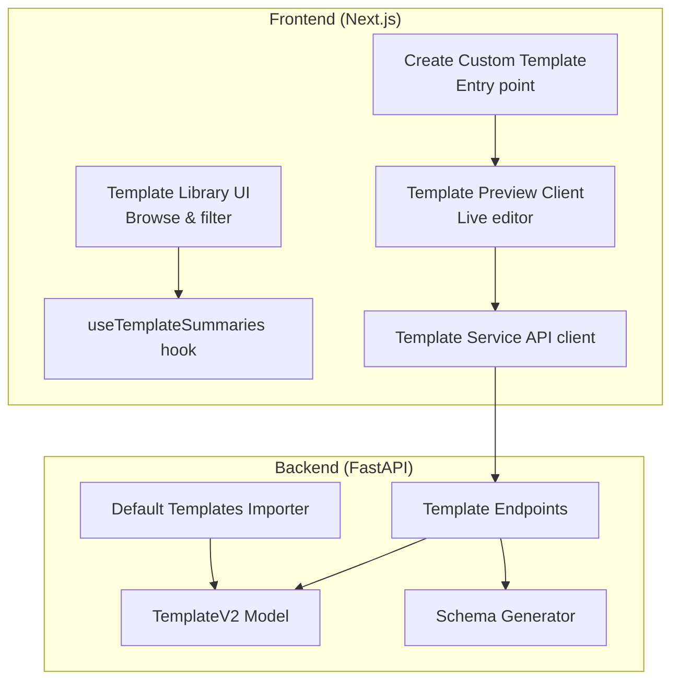
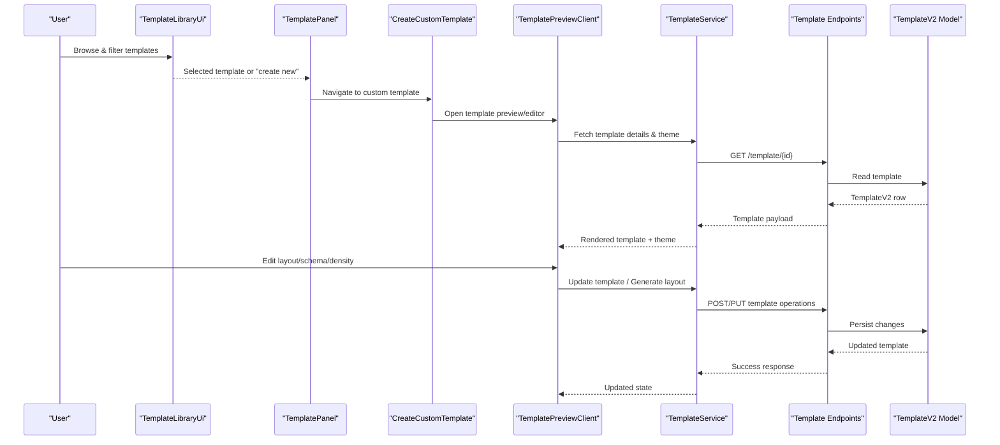
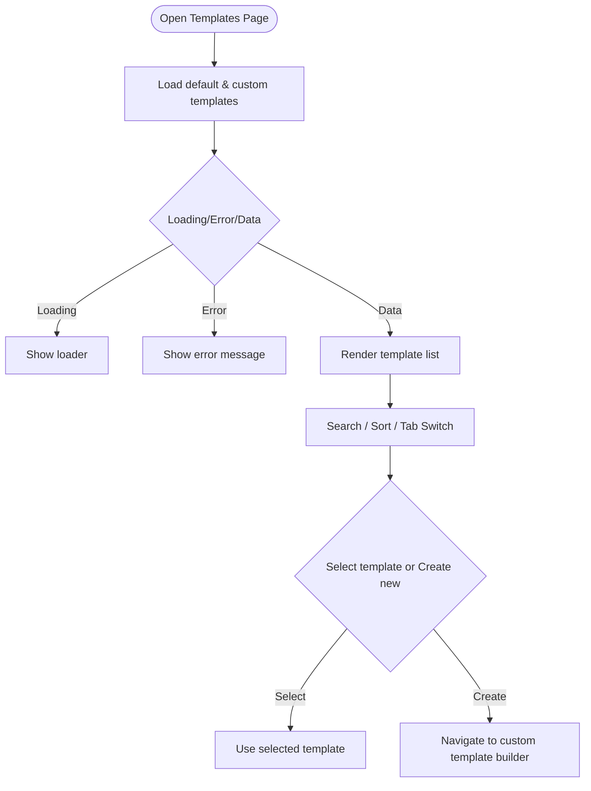
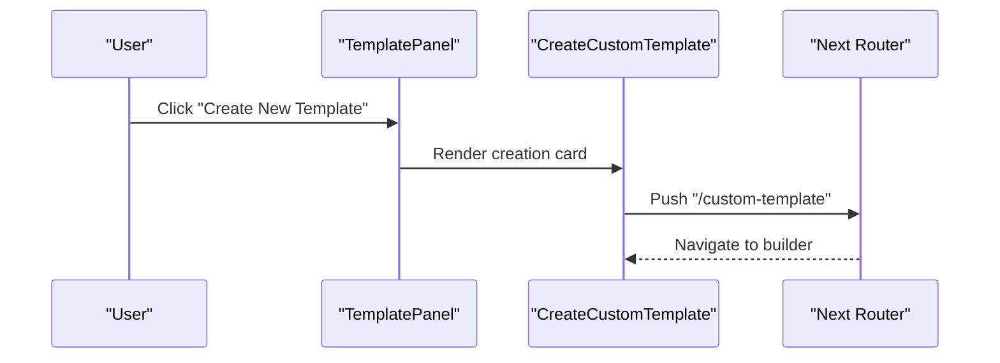
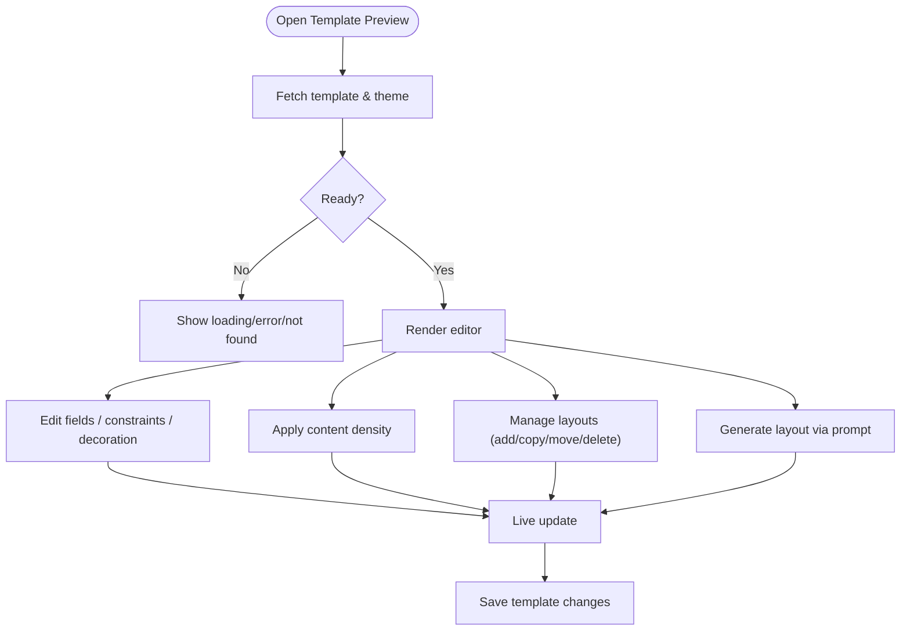
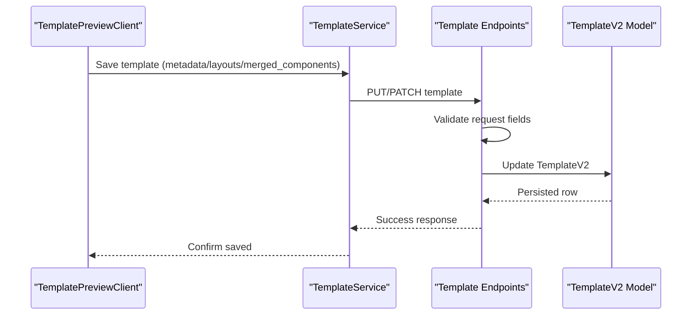
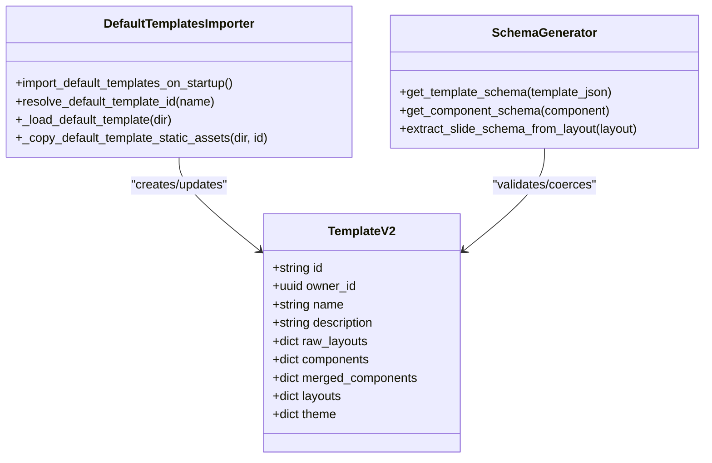
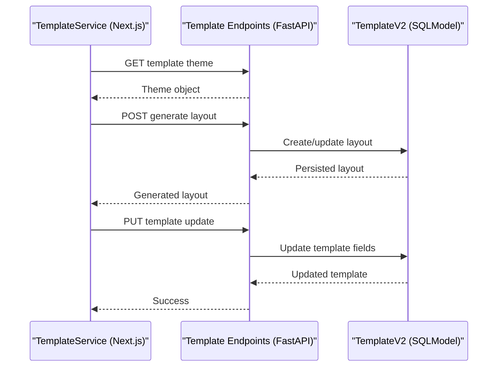
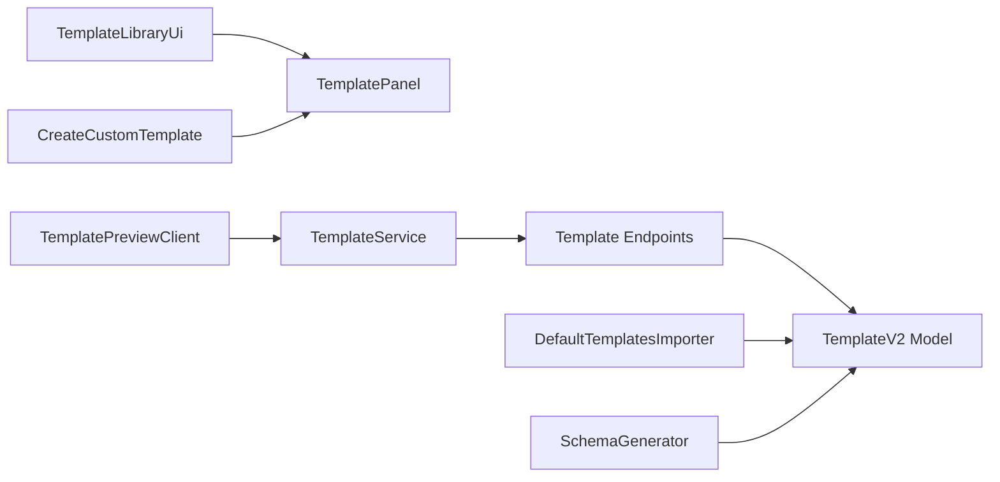

# Templates Module

<cite>
**Referenced Files in This Document**
- [servers/fastapi/templates/default_templates.py](file://servers/fastapi/templates/default_templates.py)
- [servers/fastapi/models/sql/template_v2.py](file://servers/fastapi/models/sql/template_v2.py)
- [servers/fastapi/templates/v2/schema.py](file://servers/fastapi/templates/v2/schema.py)
- [servers/fastapi/api/v1/ppt/endpoints/template.py](file://servers/fastapi/api/v1/ppt/endpoints/template.py)
- [servers/nextjs/app/(presentation-generator)/(dashboard)/templates/page.tsx](file://servers/nextjs/app/(presentation-generator)/(dashboard)/templates/page.tsx)
- [servers/nextjs/app/(presentation-generator)/(dashboard)/templates/components/TemplatePanel.tsx](file://servers/nextjs/app/(presentation-generator)/(dashboard)/templates/components/TemplatePanel.tsx)
- [servers/nextjs/app/(presentation-generator)/(dashboard)/templates/components/TemplateLibraryUi.tsx](file://servers/nextjs/app/(presentation-generator)/(dashboard)/templates/components/TemplateLibraryUi.tsx)
- [servers/nextjs/app/(presentation-generator)/(dashboard)/templates/components/CreateCustomTemplate.tsx](file://servers/nextjs/app/(presentation-generator)/(dashboard)/templates/components/CreateCustomTemplate.tsx)
- [servers/nextjs/app/(presentation-generator)/template-preview/page.tsx](file://servers/nextjs/app/(presentation-generator)/template-preview/page.tsx)
- [servers/nextjs/app/(presentation-generator)/template-preview/components/TemplatePreviewClient.tsx](file://servers/nextjs/app/(presentation-generator)/template-preview/components/TemplatePreviewClient.tsx)
- [servers/nextjs/app/(presentation-generator)/template-preview/components/editor/TemplatePreviewStates.tsx](file://servers/nextjs/app/(presentation-generator)/template-preview/components/editor/TemplatePreviewStates.tsx)
- [servers/nextjs/app/(presentation-generator)/custom-template/page.tsx](file://servers/nextjs/app/(presentation-generator)/custom-template/page.tsx)
- [servers/nextjs/app/(presentation-generator)/hooks/useTemplateSummaries.ts](file://servers/nextjs/app/(presentation-generator)/hooks/useTemplateSummaries.ts)
- [servers/nextjs/app/(presentation-generator)/services/api/template.ts](file://servers/nextjs/app/(presentation-generator)/services/api/template.ts)
</cite>

## Table of Contents
1. [Introduction](#introduction)
2. [Project Structure](#project-structure)
3. [Core Components](#core-components)
4. [Architecture Overview](#architecture-overview)
5. [Detailed Component Analysis](#detailed-component-analysis)
6. [Dependency Analysis](#dependency-analysis)
7. [Performance Considerations](#performance-considerations)
8. [Troubleshooting Guide](#troubleshooting-guide)
9. [Conclusion](#conclusion)

## Introduction
This document explains the Templates module, covering how users browse templates, create custom templates, preview and edit them, and publish changes. It also documents the template data model, validation rules for editable content, and integration between the Next.js frontend and the FastAPI backend services.

## Project Structure
The Templates module spans both the backend (FastAPI) and the frontend (Next.js):

- Backend:
  - Default template import and asset handling
  - Template V2 database model
  - Editable content schema generation from layouts
  - API endpoints for template updates and layout generation

- Frontend:
  - Template library browsing and filtering
  - Custom template creation entry points
  - Live template preview and editor
  - Services and hooks for fetching and managing templates

**Diagram sources**
- [servers/nextjs/app/(presentation-generator)/(dashboard)/templates/components/TemplateLibraryUi.tsx:1-78](file://servers/nextjs/app/(presentation-generator)/(dashboard)/templates/components/TemplateLibraryUi.tsx#L1-L78)
- [servers/nextjs/app/(presentation-generator)/(dashboard)/templates/components/CreateCustomTemplate.tsx:1-138](file://servers/nextjs/app/(presentation-generator)/(dashboard)/templates/components/CreateCustomTemplate.tsx#L1-L138)
- [servers/nextjs/app/(presentation-generator)/template-preview/components/TemplatePreviewClient.tsx:1-800](file://servers/nextjs/app/(presentation-generator)/template-preview/components/TemplatePreviewClient.tsx#L1-L800)
- [servers/nextjs/app/(presentation-generator)/services/api/template.ts:328-347](file://servers/nextjs/app/(presentation-generator)/services/api/template.ts#L328-L347)
- [servers/nextjs/app/(presentation-generator)/hooks/useTemplateSummaries.ts:183-210](file://servers/nextjs/app/(presentation-generator)/hooks/useTemplateSummaries.ts#L183-L210)
- [servers/fastapi/templates/default_templates.py:21-54](file://servers/fastapi/templates/default_templates.py#L21-L54)
- [servers/fastapi/models/sql/template_v2.py:16-42](file://servers/fastapi/models/sql/template_v2.py#L16-L42)
- [servers/fastapi/templates/v2/schema.py:183-279](file://servers/fastapi/templates/v2/schema.py#L183-L279)
- [servers/fastapi/api/v1/ppt/endpoints/template.py:1995-2030](file://servers/fastapi/api/v1/ppt/endpoints/template.py#L1995-L2030)

**Section sources**
- [servers/nextjs/app/(presentation-generator)/(dashboard)/templates/page.tsx:1-22](file://servers/nextjs/app/(presentation-generator)/(dashboard)/templates/page.tsx#L1-L22)
- [servers/nextjs/app/(presentation-generator)/template-preview/page.tsx:1-30](file://servers/nextjs/app/(presentation-generator)/template-preview/page.tsx#L1-L30)
- [servers/nextjs/app/(presentation-generator)/custom-template/page.tsx:1-18](file://servers/nextjs/app/(presentation-generator)/custom-template/page.tsx#L1-L18)

## Core Components
- Template Library UI: Provides search, sorting, and tab switching to browse default and custom templates.
- Create Custom Template: Entry point that navigates to the template builder.
- Template Preview Client: Full live editor with layout management, schema editing, density preview, and save operations.
- Template Service API Client: Encapsulates calls to backend endpoints for theme retrieval, layout generation, and template updates.
- useTemplateSummaries Hook: Aggregates default and custom templates and tracks processing tasks.
- Default Templates Importer: Loads bundled templates into the database and copies static assets.
- TemplateV2 Model: Database representation of a template including metadata, layouts, components, and theme.
- Schema Generator: Derives JSON schemas for editable content from template layouts.
- Template Endpoints: Validate and persist template updates and generate new layouts.

**Section sources**
- [servers/nextjs/app/(presentation-generator)/(dashboard)/templates/components/TemplateLibraryUi.tsx:1-78](file://servers/nextjs/app/(presentation-generator)/(dashboard)/templates/components/TemplateLibraryUi.tsx#L1-L78)
- [servers/nextjs/app/(presentation-generator)/(dashboard)/templates/components/CreateCustomTemplate.tsx:1-138](file://servers/nextjs/app/(presentation-generator)/(dashboard)/templates/components/CreateCustomTemplate.tsx#L1-L138)
- [servers/nextjs/app/(presentation-generator)/template-preview/components/TemplatePreviewClient.tsx:1-800](file://servers/nextjs/app/(presentation-generator)/template-preview/components/TemplatePreviewClient.tsx#L1-L800)
- [servers/nextjs/app/(presentation-generator)/services/api/template.ts:328-347](file://servers/nextjs/app/(presentation-generator)/services/api/template.ts#L328-L347)
- [servers/nextjs/app/(presentation-generator)/hooks/useTemplateSummaries.ts:183-210](file://servers/nextjs/app/(presentation-generator)/hooks/useTemplateSummaries.ts#L183-L210)
- [servers/fastapi/templates/default_templates.py:21-54](file://servers/fastapi/templates/default_templates.py#L21-L54)
- [servers/fastapi/models/sql/template_v2.py:16-42](file://servers/fastapi/models/sql/template_v2.py#L16-L42)
- [servers/fastapi/templates/v2/schema.py:183-279](file://servers/fastapi/templates/v2/schema.py#L183-L279)
- [servers/fastapi/api/v1/ppt/endpoints/template.py:1995-2030](file://servers/fastapi/api/v1/ppt/endpoints/template.py#L1995-L2030)

## Architecture Overview
The Templates module follows a layered architecture:

- Presentation Layer (Next.js):
  - Template library browsing and selection
  - Custom template creation flow
  - Live preview and editor with real-time schema and density controls
- Application Layer (FastAPI):
  - Template persistence via TemplateV2 model
  - Validation and transformation of template payloads
  - Generation of editable content schemas from layouts
  - Asset management for default templates

**Diagram sources**
- [servers/nextjs/app/(presentation-generator)/(dashboard)/templates/components/TemplateLibraryUi.tsx:1-78](file://servers/nextjs/app/(presentation-generator)/(dashboard)/templates/components/TemplateLibraryUi.tsx#L1-L78)
- [servers/nextjs/app/(presentation-generator)/(dashboard)/templates/components/TemplatePanel.tsx:129-152](file://servers/nextjs/app/(presentation-generator)/(dashboard)/templates/components/TemplatePanel.tsx#L129-L152)
- [servers/nextjs/app/(presentation-generator)/(dashboard)/templates/components/CreateCustomTemplate.tsx:1-138](file://servers/nextjs/app/(presentation-generator)/(dashboard)/templates/components/CreateCustomTemplate.tsx#L1-L138)
- [servers/nextjs/app/(presentation-generator)/template-preview/components/TemplatePreviewClient.tsx:1-800](file://servers/nextjs/app/(presentation-generator)/template-preview/components/TemplatePreviewClient.tsx#L1-L800)
- [servers/nextjs/app/(presentation-generator)/services/api/template.ts:328-347](file://servers/nextjs/app/(presentation-generator)/services/api/template.ts#L328-L347)
- [servers/fastapi/api/v1/ppt/endpoints/template.py:1995-2030](file://servers/fastapi/api/v1/ppt/endpoints/template.py#L1995-L2030)
- [servers/fastapi/models/sql/template_v2.py:16-42](file://servers/fastapi/models/sql/template_v2.py#L16-L42)

## Detailed Component Analysis

### Template Selection Interface
- The template selection interface is composed of:
  - TemplatePanel: Orchestrates tabs, query, sort, and renders either the library or the custom template creation card.
  - TemplateLibraryUi: Implements search input, dropdown sort options, and comparison logic for sorting by name or date.
  - CreateCustomTemplate: Renders a prominent card/button to start building a custom template and navigates to the builder.

Key behaviors:
- Sorting supports ascending/descending by name and newest/oldest by created_at.
- The panel shows loading, error, and empty states while fetching templates.
- Users can switch between default and custom templates and initiate creation.

**Diagram sources**
- [servers/nextjs/app/(presentation-generator)/(dashboard)/templates/components/TemplatePanel.tsx:129-152](file://servers/nextjs/app/(presentation-generator)/(dashboard)/templates/components/TemplatePanel.tsx#L129-L152)
- [servers/nextjs/app/(presentation-generator)/(dashboard)/templates/components/TemplateLibraryUi.tsx:1-78](file://servers/nextjs/app/(presentation-generator)/(dashboard)/templates/components/TemplateLibraryUi.tsx#L1-L78)
- [servers/nextjs/app/(presentation-generator)/(dashboard)/templates/components/CreateCustomTemplate.tsx:1-138](file://servers/nextjs/app/(presentation-generator)/(dashboard)/templates/components/CreateCustomTemplate.tsx#L1-L138)

**Section sources**
- [servers/nextjs/app/(presentation-generator)/(dashboard)/templates/components/TemplatePanel.tsx:129-152](file://servers/nextjs/app/(presentation-generator)/(dashboard)/templates/components/TemplatePanel.tsx#L129-L152)
- [servers/nextjs/app/(presentation-generator)/(dashboard)/templates/components/TemplateLibraryUi.tsx:1-78](file://servers/nextjs/app/(presentation-generator)/(dashboard)/templates/components/TemplateLibraryUi.tsx#L1-L78)
- [servers/nextjs/app/(presentation-generator)/(dashboard)/templates/components/CreateCustomTemplate.tsx:1-138](file://servers/nextjs/app/(presentation-generator)/(dashboard)/templates/components/CreateCustomTemplate.tsx#L1-L138)

### Template Creation Wizard
- Entry points:
  - From the template library page, clicking “Create New Template” opens the builder.
  - From the outline selection page, a “Build Templates” card triggers navigation to the builder.
- Behavior:
  - Tracks analytics events when opening the builder.
  - Navigates to the custom-template route.

**Diagram sources**
- [servers/nextjs/app/(presentation-generator)/(dashboard)/templates/components/TemplatePanel.tsx:129-152](file://servers/nextjs/app/(presentation-generator)/(dashboard)/templates/components/TemplatePanel.tsx#L129-L152)
- [servers/nextjs/app/(presentation-generator)/(dashboard)/templates/components/CreateCustomTemplate.tsx:1-138](file://servers/nextjs/app/(presentation-generator)/(dashboard)/templates/components/CreateCustomTemplate.tsx#L1-L138)
- [servers/nextjs/app/(presentation-generator)/custom-template/page.tsx:1-18](file://servers/nextjs/app/(presentation-generator)/custom-template/page.tsx#L1-L18)

**Section sources**
- [servers/nextjs/app/(presentation-generator)/(dashboard)/templates/components/CreateCustomTemplate.tsx:1-138](file://servers/nextjs/app/(presentation-generator)/(dashboard)/templates/components/CreateCustomTemplate.tsx#L1-L138)
- [servers/nextjs/app/(presentation-generator)/custom-template/page.tsx:1-18](file://servers/nextjs/app/(presentation-generator)/custom-template/page.tsx#L1-L18)

### Live Preview System
- The Template Preview Client provides:
  - Loading, error, and not-found states.
  - Theme resolution and font loading.
  - Layout selection, duplication, move, delete, and blank layout creation.
  - Schema field editing, constraint updates, and decorative toggles.
  - Content density simulation and canvas edits merging.
  - AI-assisted layout reconstruction via prompts.
  - Save workflow to persist changes.

**Diagram sources**
- [servers/nextjs/app/(presentation-generator)/template-preview/components/TemplatePreviewClient.tsx:1-800](file://servers/nextjs/app/(presentation-generator)/template-preview/components/TemplatePreviewClient.tsx#L1-L800)
- [servers/nextjs/app/(presentation-generator)/template-preview/components/editor/TemplatePreviewStates.tsx:1-54](file://servers/nextjs/app/(presentation-generator)/template-preview/components/editor/TemplatePreviewStates.tsx#L1-L54)

**Section sources**
- [servers/nextjs/app/(presentation-generator)/template-preview/components/TemplatePreviewClient.tsx:1-800](file://servers/nextjs/app/(presentation-generator)/template-preview/components/TemplatePreviewClient.tsx#L1-L800)
- [servers/nextjs/app/(presentation-generator)/template-preview/components/editor/TemplatePreviewStates.tsx:1-54](file://servers/nextjs/app/(presentation-generator)/template-preview/components/editor/TemplatePreviewStates.tsx#L1-L54)

### Template Publishing Process
- Publishing corresponds to saving template changes:
  - The preview client coordinates local state updates and then persists via the Template Service.
  - The service calls backend endpoints to update template metadata, merged components, and layouts.
  - The backend validates inputs, coerces structures, and writes to the database.

**Diagram sources**
- [servers/nextjs/app/(presentation-generator)/template-preview/components/TemplatePreviewClient.tsx:1-800](file://servers/nextjs/app/(presentation-generator)/template-preview/components/TemplatePreviewClient.tsx#L1-L800)
- [servers/nextjs/app/(presentation-generator)/services/api/template.ts:328-347](file://servers/nextjs/app/(presentation-generator)/services/api/template.ts#L328-L347)
- [servers/fastapi/api/v1/ppt/endpoints/template.py:1995-2030](file://servers/fastapi/api/v1/ppt/endpoints/template.py#L1995-L2030)
- [servers/fastapi/models/sql/template_v2.py:16-42](file://servers/fastapi/models/sql/template_v2.py#L16-L42)

**Section sources**
- [servers/nextjs/app/(presentation-generator)/services/api/template.ts:328-347](file://servers/nextjs/app/(presentation-generator)/services/api/template.ts#L328-L347)
- [servers/fastapi/api/v1/ppt/endpoints/template.py:1995-2030](file://servers/fastapi/api/v1/ppt/endpoints/template.py#L1995-L2030)

### Template Data Structure and Validation Rules
- TemplateV2 model fields include:
  - id, owner_id, name, description
  - raw_layouts, components, merged_components, layouts, theme
  - Additional metadata such as assets and timestamps (as defined in the model)
- Default templates importer:
  - Reads bundled template.json files, rewrites static asset URLs, coerces layouts and merged components, and builds assets metadata.
  - Copies static assets into app data directory under a per-template path.
- Schema generator:
  - Converts slide layouts into JSON schemas for editable content.
  - Supports text, image, text-list, table, chart, infographic elements.
  - Computes table text capacity limits based on typography and dimensions.
  - Handles repeated children groups and normalizes component schemas.

**Diagram sources**
- [servers/fastapi/models/sql/template_v2.py:16-42](file://servers/fastapi/models/sql/template_v2.py#L16-L42)
- [servers/fastapi/templates/default_templates.py:112-138](file://servers/fastapi/templates/default_templates.py#L112-L138)
- [servers/fastapi/templates/default_templates.py:219-240](file://servers/fastapi/templates/default_templates.py#L219-L240)
- [servers/fastapi/templates/default_templates.py:294-306](file://servers/fastapi/templates/default_templates.py#L294-L306)
- [servers/fastapi/templates/v2/schema.py:183-279](file://servers/fastapi/templates/v2/schema.py#L183-L279)
- [servers/fastapi/templates/v2/schema.py:361-423](file://servers/fastapi/templates/v2/schema.py#L361-L423)
- [servers/fastapi/templates/v2/schema.py:57-125](file://servers/fastapi/templates/v2/schema.py#L57-L125)

**Section sources**
- [servers/fastapi/models/sql/template_v2.py:16-42](file://servers/fastapi/models/sql/template_v2.py#L16-L42)
- [servers/fastapi/templates/default_templates.py:21-54](file://servers/fastapi/templates/default_templates.py#L21-L54)
- [servers/fastapi/templates/default_templates.py:112-138](file://servers/fastapi/templates/default_templates.py#L112-L138)
- [servers/fastapi/templates/default_templates.py:219-240](file://servers/fastapi/templates/default_templates.py#L219-L240)
- [servers/fastapi/templates/default_templates.py:294-306](file://servers/fastapi/templates/default_templates.py#L294-L306)
- [servers/fastapi/templates/v2/schema.py:183-279](file://servers/fastapi/templates/v2/schema.py#L183-L279)
- [servers/fastapi/templates/v2/schema.py:361-423](file://servers/fastapi/templates/v2/schema.py#L361-L423)
- [servers/fastapi/templates/v2/schema.py:57-125](file://servers/fastapi/templates/v2/schema.py#L57-L125)

### Integration with Backend Template Service
- Frontend TemplateService encapsulates:
  - Retrieving template themes
  - Generating layouts via prompts
  - Updating template metadata and layouts
- Backend endpoints:
  - Validate incoming requests (e.g., name, description, merged_components, layouts).
  - Coerce and validate merged_components and layouts using Pydantic models.
  - Persist changes to TemplateV2 rows.

**Diagram sources**
- [servers/nextjs/app/(presentation-generator)/services/api/template.ts:328-347](file://servers/nextjs/app/(presentation-generator)/services/api/template.ts#L328-L347)
- [servers/fastapi/api/v1/ppt/endpoints/template.py:1995-2030](file://servers/fastapi/api/v1/ppt/endpoints/template.py#L1995-L2030)
- [servers/fastapi/models/sql/template_v2.py:16-42](file://servers/fastapi/models/sql/template_v2.py#L16-L42)

**Section sources**
- [servers/nextjs/app/(presentation-generator)/services/api/template.ts:328-347](file://servers/nextjs/app/(presentation-generator)/services/api/template.ts#L328-L347)
- [servers/fastapi/api/v1/ppt/endpoints/template.py:1995-2030](file://servers/fastapi/api/v1/ppt/endpoints/template.py#L1995-L2030)

## Dependency Analysis
- Frontend dependencies:
  - TemplateLibraryUi depends on shared UI primitives and template list components.
  - TemplatePanel composes TemplateLibraryControls and CreateCustomTemplate.
  - TemplatePreviewClient depends on TemplateService, useTemplateDetails, and editor utilities.
- Backend dependencies:
  - DefaultTemplatesImporter depends on TemplateV2 model and utility functions for environment and icon weights.
  - SchemaGenerator depends on layout models and infographic catalog.
  - Template endpoints depend on Pydantic validators and database session.

**Diagram sources**
- [servers/nextjs/app/(presentation-generator)/(dashboard)/templates/components/TemplateLibraryUi.tsx:1-78](file://servers/nextjs/app/(presentation-generator)/(dashboard)/templates/components/TemplateLibraryUi.tsx#L1-L78)
- [servers/nextjs/app/(presentation-generator)/(dashboard)/templates/components/TemplatePanel.tsx:129-152](file://servers/nextjs/app/(presentation-generator)/(dashboard)/templates/components/TemplatePanel.tsx#L129-L152)
- [servers/nextjs/app/(presentation-generator)/(dashboard)/templates/components/CreateCustomTemplate.tsx:1-138](file://servers/nextjs/app/(presentation-generator)/(dashboard)/templates/components/CreateCustomTemplate.tsx#L1-L138)
- [servers/nextjs/app/(presentation-generator)/template-preview/components/TemplatePreviewClient.tsx:1-800](file://servers/nextjs/app/(presentation-generator)/template-preview/components/TemplatePreviewClient.tsx#L1-L800)
- [servers/nextjs/app/(presentation-generator)/services/api/template.ts:328-347](file://servers/nextjs/app/(presentation-generator)/services/api/template.ts#L328-L347)
- [servers/fastapi/api/v1/ppt/endpoints/template.py:1995-2030](file://servers/fastapi/api/v1/ppt/endpoints/template.py#L1995-L2030)
- [servers/fastapi/models/sql/template_v2.py:16-42](file://servers/fastapi/models/sql/template_v2.py#L16-L42)
- [servers/fastapi/templates/default_templates.py:21-54](file://servers/fastapi/templates/default_templates.py#L21-L54)
- [servers/fastapi/templates/v2/schema.py:183-279](file://servers/fastapi/templates/v2/schema.py#L183-L279)

**Section sources**
- [servers/nextjs/app/(presentation-generator)/hooks/useTemplateSummaries.ts:183-210](file://servers/nextjs/app/(presentation-generator)/hooks/useTemplateSummaries.ts#L183-L210)
- [servers/fastapi/templates/default_templates.py:21-54](file://servers/fastapi/templates/default_templates.py#L21-L54)
- [servers/fastapi/templates/v2/schema.py:183-279](file://servers/fastapi/templates/v2/schema.py#L183-L279)

## Performance Considerations
- Avoid unnecessary re-renders in the preview editor by memoizing computed values like theme and preview layouts.
- Defer heavy operations (font loading, Tailwind script injection) until needed.
- Batch template updates and avoid frequent small writes; prefer consolidated saves.
- On the backend, validate early and fail fast to reduce round-trips.

[No sources needed since this section provides general guidance]

## Troubleshooting Guide
Common issues and resolutions:
- Template not found:
  - Ensure the template ID exists and is accessible.
  - Check network errors and backend availability.
- Error loading template:
  - Verify authentication and permissions.
  - Inspect backend logs for validation errors.
- Cannot create slide via prompt:
  - Ensure a blank layout exists and is available.
  - Check backend response structure and error messages.

**Section sources**
- [servers/nextjs/app/(presentation-generator)/template-preview/components/editor/TemplatePreviewStates.tsx:1-54](file://servers/nextjs/app/(presentation-generator)/template-preview/components/editor/TemplatePreviewStates.tsx#L1-L54)
- [servers/nextjs/app/(presentation-generator)/template-preview/components/TemplatePreviewClient.tsx:622-715](file://servers/nextjs/app/(presentation-generator)/template-preview/components/TemplatePreviewClient.tsx#L622-L715)

## Conclusion
The Templates module integrates a robust frontend experience with a validated backend pipeline. Users can browse and select templates, build custom ones, and iteratively refine layouts through a live preview system. The TemplateV2 model and schema generator ensure consistent data structures and validation, while the default templates importer streamlines bundling and deployment of built-in templates.

[No sources needed since this section summarizes without analyzing specific files]