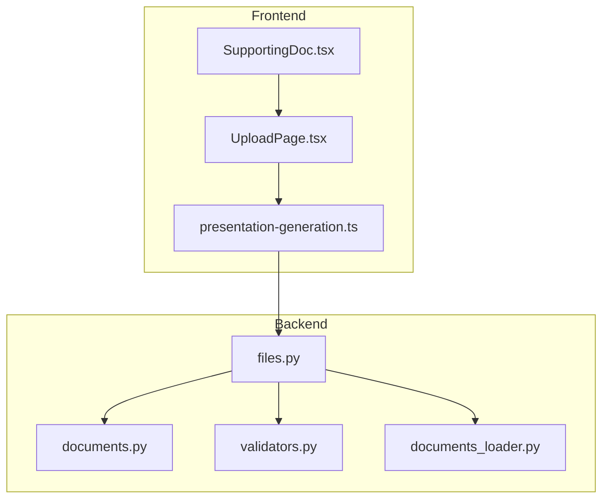
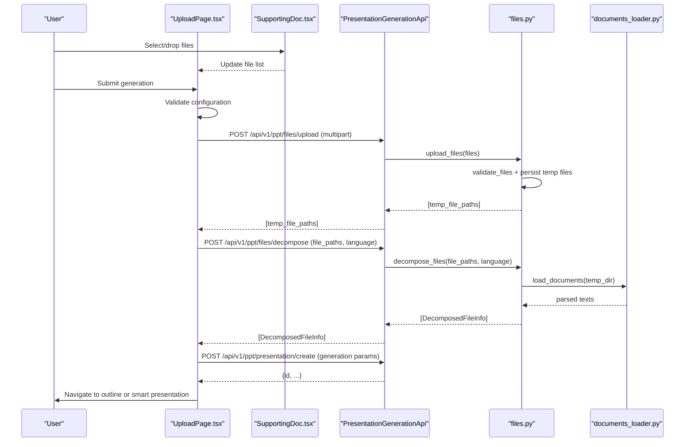
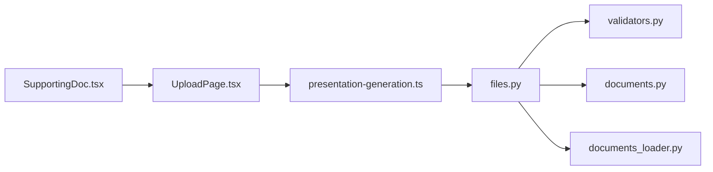

# Upload Module

<cite>
**Referenced Files in This Document**
- [UploadPage.tsx](file://servers/nextjs/app/(presentation-generator)/upload/components/UploadPage.tsx)
- [SupportingDoc.tsx](file://servers/nextjs/app/(presentation-generator)/upload/components/SupportingDoc.tsx)
- [presentation-generation.ts](file://servers/nextjs/app/(presentation-generator)/services/api/presentation-generation.ts)
- [files.py](file://servers/fastapi/api/v1/ppt/endpoints/files.py)
- [documents.py](file://servers/fastapi/constants/documents.py)
- [validators.py](file://servers/fastapi/utils/validators.py)
- [documents_loader.py](file://servers/fastapi/services/documents_loader.py)
</cite>

## Table of Contents
1. [Introduction](#introduction)
2. [Project Structure](#project-structure)
3. [Core Components](#core-components)
4. [Architecture Overview](#architecture-overview)
5. [Detailed Component Analysis](#detailed-component-analysis)
6. [Dependency Analysis](#dependency-analysis)
7. [Performance Considerations](#performance-considerations)
8. [Troubleshooting Guide](#troubleshooting-guide)
9. [Conclusion](#conclusion)

## Introduction
This document explains the upload module that powers document processing and presentation generation from uploaded files. It covers the user-facing upload interface, supported file formats, validation rules, progress feedback, configuration options for generation parameters, error handling, and how the frontend integrates with the backend document processing service. It also provides end-to-end workflows for different upload scenarios and a troubleshooting guide for common issues.

## Project Structure
The upload feature spans both the Next.js frontend and the FastAPI backend:

- Frontend (Next.js)
  - Upload UI and orchestration: UploadPage component
  - File attachment UI: SupportingDoc component
  - API client: PresentationGenerationApi class
- Backend (FastAPI)
  - File endpoints: upload, MCP base64 upload, decompose, update
  - Accepted types and MIME constants
  - Validators for size and type checks
  - Documents loader for parsing and OCR

**Diagram sources**
- [UploadPage.tsx:151-692](file://servers/nextjs/app/(presentation-generator)/upload/components/UploadPage.tsx#L151-L692)
- [SupportingDoc.tsx:27-143](file://servers/nextjs/app/(presentation-generator)/upload/components/SupportingDoc.tsx#L27-L143)
- [presentation-generation.ts:23-144](file://servers/nextjs/app/(presentation-generator)/services/api/presentation-generation.ts#L23-L144)
- [files.py:16-185](file://servers/fastapi/api/v1/ppt/endpoints/files.py#L16-L185)
- [documents.py:1-89](file://servers/fastapi/constants/documents.py#L1-L89)
- [validators.py:8-49](file://servers/fastapi/utils/validators.py#L8-L49)
- [documents_loader.py:163-358](file://servers/fastapi/services/documents_loader.py#L163-L358)

**Section sources**
- [UploadPage.tsx:151-692](file://servers/nextjs/app/(presentation-generator)/upload/components/UploadPage.tsx#L151-L692)
- [SupportingDoc.tsx:27-143](file://servers/nextjs/app/(presentation-generator)/upload/components/SupportingDoc.tsx#L27-L143)
- [presentation-generation.ts:23-144](file://servers/nextjs/app/(presentation-generator)/services/api/presentation-generation.ts#L23-L144)
- [files.py:16-185](file://servers/fastapi/api/v1/ppt/endpoints/files.py#L16-L185)
- [documents.py:1-89](file://servers/fastapi/constants/documents.py#L1-L89)
- [validators.py:8-49](file://servers/fastapi/utils/validators.py#L8-L49)
- [documents_loader.py:163-358](file://servers/fastapi/services/documents_loader.py#L163-L358)

## Core Components
- UploadPage (frontend): Orchestrates user input, validates configuration, triggers uploads, decomposes documents, and creates presentations. Manages loading states and navigation to outline or smart presentation views.
- SupportingDoc (frontend): Provides drag-and-drop and file picker UI, enforces allowed extensions and maximum file count, and notifies users on validation failures.
- PresentationGenerationApi (frontend): Encapsulates HTTP calls to upload files, decompose them, and create presentations with generation parameters.
- Files endpoints (backend): Accepts multipart uploads, decodes MCP base64 payloads, persists temp files, validates sizes/types, and decomposes documents into normalized text.
- Constants and validators (backend): Define accepted file types and enforce per-file size/type constraints.
- DocumentsLoader (backend): Parses PDFs, Office documents, images, and text; performs OCR when needed; cleans extracted content; supports fallback parsing.

Key responsibilities:
- File validation and acceptance
- Temporary storage and path management
- Document decomposition into plain text
- Generation parameter propagation
- User feedback and error handling

**Section sources**
- [UploadPage.tsx:151-692](file://servers/nextjs/app/(presentation-generator)/upload/components/UploadPage.tsx#L151-L692)
- [SupportingDoc.tsx:27-143](file://servers/nextjs/app/(presentation-generator)/upload/components/SupportingDoc.tsx#L27-L143)
- [presentation-generation.ts:23-144](file://servers/nextjs/app/(presentation-generator)/services/api/presentation-generation.ts#L23-L144)
- [files.py:16-185](file://servers/fastapi/api/v1/ppt/endpoints/files.py#L16-L185)
- [documents.py:1-89](file://servers/fastapi/constants/documents.py#L1-L89)
- [validators.py:8-49](file://servers/fastapi/utils/validators.py#L8-L49)
- [documents_loader.py:163-358](file://servers/fastapi/services/documents_loader.py#L163-L358)

## Architecture Overview
End-to-end flow from user upload to presentation creation:

**Diagram sources**
- [UploadPage.tsx:441-530](file://servers/nextjs/app/(presentation-generator)/upload/components/UploadPage.tsx#L441-L530)
- [presentation-generation.ts:23-144](file://servers/nextjs/app/(presentation-generator)/services/api/presentation-generation.ts#L23-L144)
- [files.py:79-185](file://servers/fastapi/api/v1/ppt/endpoints/files.py#L79-L185)
- [documents_loader.py:192-244](file://servers/fastapi/services/documents_loader.py#L192-L244)

## Detailed Component Analysis

### Frontend Upload Interface
- UploadPage orchestrates:
  - Configuration selection (language, tone, verbosity, slide count, table of contents, title slide, web search).
  - Generation mode selection (standard vs smart).
  - Community reference selection for smart mode.
  - Validation of required inputs (language, prompt or documents or community reference).
  - Progress overlay with messages and durations during upload and processing.
  - Navigation to outline or streaming smart presentation after successful creation.

- SupportingDoc handles:
  - Allowed extensions list and accept attribute.
  - Maximum file count enforcement.
  - Drag-and-drop and file picker integration.
  - User notifications for unsupported files and limits.

Supported formats (frontend allowlist):
- Word: .doc, .docx, .docm, .odt, .rtf
- PowerPoint: .ppt, .pptx, .pptm, .odp
- Spreadsheets: .xls, .xlsx, .xlsm, .ods, .csv, .tsv
- Images: .jpg, .jpeg, .png, .gif, .bmp, .tiff, .webp
- Text/PDF: .txt, .pdf

Validation and UX:
- Rejects unsupported extensions with an error notification.
- Limits total attachments to 8 files.
- Disables submit while processing.

Progress tracking:
- Shows an overlay loader with messages such as “Processing documents...” and “Generating presentation outline...”.
- Uses duration-based progress bars to indicate expected wait times.

Configuration options passed to generation:
- Content (prompt), version, n_slides, file_paths, language, tone, verbosity, instructions, include_table_of_contents, include_title_slide, web_search, generation_mode, community_design_ids.

Error handling:
- Catches errors during upload/decompose/create and displays user-friendly notifications.
- Tracks analytics events for validation failures and generation outcomes.

**Section sources**
- [UploadPage.tsx:151-692](file://servers/nextjs/app/(presentation-generator)/upload/components/UploadPage.tsx#L151-L692)
- [SupportingDoc.tsx:27-143](file://servers/nextjs/app/(presentation-generator)/upload/components/SupportingDoc.tsx#L27-L143)

### Backend File Endpoints
- POST /api/v1/ppt/files/upload
  - Validates presence of files.
  - Creates a temporary directory and writes each uploaded file to disk.
  - Enforces per-file size limit and accepted types via validators.
  - Returns array of temporary file paths.

- POST /api/v1/ppt/files/mcp-upload
  - Accepts base64-encoded files for clients that cannot send multipart bodies.
  - Decodes payload, enforces combined size limit (100 MiB), and delegates to upload endpoint.

- POST /api/v1/ppt/files/decompose
  - Resolves existing temp paths.
  - Separates .txt files from others.
  - Loads non-text documents using DocumentsLoader.
  - Writes parsed text to new temp files and returns DecomposedFileInfo entries.

- POST /api/v1/ppt/files/update
  - Updates an existing temp file with a new upload.

Size and type validation:
- Per-file size limit enforced by validators (default 100 MB).
- Accepted types defined in constants (MIME types and extensions).

**Section sources**
- [files.py:16-185](file://servers/fastapi/api/v1/ppt/endpoints/files.py#L16-L185)
- [validators.py:8-49](file://servers/fastapi/utils/validators.py#L8-L49)
- [documents.py:1-89](file://servers/fastapi/constants/documents.py#L1-L89)

### Document Processing Pipeline
DocumentsLoader processes multiple file categories:
- PDFs: Detects scanned PDFs and applies OCR at higher DPI when necessary.
- Office documents: Extracts text via office document service.
- Images: Converts to PNG and parses via LiteParse with OCR.
- Text: Reads plain text files.
- Fallback parsing: Uses LiteParse first, then optional lightweight fallback parser if available.

Parsing details:
- Cleans extracted content to remove wrapper JSON from LiteParse outputs.
- Normalizes line breaks and ensures UTF-8 encoding.
- Supports OCR language mapping based on presentation language.

Timeouts and resilience:
- Decompose timeout configured for long-running operations.
- Graceful fallback to alternative parsers when primary parsing fails.

**Section sources**
- [documents_loader.py:163-358](file://servers/fastapi/services/documents_loader.py#L163-L358)

### API Client Integration
PresentationGenerationApi exposes:
- uploadDoc: Sends multipart FormData to /api/v1/ppt/files/upload.
- decomposeDocuments: Sends file_paths and language to /api/v1/ppt/files/decompose.
- createPresentation: Sends full generation payload to /api/v1/ppt/presentation/create.

Response handling:
- Centralized error handling wrapper for consistent error messaging.
- Clamps slide counts to allowed ranges before sending to backend.

**Section sources**
- [presentation-generation.ts:23-144](file://servers/nextjs/app/(presentation-generator)/services/api/presentation-generation.ts#L23-L144)

## Dependency Analysis
High-level dependencies between components:

Coupling and cohesion:
- UploadPage depends on SupportingDoc for file selection and on PresentationGenerationApi for all backend interactions.
- PresentationGenerationApi is a thin HTTP client layer over FastAPI endpoints.
- files.py coordinates validation, persistence, and decomposition, delegating heavy parsing to DocumentsLoader.
- Constants and validators are shared across endpoints to ensure consistent behavior.

Potential circular dependencies:
- None detected; layers are clearly separated (UI -> API client -> endpoints -> services).

External integrations:
- LiteParseService and DocumentConversionService used by DocumentsLoader for parsing and OCR.
- Optional lightweight fallback parser for environments where primary parsing fails.

**Diagram sources**
- [UploadPage.tsx:151-692](file://servers/nextjs/app/(presentation-generator)/upload/components/UploadPage.tsx#L151-L692)
- [SupportingDoc.tsx:27-143](file://servers/nextjs/app/(presentation-generator)/upload/components/SupportingDoc.tsx#L27-L143)
- [presentation-generation.ts:23-144](file://servers/nextjs/app/(presentation-generator)/services/api/presentation-generation.ts#L23-L144)
- [files.py:16-185](file://servers/fastapi/api/v1/ppt/endpoints/files.py#L16-L185)
- [documents_loader.py:163-358](file://servers/fastapi/services/documents_loader.py#L163-L358)

**Section sources**
- [UploadPage.tsx:151-692](file://servers/nextjs/app/(presentation-generator)/upload/components/UploadPage.tsx#L151-L692)
- [SupportingDoc.tsx:27-143](file://servers/nextjs/app/(presentation-generator)/upload/components/SupportingDoc.tsx#L27-L143)
- [presentation-generation.ts:23-144](file://servers/nextjs/app/(presentation-generator)/services/api/presentation-generation.ts#L23-L144)
- [files.py:16-185](file://servers/fastapi/api/v1/ppt/endpoints/files.py#L16-L185)
- [documents_loader.py:163-358](file://servers/fastapi/services/documents_loader.py#L163-L358)

## Performance Considerations
- Large documents:
  - Decompose operation may take several minutes; UI shows progress and extra info indicating longer waits for large files.
  - OCR-enabled parsing increases CPU usage; scanned PDFs trigger higher DPI processing.
- Concurrency:
  - Decomposition runs per file; consider batching or queuing for many large attachments.
- Memory:
  - Temp files are written to disk; ensure sufficient disk space and cleanup policies.
- Timeouts:
  - Decompose timeout prevents indefinite hangs; tune based on environment capacity.

[No sources needed since this section provides general guidance]

## Troubleshooting Guide
Common issues and resolutions:

- Unsupported file format
  - Symptom: Error notification about unsupported files.
  - Cause: File extension not in the frontend allowlist or backend accepted types.
  - Resolution: Convert to a supported format (PDF, TXT, Word, PowerPoint, spreadsheets, or images).

- Too many files
  - Symptom: Warning about maximum file limit reached.
  - Cause: More than 8 files selected.
  - Resolution: Reduce attachments to 8 or fewer.

- Missing required inputs
  - Symptom: Validation warning requiring language, prompt, or documents/community reference.
  - Cause: Incomplete configuration before submission.
  - Resolution: Provide language, add a prompt or documents, or select a community reference in smart mode.

- File too large
  - Symptom: Error stating file exceeded max upload size.
  - Cause: Per-file size exceeds validator limit (default 100 MB).
  - Resolution: Split or compress the file, or reduce its size.

- Combined upload too large (MCP base64)
  - Symptom: Error indicating combined upload exceeds 100 MiB.
  - Cause: Base64 payload sum exceeds limit.
  - Resolution: Reduce number or size of files sent via MCP base64 upload.

- Parsing failure
  - Symptom: Error during decompose indicating failed to parse document.
  - Cause: Primary parser (LiteParse) failed and fallback unavailable or also failed.
  - Resolution: Ensure document integrity, try converting to PDF or plain text, or use a simpler file structure.

- Image provider unavailable
  - Symptom: Error notifying image provider unreachable.
  - Cause: Stock image provider API key or connectivity issue.
  - Resolution: Verify API keys and network access; retry later.

**Section sources**
- [SupportingDoc.tsx:34-58](file://servers/nextjs/app/(presentation-generator)/upload/components/SupportingDoc.tsx#L34-L58)
- [UploadPage.tsx:377-405](file://servers/nextjs/app/(presentation-generator)/upload/components/UploadPage.tsx#L377-L405)
- [validators.py:23-49](file://servers/fastapi/utils/validators.py#L23-L49)
- [files.py:45-75](file://servers/fastapi/api/v1/ppt/endpoints/files.py#L45-L75)
- [documents_loader.py:312-340](file://servers/fastapi/services/documents_loader.py#L312-L340)

## Conclusion
The upload module provides a robust, user-friendly pipeline for ingesting diverse document types, validating and preparing them for presentation generation, and integrating seamlessly with backend services for parsing and OCR. The frontend emphasizes clear validation, progress feedback, and flexible configuration, while the backend enforces strict safety and performance boundaries through validators, temp file management, and resilient parsing strategies. By following the workflows and troubleshooting steps outlined here, users and developers can reliably process uploads and generate high-quality presentations.