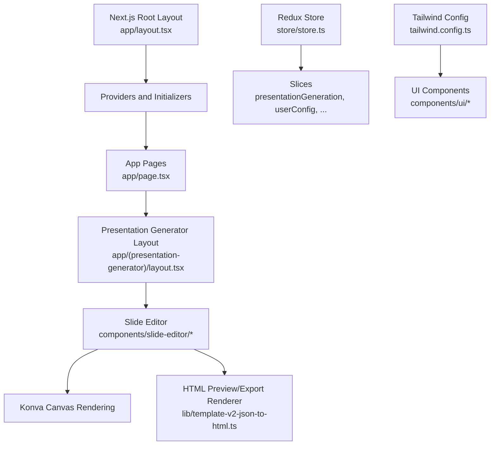
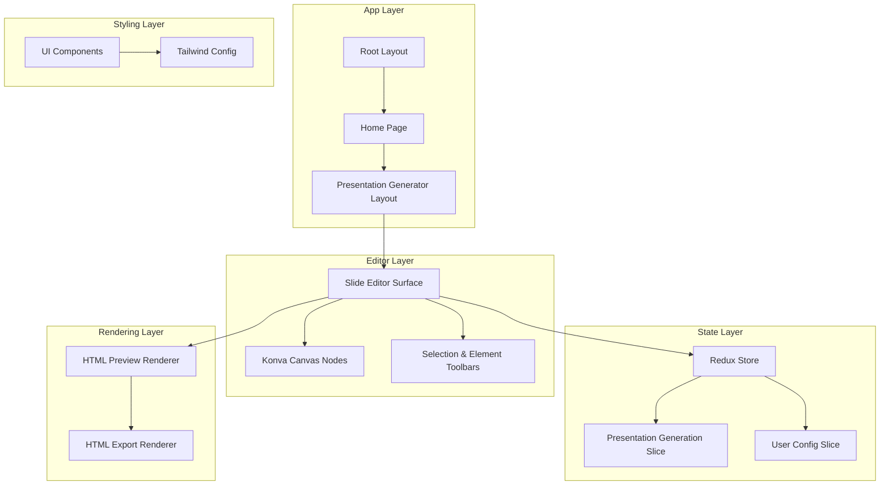
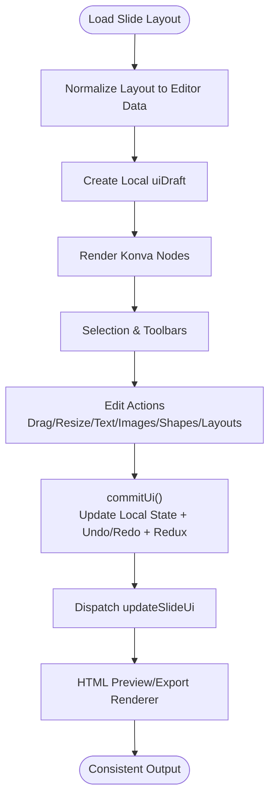
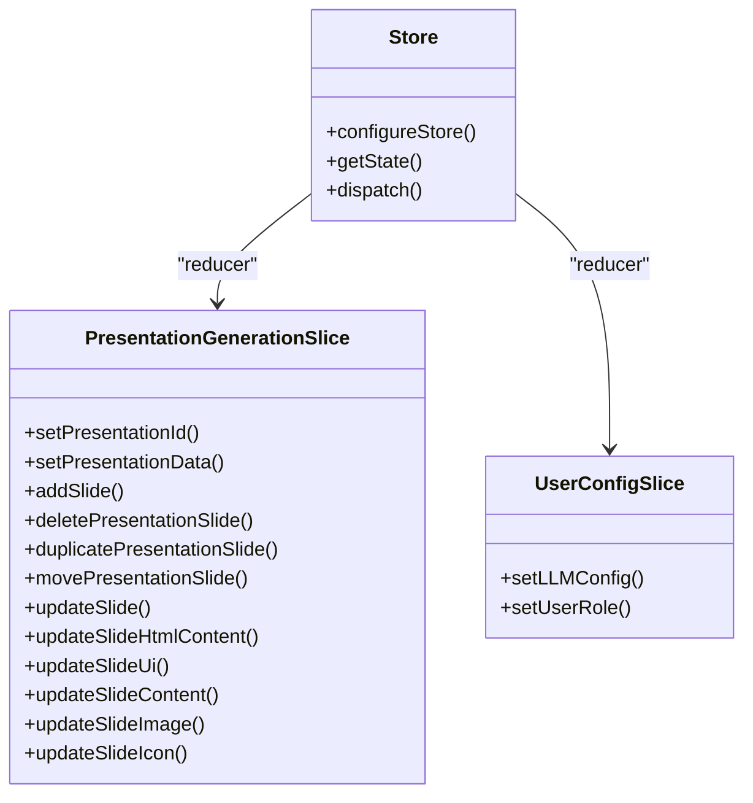
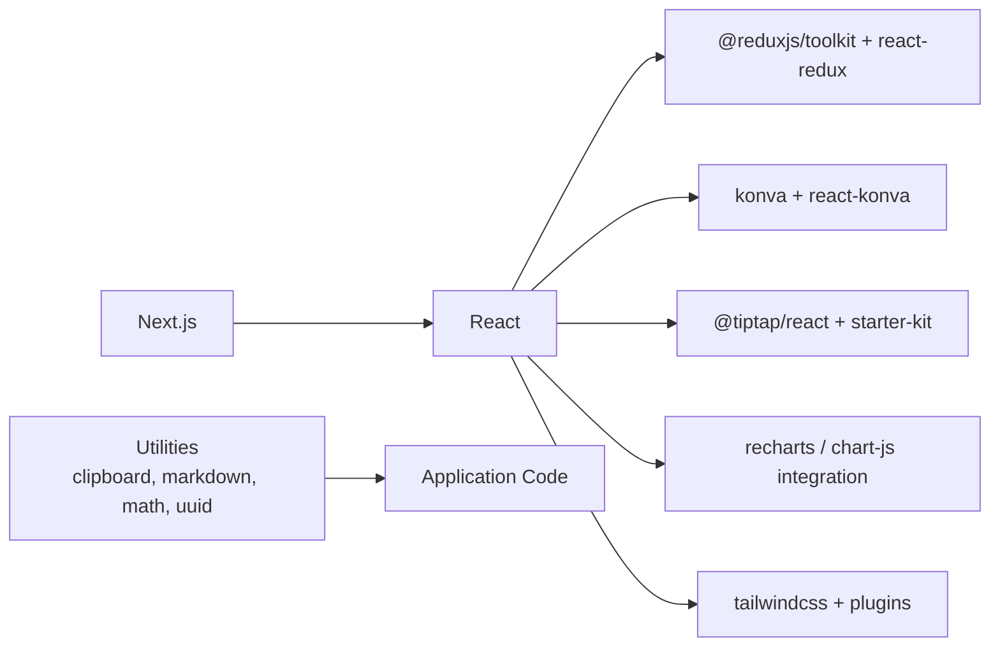

# Frontend Application

<cite>
**Referenced Files in This Document**
- [package.json](file://servers/nextjs/package.json)
- [layout.tsx](file://servers/nextjs/app/layout.tsx)
- [page.tsx](file://servers/nextjs/app/page.tsx)
- [presentation-generator layout.tsx](file://servers/nextjs/app/(presentation-generator)/layout.tsx)
- [store.ts](file://servers/nextjs/store/store.ts)
- [presentationGeneration.ts](file://servers/nextjs/store/slices/presentationGeneration.ts)
- [userConfig.ts](file://servers/nextjs/store/slices/userConfig.ts)
- [tailwind.config.ts](file://servers/nextjs/tailwind.config.ts)
- [slide-editor README.md](file://servers/nextjs/components/slide-editor/README.md)
- [types.ts](file://servers/nextjs/components/slide-editor/types.ts)
- [template-v2-json-to-html.ts](file://servers/nextjs/lib/template-v2-json-to-html.ts)
</cite>

## Table of Contents
1. [Introduction](#introduction)
2. [Project Structure](#project-structure)
3. [Core Components](#core-components)
4. [Architecture Overview](#architecture-overview)
5. [Detailed Component Analysis](#detailed-component-analysis)
6. [Dependency Analysis](#dependency-analysis)
7. [Performance Considerations](#performance-considerations)
8. [Troubleshooting Guide](#troubleshooting-guide)
9. [Conclusion](#conclusion)
10. [Appendices](#appendices)

## Introduction
This document explains the Presenton frontend application built with Next.js and React. It covers the application structure, routing organization, component hierarchy, slide editor powered by Konva, real-time preview and export rendering, state management with Redux Toolkit, UI components styled with Tailwind CSS, responsive design patterns, accessibility considerations, backend integration points, and guidelines for extending the UI consistently.

The presentation generator routes are protected by server-side session checks and initialize configuration before rendering application content. The slide editor is a JSON-driven system where Template V2 layouts are edited on a Konva canvas and also rendered to HTML for previews and exports. State is centralized using Redux Toolkit slices for presentation data, user configuration, upload progress, and undo/redo history.

## Project Structure
The Next.js frontend lives under `servers/nextjs`. Key areas:
- App Router pages and layouts under `app/`
- Shared UI components under `components/ui/`
- Slide editor implementation under `components/slide-editor/`
- Global store setup under `store/`
- Utilities and helpers under `lib/`, `utils/`, and `types/`
- Styling via Tailwind CSS configured in `tailwind.config.ts`

**Diagram sources**
- [layout.tsx:52-73](file://servers/nextjs/app/layout.tsx#L52-L73)
- [page.tsx:7-28](file://servers/nextjs/app/page.tsx#L7-L28)
- [presentation-generator layout.tsx:6-13](file://servers/nextjs/app/(presentation-generator)/layout.tsx#L6-L13)
- [slide-editor README.md:13-35](file://servers/nextjs/components/slide-editor/README.md#L13-L35)
- [template-v2-json-to-html.ts:156-186](file://servers/nextjs/lib/template-v2-json-to-html.ts#L156-L186)
- [store.ts:7-14](file://servers/nextjs/store/store.ts#L7-L14)
- [tailwind.config.ts:1-11](file://servers/nextjs/tailwind.config.ts#L1-L11)

**Section sources**
- [layout.tsx:52-73](file://servers/nextjs/app/layout.tsx#L52-L73)
- [page.tsx:7-28](file://servers/nextjs/app/page.tsx#L7-L28)
- [presentation-generator layout.tsx:6-13](file://servers/nextjs/app/(presentation-generator)/layout.tsx#L6-L13)
- [tailwind.config.ts:1-11](file://servers/nextjs/tailwind.config.ts#L1-L11)

## Core Components
- Root layout initializes global providers, metadata, analytics, theme runtime, and toast notifications.
- Home page conditionally renders the main application or an authentication gate based on auth configuration and server-side status.
- Presentation generator layout enforces app session requirements and wraps children with configuration initialization.
- Redux store composes multiple slices for presentation generation state, user configuration, upload state, and undo/redo.
- Slide editor provides a rich, JSON-driven editing experience backed by Konva and dual rendering paths (canvas editor and HTML preview/export).
- Tailwind configuration defines design tokens, animations, typography plugin, and dark mode strategy.

Key responsibilities:
- Routing and protection: root layout, home page, presentation generator layout.
- State: Redux store and slices.
- Editor: slide editor modules and types.
- Styling: Tailwind config and UI components.

**Section sources**
- [layout.tsx:52-73](file://servers/nextjs/app/layout.tsx#L52-L73)
- [page.tsx:7-28](file://servers/nextjs/app/page.tsx#L7-L28)
- [presentation-generator layout.tsx:6-13](file://servers/nextjs/app/(presentation-generator)/layout.tsx#L6-L13)
- [store.ts:7-14](file://servers/nextjs/store/store.ts#L7-L14)
- [slide-editor README.md:13-35](file://servers/nextjs/components/slide-editor/README.md#L13-L35)
- [tailwind.config.ts:1-11](file://servers/nextjs/tailwind.config.ts#L1-L11)

## Architecture Overview
The frontend architecture follows a layered approach:
- App layer: Next.js App Router pages and layouts handle routing, authentication gating, and configuration initialization.
- Editor layer: Slide editor components render and manipulate Template V2 layouts on a Konva canvas.
- State layer: Redux Toolkit slices manage presentation data, user preferences, and UI state.
- Rendering layer: HTML preview/export renderer converts Template V2 JSON into HTML for non-editable views and exports.
- Styling layer: Tailwind CSS provides utility classes and design tokens across the UI.

**Diagram sources**
- [layout.tsx:52-73](file://servers/nextjs/app/layout.tsx#L52-L73)
- [page.tsx:7-28](file://servers/nextjs/app/page.tsx#L7-L28)
- [presentation-generator layout.tsx:6-13](file://servers/nextjs/app/(presentation-generator)/layout.tsx#L6-L13)
- [slide-editor README.md:13-35](file://servers/nextjs/components/slide-editor/README.md#L13-L35)
- [template-v2-json-to-html.ts:156-186](file://servers/nextjs/lib/template-v2-json-to-html.ts#L156-L186)
- [store.ts:7-14](file://servers/nextjs/store/store.ts#L7-L14)
- [tailwind.config.ts:1-11](file://servers/nextjs/tailwind.config.ts#L1-L11)

## Detailed Component Analysis

### Slide Editor Implementation
The slide editor is a JSON-driven system centered around Template V2 layouts. It supports:
- Drag-and-drop editing on a Konva canvas
- Real-time preview via HTML renderer
- Interactive manipulation through selection toolbars and element-specific editors
- Undo/redo, copy/paste, duplicate, layer ordering, ungrouping
- Rich text editing with Tiptap integration
- Image handling including crop, fit modes, flip, opacity, border radius, and icon replacement
- Shapes, lines, containers, flex/grid layouts, tables, charts, and infographics

Data model:
- Editor geometry uses fixed canvas dimensions.
- Types define elements such as text, image, table, chart, flex, grid, group, vector, svg, infographic.
- Import adapters normalize generated payloads into editor deck/slide data.

Rendering paths:
- Editor path: Konva nodes render editable components and elements.
- HTML path: A separate renderer produces HTML for previews and exports.

**Diagram sources**
- [slide-editor README.md:13-35](file://servers/nextjs/components/slide-editor/README.md#L13-L35)
- [slide-editor README.md:130-185](file://servers/nextjs/components/slide-editor/README.md#L130-L185)
- [slide-editor README.md:321-404](file://servers/nextjs/components/slide-editor/README.md#L321-L404)
- [slide-editor README.md:406-433](file://servers/nextjs/components/slide-editor/README.md#L406-L433)
- [types.ts:1-3](file://servers/nextjs/components/slide-editor/types.ts#L1-L3)
- [types.ts:431-649](file://servers/nextjs/components/slide-editor/types.ts#L431-L649)

**Section sources**
- [slide-editor README.md:13-35](file://servers/nextjs/components/slide-editor/README.md#L13-L35)
- [slide-editor README.md:130-185](file://servers/nextjs/components/slide-editor/README.md#L130-L185)
- [slide-editor README.md:321-404](file://servers/nextjs/components/slide-editor/README.md#L321-L404)
- [slide-editor README.md:406-433](file://servers/nextjs/components/slide-editor/README.md#L406-L433)
- [types.ts:1-3](file://servers/nextjs/components/slide-editor/types.ts#L1-L3)
- [types.ts:431-649](file://servers/nextjs/components/slide-editor/types.ts#L431-L649)

### State Management with Redux Toolkit
The Redux store composes slices for:
- Presentation generation: presentation data, outlines, streaming state, metrics, slide operations, HTML content updates, UI updates, images/icons properties.
- User configuration: LLM settings and user role.
- Upload state and undo/redo history (additional slices present in store composition).

Key behaviors:
- Slides can be added, deleted, duplicated, moved, and updated.
- Slide UI changes from the editor are persisted via `updateSlideUi`.
- Rich text edits use targeted updates at specific data paths.
- Images and icons can be updated at nested paths while preserving existing properties.

**Diagram sources**
- [store.ts:7-14](file://servers/nextjs/store/store.ts#L7-L14)
- [presentationGeneration.ts:80-147](file://servers/nextjs/store/slices/presentationGeneration.ts#L80-L147)
- [presentationGeneration.ts:164-319](file://servers/nextjs/store/slices/presentationGeneration.ts#L164-L319)
- [presentationGeneration.ts:321-569](file://servers/nextjs/store/slices/presentationGeneration.ts#L321-L569)
- [userConfig.ts:18-31](file://servers/nextjs/store/slices/userConfig.ts#L18-L31)

**Section sources**
- [store.ts:7-14](file://servers/nextjs/store/store.ts#L7-L14)
- [presentationGeneration.ts:80-147](file://servers/nextjs/store/slices/presentationGeneration.ts#L80-L147)
- [presentationGeneration.ts:164-319](file://servers/nextjs/store/slices/presentationGeneration.ts#L164-L319)
- [presentationGeneration.ts:321-569](file://servers/nextjs/store/slices/presentationGeneration.ts#L321-L569)
- [userConfig.ts:18-31](file://servers/nextjs/store/slices/userConfig.ts#L18-L31)

### UI Component Library and Design System
- Tailwind CSS is configured with dark mode via class strategy, extended color tokens, border radius, animations, and typography plugin.
- UI components under `components/ui/` provide reusable primitives like buttons, dialogs, inputs, tabs, tooltips, and more.
- Theme variables are used for consistent colors and radii across components.

Guidelines:
- Use Tailwind utility classes for styling.
- Prefer shared UI components for consistency.
- Extend design tokens in Tailwind config rather than ad-hoc values.

**Section sources**
- [tailwind.config.ts:1-11](file://servers/nextjs/tailwind.config.ts#L1-L11)
- [tailwind.config.ts:12-55](file://servers/nextjs/tailwind.config.ts#L12-L55)
- [tailwind.config.ts:56-92](file://servers/nextjs/tailwind.config.ts#L56-L92)

### Responsive Design and Accessibility
- The root body applies antialiased text globally.
- Dark mode is enabled via Tailwind’s class strategy, allowing theme toggling.
- Typography plugin supports accessible content styling.
- UI components should leverage semantic HTML and ARIA attributes provided by Radix-based primitives.

Recommendations:
- Ensure interactive elements have proper labels and roles.
- Maintain sufficient color contrast using theme tokens.
- Test keyboard navigation and screen reader compatibility.

**Section sources**
- [layout.tsx:58-70](file://servers/nextjs/app/layout.tsx#L58-L70)
- [tailwind.config.ts:1-4](file://servers/nextjs/tailwind.config.ts#L1-L4)
- [tailwind.config.ts:89-92](file://servers/nextjs/tailwind.config.ts#L89-L92)

### Backend Integration and Real-Time Collaboration
- The presentation generator layout enforces app session requirements before rendering content.
- Presentation generation state includes streaming flags and metrics, indicating support for real-time updates during generation.
- Backend endpoints exist for updating presentations and streaming SSE responses; the frontend integrates these flows through hooks and services.

Patterns:
- Server-side session checks protect routes.
- Streaming state toggles UI indicators and disables certain interactions during generation.
- Updates to slides and UI are dispatched to Redux for consistent state synchronization.

**Section sources**
- [presentation-generator layout.tsx:6-13](file://servers/nextjs/app/(presentation-generator)/layout.tsx#L6-L13)
- [presentationGeneration.ts:80-147](file://servers/nextjs/store/slices/presentationGeneration.ts#L80-L147)

## Dependency Analysis
External dependencies relevant to the frontend include:
- Konva and react-konva for canvas rendering.
- Redux Toolkit and react-redux for state management.
- Tiptap for rich text editing.
- Tailwind CSS and related plugins for styling.
- Chart libraries for chart rendering.
- Utility libraries for clipboard, markdown, math rendering, and more.

**Diagram sources**
- [package.json:13-70](file://servers/nextjs/package.json#L13-L70)

**Section sources**
- [package.json:13-70](file://servers/nextjs/package.json#L13-L70)

## Performance Considerations
- Editor typing performance: Inline text runs are buffered and committed without pushing every keystroke to Redux to avoid rerender lag.
- Canvas rendering: Konva nodes are memoized and optimized for large scenes.
- Asset loading: Images and fonts are loaded asynchronously; font loading waits before enabling layers.
- State updates: Targeted slice reducers minimize re-renders by updating only affected parts of the state tree.

Best practices:
- Batch UI updates when possible.
- Avoid unnecessary deep clones; use immutable updates via Redux Toolkit.
- Defer heavy computations off the main thread where feasible.

**Section sources**
- [slide-editor README.md:649-670](file://servers/nextjs/components/slide-editor/README.md#L649-L670)
- [slide-editor README.md:321-379](file://servers/nextjs/components/slide-editor/README.md#L321-L379)

## Troubleshooting Guide
Common issues and resolutions:
- Slide not saving: Verify that `commitUi()` is called with history push enabled and that `updateSlideUi` dispatches correctly.
- Text editing lag: Ensure inline text runs are not committing Redux on every keystroke; rely on buffered updates.
- Image not displaying: Check asset URL normalization and backend asset resolution in the HTML renderer.
- Theme not applying: Confirm Tailwind dark mode class strategy and CSS variables are loaded.

Debugging tips:
- Inspect Redux state slices for presentation data and user config.
- Validate Konva node refs and selection keys.
- Review HTML output from the JSON-to-HTML renderer for missing styles or assets.

**Section sources**
- [slide-editor README.md:535-559](file://servers/nextjs/components/slide-editor/README.md#L535-L559)
- [slide-editor README.md:649-670](file://servers/nextjs/components/slide-editor/README.md#L649-L670)
- [template-v2-json-to-html.ts:221-244](file://servers/nextjs/lib/template-v2-json-to-html.ts#L221-L244)
- [tailwind.config.ts:1-4](file://servers/nextjs/tailwind.config.ts#L1-L4)

## Conclusion
The Presenton frontend combines Next.js routing, Redux Toolkit state management, a powerful Konva-based slide editor, and a robust HTML preview/export pipeline. Tailwind CSS provides a consistent design system, while server-side session checks ensure secure access to the presentation generator. By following the documented patterns for editor extensions, state updates, and styling, teams can maintain consistency and scalability across the application.

## Appendices

### Extending the UI and Adding New Components
- Add new UI components under `components/ui/` and reuse them throughout the app.
- Define new design tokens in Tailwind config if needed.
- For editor features, extend the Template V2 type definitions and implement both Konva rendering and HTML rendering paths.
- Integrate new state via Redux slices and dispatch actions from editor toolbars.

**Section sources**
- [tailwind.config.ts:12-55](file://servers/nextjs/tailwind.config.ts#L12-L55)
- [types.ts:431-649](file://servers/nextjs/components/slide-editor/types.ts#L431-L649)
- [slide-editor README.md:406-433](file://servers/nextjs/components/slide-editor/README.md#L406-L433)
- [store.ts:7-14](file://servers/nextjs/store/store.ts#L7-L14)