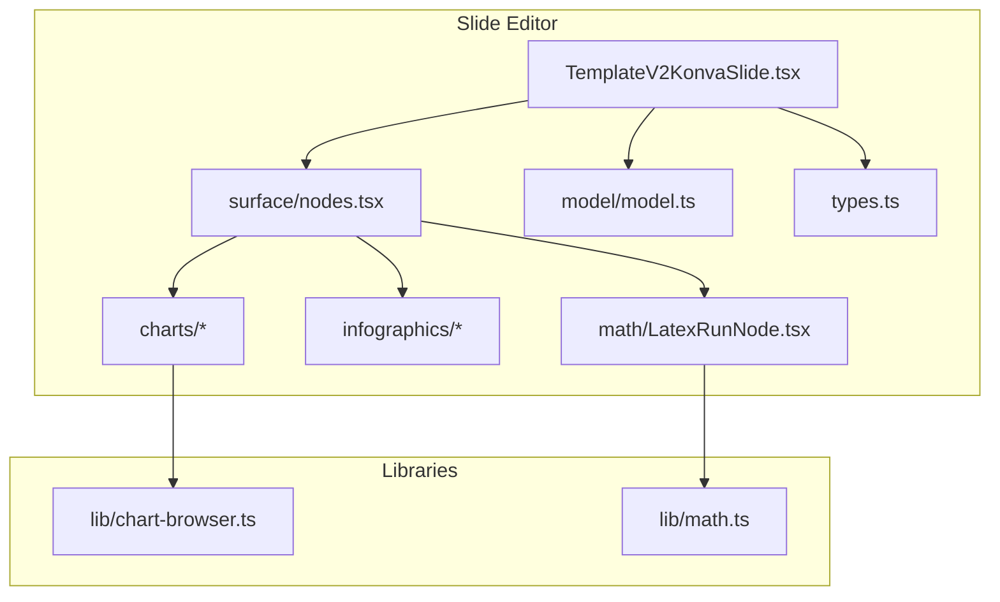
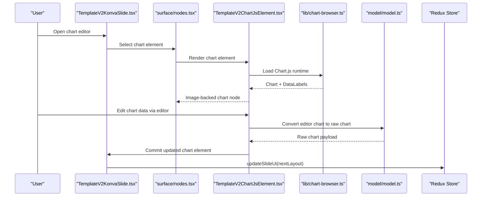
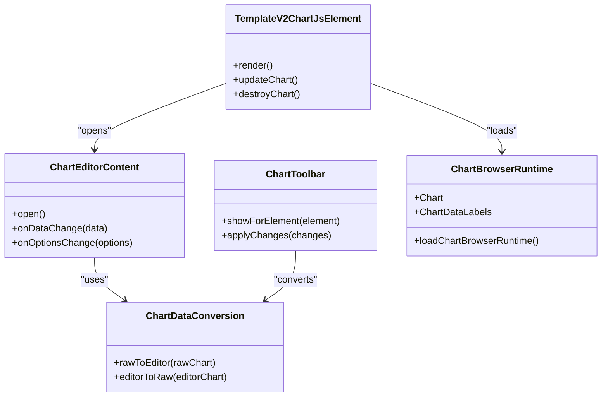
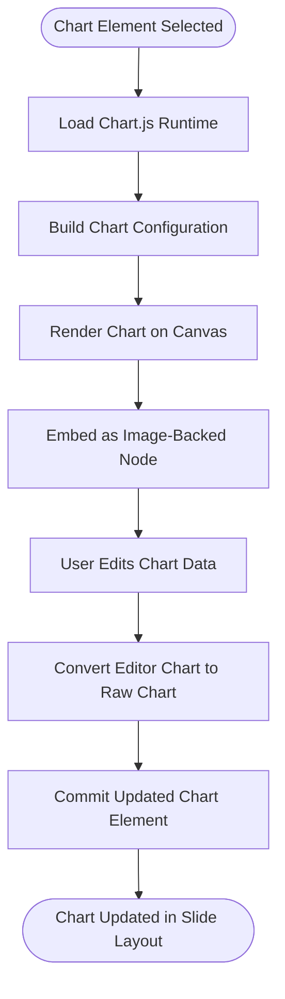
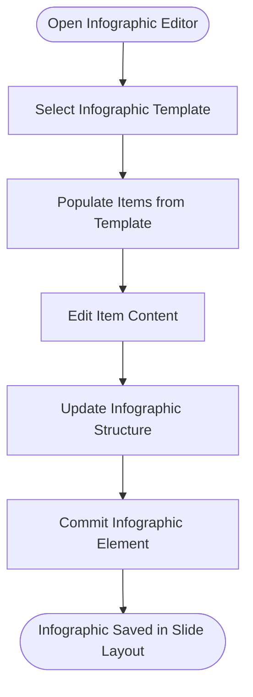
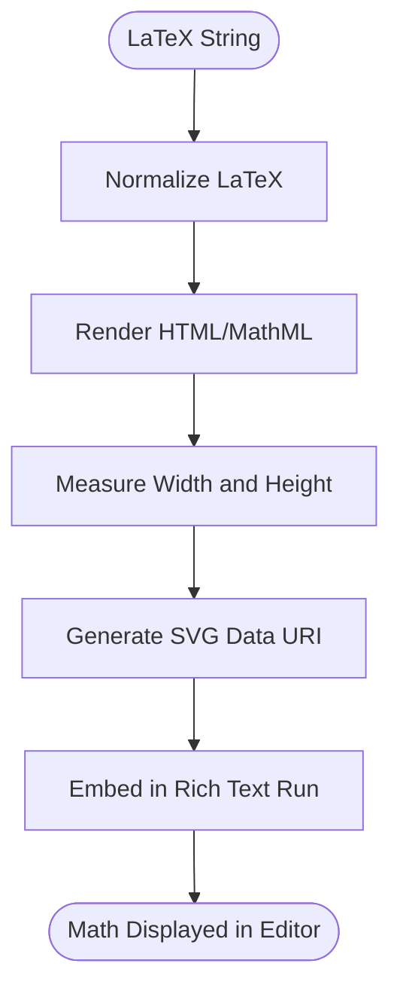
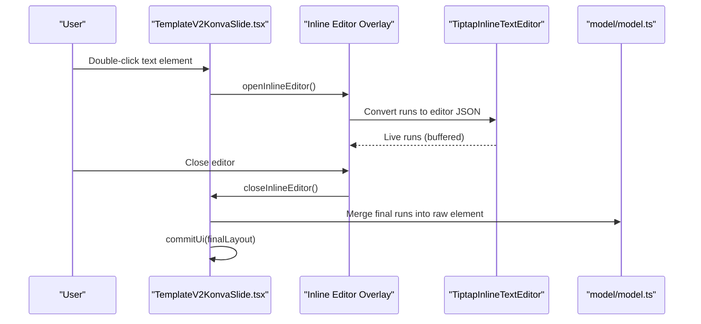
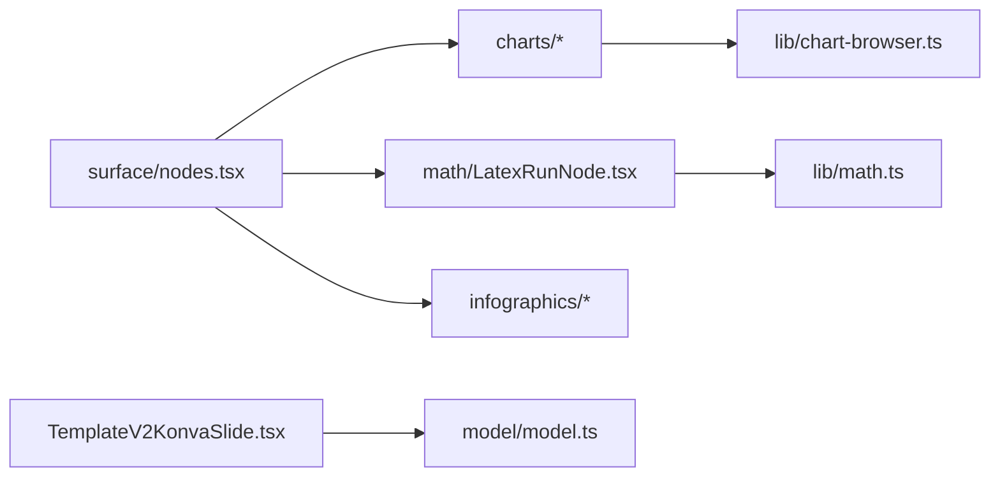

# Advanced Features

<cite>
**Referenced Files in This Document**
- [README.md](file://servers/nextjs/components/slide-editor/README.md)
- [TemplateV2KonvaSlide.tsx](file://servers/nextjs/components/slide-editor/surface/TemplateV2KonvaSlide.tsx)
- [nodes.tsx](file://servers/nextjs/components/slide-editor/surface/nodes.tsx)
- [model.ts](file://servers/nextjs/components/slide-editor/model/model.ts)
- [chart-model.ts](file://servers/nextjs/components/slide-editor/model/chart-model.ts)
- [types.ts](file://servers/nextjs/components/slide-editor/types.ts)
- [TemplateV2ChartJsElement.tsx](file://servers/nextjs/components/slide-editor/charts/TemplateV2ChartJsElement.tsx)
- [ChartEditorContent.tsx](file://servers/nextjs/components/slide-editor/charts/ChartEditorContent.tsx)
- [ChartToolbar.tsx](file://servers/nextjs/components/slide-editor/charts/ChartToolbar.tsx)
- [chart-data.ts](file://servers/nextjs/components/slide-editor/charts/chart-data.ts)
- [chart-browser.ts](file://servers/nextjs/lib/chart-browser.ts)
- [InfographicEditorContent.tsx](file://servers/nextjs/components/slide-editor/infographics/InfographicEditorContent.tsx)
- [InfographicItemToolbar.tsx](file://servers/nextjs/components/slide-editor/infographics/InfographicItemToolbar.tsx)
- [InfographicPlainTextEditor.tsx](file://servers/nextjs/components/slide-editor/infographics/InfographicPlainTextEditor.tsx)
- [infographic-editing.ts](file://servers/nextjs/components/slide-editor/infographics/infographic-editing.ts)
- [LatexRunNode.tsx](file://servers/nextjs/components/slide-editor/math/LatexRunNode.tsx)
- [math.ts](file://servers/nextjs/lib/math.ts)
</cite>

## Table of Contents
1. [Introduction](#introduction)
2. [Project Structure](#project-structure)
3. [Core Components](#core-components)
4. [Architecture Overview](#architecture-overview)
5. [Detailed Component Analysis](#detailed-component-analysis)
6. [Dependency Analysis](#dependency-analysis)
7. [Performance Considerations](#performance-considerations)
8. [Troubleshooting Guide](#troubleshooting-guide)
9. [Conclusion](#conclusion)

## Introduction
This document explains the advanced editor features that extend the core Template V2 slide editor: Chart.js-based chart editing, infographic creation and manipulation, LaTeX math rendering, and inline editing state management. It also documents how these features integrate with the core editor surface, data binding mechanisms, customization options, and practical extension patterns.

The editor is a JSON-driven system where slides are represented as UI layouts. These layouts are rendered both on an editable Konva canvas for the interactive editor and to HTML for preview/export flows. Advanced features plug into this model by converting raw element data into typed editor models, providing toolbars and editors, and committing changes back through the central editor surface.

## Project Structure
Advanced features live under the slide editor package and related library utilities:

- `components/slide-editor`
  - `charts/`: Chart.js integration, chart editor content, toolbar, and data conversion.
  - `infographics/`: Infographic editor content, item toolbar, plain text editor, and editing helpers.
  - `math/`: LaTeX run node used inside rich text.
  - `surface/`, `model/`, `toolbar/`, `selection/`, `text/`, `tables/`: Core editor infrastructure referenced by advanced features.
- `lib/`
  - `chart-browser.ts`: Browser-side Chart.js runtime loader.
  - `math.ts`: KaTeX-based LaTeX normalization, rendering, measurement, and SVG data URI generation.

**Diagram sources**
- [README.md:13-35](file://servers/nextjs/components/slide-editor/README.md#L13-L35)
- [TemplateV2KonvaSlide.tsx](file://servers/nextjs/components/slide-editor/surface/TemplateV2KonvaSlide.tsx)
- [nodes.tsx](file://servers/nextjs/components/slide-editor/surface/nodes.tsx)
- [model.ts](file://servers/nextjs/components/slide-editor/model/model.ts)
- [types.ts](file://servers/nextjs/components/slide-editor/types.ts)
- [TemplateV2ChartJsElement.tsx](file://servers/nextjs/components/slide-editor/charts/TemplateV2ChartJsElement.tsx)
- [InfographicEditorContent.tsx](file://servers/nextjs/components/slide-editor/infographics/InfographicEditorContent.tsx)
- [LatexRunNode.tsx](file://servers/nextjs/components/slide-editor/math/LatexRunNode.tsx)
- [chart-browser.ts](file://servers/nextjs/lib/chart-browser.ts)
- [math.ts](file://servers/nextjs/lib/math.ts)

**Section sources**
- [README.md:13-80](file://servers/nextjs/components/slide-editor/README.md#L13-L80)

## Core Components
The advanced features share a common pattern:

1. Raw element data from the slide layout is converted into a typed editor model.
2. A dedicated editor component or toolbar provides user interaction.
3. Changes are merged back into the raw element via model helpers.
4. The central surface commits updates to local draft state, undo history, and Redux.

Key responsibilities:

- **Chart editing**: Converts raw chart elements to editor charts, renders Chart.js output into the Konva scene, and exposes a chart editor and toolbar.
- **Infographic editing**: Provides an infographic editor content panel, item-level toolbar, and plain text editing for infographic nodes.
- **LaTeX math rendering**: Normalizes LaTeX strings, renders them to HTML/MathML, measures dimensions, and produces high-quality SVG data URIs for canvas rendering.
- **Inline editing state management**: Buffers rich text runs during typing, commits final edits on close, and coordinates selection and toolbar visibility.

**Section sources**
- [README.md:83-128](file://servers/nextjs/components/slide-editor/README.md#L83-L128)
- [README.md:130-184](file://servers/nextjs/components/slide-editor/README.md#L130-L184)
- [README.md:200-320](file://servers/nextjs/components/slide-editor/README.md#L200-L320)

## Architecture Overview
The advanced features integrate with the core editor through the main slide surface and the node renderer.

**Diagram sources**
- [TemplateV2KonvaSlide.tsx](file://servers/nextjs/components/slide-editor/surface/TemplateV2KonvaSlide.tsx)
- [nodes.tsx](file://servers/nextjs/components/slide-editor/surface/nodes.tsx)
- [TemplateV2ChartJsElement.tsx](file://servers/nextjs/components/slide-editor/charts/TemplateV2ChartJsElement.tsx)
- [chart-browser.ts](file://servers/nextjs/lib/chart-browser.ts)
- [model.ts](file://servers/nextjs/components/slide-editor/model/model.ts)

## Detailed Component Analysis

### Chart Editing System with Chart.js Integration
The chart feature supports creating, editing, and rendering charts directly in the editor. It uses Chart.js loaded at runtime and integrates with the editor’s data model.

Key files:
- `charts/TemplateV2ChartJsElement.tsx`: Renders a chart element using Chart.js and embeds it into the Konva scene as an image-backed node.
- `charts/ChartEditorContent.tsx`: Provides the chart editor UI for modifying datasets, labels, and chart options.
- `charts/ChartToolbar.tsx`: Element toolbar entry point for chart properties.
- `charts/chart-data.ts`: Conversion between raw chart data and editor-friendly chart models.
- `model/chart-model.ts`: Raw chart to editor chart conversion and reverse mapping.
- `lib/chart-browser.ts`: Loads Chart.js and the datalabels plugin safely in the browser.

**Diagram sources**
- [TemplateV2ChartJsElement.tsx](file://servers/nextjs/components/slide-editor/charts/TemplateV2ChartJsElement.tsx)
- [ChartEditorContent.tsx](file://servers/nextjs/components/slide-editor/charts/ChartEditorContent.tsx)
- [ChartToolbar.tsx](file://servers/nextjs/components/slide-editor/charts/ChartToolbar.tsx)
- [chart-data.ts](file://servers/nextjs/components/slide-editor/charts/chart-data.ts)
- [chart-browser.ts](file://servers/nextjs/lib/chart-browser.ts)

Processing flow:

**Diagram sources**
- [TemplateV2ChartJsElement.tsx](file://servers/nextjs/components/slide-editor/charts/TemplateV2ChartJsElement.tsx)
- [chart-data.ts](file://servers/nextjs/components/slide-editor/charts/chart-data.ts)
- [chart-browser.ts](file://servers/nextjs/lib/chart-browser.ts)

Integration points:
- The node renderer delegates chart rendering to `TemplateV2ChartJsElement`.
- The surface opens the chart editor via custom events and updates the selected chart element.
- Model conversion functions ensure raw chart payloads remain compatible with the backend schema.

Customization options:
- Chart types, datasets, labels, colors, and options can be edited through the chart editor.
- Datalabels plugin is registered automatically when available.
- Chart configuration is normalized before rendering to avoid invalid Chart.js inputs.

Extension examples:
- Add a new chart type by extending the chart configuration builder and ensuring the raw-to-editor conversion handles the new fields.
- Integrate a custom chart plugin by loading it alongside Chart.js in `chart-browser.ts` and registering it in the runtime initialization.

**Section sources**
- [README.md:321-379](file://servers/nextjs/components/slide-editor/README.md#L321-L379)
- [README.md:435-466](file://servers/nextjs/components/slide-editor/README.md#L435-L466)
- [chart-browser.ts:1-137](file://servers/nextjs/lib/chart-browser.ts#L1-L137)

### Infographic Creation and Manipulation
Infographics are visual components that can be created, edited, and manipulated within the slide editor. They provide structured layouts with items that may include icons, text, and other visual elements.

Key files:
- `infographics/InfographicEditorContent.tsx`: Main infographic editor panel for selecting templates and adjusting structure.
- `infographics/InfographicItemToolbar.tsx`: Toolbar for editing individual infographic items.
- `infographics/InfographicPlainTextEditor.tsx`: Plain text editor overlay for infographic text nodes.
- `infographics/infographic-editing.ts`: Editing helpers for infographic data transformation and validation.

**Diagram sources**
- [InfographicEditorContent.tsx](file://servers/nextjs/components/slide-editor/infographics/InfographicEditorContent.tsx)
- [InfographicItemToolbar.tsx](file://servers/nextjs/components/slide-editor/infographics/InfographicItemToolbar.tsx)
- [InfographicPlainTextEditor.tsx](file://servers/nextjs/components/slide-editor/infographics/InfographicPlainTextEditor.tsx)
- [infographic-editing.ts](file://servers/nextjs/components/slide-editor/infographics/infographic-editing.ts)

Data binding:
- Infographic templates define item schemas and default values.
- The editor converts template selections into raw infographic elements compatible with the slide layout.
- Item-level edits update only the affected nodes, minimizing re-renders.

Customization options:
- Item text, icon selection, alignment, spacing, and styling can be adjusted via the item toolbar.
- Plain text editing supports basic formatting without full rich text overhead.

Extension examples:
- Add a new infographic template by defining its item schema and default values.
- Extend item editing by adding new fields to the item toolbar and updating the editing helpers.

**Section sources**
- [README.md:321-379](file://servers/nextjs/components/slide-editor/README.md#L321-L379)
- [README.md:435-466](file://servers/nextjs/components/slide-editor/README.md#L435-L466)

### LaTeX Math Rendering Capabilities
LaTeX math rendering enables users to insert mathematical expressions into text elements. The system normalizes LaTeX input, renders it to HTML/MathML, measures dimensions for layout, and generates high-quality SVG data URIs for canvas rendering.

Key files:
- `math/LatexRunNode.tsx`: Renders LaTeX runs inside rich text.
- `lib/math.ts`: LaTeX normalization, HTML rendering, measurement, and SVG data URI generation.

**Diagram sources**
- [LatexRunNode.tsx](file://servers/nextjs/components/slide-editor/math/LatexRunNode.tsx)
- [math.ts:1-149](file://servers/nextjs/lib/math.ts#L1-L149)

Features:
- Normalization removes wrapper delimiters like `$$...$$` or `\[...\]`.
- Rendering uses KaTeX with safe defaults and error handling.
- Measurement caches results per font size and display mode to improve performance.
- SVG data URIs use MathML inside foreignObject with extra pixel ratio for sharp rendering on scaled canvases.

Customization options:
- Display mode toggle for block vs inline math.
- Color and font size control for SVG output.
- Alignment and vertical alignment controls for positioning within text containers.

Extension examples:
- Add new LaTeX macros by configuring KaTeX options where appropriate.
- Extend measurement accuracy by improving fallback sizing logic for complex expressions.

**Section sources**
- [README.md:614-670](file://servers/nextjs/components/slide-editor/README.md#L614-L670)
- [math.ts:1-149](file://servers/nextjs/lib/math.ts#L1-L149)

### Inline Editing State Management
Inline editing manages rich text and table cell editing states. It buffers live changes during typing to avoid lag and commits final edits when the editor closes.

Key responsibilities:
- Opening inline editors for text, text-list, tables, charts, icons, and images based on double-click behavior.
- Buffering rich text runs via requestAnimationFrame to prevent frequent Redux updates.
- Coordinating selection state, toolbar visibility, and surface activation.

**Diagram sources**
- [TemplateV2KonvaSlide.tsx](file://servers/nextjs/components/slide-editor/surface/TemplateV2KonvaSlide.tsx)
- [README.md:649-670](file://servers/nextjs/components/slide-editor/README.md#L649-L670)

Best practices:
- Use `commitInlineTextRuns()` for live updates without pushing every keystroke to Redux.
- Always commit final edits on close to ensure persistence.
- Guard keyboard shortcuts against editable targets to avoid unintended actions.

**Section sources**
- [README.md:130-184](file://servers/nextjs/components/slide-editor/README.md#L130-L184)
- [README.md:649-670](file://servers/nextjs/components/slide-editor/README.md#L649-L670)

## Dependency Analysis
Advanced features depend on shared editor infrastructure and external libraries:

- Chart editing depends on Chart.js runtime loading and datalabels plugin registration.
- LaTeX rendering depends on KaTeX and DOM APIs for measurement.
- All features rely on the central surface for state commitment and undo/redo.

**Diagram sources**
- [chart-browser.ts](file://servers/nextjs/lib/chart-browser.ts)
- [math.ts](file://servers/nextjs/lib/math.ts)
- [TemplateV2KonvaSlide.tsx](file://servers/nextjs/components/slide-editor/surface/TemplateV2KonvaSlide.tsx)
- [nodes.tsx](file://servers/nextjs/components/slide-editor/surface/nodes.tsx)
- [model.ts](file://servers/nextjs/components/slide-editor/model/model.ts)

Potential coupling concerns:
- Chart runtime loading must succeed before chart rendering; failures should degrade gracefully.
- LaTeX measurement relies on DOM availability; server-side rendering paths must handle missing DOM.
- Inline editing buffers must flush on close to avoid data loss.

**Section sources**
- [chart-browser.ts:58-137](file://servers/nextjs/lib/chart-browser.ts#L58-L137)
- [math.ts:40-81](file://servers/nextjs/lib/math.ts#L40-L81)

## Performance Considerations
- Chart rendering: Avoid recreating Chart.js instances unnecessarily; reuse instances and call update methods when possible.
- LaTeX measurement: Use the built-in cache keyed by font size and display mode to reduce repeated measurements.
- Inline editing: Buffer live runs and commit final edits to minimize Redux churn and rerenders.
- Image-backed chart nodes: Ensure proper cleanup of chart instances to prevent memory leaks.

[No sources needed since this section provides general guidance]

## Troubleshooting Guide
Common issues and resolutions:

- Chart.js runtime not loaded:
  - Verify vendor scripts are available at expected URLs.
  - Check browser console for script load errors.
  - Ensure Chart.js and datalabels plugins register correctly.

- LaTeX rendering blank or misaligned:
  - Validate LaTeX string normalization and length limits.
  - Confirm DOM measurement container is attached and removed after use.
  - Inspect SVG data URI generation for correct color and font size.

- Inline editing lag:
  - Ensure live runs are buffered and not committed on every keystroke.
  - Verify close handlers commit final edits.

- Infographic edits not persisting:
  - Confirm editing helpers produce valid raw infographic elements.
  - Check that item toolbar changes merge into the parent infographic element.

**Section sources**
- [chart-browser.ts:98-137](file://servers/nextjs/lib/chart-browser.ts#L98-L137)
- [math.ts:13-38](file://servers/nextjs/lib/math.ts#L13-L38)
- [README.md:649-670](file://servers/nextjs/components/slide-editor/README.md#L649-L670)

## Conclusion
The advanced editor features extend the core Template V2 slide editor with powerful chart editing, infographic manipulation, LaTeX math rendering, and robust inline editing state management. By adhering to the established data model, leveraging shared utilities, and following the integration patterns documented here, you can confidently add new capabilities, customize existing behaviors, and maintain consistency across editor and export flows.

[No sources needed since this section summarizes without analyzing specific files]