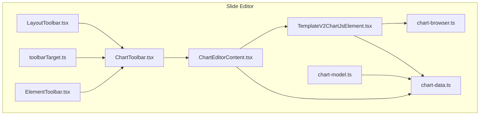
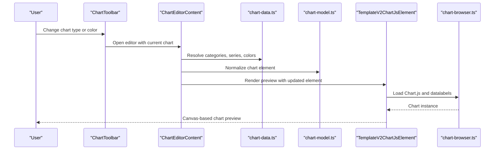
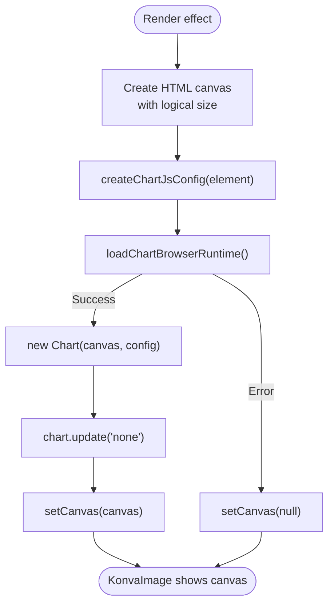
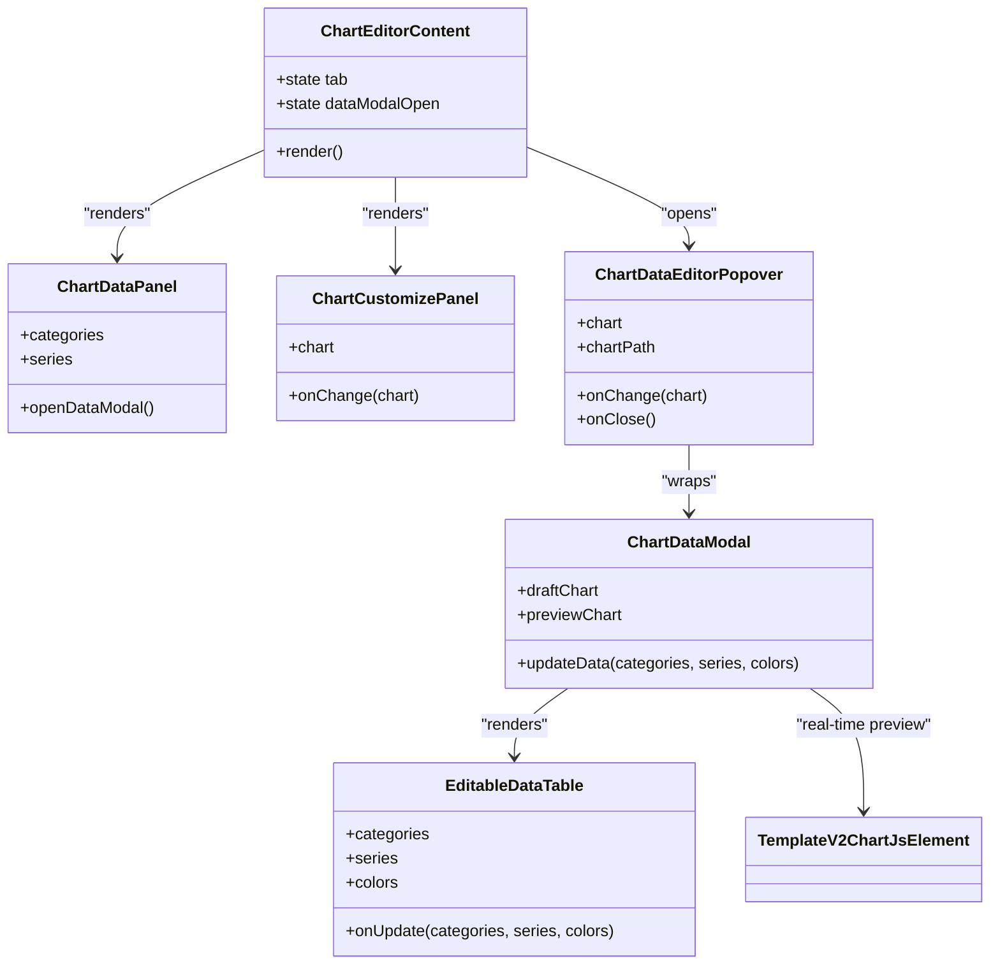
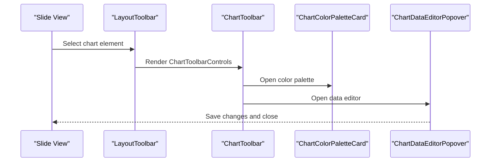
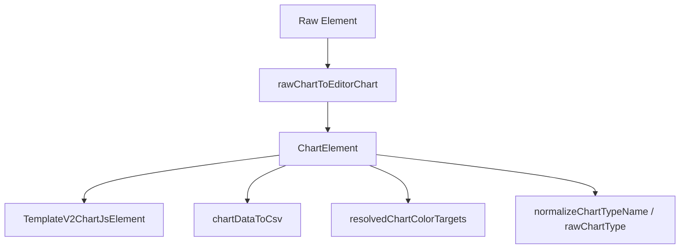
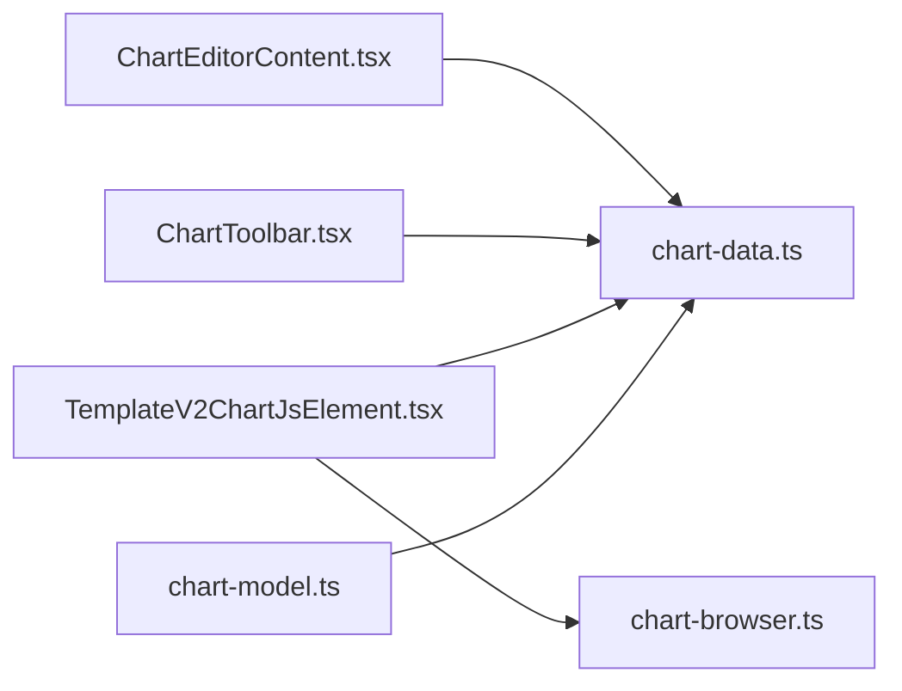

# Chart Editing System

<cite>
**Referenced Files in This Document**
- [TemplateV2ChartJsElement.tsx](file://servers/nex tjs/components/slide-editor/charts/TemplateV2ChartJsElement.tsx)
- [ChartEditorContent.tsx](file://servers/nex tjs/components/slide-editor/charts/ChartEditorContent.tsx)
- [ChartToolbar.tsx](file://servers/nex tjs/components/slide-editor/charts/ChartToolbar.tsx)
- [chart-data.ts](file://servers/nex tjs/components/slide-editor/charts/chart-data.ts)
- [chart-model.ts](file://servers/nex tjs/components/slide-editor/model/chart-model.ts)
- [chart-browser.ts](file://servers/nex tjs/lib/chart-browser.ts)
- [LayoutToolbar.tsx](file://servers/nex tjs/components/slide-editor/layout/LayoutToolbar.tsx)
- [toolbarTarget.ts](file://servers/nex tjs/components/slide-editor/selection/toolbarTarget.ts)
- [ElementToolbar.tsx](file://servers/nex tjs/components/slide-editor/toolbar/ElementToolbar.tsx)
</cite>

## Table of Contents
1. [Introduction](#introduction)
2. [Project Structure](#project-structure)
3. [Core Components](#core-components)
4. [Architecture Overview](#architecture-overview)
5. [Detailed Component Analysis](#detailed-component-analysis)
6. [Dependency Analysis](#dependency-analysis)
7. [Performance Considerations](#performance-considerations)
8. [Troubleshooting Guide](#troubleshooting-guide)
9. [Conclusion](#conclusion)
10. [Appendices](#appendices)

## Introduction
This document explains the chart editing system used by the slide editor. It covers how Chart.js is integrated, how chart data flows from templates and user edits into a rendered canvas, and how the interactive editor components allow users to change chart types, colors, axes, legends, and data. The main rendering component is `TemplateV2ChartJsElement`, while the editing experience is provided by `ChartEditorContent` and `ChartToolbar`. Data transformation utilities live in `chart-data.ts`, with model adapters in `chart-model.ts`. Browser-side Chart.js loading is handled by `chart-browser.ts`.

## Project Structure
The chart editing system is primarily located under the Next.js slide editor:

- Rendering: `charts/TemplateV2ChartJsElement.tsx`
- Editor UI: `charts/ChartEditorContent.tsx`
- Floating toolbar: `charts/ChartToolbar.tsx`
- Shared chart data utilities: `charts/chart-data.ts`
- Model adapters for raw template elements: `model/chart-model.ts`
- Browser runtime loader: `lib/chart-browser.ts`
- Integration points: `layout/LayoutToolbar.tsx`, `selection/toolbarTarget.ts`, `toolbar/ElementToolbar.tsx`

**Diagram sources**
- [LayoutToolbar.tsx:324-409](file://servers/nex tjs/components/slide-editor/layout/LayoutToolbar.tsx#L324-L409)
- [toolbarTarget.ts:101-120](file://servers/nex tjs/components/slide-editor/selection/toolbarTarget.ts#L101-L120)
- [ElementToolbar.tsx:8-12](file://servers/nex tjs/components/slide-editor/toolbar/ElementToolbar.tsx#L8-L12)
- [ChartToolbar.tsx:172-221](file://servers/nex tjs/components/slide-editor/charts/ChartToolbar.tsx#L172-L221)
- [ChartEditorContent.tsx:77-169](file://servers/nex tjs/components/slide-editor/charts/ChartEditorContent.tsx#L77-L169)
- [TemplateV2ChartJsElement.tsx:78-168](file://servers/nex tjs/components/slide-editor/charts/TemplateV2ChartJsElement.tsx#L78-L168)
- [chart-browser.ts:98-136](file://servers/nex tjs/lib/chart-browser.ts#L98-L136)

**Section sources**
- [TemplateV2ChartJsElement.tsx:78-168](file://servers/nex tjs/components/slide-editor/charts/TemplateV2ChartJsElement.tsx#L78-L168)
- [ChartEditorContent.tsx:77-169](file://servers/nex tjs/components/slide-editor/charts/ChartEditorContent.tsx#L77-L169)
- [ChartToolbar.tsx:172-221](file://servers/nex tjs/components/slide-editor/charts/ChartToolbar.tsx#L172-L221)
- [chart-data.ts:26-35](file://servers/nex tjs/components/slide-editor/charts/chart-data.ts#L26-L35)
- [chart-browser.ts:1-56](file://servers/nex tjs/lib/chart-browser.ts#L1-L56)

## Core Components
- `TemplateV2ChartJsElement`: Renders a chart on an offscreen HTML canvas using Chart.js and displays it inside a Konva group. It converts raw template element data into a Chart.js configuration, manages lifecycle, and handles high-DPI scaling.
- `ChartEditorContent`: Provides the full chart editor panel with tabs for data and customization, a type selector, color palette controls, axis and legend toggles, and a modal data table with real-time preview.
- `ChartToolbar`: A floating toolbar that lets users quickly change chart type, open the editor, and adjust series/category colors without leaving the slide view.
- `chart-data.ts`: Centralized utilities for categories, series, colors, CSV export, text limits, label positions, and chart type normalization.
- `chart-model.ts`: Converts between raw template chart elements and the editor’s normalized `ChartElement` model.
- `chart-browser.ts`: Loads Chart.js and the datalabels plugin from local vendor scripts and exposes a safe runtime promise.

**Section sources**
- [TemplateV2ChartJsElement.tsx:78-168](file://servers/nex tjs/components/slide-editor/charts/TemplateV2ChartJsElement.tsx#L78-L168)
- [ChartEditorContent.tsx:77-169](file://servers/nex tjs/components/slide-editor/charts/ChartEditorContent.tsx#L77-L169)
- [ChartToolbar.tsx:37-170](file://servers/nex tjs/components/slide-editor/charts/ChartToolbar.tsx#L37-L170)
- [chart-data.ts:24-35](file://servers/nex tjs/components/slide-editor/charts/chart-data.ts#L24-L35)
- [chart-model.ts:17-122](file://servers/nex tjs/components/slide-editor/model/chart-model.ts#L17-L122)
- [chart-browser.ts:98-136](file://servers/nex tjs/lib/chart-browser.ts#L98-L136)

## Architecture Overview
The chart system follows a clear separation between editing state, data transformation, and rendering:

1. User interactions update a normalized `ChartElement` through `ChartEditorContent` or `ChartToolbar`.
2. Utilities in `chart-data.ts` compute categories, series, colors, and derived data.
3. `chart-model.ts` adapts raw template fields to the editor model and back.
4. `TemplateV2ChartJsElement` transforms the element into a Chart.js configuration and renders it on a canvas.
5. `chart-browser.ts` loads Chart.js and the datalabels plugin once per page.

**Diagram sources**
- [ChartToolbar.tsx:172-221](file://servers/nex tjs/components/slide-editor/charts/ChartToolbar.tsx#L172-L221)
- [ChartEditorContent.tsx:839-1084](file://servers/nex tjs/components/slide-editor/charts/ChartEditorContent.tsx#L839-L1084)
- [chart-data.ts:236-302](file://servers/nex tjs/components/slide-editor/charts/chart-data.ts#L236-L302)
- [chart-model.ts:17-122](file://servers/nex tjs/components/slide-editor/model/chart-model.ts#L17-L122)
- [TemplateV2ChartJsElement.tsx:117-151](file://servers/nex tjs/components/slide-editor/charts/TemplateV2ChartJsElement.tsx#L117-L151)
- [chart-browser.ts:98-136](file://servers/nex tjs/lib/chart-browser.ts#L98-L136)

## Detailed Component Analysis

### TemplateV2ChartJsElement
This component is responsible for rendering charts in the slide editor and preview panels.

Key responsibilities:
- Compute logical width, height, and pixel ratio.
- Build a stable render signature to avoid unnecessary re-renders.
- Create a Chart.js configuration from the raw element.
- Dynamically load Chart.js and the datalabels plugin.
- Destroy previous instances on cleanup to prevent memory leaks.
- Display the resulting canvas inside a Konva group.

Supported chart kinds include bar, horizontal bar, stacked bar, line, area, pie, donut, scatter, bubble, radar, and polar area. The component maps internal chart names to Chart.js types and adjusts datasets, scales, labels, legends, and colors accordingly.

**Diagram sources**
- [TemplateV2ChartJsElement.tsx:117-151](file://servers/nex tjs/components/slide-editor/charts/TemplateV2ChartJsElement.tsx#L117-L151)
- [TemplateV2ChartJsElement.tsx:231-413](file://servers/nex tjs/components/slide-editor/charts/TemplateV2ChartJsElement.tsx#L231-L413)
- [chart-browser.ts:98-136](file://servers/nex tjs/lib/chart-browser.ts#L98-L136)

Important implementation details:
- Pixel ratio is clamped to balance quality and performance; interactive mode uses lower ratios than non-interactive previews when appropriate.
- Colors are normalized and validated before being passed to Chart.js.
- Axis titles, tick labels, legend labels, and data labels are ellipsized to fit layout constraints.
- Data labels use contrast-aware text colors for better readability over colored backgrounds.

**Section sources**
- [TemplateV2ChartJsElement.tsx:78-168](file://servers/nex tjs/components/slide-editor/charts/TemplateV2ChartJsElement.tsx#L78-L168)
- [TemplateV2ChartJsElement.tsx:231-413](file://servers/nex tjs/components/slide-editor/charts/TemplateV2ChartJsElement.tsx#L231-L413)
- [TemplateV2ChartJsElement.tsx:820-911](file://servers/nex tjs/components/slide-editor/charts/TemplateV2ChartJsElement.tsx#L820-L911)
- [TemplateV2ChartJsElement.tsx:988-1058](file://servers/nex tjs/components/slide-editor/charts/TemplateV2ChartJsElement.tsx#L988-L1058)
- [TemplateV2ChartJsElement.tsx:1167-1204](file://servers/nex tjs/components/slide-editor/charts/TemplateV2ChartJsElement.tsx#L1167-L1204)

### ChartEditorContent
This component provides the full chart editing interface.

Main features:
- Chart type selection.
- Two-tab interface: Data and Customize.
- Mini data table preview.
- Full-screen data editor modal with real-time preview.
- Color palette management for category or series modes.
- Axis visibility and grid toggles.
- Legend visibility and color control.
- Title and axis title editing with text length limits.

Real-time preview works by computing a preview element from the draft chart and rendering it through `TemplateV2ChartJsElement` inside a scaled Konva stage.

**Diagram sources**
- [ChartEditorContent.tsx:77-169](file://servers/nex tjs/components/slide-editor/charts/ChartEditorContent.tsx#L77-L169)
- [ChartEditorContent.tsx:268-347](file://servers/nex tjs/components/slide-editor/charts/ChartEditorContent.tsx#L268-L347)
- [ChartEditorContent.tsx:349-537](file://servers/nex tjs/components/slide-editor/charts/ChartEditorContent.tsx#L349-L537)
- [ChartEditorContent.tsx:839-1084](file://servers/nex tjs/components/slide-editor/charts/ChartEditorContent.tsx#L839-L1084)
- [ChartEditorContent.tsx:1086-1550](file://servers/nex tjs/components/slide-editor/charts/ChartEditorContent.tsx#L1086-L1550)

Data update flow:
- Users edit categories, series names, and numeric values.
- Draft updates normalize lengths, limit text, extend colors, and compute derived data.
- Saving sanitizes text fields and closes the modal.

**Section sources**
- [ChartEditorContent.tsx:77-169](file://servers/nex tjs/components/slide-editor/charts/ChartEditorContent.tsx#L77-L169)
- [ChartEditorContent.tsx:839-1084](file://servers/nex tjs/components/slide-editor/charts/ChartEditorContent.tsx#L839-L1084)
- [ChartEditorContent.tsx:1086-1550](file://servers/nex tjs/components/slide-editor/charts/ChartEditorContent.tsx#L1086-L1550)
- [ChartEditorContent.tsx:1671-1715](file://servers/nex tjs/components/slide-editor/charts/ChartEditorContent.tsx#L1671-L1715)

### ChartToolbar
The floating toolbar provides quick access to chart controls directly above the selected chart.

Features:
- Chart type dropdown.
- Optional “Edit data” button that opens the full editor.
- Color palette popover for changing category or series colors.
- Anchors to the chart’s position and scale.

Integration:
- Used by `LayoutToolbar` when a chart element is selected.
- Uses `resolvedChartColorTargets`, `appendChartColorTarget`, `removeChartColorTarget`, and `updateChartColorTarget` from `chart-data.ts`.

**Diagram sources**
- [ChartToolbar.tsx:37-170](file://servers/nex tjs/components/slide-editor/charts/ChartToolbar.tsx#L37-L170)
- [ChartToolbar.tsx:172-221](file://servers/nex tjs/components/slide-editor/charts/ChartToolbar.tsx#L172-L221)
- [LayoutToolbar.tsx:408-409](file://servers/nex tjs/components/slide-editor/layout/LayoutToolbar.tsx#L408-L409)

**Section sources**
- [ChartToolbar.tsx:37-170](file://servers/nex tjs/components/slide-editor/charts/ChartToolbar.tsx#L37-L170)
- [ChartToolbar.tsx:172-221](file://servers/nex tjs/components/slide-editor/charts/ChartToolbar.tsx#L172-L221)

### Chart Data Utilities and Model Adapters
`chart-data.ts` defines shared behavior for:
- Default chart colors.
- Category resolution.
- Series normalization.
- Color target mode (category vs series).
- Color palette operations.
- CSV export.
- Chart type normalization.
- Text limits and markdown-to-plain conversion.

`chart-model.ts` converts between:
- Raw template chart elements and editor `ChartElement`.
- Legacy field names and new snake_case fields.
- Data label positions and boolean-like configurations.

**Diagram sources**
- [chart-model.ts:17-122](file://servers/nex tjs/components/slide-editor/model/chart-model.ts#L17-L122)
- [chart-data.ts:236-302](file://servers/nex tjs/components/slide-editor/charts/chart-data.ts#L236-L302)
- [chart-data.ts:353-387](file://servers/nex tjs/components/slide-editor/charts/chart-data.ts#L353-L387)
- [chart-data.ts:532-593](file://servers/nex tjs/components/slide-editor/charts/chart-data.ts#L532-L593)

**Section sources**
- [chart-data.ts:24-35](file://servers/nex tjs/components/slide-editor/charts/chart-data.ts#L24-L35)
- [chart-data.ts:236-302](file://servers/nex tjs/components/slide-editor/charts/chart-data.ts#L236-L302)
- [chart-data.ts:353-387](file://servers/nex tjs/components/slide-editor/charts/chart-data.ts#L353-L387)
- [chart-data.ts:412-530](file://servers/nex tjs/components/slide-editor/charts/chart-data.ts#L412-L530)
- [chart-data.ts:532-593](file://servers/nex tjs/components/slide-editor/charts/chart-data.ts#L532-L593)
- [chart-model.ts:17-122](file://servers/nex tjs/components/slide-editor/model/chart-model.ts#L17-L122)
- [chart-model.ts:152-217](file://servers/nex tjs/components/slide-editor/model/chart-model.ts#L152-L217)

## Dependency Analysis
The chart system has clear layering:

- UI layer: `ChartEditorContent`, `ChartToolbar`
- Data layer: `chart-data.ts`
- Model adapter layer: `chart-model.ts`
- Rendering layer: `TemplateV2ChartJsElement`
- Runtime layer: `chart-browser.ts`

Coupling:
- `ChartEditorContent` depends on `chart-data.ts` for normalization and color logic.
- `TemplateV2ChartJsElement` depends on `chart-data.ts` for text helpers and chart kind mapping.
- Both UI components depend on `chart-browser.ts` indirectly through the renderer.
- `chart-model.ts` depends on `chart-data.ts` for chart type normalization.

External dependencies:
- Chart.js and the datalabels plugin are loaded at runtime from local vendor scripts.

**Diagram sources**
- [ChartEditorContent.tsx:18-49](file://servers/nex tjs/components/slide-editor/charts/ChartEditorContent.tsx#L18-L49)
- [ChartToolbar.tsx:4-11](file://servers/nex tjs/components/slide-editor/charts/ChartToolbar.tsx#L4-L11)
- [TemplateV2ChartJsElement.tsx:5-16](file://servers/nex tjs/components/slide-editor/charts/TemplateV2ChartJsElement.tsx#L5-L16)
- [chart-model.ts:6-13](file://servers/nex tjs/components/slide-editor/model/chart-model.ts#L6-L13)
- [TemplateV2ChartJsElement.tsx:5-11](file://servers/nex tjs/components/slide-editor/charts/TemplateV2ChartJsElement.tsx#L5-L11)

**Section sources**
- [ChartEditorContent.tsx:18-49](file://servers/nex tjs/components/slide-editor/charts/ChartEditorContent.tsx#L18-L49)
- [ChartToolbar.tsx:4-11](file://servers/nex tjs/components/slide-editor/charts/ChartToolbar.tsx#L4-L11)
- [TemplateV2ChartJsElement.tsx:5-16](file://servers/nex tjs/components/slide-editor/charts/TemplateV2ChartJsElement.tsx#L5-L16)
- [chart-model.ts:6-13](file://servers/nex tjs/components/slide-editor/model/chart-model.ts#L6-L13)

## Performance Considerations
- Canvas sizing and pixel ratio: The renderer computes logical dimensions and clamps pixel ratio to reduce GPU/CPU pressure during editing. Non-interactive previews can use different scaling strategies.
- Chart.js initialization: Chart.js is loaded once and cached via a global runtime promise. Instances are destroyed on cleanup to avoid memory leaks.
- Dataset limits: Categories and series are capped to reasonable maximums to prevent large DOM/canvas workloads.
- Animation disabled: Chart.js animations are disabled in editor contexts to keep previews responsive.
- Text limits: Titles, axis titles, categories, series names, and data labels are limited to fixed maximum lengths.
- Color normalization: Colors are normalized and validated early to avoid expensive parsing later.

Recommendations for large datasets:
- Keep categories under the enforced maximum.
- Limit series to supported counts.
- Avoid excessive custom colors beyond the palette cap.
- Prefer static previews for very large data exports rather than interactive editing.

[No sources needed since this section provides general guidance]

## Troubleshooting Guide
Common issues and resolutions:

- Chart.js not loading:
  - Ensure the vendor scripts are available at the expected URLs.
  - Check browser console for script load errors.
  - Verify that the runtime promise resolves and registers the datalabels plugin.

- Chart does not render:
  - Confirm the element has valid chart type, categories, and series.
  - Validate colors and text fields.
  - Check that the canvas creation and Chart.js constructor do not throw.

- Incorrect chart appearance:
  - Verify chart kind mapping and dataset construction.
  - Check axis visibility, grid toggles, legend settings, and data label positions.
  - Ensure color targets match the expected category or series mode.

- Memory leaks or stale charts:
  - Ensure previous Chart.js instances are destroyed when the component unmounts or data changes.

**Section sources**
- [chart-browser.ts:98-136](file://servers/nex tjs/lib/chart-browser.ts#L98-L136)
- [TemplateV2ChartJsElement.tsx:117-151](file://servers/nex tjs/components/slide-editor/charts/TemplateV2ChartJsElement.tsx#L117-L151)
- [TemplateV2ChartJsElement.tsx:231-413](file://servers/nex tjs/components/slide-editor/charts/TemplateV2ChartJsElement.tsx#L231-L413)

## Conclusion
The chart editing system combines a robust editor UI with a reliable Chart.js rendering pipeline. `ChartEditorContent` and `ChartToolbar` provide intuitive controls for chart type, data, colors, axes, and legends. `TemplateV2ChartJsElement` translates normalized chart elements into Chart.js configurations and renders them efficiently. Shared utilities in `chart-data.ts` and model adapters in `chart-model.ts` ensure consistent data handling across editing and rendering. With careful attention to dataset size, color management, and runtime loading, the system supports both interactive editing and real-time preview.

[No sources needed since this section summarizes without analyzing specific files]

## Appendices

### Supported Chart Types
- Bar Chart
- Horizontal Bar
- Stacked Bar
- Horizontal Stacked Bar
- Line Chart
- Area Chart
- Pie Chart
- Donut Chart
- Scatter Chart
- Radar Chart
- Polar Area

These types are defined in the editor UI and mapped to Chart.js types during rendering.

**Section sources**
- [ChartEditorContent.tsx:51-63](file://servers/nex tjs/components/slide-editor/charts/ChartEditorContent.tsx#L51-L63)
- [ChartToolbar.tsx:20-35](file://servers/nex tjs/components/slide-editor/charts/ChartToolbar.tsx#L20-L35)
- [TemplateV2ChartJsElement.tsx:44-58](file://servers/nex tjs/components/slide-editor/charts/TemplateV2ChartJsElement.tsx#L44-L58)

### Adding a New Chart Type
Steps:
1. Add the new chart type to the editor UI lists in `ChartEditorContent` and `ChartToolbar`.
2. Normalize the chart type name in `chart-data.ts` if needed.
3. Map the normalized type to a Chart.js type and any special flags in `TemplateV2ChartJsElement`.
4. Adjust dataset construction, scales, and label handling for the new type.
5. Test real-time preview and toolbar behavior.

**Section sources**
- [ChartEditorContent.tsx:51-63](file://servers/nex tjs/components/slide-editor/charts/ChartEditorContent.tsx#L51-L63)
- [ChartToolbar.tsx:20-35](file://servers/nex tjs/components/slide-editor/charts/ChartToolbar.tsx#L20-L35)
- [chart-data.ts:546-593](file://servers/nex tjs/components/slide-editor/charts/chart-data.ts#L546-L593)
- [TemplateV2ChartJsElement.tsx:765-818](file://servers/nex tjs/components/slide-editor/charts/TemplateV2ChartJsElement.tsx#L765-L818)

### Customizing Chart Appearance
- Title and title color.
- Axis visibility and titles.
- Grid visibility and colors.
- Legend visibility and color.
- Data label position and display.
- Series/category color palette.

**Section sources**
- [ChartEditorContent.tsx:349-537](file://servers/nex tjs/components/slide-editor/charts/ChartEditorContent.tsx#L349-L537)
- [chart-data.ts:215-234](file://servers/nex tjs/components/slide-editor/charts/chart-data.ts#L215-L234)
- [chart-data.ts:297-338](file://servers/nex tjs/components/slide-editor/charts/chart-data.ts#L297-L338)

### Handling Chart Data Updates
- Use the data editor modal to edit categories, series names, and numeric values.
- Changes are normalized, limited, and extended to maintain consistent palette sizes.
- Saving sanitizes text fields and applies the updated chart element.

**Section sources**
- [ChartEditorContent.tsx:863-1084](file://servers/nex tjs/components/slide-editor/charts/ChartEditorContent.tsx#L863-L1084)
- [ChartEditorContent.tsx:1086-1550](file://servers/nex tjs/components/slide-editor/charts/ChartEditorContent.tsx#L1086-L1550)
- [ChartEditorContent.tsx:1671-1715](file://servers/nex tjs/components/slide-editor/charts/ChartEditorContent.tsx#L1671-L1715)