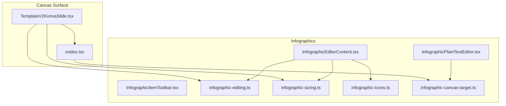
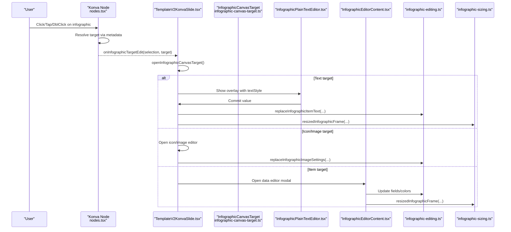
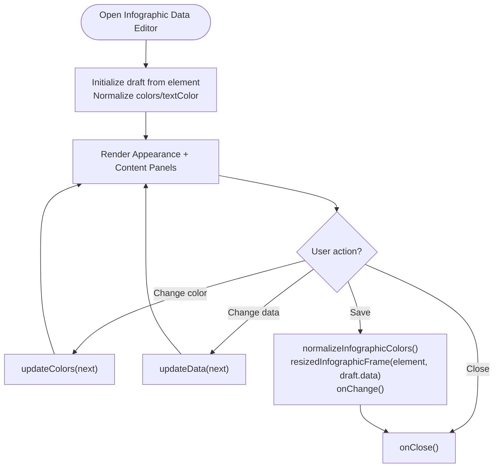
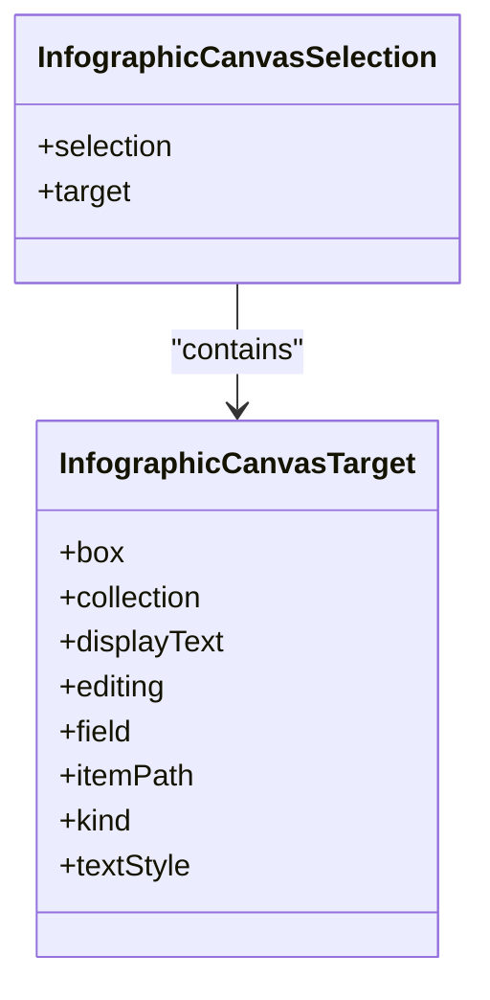
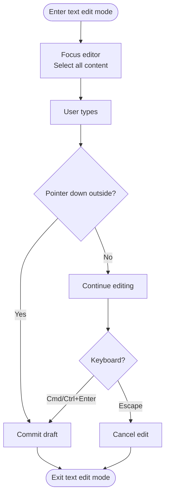
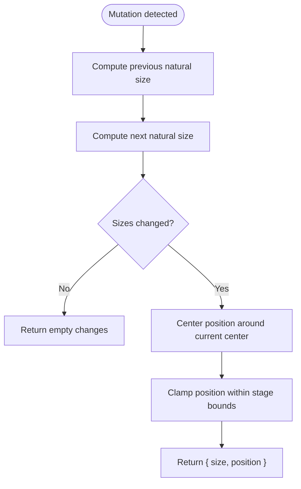
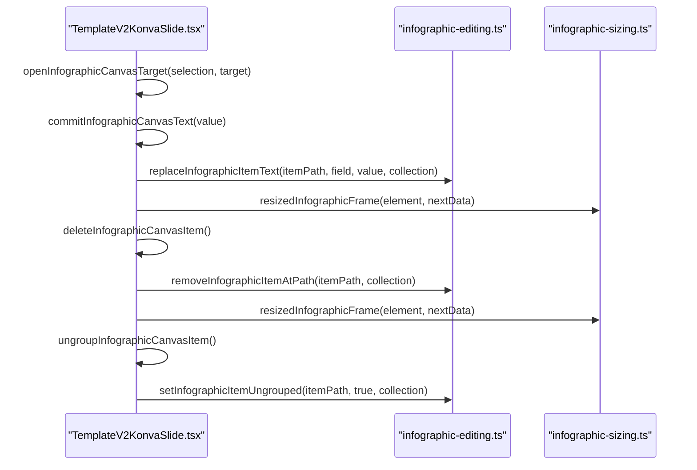
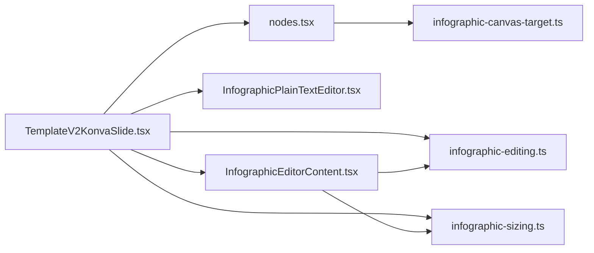

# Infographic Editor

<cite>
**Referenced Files in This Document**
- [InfographicEditorContent.tsx](file://servers/nex tjs/components/slide-editor/infographics/InfographicEditorContent.tsx)
- [InfographicPlainTextEditor.tsx](file://servers/nex tjs/components/slide-editor/infographics/InfographicPlainTextEditor.tsx)
- [InfographicItemToolbar.tsx](file://servers/nex tjs/components/slide-editor/infographics/InfographicItemToolbar.tsx)
- [infographic-editing.ts](file://servers/nex tjs/components/slide-editor/infographics/infographic-editing.ts)
- [infographic-sizing.ts](file://servers/nex tjs/components/slide-editor/infographics/infographic-sizing.ts)
- [infographic-icons.ts](file://servers/nex tjs/components/slide-editor/infographics/infographic-icons.ts)
- [infographic-canvas-target.ts](file://servers/nex tjs/components/slide-editor/infographics/infographic-canvas-target.ts)
- [nodes.tsx](file://servers/nex tjs/components/slide-editor/surface/nodes.tsx)
- [TemplateV2KonvaSlide.tsx](file://servers/nex tjs/components/slide-editor/surface/TemplateV2KonvaSlide.tsx)
</cite>

## Table of Contents
1. Introduction
2. Project Structure
3. Core Components
4. Architecture Overview
5. Detailed Component Analysis
6. Dependency Analysis
7. Performance Considerations
8. Troubleshooting Guide
9. Conclusion

## Introduction
This document explains the infographic editor subsystem used inside the slide editor. It covers the canvas-based editing architecture, item manipulation workflows, text editing capabilities, icon management, sizing algorithms, canvas targeting, and editing state management. It also provides practical guidance for building custom infographic layouts, implementing drag-and-drop behaviors, handling complex compositions, optimizing performance for large infographics, and debugging canvas-related issues.

## Project Structure
The infographic editor is implemented as a set of focused modules:
- Data editors and UI for each infographic type live under the infographics folder.
- Canvas interaction and selection logic are integrated into the Konva-based slide surface.
- Sizing utilities compute natural frames based on data.
- Editing helpers provide immutable updates to infographic data structures.
- Plain text editing overlays support inline text edits directly on the canvas.

**Diagram sources**
- [InfographicEditorContent.tsx:111-408](file://servers/nex tjs/components/slide-editor/infographics/InfographicEditorContent.tsx#L111-L408)
- [InfographicPlainTextEditor.tsx:7-141](file://servers/nex tjs/components/slide-editor/infographics/InfographicPlainTextEditor.tsx#L7-L141)
- [InfographicItemToolbar.tsx:13-61](file://servers/nex tjs/components/slide-editor/infographics/InfographicItemToolbar.tsx#L13-L61)
- [infographic-editing.ts:1-800](file://servers/nex tjs/components/slide-editor/infographics/infographic-editing.ts#L1-L800)
- [infographic-sizing.ts:1-279](file://servers/nex tjs/components/slide-editor/infographics/infographic-sizing.ts#L1-L279)
- [infographic-icons.ts:1-23](file://servers/nex tjs/components/slide-editor/infographics/infographic-icons.ts#L1-L23)
- [infographic-canvas-target.ts:1-60](file://servers/nex tjs/components/slide-editor/infographics/infographic-canvas-target.ts#L1-L60)
- [nodes.tsx:542-679](file://servers/nex tjs/components/slide-editor/surface/nodes.tsx#L542-L679)
- [TemplateV2KonvaSlide.tsx:2504-2655](file://servers/nex tjs/components/slide-editor/surface/TemplateV2KonvaSlide.tsx#L2504-L2655)

**Section sources**
- [InfographicEditorContent.tsx:111-408](file://servers/nex tjs/components/slide-editor/infographics/InfographicEditorContent.tsx#L111-L408)
- [infographic-sizing.ts:1-279](file://servers/nex tjs/components/slide-editor/infographics/infographic-sizing.ts#L1-L279)
- [infographic-editing.ts:1-800](file://servers/nex tjs/components/slide-editor/infographics/infographic-editing.ts#L1-L800)
- [nodes.tsx:542-679](file://servers/nex tjs/components/slide-editor/surface/nodes.tsx#L542-L679)
- [TemplateV2KonvaSlide.tsx:2504-2655](file://servers/nex tjs/components/slide-editor/surface/TemplateV2KonvaSlide.tsx#L2504-L2655)

## Core Components
- InfographicDataEditorContent: Modal-driven content editor for all supported infographic types. It manages draft state, color palettes, text colors, and delegates per-type editing panels. On save, it normalizes colors and computes resized frame changes before calling onChange.
- InfographicPlainTextEditor: Inline overlay editor for text nodes within an infographic. It captures input, applies text styles from the canvas target, commits on blur or outside pointer events, and supports keyboard shortcuts.
- InfographicItemToolbar: Floating toolbar for deleting or ungrouping selected infographic items.
- infographic-editing: Immutable update helpers for items, icons, images, offsets, grouping flags, and collection operations (add/remove/move). Also includes palette normalization and Gantt column utilities.
- infographic-sizing: Natural size computation per infographic type and frame resizing logic that centers and contains positions when sizes change.
- infographic-icons: Default icon generator and normalized icon shape.
- infographic-canvas-target: Types and equality helper for canvas-level targets (item, icon, image, shape, text).
- nodes.tsx: Konva node rendering and click/tap/double-click handlers that resolve InfographicCanvasTarget via ancestor metadata attributes.
- TemplateV2KonvaSlide.tsx: Orchestrates canvas selection, opens text/image/icon editors, commits text changes, deletes items, and toggles ungrouped state.

**Section sources**
- [InfographicEditorContent.tsx:111-408](file://servers/nex tjs/components/slide-editor/infographics/InfographicEditorContent.tsx#L111-L408)
- [InfographicPlainTextEditor.tsx:7-141](file://servers/nex tjs/components/slide-editor/infographics/InfographicPlainTextEditor.tsx#L7-L141)
- [InfographicItemToolbar.tsx:13-61](file://servers/nex tjs/components/slide-editor/infographics/InfographicItemToolbar.tsx#L13-L61)
- [infographic-editing.ts:1-800](file://servers/nex tjs/components/slide-editor/infographics/infographic-editing.ts#L1-L800)
- [infographic-sizing.ts:1-279](file://servers/nex tjs/components/slide-editor/infographics/infographic-sizing.ts#L1-L279)
- [infographic-icons.ts:1-23](file://servers/nex tjs/components/slide-editor/infographics/infographic-icons.ts#L1-L23)
- [infographic-canvas-target.ts:1-60](file://servers/nex tjs/components/slide-editor/infographics/infographic-canvas-target.ts#L1-L60)
- [nodes.tsx:542-679](file://servers/nex tjs/components/slide-editor/surface/nodes.tsx#L542-L679)
- [TemplateV2KonvaSlide.tsx:2504-2655](file://servers/nex tjs/components/slide-editor/surface/TemplateV2KonvaSlide.tsx#L2504-L2655)

## Architecture Overview
The infographic editor integrates with the Konva-based slide surface. Clicks and taps on infographic elements are intercepted by nodes.tsx, which resolves a structured InfographicCanvasTarget using metadata attached to Konva nodes. The slide surface then opens appropriate editors (text overlay, icon picker, or data modal), applies immutable updates through infographic-editing helpers, and adjusts the infographic frame using infographic-sizing utilities.

**Diagram sources**
- [nodes.tsx:1756-1815](file://servers/nex tjs/components/slide-editor/surface/nodes.tsx#L1756-L1815)
- [TemplateV2KonvaSlide.tsx:2504-2655](file://servers/nex tjs/components/slide-editor/surface/TemplateV2KonvaSlide.tsx#L2504-L2655)
- [infographic-canvas-target.ts:22-36](file://servers/nex tjs/components/slide-editor/infographics/infographic-canvas-target.ts#L22-L36)
- [InfographicPlainTextEditor.tsx:7-141](file://servers/nex tjs/components/slide-editor/infographics/InfographicPlainTextEditor.tsx#L7-L141)
- [InfographicEditorContent.tsx:111-408](file://servers/nex tjs/components/slide-editor/infographics/InfographicEditorContent.tsx#L111-L408)
- [infographic-editing.ts:172-240](file://servers/nex tjs/components/slide-editor/infographics/infographic-editing.ts#L172-L240)
- [infographic-sizing.ts:245-278](file://servers/nex tjs/components/slide-editor/infographics/infographic-sizing.ts#L245-L278)

## Detailed Component Analysis

### InfographicEditorContent
Responsibilities:
- Renders a modal dialog with appearance controls (palette, text color) and per-type content editors.
- Maintains a draft copy of the element and normalizes colors and text color.
- Delegates to specialized editors (e.g., MeterEditor, GanttEditor, TimelineEditor, FunnelEditor, MatrixEditors, HierarchyEditor, MindMapEditor).
- On save, normalizes colors and computes resizedInfographicFrame before invoking onChange.

Key implementation patterns:
- Draft state with localized update functions for data and colors.
- Keyboard shortcut (Escape) to close the modal.
- Type-specific branches render the correct editor panel.
- Uses buildSvgUpdateUrl to preview icons with dynamic color.

**Diagram sources**
- [InfographicEditorContent.tsx:111-408](file://servers/nex tjs/components/slide-editor/infographics/InfographicEditorContent.tsx#L111-L408)
- [infographic-editing.ts:716-750](file://servers/nex tjs/components/slide-editor/infographics/infographic-editing.ts#L716-L750)
- [infographic-sizing.ts:245-278](file://servers/nex tjs/components/slide-editor/infographics/infographic-sizing.ts#L245-L278)

**Section sources**
- [InfographicEditorContent.tsx:111-408](file://servers/nex tjs/components/slide-editor/infographics/InfographicEditorContent.tsx#L111-L408)

### Canvas Targeting and Selection
Responsibilities:
- Attach metadata to Konva nodes to identify editable regions (item, icon, image, shape, text).
- Traverse ancestors to resolve the most relevant target, preferring item-level targets unless explicitly overridden.
- Compute bounding boxes relative to the stage and extract text styles for inline editing.

Key implementation patterns:
- INFOGRAPHIC_TARGET_ATTR constant stores structured metadata on nodes.
- infographicCanvasTargetFromNode walks up the node tree to find the best match.
- For text nodes, explicit metadata can force text editing mode.

**Diagram sources**
- [infographic-canvas-target.ts:22-36](file://servers/nex tjs/components/slide-editor/infographics/infographic-canvas-target.ts#L22-L36)

**Section sources**
- [nodes.tsx:542-679](file://servers/nex tjs/components/slide-editor/surface/nodes.tsx#L542-L679)
- [infographic-canvas-target.ts:1-60](file://servers/nex tjs/components/slide-editor/infographics/infographic-canvas-target.ts#L1-L60)

### Text Editing Overlay
Responsibilities:
- Provide a contentEditable overlay positioned over the selected text region.
- Apply text styles derived from the canvas target.
- Commit on blur, outside pointerdown, or keyboard shortcuts; cancel on Escape.

Key implementation patterns:
- Absolute positioning based on box coordinates.
- Prevent event propagation to avoid interfering with canvas interactions.
- Normalize line endings and preserve plain text.

**Diagram sources**
- [InfographicPlainTextEditor.tsx:7-141](file://servers/nex tjs/components/slide-editor/infographics/InfographicPlainTextEditor.tsx#L7-L141)

**Section sources**
- [InfographicPlainTextEditor.tsx:7-141](file://servers/nex tjs/components/slide-editor/infographics/InfographicPlainTextEditor.tsx#L7-L141)

### Item Manipulation and Toolbar
Responsibilities:
- Offer delete and ungroup actions for selected infographic items.
- Integrate with the floating toolbar system and component actions menu.

Key implementation patterns:
- Conditional rendering of ungroup button based on capability.
- Delegates deletion and ungrouping to parent handlers.

**Section sources**
- [InfographicItemToolbar.tsx:13-61](file://servers/nex tjs/components/slide-editor/infographics/InfographicItemToolbar.tsx#L13-L61)

### Icon Management
Responsibilities:
- Provide default icons and normalize icon objects (url, color).
- Preview icons with dynamic color via SVG URL builder.

Key implementation patterns:
- defaultInfographicIcon cycles through example URLs.
- normalizeInfographicIcon handles legacy color fields and trims values.

**Section sources**
- [infographic-icons.ts:1-23](file://servers/nex tjs/components/slide-editor/infographics/infographic-icons.ts#L1-L23)
- [InfographicEditorContent.tsx:2163-2187](file://servers/nex tjs/components/slide-editor/infographics/InfographicEditorContent.tsx#L2163-L2187)

### Sizing Algorithms
Responsibilities:
- Compute natural content size per infographic type.
- Adjust frame size and position when data changes significantly.

Key implementation patterns:
- infographicContentSize maps each type to width/height formulas.
- resizedInfographicFrame compares previous and next natural sizes and returns centered, contained position if needed.

**Diagram sources**
- [infographic-sizing.ts:103-199](file://servers/nex tjs/components/slide-editor/infographics/infographic-sizing.ts#L103-L199)
- [infographic-sizing.ts:245-278](file://servers/nex tjs/components/slide-editor/infographics/infographic-sizing.ts#L245-L278)

**Section sources**
- [infographic-sizing.ts:1-279](file://servers/nex tjs/components/slide-editor/infographics/infographic-sizing.ts#L1-L279)

### Editing State Management
Responsibilities:
- Manage canvas-level selection for infographic targets.
- Open/close text, icon, and data editors.
- Commit text changes and apply immutable updates.
- Delete items and toggle ungrouped state.

Key implementation patterns:
- openInfographicCanvasTarget sets selection and hides underlying text node during editing.
- commitInfographicCanvasText uses replaceInfographicItemText and clears selection.
- deleteInfographicCanvasItem uses removeInfographicItemAtPath and recomputes frame.
- ungroupInfographicCanvasItem sets __presenton_ungrouped flag.

**Diagram sources**
- [TemplateV2KonvaSlide.tsx:2504-2655](file://servers/nex tjs/components/slide-editor/surface/TemplateV2KonvaSlide.tsx#L2504-L2655)
- [infographic-editing.ts:172-240](file://servers/nex tjs/components/slide-editor/infographics/infographic-editing.ts#L172-L240)
- [infographic-editing.ts:483-526](file://servers/nex tjs/components/slide-editor/infographics/infographic-editing.ts#L483-L526)
- [infographic-editing.ts:283-313](file://servers/nex tjs/components/slide-editor/infographics/infographic-editing.ts#L283-L313)
- [infographic-sizing.ts:245-278](file://servers/nex tjs/components/slide-editor/infographics/infographic-sizing.ts#L245-L278)

**Section sources**
- [TemplateV2KonvaSlide.tsx:2504-2655](file://servers/nex tjs/components/slide-editor/surface/TemplateV2KonvaSlide.tsx#L2504-L2655)
- [infographic-editing.ts:172-240](file://servers/nex tjs/components/slide-editor/infographics/infographic-editing.ts#L172-L240)
- [infographic-editing.ts:483-526](file://servers/nex tjs/components/slide-editor/infographics/infographic-editing.ts#L483-L526)
- [infographic-editing.ts:283-313](file://servers/nex tjs/components/slide-editor/infographics/infographic-editing.ts#L283-L313)
- [infographic-sizing.ts:245-278](file://servers/nex tjs/components/slide-editor/infographics/infographic-sizing.ts#L245-L278)

## Dependency Analysis
High-level dependencies:
- TemplateV2KonvaSlide orchestrates user interactions and delegates to:
  - nodes.tsx for target resolution and event routing.
  - infographic-editing for immutable data mutations.
  - infographic-sizing for frame adjustments.
  - InfographicPlainTextEditor and InfographicEditorContent for editing UI.
- nodes.tsx depends on infographic-canvas-target types and attaches metadata to Konva nodes.
- InfographicEditorContent depends on infographic-editing and infographic-sizing for validation and layout.

**Diagram sources**
- [TemplateV2KonvaSlide.tsx:2504-2655](file://servers/nex tjs/components/slide-editor/surface/TemplateV2KonvaSlide.tsx#L2504-L2655)
- [nodes.tsx:542-679](file://servers/nex tjs/components/slide-editor/surface/nodes.tsx#L542-L679)
- [infographic-canvas-target.ts:1-60](file://servers/nex tjs/components/slide-editor/infographics/infographic-canvas-target.ts#L1-L60)
- [InfographicEditorContent.tsx:111-408](file://servers/nex tjs/components/slide-editor/infographics/InfographicEditorContent.tsx#L111-L408)

**Section sources**
- [TemplateV2KonvaSlide.tsx:2504-2655](file://servers/nex tjs/components/slide-editor/surface/TemplateV2KonvaSlide.tsx#L2504-L2655)
- [nodes.tsx:542-679](file://servers/nex tjs/components/slide-editor/surface/nodes.tsx#L542-L679)
- [infographic-canvas-target.ts:1-60](file://servers/nex tjs/components/slide-editor/infographics/infographic-canvas-target.ts#L1-L60)
- [InfographicEditorContent.tsx:111-408](file://servers/nex tjs/components/slide-editor/infographics/InfographicEditorContent.tsx#L111-L408)

## Performance Considerations
- Prefer immutable updates: Use infographic-editing helpers to create new object graphs rather than mutating existing ones. This reduces re-renders and keeps undo/redo consistent.
- Batch visual updates: When editing text, hide the underlying Konva text node and batchDraw after restoring visibility to avoid flicker.
- Limit heavy computations: infographicContentSize is computed only when necessary (e.g., on save or structural changes). Avoid recalculating on every keystroke.
- Virtualize large collections: For very large infographics (many items), consider lazy rendering of off-screen items in the Konva tree.
- Debounce frequent updates: For real-time previews (e.g., icon color), debounce calls to buildSvgUpdateUrl to reduce network overhead.
- Minimize DOM overlays: Keep InfographicPlainTextEditor mounted only while editing; detach listeners promptly.

[No sources needed since this section provides general guidance]

## Troubleshooting Guide
Common issues and resolutions:
- Text overlay not appearing:
  - Verify that the target kind is "text" and that the node has valid textStyle properties.
  - Ensure the Konva text node is hidden during editing and restored afterward.
  - Check that the overlay’s absolute positioning matches the computed box coordinates.
- Incorrect target resolution:
  - Confirm that INFOGRAPHIC_TARGET_ATTR metadata is attached to nodes.
  - Inspect ancestor traversal in infographicCanvasTargetFromNode to ensure the intended node is selected.
- Frame jumps after edits:
  - Validate that resizedInfographicFrame is called with the updated data and that previousNaturalSize vs nextNaturalSize differ.
  - Ensure position clamping is applied so the infographic remains within the stage bounds.
- Icon color not updating:
  - Ensure normalizeInfographicIcon returns a valid url and color.
  - Verify buildSvgUpdateUrl receives a proper base URL and color parameter.
- Deleting items leaves orphaned children:
  - Confirm removeInfographicItemAtPath clears parent_id references for nested children.
  - For hierarchical types (org_chart, decision_tree), verify parent_id normalization.

**Section sources**
- [nodes.tsx:542-679](file://servers/nex tjs/components/slide-editor/surface/nodes.tsx#L542-L679)
- [TemplateV2KonvaSlide.tsx:2504-2655](file://servers/nex tjs/components/slide-editor/surface/TemplateV2KonvaSlide.tsx#L2504-L2655)
- [infographic-editing.ts:483-526](file://servers/nex tjs/components/slide-editor/infographics/infographic-editing.ts#L483-L526)
- [infographic-sizing.ts:245-278](file://servers/nex tjs/components/slide-editor/infographics/infographic-sizing.ts#L245-L278)
- [infographic-icons.ts:1-23](file://servers/nex tjs/components/slide-editor/infographics/infographic-icons.ts#L1-L23)

## Conclusion
The infographic editor subsystem combines a robust canvas targeting mechanism, immutable data mutation helpers, and flexible sizing algorithms to deliver a responsive editing experience. InfographicEditorContent centralizes per-type editing, while InfographicPlainTextEditor enables direct text edits on the canvas. TemplateV2KonvaSlide orchestrates interactions, opening appropriate editors and committing changes consistently. By following the patterns outlined here—using targeted metadata, immutable updates, and calculated frame resizing—you can extend the system with new infographic types, implement advanced drag-and-drop behaviors, and optimize performance for complex compositions.

[No sources needed since this section summarizes without analyzing specific files]