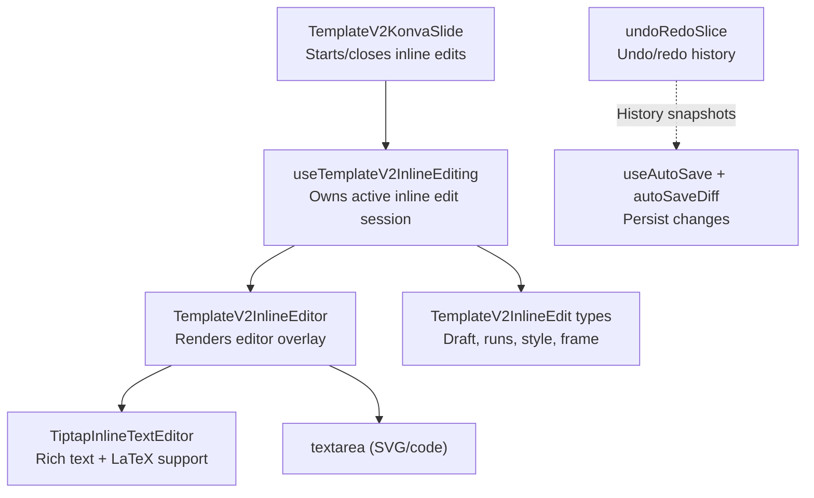
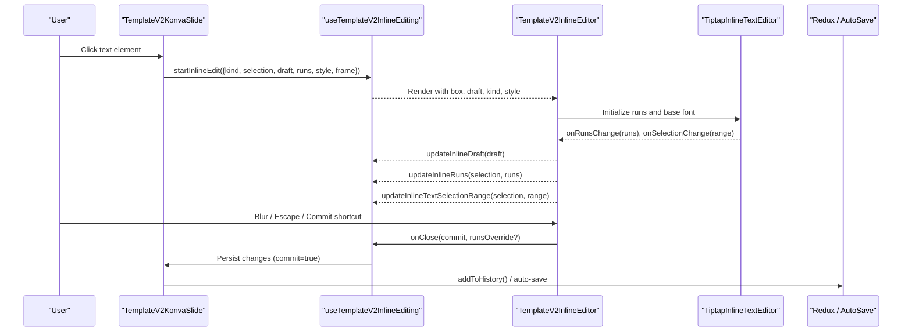
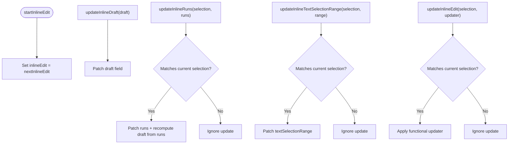
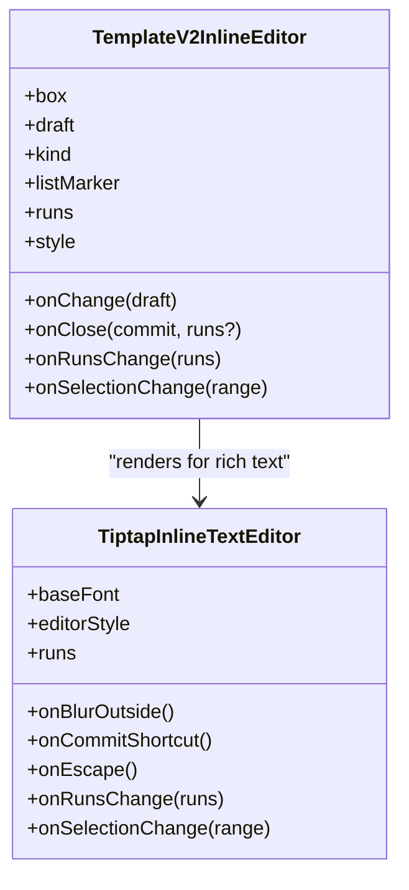
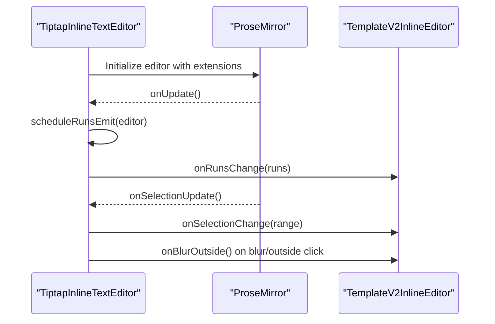
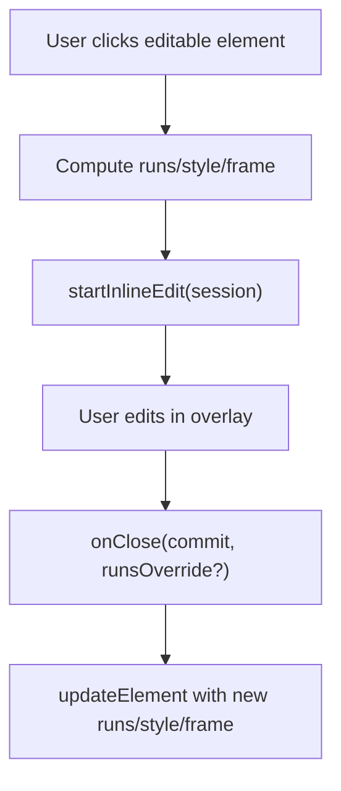
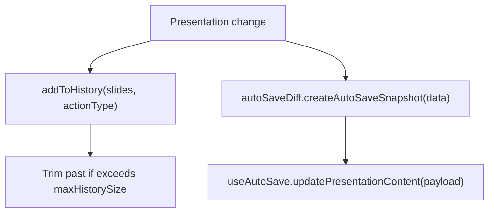
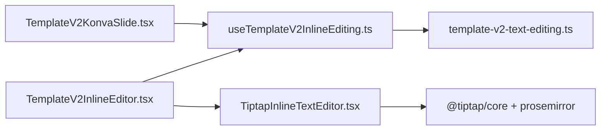

# Inline Editing State Management

<cite>
**Referenced Files in This Document**
- [useTemplateV2InlineEditing.ts](file://servers/nextjs/components/slide-editor/state/useTemplateV2InlineEditing.ts)
- [template-v2-text-editing.ts](file://servers/nextjs/components/slide-editor/text/template-v2-text-editing.ts)
- [TemplateV2InlineEditor.tsx](file://servers/nextjs/components/slide-editor/text/TemplateV2InlineEditor.tsx)
- [TiptapInlineTextEditor.tsx](file://servers/nextjs/components/slide-editor/text/TiptapInlineTextEditor.tsx)
- [core.ts](file://servers/nextjs/components/slide-editor/model/core.ts)
- [TemplateV2KonvaSlide.tsx](file://servers/nextjs/components/slide-editor/surface/TemplateV2KonvaSlide.tsx)
- [undoRedoSlice.ts](file://servers/nextjs/store/slices/undoRedoSlice.ts)
- [useAutoSave.tsx](file://servers/nextjs/app/(presentation-generator)/presentation/hooks/useAutoSave.tsx)
- [autoSaveDiff.ts](file://servers/nextjs/app/(presentation-generator)/presentation/utils/autoSaveDiff.ts)
</cite>

## Table of Contents
1. [Introduction](#introduction)
2. [Project Structure](#project-structure)
3. [Core Components](#core-components)
4. [Architecture Overview](#architecture-overview)
5. [Detailed Component Analysis](#detailed-component-analysis)
6. [Dependency Analysis](#dependency-analysis)
7. [Performance Considerations](#performance-considerations)
8. [Troubleshooting Guide](#troubleshooting-guide)
9. [Conclusion](#conclusion)

## Introduction
This document explains the inline editing state management for Template V2 elements, focusing on the useTemplateV2InlineEditing hook architecture, state synchronization mechanisms, and editing session lifecycle. It covers how inline editing integrates with the template V2 system, data persistence strategies, selection handling, cursor positioning, undo/redo integration, and collaborative editing considerations. It also includes guidance for extending capabilities, implementing custom editors, optimizing performance, and troubleshooting common issues.

## Project Structure
The inline editing subsystem is implemented in the Next.js slide editor:
- State orchestration: a React hook that owns the active inline edit session and exposes typed update functions.
- Editor UI: a lightweight overlay component that renders either a rich text editor or a code textarea depending on content kind.
- Rich text engine: a Tiptap-based editor that manages runs, LaTeX nodes, selection, and commit behavior.
- Integration layer: slide surface components that start/close inline edits and persist changes to the presentation model.
- Undo/redo and persistence: Redux slice for history and auto-save utilities for diffing and saving changes.

**Diagram sources**
- [useTemplateV2InlineEditing.ts:9-83](file://servers/nextjs/components/slide-editor/state/useTemplateV2InlineEditing.ts#L9-L83)
- [TemplateV2InlineEditor.tsx:38-200](file://servers/nextjs/components/slide-editor/text/TemplateV2InlineEditor.tsx#L38-L200)
- [TiptapInlineTextEditor.tsx:280-617](file://servers/nextjs/components/slide-editor/text/TiptapInlineTextEditor.tsx#L280-L617)
- [TemplateV2KonvaSlide.tsx:1886-1925](file://servers/nextjs/components/slide-editor/surface/TemplateV2KonvaSlide.tsx#L1886-L1925)
- [undoRedoSlice.ts:28-138](file://servers/nextjs/store/slices/undoRedoSlice.ts#L28-L138)
- [useAutoSave.tsx:68-98](file://servers/nextjs/app/(presentation-generator)/presentation/hooks/useAutoSave.tsx#L68-L98)
- [autoSaveDiff.ts:1-47](file://servers/nextjs/app/(presentation-generator)/presentation/utils/autoSaveDiff.ts#L1-L47)

**Section sources**
- [useTemplateV2InlineEditing.ts:9-83](file://servers/nextjs/components/slide-editor/state/useTemplateV2InlineEditing.ts#L9-L83)
- [TemplateV2InlineEditor.tsx:38-200](file://servers/nextjs/components/slide-editor/text/TemplateV2InlineEditor.tsx#L38-L200)
- [TiptapInlineTextEditor.tsx:280-617](file://servers/nextjs/components/slide-editor/text/TiptapInlineTextEditor.tsx#L280-L617)
- [TemplateV2KonvaSlide.tsx:1886-1925](file://servers/nextjs/components/slide-editor/surface/TemplateV2KonvaSlide.tsx#L1886-L1925)
- [undoRedoSlice.ts:28-138](file://servers/nextjs/store/slices/undoRedoSlice.ts#L28-L138)
- [useAutoSave.tsx:68-98](file://servers/nextjs/app/(presentation-generator)/presentation/hooks/useAutoSave.tsx#L68-L98)
- [autoSaveDiff.ts:1-47](file://servers/nextjs/app/(presentation-generator)/presentation/utils/autoSaveDiff.ts#L1-L47)

## Core Components
- useTemplateV2InlineEditing: A generic React hook that holds the current inline edit session, keyed by a stable selection identifier. It provides methods to start, update draft text, update runs, update selection range, and perform targeted updates.
- TemplateV2InlineEditor: The visual overlay that hosts either a rich text editor or a plain textarea. It computes layout metrics, forwards selection events, and commits or cancels edits based on user actions.
- TiptapInlineTextEditor: A ProseMirror-backed editor that supports styled runs, LaTeX math blocks, list markers, and robust selection reporting. It debounces run emissions and preserves caret positions when external content updates occur.
- TemplateV2InlineEdit types: Typed definitions for the inline edit session including kind, selection, draft, optional runs, style, frame geometry, and text selection range.
- Slide surface integration: The Konva slide component starts inline editing for text and text-list elements, computes frames, and persists changes upon close.

Key responsibilities:
- Session ownership and scoping via keyForSelection.
- Draft vs committed runs synchronization.
- Selection range propagation across editor layers.
- Commit/cancel semantics and blur handling.

**Section sources**
- [useTemplateV2InlineEditing.ts:9-83](file://servers/nextjs/components/slide-editor/state/useTemplateV2InlineEditing.ts#L9-L83)
- [template-v2-text-editing.ts:14-48](file://servers/nextjs/components/slide-editor/text/template-v2-text-editing.ts#L14-L48)
- [TemplateV2InlineEditor.tsx:38-200](file://servers/nextjs/components/slide-editor/text/TemplateV2InlineEditor.tsx#L38-L200)
- [TiptapInlineTextEditor.tsx:280-617](file://servers/nextjs/components/slide-editor/text/TiptapInlineTextEditor.tsx#L280-L617)
- [TemplateV2KonvaSlide.tsx:1886-1925](file://servers/nextjs/components/slide-editor/surface/TemplateV2KonvaSlide.tsx#L1886-L1925)

## Architecture Overview
The inline editing flow connects the slide surface, the hook-managed session, and the editor overlay. Changes are synchronized through typed callbacks and persisted via auto-save and undo/redo.

**Diagram sources**
- [TemplateV2KonvaSlide.tsx:1886-1925](file://servers/nextjs/components/slide-editor/surface/TemplateV2KonvaSlide.tsx#L1886-L1925)
- [useTemplateV2InlineEditing.ts:21-72](file://servers/nextjs/components/slide-editor/state/useTemplateV2InlineEditing.ts#L21-L72)
- [TemplateV2InlineEditor.tsx:75-140](file://servers/nextjs/components/slide-editor/text/TemplateV2InlineEditor.tsx#L75-L140)
- [TiptapInlineTextEditor.tsx:446-505](file://servers/nextjs/components/slide-editor/text/TiptapInlineTextEditor.tsx#L446-L505)
- [undoRedoSlice.ts:32-86](file://servers/nextjs/store/slices/undoRedoSlice.ts#L32-L86)
- [useAutoSave.tsx:68-98](file://servers/nextjs/app/(presentation-generator)/presentation/hooks/useAutoSave.tsx#L68-L98)

## Detailed Component Analysis

### useTemplateV2InlineEditing Hook
Responsibilities:
- Owns a single active inline edit session per selection key.
- Provides immutable-style updates for draft, runs, and selection range.
- Ensures updates only apply to the matching selection using keyForSelection.

Design patterns:
- Functional updater pattern for safe concurrent updates.
- Generic typing over Selection to integrate with any selection model.

Complexity:
- O(1) per update; no deep cloning beyond object spread.

Error handling:
- Guards against null sessions and mismatched selections.

**Diagram sources**
- [useTemplateV2InlineEditing.ts:21-72](file://servers/nextjs/components/slide-editor/state/useTemplateV2InlineEditing.ts#L21-L72)

**Section sources**
- [useTemplateV2InlineEditing.ts:9-83](file://servers/nextjs/components/slide-editor/state/useTemplateV2InlineEditing.ts#L9-L83)

### TemplateV2InlineEditor Overlay
Responsibilities:
- Renders an absolutely positioned editor overlay sized to the computed frame.
- Chooses between rich text (Tiptap) and code (textarea) based on kind.
- Reports selection ranges and forwards commit/cancel actions.

Behavior highlights:
- Computes effective line height for accurate sizing.
- Uses data-inline-edit-ignore attributes to avoid interfering with toolbar interactions.
- Handles Escape and commit shortcuts consistently across editors.

**Diagram sources**
- [TemplateV2InlineEditor.tsx:38-200](file://servers/nextjs/components/slide-editor/text/TemplateV2InlineEditor.tsx#L38-L200)
- [TiptapInlineTextEditor.tsx:280-617](file://servers/nextjs/components/slide-editor/text/TiptapInlineTextEditor.tsx#L280-L617)

**Section sources**
- [TemplateV2InlineEditor.tsx:38-200](file://servers/nextjs/components/slide-editor/text/TemplateV2InlineEditor.tsx#L38-L200)

### TiptapInlineTextEditor (Rich Text Engine)
Responsibilities:
- Manages ProseMirror editor instance, extensions, and content conversion between TextRun[] and JSONContent.
- Supports LaTeX math nodes with inline editing and display modes.
- Emits runs and selection changes with deduplication and requestAnimationFrame batching.
- Preserves caret position during external content updates.

Key behaviors:
- Debounced run emission via scheduleRunsEmit/flushPendingRuns.
- Robust beforeinput handling for insert/delete/line-break operations.
- List marker prefixing for ordered/bullet lists.
- Global pointerdown listener to commit on outside clicks.

**Diagram sources**
- [TiptapInlineTextEditor.tsx:398-505](file://servers/nextjs/components/slide-editor/text/TiptapInlineTextEditor.tsx#L398-L505)
- [TiptapInlineTextEditor.tsx:535-586](file://servers/nextjs/components/slide-editor/text/TiptapInlineTextEditor.tsx#L535-L586)

**Section sources**
- [TiptapInlineTextEditor.tsx:280-617](file://servers/nextjs/components/slide-editor/text/TiptapInlineTextEditor.tsx#L280-L617)

### Template V2 Types and Helpers
Types:
- TemplateV2InlineEditKind: "text" | "text-list" | "svg".
- TemplateV2InlineEditBox: absolute positioning rectangle.
- TemplateV2TextEditStyle: typography and alignment properties.
- TemplateV2InlineEdit: union describing the active inline edit session.

Helpers:
- measureWrappedRenderTextHeight: measures wrapped text height for layout.
- measureWordWrappedTextRunsHeight: computes height for runs with word wrapping.
- wordWrappedTextRuns: normalizes runs for editor consumption.

**Section sources**
- [template-v2-text-editing.ts:14-48](file://servers/nextjs/components/slide-editor/text/template-v2-text-editing.ts#L14-L48)
- [template-v2-text-editing.ts:50-112](file://servers/nextjs/components/slide-editor/text/template-v2-text-editing.ts#L50-L112)

### Slide Surface Integration
The slide surface component:
- Starts inline editing for text and text-list elements, computing initial runs, style, and frame.
- Closes the inline editor, committing changes and updating the underlying element.

**Diagram sources**
- [TemplateV2KonvaSlide.tsx:1886-1925](file://servers/nextjs/components/slide-editor/surface/TemplateV2KonvaSlide.tsx#L1886-L1925)

**Section sources**
- [TemplateV2KonvaSlide.tsx:1886-1925](file://servers/nextjs/components/slide-editor/surface/TemplateV2KonvaSlide.tsx#L1886-L1925)

### Undo/Redo and Data Persistence
Undo/Redo:
- Redux slice maintains past/present/future stacks with max history size and guards against duplicate entries.
- Integrates with presentation updates to snapshot slides and track action types.

Persistence:
- Auto-save compares structural vs metadata changes and serializes minimal payloads.
- Fingerprints help detect meaningful changes and reduce network traffic.

**Diagram sources**
- [undoRedoSlice.ts:28-86](file://servers/nextjs/store/slices/undoRedoSlice.ts#L28-L86)
- [useAutoSave.tsx:68-98](file://servers/nextjs/app/(presentation-generator)/presentation/hooks/useAutoSave.tsx#L68-L98)
- [autoSaveDiff.ts:1-47](file://servers/nextjs/app/(presentation-generator)/presentation/utils/autoSaveDiff.ts#L1-L47)

**Section sources**
- [undoRedoSlice.ts:28-138](file://servers/nextjs/store/slices/undoRedoSlice.ts#L28-L138)
- [useAutoSave.tsx:68-98](file://servers/nextjs/app/(presentation-generator)/presentation/hooks/useAutoSave.tsx#L68-L98)
- [autoSaveDiff.ts:1-47](file://servers/nextjs/app/(presentation-generator)/presentation/utils/autoSaveDiff.ts#L1-L47)

## Dependency Analysis
- useTemplateV2InlineEditing depends on:
  - TemplateV2InlineEdit types and helpers for session shape and text measurement.
  - TextRun and TextSelectionRange types for structured content and selection.
- TemplateV2InlineEditor depends on:
  - TiptapInlineTextEditor for rich text editing.
  - TemplateV2InlineEditBox, TemplateV2InlineEditKind, TemplateV2TextEditStyle for rendering configuration.
- TiptapInlineTextEditor depends on:
  - ProseMirror/Tiptap core and extensions.
  - TextRun conversion utilities and CSS font helpers.
- Slide surface depends on:
  - Hook API to manage sessions.
  - Element models to persist changes.

**Diagram sources**
- [useTemplateV2InlineEditing.ts:1-8](file://servers/nextjs/components/slide-editor/state/useTemplateV2InlineEditing.ts#L1-L8)
- [template-v2-text-editing.ts:1-13](file://servers/nextjs/components/slide-editor/text/template-v2-text-editing.ts#L1-L13)
- [TemplateV2InlineEditor.tsx:1-23](file://servers/nextjs/components/slide-editor/text/TemplateV2InlineEditor.tsx#L1-L23)
- [TiptapInlineTextEditor.tsx:1-31](file://servers/nextjs/components/slide-editor/text/TiptapInlineTextEditor.tsx#L1-L31)
- [TemplateV2KonvaSlide.tsx:1886-1925](file://servers/nextjs/components/slide-editor/surface/TemplateV2KonvaSlide.tsx#L1886-L1925)

**Section sources**
- [useTemplateV2InlineEditing.ts:1-83](file://servers/nextjs/components/slide-editor/state/useTemplateV2InlineEditing.ts#L1-L83)
- [template-v2-text-editing.ts:1-112](file://servers/nextjs/components/slide-editor/text/template-v2-text-editing.ts#L1-L112)
- [TemplateV2InlineEditor.tsx:1-216](file://servers/nextjs/components/slide-editor/text/TemplateV2InlineEditor.tsx#L1-L216)
- [TiptapInlineTextEditor.tsx:1-617](file://servers/nextjs/components/slide-editor/text/TiptapInlineTextEditor.tsx#L1-L617)
- [TemplateV2KonvaSlide.tsx:1886-1925](file://servers/nextjs/components/slide-editor/surface/TemplateV2KonvaSlide.tsx#L1886-L1925)

## Performance Considerations
- Batched run emissions: TiptapInlineTextEditor uses requestAnimationFrame to coalesce multiple updates into a single onRunsChange call, reducing re-renders.
- Signature-based deduplication: Both runs and selection emissions compare signatures to avoid redundant callbacks.
- Minimal payload serialization: Auto-save constructs compact payloads and fingerprints to minimize network overhead.
- Efficient selection scoping: useTemplateV2InlineEditing applies updates only when selection keys match, avoiding unnecessary state churn.
- DOM event optimization: Inline editor overlays stop propagation and ignore specific targets to prevent unintended blur/commit cycles.

Recommendations:
- Keep keyForSelection deterministic and stable across re-renders.
- Avoid frequent full-content resets; prefer incremental updates to runs.
- Use memoization for derived styles and fonts where possible.
- Monitor memory usage when large amounts of LaTeX or long documents are edited.

[No sources needed since this section provides general guidance]

## Troubleshooting Guide
Common issues and resolutions:
- Editor closes unexpectedly on blur:
  - Ensure interactive elements inside the editor have data-inline-edit-ignore="true".
  - Check global pointerdown handlers and toolbar interaction flags.
- Selection drift after external updates:
  - Verify signature checks and caret clamping logic in TiptapInlineTextEditor.
  - Confirm that external content updates preserve selection boundaries.
- Duplicate history entries:
  - Ensure addToHistory receives structurally different slides arrays and relies on reference equality checks.
- Auto-save not triggering:
  - Validate fingerprint computation and structural change detection in autoSaveDiff.
  - Confirm API calls are invoked with serialized payloads.

Debugging techniques:
- Log selection signatures and run signatures around emitSelection and emitRuns.
- Inspect data-inline-edit-ignore attributes on nested elements.
- Temporarily disable debounce to observe raw update frequency.
- Use browser devtools to monitor requestAnimationFrame calls and event dispatches.

**Section sources**
- [TiptapInlineTextEditor.tsx:446-505](file://servers/nextjs/components/slide-editor/text/TiptapInlineTextEditor.tsx#L446-L505)
- [TiptapInlineTextEditor.tsx:535-586](file://servers/nextjs/components/slide-editor/text/TiptapInlineTextEditor.tsx#L535-L586)
- [undoRedoSlice.ts:32-86](file://servers/nextjs/store/slices/undoRedoSlice.ts#L32-L86)
- [autoSaveDiff.ts:1-47](file://servers/nextjs/app/(presentation-generator)/presentation/utils/autoSaveDiff.ts#L1-L47)

## Conclusion
The inline editing system centers around a typed, selection-scoped session managed by useTemplateV2InlineEditing, rendered by TemplateV2InlineEditor, and powered by TiptapInlineTextEditor for rich text and LaTeX. Changes are synchronized efficiently through debounced emissions and signature checks, then persisted via auto-save and integrated with undo/redo. The design emphasizes predictable state transitions, robust selection handling, and extensibility for custom editors and collaborative workflows.

[No sources needed since this section summarizes without analyzing specific files]