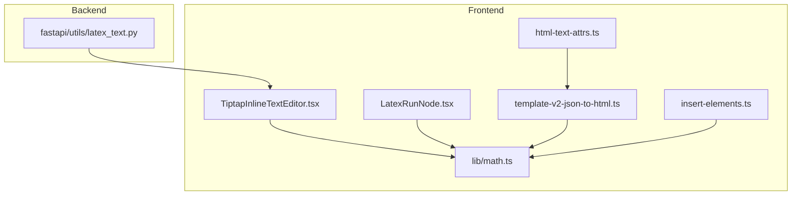
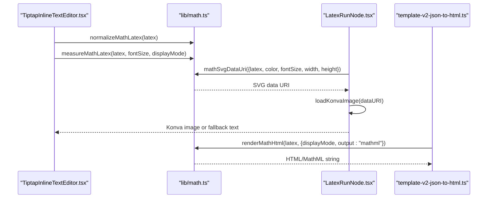
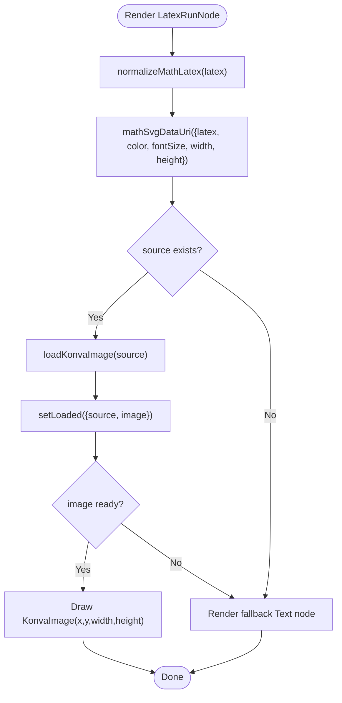
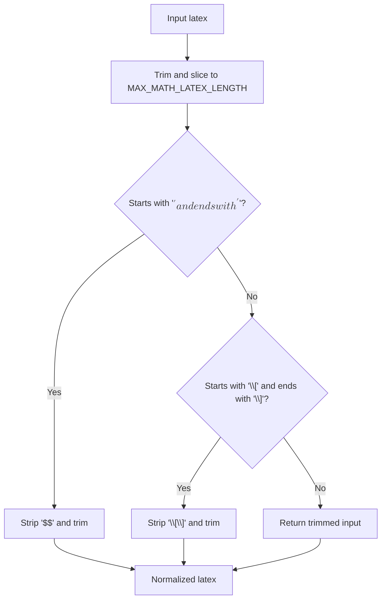
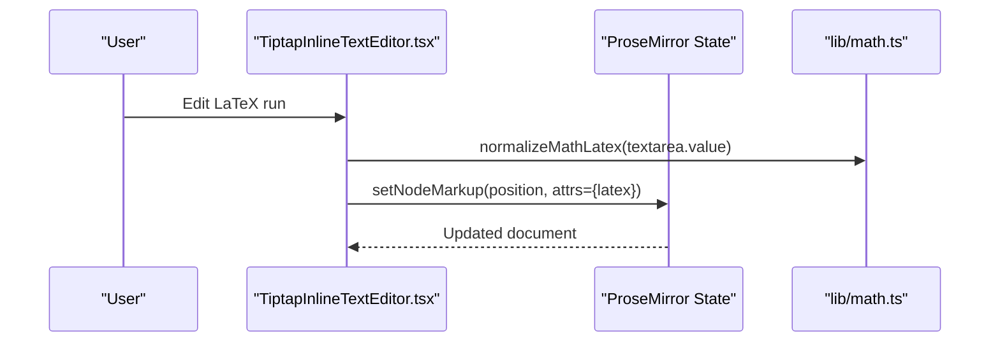
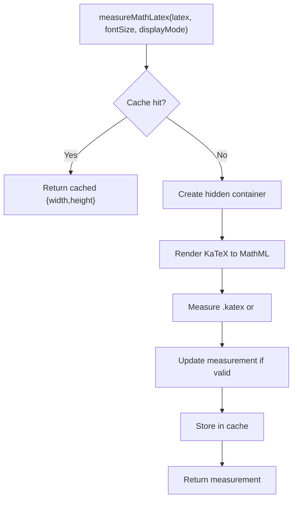
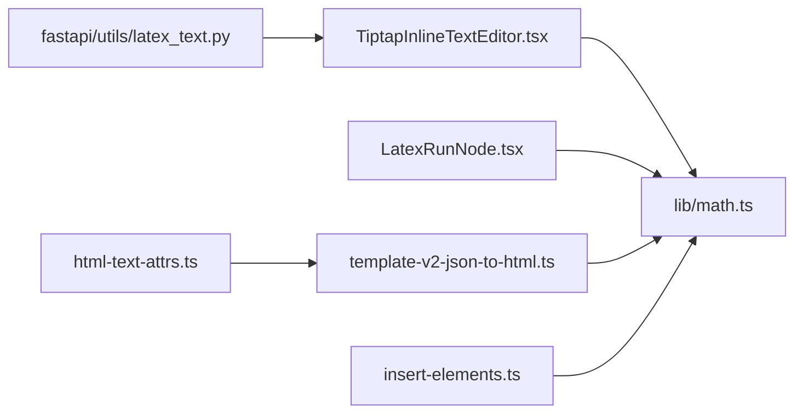

# LaTeX Math Rendering

<cite>
**Referenced Files in This Document**
- [LatexRunNode.tsx](file://servers/nexjs/components/slide-editor/math/LatexRunNode.tsx)
- [math.ts](file://servers/nexjs/lib/math.ts)
- [template-v2-json-to-html.ts](file://servers/nexjs/lib/template-v2-json-to-html.ts)
- [latex_text.py](file://servers/fastapi/utils/latex_text.py)
- [TiptapInlineTextEditor.tsx](file://servers/nexjs/components/slide-editor/text/TiptapInlineTextEditor.tsx)
- [insert-elements.ts](file://servers/nexjs/components/slide-editor/insert/insert-elements.ts)
- [TemplateV2TableElement.tsx](file://servers/nexjs/components/slide-editor/tables/TemplateV2TableElement.tsx)
- [html-text-attrs.ts](file://servers/nexjs/components/slide-editor/text/html-text-attrs.ts)
</cite>

## Table of Contents
1. [Introduction](#introduction)
2. [Project Structure](#project-structure)
3. [Core Components](#core-components)
4. [Architecture Overview](#architecture-overview)
5. [Detailed Component Analysis](#detailed-component-analysis)
6. [Dependency Analysis](#dependency-analysis)
7. [Performance Considerations](#performance-considerations)
8. [Troubleshooting Guide](#troubleshooting-guide)
9. [Conclusion](#conclusion)

## Introduction
This document explains the LaTeX math rendering capabilities in the project, focusing on how mathematical expressions are parsed, normalized, measured, and rendered across the editor, canvas, HTML export, and server-side text processing pipelines. It covers the LatexRunNode component implementation, the KaTeX-based rendering pipeline, supported LaTeX syntax, equation formatting, responsive rendering, and integration with the text editing system. It also includes guidance for customizing math styling, optimizing performance, handling common syntax errors, and addressing browser compatibility.

## Project Structure
The LaTeX math feature spans both frontend (Next.js) and backend (FastAPI) code:
- Frontend:
  - Editor integration via Tiptap nodes and inline editing
  - Canvas rendering via React-Konva using SVG data URIs
  - HTML export path using KaTeX to produce MathML/HTML
- Backend:
  - Text run parsing that recognizes LaTeX runs and normalizes delimiters



**Diagram sources**
- [TiptapInlineTextEditor.tsx:86-116](file://servers/nexjs/components/slide-editor/text/TiptapInlineTextEditor.tsx#L86-L116)
- [LatexRunNode.tsx:1-93](file://servers/nexjs/components/slide-editor/math/LatexRunNode.tsx#L1-L93)
- [math.ts:1-149](file://servers/nexjs/lib/math.ts#L1-L149)
- [template-v2-json-to-html.ts:3840-3897](file://servers/nexjs/lib/template-v2-json-to-html.ts#L3840-L3897)
- [insert-elements.ts:127-162](file://servers/nexjs/components/slide-editor/insert/insert-elements.ts#L127-L162)
- [html-text-attrs.ts:1-46](file://servers/nexjs/components/slide-editor/text/html-text-attrs.ts#L1-L46)
- [latex_text.py:88-156](file://servers/fastapi/utils/latex_text.py#L88-L156)

**Section sources**
- [TiptapInlineTextEditor.tsx:86-116](file://servers/nexjs/components/slide-editor/text/TiptapInlineTextEditor.tsx#L86-L116)
- [LatexRunNode.tsx:1-93](file://servers/nexjs/components/slide-editor/math/LatexRunNode.tsx#L1-L93)
- [math.ts:1-149](file://servers/nexjs/lib/math.ts#L1-L149)
- [template-v2-json-to-html.ts:3840-3897](file://servers/nexjs/lib/template-v2-json-to-html.ts#L3840-L3897)
- [insert-elements.ts:127-162](file://servers/nexjs/components/slide-editor/insert/insert-elements.ts#L127-L162)
- [html-text-attrs.ts:1-46](file://servers/nexjs/components/slide-editor/text/html-text-attrs.ts#L1-L46)
- [latex_text.py:88-156](file://servers/fastapi/utils/latex_text.py#L88-L156)

## Core Components
- LatexRunNode: Renders a single LaTeX run as a Konva image when available; falls back to plain text otherwise.
- lib/math.ts: Provides normalization, measurement, HTML/MathML rendering, and SVG data URI generation for high-quality canvas rendering.
- template-v2-json-to-html.ts: Converts JSON text runs into HTML with KaTeX output for static export.
- latex_text.py: Parses mixed text/LaTeX content and normalizes delimiters on the server side.
- TiptapInlineTextEditor.tsx: Defines an inline atom node for editing LaTeX expressions within rich text.
- insert-elements.ts: Creates default slide elements including pre-sized LaTeX text boxes.
- html-text-attrs.ts: Determines when to render text as HTML (e.g., when LaTeX or RTL is present).

Key responsibilities:
- Normalization: Strip display delimiters and enforce length limits.
- Measurement: Compute width/height for layout and sizing.
- Rendering: Produce MathML/HTML for web and SVG data URIs for canvas.
- Editing: Provide an inline editor for LaTeX runs.

**Section sources**
- [LatexRunNode.tsx:1-93](file://servers/nexjs/components/slide-editor/math/LatexRunNode.tsx#L1-L93)
- [math.ts:1-149](file://servers/nexjs/lib/math.ts#L1-L149)
- [template-v2-json-to-html.ts:3840-3897](file://servers/nexjs/lib/template-v2-json-to-html.ts#L3840-L3897)
- [latex_text.py:88-156](file://servers/fastapi/utils/latex_text.py#L88-L156)
- [TiptapInlineTextEditor.tsx:86-116](file://servers/nexjs/components/slide-editor/text/TiptapInlineTextEditor.tsx#L86-L116)
- [insert-elements.ts:127-162](file://servers/nexjs/components/slide-editor/insert/insert-elements.ts#L127-L162)
- [html-text-attrs.ts:1-46](file://servers/nexjs/components/slide-editor/text/html-text-attrs.ts#L1-L46)

## Architecture Overview
The rendering pipeline has two primary paths:
- Canvas path (editor): Normalize → Measure → Generate SVG data URI → Load as image → Draw on Konva.
- HTML path (export/static): Normalize → Render to MathML/HTML → Embed in exported markup.



**Diagram sources**
- [TiptapInlineTextEditor.tsx:170-196](file://servers/nexjs/components/slide-editor/text/TiptapInlineTextEditor.tsx#L170-L196)
- [LatexRunNode.tsx:29-59](file://servers/nexjs/components/slide-editor/math/LatexRunNode.tsx#L29-L59)
- [math.ts:13-38](file://servers/nexjs/lib/math.ts#L13-L38)
- [template-v2-json-to-html.ts:3884-3897](file://servers/nexjs/lib/template-v2-json-to-html.ts#L3884-L3897)

## Detailed Component Analysis

### LatexRunNode Implementation
LatexRunNode renders a LaTeX expression inside the canvas by converting it to an SVG data URI and loading it as an image. If the image is not yet loaded, it shows a plain text fallback.

- Inputs: color, displayMode, fontSize, height, interactive, latex, width, x, y
- Processing:
  - Normalize LaTeX
  - Build SVG data URI with alignment and vertical alignment
  - Asynchronously load image and cache result
- Output:
  - On success: Konva image at specified position and size
  - Fallback: italicized plain text with constrained font size



**Diagram sources**
- [LatexRunNode.tsx:29-93](file://servers/nexjs/components/slide-editor/math/LatexRunNode.tsx#L29-L93)
- [math.ts:83-131](file://servers/nexjs/lib/math.ts#L83-L131)

**Section sources**
- [LatexRunNode.tsx:1-93](file://servers/nexjs/components/slide-editor/math/LatexRunNode.tsx#L1-L93)
- [math.ts:83-131](file://servers/nexjs/lib/math.ts#L83-L131)

### Mathematical Expression Parsing and Normalization
Normalization removes display delimiters and enforces maximum length:
- Supported delimiters: $$...$$ and \[...\]
- Maximum length: 4000 characters
- The same normalization is used across editor, canvas, and export paths.



**Diagram sources**
- [math.ts:13-23](file://servers/nexjs/lib/math.ts#L13-L23)
- [latex_text.py:159-173](file://servers/fastapi/utils/latex_text.py#L159-L173)

**Section sources**
- [math.ts:13-23](file://servers/nexjs/lib/math.ts#L13-L23)
- [latex_text.py:159-173](file://servers/fastapi/utils/latex_text.py#L159-L173)

### Rendering Pipeline
- HTML/MathML rendering: Uses KaTeX to generate MathML or combined HTML+MathML for accessibility and broad support.
- Canvas rendering: Generates an SVG containing MathML wrapped in foreignObject, then converts to a data URI for high-density rendering.

```mermaid
classDiagram
class MathLib {
+normalizeMathLatex(value) string
+renderMathHtml(latex, options) string
+measureMathLatex(latex, fontSize, displayMode) {width,height}
+mathSvgDataUri(params) string|null
}
class LatexRunNode {
+props : color, displayMode, fontSize, height, interactive, latex, width, x, y
+render()
}
class TemplateV2Html {
+renderTextRunHtml(run, font) string
}
LatexRunNode --> MathLib : "uses"
TemplateV2Html --> MathLib : "uses"
```

**Diagram sources**
- [math.ts:1-149](file://servers/nexjs/lib/math.ts#L1-L149)
- [LatexRunNode.tsx:1-93](file://servers/nexjs/components/slide-editor/math/LatexRunNode.tsx#L1-L93)
- [template-v2-json-to-html.ts:3884-3897](file://servers/nexjs/lib/template-v2-json-to-html.ts#L3884-L3897)

**Section sources**
- [math.ts:1-149](file://servers/nexjs/lib/math.ts#L1-L149)
- [template-v2-json-to-html.ts:3884-3897](file://servers/nexjs/lib/template-v2-json-to-html.ts#L3884-L3897)

### Integration With Text Editing System
- TiptapInlineTextEditor defines an inline atom node for LaTeX runs, enabling editing within rich text while preserving LaTeX content.
- When committing edits, the editor normalizes the LaTeX before updating the document state.
- HTML text detection determines whether to render text elements as HTML (e.g., when LaTeX or RTL is present).



**Diagram sources**
- [TiptapInlineTextEditor.tsx:170-196](file://servers/nexjs/components/slide-editor/text/TiptapInlineTextEditor.tsx#L170-L196)
- [html-text-attrs.ts:11-39](file://servers/nexjs/components/slide-editor/text/html-text-attrs.ts#L11-L39)

**Section sources**
- [TiptapInlineTextEditor.tsx:86-116](file://servers/nexjs/components/slide-editor/text/TiptapInlineTextEditor.tsx#L86-L116)
- [TiptapInlineTextEditor.tsx:170-196](file://servers/nexjs/components/slide-editor/text/TiptapInlineTextEditor.tsx#L170-L196)
- [html-text-attrs.ts:11-39](file://servers/nexjs/components/slide-editor/text/html-text-attrs.ts#L11-L39)

### Equation Formatting and Display Modes
- Display mode toggles block vs inline-block presentation.
- Alignment and vertical alignment control positioning within containers.
- Color and font size propagate from text styles to math rendering.

Examples of usage patterns:
- Inline math: displayMode=false, verticalAlign=middle
- Block math: displayMode=true, align=center

**Section sources**
- [template-v2-json-to-html.ts:3884-3897](file://servers/nexjs/lib/template-v2-json-to-html.ts#L3884-L3897)
- [math.ts:83-131](file://servers/nexjs/lib/math.ts#L83-L131)

### Responsive Rendering Across Screen Sizes
- Measurement function computes width/height based on KaTeX output and caches results per fontSize/displayMode/latex.
- Canvas rendering uses a pixel ratio multiplier to ensure sharpness on high-DPI displays.
- HTML export uses MathML/HTML which scales naturally with CSS.



**Diagram sources**
- [math.ts:40-81](file://servers/nexjs/lib/math.ts#L40-L81)

**Section sources**
- [math.ts:40-81](file://servers/nexjs/lib/math.ts#L40-L81)

### Examples of Embedding Complex Expressions
- Inserting a new LaTeX element:
  - The insertion helper measures the expression and creates a text element with a LaTeX run and display mode enabled.
- Tables and other components:
  - Table cells can contain LaTeX runs and render them via LatexRunNode.

Practical references:
- Creating a LaTeX text element with measured dimensions
- Rendering LaTeX runs inside table cells

**Section sources**
- [insert-elements.ts:127-162](file://servers/nexjs/components/slide-editor/insert/insert-elements.ts#L127-L162)
- [TemplateV2TableElement.tsx:247-287](file://servers/nexjs/components/slide-editor/tables/TemplateV2TableElement.tsx#L247-L287)

### Customizing Math Styling
- Color propagation:
  - LatexRunNode passes color to mathSvgDataUri, which applies it to the SVG’s MathML content.
- Font size:
  - Both measurement and SVG generation clamp font sizes to safe ranges.
- Alignment:
  - Horizontal and vertical alignment are configurable for precise placement.

Styling hooks:
- Use the text style system to set color, size, bold/italic, line height, letter spacing, and opacity.
- For HTML export, use the font style helpers to apply consistent typography.

**Section sources**
- [LatexRunNode.tsx:29-43](file://servers/nexjs/components/slide-editor/math/LatexRunNode.tsx#L29-L43)
- [math.ts:83-131](file://servers/nexjs/lib/math.ts#L83-L131)
- [template-v2-json-to-html.ts:3884-3897](file://servers/nexjs/lib/template-v2-json-to-html.ts#L3884-L3897)

### Optimizing Rendering Performance
- Measurement caching:
  - Repeated measurements for identical inputs are cached to avoid DOM operations.
- High-DPI rendering:
  - SVG data URIs are generated at a higher pixel ratio to maintain crispness on scaled canvases.
- Length limits:
  - Enforcing a maximum LaTeX length prevents excessive computation.

Recommendations:
- Prefer reuse of existing LaTeX runs where possible.
- Avoid frequent changes to fontSize/displayMode for the same expression to leverage caching.

**Section sources**
- [math.ts:3-6](file://servers/nexjs/lib/math.ts#L3-L6)
- [math.ts:40-81](file://servers/nexjs/lib/math.ts#L40-L81)
- [math.ts:120-131](file://servers/nexjs/lib/math.ts#L120-L131)

## Dependency Analysis
The following diagram highlights key dependencies between components involved in LaTeX math rendering.



**Diagram sources**
- [TiptapInlineTextEditor.tsx:86-116](file://servers/nexjs/components/slide-editor/text/TiptapInlineTextEditor.tsx#L86-L116)
- [LatexRunNode.tsx:1-93](file://servers/nexjs/components/slide-editor/math/LatexRunNode.tsx#L1-L93)
- [template-v2-json-to-html.ts:3840-3897](file://servers/nexjs/lib/template-v2-json-to-html.ts#L3840-L3897)
- [insert-elements.ts:127-162](file://servers/nexjs/components/slide-editor/insert/insert-elements.ts#L127-L162)
- [html-text-attrs.ts:1-46](file://servers/nexjs/components/slide-editor/text/html-text-attrs.ts#L1-L46)
- [latex_text.py:88-156](file://servers/fastapi/utils/latex_text.py#L88-L156)

**Section sources**
- [TiptapInlineTextEditor.tsx:86-116](file://servers/nexjs/components/slide-editor/text/TiptapInlineTextEditor.tsx#L86-L116)
- [LatexRunNode.tsx:1-93](file://servers/nexjs/components/slide-editor/math/LatexRunNode.tsx#L1-L93)
- [template-v2-json-to-html.ts:3840-3897](file://servers/nexjs/lib/template-v2-json-to-html.ts#L3840-L3897)
- [insert-elements.ts:127-162](file://servers/nexjs/components/slide-editor/insert/insert-elements.ts#L127-L162)
- [html-text-attrs.ts:1-46](file://servers/nexjs/components/slide-editor/text/html-text-attrs.ts#L1-L46)
- [latex_text.py:88-156](file://servers/fastapi/utils/latex_text.py#L88-L156)

## Performance Considerations
- Measurement caching reduces repeated DOM queries and KaTeX renders.
- SVG data URI rendering with increased pixel ratio ensures sharp visuals without layout thrashing.
- Enforcing maximum LaTeX length avoids heavy computations on large inputs.
- Prefer displayMode=true for standalone equations to optimize layout calculations.

[No sources needed since this section provides general guidance]

## Troubleshooting Guide
Common issues and resolutions:
- Empty or invalid LaTeX:
  - Normalization returns empty strings for non-string inputs or after stripping delimiters; ensure valid LaTeX content.
- Blurry equations on canvas:
  - Ensure width/height are positive and rely on the built-in pixel ratio scaling.
- Incorrect alignment:
  - Verify align and verticalAlign parameters passed to mathSvgDataUri.
- HTML export missing MathML:
  - Confirm renderMathHtml is called with output="mathml" for export paths.
- Server-side parsing mismatches:
  - Ensure LaTeX runs are properly tagged and normalized on the backend.

Operational references:
- Normalization behavior and error tolerance
- SVG generation and attribute escaping
- HTML export configuration

**Section sources**
- [math.ts:13-38](file://servers/nexjs/lib/math.ts#L13-L38)
- [math.ts:83-131](file://servers/nexjs/lib/math.ts#L83-L131)
- [template-v2-json-to-html.ts:3884-3897](file://servers/nexjs/lib/template-v2-json-to-html.ts#L3884-L3897)
- [latex_text.py:88-156](file://servers/fastapi/utils/latex_text.py#L88-L156)

## Conclusion
The LaTeX math rendering system integrates tightly with the editor, canvas, and export pipelines. It normalizes input, measures layouts accurately, and renders high-quality outputs via KaTeX and SVG data URIs. By leveraging measurement caching, controlled font sizes, and proper alignment settings, the system delivers responsive and performant math rendering across different contexts. Proper use of display modes, styling attributes, and validated LaTeX content ensures robust behavior in both interactive editing and static export scenarios.

[No sources needed since this section summarizes without analyzing specific files]