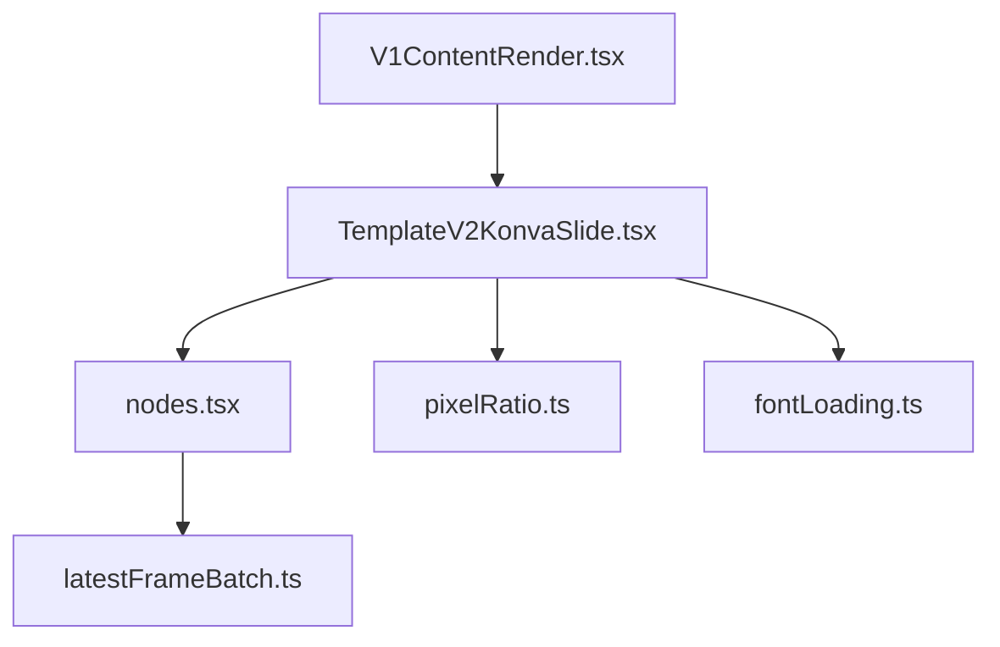
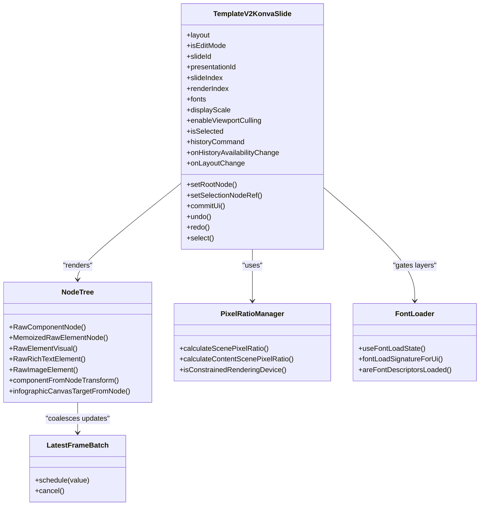
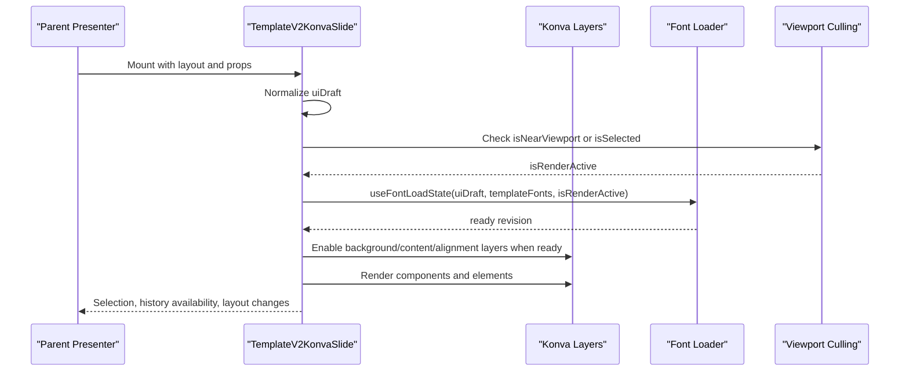
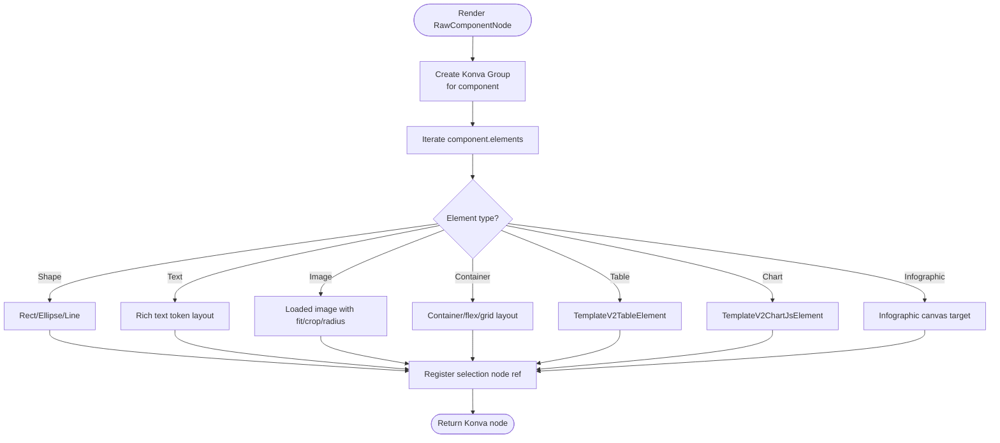
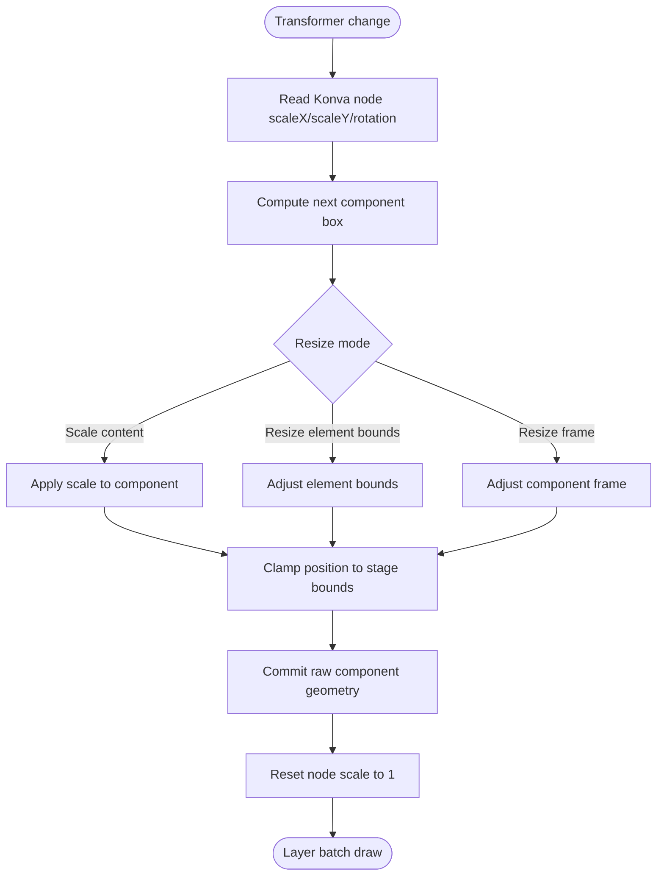
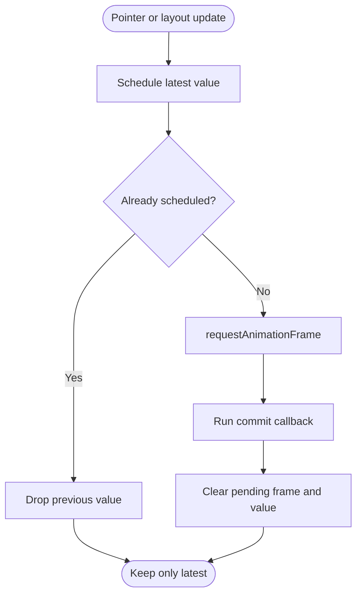
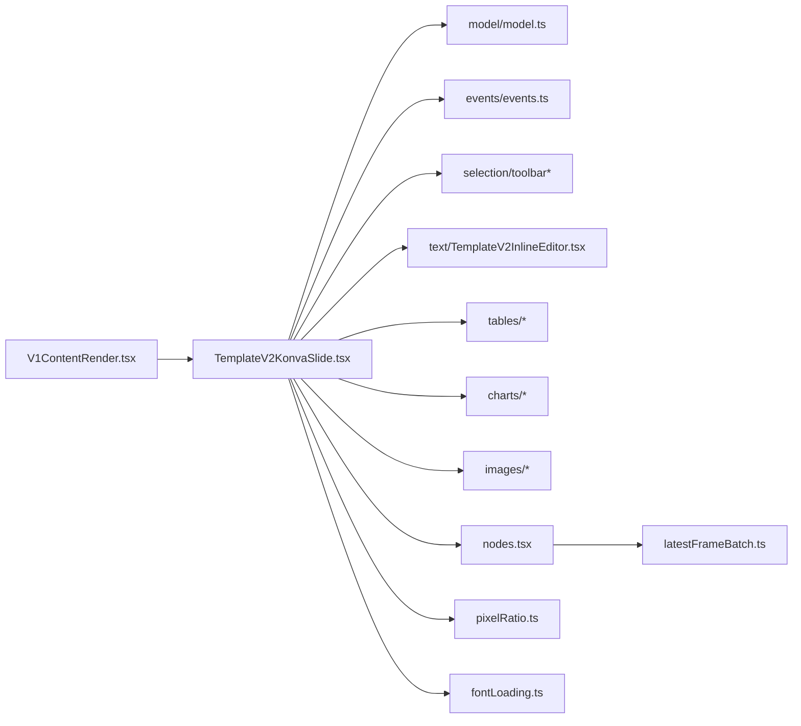

# Canvas Rendering Engine

<cite>
**Referenced Files in This Document**
- [TemplateV2KonvaSlide.tsx](file://servers/nextjs/components/slide-editor/surface/TemplateV2KonvaSlide.tsx)
- [nodes.tsx](file://servers/nextjs/components/slide-editor/surface/nodes.tsx)
- [pixelRatio.ts](file://servers/nextjs/components/slide-editor/surface/pixelRatio.ts)
- [fontLoading.ts](file://servers/nextjs/components/slide-editor/surface/fontLoading.ts)
- [latestFrameBatch.ts](file://servers/nextjs/components/slide-editor/surface/latestFrameBatch.ts)
- [README.md](file://servers/nextjs/components/slide-editor/README.md)
- [V1ContentRender.tsx](file://servers/nextjs/app/(presentation-generator)/components/V1ContentRender.tsx)
</cite>

## Table of Contents
1. [Introduction](#introduction)
2. [Project Structure](#project-structure)
3. [Core Components](#core-components)
4. [Architecture Overview](#architecture-overview)
5. [Detailed Component Analysis](#detailed-component-analysis)
6. [Dependency Analysis](#dependency-analysis)
7. [Performance Considerations](#performance-considerations)
8. [Troubleshooting Guide](#troubleshooting-guide)
9. [Conclusion](#conclusion)
10. [Appendices](#appendices)

## Introduction
This document explains the canvas rendering engine used by the Template V2 slide editor. The implementation is built on Konva.js through React-Konva and centers around the `TemplateV2KonvaSlide` component. It covers:

- How slides are represented as a JSON-driven layout with components and elements.
- How Konva stages, layers, and nodes render editable visual content.
- How node management tracks selection, transforms, dragging, alignment guides, and inline editors.
- How frame batching and viewport culling optimize performance for large slide compositions.
- How coordinate transformations map between Konva node space and the fixed 1280 x 720 editor coordinate system.
- How to customize the rendering pipeline, add new visual elements, and debug canvas performance issues.

## Project Structure
The canvas rendering engine lives primarily under the Next.js slide editor surface:

| Area | Responsibility |
|---|---|
| `surface/TemplateV2KonvaSlide.tsx` | Main slide surface, Konva stage, layers, selection state, history, toolbar integration, and event coordination. |
| `surface/nodes.tsx` | Konva node tree for components, elements, text, images, shapes, tables, charts, infographics, vector editing, and transform handling. |
| `surface/pixelRatio.ts` | Scene pixel ratio calculation and constrained-device detection. |
| `surface/fontLoading.ts` | Font descriptor collection, stylesheet injection, font readiness probing, and canvas enable gating. |
| `surface/latestFrameBatch.ts` | Animation-frame coalescing utility for pointer-driven preview updates. |
| `app/(presentation-generator)/components/V1ContentRender.tsx` | Consumer that mounts `TemplateV2KonvaSlide` for presentation slides. |
| `components/slide-editor/README.md` | High-level mental model, feature map, and editor flow documentation. |

**Diagram sources**
- [V1ContentRender.tsx:223-237](file://servers/nextjs/app/(presentation-generator)/components/V1ContentRender.tsx#L223-L237)
- [TemplateV2KonvaSlide.tsx:308-325](file://servers/nextjs/components/slide-editor/surface/TemplateV2KonvaSlide.tsx#L308-L325)
- [nodes.tsx:1-60](file://servers/nextjs/components/slide-editor/surface/nodes.tsx#L1-L60)
- [pixelRatio.ts:1-10](file://servers/nextjs/components/slide-editor/surface/pixelRatio.ts#L1-L10)
- [fontLoading.ts:25-35](file://servers/nextjs/components/slide-editor/surface/fontLoading.ts#L25-L35)
- [latestFrameBatch.ts:1-46](file://servers/nextjs/components/slide-editor/surface/latestFrameBatch.ts#L1-L46)

**Section sources**
- [README.md:1-25](file://servers/nextjs/components/slide-editor/README.md#L1-L25)
- [V1ContentRender.tsx:201-237](file://servers/nextjs/app/(presentation-generator)/components/V1ContentRender.tsx#L201-L237)

## Core Components
The core rendering engine consists of:

1. **TemplateV2KonvaSlide**: The React component that owns the Konva `Stage`, background/content/alignment layers, local UI draft state, selection, undo/redo, clipboard, toolbars, and event listeners.
2. **Node Tree (`nodes.tsx`)**: Renders raw components and elements into Konva groups, shapes, text, images, tables, charts, and infographic elements. It also handles resize modes, drag previews, vector point editing, and infographic canvas targets.
3. **Pixel Ratio Manager**: Calculates scene pixel ratios based on device pixel ratio, display scale, and device constraints.
4. **Font Loader**: Collects font descriptors from the slide layout, ensures stylesheets and fonts are loaded, and exposes a revision-based ready state.
5. **Latest Frame Batcher**: Coalesces rapid updates into one commit per animation frame.

Key responsibilities:

- Convert Template V2 JSON into a normalized local `uiDraft`.
- Render a fixed 1280 x 720 editor surface.
- Manage selection across components, root elements, nested elements, tables, charts, and infographics.
- Apply Konva transforms and convert them back into raw geometry.
- Provide alignment guides, undo/redo, copy/paste, and toolbar integration.
- Gate layer rendering until fonts are ready.
- Optionally disable off-screen slides via viewport culling.

**Section sources**
- [TemplateV2KonvaSlide.tsx:308-325](file://servers/nextjs/components/slide-editor/surface/TemplateV2KonvaSlide.tsx#L308-L325)
- [TemplateV2KonvaSlide.tsx:391-483](file://servers/nextjs/components/slide-editor/surface/TemplateV2KonvaSlide.tsx#L391-L483)
- [nodes.tsx:771-800](file://servers/nextjs/components/slide-editor/surface/nodes.tsx#L771-L800)
- [pixelRatio.ts:25-52](file://servers/nextjs/components/slide-editor/surface/pixelRatio.ts#L25-L52)
- [fontLoading.ts:25-35](file://servers/nextjs/components/slide-editor/surface/fontLoading.ts#L25-L35)
- [latestFrameBatch.ts:9-46](file://servers/nextjs/components/slide-editor/surface/latestFrameBatch.ts#L9-L46)

## Architecture Overview
At a high level, the rendering architecture separates data, rendering, interaction, and optimization:

**Diagram sources**
- [TemplateV2KonvaSlide.tsx:308-325](file://servers/nextjs/components/slide-editor/surface/TemplateV2KonvaSlide.tsx#L308-L325)
- [TemplateV2KonvaSlide.tsx:391-483](file://servers/nextjs/components/slide-editor/surface/TemplateV2KonvaSlide.tsx#L391-L483)
- [nodes.tsx:771-800](file://servers/nextjs/components/slide-editor/surface/nodes.tsx#L771-L800)
- [pixelRatio.ts:12-83](file://servers/nextjs/components/slide-editor/surface/pixelRatio.ts#L12-L83)
- [fontLoading.ts:25-135](file://servers/nextjs/components/slide-editor/surface/fontLoading.ts#L25-L135)
- [latestFrameBatch.ts:1-46](file://servers/nextjs/components/slide-editor/surface/latestFrameBatch.ts#L1-L46)

## Detailed Component Analysis

### TemplateV2KonvaSlide Component Architecture
`TemplateV2KonvaSlide` is the central controller for the Konva canvas. It:

- Accepts a Template V2 layout and optional editing flags.
- Normalizes markdown text and stores a local `uiDraft`.
- Tracks selection, inline editing, table cell selection, chart/icon/infographic editor state.
- Creates three Konva layers:
  - Background layer.
  - Content layer.
  - Alignment guide layer.
- Uses viewport culling to avoid rendering off-screen slides unless selected.
- Waits for fonts before enabling the content layer.
- Integrates with Redux via `updateSlideUi`.
- Exposes selection, toolbar positioning, and custom events for external editor panels.

**Diagram sources**
- [TemplateV2KonvaSlide.tsx:391-483](file://servers/nextjs/components/slide-editor/surface/TemplateV2KonvaSlide.tsx#L391-L483)
- [fontLoading.ts:25-135](file://servers/nextjs/components/slide-editor/surface/fontLoading.ts#L25-L135)

**Section sources**
- [TemplateV2KonvaSlide.tsx:308-325](file://servers/nextjs/components/slide-editor/surface/TemplateV2KonvaSlide.tsx#L308-L325)
- [TemplateV2KonvaSlide.tsx:391-483](file://servers/nextjs/components/slide-editor/surface/TemplateV2KonvaSlide.tsx#L391-L483)
- [README.md:133-199](file://servers/nextjs/components/slide-editor/README.md#L133-L199)

### Node Management System
The node tree renders the slide’s components and elements into Konva nodes. Important behaviors include:

- `RawComponentNode` renders each top-level component as a Konva group.
- `MemoizedRawElementNode` renders root elements without wrapping them in a normal component.
- `RawElementVisual` dispatches by element type: rectangle, ellipse, container, flex, grid, group, line, text, text-list, image, table, chart, infographic.
- Selection nodes register themselves so transformers and toolbars can find them.
- Dragging, resizing, rotation, and multi-select behavior update the raw UI model rather than directly mutating Konva state.
- Vector elements support vertex editing, endpoint markers, and stroke-based hit areas.
- Infographic elements expose canvas targets for editing text, icons, images, and shapes.

**Diagram sources**
- [nodes.tsx:771-800](file://servers/nextjs/components/slide-editor/surface/nodes.tsx#L771-L800)
- [README.md:323-379](file://servers/nextjs/components/slide-editor/README.md#L323-L379)

**Section sources**
- [nodes.tsx:1-60](file://servers/nextjs/components/slide-editor/surface/nodes.tsx#L1-L60)
- [nodes.tsx:771-800](file://servers/nextjs/components/slide-editor/surface/nodes.tsx#L771-L800)
- [README.md:323-379](file://servers/nextjs/components/slide-editor/README.md#L323-L379)

### Coordinate Transformation Handling
Coordinate transformation is critical because the editor uses a fixed 1280 x 720 coordinate system, while Konva nodes may be scaled, rotated, or positioned relative to their parent groups.

Key transformation logic:

- Component boxes are computed from raw component geometry.
- Konva node transforms (`scaleX`, `scaleY`, `rotation`, `x`, `y`) are read during resize or drag.
- Resize mode is determined by the active transformer anchor:
  - Scale content.
  - Resize element bounds.
  - Resize frame.
- Position is clamped inside the stage box.
- Transform results are converted back into raw component geometry using helper functions.
- Vector elements translate node coordinates back into vertex points.

**Diagram sources**
- [nodes.tsx:369-482](file://servers/nextjs/components/slide-editor/surface/nodes.tsx#L369-L482)

**Section sources**
- [nodes.tsx:328-482](file://servers/nextjs/components/slide-editor/surface/nodes.tsx#L328-L482)

### Frame Batching and Optimization Techniques
The engine uses several techniques to keep large slide compositions responsive:

1. **Viewport Culling**: Slides outside the viewport are not rendered unless explicitly selected.
2. **Font Gating**: The content layer is disabled until required fonts are loaded.
3. **Pixel Ratio Scaling**: Scene pixel ratios are calculated per layer and constrained on low-memory devices.
4. **Animation Frame Coalescing**: Rapid pointer-driven updates are scheduled once per frame.
5. **Layered Rendering**: Background, content, and alignment guides are separated so expensive operations do not redraw everything unnecessarily.
6. **Memoization**: Components and nodes are memoized where possible to reduce re-renders.

**Diagram sources**
- [latestFrameBatch.ts:9-46](file://servers/nextjs/components/slide-editor/surface/latestFrameBatch.ts#L9-L46)

**Section sources**
- [TemplateV2KonvaSlide.tsx:469-483](file://servers/nextjs/components/slide-editor/surface/TemplateV2KonvaSlide.tsx#L469-L483)
- [fontLoading.ts:92-135](file://servers/nextjs/components/slide-editor/surface/fontLoading.ts#L92-L135)
- [pixelRatio.ts:25-83](file://servers/nextjs/components/slide-editor/surface/pixelRatio.ts#L25-L83)
- [latestFrameBatch.ts:9-46](file://servers/nextjs/components/slide-editor/surface/latestFrameBatch.ts#L9-L46)

### Performance Optimization Strategies for Large Slide Compositions
Recommended strategies derived from the codebase:

- Enable `enableViewportCulling` when rendering many slides at once.
- Keep `displayScale` reasonable; very high scales increase pixel buffer size.
- Avoid unnecessary Redux updates during typing; rely on inline edit buffering.
- Prefer memoized nodes and components.
- Use constrained pixel ratio paths on low-memory devices.
- Separate background and content layers so alignment guides and backgrounds do not force full redraws.
- Limit heavy operations like chart re-rendering and image loading to visible slides.
- Use batch drawing via Konva layers instead of forcing global redraws.

**Section sources**
- [TemplateV2KonvaSlide.tsx:406-483](file://servers/nextjs/components/slide-editor/surface/TemplateV2KonvaSlide.tsx#L406-L483)
- [pixelRatio.ts:12-83](file://servers/nextjs/components/slide-editor/surface/pixelRatio.ts#L12-L83)
- [README.md:666-670](file://servers/nextjs/components/slide-editor/README.md#L666-L670)

## Dependency Analysis
The main dependencies between rendering components are:

**Diagram sources**
- [V1ContentRender.tsx:223-237](file://servers/nextjs/app/(presentation-generator)/components/V1ContentRender.tsx#L223-L237)
- [TemplateV2KonvaSlide.tsx:1-149](file://servers/nextjs/components/slide-editor/surface/TemplateV2KonvaSlide.tsx#L1-L149)
- [nodes.tsx:1-60](file://servers/nextjs/components/slide-editor/surface/nodes.tsx#L1-L60)
- [pixelRatio.ts:1-10](file://servers/nextjs/components/slide-editor/surface/pixelRatio.ts#L1-L10)
- [fontLoading.ts:1-22](file://servers/nextjs/components/slide-editor/surface/fontLoading.ts#L1-L22)
- [latestFrameBatch.ts:1-46](file://servers/nextjs/components/slide-editor/surface/latestFrameBatch.ts#L1-L46)

**Section sources**
- [TemplateV2KonvaSlide.tsx:1-149](file://servers/nextjs/components/slide-editor/surface/TemplateV2KonvaSlide.tsx#L1-L149)
- [nodes.tsx:1-60](file://servers/nextjs/components/slide-editor/surface/nodes.tsx#L1-L60)

## Performance Considerations
When diagnosing canvas performance:

| Symptom | Likely Cause | Recommended Action |
|---|---|---|
| Slow scrolling through many slides | All slides rendering off-screen | Enable `enableViewportCulling` and ensure `rootSelector` matches the scroll container. |
| Blurry text or shapes | Incorrect scene pixel ratio or excessive display scale | Review `displayScale` and constrained device pixel ratio settings. |
| Stutter during drag or resize | Too many synchronous updates per frame | Ensure pointer-driven updates use frame batching and avoid Redux commits on every move. |
| Fonts appear wrong initially | Layer enabled before fonts load | Verify font signature and font loader readiness. |
| High memory usage | Very high pixel ratio or too many heavy elements | Reduce display scale, limit charts/images, and avoid unnecessary shadows or strokes. |
| Misaligned selection or toolbar | Node refs missing or stale | Confirm `setSelectionNodeRef` is called and selection keys match rendered nodes. |

**Section sources**
- [TemplateV2KonvaSlide.tsx:469-483](file://servers/nextjs/components/slide-editor/surface/TemplateV2KonvaSlide.tsx#L469-L483)
- [pixelRatio.ts:12-83](file://servers/nextjs/components/slide-editor/surface/pixelRatio.ts#L12-L83)
- [fontLoading.ts:92-135](file://servers/nextjs/components/slide-editor/surface/fontLoading.ts#L92-L135)
- [README.md:666-670](file://servers/nextjs/components/slide-editor/README.md#L666-L670)

## Troubleshooting Guide
Common debugging steps for canvas performance and rendering issues:

1. **Check viewport culling**
   - If slides are not near the viewport, they should not render unless selected.
   - Verify `enableViewportCulling` and `isSelected`.
   - Confirm the viewport root selector matches the scroll container.

2. **Inspect font loading**
   - If text appears incorrectly, check whether the font signature includes all text/table/chart fonts.
   - Look for fallback timeouts and mutation observers that probe font readiness.

3. **Validate pixel ratio**
   - For blurry rendering, inspect `devicePixelRatio`, `displayScale`, and constrained device detection.
   - Ensure background and alignment layers use appropriate pixel ratios.

4. **Review node registration**
   - If selection or transformers fail, verify that `nodeRefs` contains the expected Konva nodes.
   - Check selection keys and component indexes.

5. **Analyze transform behavior**
   - If resize or rotation produces unexpected geometry, trace `componentFromNodeTransform` and related helpers.
   - Confirm resize mode matches the intended anchor behavior.

6. **Reduce update frequency**
   - For pointer-heavy interactions, prefer frame-batched updates.
   - Avoid committing Redux on every keystroke or drag tick.

7. **Isolate heavy elements**
   - Temporarily remove charts, tables, or large images to determine if they cause lag.
   - Check whether HTML text overlays or inline editors are causing DOM pressure.

**Section sources**
- [TemplateV2KonvaSlide.tsx:469-483](file://servers/nextjs/components/slide-editor/surface/TemplateV2KonvaSlide.tsx#L469-L483)
- [fontLoading.ts:92-135](file://servers/nextjs/components/slide-editor/surface/fontLoading.ts#L92-L135)
- [pixelRatio.ts:12-83](file://servers/nextjs/components/slide-editor/surface/pixelRatio.ts#L12-L83)
- [nodes.tsx:369-482](file://servers/nextjs/components/slide-editor/surface/nodes.tsx#L369-L482)

## Conclusion
The Template V2 canvas rendering engine is a structured, Konva-based system that separates slide data, node rendering, interaction, and performance optimization. `TemplateV2KonvaSlide` acts as the orchestrator, while `nodes.tsx` provides the detailed visual representation. Pixel ratio calculation, font loading, viewport culling, and frame batching work together to keep large slide compositions usable. For extensions, developers should follow the existing patterns for element types, coordinate transformations, selection, and layer rendering.

## Appendices

### Customizing the Rendering Pipeline
To extend the rendering pipeline:

1. Add a new element type to the editor model and import path.
2. Implement a renderer branch in `RawElementVisual` within `nodes.tsx`.
3. Add toolbar support if the element is editable.
4. Update HTML preview/export renderers if the element must survive non-Konva rendering.
5. Add selection, transform, and geometry helpers if the element participates in selection or layout.
6. Test both editor rendering and export rendering.

**Section sources**
- [README.md:323-433](file://servers/nextjs/components/slide-editor/README.md#L323-L433)
- [nodes.tsx:1-60](file://servers/nextjs/components/slide-editor/surface/nodes.tsx#L1-L60)

### Implementing New Visual Elements
Steps for adding a new visual element:

- Define the raw element shape and editor type.
- Add a Konva node branch in `nodes.tsx`.
- Handle selection, double-click, and drag behavior.
- Add toolbar controls in the appropriate toolbar folder.
- Convert raw element to editor element and back.
- Add HTML preview/export support if needed.
- Add tests for geometry, selection, and rendering.

**Section sources**
- [README.md:323-433](file://servers/nextjs/components/slide-editor/README.md#L323-L433)

### Debugging Canvas Performance Issues
Use this checklist:

- Measure whether off-screen slides are rendering.
- Check font readiness before content layer activation.
- Inspect scene pixel ratio and display scale.
- Identify heavy elements such as charts, tables, or large images.
- Confirm frame batching is used for pointer-driven updates.
- Validate selection node registration.
- Reduce shadow, stroke, and opacity complexity temporarily.

**Section sources**
- [TemplateV2KonvaSlide.tsx:469-483](file://servers/nextjs/components/slide-editor/surface/TemplateV2KonvaSlide.tsx#L469-L483)
- [pixelRatio.ts:12-83](file://servers/nextjs/components/slide-editor/surface/pixelRatio.ts#L12-L83)
- [fontLoading.ts:92-135](file://servers/nextjs/components/slide-editor/surface/fontLoading.ts#L92-L135)
- [latestFrameBatch.ts:9-46](file://servers/nextjs/components/slide-editor/surface/latestFrameBatch.ts#L9-L46)