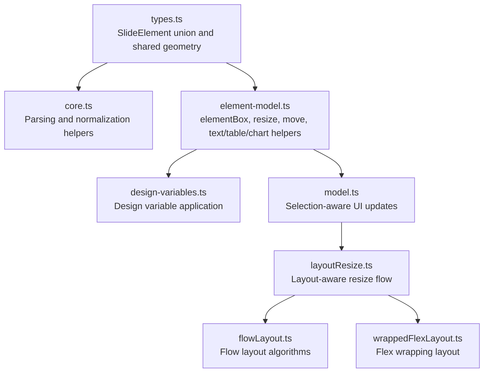
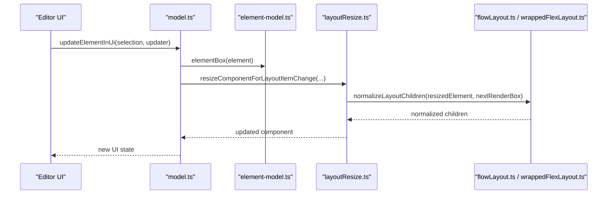
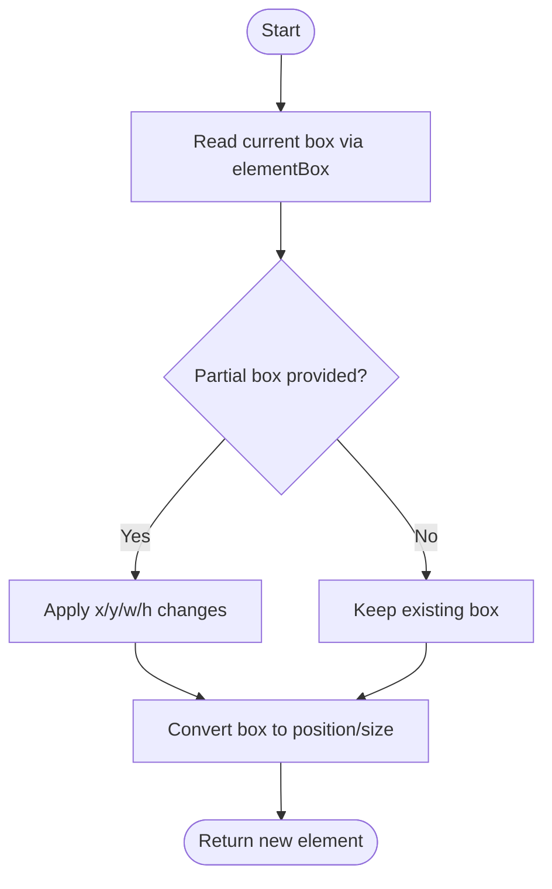
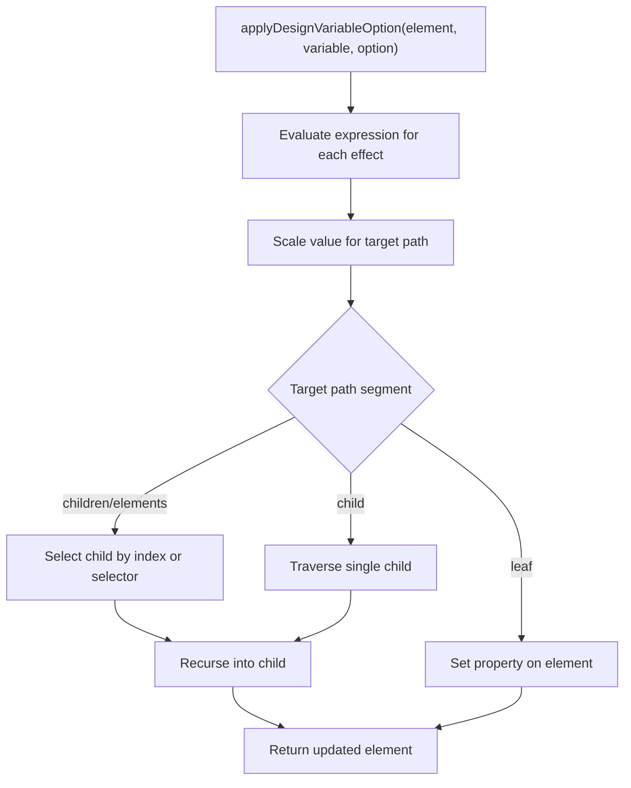
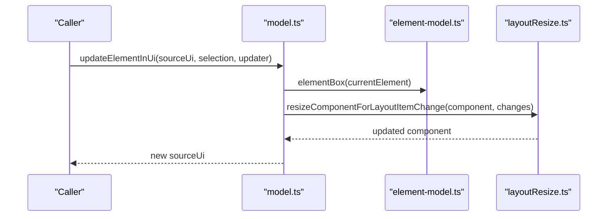
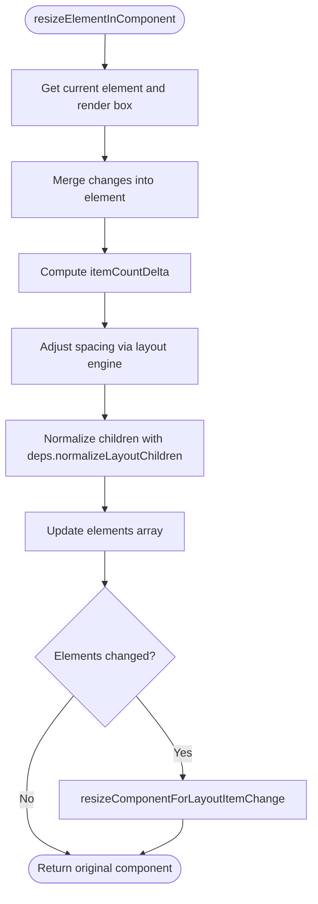
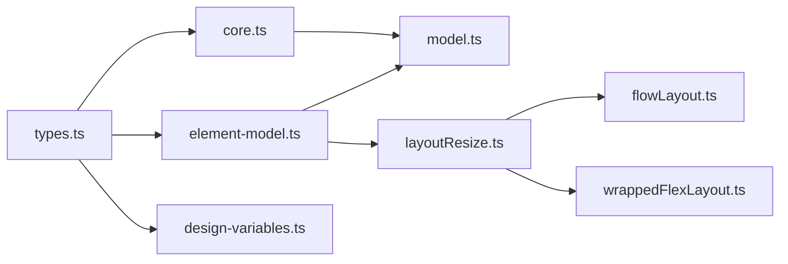

# Base Element Model

<cite>
**Referenced Files in This Document**
- [types.ts](file://servers/nextjs/components/slide-editor/types.ts)
- [core.ts](file://servers/nextjs/components/slide-editor/model/core.ts)
- [element-model.ts](file://servers/nextjs/components/slide-editor/model/element-model.ts)
- [design-variables.ts](file://servers/nextjs/components/slide-editor/model/design-variables.ts)
- [model.ts](file://servers/nextjs/components/slide-editor/model/model.ts)
- [layoutResize.ts](file://servers/nextjs/components/slide-editor/layout/layoutResize.ts)
- [flowLayout.ts](file://servers/nextjs/components/slide-editor/layout/flowLayout.ts)
- [wrappedFlexLayout.ts](file://servers/nextjs/components/slide-editor/layout/wrappedFlexLayout.ts)
</cite>

## Table of Contents
1. [Introduction](#introduction)
2. [Project Structure](#project-structure)
3. [Core Components](#core-components)
4. [Architecture Overview](#architecture-overview)
5. [Detailed Component Analysis](#detailed-component-analysis)
6. [Dependency Analysis](#dependency-analysis)
7. [Performance Considerations](#performance-considerations)
8. [Troubleshooting Guide](#troubleshooting-guide)
9. [Conclusion](#conclusion)

## Introduction
This document explains the base element model system used by the slide editor. It focuses on:
- The core SlideElement interface and its shared base fields
- Element lifecycle and data mutation utilities
- Position and size management helpers
- How elements are structured in the editor’s data model
- Practical examples for extending the base model and implementing common behaviors

The goal is to make it easy to understand how elements are represented, mutated, laid out, and integrated with the editor state.

## Project Structure
The base element model spans a small set of focused modules:
- types.ts defines the canonical element type hierarchy and shared geometry primitives
- core.ts provides low-level parsing and normalization utilities used across the editor
- element-model.ts implements elementBox, resize/move operations, text/table/chart helpers
- design-variables.ts applies reactive design variables to nested elements
- model.ts coordinates selection-aware updates and component-level mutations
- layout/*.ts implement layout-driven resizing and child normalization

**Diagram sources**
- [types.ts:431-649](file://servers/nextjs/components/slide-editor/types.ts#L431-L649)
- [core.ts:76-190](file://servers/nextjs/components/slide-editor/model/core.ts#L76-L190)
- [element-model.ts:43-88](file://servers/nextjs/components/slide-editor/model/element-model.ts#L43-L88)
- [design-variables.ts:10-27](file://servers/nextjs/components/slide-editor/model/design-variables.ts#L10-L27)
- [model.ts:209-238](file://servers/nextjs/components/slide-editor/model/model.ts#L209-L238)
- [layoutResize.ts:60-99](file://servers/nextjs/components/slide-editor/layout/layoutResize.ts#L60-L99)
- [flowLayout.ts:40-40](file://servers/nextjs/components/slide-editor/layout/flowLayout.ts#L40-L40)
- [wrappedFlexLayout.ts:39-39](file://servers/nextjs/components/slide-editor/layout/wrappedFlexLayout.ts#L39-L39)

**Section sources**
- [types.ts:1-10](file://servers/nextjs/components/slide-editor/types.ts#L1-L10)
- [core.ts:8-29](file://servers/nextjs/components/slide-editor/model/core.ts#L8-L29)
- [element-model.ts:24-37](file://servers/nextjs/components/slide-editor/model/element-model.ts#L24-L37)

## Core Components
This section documents the foundational types and utilities that underpin all element behavior.

### SlideElement Interface and Shared Base
- ElementBase defines shared metadata and geometry:
  - decorative, name
  - position (x, y), size (width, height)
  - rotation, flip_h, flip_v, opacity
  - shadow, component identifiers, design_variables, layout
- Concrete element types extend ElementBase with type-specific fields:
  - text, container, image, text-list, table, vector, svg, chart, infographic, flex, grid, group
- SlideElement is a discriminated union over these concrete types
- Box, Position, Size, Padding, Alignment, Font, Fill, Stroke, Shadow, etc., provide consistent geometry and styling primitives

Key responsibilities:
- Provide a uniform contract for all elements regardless of type
- Allow layout engines and editors to read/write position/size uniformly
- Support composition via children/child fields in container-like elements

**Section sources**
- [types.ts:296-386](file://servers/nextjs/components/slide-editor/types.ts#L296-L386)
- [types.ts:431-649](file://servers/nextjs/components/slide-editor/types.ts#L431-L649)

### Element Lifecycle and Data Mutations
- elementBox converts an element’s position/size into a normalized box {x, y, w, h}
- boxToPositionSize converts a box back to position/size
- resizeElement updates position/size immutably using partial box changes
- moveElement shifts an element by dx/dy using resizeElement
- Text/table/chart helpers provide immutable updates for content and style

These functions ensure:
- Predictable geometry transformations
- Immutability-friendly updates suitable for undo/redo and diffing
- Clear separation between raw data and computed boxes

**Section sources**
- [element-model.ts:43-88](file://servers/nextjs/components/slide-editor/model/element-model.ts#L43-L88)
- [element-model.ts:90-165](file://servers/nextjs/components/slide-editor/model/element-model.ts#L90-L165)
- [element-model.ts:167-249](file://servers/nextjs/components/slide-editor/model/element-model.ts#L167-L249)

### Position and Size Management Utilities
- core.ts provides robust readers for padding, point, size, arrays, strings, numbers, booleans
- alignmentOffset computes offsets based on horizontal/vertical alignment
- clamp, normalizeId, cloneJson, stripUndefined support safe data handling

These utilities are reused by layout engines and importers to normalize incoming data and compute positions consistently.

**Section sources**
- [core.ts:76-190](file://servers/nextjs/components/slide-editor/model/core.ts#L76-L190)

### Design Variables and Reactive Updates
- applyDesignVariableOption applies a design variable option to an element tree
- Path-based selectors target nested children or single child nodes
- Expression evaluation supports arithmetic, rounding, and object path access
- Scaling rules round numeric values for font size, position, size, border radius, blur, and offsets

This enables dynamic theming and template-driven variations without manual edits.

**Section sources**
- [design-variables.ts:10-27](file://servers/nextjs/components/slide-editor/model/design-variables.ts#L10-L27)
- [design-variables.ts:68-102](file://servers/nextjs/components/slide-editor/model/design-variables.ts#L68-L102)
- [design-variables.ts:104-149](file://servers/nextjs/components/slide-editor/model/design-variables.ts#L104-L149)
- [design-variables.ts:217-235](file://servers/nextjs/components/slide-editor/model/design-variables.ts#L217-L235)

## Architecture Overview
The base element model integrates with the editor through a layered architecture:
- Type layer (types.ts): Canonical element definitions and shared geometry
- Utility layer (core.ts, element-model.ts): Parsing, normalization, and immutable mutations
- State integration (model.ts): Selection-aware updates and component-level operations
- Layout layer (layout/*.ts): Layout-driven resizing and child normalization

**Diagram sources**
- [model.ts:209-238](file://servers/nextjs/components/slide-editor/model/model.ts#L209-L238)
- [element-model.ts:43-88](file://servers/nextjs/components/slide-editor/model/element-model.ts#L43-L88)
- [layoutResize.ts:60-99](file://servers/nextjs/components/slide-editor/layout/layoutResize.ts#L60-L99)
- [flowLayout.ts:40-40](file://servers/nextjs/components/slide-editor/layout/flowLayout.ts#L40-L40)
- [wrappedFlexLayout.ts:39-39](file://servers/nextjs/components/slide-editor/layout/wrappedFlexLayout.ts#L39-L39)

## Detailed Component Analysis

### Element Geometry and Box Utilities
- elementBox extracts a normalized box from any element with position/size
- boxToPositionSize reconstructs position/size from a box
- resizeElement merges partial box changes immutably
- moveElement translates an element by dx/dy

**Diagram sources**
- [element-model.ts:43-88](file://servers/nextjs/components/slide-editor/model/element-model.ts#L43-L88)

**Section sources**
- [element-model.ts:43-88](file://servers/nextjs/components/slide-editor/model/element-model.ts#L43-L88)

### Text, Lists, Tables, and Charts Helpers
- textContent/textRun/setTextContent manage plain text runs
- mergeFontForTextSelection applies font changes to selected ranges
- elementFont resolves defaults for family, size, color, and other attributes
- textListStrings/setTextListStrings handle list items
- tableRowsAsStrings/setTableRowsFromStrings manage tabular content
- chartColor provides default chart colors

These helpers maintain immutable updates and integrate with run-based text editing.

**Section sources**
- [element-model.ts:90-165](file://servers/nextjs/components/slide-editor/model/element-model.ts#L90-L165)
- [element-model.ts:167-249](file://servers/nextjs/components/slide-editor/model/element-model.ts#L167-L249)

### Design Variable Application
- applyDesignVariableOption evaluates expressions and writes values along paths
- Path resolution supports:
  - Direct properties
  - Single child via child
  - Children arrays via children or elements
  - Selectors by component_slot, component_id, or type
- Numeric scaling rounds values for specific targets (font.size, size.width/height, position.x/y, border radius, blur, offsets)

**Diagram sources**
- [design-variables.ts:10-27](file://servers/nextjs/components/slide-editor/model/design-variables.ts#L10-L27)
- [design-variables.ts:104-149](file://servers/nextjs/components/slide-editor/model/design-variables.ts#L104-L149)
- [design-variables.ts:217-235](file://servers/nextjs/components/slide-editor/model/design-variables.ts#L217-L235)

**Section sources**
- [design-variables.ts:10-27](file://servers/nextjs/components/slide-editor/model/design-variables.ts#L10-L27)
- [design-variables.ts:68-102](file://servers/nextjs/components/slide-editor/model/design-variables.ts#L68-L102)
- [design-variables.ts:104-149](file://servers/nextjs/components/slide-editor/model/design-variables.ts#L104-L149)
- [design-variables.ts:217-235](file://servers/nextjs/components/slide-editor/model/design-variables.ts#L217-L235)

### Editor Data Model Integration
- model.ts exposes updateElementInUi to mutate elements within components or root elements based on selection
- resizeComponent adjusts component position, rotation, and scales raw elements according to layout rules
- deleteLayoutChildFromArray removes nested elements safely

**Diagram sources**
- [model.ts:209-238](file://servers/nextjs/components/slide-editor/model/model.ts#L209-L238)
- [element-model.ts:43-88](file://servers/nextjs/components/slide-editor/model/element-model.ts#L43-L88)
- [layoutResize.ts:60-99](file://servers/nextjs/components/slide-editor/layout/layoutResize.ts#L60-L99)

**Section sources**
- [model.ts:209-238](file://servers/nextjs/components/slide-editor/model/model.ts#L209-L238)
- [model.ts:424-435](file://servers/nextjs/components/slide-editor/model/model.ts#L424-L435)

### Layout-Aware Resize Flow
- layoutResize.ts orchestrates resizing:
  - Computes current render box relative to component origin
  - Applies changes and calculates item count delta
  - Adjusts spacing via layoutElementWithAdjustedItemSpace
  - Normalizes children via deps.normalizeLayoutChildren
  - Triggers component resize when elements change

**Diagram sources**
- [layoutResize.ts:60-99](file://servers/nextjs/components/slide-editor/layout/layoutResize.ts#L60-L99)

**Section sources**
- [layoutResize.ts:60-99](file://servers/nextjs/components/slide-editor/layout/layoutResize.ts#L60-L99)

### Flow and Flex Layout Engines
- flowLayout.ts and wrappedFlexLayout.ts define layout dependencies:
  - elementBox: function to compute child boxes
  - elementSize: function to compute intrinsic sizes
  - isManualPositioned: predicate to skip layout for manually positioned children
- These engines feed normalized layouts back into the element tree during resize and insertion flows

**Section sources**
- [flowLayout.ts:40-40](file://servers/nextjs/components/slide-editor/layout/flowLayout.ts#L40-L40)
- [wrappedFlexLayout.ts:39-39](file://servers/nextjs/components/slide-editor/layout/wrappedFlexLayout.ts#L39-L39)

## Dependency Analysis
The base element model exhibits clear separation of concerns:
- types.ts is the single source of truth for element shapes
- core.ts and element-model.ts depend only on types.ts
- design-variables.ts depends on types.ts and uses path traversal utilities
- model.ts depends on core.ts and element-model.ts for selection-aware updates
- layout/*.ts depend on element-model.ts and provide layout-specific logic

**Diagram sources**
- [types.ts:431-649](file://servers/nextjs/components/slide-editor/types.ts#L431-L649)
- [core.ts:76-190](file://servers/nextjs/components/slide-editor/model/core.ts#L76-L190)
- [element-model.ts:43-88](file://servers/nextjs/components/slide-editor/model/element-model.ts#L43-L88)
- [design-variables.ts:10-27](file://servers/nextjs/components/slide-editor/model/design-variables.ts#L10-L27)
- [model.ts:209-238](file://servers/nextjs/components/slide-editor/model/model.ts#L209-L238)
- [layoutResize.ts:60-99](file://servers/nextjs/components/slide-editor/layout/layoutResize.ts#L60-L99)
- [flowLayout.ts:40-40](file://servers/nextjs/components/slide-editor/layout/flowLayout.ts#L40-L40)
- [wrappedFlexLayout.ts:39-39](file://servers/nextjs/components/slide-editor/layout/wrappedFlexLayout.ts#L39-L39)

**Section sources**
- [types.ts:431-649](file://servers/nextjs/components/slide-editor/types.ts#L431-L649)
- [core.ts:76-190](file://servers/nextjs/components/slide-editor/model/core.ts#L76-L190)
- [element-model.ts:43-88](file://servers/nextjs/components/slide-editor/model/element-model.ts#L43-L88)
- [design-variables.ts:10-27](file://servers/nextjs/components/slide-editor/model/design-variables.ts#L10-L27)
- [model.ts:209-238](file://servers/nextjs/components/slide-editor/model/model.ts#L209-L238)
- [layoutResize.ts:60-99](file://servers/nextjs/components/slide-editor/layout/layoutResize.ts#L60-L99)

## Performance Considerations
- Immutable updates: All mutation functions return new objects, enabling efficient diffs and undo/redo stacks at the cost of allocation overhead.
- Minimal recomputation: elementBox and boxToPositionSize are lightweight; avoid repeated conversions by caching boxes where appropriate.
- Layout normalization: Defer heavy layout computations until necessary (e.g., during resize) to reduce unnecessary reflows.
- Design variable evaluation: Expression evaluation is simple and fast; keep expressions concise to avoid excessive parsing overhead.

[No sources needed since this section provides general guidance]

## Troubleshooting Guide
Common issues and resolutions:
- Elements not moving or resizing:
  - Verify elementBox returns expected values; check position/size presence
  - Ensure moveElement and resizeElement are called with correct deltas
- Text not updating:
  - Use setTextContent or mergeFontForTextSelection to update runs immutably
  - Confirm font defaults via elementFont if styles appear missing
- Design variables not applying:
  - Validate path syntax and selectors (component_slot, component_id, type)
  - Check numeric scaling rules for targeted properties
- Layout anomalies after resize:
  - Inspect itemCountDelta and spacing adjustments in layoutResize
  - Ensure normalizeLayoutChildren is invoked with the correct render box

**Section sources**
- [element-model.ts:43-88](file://servers/nextjs/components/slide-editor/model/element-model.ts#L43-L88)
- [element-model.ts:90-165](file://servers/nextjs/components/slide-editor/model/element-model.ts#L90-L165)
- [design-variables.ts:104-149](file://servers/nextjs/components/slide-editor/model/design-variables.ts#L104-L149)
- [layoutResize.ts:60-99](file://servers/nextjs/components/slide-editor/layout/layoutResize.ts#L60-L99)

## Conclusion
The base element model provides a robust foundation for representing, mutating, and laying out slide elements. By centralizing geometry primitives, immutable mutation helpers, and layout integration points, it enables consistent behavior across diverse element types and complex editor workflows. Extending the model involves adding new types to the SlideElement union and leveraging existing utilities for positioning, sizing, and content updates.

[No sources needed since this section summarizes without analyzing specific files]