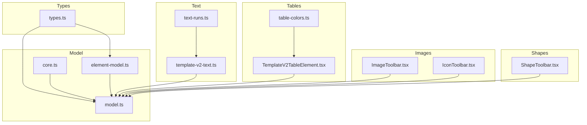
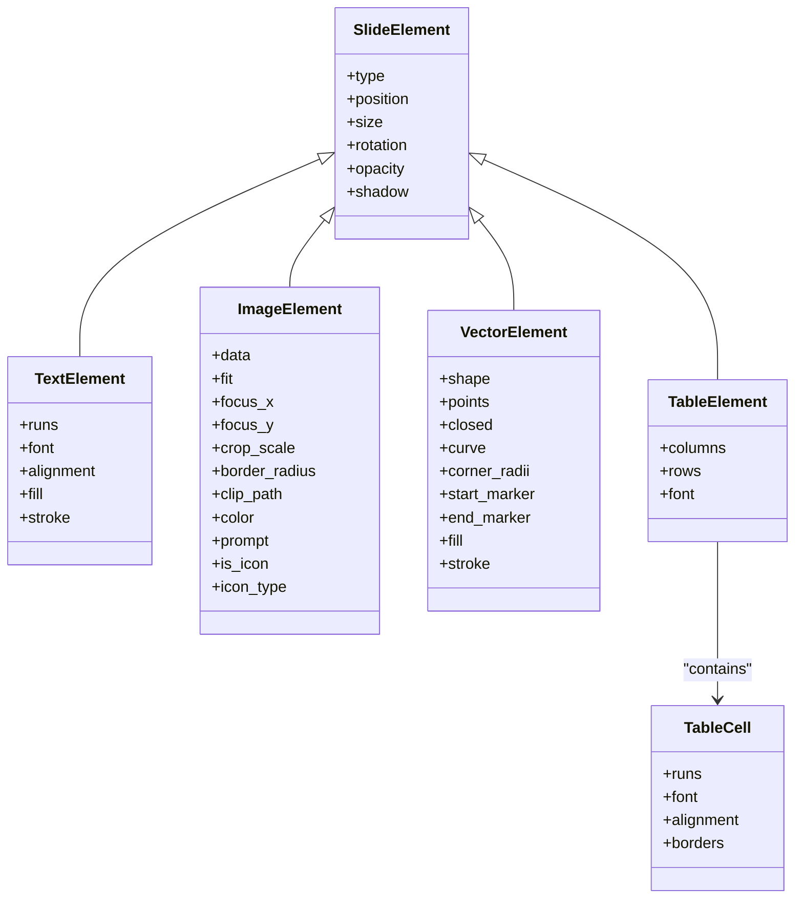
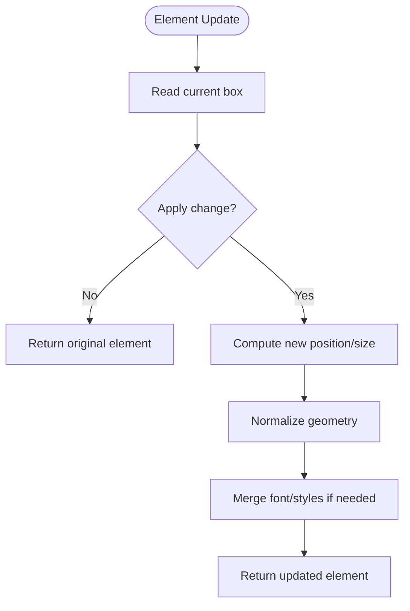
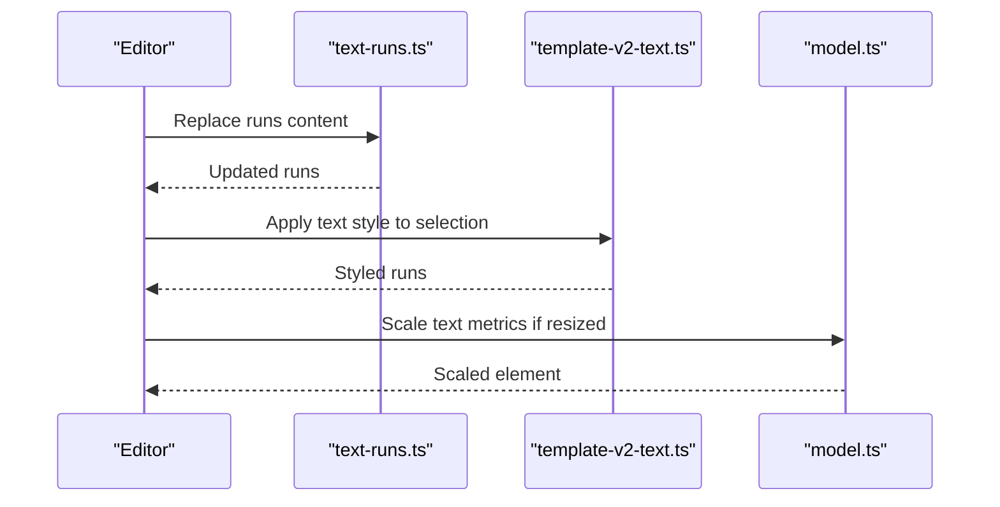
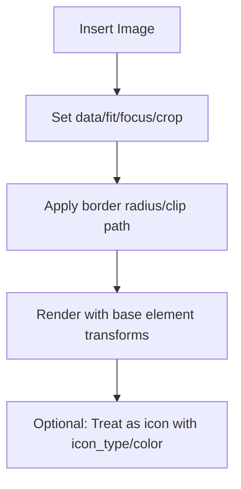
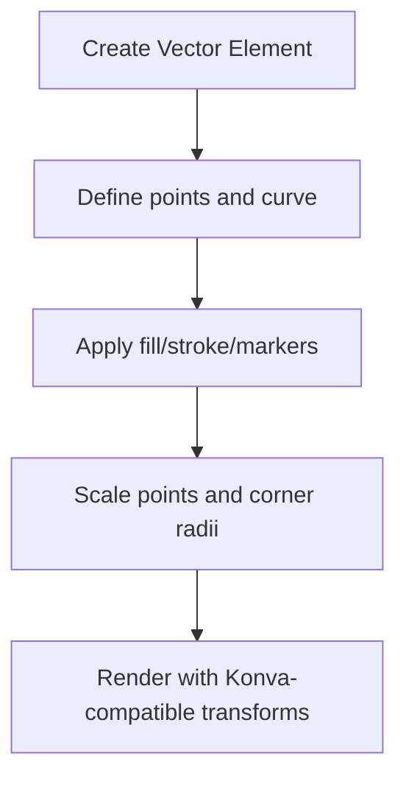
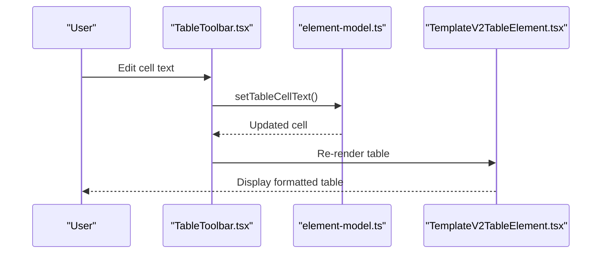
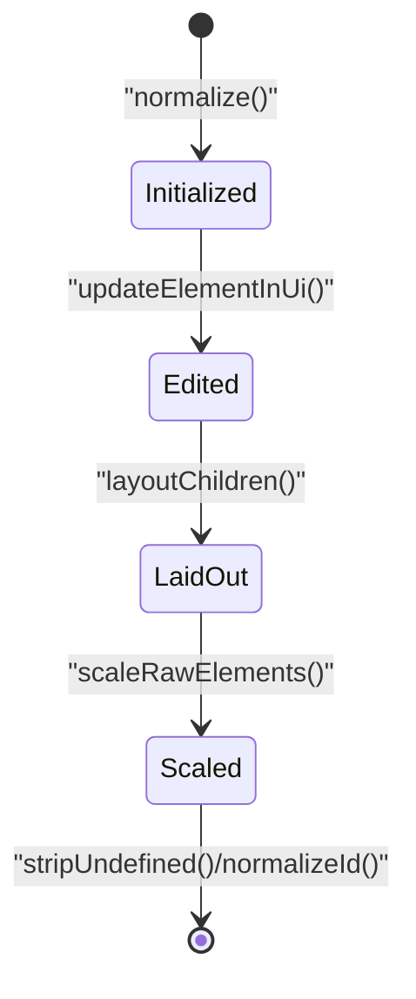
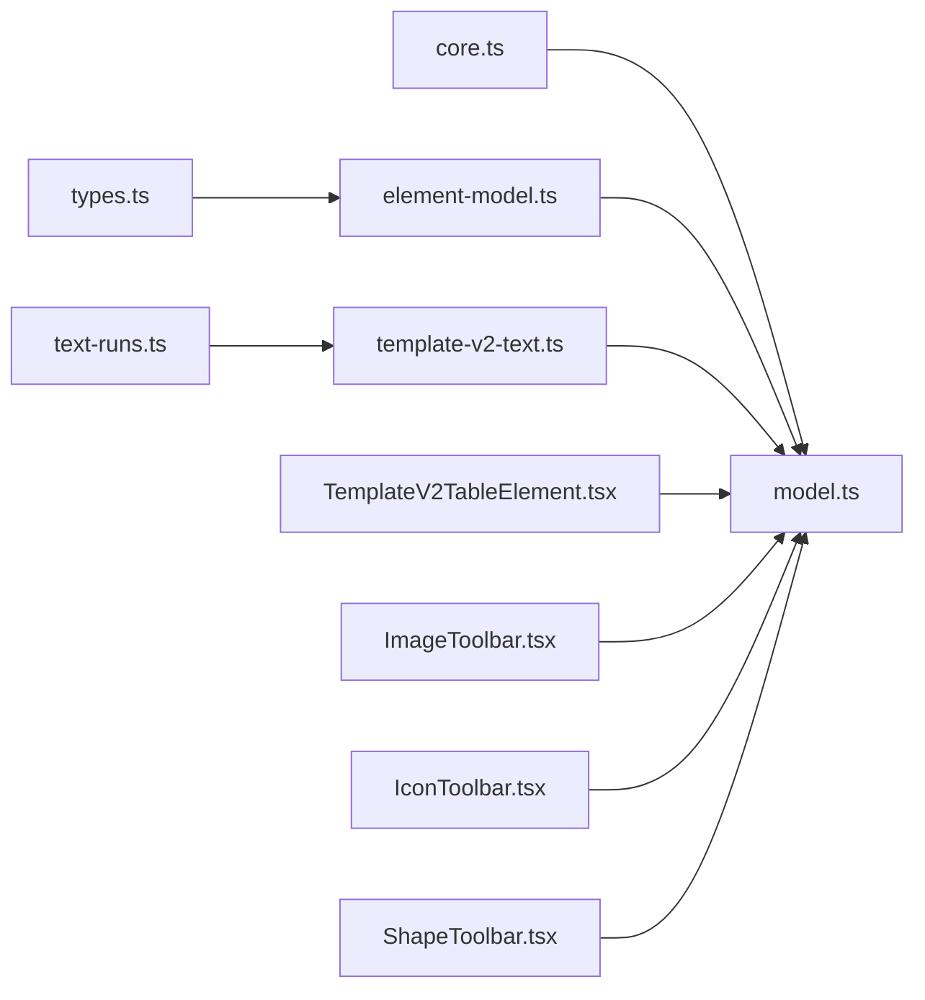

# Element Types and Components

<cite>
**Referenced Files in This Document**
- [types.ts](file://servers/nextjs/components/slide-editor/types.ts)
- [core.ts](file://servers/nextjs/components/slide-editor/model/core.ts)
- [element-model.ts](file://servers/nextjs/components/slide-editor/model/element-model.ts)
- [model.ts](file://servers/nextjs/components/slide-editor/model/model.ts)
- [template-v2-text.ts](file://servers/nextjs/components/slide-editor/text/template-v2-text.ts)
- [text-runs.ts](file://servers/nextjs/components/slide-editor/text/text-runs.ts)
- [TemplateV2TableElement.tsx](file://servers/nextjs/components/slide-editor/tables/TemplateV2TableElement.tsx)
- [table-colors.ts](file://servers/nextjs/components/slide-editor/tables/table-colors.ts)
- [ImageToolbar.tsx](file://servers/nextjs/components/slide-editor/images/ImageToolbar.tsx)
- [IconToolbar.tsx](file://servers/nextjs/components/slide-editor/images/IconToolbar.tsx)
- [ShapeToolbar.tsx](file://servers/nextjs/components/slide-editor/shapes/ShapeToolbar.tsx)
</cite>

## Table of Contents
1. [Introduction](#introduction)
2. [Project Structure](#project-structure)
3. [Core Components](#core-components)
4. [Architecture Overview](#architecture-overview)
5. [Detailed Component Analysis](#detailed-component-analysis)
6. [Dependency Analysis](#dependency-analysis)
7. [Performance Considerations](#performance-considerations)
8. [Troubleshooting Guide](#troubleshooting-guide)
9. [Conclusion](#conclusion)

## Introduction
This document explains the element types and components system used by the slide editor. It covers:
- The base element model architecture and shared geometry utilities
- Text elements with rich formatting support (plain text, LaTeX runs, lists)
- Image handling and manipulation (including icons)
- Shape components (vector paths and polygons)
- Table elements (cells, columns, rows, inline editing)
- How to extend the system with custom element types
- Handling element-specific properties
- Implementing lifecycle-like behaviors through normalization, layout, and scaling functions

The goal is to help you understand how data flows from raw UI definitions into rendered elements and how to add new element types that integrate seamlessly with the editor workflow.

## Project Structure
The element system lives under the slide editor module. Key areas:
- Type definitions for all element kinds and shared geometry
- Model utilities for reading/writing element data, selection, layout, and scaling
- Text subsystem for rich text runs and formatting
- Tables subsystem for tabular content and styling
- Images subsystem for image/icon toolbars
- Shapes subsystem for vector shape tooling

**Diagram sources**
- [types.ts:1-746](file://servers/nextjs/components/slide-editor/types.ts#L1-L746)
- [core.ts:1-200](file://servers/nextjs/components/slide-editor/model/core.ts#L1-L200)
- [element-model.ts:1-250](file://servers/nextjs/components/slide-editor/model/element-model.ts#L1-L250)
- [model.ts:1-800](file://servers/nextjs/components/slide-editor/model/model.ts#L1-L800)
- [template-v2-text.ts](file://servers/nextjs/components/slide-editor/text/template-v2-text.ts)
- [text-runs.ts](file://servers/nextjs/components/slide-editor/text/text-runs.ts)
- [TemplateV2TableElement.tsx](file://servers/nextjs/components/slide-editor/tables/TemplateV2TableElement.tsx)
- [table-colors.ts](file://servers/nextjs/components/slide-editor/tables/table-colors.ts)
- [ImageToolbar.tsx](file://servers/nextjs/components/slide-editor/images/ImageToolbar.tsx)
- [IconToolbar.tsx](file://servers/nextjs/components/slide-editor/images/IconToolbar.tsx)
- [ShapeToolbar.tsx](file://servers/nextjs/components/slide-editor/shapes/ShapeToolbar.tsx)

**Section sources**
- [types.ts:1-746](file://servers/nextjs/components/slide-editor/types.ts#L1-L746)
- [core.ts:1-200](file://servers/nextjs/components/slide-editor/model/core.ts#L1-L200)
- [element-model.ts:1-250](file://servers/nextjs/components/slide-editor/model/element-model.ts#L1-L250)
- [model.ts:1-800](file://servers/nextjs/components/slide-editor/model/model.ts#L1-L800)

## Core Components
This section introduces the foundational building blocks of the element system.

- Base element model and geometry
  - Shared constants like stage dimensions and defaults live in core utilities.
  - Geometry helpers read and normalize points, sizes, padding, alignment offsets, and IDs.
  - These utilities are reused across layout, scaling, and transformation logic.

- Element operations
  - Functions compute bounding boxes, move/resize elements, merge fonts, and convert between different representations.
  - Helpers exist for text content extraction, list items, table cells, chart colors, and image presence checks.

- Raw vs editor models
  - Raw UI uses generic records; editor models use strongly typed structures defined in types.
  - Conversion and normalization functions bridge these layers safely.

Key responsibilities:
- Provide a consistent coordinate system and safe parsing of arbitrary inputs
- Offer immutable update patterns for elements
- Centralize common transformations (scaling, moving, resizing)

**Section sources**
- [core.ts:1-200](file://servers/nextjs/components/slide-editor/model/core.ts#L1-L200)
- [element-model.ts:1-250](file://servers/nextjs/components/slide-editor/model/element-model.ts#L1-L250)

## Architecture Overview
The editor’s element system follows a layered approach:
- Types define the canonical element shapes and shared geometry
- Model layer provides immutable updates, selection, layout, and scaling
- Text subsystem manages rich text runs and formatting
- Specialized subsystems handle tables, images/icons, and shapes

**Diagram sources**
- [types.ts:431-649](file://servers/nextjs/components/slide-editor/types.ts#L431-L649)

**Section sources**
- [types.ts:431-649](file://servers/nextjs/components/slide-editor/types.ts#L431-L649)

## Detailed Component Analysis

### Base Element Model Architecture
The base model defines:
- Common element fields such as position, size, rotation, opacity, shadow, and component metadata
- Geometry helpers for converting between box and position/size
- Immutable mutation functions for moving and resizing elements
- Font merging utilities that propagate style changes across runs when applicable

Lifecycle-like behaviors:
- Normalization: ensure consistent representation of geometry and styles
- Layout: compute child positions based on container rules
- Scaling: adjust positions, sizes, corner radii, and text metrics proportionally

**Diagram sources**
- [element-model.ts:43-147](file://servers/nextjs/components/slide-editor/model/element-model.ts#L43-L147)
- [model.ts:457-528](file://servers/nextjs/components/slide-editor/model/model.ts#L457-L528)

**Section sources**
- [element-model.ts:43-147](file://servers/nextjs/components/slide-editor/model/element-model.ts#L43-L147)
- [model.ts:457-528](file://servers/nextjs/components/slide-editor/model/model.ts#L457-L528)

### Text Elements with Rich Formatting
Text elements support:
- Plain text runs and LaTeX runs
- Per-run fonts and global element-level font overrides
- Lists of text items with markers and spacing
- Content extraction and replacement utilities

Implementation highlights:
- Runs are stored as an array of text or LaTeX segments
- Font merging applies to both element-level and per-run styles
- List items map to arrays of runs, enabling mixed formatting within list entries

**Diagram sources**
- [text-runs.ts](file://servers/nextjs/components/slide-editor/text/text-runs.ts)
- [template-v2-text.ts](file://servers/nextjs/components/slide-editor/text/template-v2-text.ts)
- [model.ts:457-528](file://servers/nextjs/components/slide-editor/model/model.ts#L457-L528)

**Section sources**
- [element-model.ts:90-165](file://servers/nextjs/components/slide-editor/model/element-model.ts#L90-L165)
- [types.ts:402-458](file://servers/nextjs/components/slide-editor/types.ts#L402-L458)

### Image Handling and Manipulation
Image elements include:
- Data payload (e.g., base64 or URL), fit mode, focus point, crop scale
- Border radius and clipping path support
- Icon variants with icon type and color

Toolbars provide:
- Image insertion and property editing
- Icon selection and configuration

Integration points:
- Image presence detection helper
- Consistent geometry and styling via base element model

**Diagram sources**
- [types.ts:470-485](file://servers/nextjs/components/slide-editor/types.ts#L470-L485)
- [element-model.ts:241-243](file://servers/nextjs/components/slide-editor/model/element-model.ts#L241-L243)
- [ImageToolbar.tsx](file://servers/nextjs/components/slide-editor/images/ImageToolbar.tsx)
- [IconToolbar.tsx](file://servers/nextjs/components/slide-editor/images/IconToolbar.tsx)

**Section sources**
- [types.ts:470-485](file://servers/nextjs/components/slide-editor/types.ts#L470-L485)
- [element-model.ts:241-243](file://servers/nextjs/components/slide-editor/model/element-model.ts#L241-L243)
- [ImageToolbar.tsx](file://servers/nextjs/components/slide-editor/images/ImageToolbar.tsx)
- [IconToolbar.tsx](file://servers/nextjs/components/slide-editor/images/IconToolbar.tsx)

### Shape Components (Vector Elements)
Vector elements represent:
- Polygons and ellipses
- Paths with control curves and corner radii
- Line endpoints with markers (arrows, diamonds, etc.)
- Fill and stroke styling

Normalization and scaling:
- Points are scaled proportionally
- Corner radii are adjusted using minimum scale factor
- Rotation and positioning remain consistent with base element model

**Diagram sources**
- [types.ts:528-560](file://servers/nextjs/components/slide-editor/types.ts#L528-L560)
- [model.ts:457-513](file://servers/nextjs/components/slide-editor/model/model.ts#L457-L513)
- [ShapeToolbar.tsx](file://servers/nextjs/components/slide-editor/shapes/ShapeToolbar.tsx)

**Section sources**
- [types.ts:528-560](file://servers/nextjs/components/slide-editor/types.ts#L528-L560)
- [model.ts:457-513](file://servers/nextjs/components/slide-editor/model/model.ts#L457-L513)
- [ShapeToolbar.tsx](file://servers/nextjs/components/slide-editor/shapes/ShapeToolbar.tsx)

### Table Elements
Table elements consist of:
- Columns and rows of cells
- Cell-level fonts, alignments, borders, and runs
- Inline editing and toolbar controls
- Color utilities for consistent styling

Data flow:
- Convert strings to cell runs and vice versa
- Normalize table structure during import/editing
- Apply theme-aware colors and strokes

**Diagram sources**
- [element-model.ts:193-235](file://servers/nextjs/components/slide-editor/model/element-model.ts#L193-L235)
- [TemplateV2TableElement.tsx](file://servers/nextjs/components/slide-editor/tables/TemplateV2TableElement.tsx)
- [table-colors.ts](file://servers/nextjs/components/slide-editor/tables/table-colors.ts)

**Section sources**
- [types.ts:502-526](file://servers/nextjs/components/slide-editor/types.ts#L502-L526)
- [element-model.ts:193-235](file://servers/nextjs/components/slide-editor/model/element-model.ts#L193-L235)
- [TemplateV2TableElement.tsx](file://servers/nextjs/components/slide-editor/tables/TemplateV2TableElement.tsx)
- [table-colors.ts](file://servers/nextjs/components/slide-editor/tables/table-colors.ts)

### Extending the Element System with Custom Components
To add a new element type:
1. Define the element shape in types
   - Extend the union type for SlideElement
   - Add any specific properties (e.g., data schema, styling options)
2. Implement conversion and normalization
   - Provide functions to transform raw data into editor model
   - Ensure geometry normalization (position, size, rotation)
3. Integrate layout and scaling
   - If the element has children, implement child array info and layout behavior
   - Ensure scaling adjusts internal geometry appropriately
4. Add editor tooling
   - Create a toolbar or modal for inserting/configuring the element
   - Wire up selection and update flows using existing model utilities
5. Handle lifecycle-like behaviors
   - Normalize on load/import
   - Scale on resize
   - Update styles consistently across nested runs or sub-elements

Concrete example outline:
- Define a new element type with required fields
- Add a factory function to create default instances
- Implement a converter from raw template data
- Register the element in layout and scaling pipelines
- Build a toolbar component to insert and edit the element

**Section sources**
- [types.ts:637-649](file://servers/nextjs/components/slide-editor/types.ts#L637-L649)
- [model.ts:352-375](file://servers/nextjs/components/slide-editor/model/model.ts#L352-L375)
- [model.ts:457-528](file://servers/nextjs/components/slide-editor/model/model.ts#L457-L528)

### Handling Element-Specific Properties
Common property categories:
- Geometry: position, size, rotation, flip, opacity
- Styling: fill, stroke, shadow, border radius
- Content: runs for text, data for charts/infographics, points for vectors
- Metadata: component_id, design_variables, layout hints

Best practices:
- Use helper functions to read and normalize optional properties
- Keep element updates immutable to simplify undo/redo and diffing
- Validate and sanitize external inputs before applying them to elements

**Section sources**
- [types.ts:296-386](file://servers/nextjs/components/slide-editor/types.ts#L296-L386)
- [element-model.ts:167-191](file://servers/nextjs/components/slide-editor/model/element-model.ts#L167-L191)

### Implementing Element Lifecycle Methods
While not traditional OOP methods, the system implements lifecycle-like behaviors through pure functions:
- Initialization: normalize raw data into editor model
- Editing: apply updates immutably and propagate styles
- Layout: compute child positions and bounds
- Scaling: adjust geometry and text metrics proportionally
- Cleanup: strip undefined values and normalize IDs

**Diagram sources**
- [model.ts:156-239](file://servers/nextjs/components/slide-editor/model/model.ts#L156-L239)
- [model.ts:598-727](file://servers/nextjs/components/slide-editor/model/model.ts#L598-L727)
- [model.ts:457-528](file://servers/nextjs/components/slide-editor/model/model.ts#L457-L528)
- [core.ts:171-186](file://servers/nextjs/components/slide-editor/model/core.ts#L171-L186)

**Section sources**
- [model.ts:156-239](file://servers/nextjs/components/slide-editor/model/model.ts#L156-L239)
- [model.ts:598-727](file://servers/nextjs/components/slide-editor/model/model.ts#L598-L727)
- [model.ts:457-528](file://servers/nextjs/components/slide-editor/model/model.ts#L457-L528)
- [core.ts:171-186](file://servers/nextjs/components/slide-editor/model/core.ts#L171-L186)

## Dependency Analysis
The element system exhibits clear separation of concerns:
- types.ts defines the canonical model consumed by all other modules
- core.ts provides low-level utilities reused throughout
- element-model.ts offers domain-specific operations over the model
- model.ts orchestrates higher-level workflows (selection, layout, scaling)
- Subsystems (text, tables, images, shapes) depend on the model and types

**Diagram sources**
- [types.ts:1-746](file://servers/nextjs/components/slide-editor/types.ts#L1-L746)
- [core.ts:1-200](file://servers/nextjs/components/slide-editor/model/core.ts#L1-L200)
- [element-model.ts:1-250](file://servers/nextjs/components/slide-editor/model/element-model.ts#L1-L250)
- [model.ts:1-800](file://servers/nextjs/components/slide-editor/model/model.ts#L1-L800)
- [template-v2-text.ts](file://servers/nextjs/components/slide-editor/text/template-v2-text.ts)
- [text-runs.ts](file://servers/nextjs/components/slide-editor/text/text-runs.ts)
- [TemplateV2TableElement.tsx](file://servers/nextjs/components/slide-editor/tables/TemplateV2TableElement.tsx)
- [ImageToolbar.tsx](file://servers/nextjs/components/slide-editor/images/ImageToolbar.tsx)
- [IconToolbar.tsx](file://servers/nextjs/components/slide-editor/images/IconToolbar.tsx)
- [ShapeToolbar.tsx](file://servers/nextjs/components/slide-editor/shapes/ShapeToolbar.tsx)

**Section sources**
- [types.ts:1-746](file://servers/nextjs/components/slide-editor/types.ts#L1-L746)
- [core.ts:1-200](file://servers/nextjs/components/slide-editor/model/core.ts#L1-L200)
- [element-model.ts:1-250](file://servers/nextjs/components/slide-editor/model/element-model.ts#L1-L250)
- [model.ts:1-800](file://servers/nextjs/components/slide-editor/model/model.ts#L1-L800)

## Performance Considerations
- Prefer immutable updates to avoid deep diffs and enable efficient undo/redo
- Batch geometry computations where possible (e.g., compute boxes once per layout pass)
- Avoid unnecessary re-renders by checking equality before updating state
- Scale text metrics only when font scale differs significantly from identity
- Normalize inputs early to prevent repeated validation overhead

[No sources needed since this section provides general guidance]

## Troubleshooting Guide
Common issues and resolutions:
- Unexpected element positions after resize
  - Verify scaling factors and anchor calculations
  - Ensure position clamping respects parent bounds
- Text not wrapping or overflowing
  - Check font metrics and width estimation
  - Confirm line height and letter spacing are applied consistently
- Table styling inconsistencies
  - Validate cell borders and colors against theme utilities
  - Ensure column/row counts match expected structure
- Vector shapes misaligned
  - Confirm points scaling and corner radii adjustments
  - Check marker placement relative to endpoints

**Section sources**
- [model.ts:553-596](file://servers/nextjs/components/slide-editor/model/model.ts#L553-L596)
- [model.ts:729-745](file://servers/nextjs/components/slide-editor/model/model.ts#L729-L745)
- [table-colors.ts](file://servers/nextjs/components/slide-editor/tables/table-colors.ts)

## Conclusion
The element types and components system provides a robust foundation for building and manipulating slide content. By adhering to the defined types, leveraging model utilities, and integrating specialized subsystems, you can extend the editor with new element types while maintaining consistency in geometry, styling, and lifecycle behaviors. Use the provided normalization, layout, and scaling functions to ensure predictable behavior across editing, resizing, and rendering phases.

[No sources needed since this section summarizes without analyzing specific files]