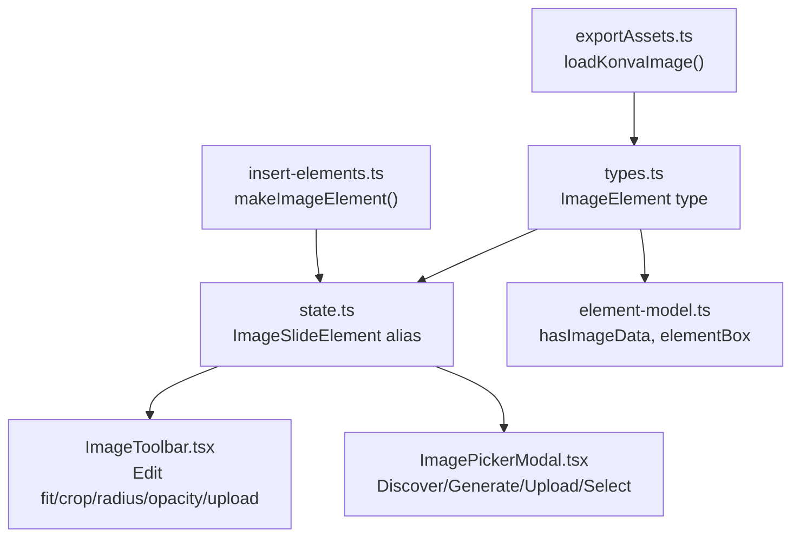
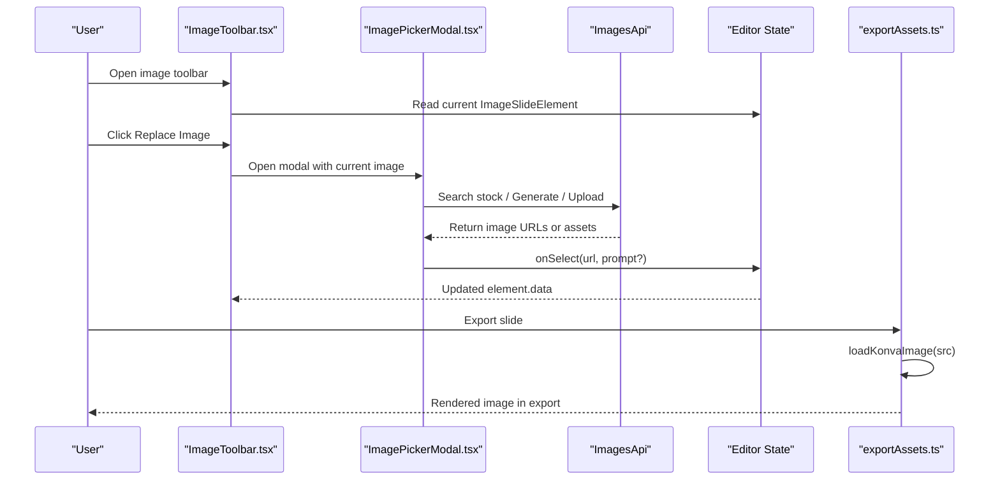
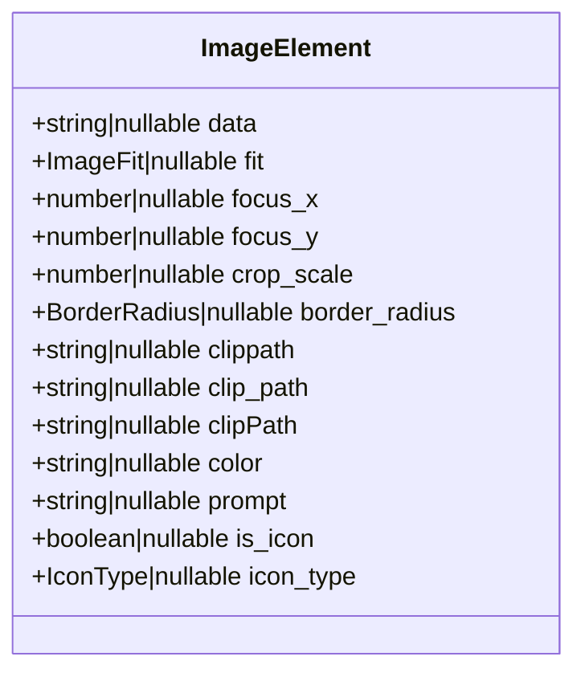
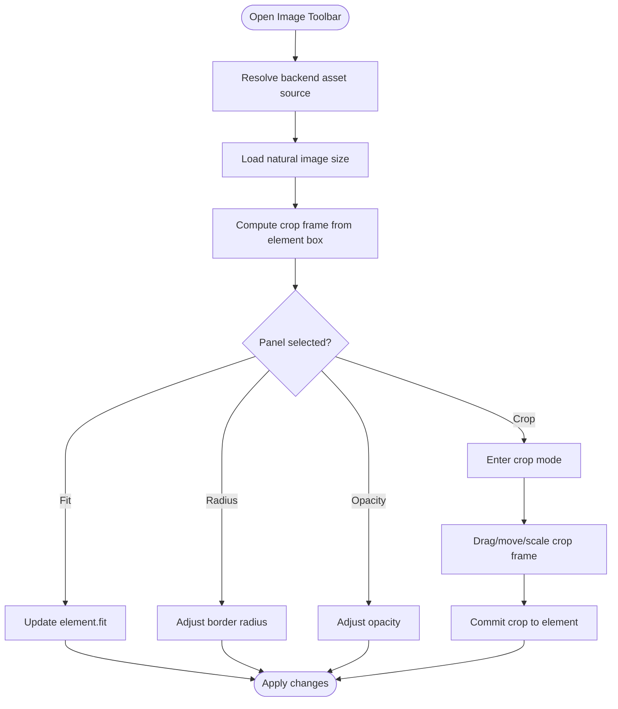
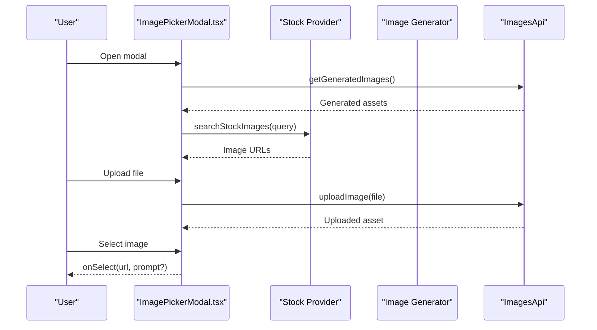
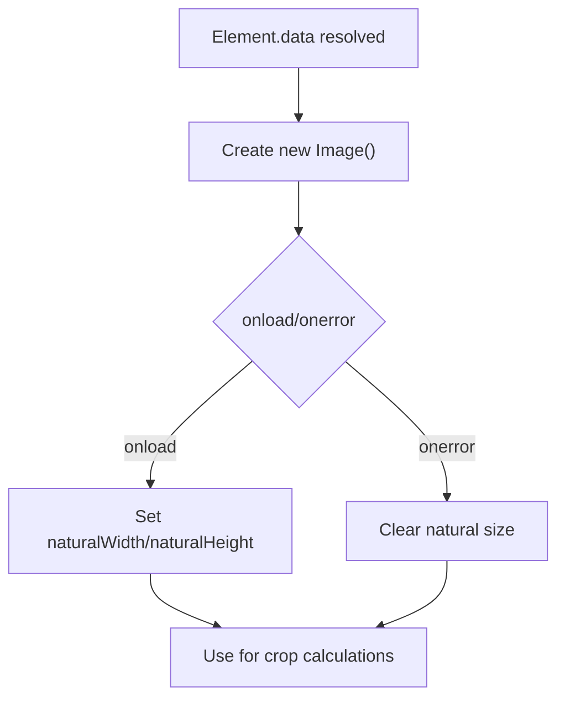
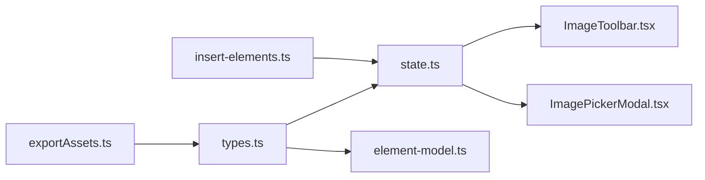

# Image Elements

<cite>
**Referenced Files in This Document**
- [types.ts](file://servers/nexjs/components/slide-editor/types.ts)
- [state.ts](file://servers/nexjs/components/slide-editor/state/state.ts)
- [element-model.ts](file://servers/nexjs/components/slide-editor/model/element-model.ts)
- [ImageToolbar.tsx](file://servers/nexjs/components/slide-editor/images/ImageToolbar.tsx)
- [ImagePickerModal.tsx](file://servers/nexjs/components/slide-editor/images/ImagePickerModal.tsx)
- [insert-elements.ts](file://servers/nexjs/components/slide-editor/insert/insert-elements.ts)
- [exportAssets.ts](file://servers/nexjs/components/slide-editor/surface/exportAssets.ts)
</cite>

## Table of Contents
1. [Introduction](#introduction)
2. [Project Structure](#project-structure)
3. [Core Components](#core-components)
4. [Architecture Overview](#architecture-overview)
5. [Detailed Component Analysis](#detailed-component-analysis)
6. [Dependency Analysis](#dependency-analysis)
7. [Performance Considerations](#performance-considerations)
8. [Troubleshooting Guide](#troubleshooting-guide)
9. [Conclusion](#conclusion)

## Introduction
This document explains how image elements are modeled, managed, and edited within the slide editor. It covers:
- The image element data model and its properties
- How images are loaded, processed, and displayed on slides
- Toolbar integration for editing (fit, crop, flip, radius, opacity)
- The image picker modal for discovery, generation, uploads, and selection
- Practical examples for adding custom sources, handling formats, and extending image editing features

## Project Structure
The image feature spans a small set of focused modules:
- Data model and types define the shape of an image element
- State helpers provide typed aliases for image elements
- Model utilities expose helpers like bounding box computation and presence checks
- UI components implement the toolbar and picker modal
- Insert logic creates default image elements
- Export utilities handle loading images for export

**Diagram sources**
- [types.ts:470-485](file://servers/nexjs/components/slide-editor/types.ts#L470-L485)
- [state.ts:6](file://servers/nexjs/components/slide-editor/state/state.ts#L6)
- [element-model.ts:241-243](file://servers/nexjs/components/slide-editor/model/element-model.ts#L241-L243)
- [ImageToolbar.tsx:283-343](file://servers/nexjs/components/slide-editor/images/ImageToolbar.tsx#L283-L343)
- [ImagePickerModal.tsx:80-118](file://servers/nexjs/components/slide-editor/images/ImagePickerModal.tsx#L80-L118)
- [insert-elements.ts:1634-1729](file://servers/nexjs/components/slide-editor/insert/insert-elements.ts#L1634-L1729)
- [exportAssets.ts:1-14](file://servers/nexjs/components/slide-editor/surface/exportAssets.ts#L1-L14)

**Section sources**
- [types.ts:470-485](file://servers/nexjs/components/slide-editor/types.ts#L470-L485)
- [state.ts:6](file://servers/nexjs/components/slide-editor/state/state.ts#L6)
- [element-model.ts:241-243](file://servers/nexjs/components/slide-editor/model/element-model.ts#L241-L243)
- [ImageToolbar.tsx:283-343](file://servers/nexjs/components/slide-editor/images/ImageToolbar.tsx#L283-L343)
- [ImagePickerModal.tsx:80-118](file://servers/nexjs/components/slide-editor/images/ImagePickerModal.tsx#L80-L118)
- [insert-elements.ts:1634-1729](file://servers/nexjs/components/slide-editor/insert/insert-elements.ts#L1634-L1729)
- [exportAssets.ts:1-14](file://servers/nexjs/components/slide-editor/surface/exportAssets.ts#L1-L14)

## Core Components
- ImageElement type defines all image-specific fields including source URL, fit mode, focus point, crop scale, border radius, clip path, color, prompt, and icon metadata.
- ImageSlideElement is a type alias that narrows SlideElement to images for editor state operations.
- hasImageData checks whether an image element has a valid data source.
- elementBox computes the bounding box used by the toolbar and cropping overlay.

Key responsibilities:
- Data modeling: types.ts
- State typing: state.ts
- Presence and geometry helpers: element-model.ts

**Section sources**
- [types.ts:470-485](file://servers/nexjs/components/slide-editor/types.ts#L470-L485)
- [state.ts:6](file://servers/nexjs/components/slide-editor/state/state.ts#L6)
- [element-model.ts:241-243](file://servers/nexjs/components/slide-editor/model/element-model.ts#L241-L243)
- [element-model.ts:43-50](file://servers/nexjs/components/slide-editor/model/element-model.ts#L43-L50)

## Architecture Overview
The image workflow connects the data model with UI interactions and asset loading:

**Diagram sources**
- [ImageToolbar.tsx:630-649](file://servers/nexjs/components/slide-editor/images/ImageToolbar.tsx#L630-L649)
- [ImagePickerModal.tsx:238-242](file://servers/nexjs/components/slide-editor/images/ImagePickerModal.tsx#L238-L242)
- [ImagePickerModal.tsx:269-312](file://servers/nexjs/components/slide-editor/images/ImagePickerModal.tsx#L269-L312)
- [ImagePickerModal.tsx:320-352](file://servers/nexjs/components/slide-editor/images/ImagePickerModal.tsx#L320-L352)
- [exportAssets.ts:1-14](file://servers/nexjs/components/slide-editor/surface/exportAssets.ts#L1-L14)

## Detailed Component Analysis

### Image Element Data Model
The image element supports:
- Source: data (string URL or backend asset reference)
- Fit: contain | cover | fill
- Focus and crop: focus_x, focus_y, crop_scale
- Appearance: border_radius, clippath/clip_path/clipPath, color
- Metadata: prompt, is_icon, icon_type

**Diagram sources**
- [types.ts:470-485](file://servers/nexjs/components/slide-editor/types.ts#L470-L485)

**Section sources**
- [types.ts:470-485](file://servers/nexjs/components/slide-editor/types.ts#L470-L485)

### Image Toolbar Integration
The floating toolbar provides:
- Fit mode selector (Fill, Contain, Stretch)
- Upload replacement image
- Replace via image picker modal
- Crop mode with interactive frame and keyboard controls
- Flip horizontal/vertical toggles
- Border radius slider
- Opacity slider

It also:
- Resolves the backend asset source from element.data
- Computes natural image size to support cropping calculations
- Commits crop changes to element.fit, focus_x, focus_y, crop_scale

**Diagram sources**
- [ImageToolbar.tsx:314-343](file://servers/nexjs/components/slide-editor/images/ImageToolbar.tsx#L314-L343)
- [ImageToolbar.tsx:409-423](file://servers/nexjs/components/slide-editor/images/ImageToolbar.tsx#L409-L423)
- [ImageToolbar.tsx:475-507](file://servers/nexjs/components/slide-editor/images/ImageToolbar.tsx#L475-L507)
- [ImageToolbar.tsx:519-553](file://servers/nexjs/components/slide-editor/images/ImageToolbar.tsx#L519-L553)

**Section sources**
- [ImageToolbar.tsx:283-343](file://servers/nexjs/components/slide-editor/images/ImageToolbar.tsx#L283-L343)
- [ImageToolbar.tsx:409-423](file://servers/nexjs/components/slide-editor/images/ImageToolbar.tsx#L409-L423)
- [ImageToolbar.tsx:475-507](file://servers/nexjs/components/slide-editor/images/ImageToolbar.tsx#L475-L507)
- [ImageToolbar.tsx:519-553](file://servers/nexjs/components/slide-editor/images/ImageToolbar.tsx#L519-L553)

### Image Picker Modal
The modal supports three primary workflows:
- Discover: search stock images (e.g., Pexels/Pixabay) or generate images via configured provider
- Uploads: upload local images, list library, delete uploaded images
- Selection: choose an image and return its URL and optional prompt to the editor

Key behaviors:
- Normalizes provider names and reads configuration flags
- Loads generated and uploaded libraries asynchronously
- Validates file type and size before upload
- Deduplicates images by URL
- Displays skeletons while loading and errors when requests fail

**Diagram sources**
- [ImagePickerModal.tsx:119-201](file://servers/nexjs/components/slide-editor/images/ImagePickerModal.tsx#L119-L201)
- [ImagePickerModal.tsx:203-236](file://servers/nexjs/components/slide-editor/images/ImagePickerModal.tsx#L203-L236)
- [ImagePickerModal.tsx:269-312](file://servers/nexjs/components/slide-editor/images/ImagePickerModal.tsx#L269-L312)
- [ImagePickerModal.tsx:320-352](file://servers/nexjs/components/slide-editor/images/ImagePickerModal.tsx#L320-L352)

**Section sources**
- [ImagePickerModal.tsx:80-118](file://servers/nexjs/components/slide-editor/images/ImagePickerModal.tsx#L80-L118)
- [ImagePickerModal.tsx:238-242](file://servers/nexjs/components/slide-editor/images/ImagePickerModal.tsx#L238-L242)
- [ImagePickerModal.tsx:269-312](file://servers/nexjs/components/slide-editor/images/ImagePickerModal.tsx#L269-L312)
- [ImagePickerModal.tsx:320-352](file://servers/nexjs/components/slide-editor/images/ImagePickerModal.tsx#L320-L352)

### Creating Default Images
Default image elements can be inserted programmatically using makeImageElement. This function constructs image elements with initial position, size, and optional data.

Typical usage patterns include:
- Inserting a placeholder image with default dimensions
- Pre-populating with a known URL or template asset
- Adding multiple images at once for layout templates

**Section sources**
- [insert-elements.ts:1634-1729](file://servers/nexjs/components/slide-editor/insert/insert-elements.ts#L1634-L1729)

### Loading and Displaying Images
For rendering and export:
- The toolbar loads the natural image size to compute cropping accurately
- Export utilities cache and load HTMLImageElement instances for Konva-based export

**Diagram sources**
- [ImageToolbar.tsx:367-396](file://servers/nexjs/components/slide-editor/images/ImageToolbar.tsx#L367-L396)
- [exportAssets.ts:1-14](file://servers/nexjs/components/slide-editor/surface/exportAssets.ts#L1-L14)

**Section sources**
- [ImageToolbar.tsx:367-396](file://servers/nexjs/components/slide-editor/images/ImageToolbar.tsx#L367-L396)
- [exportAssets.ts:1-14](file://servers/nexjs/components/slide-editor/surface/exportAssets.ts#L1-L14)

## Dependency Analysis
- types.ts defines ImageElement and related types consumed by other modules
- state.ts provides ImageSlideElement alias used by toolbar and state handlers
- element-model.ts exposes hasImageData and elementBox used by toolbar and selection logic
- ImageToolbar.tsx depends on types, state, and utility functions; it orchestrates user edits and updates element state
- ImagePickerModal.tsx integrates with ImagesApi for stock, generation, and upload flows
- insert-elements.ts uses ImageElement to create defaults
- exportAssets.ts consumes ImageElement data to load images for export

**Diagram sources**
- [types.ts:470-485](file://servers/nexjs/components/slide-editor/types.ts#L470-L485)
- [state.ts:6](file://servers/nexjs/components/slide-editor/state/state.ts#L6)
- [element-model.ts:241-243](file://servers/nexjs/components/slide-editor/model/element-model.ts#L241-L243)
- [ImageToolbar.tsx:283-343](file://servers/nexjs/components/slide-editor/images/ImageToolbar.tsx#L283-L343)
- [ImagePickerModal.tsx:80-118](file://servers/nexjs/components/slide-editor/images/ImagePickerModal.tsx#L80-L118)
- [insert-elements.ts:1634-1729](file://servers/nexjs/components/slide-editor/insert/insert-elements.ts#L1634-L1729)
- [exportAssets.ts:1-14](file://servers/nexjs/components/slide-editor/surface/exportAssets.ts#L1-L14)

**Section sources**
- [types.ts:470-485](file://servers/nexjs/components/slide-editor/types.ts#L470-L485)
- [state.ts:6](file://servers/nexjs/components/slide-editor/state/state.ts#L6)
- [element-model.ts:241-243](file://servers/nexjs/components/slide-editor/model/element-model.ts#L241-L243)
- [ImageToolbar.tsx:283-343](file://servers/nexjs/components/slide-editor/images/ImageToolbar.tsx#L283-L343)
- [ImagePickerModal.tsx:80-118](file://servers/nexjs/components/slide-editor/images/ImagePickerModal.tsx#L80-L118)
- [insert-elements.ts:1634-1729](file://servers/nexjs/components/slide-editor/insert/insert-elements.ts#L1634-L1729)
- [exportAssets.ts:1-14](file://servers/nexjs/components/slide-editor/surface/exportAssets.ts#L1-L14)

## Performance Considerations
- Avoid unnecessary re-renders by committing crop only when changes exceed thresholds (e.g., same crop draft in cover mode).
- Debounce or throttle heavy operations like generating multiple variations; the modal already batches requests and deduplicates results.
- Cache image loads during export to prevent redundant network calls.
- Validate file sizes early to reduce failed uploads and wasted bandwidth.

[No sources needed since this section provides general guidance]

## Troubleshooting Guide
Common issues and resolutions:
- No images found in discover view: ensure query is non-empty and provider keys are configured; check error messages shown in the modal.
- Generation disabled: if IMAGE_GENERATION is disabled and no stock provider is configured, discovery will be blocked.
- Upload failures: verify file type starts with image/ and file size is under the limit; the modal enforces these checks.
- Crop not applying: confirm fit is set to cover when committing crop; the toolbar normalizes and clamps values before update.

**Section sources**
- [ImagePickerModal.tsx:244-267](file://servers/nexjs/components/slide-editor/images/ImagePickerModal.tsx#L244-L267)
- [ImagePickerModal.tsx:320-352](file://servers/nexjs/components/slide-editor/images/ImagePickerModal.tsx#L320-L352)
- [ImageToolbar.tsx:409-423](file://servers/nexjs/components/slide-editor/images/ImageToolbar.tsx#L409-L423)

## Conclusion
Image elements in the editor are modeled by a clear, extensible type and supported by focused UI components. The toolbar enables precise visual adjustments, while the picker modal unifies discovery, generation, and uploads. With well-defined data contracts and helper utilities, adding custom sources or editing features is straightforward and consistent with existing patterns.

[No sources needed since this section summarizes without analyzing specific files]