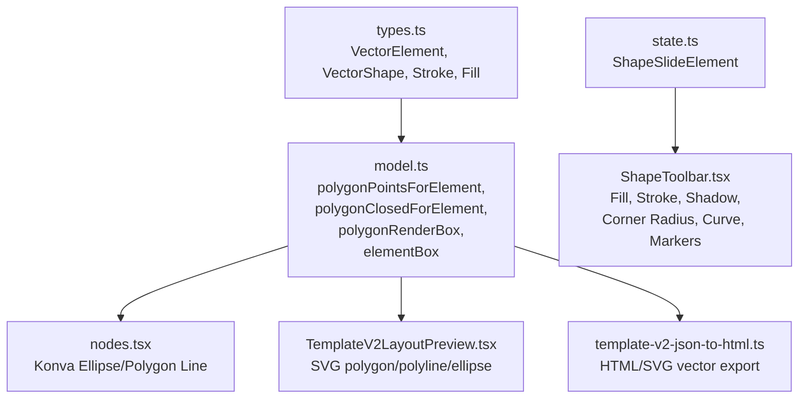
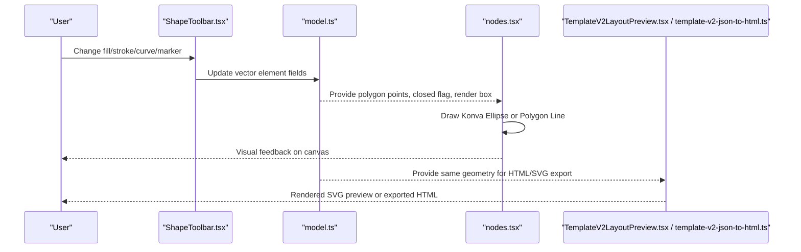
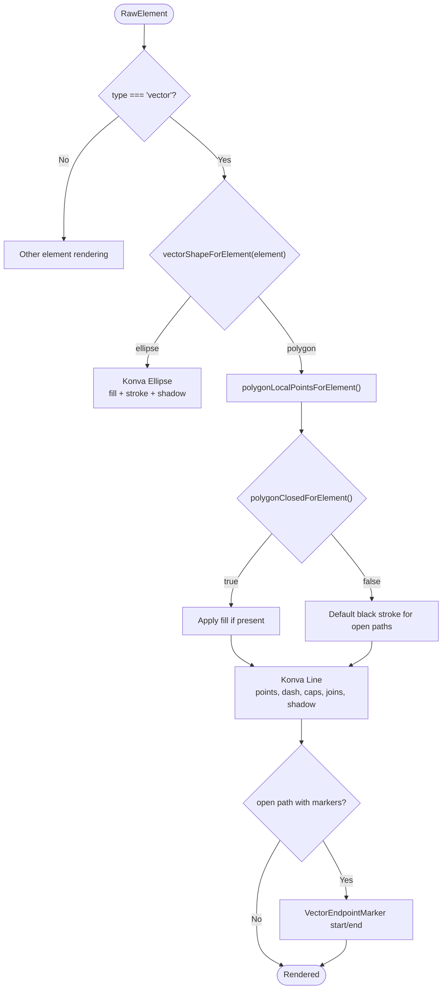
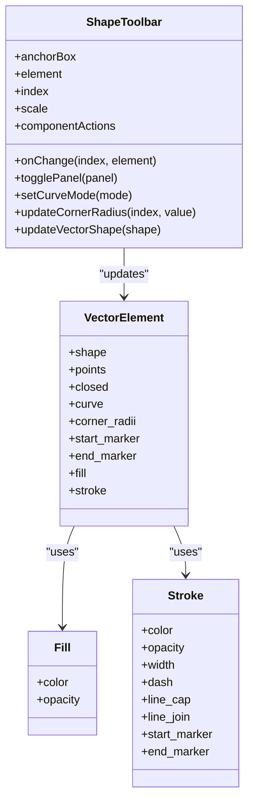
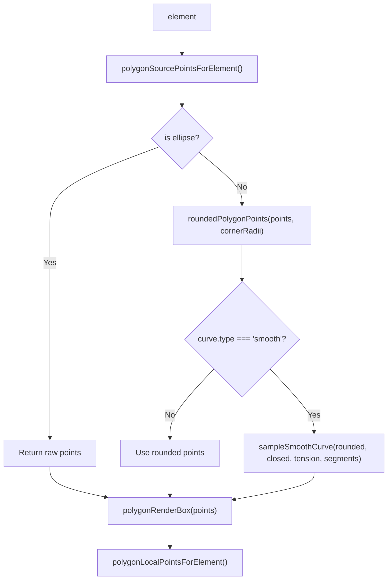
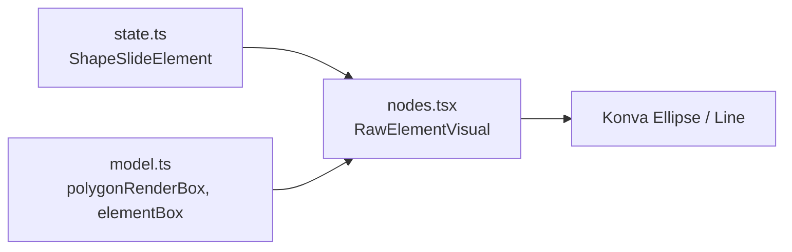
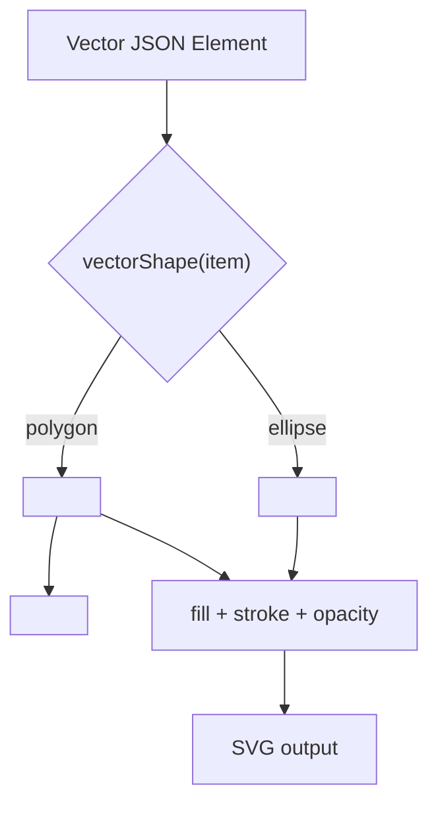
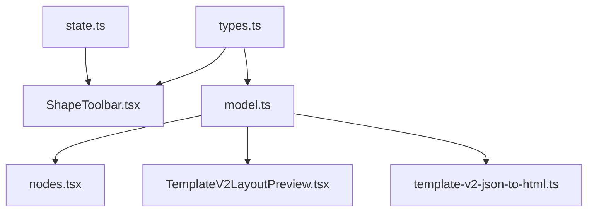

# Shape Elements

<cite>
**Referenced Files in This Document**
- [ShapeToolbar.tsx](file://servers/nextjs/components/slide-editor/shapes/ShapeToolbar.tsx)
- [model.ts](file://servers/nextjs/components/slide-editor/model/model.ts)
- [nodes.tsx](file://servers/nextjs/components/slide-editor/surface/nodes.tsx)
- [state.ts](file://servers/nextjs/components/slide-editor/state/state.ts)
- [types.ts](file://servers/nextjs/components/slide-editor/types.ts)
- [TemplateV2LayoutPreview.tsx](file://servers/nextjs/app/(presentation-generator)/custom-template/components/EachSlide/TemplateV2LayoutPreview.tsx)
- [template-v2-json-to-html.ts](file://servers/nextjs/lib/template-v2-json-to-html.ts)
</cite>

## Table of Contents
1. [Introduction](#introduction)
2. [Project Structure](#project-structure)
3. [Core Components](#core-components)
4. [Architecture Overview](#architecture-overview)
5. [Detailed Component Analysis](#detailed-component-analysis)
6. [Dependency Analysis](#dependency-analysis)
7. [Performance Considerations](#performance-considerations)
8. [Troubleshooting Guide](#troubleshooting-guide)
9. [Conclusion](#conclusion)

## Introduction
This document explains how shape elements are implemented, rendered, and edited in the slide editor. Shapes are represented as vector elements with two primary drawing primitives: ellipses and polygons. The system supports fill, stroke, shadow, opacity, corner rounding, smooth curves, line markers, and interactive editing through a floating toolbar. Shapes are integrated into the slide canvas via a Konva-based surface renderer and can also be exported to HTML/SVG for previews and exports.

## Project Structure
The shape implementation spans several focused areas:

- Data model and geometry utilities: `model.ts`
- Editor types and shared type definitions: `types.ts`
- Editor state helpers and shape element alias: `state.ts`
- Floating shape editing toolbar: `ShapeToolbar.tsx`
- Canvas rendering pipeline: `nodes.tsx`
- HTML preview/export path: `TemplateV2LayoutPreview.tsx` and `template-v2-json-to-html.ts`

**Diagram sources**
- [types.ts:528-560](file://servers/nextjs/components/slide-editor/types.ts#L528-L560)
- [model.ts:1648-1730](file://servers/nextjs/components/slide-editor/model/model.ts#L1648-L1730)
- [state.ts:7-10](file://servers/nextjs/components/slide-editor/state/state.ts#L7-L10)
- [ShapeToolbar.tsx:90-579](file://servers/nextjs/components/slide-editor/shapes/ShapeToolbar.tsx#L90-L579)
- [nodes.tsx:2265-2377](file://servers/nextjs/components/slide-editor/surface/nodes.tsx#L2265-L2377)
- [TemplateV2LayoutPreview.tsx:181-217](file://servers/nextjs/app/(presentation-generator)/custom-template/components/EachSlide/TemplateV2LayoutPreview.tsx#L181-L217)
- [template-v2-json-to-html.ts:847-873](file://servers/nextjs/lib/template-v2-json-to-html.ts#L847-L873)

**Section sources**
- [types.ts:528-560](file://servers/nextjs/components/slide-editor/types.ts#L528-L560)
- [model.ts:1648-1730](file://servers/nextjs/components/slide-editor/model/model.ts#L1648-L1730)
- [state.ts:7-10](file://servers/nextjs/components/slide-editor/state/state.ts#L7-L10)
- [ShapeToolbar.tsx:90-579](file://servers/nextjs/components/slide-editor/shapes/ShapeToolbar.tsx#L90-L579)
- [nodes.tsx:2265-2377](file://servers/nextjs/components/slide-editor/surface/nodes.tsx#L2265-L2377)
- [TemplateV2LayoutPreview.tsx:181-217](file://servers/nextjs/app/(presentation-generator)/custom-template/components/EachSlide/TemplateV2LayoutPreview.tsx#L181-L217)
- [template-v2-json-to-html.ts:847-873](file://servers/nextjs/lib/template-v2-json-to-html.ts#L847-L873)

## Core Components
- Vector data model: `VectorElement` defines shape type, points, closed path, curve settings, corner radii, markers, fill, and stroke.
- Shape element alias: `ShapeSlideElement` is the editor’s typed representation of a vector element on slides.
- Geometry utilities: functions compute polygon points, closedness, render box, local points, and element bounding boxes.
- Rendering: Konva nodes draw ellipses or polygon lines with optional fills, strokes, dash patterns, line caps/joins, shadows, and endpoint markers.
- Editing UI: `ShapeToolbar` provides controls for fill, stroke, shadow, opacity, corner radius, curve mode, and line markers.

Key responsibilities:
- `types.ts`: declares vector-related types and shared style shapes.
- `model.ts`: computes geometry and transforms for vector shapes.
- `nodes.tsx`: renders vector shapes on the canvas.
- `ShapeToolbar.tsx`: edits vector shape properties and updates the underlying element.
- `state.ts`: exposes `ShapeSlideElement` for toolbars and selection logic.
- `TemplateV2LayoutPreview.tsx` and `template-v2-json-to-html.ts`: render vector shapes for HTML/SVG previews and exports.

**Section sources**
- [types.ts:528-560](file://servers/nextjs/components/slide-editor/types.ts#L528-L560)
- [state.ts:7-10](file://servers/nextjs/components/slide-editor/state/state.ts#L7-L10)
- [model.ts:1648-1730](file://servers/nextjs/components/slide-editor/model/model.ts#L1648-L1730)
- [nodes.tsx:2265-2377](file://servers/nextjs/components/slide-editor/surface/nodes.tsx#L2265-L2377)
- [ShapeToolbar.tsx:90-579](file://servers/nextjs/components/slide-editor/shapes/ShapeToolbar.tsx#L90-L579)

## Architecture Overview
The shape system follows a clear separation between data, editing, and rendering:

**Diagram sources**
- [ShapeToolbar.tsx:144-229](file://servers/nextjs/components/slide-editor/shapes/ShapeToolbar.tsx#L144-L229)
- [model.ts:1648-1730](file://servers/nextjs/components/slide-editor/model/model.ts#L1648-L1730)
- [nodes.tsx:2265-2377](file://servers/nextjs/components/slide-editor/surface/nodes.tsx#L2265-L2377)
- [TemplateV2LayoutPreview.tsx:181-217](file://servers/nextjs/app/(presentation-generator)/custom-template/components/EachSlide/TemplateV2LayoutPreview.tsx#L181-L217)
- [template-v2-json-to-html.ts:847-873](file://servers/nextjs/lib/template-v2-json-to-html.ts#L847-L873)

## Detailed Component Analysis

### Vector Shape Types and Data Model
- `VectorShape` is `"polygon"` or `"ellipse"`.
- `VectorElement` includes:
  - `shape`, `points`, `closed`, `curve`, `corner_radii`
  - `start_marker`, `end_marker`
  - `fill`, `stroke`
- `Stroke` supports color, opacity, width, dash, line cap, line join, and marker references.
- `Fill` supports color and opacity.
- `Shadow` supports color, blur, opacity, and offsets.

These types define the canonical shape data used by both the editor and exporters.

**Section sources**
- [types.ts:347-386](file://servers/nextjs/components/slide-editor/types.ts#L347-L386)
- [types.ts:528-560](file://servers/nextjs/components/slide-editor/types.ts#L528-L560)

### Drawing Primitives and Rendering Pipeline
Rendering distinguishes between ellipse and polygon vectors:

- Ellipse:
  - Centered at half width/height.
  - Uses Konva `Ellipse` with fill, stroke, dash, line cap/join, hit area, and shadow.
- Polygon:
  - Uses computed local points from `polygonLocalPointsForElement`.
  - Closed polygons receive fill; open paths default to black stroke when no explicit stroke is provided.
  - Endpoint markers are drawn using `VectorEndpointMarker` for start/end positions.
  - Supports dash patterns, line caps, line joins, and shadows.

**Diagram sources**
- [nodes.tsx:2265-2377](file://servers/nextjs/components/slide-editor/surface/nodes.tsx#L2265-L2377)
- [model.ts:1648-1712](file://servers/nextjs/components/slide-editor/model/model.ts#L1648-L1712)

**Section sources**
- [nodes.tsx:2265-2377](file://servers/nextjs/components/slide-editor/surface/nodes.tsx#L2265-L2377)
- [model.ts:1648-1712](file://servers/nextjs/components/slide-editor/model/model.ts#L1648-L1712)

### Shape Manipulation Tools and Visual Styling
The floating toolbar provides:

- Fill: toggle, color, opacity.
- Stroke: toggle, color, width, opacity.
- Corner Radius: uniform slider plus per-corner values for four-point closed polygons.
- Vector Path:
  - Switch between polygon and ellipse.
  - Toggle closed path.
  - Smooth curve mode with tension and segments.
- Line Markers: start and end markers for open polygon paths.
- Shadow: position, blur, color, opacity.
- Opacity: overall shape opacity.

The toolbar computes derived values such as maximum corner radius based on the shape’s bounding box and determines whether markers are available based on shape kind and closedness.

**Diagram sources**
- [ShapeToolbar.tsx:90-579](file://servers/nextjs/components/slide-editor/shapes/ShapeToolbar.tsx#L90-L579)
- [types.ts:347-386](file://servers/nextjs/components/slide-editor/types.ts#L347-L386)
- [types.ts:528-560](file://servers/nextjs/components/slide-editor/types.ts#L528-L560)

**Section sources**
- [ShapeToolbar.tsx:90-579](file://servers/nextjs/components/slide-editor/shapes/ShapeToolbar.tsx#L90-L579)

### Geometry Computation and Bounding Boxes
Geometry utilities ensure consistent sizing and interaction:

- `polygonPointsForElement`:
  - Returns raw points for ellipses.
  - Applies corner rounding for closed polygons.
  - Optionally samples smooth curves using Hermite interpolation.
- `polygonClosedForElement`:
  - Ellipses are always closed.
  - For polygons, uses explicit `closed` field or defaults to closed when more than two points exist.
- `polygonRenderBox`:
  - Computes bounding box from source points (ellipse) or processed points (polygon).
  - Ensures minimum size considering stroke width.
- `polygonLocalPointsForElement`:
  - Converts global points to local coordinates relative to the render box.
- `elementBox` and `elementSize`:
  - Treat vector elements specially by delegating to polygon geometry.

**Diagram sources**
- [model.ts:1613-1663](file://servers/nextjs/components/slide-editor/model/model.ts#L1613-L1663)
- [model.ts:1665-1712](file://servers/nextjs/components/slide-editor/model/model.ts#L1665-L1712)

**Section sources**
- [model.ts:1613-1663](file://servers/nextjs/components/slide-editor/model/model.ts#L1613-L1663)
- [model.ts:1665-1712](file://servers/nextjs/components/slide-editor/model/model.ts#L1665-L1712)

### Integration Into the Slide Canvas
Shapes are part of the broader slide element system:

- `ShapeSlideElement` is an alias for vector elements within slide state.
- The surface renderer dispatches vector elements to either ellipse or polygon drawing code.
- Selection, resizing, and transformation pipelines use `elementBox` and `polygonRenderBox` to compute frames and bounds consistently across text, containers, groups, and vector shapes.

**Diagram sources**
- [state.ts:7-10](file://servers/nextjs/components/slide-editor/state/state.ts#L7-L10)
- [nodes.tsx:2265-2377](file://servers/nextjs/components/slide-editor/surface/nodes.tsx#L2265-L2377)
- [model.ts:1677-1730](file://servers/nextjs/components/slide-editor/model/model.ts#L1677-L1730)

**Section sources**
- [state.ts:7-10](file://servers/nextjs/components/slide-editor/state/state.ts#L7-L10)
- [nodes.tsx:2265-2377](file://servers/nextjs/components/slide-editor/surface/nodes.tsx#L2265-L2377)
- [model.ts:1677-1730](file://servers/nextjs/components/slide-editor/model/model.ts#L1677-L1730)

### Custom Shapes and Shape-Specific Editing Behaviors
Customization options include:

- Creating custom polygons by defining point arrays and toggling closed/open states.
- Applying smooth curves with adjustable tension and segment count.
- Rounding corners uniformly or per-corner for four-point closed polygons.
- Adding directional markers to open paths for flow diagrams and arrows.
- Styling with fill, stroke, dash patterns, line caps/joins, shadows, and opacity.

Examples of behavior:
- When switching to ellipse, curve and corner radius settings are cleared because they do not apply.
- When enabling smooth curves, the system samples additional points along Hermite segments to approximate curvature.
- When opening a polygon path, default stroke color ensures visibility even without explicit styling.

**Section sources**
- [ShapeToolbar.tsx:123-229](file://servers/nextjs/components/slide-editor/shapes/ShapeToolbar.tsx#L123-L229)
- [model.ts:1613-1663](file://servers/nextjs/components/slide-editor/model/model.ts#L1613-L1663)
- [nodes.tsx:2313-2377](file://servers/nextjs/components/slide-editor/surface/nodes.tsx#L2313-L2377)

### HTML and SVG Export Path
The preview and export components mirror the editor’s vector rendering logic:

- Template preview renders SVG `<polygon>` or `<polyline>` for polygons and `<ellipse>` for ellipses.
- It computes point strings relative to the shape’s bounding box and applies fill/stroke styles.
- Markers are defined in `<defs>` and referenced for open paths.

**Diagram sources**
- [TemplateV2LayoutPreview.tsx:181-217](file://servers/nextjs/app/(presentation-generator)/custom-template/components/EachSlide/TemplateV2LayoutPreview.tsx#L181-L217)
- [template-v2-json-to-html.ts:847-873](file://servers/nextjs/lib/template-v2-json-to-html.ts#L847-L873)

**Section sources**
- [TemplateV2LayoutPreview.tsx:181-217](file://servers/nextjs/app/(presentation-generator)/custom-template/components/EachSlide/TemplateV2LayoutPreview.tsx#L181-L217)
- [template-v2-json-to-html.ts:847-873](file://servers/nextjs/lib/template-v2-json-to-html.ts#L847-L873)

## Dependency Analysis
The shape system has clear dependencies:

- `ShapeToolbar.tsx` depends on:
  - `state.ts` for `ShapeSlideElement`.
  - `types.ts` for `VectorElement`, `VectorCurve`, `VectorMarker`.
  - `model.ts` for `elementBox` and geometry helpers.
- `nodes.tsx` depends on:
  - `model.ts` for `vectorShapeForElement`, `polygonClosedForElement`, `polygonLocalPointsForElement`.
  - Shared style helpers for fill, stroke, and shadow.
- Export/preview components depend on:
  - Geometry helpers and vector shape detection.

Potential coupling concerns:
- Geometry computation is centralized in `model.ts`, reducing duplication between editor and exporter.
- Type definitions in `types.ts` provide a single source of truth for vector-related structures.

**Diagram sources**
- [types.ts:528-560](file://servers/nextjs/components/slide-editor/types.ts#L528-L560)
- [state.ts:7-10](file://servers/nextjs/components/slide-editor/state/state.ts#L7-L10)
- [ShapeToolbar.tsx:90-579](file://servers/nextjs/components/slide-editor/shapes/ShapeToolbar.tsx#L90-L579)
- [model.ts:1648-1730](file://servers/nextjs/components/slide-editor/model/model.ts#L1648-L1730)
- [nodes.tsx:2265-2377](file://servers/nextjs/components/slide-editor/surface/nodes.tsx#L2265-L2377)
- [TemplateV2LayoutPreview.tsx:181-217](file://servers/nextjs/app/(presentation-generator)/custom-template/components/EachSlide/TemplateV2LayoutPreview.tsx#L181-L217)
- [template-v2-json-to-html.ts:847-873](file://servers/nextjs/lib/template-v2-json-to-html.ts#L847-L873)

**Section sources**
- [types.ts:528-560](file://servers/nextjs/components/slide-editor/types.ts#L528-L560)
- [state.ts:7-10](file://servers/nextjs/components/slide-editor/state/state.ts#L7-L10)
- [ShapeToolbar.tsx:90-579](file://servers/nextjs/components/slide-editor/shapes/ShapeToolbar.tsx#L90-L579)
- [model.ts:1648-1730](file://servers/nextjs/components/slide-editor/model/model.ts#L1648-L1730)
- [nodes.tsx:2265-2377](file://servers/nextjs/components/slide-editor/surface/nodes.tsx#L2265-L2377)
- [TemplateV2LayoutPreview.tsx:181-217](file://servers/nextjs/app/(presentation-generator)/custom-template/components/EachSlide/TemplateV2LayoutPreview.tsx#L181-L217)
- [template-v2-json-to-html.ts:847-873](file://servers/nextjs/lib/template-v2-json-to-html.ts#L847-L873)

## Performance Considerations
- Smooth curves sample additional points proportional to the configured segment count; high segment counts increase polygon point arrays and may affect rendering performance.
- Corner rounding and curve sampling are applied during geometry computation; batch updates via the toolbar minimize repeated recomputation.
- Hit testing for vector shapes sets a minimum hit stroke width to improve interaction reliability without excessive overhead.
- Export paths reuse geometry computations rather than duplicating complex algorithms, keeping HTML/SVG generation efficient.

[No sources needed since this section provides general guidance]

## Troubleshooting Guide
Common issues and resolutions:

- Shape appears invisible:
  - Ensure either fill or stroke is enabled. Open polygons default to black stroke only when no explicit stroke is set.
  - Verify opacity values are not zero.
- Markers not visible:
  - Markers are only applicable to open polygon paths.
  - Confirm stroke width is greater than zero and stroke color is set.
- Corner radius has no effect:
  - Corner radius applies to closed polygons with exactly four points.
  - Ellipses ignore corner radius settings.
- Smooth curve looks jagged:
  - Increase the smoothness/segments parameter.
  - Adjust tension to control curve tightness.
- Export differs from editor:
  - Confirm that vector shape kind and closedness match between editor and export logic.
  - Validate that point arrays and bounding boxes are consistent.

**Section sources**
- [ShapeToolbar.tsx:123-229](file://servers/nextjs/components/slide-editor/shapes/ShapeToolbar.tsx#L123-L229)
- [nodes.tsx:2313-2377](file://servers/nextjs/components/slide-editor/surface/nodes.tsx#L2313-L2377)
- [model.ts:1648-1712](file://servers/nextjs/components/slide-editor/model/model.ts#L1648-L1712)

## Conclusion
Shape elements in this project are built around a robust vector model supporting ellipses and polygons. Geometry computation is centralized, rendering is handled by a dedicated surface layer, and the floating toolbar provides comprehensive editing capabilities. The same geometry is reused for HTML/SVG previews and exports, ensuring consistency across editing and delivery. By following the documented types, geometry functions, and rendering paths, developers can extend shape behaviors, add new styling options, and implement custom editing interactions while maintaining predictable visual results.

[No sources needed since this section summarizes without analyzing specific files]