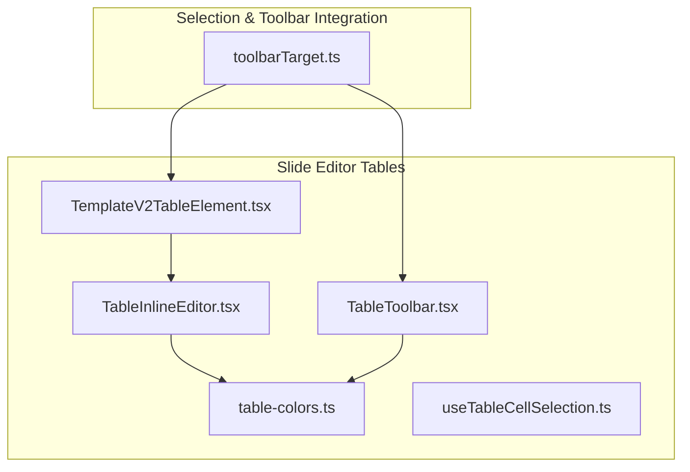
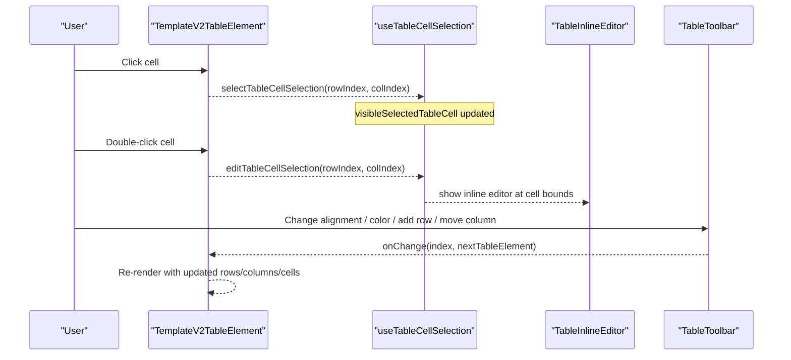
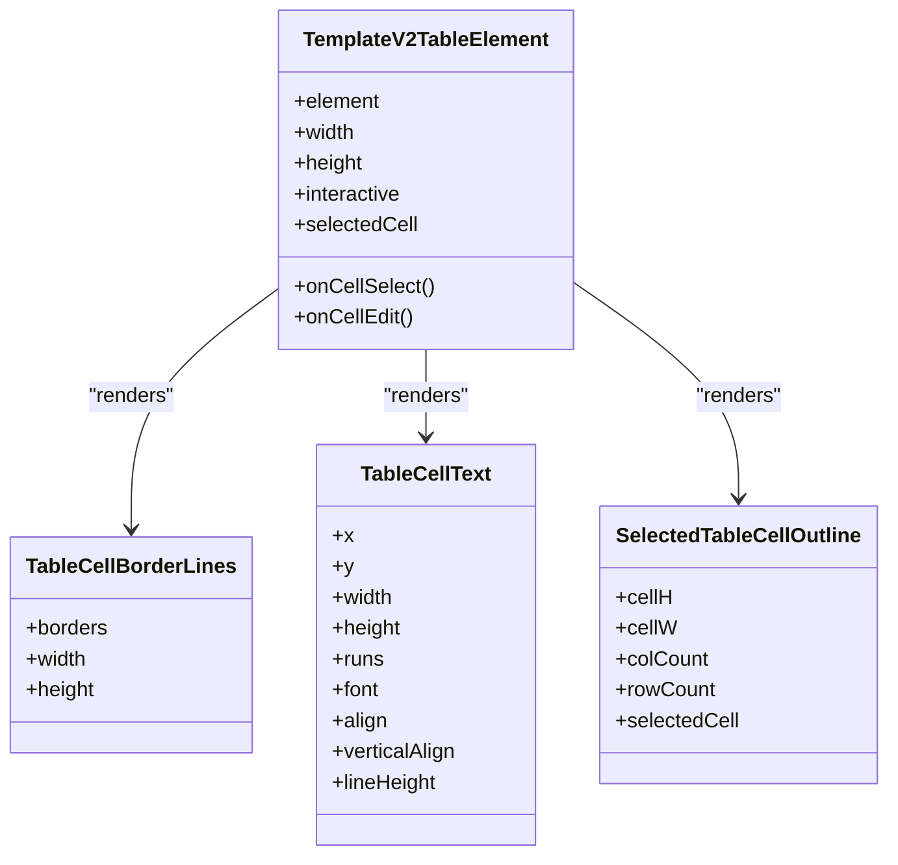
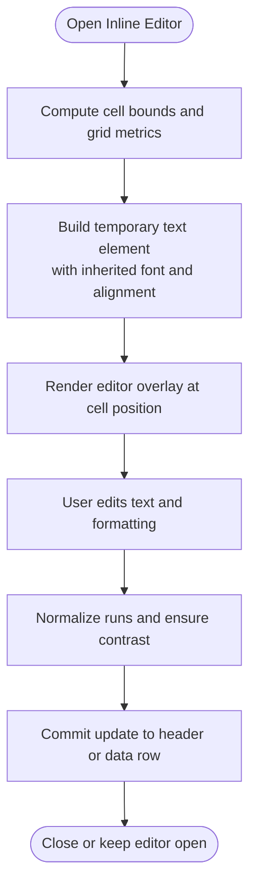
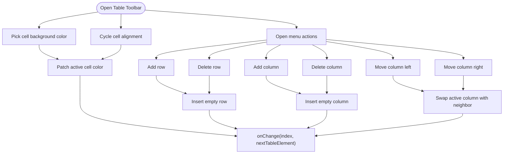
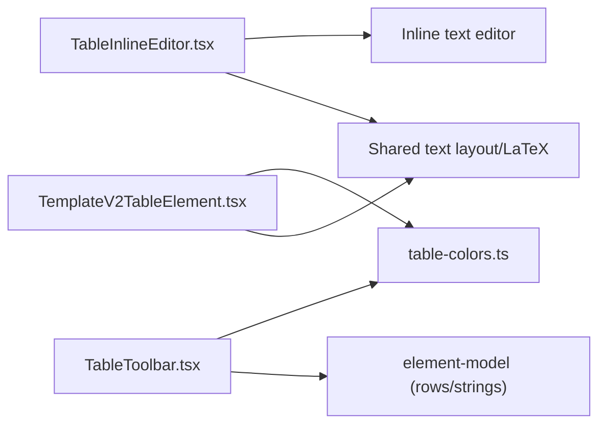

# Table Elements

<cite>
**Referenced Files in This Document**
- [TemplateV2TableElement.tsx](file://servers\nextjs\components\slide-editor\tables\TemplateV2TableElement.tsx)
- [TableInlineEditor.tsx](file://servers\nextjs\components\slide-editor\tables\TableInlineEditor.tsx)
- [TableToolbar.tsx](file://servers\nextjs\components\slide-editor\tables\TableToolbar.tsx)
- [table-colors.ts](file://servers\nextjs\components\slide-editor\tables\table-colors.ts)
- [useTableCellSelection.ts](file://servers\nextjs\components\slide-editor\tables\useTableCellSelection.ts)
- [toolbarTarget.ts](file://servers\nextjs\components\slide-editor\selection\toolbarTarget.ts)
</cite>

## Table of Contents
1. [Introduction](#introduction)
2. [Project Structure](#project-structure)
3. [Core Components](#core-components)
4. [Architecture Overview](#architecture-overview)
5. [Detailed Component Analysis](#detailed-component-analysis)
6. [Dependency Analysis](#dependency-analysis)
7. [Performance Considerations](#performance-considerations)
8. [Troubleshooting Guide](#troubleshooting-guide)
9. [Conclusion](#conclusion)

## Introduction
This document explains the table element functionality used in the slide editor. It covers:
- Table structure and data model (rows, columns, cells, runs)
- Rendering with Konva for interactive editing
- Inline cell editing with rich text and formatting
- Toolbar operations for cell alignment, background color, row/column management, and reordering
- Data binding between the editor state and rendered output
- Cell formatting including fonts, colors, borders, and accessibility-aware text contrast
- User interactions such as selection, double-click to edit, resizing via toolbar-driven layout changes, and column reordering

## Project Structure
The table feature is implemented under the slide editor’s tables module and integrates with selection and toolbar systems.

**Diagram sources**
- [TemplateV2TableElement.tsx:1-523](file://servers\nextjs\components\slide-editor\tables\TemplateV2TableElement.tsx#L1-L523)
- [TableInlineEditor.tsx:1-343](file://servers\nextjs\components\slide-editor\tables\TableInlineEditor.tsx#L1-L343)
- [TableToolbar.tsx:1-604](file://servers\nextjs\components\slide-editor\tables\TableToolbar.tsx#L1-L604)
- [table-colors.ts:1-86](file://servers\nextjs\components\slide-editor\tables\table-colors.ts#L1-L86)
- [useTableCellSelection.ts:1-116](file://servers\nextjs\components\slide-editor\tables\useTableCellSelection.ts#L1-L116)
- [toolbarTarget.ts:154-179](file://servers\nextjs\components\slide-editor\selection\toolbarTarget.ts#L154-L179)

**Section sources**
- [TemplateV2TableElement.tsx:1-523](file://servers\nextjs\components\slide-editor\tables\TemplateV2TableElement.tsx#L1-L523)
- [TableInlineEditor.tsx:1-343](file://servers\nextjs\components\slide-editor\tables\TableInlineEditor.tsx#L1-L343)
- [TableToolbar.tsx:1-604](file://servers\nextjs\components\slide-editor\tables\TableToolbar.tsx#L1-L604)
- [table-colors.ts:1-86](file://servers\nextjs\components\slide-editor\tables\table-colors.ts#L1-L86)
- [useTableCellSelection.ts:1-116](file://servers\nextjs\components\slide-editor\tables\useTableCellSelection.ts#L1-L116)
- [toolbarTarget.ts:154-179](file://servers\nextjs\components\slide-editor\selection\toolbarTarget.ts#L154-L179)

## Core Components
- TemplateV2TableElement: Renders a table grid using Konva primitives, handles cell backgrounds, strokes/borders, text runs (including LaTeX), header bolding, and selection outlines.
- TableInlineEditor: Provides an inline rich-text editor overlay for a selected cell, computing geometry, font inheritance, and applying text formatting via shared text utilities.
- TableToolbar: Floating toolbar offering cell alignment cycling, background color picker, add/delete rows/columns, and move column left/right.
- table-colors: Utilities for readable text color based on contrast against cell fill.
- useTableCellSelection: Hook that tracks per-cell selection and editing state tied to the global selection path.

Key responsibilities:
- Data binding: Rows/columns are represented as arrays of cells; each cell contains formatted runs and optional styling.
- Formatting: Fonts, colors, alignment, borders, and opacity are applied consistently across rendering and editing.
- Interactions: Click selects a cell; double-click opens inline editor; toolbar actions mutate the underlying table data.

**Section sources**
- [TemplateV2TableElement.tsx:29-158](file://servers\nextjs\components\slide-editor\tables\TemplateV2TableElement.tsx#L29-L158)
- [TableInlineEditor.tsx:29-217](file://servers\nextjs\components\slide-editor\tables\TableInlineEditor.tsx#L29-L217)
- [TableToolbar.tsx:49-319](file://servers\nextjs\components\slide-editor\tables\TableToolbar.tsx#L49-L319)
- [table-colors.ts:1-86](file://servers\nextjs\components\slide-editor\tables\table-colors.ts#L1-L86)
- [useTableCellSelection.ts:8-115](file://servers\nextjs\components\slide-editor\tables\useTableCellSelection.ts#L8-L115)

## Architecture Overview
The table system follows a clear separation between rendering, editing, and UI controls.

**Diagram sources**
- [TemplateV2TableElement.tsx:98-119](file://servers\nextjs\components\slide-editor\tables\TemplateV2TableElement.tsx#L98-L119)
- [useTableCellSelection.ts:70-99](file://servers\nextjs\components\slide-editor\tables\useTableCellSelection.ts#L70-L99)
- [TableInlineEditor.tsx:154-217](file://servers\nextjs\components\slide-editor\tables\TableInlineEditor.tsx#L154-L217)
- [TableToolbar.tsx:116-181](file://servers\nextjs\components\slide-editor\tables\TableToolbar.tsx#L116-L181)

## Detailed Component Analysis

### TemplateV2TableElement
Responsibilities:
- Computes grid dimensions from width/height and number of rows/columns.
- Reads cell content as runs (text or LaTeX) and applies font inheritance and header bold behavior.
- Draws cell backgrounds, default strokes, and optional custom borders.
- Handles click/double-click to select and edit cells.
- Draws a selection outline for the active cell.

Data model highlights:
- Columns and rows are arrays of cells; first row acts as header.
- Cells may include runs, font overrides, alignment, fill/stroke/borders.
- Text is laid out using shared rich text utilities and supports LaTeX rendering.

**Diagram sources**
- [TemplateV2TableElement.tsx:29-158](file://servers\nextjs\components\slide-editor\tables\TemplateV2TableElement.tsx#L29-L158)
- [TemplateV2TableElement.tsx:161-211](file://servers\nextjs\components\slide-editor\tables\TemplateV2TableElement.tsx#L161-L211)
- [TemplateV2TableElement.tsx:213-295](file://servers\nextjs\components\slide-editor\tables\TemplateV2TableElement.tsx#L213-L295)
- [TemplateV2TableElement.tsx:297-327](file://servers\nextjs\components\slide-editor\tables\TemplateV2TableElement.tsx#L297-L327)

Implementation notes:
- Header row is bold unless explicit bold is set on the cell/run.
- Borders can be customized per side with stroke properties; otherwise a default stroke is drawn.
- Text uses effective line height calculation to avoid clipping.

**Section sources**
- [TemplateV2TableElement.tsx:29-158](file://servers\nextjs\components\slide-editor\tables\TemplateV2TableElement.tsx#L29-L158)
- [TemplateV2TableElement.tsx:161-211](file://servers\nextjs\components\slide-editor\tables\TemplateV2TableElement.tsx#L161-L211)
- [TemplateV2TableElement.tsx:213-295](file://servers\nextjs\components\slide-editor\tables\TemplateV2TableElement.tsx#L213-L295)
- [TemplateV2TableElement.tsx:297-327](file://servers\nextjs\components\slide-editor\tables\TemplateV2TableElement.tsx#L297-L327)

### TableInlineEditor
Responsibilities:
- Positions an inline editor overlay over the selected cell.
- Derives a temporary text element to compute font, size, alignment, and line height.
- Integrates with shared text toolbar and inline editor components.
- Normalizes runs and ensures consistent color contrast against cell background.

Editing flow:
- On open, computes cell geometry and creates a virtual text element.
- Applies inherited font and alignment from the cell/table.
- Commits changes back to the parent table by updating either the header row or the corresponding data row.

**Diagram sources**
- [TableInlineEditor.tsx:46-102](file://servers\nextjs\components\slide-editor\tables\TableInlineEditor.tsx#L46-L102)
- [TableInlineEditor.tsx:112-152](file://servers\nextjs\components\slide-editor\tables\TableInlineEditor.tsx#L112-L152)
- [TableInlineEditor.tsx:154-217](file://servers\nextjs\components\slide-editor\tables\TableInlineEditor.tsx#L154-L217)

**Section sources**
- [TableInlineEditor.tsx:29-217](file://servers\nextjs\components\slide-editor\tables\TableInlineEditor.tsx#L29-L217)
- [TableInlineEditor.tsx:219-343](file://servers\nextjs\components\slide-editor\tables\TableInlineEditor.tsx#L219-L343)

### TableToolbar
Responsibilities:
- Displays floating toolbar anchored to the table.
- Provides cell background color picker and alignment cycling.
- Offers menu actions: add/delete rows and columns, move columns left/right.
- Updates the table element through onChange callbacks.

Key behaviors:
- Row/column limits enforced (e.g., max rows/columns).
- Active cell context determines which row/column is modified.
- Column reordering swaps entries within each row.

**Diagram sources**
- [TableToolbar.tsx:49-319](file://servers\nextjs\components\slide-editor\tables\TableToolbar.tsx#L49-L319)
- [TableToolbar.tsx:321-361](file://servers\nextjs\components\slide-editor\tables\TableToolbar.tsx#L321-L361)
- [TableToolbar.tsx:363-435](file://servers\nextjs\components\slide-editor\tables\TableToolbar.tsx#L363-L435)

**Section sources**
- [TableToolbar.tsx:49-319](file://servers\nextjs\components\slide-editor\tables\TableToolbar.tsx#L49-L319)
- [TableToolbar.tsx:321-361](file://servers\nextjs\components\slide-editor\tables\TableToolbar.tsx#L321-L361)
- [TableToolbar.tsx:363-435](file://servers\nextjs\components\slide-editor\tables\TableToolbar.tsx#L363-L435)

### Color Contrast Utilities
Purpose:
- Ensure readable text color against cell backgrounds.
- Provide black-or-white fallback when needed.

Functions:
- Readable text color based on contrast ratio thresholds.
- Black-or-white selector based on luminance comparison.

**Section sources**
- [table-colors.ts:1-86](file://servers\nextjs\components\slide-editor\tables\table-colors.ts#L1-L86)

### Cell Selection Hook
Purpose:
- Track selected and editing cell indices alongside the current element selection path.
- Clear states when selection changes.
- Expose helpers to select/edit cells and determine visibility of selection outline.

**Section sources**
- [useTableCellSelection.ts:1-116](file://servers\nextjs\components\slide-editor\tables\useTableCellSelection.ts#L1-L116)

### Toolbar Target Integration
Purpose:
- Detect when a table element is selected and provide a toolbar target for the table-specific controls.
- Resolve the table root element and construct a toolbar element for display.

**Section sources**
- [toolbarTarget.ts:154-179](file://servers\nextjs\components\slide-editor\selection\toolbarTarget.ts#L154-L179)
- [toolbarTarget.ts:236-322](file://servers\nextjs\components\slide-editor\selection\toolbarTarget.ts#L236-L322)

## Dependency Analysis
High-level dependencies:
- TemplateV2TableElement depends on shared text layout and LaTeX rendering utilities, plus color utilities.
- TableInlineEditor depends on text runs, font helpers, and inline editor components.
- TableToolbar depends on shared element-model utilities for converting between string representations and structured rows.
- All table components rely on table-colors for accessible text contrast.

**Diagram sources**
- [TemplateV2TableElement.tsx:1-14](file://servers\nextjs\components\slide-editor\tables\TemplateV2TableElement.tsx#L1-L14)
- [TableInlineEditor.tsx:1-24](file://servers\nextjs\components\slide-editor\tables\TableInlineEditor.tsx#L1-L24)
- [TableToolbar.tsx:27-38](file://servers\nextjs\components\slide-editor\tables\TableToolbar.tsx#L27-L38)
- [table-colors.ts:1-86](file://servers\nextjs\components\slide-editor\tables\table-colors.ts#L1-L86)

**Section sources**
- [TemplateV2TableElement.tsx:1-14](file://servers\nextjs\components\slide-editor\tables\TemplateV2TableElement.tsx#L1-L14)
- [TableInlineEditor.tsx:1-24](file://servers\nextjs\components\slide-editor\tables\TableInlineEditor.tsx#L1-L24)
- [TableToolbar.tsx:27-38](file://servers\nextjs\components\slide-editor\tables\TableToolbar.tsx#L27-L38)
- [table-colors.ts:1-86](file://servers\nextjs\components\slide-editor\tables\table-colors.ts#L1-L86)

## Performance Considerations
- Grid computation is O(rows × cols); keep reasonable limits for rows and columns to avoid heavy re-renders.
- Text layout and LaTeX rendering are performed per cell; minimize excessive formatting changes during editing.
- Inline editor overlays are positioned absolutely; avoid unnecessary reflows by batching updates.
- Toolbar actions mutate data immutably; prefer minimal diffs to reduce component tree updates.

[No sources needed since this section provides general guidance]

## Troubleshooting Guide
Common issues and resolutions:
- Text not visible against background:
  - The system adjusts text color based on contrast; verify cell fill and run colors. See color utility functions.
- Header not bold:
  - Header bold is forced only if no explicit bold is set; ensure you do not override bold to false unintentionally.
- Borders not appearing:
  - If custom borders are defined, default stroke is suppressed; verify border definitions and stroke widths.
- Inline editor not closing:
  - The editor closes on blur unless focus remains inside the editor or ignored elements; check event propagation and ignore flags.
- Toolbar actions disabled:
  - Row/column add/delete/move buttons are disabled based on current dimensions; ensure constraints allow the operation.

**Section sources**
- [table-colors.ts:1-86](file://servers\nextjs\components\slide-editor\tables\table-colors.ts#L1-L86)
- [TemplateV2TableElement.tsx:63-81](file://servers\nextjs\components\slide-editor\tables\TemplateV2TableElement.tsx#L63-L81)
- [TemplateV2TableElement.tsx:121-134](file://servers\nextjs\components\slide-editor\tables\TemplateV2TableElement.tsx#L121-L134)
- [TableInlineEditor.tsx:103-110](file://servers\nextjs\components\slide-editor\tables\TableInlineEditor.tsx#L103-L110)
- [TableToolbar.tsx:92-98](file://servers\nextjs\components\slide-editor\tables\TableToolbar.tsx#L92-L98)

## Conclusion
The table subsystem provides a robust, interactive table experience within the slide editor. It combines precise rendering with accessible formatting, flexible toolbar operations, and seamless inline editing. By leveraging shared text and color utilities, it ensures consistency and readability across all table cells. Users can create dynamic tables, adjust structure and appearance via the toolbar, and edit content inline with full rich-text support.

[No sources needed since this section summarizes without analyzing specific files]