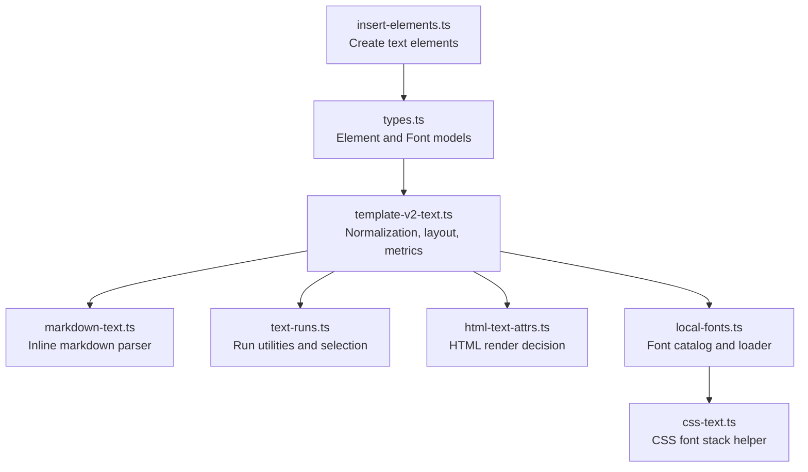
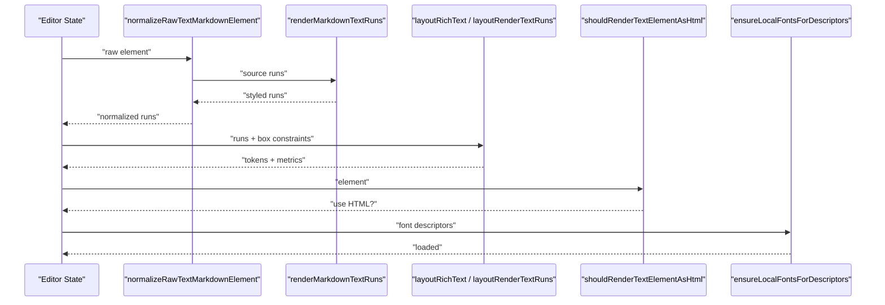
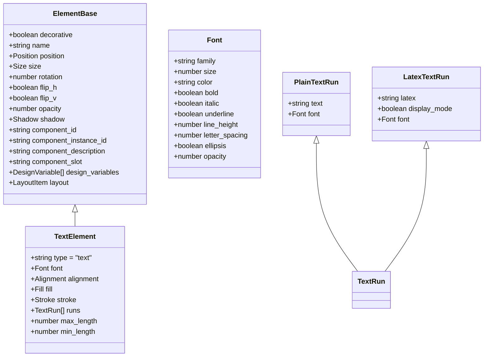
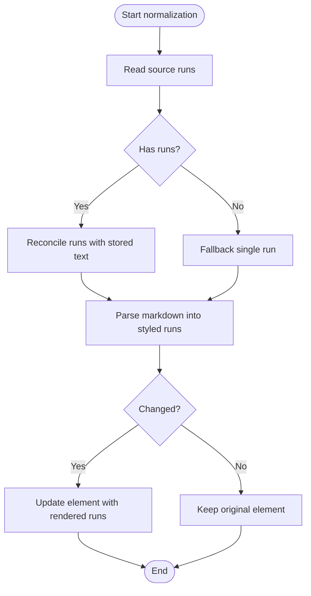
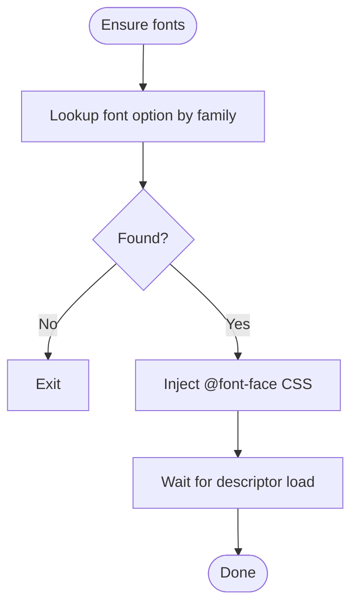
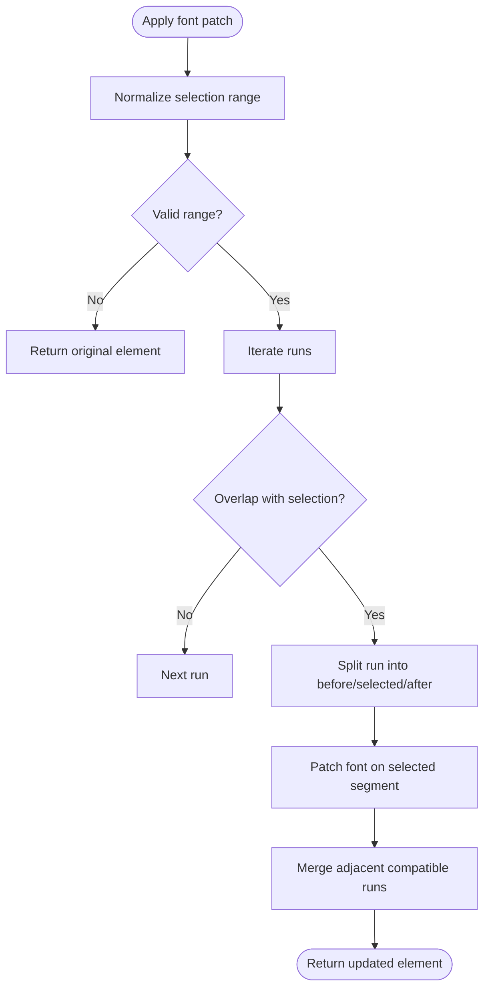
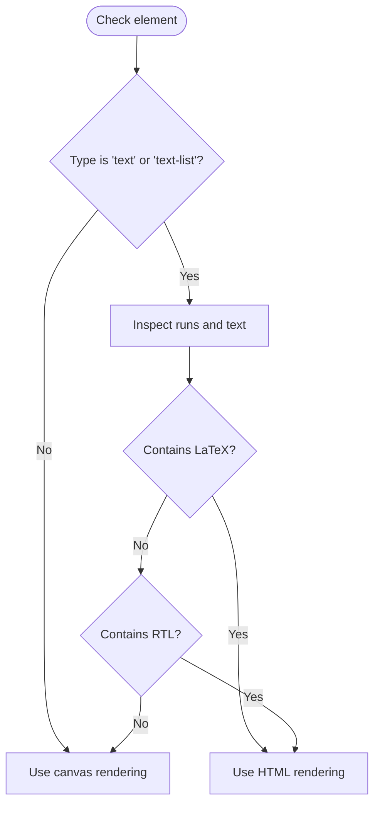
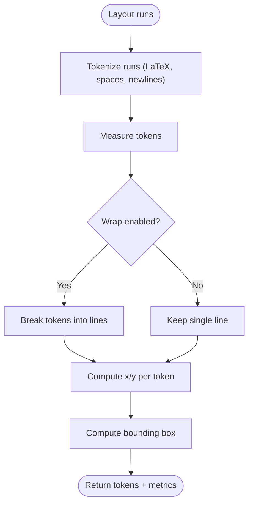
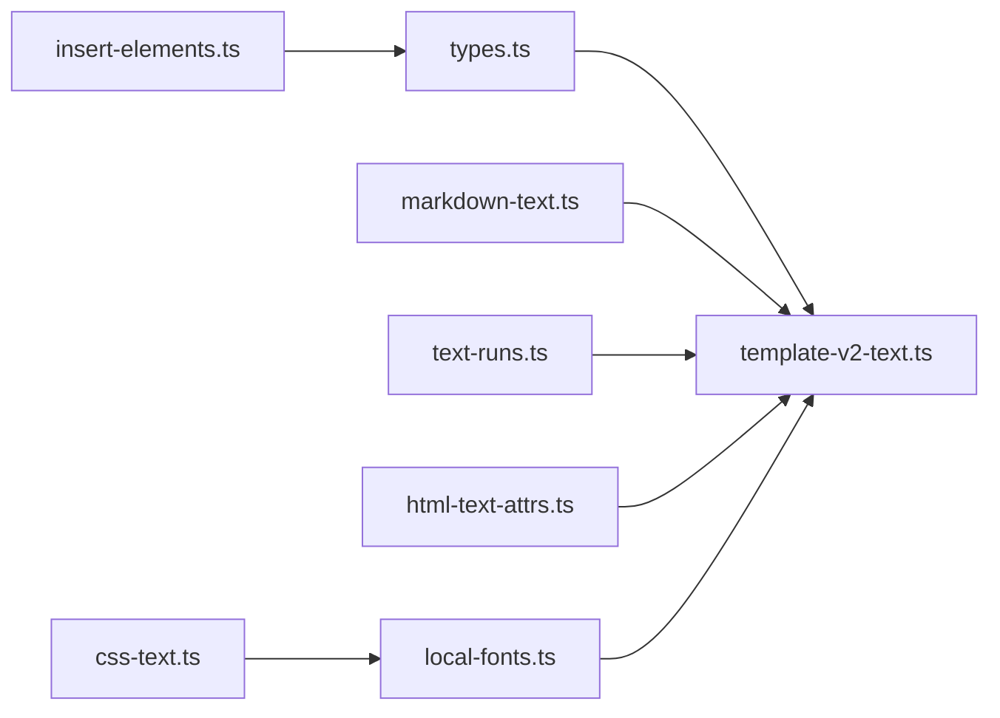

# Text Elements

<cite>
**Referenced Files in This Document**
- [types.ts](file://servers/nextjs/components/slide-editor/types.ts)
- [template-v2-text.ts](file://servers/nextjs/components/slide-editor/text/template-v2-text.ts)
- [markdown-text.ts](file://servers/nextjs/components/slide-editor/text/markdown-text.ts)
- [text-runs.ts](file://servers/nextjs/components/slide-editor/text/text-runs.ts)
- [html-text-attrs.ts](file://servers/nextjs/components/slide-editor/text/html-text-attrs.ts)
- [local-fonts.ts](file://servers/nextjs/components/slide-editor/text/local-fonts.ts)
- [css-text.ts](file://servers/nextjs/components/slide-editor/text/css-text.ts)
- [insert-elements.ts](file://servers/nextjs/components/slide-editor/insert/insert-elements.ts)
</cite>

## Table of Contents
1. [Introduction](#introduction)
2. [Project Structure](#project-structure)
3. [Core Components](#core-components)
4. [Architecture Overview](#architecture-overview)
5. [Detailed Component Analysis](#detailed-component-analysis)
6. [Dependency Analysis](#dependency-analysis)
7. [Performance Considerations](#performance-considerations)
8. [Troubleshooting Guide](#troubleshooting-guide)
9. [Conclusion](#conclusion)

## Introduction
This document explains how text elements are modeled, edited, and rendered in the editor. It covers:
- The TextElement structure and related types
- Rich text formatting with runs (plain text and LaTeX)
- Markdown support for inline styles
- Font management and loading
- Text selection handling and style application
- Rendering decisions (HTML vs canvas), layout, and wrapping
- Integration points with insertion helpers and toolbars

The goal is to help you create custom text elements and handle complex scenarios such as mixed styling, math content, right-to-left text, lists, and precise selection-based edits.

## Project Structure
Text-related logic is concentrated under the slide editor’s text module and shared type definitions:
- Type model for elements and fonts
- Text normalization, markdown parsing, and run utilities
- Layout and measurement for rich text and lists
- HTML rendering decision helpers
- Local font catalog and loader
- CSS helper for font stacks
- Insertion helpers that construct text elements

**Diagram sources**
- [types.ts:333-458](file://servers/nextjs/components/slide-editor/types.ts#L333-L458)
- [template-v2-text.ts:1-10](file://servers/nextjs/components/slide-editor/text/template-v2-text.ts#L1-L10)
- [markdown-text.ts:1-27](file://servers/nextjs/components/slide-editor/text/markdown-text.ts#L1-L27)
- [text-runs.ts:1-28](file://servers/nextjs/components/slide-editor/text/text-runs.ts#L1-L28)
- [html-text-attrs.ts:1-35](file://servers/nextjs/components/slide-editor/text/html-text-attrs.ts#L1-L35)
- [local-fonts.ts:1-15](file://servers/nextjs/components/slide-editor/text/local-fonts.ts#L1-L15)
- [css-text.ts:1-9](file://servers/nextjs/components/slide-editor/text/css-text.ts#L1-L9)
- [insert-elements.ts:87-125](file://servers/nextjs/components/slide-editor/insert/insert-elements.ts#L87-L125)

**Section sources**
- [types.ts:333-458](file://servers/nextjs/components/slide-editor/types.ts#L333-L458)
- [template-v2-text.ts:1-10](file://servers/nextjs/components/slide-editor/text/template-v2-text.ts#L1-L10)
- [markdown-text.ts:1-27](file://servers/nextjs/components/slide-editor/text/markdown-text.ts#L1-L27)
- [text-runs.ts:1-28](file://servers/nextjs/components/slide-editor/text/text-runs.ts#L1-L28)
- [html-text-attrs.ts:1-35](file://servers/nextjs/components/slide-editor/text/html-text-attrs.ts#L1-L35)
- [local-fonts.ts:1-15](file://servers/nextjs/components/slide-editor/text/local-fonts.ts#L1-L15)
- [css-text.ts:1-9](file://servers/nextjs/components/slide-editor/text/css-text.ts#L1-L9)
- [insert-elements.ts:87-125](file://servers/nextjs/components/slide-editor/insert/insert-elements.ts#L87-L125)

## Core Components
- TextElement and related types define the data model for text content, including runs and font metadata.
- template-v2-text.ts provides normalization from raw element storage to editor-friendly runs, markdown parsing, layout, measurement, and scaling.
- markdown-text.ts parses inline markdown into styled runs.
- text-runs.ts implements run utilities, selection range normalization, and selection-aware style application.
- html-text-attrs.ts decides when to render text as HTML (e.g., LaTeX or RTL).
- local-fonts.ts manages a catalog of bundled fonts and ensures they are loaded.
- css-text.ts builds safe CSS font-family stacks.
- insert-elements.ts constructs default text elements for quick insertion.

Key responsibilities:
- Data modeling: types.ts
- Normalization and editing pipeline: template-v2-text.ts
- Markdown parsing: markdown-text.ts
- Selection and run manipulation: text-runs.ts
- Rendering strategy: html-text-attrs.ts
- Font availability: local-fonts.ts
- CSS safety: css-text.ts
- Element creation: insert-elements.ts

**Section sources**
- [types.ts:333-458](file://servers/nextjs/components/slide-editor/types.ts#L333-L458)
- [template-v2-text.ts:198-342](file://servers/nextjs/components/slide-editor/text/template-v2-text.ts#L198-L342)
- [markdown-text.ts:9-27](file://servers/nextjs/components/slide-editor/text/markdown-text.ts#L9-L27)
- [text-runs.ts:8-60](file://servers/nextjs/components/slide-editor/text/text-runs.ts#L8-L60)
- [html-text-attrs.ts:11-35](file://servers/nextjs/components/slide-editor/text/html-text-attrs.ts#L11-L35)
- [local-fonts.ts:212-243](file://servers/nextjs/components/slide-editor/text/local-fonts.ts#L212-L243)
- [css-text.ts:1-9](file://servers/nextjs/components/slide-editor/text/css-text.ts#L1-L9)
- [insert-elements.ts:87-125](file://servers/nextjs/components/slide-editor/insert/insert-elements.ts#L87-L125)

## Architecture Overview
The text system follows a clear pipeline:
1. Raw element data is normalized into editor-friendly runs.
2. Markdown syntax is parsed into styled runs.
3. Runs are laid out and measured for display.
4. Rendering chooses between HTML and canvas based on content needs.
5. Fonts are ensured to be available before measurement/rendering.
6. Selection ranges drive style changes across runs.

**Diagram sources**
- [template-v2-text.ts:198-232](file://servers/nextjs/components/slide-editor/text/template-v2-text.ts#L198-L232)
- [markdown-text.ts:9-27](file://servers/nextjs/components/slide-editor/text/markdown-text.ts#L9-L27)
- [template-v2-text.ts:722-860](file://servers/nextjs/components/slide-editor/text/template-v2-text.ts#L722-L860)
- [html-text-attrs.ts:11-35](file://servers/nextjs/components/slide-editor/text/html-text-attrs.ts#L11-L35)
- [local-fonts.ts:225-243](file://servers/nextjs/components/slide-editor/text/local-fonts.ts#L225-L243)

## Detailed Component Analysis

### TextElement Model and Font Metadata
- TextElement extends a common base with geometry, transforms, and visual effects.
- It includes:
  - type: "text"
  - runs: array of TextRun (plain or latex)
  - font: global font defaults
  - alignment: horizontal and vertical
  - fill/stroke for background and border
  - length constraints for input-like behavior

Font metadata supports family, size, color, bold, italic, underline, line height, letter spacing, ellipsis, and opacity.

**Diagram sources**
- [types.ts:431-458](file://servers/nextjs/components/slide-editor/types.ts#L431-L458)
- [types.ts:333-345](file://servers/nextjs/components/slide-editor/types.ts#L333-L345)
- [types.ts:402-415](file://servers/nextjs/components/slide-editor/types.ts#L402-L415)

**Section sources**
- [types.ts:333-458](file://servers/nextjs/components/slide-editor/types.ts#L333-L458)

### Rich Text Runs and Markdown Support
- Runs can be plain text or LaTeX.
- Markdown inline styles (bold, italic) are parsed into styled runs.
- The normalization pipeline reconciles stored text with runs and applies markdown parsing only when needed.

Key behaviors:
- parseMarkdownText splits by delimiters and merges adjacent runs with identical fonts.
- normalizeRawTextMarkdownElement computes whether the element changed after markdown parsing.
- setRawTextContent and setRawTextRunsContent update both text and runs consistently.

**Diagram sources**
- [template-v2-text.ts:198-232](file://servers/nextjs/components/slide-editor/text/template-v2-text.ts#L198-L232)
- [markdown-text.ts:9-27](file://servers/nextjs/components/slide-editor/text/markdown-text.ts#L9-L27)

**Section sources**
- [template-v2-text.ts:198-342](file://servers/nextjs/components/slide-editor/text/template-v2-text.ts#L198-L342)
- [markdown-text.ts:9-27](file://servers/nextjs/components/slide-editor/text/markdown-text.ts#L9-L27)

### Font Management and Loading
- A catalog of bundled fonts is provided with families, source URLs, and optional italic variants.
- Utilities ensure fonts are loaded before measurement and rendering.
- CSS @font-face rules are generated and injected into the document head.
- System font families are recognized and skipped from local loading.

Important functions:
- ensureLocalFontsForDescriptors: loads fonts referenced by CSS descriptors.
- ensureLocalFontLoaded: injects @font-face and waits for load.
- renderLocalFontFaceCss: generates CSS for a font option.

**Diagram sources**
- [local-fonts.ts:212-243](file://servers/nextjs/components/slide-editor/text/local-fonts.ts#L212-L243)
- [local-fonts.ts:449-582](file://servers/nextjs/components/slide-editor/text/local-fonts.ts#L449-L582)
- [local-fonts.ts:482-520](file://servers/nextjs/components/slide-editor/text/local-fonts.ts#L482-L520)

**Section sources**
- [local-fonts.ts:70-172](file://servers/nextjs/components/slide-editor/text/local-fonts.ts#L70-L172)
- [local-fonts.ts:212-243](file://servers/nextjs/components/slide-editor/text/local-fonts.ts#L212-L243)
- [local-fonts.ts:449-582](file://servers/nextjs/components/slide-editor/text/local-fonts.ts#L449-L582)
- [css-text.ts:1-9](file://servers/nextjs/components/slide-editor/text/css-text.ts#L1-L9)

### Text Selection Handling and Style Application
- Selection ranges are normalized to valid bounds within concatenated run content.
- fontForTextSelection returns the effective font at the cursor or selection start.
- applyTextRunFontToSelection patches font properties over the selected range, splitting runs as needed and merging adjacent compatible runs.
- toggleTextRunLatexForSelection converts selected plain text to LaTeX or vice versa.

**Diagram sources**
- [text-runs.ts:30-60](file://servers/nextjs/components/slide-editor/text/text-runs.ts#L30-L60)
- [text-runs.ts:62-122](file://servers/nextjs/components/slide-editor/text/text-runs.ts#L62-L122)
- [text-runs.ts:166-230](file://servers/nextjs/components/slide-editor/text/text-runs.ts#L166-L230)
- [text-runs.ts:273-297](file://servers/nextjs/components/slide-editor/text/text-runs.ts#L273-L297)

**Section sources**
- [text-runs.ts:8-60](file://servers/nextjs/components/slide-editor/text/text-runs.ts#L8-L60)
- [text-runs.ts:62-122](file://servers/nextjs/components/slide-editor/text/text-runs.ts#L62-L122)
- [text-runs.ts:166-230](file://servers/nextjs/components/slide-editor/text/text-runs.ts#L166-L230)
- [text-runs.ts:273-297](file://servers/nextjs/components/slide-editor/text/text-runs.ts#L273-L297)

### Rendering Strategy: HTML vs Canvas
- shouldRenderTextElementAsHtml determines if an element must be rendered as HTML due to:
  - Presence of LaTeX runs
  - Right-to-left text segments
- This avoids issues with bidirectional text and complex math that require browser text engine features.

**Diagram sources**
- [html-text-attrs.ts:11-35](file://servers/nextjs/components/slide-editor/text/html-text-attrs.ts#L11-L35)
- [html-text-attrs.ts:47-52](file://servers/nextjs/components/slide-editor/text/html-text-attrs.ts#L47-L52)

**Section sources**
- [html-text-attrs.ts:11-35](file://servers/nextjs/components/slide-editor/text/html-text-attrs.ts#L11-L35)
- [html-text-attrs.ts:47-52](file://servers/nextjs/components/slide-editor/text/html-text-attrs.ts#L47-L52)

### Layout, Wrapping, and Measurement
- layoutRichText tokenizes runs, handles LaTeX blocks, wraps text, and computes line heights and positions.
- layoutRenderTextRuns lays out runs into lines with proper wrapping and whitespace handling.
- textVisualLocalBox and textListVisualLocalBox compute bounding boxes considering alignment and vertical positioning.
- splitOversizedTextSegment performs binary search to split long words safely.

**Diagram sources**
- [template-v2-text.ts:722-860](file://servers/nextjs/components/slide-editor/text/template-v2-text.ts#L722-L860)
- [template-v2-text.ts:1002-1069](file://servers/nextjs/components/slide-editor/text/template-v2-text.ts#L1002-L1069)
- [template-v2-text.ts:1085-1128](file://servers/nextjs/components/slide-editor/text/template-v2-text.ts#L1085-L1128)
- [template-v2-text.ts:557-669](file://servers/nextjs/components/slide-editor/text/template-v2-text.ts#L557-L669)

**Section sources**
- [template-v2-text.ts:557-669](file://servers/nextjs/components/slide-editor/text/template-v2-text.ts#L557-L669)
- [template-v2-text.ts:722-860](file://servers/nextjs/components/slide-editor/text/template-v2-text.ts#L722-L860)
- [template-v2-text.ts:1002-1069](file://servers/nextjs/components/slide-editor/text/template-v2-text.ts#L1002-L1069)
- [template-v2-text.ts:1085-1128](file://servers/nextjs/components/slide-editor/text/template-v2-text.ts#L1085-L1128)

### Creating Custom Text Elements
- Use the insertion helper to create a basic text element with default font and runs.
- For math-heavy content, use the LaTeX insertion helper which measures and centers the element.

Guidelines:
- Provide runs with either text or latex fields.
- Set font properties at the element level or per-run for granular control.
- Respect max_length/min_length for constrained inputs.

**Section sources**
- [insert-elements.ts:87-125](file://servers/nextjs/components/slide-editor/insert/insert-elements.ts#L87-L125)
- [insert-elements.ts:127-148](file://servers/nextjs/components/slide-editor/insert/insert-elements.ts#L127-L148)

## Dependency Analysis
- types.ts defines core shapes consumed by all text modules.
- template-v2-text.ts depends on markdown-text.ts for parsing and text-runs.ts for run utilities.
- html-text-attrs.ts uses model accessors to inspect runs and decide rendering.
- local-fonts.ts is independent but used by rendering/layout code to ensure fonts are ready.
- css-text.ts is a small utility used where CSS font stacks are constructed.
- insert-elements.ts relies on types.ts and measurement utilities indirectly via math helpers.

**Diagram sources**
- [types.ts:333-458](file://servers/nextjs/components/slide-editor/types.ts#L333-L458)
- [template-v2-text.ts:1-10](file://servers/nextjs/components/slide-editor/text/template-v2-text.ts#L1-L10)
- [markdown-text.ts:1-27](file://servers/nextjs/components/slide-editor/text/markdown-text.ts#L1-L27)
- [text-runs.ts:1-28](file://servers/nextjs/components/slide-editor/text/text-runs.ts#L1-L28)
- [html-text-attrs.ts:1-35](file://servers/nextjs/components/slide-editor/text/html-text-attrs.ts#L1-L35)
- [local-fonts.ts:1-15](file://servers/nextjs/components/slide-editor/text/local-fonts.ts#L1-L15)
- [css-text.ts:1-9](file://servers/nextjs/components/slide-editor/text/css-text.ts#L1-L9)
- [insert-elements.ts:87-125](file://servers/nextjs/components/slide-editor/insert/insert-elements.ts#L87-L125)

**Section sources**
- [types.ts:333-458](file://servers/nextjs/components/slide-editor/types.ts#L333-L458)
- [template-v2-text.ts:1-10](file://servers/nextjs/components/slide-editor/text/template-v2-text.ts#L1-L10)
- [markdown-text.ts:1-27](file://servers/nextjs/components/slide-editor/text/markdown-text.ts#L1-L27)
- [text-runs.ts:1-28](file://servers/nextjs/components/slide-editor/text/text-runs.ts#L1-L28)
- [html-text-attrs.ts:1-35](file://servers/nextjs/components/slide-editor/text/html-text-attrs.ts#L1-L35)
- [local-fonts.ts:1-15](file://servers/nextjs/components/slide-editor/text/local-fonts.ts#L1-L15)
- [css-text.ts:1-9](file://servers/nextjs/components/slide-editor/text/css-text.ts#L1-L9)
- [insert-elements.ts:87-125](file://servers/nextjs/components/slide-editor/insert/insert-elements.ts#L87-L125)

## Performance Considerations
- Avoid unnecessary re-parsing: markdown parsing is applied conditionally during normalization.
- Prefer batching font descriptor loads; the loader caches pending loads and waits for readiness.
- Use layoutRenderTextRuns for efficient line computation; it handles whitespace and LaTeX blocks efficiently.
- Minimize run fragmentation: mergeAdjacentTextRuns reduces run count by combining compatible runs.
- Limit excessive nested lists and very long words; splitting algorithms are optimized but still O(n log n) per word.

[No sources needed since this section provides general guidance]

## Troubleshooting Guide
Common issues and resolutions:
- Markdown not applying: Ensure the element contains markdown syntax and that normalization has been invoked. Check normalizeRawTextMarkdownElement flow.
- LaTeX not rendering: Verify runs contain latex fields and that shouldRenderTextElementAsHtml returns true for HTML rendering when needed.
- Fonts appear missing: Confirm ensureLocalFontsForDescriptors was called with correct descriptors and that local-fonts catalog includes the family.
- Selection style not applied: Validate selection range normalization and that applyTextRunFontToSelection is used with a valid range.
- Text overflow or misalignment: Review layoutRichText and textVisualLocalBox outputs; check wrap mode and alignment settings.

**Section sources**
- [template-v2-text.ts:198-232](file://servers/nextjs/components/slide-editor/text/template-v2-text.ts#L198-L232)
- [html-text-attrs.ts:11-35](file://servers/nextjs/components/slide-editor/text/html-text-attrs.ts#L11-L35)
- [local-fonts.ts:225-243](file://servers/nextjs/components/slide-editor/text/local-fonts.ts#L225-L243)
- [text-runs.ts:30-60](file://servers/nextjs/components/slide-editor/text/text-runs.ts#L30-L60)
- [template-v2-text.ts:722-860](file://servers/nextjs/components/slide-editor/text/template-v2-text.ts#L722-L860)

## Conclusion
The text element system combines a robust data model with a flexible normalization and layout pipeline. It supports rich runs, markdown, LaTeX, precise selection-based editing, and reliable font loading. By understanding the roles of each module—types, normalization, markdown parsing, run utilities, rendering decisions, and font management—you can confidently implement custom text elements and handle complex scenarios while maintaining performance and correctness.

[No sources needed since this section summarizes without analyzing specific files]