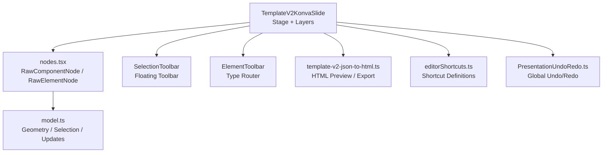
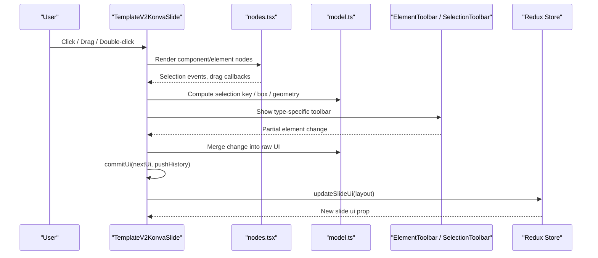
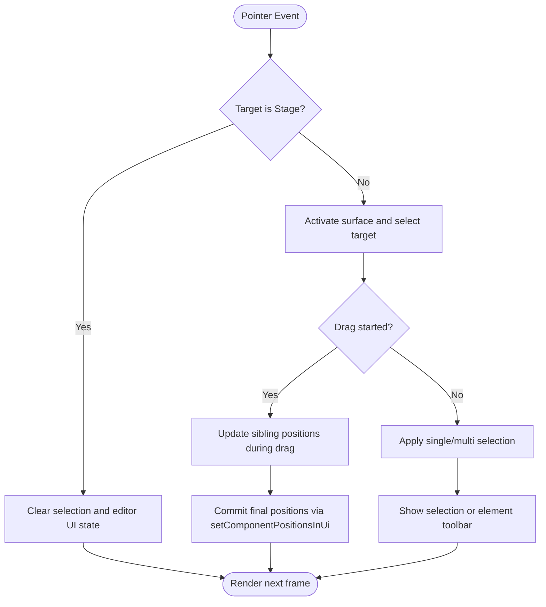
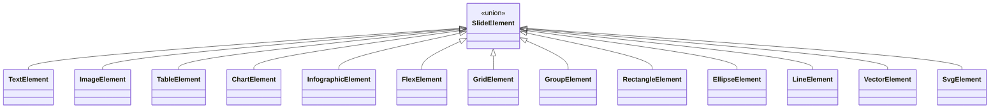
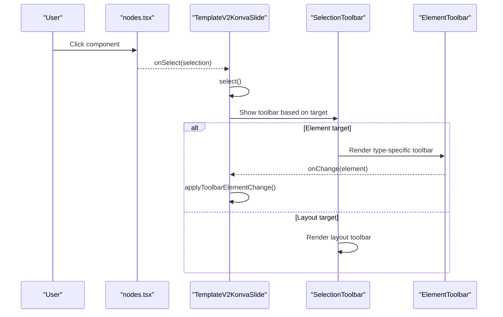
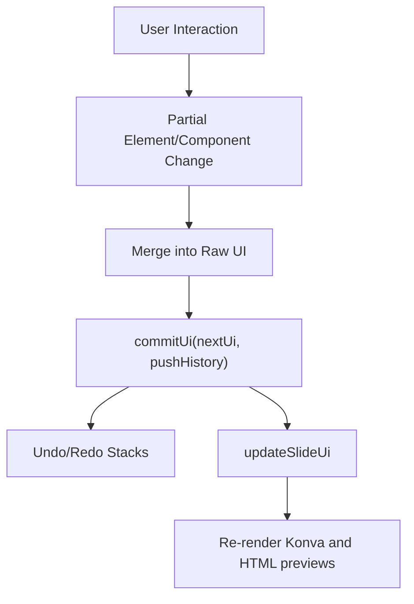
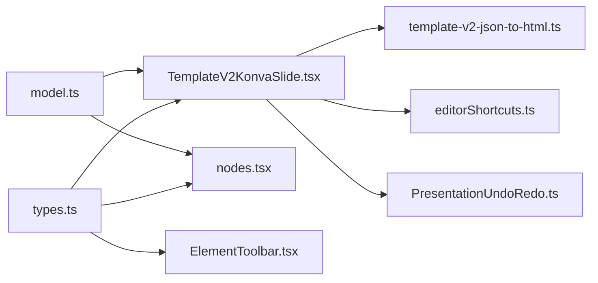

# Slide Editor Implementation

<cite>
**Referenced Files in This Document**
- [README.md](file://servers/nexjs/components/slide-editor/README.md)
- [types.ts](file://servers/nexjs/components/slide-editor/types.ts)
- [TemplateV2KonvaSlide.tsx](file://servers/nexjs/components/slide-editor/surface/TemplateV2KonvaSlide.tsx)
- [nodes.tsx](file://servers/nexjs/components/slide-editor/surface/nodes.tsx)
- [model.ts](file://servers/nexjs/components/slide-editor/model/model.ts)
- [ElementToolbar.tsx](file://servers/nexjs/components/slide-editor/toolbar/ElementToolbar.tsx)
- [SelectionToolbar.tsx](file://servers/nexjs/components/slide-editor/selection/SelectionToolbar.tsx)
- [template-v2-json-to-html.ts](file://servers/nexjs/lib/template-v2-json-to-html.ts)
- [editorShortcuts.ts](file://servers/nexjs/components/slide-editor/shortcuts/editorShortcuts.ts)
- [PresentationUndoRedo.ts](file://servers/nexjs/app/(presentation-generator)/presentation/hooks/PresentationUndoRedo.ts)
</cite>

## Table of Contents
1. [Introduction](#introduction)
2. [Project Structure](#project-structure)
3. [Core Components](#core-components)
4. [Architecture Overview](#architecture-overview)
5. [Detailed Component Analysis](#detailed-component-analysis)
6. [Dependency Analysis](#dependency-analysis)
7. [Performance Considerations](#performance-considerations)
8. [Troubleshooting Guide](#troubleshooting-guide)
9. [Conclusion](#conclusion)

## Introduction
This document explains the slide editor implementation built on a Konva canvas-based drag-and-drop system. It covers how Template V2 layouts are loaded, normalized, and rendered as editable components and elements; how selection, toolbars, and keyboard shortcuts drive changes; and how those changes synchronize with the underlying data model and Redux state. It also documents HTML preview and export rendering paths, real-time text editing, image cropping, chart and infographic editors, and performance techniques for large presentations.

The editor is designed around a clear separation:
- Visual editor: Konva canvas rendering and interaction.
- Data model: raw Template V2 layout plus typed element helpers.
- Toolbars: type-specific UI that produces partial updates.
- State synchronization: local draft state, undo/redo, and Redux persistence.

## Project Structure
The slide editor lives under `servers/nexjs/components/slide-editor`. The most important areas are:
- `surface/`: Konva stage, component nodes, element nodes, font loading, alignment guides, pixel ratio handling.
- `model/`: geometry, selection keys, clipboard conversion, inserted content normalization, style helpers.
- `toolbar/`: element toolbar router and design variables toolbar.
- `selection/`: floating selection toolbar, transformer boxes, layer ordering, toolbar positioning.
- `text/`, `tables/`, `charts/`, `images/`, `infographics/`: rich text, table, chart, image/icon, and infographic editing flows.
- `clipboard/`, `events/`, `state/`, `utils/`: shared editor utilities.

**Diagram sources**
- [TemplateV2KonvaSlide.tsx:1-300](file://servers/nexjs/components/slide-editor/surface/TemplateV2KonvaSlide.tsx#L1-L300)
- [nodes.tsx:1-300](file://servers/nexjs/components/slide-editor/surface/nodes.tsx#L1-L300)
- [model.ts:1-300](file://servers/nexjs/components/slide-editor/model/model.ts#L1-L300)
- [ElementToolbar.tsx:1-190](file://servers/nexjs/components/slide-editor/toolbar/ElementToolbar.tsx#L1-L190)
- [SelectionToolbar.tsx:1-167](file://servers/nexjs/components/slide-editor/selection/SelectionToolbar.tsx#L1-L167)
- [template-v2-json-to-html.ts:1-47](file://servers/nexjs/lib/template-v2-json-to-html.ts#L1-L47)
- [editorShortcuts.ts:1-151](file://servers/nexjs/components/slide-editor/shortcuts/editorShortcuts.ts#L1-L151)
- [PresentationUndoRedo.ts:40-99](file://servers/nexjs/app/(presentation-generator)/presentation/hooks/PresentationUndoRedo.ts#L40-L99)

**Section sources**
- [README.md:1-82](file://servers/nexjs/components/slide-editor/README.md#L1-L82)

## Core Components
- TemplateV2KonvaSlide: Main editable slide surface. Owns local draft state, selection, node references, undo/redo stacks, inline editing state, image/icon/chart editor integration, clipboard operations, and event listeners. It renders the Konva Stage, background layer, component nodes, element nodes, transformers, selection toolbar, element toolbar, table inline editor, text inline editor, icons editor, and chart/infographic editors.
- nodes.tsx: Renders each top-level component as a Konva Group and each nested element using a type switch. Handles selection, double-click behavior, drag callbacks, multi-select participation, vector endpoint markers, rounded image clipping, and delegation to chart/table renderers.
- model.ts: Central compatibility barrel and tightly coupled editor operations for selection, geometry, layout, and toolbar merging. Provides functions to update components and elements in the raw UI, compute boxes and sizes, normalize wrapper components, and convert between editor and raw chart models.
- ElementToolbar.tsx: Type-aware toolbar router. Routes selected elements to TextToolbar, BulletsToolbar, ImageToolbar, IconToolbar, ShapeToolbar, ChartToolbar, or TableToolbar. Also supports DesignVariablesToolbar when present.
- SelectionToolbar.tsx: Floating toolbar that shows either element-specific controls or layout controls for container/flex/grid/component selections. Computes anchor box and delegates to ElementToolbar or LayoutToolbar.
- template-v2-json-to-html.ts: HTML renderer used outside the Konva editor for previews and exports. Mirrors supported element types and styling so visual features survive export.

Key responsibilities:
- Loading and normalizing Template V2 layouts into editor deck/slide data.
- Rendering editable Konva nodes from the current draft.
- Converting user interactions into typed toolbar changes.
- Merging toolbar changes back into the raw UI.
- Persisting changes through commitUi to local state, undo history, and Redux.

**Section sources**
- [README.md:13-36](file://servers/nexjs/components/slide-editor/README.md#L13-L36)
- [README.md:130-199](file://servers/nexjs/components/slide-editor/README.md#L130-L199)
- [README.md:321-404](file://servers/nexjs/components/slide-editor/README.md#L321-L404)
- [README.md:406-433](file://servers/nexjs/components/slide-editor/README.md#L406-L433)
- [README.md:467-500](file://servers/nexjs/components/slide-editor/README.md#L467-L500)
- [model.ts:156-239](file://servers/nexjs/components/slide-editor/model/model.ts#L156-L239)

## Architecture Overview
The editor follows a unidirectional data flow with local draft state and global Redux persistence.

**Diagram sources**
- [TemplateV2KonvaSlide.tsx:1-300](file://servers/nexjs/components/slide-editor/surface/TemplateV2KonvaSlide.tsx#L1-L300)
- [nodes.tsx:936-986](file://servers/nexjs/components/slide-editor/surface/nodes.tsx#L936-L986)
- [model.ts:156-239](file://servers/nexjs/components/slide-editor/model/model.ts#L156-L239)
- [ElementToolbar.tsx:172-190](file://servers/nexjs/components/slide-editor/toolbar/ElementToolbar.tsx#L172-L190)
- [SelectionToolbar.tsx:62-167](file://servers/nexjs/components/slide-editor/selection/SelectionToolbar.tsx#L62-L167)

## Detailed Component Analysis

### Konva Canvas-Based Drag-and-Drop Editing System
The Konva editor uses a fixed-size 1280x720 canvas. Each top-level component is a Konva Group with selection, drag, and transform support. Nested elements are rendered inside their parent group and participate in selection and double-click editing.

Important behaviors:
- Component groups handle mouse/touch start, drag start/move/end, and multi-select participation.
- Element nodes handle selection, double-click behavior, table cell callbacks, and nested child rendering.
- Transformers provide resize and transform handles for selected items.
- Alignment guides and scene pixel ratio adjustments improve precision and clarity.

**Diagram sources**
- [nodes.tsx:936-986](file://servers/nexjs/components/slide-editor/surface/nodes.tsx#L936-L986)
- [TemplateV2KonvaSlide.tsx:2928-2972](file://servers/nexjs/components/slide-editor/surface/TemplateV2KonvaSlide.tsx#L2928-L2972)

**Section sources**
- [README.md:321-379](file://servers/nexjs/components/slide-editor/README.md#L321-L379)
- [README.md:501-534](file://servers/nexjs/components/slide-editor/README.md#L501-L534)

### Component Architecture for Slide Elements
Supported element types include text, text-list, image, rectangle, ellipse, line, container, flex, grid, group, table, chart, infographic, vector, and svg. Each type has:
- A typed definition in `types.ts`.
- A Konva renderer branch in `nodes.tsx`.
- A toolbar entry in `ElementToolbar.tsx` (when applicable).
- Optional specialized editors (e.g., chart editor, infographic editor, table inline editor).

**Diagram sources**
- [types.ts:431-649](file://servers/nexjs/components/slide-editor/types.ts#L431-L649)

**Section sources**
- [types.ts:1-68](file://servers/nexjs/components/slide-editor/types.ts#L1-L68)
- [types.ts:431-649](file://servers/nexjs/components/slide-editor/types.ts#L431-L649)
- [README.md:348-362](file://servers/nexjs/components/slide-editor/README.md#L348-L362)
- [ElementToolbar.tsx:40-170](file://servers/nexjs/components/slide-editor/toolbar/ElementToolbar.tsx#L40-L170)

### Real-Time Rendering Capabilities
Real-time rendering is achieved by:
- Rendering Konva nodes directly from the current draft.
- Using memoized nodes to reduce re-renders.
- Batching draw calls and adjusting pixel ratio for crisp visuals.
- Offloading heavy charts to Chart.js-backed elements.
- Using HTML overlays for rich text editing without committing every keystroke.

Text editing specifically buffers live runs and commits only on close to avoid typing lag. Images load asynchronously and support fit modes, crop focus, flip, opacity, and border radius clipping. Charts delegate rendering to Chart.js and appear as image-backed elements in the Konva scene. Tables use a dedicated renderer and inline cell editor.

**Section sources**
- [README.md:321-404](file://servers/nexjs/components/slide-editor/README.md#L321-L404)
- [README.md:614-670](file://servers/nexjs/components/slide-editor/README.md#L614-L670)
- [README.md:672-727](file://servers/nexjs/components/slide-editor/README.md#L672-L727)

### Template V2 Integration
Template V2 is a JSON-driven slide system where a slide has a `ui` layout object containing components, root elements, background, and asset/font metadata. The editor:
- Loads the layout into `TemplateV2KonvaSlide`.
- Normalizes it into local `uiDraft` state.
- Renders components/elements from `uiDraft`.
- Writes changes back through `commitUi()`.
- Persists to Redux via `updateSlideUi`.

There are two rendering paths:
- Editor rendering: Konva canvas via `TemplateV2KonvaSlide` and `nodes.tsx`.
- HTML rendering/export: `template-v2-json-to-html.ts` and `TemplateV2LayoutPreview.tsx`.

Adding a new element type requires updating `types.ts`, ensuring import adapters can normalize old/raw data, adding a Konva renderer branch, adding toolbar support, and mirroring the feature in HTML preview/export if needed.

**Section sources**
- [README.md:13-36](file://servers/nexjs/components/slide-editor/README.md#L13-L36)
- [README.md:83-128](file://servers/nexjs/components/slide-editor/README.md#L83-L128)
- [README.md:406-433](file://servers/nexjs/components/slide-editor/README.md#L406-L433)

### Element Selection and Manipulation Tools
Selection supports:
- Single component selection.
- Multi-component selection with Shift.
- Nested element path selection.
- Resize/transform via Konva Transformer.
- Dragging one or multiple selected components.
- Layer ordering actions.
- Ungrouping grouped components or layout targets.

Selection state determines which toolbar appears:
- Element toolbar for type-specific editing.
- Layout toolbar for container/flex/grid/component selections.
- Specialized targets for charts and tables.

**Diagram sources**
- [nodes.tsx:936-986](file://servers/nexjs/components/slide-editor/surface/nodes.tsx#L936-L986)
- [SelectionToolbar.tsx:62-167](file://servers/nexjs/components/slide-editor/selection/SelectionToolbar.tsx#L62-L167)
- [ElementToolbar.tsx:172-190](file://servers/nexjs/components/slide-editor/toolbar/ElementToolbar.tsx#L172-L190)

**Section sources**
- [README.md:467-500](file://servers/nexjs/components/slide-editor/README.md#L467-L500)
- [README.md:501-534](file://servers/nexjs/components/slide-editor/README.md#L501-L534)

### Toolbar Systems
Two toolbar systems coexist:
- Selection/layout toolbar: Shows component actions and layout controls for container/flex/grid/component selections.
- Element toolbar: Routes selected element types to specific toolbars such as TextToolbar, BulletsToolbar, ImageToolbar, IconToolbar, ShapeToolbar, ChartToolbar, and TableToolbar.

Positioning considers the selected box, toolbar width, surface bounds, and viewport fit.

**Section sources**
- [README.md:467-500](file://servers/nexjs/components/slide-editor/README.md#L467-L500)
- [ElementToolbar.tsx:1-190](file://servers/nexjs/components/slide-editor/toolbar/ElementToolbar.tsx#L1-L190)
- [SelectionToolbar.tsx:1-167](file://servers/nexjs/components/slide-editor/selection/SelectionToolbar.tsx#L1-L167)

### Keyboard Shortcuts
Keyboard shortcuts are defined centrally and include selection, editing, arrangement, navigation, and help categories. Global undo/redo hooks integrate with the presentation-level undo/redo state.

Common shortcuts:
- Undo: Mod+Z
- Redo: Mod+Shift+Z or Mod+Y
- Copy: Mod+C
- Paste: Mod+V
- Delete: Backspace or Delete
- Bring forward/backward and front/back layering
- Previous/next slide navigation

The active surface listens for undo/redo shortcuts and ignores editable inputs.

**Section sources**
- [editorShortcuts.ts:1-151](file://servers/nexjs/components/slide-editor/shortcuts/editorShortcuts.ts#L1-L151)
- [PresentationUndoRedo.ts:40-99](file://servers/nexjs/app/(presentation-generator)/presentation/hooks/PresentationUndoRedo.ts#L40-L99)
- [TemplateV2KonvaSlide.tsx:2885-2923](file://servers/nexjs/components/slide-editor/surface/TemplateV2KonvaSlide.tsx#L2885-L2923)

### Relationship Between Visual Editor and Underlying Data Model
The visual editor renders from a raw Template V2 representation stored in local draft state. Changes originate from:
- Pointer events on Konva nodes.
- Toolbar changes.
- Clipboard operations.
- Inserted content from palette/blocks.

These changes are merged into the raw UI using model helpers and then committed through `commitUi()`, which updates local state, pushes undo history, clears redo stack, and dispatches Redux updates. Geometry and layout calculations ensure consistent sizing and positioning across Konva and HTML renderers.

**Diagram sources**
- [TemplateV2KonvaSlide.tsx:1-300](file://servers/nexjs/components/slide-editor/surface/TemplateV2KonvaSlide.tsx#L1-L300)
- [model.ts:156-239](file://servers/nexjs/components/slide-editor/model/model.ts#L156-L239)

**Section sources**
- [README.md:130-199](file://servers/nexjs/components/slide-editor/README.md#L130-L199)
- [README.md:535-559](file://servers/nexjs/components/slide-editor/README.md#L535-L559)

### State Synchronization Patterns
- Local draft state (`uiDraft`) holds the current editable layout.
- `currentUiRef` keeps a ref copy for event handlers.
- `commitUi()` is the central write function for all layout changes.
- Undo/redo stacks store previous layouts and allow non-destructive exploration.
- Redux stores the current slide `ui` for persistence and cross-panel sharing.
- Inline text editing buffers live runs and commits on close to avoid frequent Redux writes.

**Section sources**
- [README.md:130-199](file://servers/nexjs/components/slide-editor/README.md#L130-L199)
- [README.md:535-559](file://servers/nexjs/components/slide-editor/README.md#L535-L559)
- [README.md:614-670](file://servers/nexjs/components/slide-editor/README.md#L614-L670)

### Performance Optimization Techniques for Large Presentations
- Fixed canvas size and scene pixel ratio management for crisp rendering.
- Memoized component and element nodes to minimize re-renders.
- Batched drawing and selective redraws.
- Async image loading and caching via Konva image loader.
- Chart rendering delegated to Chart.js-backed elements.
- HTML text overlays for rich text editing without committing every keystroke.
- Careful selection and geometry computations to avoid unnecessary updates.

**Section sources**
- [README.md:321-404](file://servers/nexjs/components/slide-editor/README.md#L321-L404)
- [README.md:614-670](file://servers/nexjs/components/slide-editor/README.md#L614-L670)

### Concrete Examples

#### Adding a New Slide Element
Steps:
1. Define the element type and properties in `types.ts`.
2. Add a Konva renderer branch in `nodes.tsx` under the element visual switch.
3. Add toolbar support in `ElementToolbar.tsx` if the element is editable.
4. If the element should be exported, add corresponding HTML rendering logic in `template-v2-json-to-html.ts`.
5. Ensure import adapters can normalize old/raw data into the new shape.

References:
- Types and union definitions: [types.ts:431-649](file://servers/nexjs/components/slide-editor/types.ts#L431-L649)
- Supported visual types and renderer notes: [README.md:348-362](file://servers/nexjs/components/slide-editor/README.md#L348-L362)
- HTML export renderer functions: [README.md:406-433](file://servers/nexjs/components/slide-editor/README.md#L406-L433)

#### Customizing Existing Components
To customize an existing element:
- Update its Konva rendering in `nodes.tsx`.
- Extend its toolbar in `ElementToolbar.tsx` or create a new toolbar component.
- Use model helpers to merge changes into the raw UI.
- Mirror changes in HTML preview/export if required.

References:
- Element toolbar routing: [ElementToolbar.tsx:40-170](file://servers/nexjs/components/slide-editor/toolbar/ElementToolbar.tsx#L40-L170)
- Raw element rendering switch: [README.md:348-362](file://servers/nexjs/components/slide-editor/README.md#L348-L362)
- Model update helpers: [model.ts:156-239](file://servers/nexjs/components/slide-editor/model/model.ts#L156-L239)

#### Extending the Editor Functionality
To extend the editor:
- Add custom insert content via inserted content normalization.
- Introduce new events for external panels.
- Implement new toolbar controls and wire them to `applyToolbarElementChange` or layout change handlers.
- Ensure clipboard payloads and paste logic support the new data.

References:
- Inserted content conversion: [README.md:219-277](file://servers/nexjs/components/slide-editor/README.md#L219-L277)
- Custom events: [README.md:585-612](file://servers/nexjs/components/slide-editor/README.md#L585-L612)
- Clipboard payload creation/pasting: [README.md:560-583](file://servers/nexjs/components/slide-editor/README.md#L560-L583)

## Dependency Analysis
The editor’s dependencies form a layered architecture:
- Surface depends on nodes for rendering and on model for geometry/selection/update logic.
- Toolbars depend on element types and selection state.
- HTML preview/export depends on the same element type definitions and layout algorithms.
- Shortcuts and undo/redo integrate at the application level but interact with the active surface.

**Diagram sources**
- [types.ts:1-68](file://servers/nexjs/components/slide-editor/types.ts#L1-L68)
- [TemplateV2KonvaSlide.tsx:1-300](file://servers/nexjs/components/slide-editor/surface/TemplateV2KonvaSlide.tsx#L1-L300)
- [nodes.tsx:1-300](file://servers/nexjs/components/slide-editor/surface/nodes.tsx#L1-L300)
- [ElementToolbar.tsx:1-190](file://servers/nexjs/components/slide-editor/toolbar/ElementToolbar.tsx#L1-L190)
- [model.ts:1-300](file://servers/nexjs/components/slide-editor/model/model.ts#L1-L300)
- [template-v2-json-to-html.ts:1-47](file://servers/nexjs/lib/template-v2-json-to-html.ts#L1-L47)
- [editorShortcuts.ts:1-151](file://servers/nexjs/components/slide-editor/shortcuts/editorShortcuts.ts#L1-L151)
- [PresentationUndoRedo.ts:40-99](file://servers/nexjs/app/(presentation-generator)/presentation/hooks/PresentationUndoRedo.ts#L40-L99)

**Section sources**
- [README.md:62-81](file://servers/nexjs/components/slide-editor/README.md#L62-L81)

## Performance Considerations
- Prefer memoization for expensive node trees.
- Avoid committing Redux on every keystroke; buffer inline text runs and commit on close.
- Use async image loading and reuse loaded images.
- Keep Konva layers minimal and batch draws.
- Limit recalculations of layout children and geometry by caching results where safe.
- Use appropriate pixel ratios for high-DPI displays without over-rendering.

[No sources needed since this section provides general guidance]

## Troubleshooting Guide
Common issues and resolutions:
- Typing lag in text elements: Ensure inline text runs are buffered and not committed on every keystroke. Check `commitInlineTextRuns` usage and close-on-blur behavior.
- Images not appearing or clipped incorrectly: Verify async image loading, fit mode, crop focus, and border radius clipping. Confirm asset URL resolution.
- Charts not rendering: Ensure Chart.js-backed elements are initialized and disposed correctly. Check chart data conversion and browser script URLs.
- Selection toolbar not showing: Confirm selection key computation and toolbar target detection. Validate anchor box calculation and viewport bounds.
- Undo/redo not working: Ensure `commitUi` is called with correct `pushHistory` flag and that shortcut listeners ignore editable targets.

**Section sources**
- [README.md:614-670](file://servers/nexjs/components/slide-editor/README.md#L614-L670)
- [README.md:672-727](file://servers/nexjs/components/slide-editor/README.md#L672-L727)
- [README.md:535-559](file://servers/nexjs/components/slide-editor/README.md#L535-L559)

## Conclusion
The slide editor combines a robust Konva canvas rendering pipeline with a clear data model and type-safe element definitions. Template V2 layouts are normalized, edited visually, and synchronized to Redux through a centralized commit function. Toolbars provide focused editing experiences per element type, while selection and dragging enable intuitive manipulation. HTML preview and export paths mirror the editor’s capabilities to ensure consistency. With careful attention to memoization, async loading, and buffered text editing, the editor scales well to large presentations.

[No sources needed since this section summarizes without analyzing specific files]