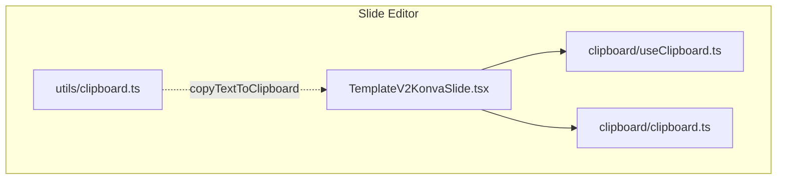
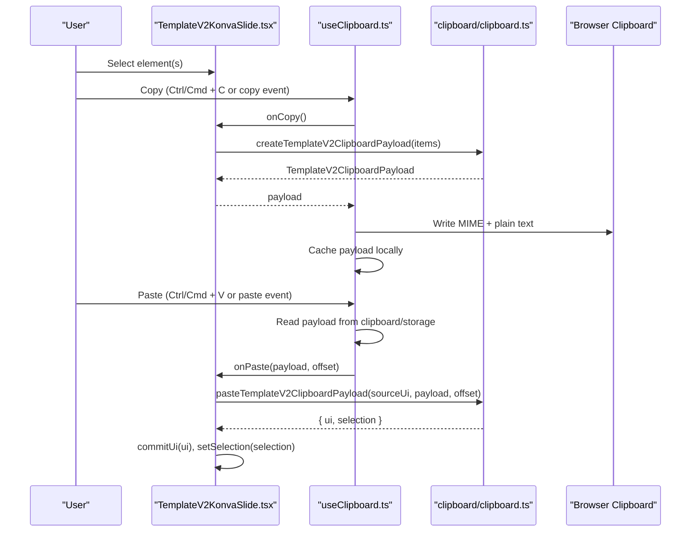
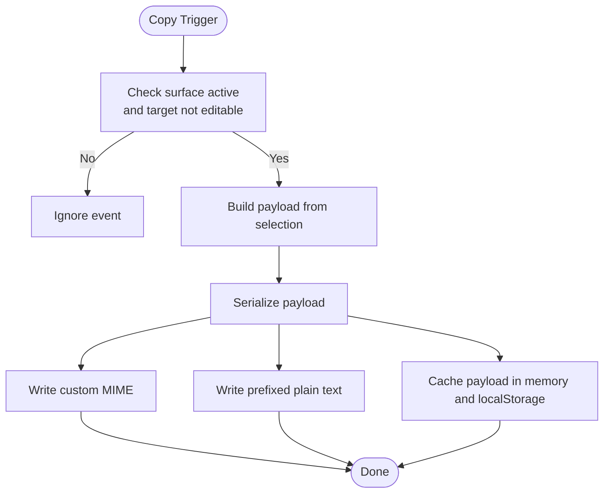
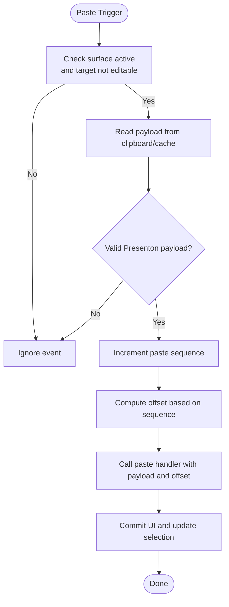
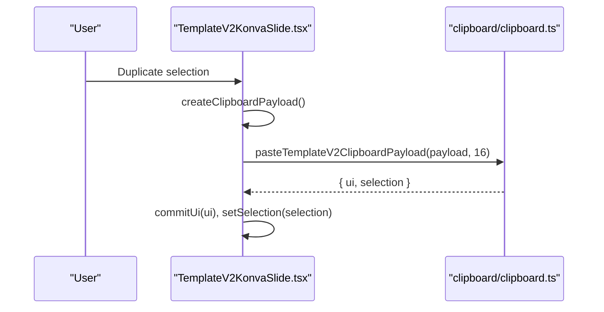
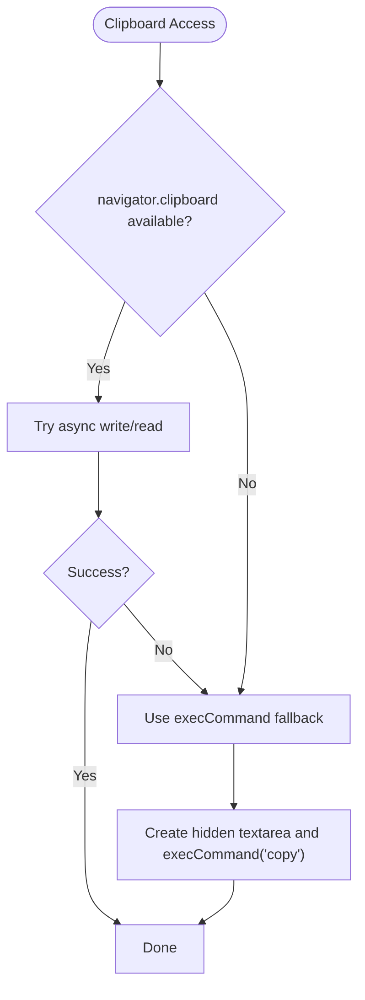
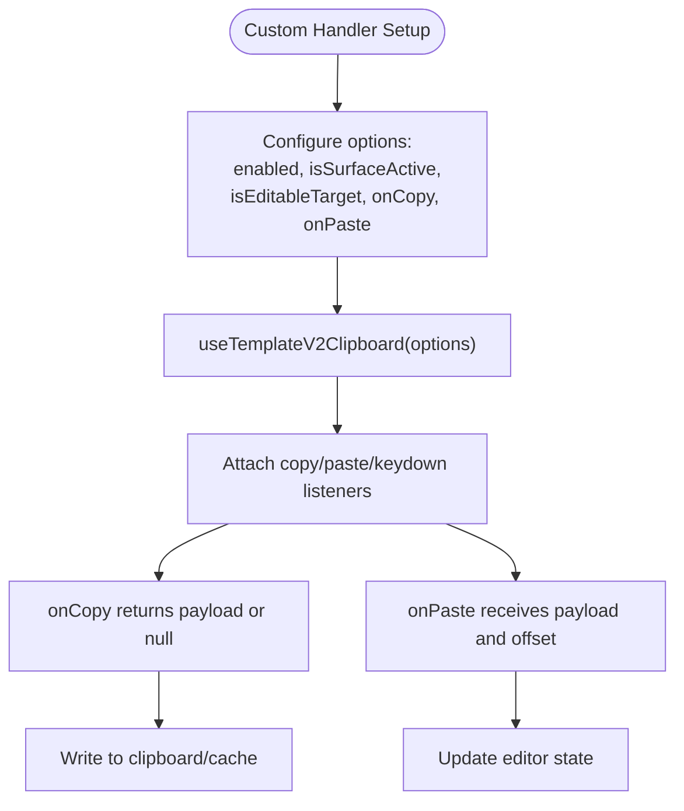
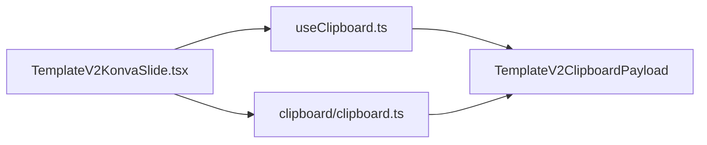

# Clipboard Operations

<cite>
**Referenced Files in This Document**
- [clipboard.ts](file://servers/nextjs/components/slide-editor/clipboard/clipboard.ts)
- [useClipboard.ts](file://servers/nextjs/components/slide-editor/clipboard/useClipboard.ts)
- [TemplateV2KonvaSlide.tsx](file://servers/nextjs/components/slide-editor/surface/TemplateV2KonvaSlide.tsx)
- [clipboard.ts](file://servers/nextjs/utils/clipboard.ts)
- [README.md](file://servers/nextjs/components/slide-editor/README.md)
</cite>

## Table of Contents
1. [Introduction](#introduction)
2. [Project Structure](#project-structure)
3. [Core Components](#core-components)
4. [Architecture Overview](#architecture-overview)
5. [Detailed Component Analysis](#detailed-component-analysis)
6. [Dependency Analysis](#dependency-analysis)
7. [Performance Considerations](#performance-considerations)
8. [Troubleshooting Guide](#troubleshooting-guide)
9. [Conclusion](#conclusion)

## Introduction
This document explains how copy, paste, and duplicate operations work inside the slide editor. It covers:
- How selected slide elements are serialized into a clipboard payload.
- How that payload is written to the browser clipboard and stored as fallback data.
- How pasted content is deserialized, inserted into the slide, and selected.
- The clipboard data format used by Presenton’s Template V2 editor.
- Cross-browser compatibility considerations for rich content and clipboard access.
- Examples of handling rich content and implementing custom clipboard handlers.

The implementation separates concerns into three layers:
- Browser integration layer: event listeners, keyboard shortcuts, and clipboard APIs.
- Data serialization layer: pure functions that create and consume clipboard payloads.
- Editor integration layer: the slide surface component that converts selection state into clipboard data and applies paste results back to the UI.

## Project Structure
The clipboard system lives under the Next.js slide editor:



**Diagram sources**
- [TemplateV2KonvaSlide.tsx:1785-1860](file://servers/nextjs/components/slide-editor/surface/TemplateV2KonvaSlide.tsx#L1785-L1860)
- [clipboard.ts:40-94](file://servers/nextjs/components/slide-editor/clipboard/clipboard.ts#L40-L94)
- [useClipboard.ts:21-90](file://servers/nextjs/components/slide-editor/clipboard/useClipboard.ts#L21-L90)
- [clipboard.ts:1-47](file://servers/nextjs/utils/clipboard.ts#L1-L47)

**Section sources**
- [README.md:568-583](file://servers/nextjs/components/slide-editor/README.md#L568-L583)

## Core Components
- `TemplateV2KonvaSlide.tsx`: The slide surface component that owns selection state and wires copy/paste behavior into the editor.
- `clipboard/clipboard.ts`: Pure TypeScript utilities for creating and applying clipboard payloads.
- `clipboard/useClipboard.ts`: React hook that attaches browser events and manages clipboard storage.
- `utils/clipboard.ts`: Generic text clipboard helper with fallback support.

Key responsibilities:
- Selection-to-payload conversion happens in the slide surface.
- Payload creation and application happen in the pure clipboard module.
- Browser API access, MIME types, and fallback storage happen in the hook.

**Section sources**
- [TemplateV2KonvaSlide.tsx:1785-1860](file://servers/nextjs/components/slide-editor/surface/TemplateV2KonvaSlide.tsx#L1785-L1860)
- [clipboard.ts:40-94](file://servers/nextjs/components/slide-editor/clipboard/clipboard.ts#L40-L94)
- [useClipboard.ts:21-90](file://servers/nextjs/components/slide-editor/clipboard/useClipboard.ts#L21-L90)

## Architecture Overview
The clipboard flow connects user actions to editor state through a typed payload.



**Diagram sources**
- [useClipboard.ts:31-53](file://servers/nextjs/components/slide-editor/clipboard/useClipboard.ts#L31-L53)
- [useClipboard.ts:127-134](file://servers/nextjs/components/slide-editor/clipboard/useClipboard.ts#L127-L134)
- [useClipboard.ts:151-161](file://servers/nextjs/components/slide-editor/clipboard/useClipboard.ts#L151-L161)
- [clipboard.ts:40-94](file://servers/nextjs/components/slide-editor/clipboard/clipboard.ts#L40-L94)
- [TemplateV2KonvaSlide.tsx:1785-1817](file://servers/nextjs/components/slide-editor/surface/TemplateV2KonvaSlide.tsx#L1785-L1817)

## Detailed Component Analysis

### Clipboard Data Format
Presenton uses a versioned JSON payload for clipboard operations. The payload identifies itself with a fixed format string and version number, then carries either a single component or an array of components along with their absolute bounding boxes.

Important fields:
- `format`: Identifies the clipboard schema.
- `version`: Schema version.
- `kind`: Either `"component"` or `"components"`.
- `data`: Optional legacy single-component data.
- `components`: Array of items, each containing component data and its absolute box.
- `absoluteBox`: Union bounding box covering all copied items.

Validation rules:
- Boxes must have finite numeric `x`, `y`, `width`, and `height`.
- Width and height must be greater than zero.
- Parsed payloads are rejected if they do not match the expected format, version, or structure.

Serialization notes:
- Component data is deep-cloned before being placed into the payload.
- Absolute boxes are normalized and unioned across multiple items.
- Duplicate paste creates unique component IDs to avoid collisions.

```mermaid
classDiagram
class TemplateV2ClipboardRecord {
"+string key"
"+unknown value"
}
class TemplateV2ClipboardBox {
"+number x"
"+number y"
"+number width"
"+number height"
}
class TemplateV2ClipboardItem {
"+TemplateV2ClipboardRecord data"
"+TemplateV2ClipboardBox absoluteBox"
}
class TemplateV2ClipboardPayload {
"+string format"
"+number version"
"+string kind"
"+TemplateV2ClipboardRecord? data"
"+TemplateV2ClipboardItem[]? components"
"+TemplateV2ClipboardBox absoluteBox"
}
TemplateV2ClipboardPayload --> TemplateV2ClipboardItem : "contains"
TemplateV2ClipboardItem --> TemplateV2ClipboardRecord : "has"
TemplateV2ClipboardItem --> TemplateV2ClipboardBox : "has"
TemplateV2ClipboardPayload --> TemplateV2ClipboardBox : "has"
```

**Diagram sources**
- [clipboard.ts:1-27](file://servers/nextjs/components/slide-editor/clipboard/clipboard.ts#L1-L27)

**Section sources**
- [clipboard.ts:1-27](file://servers/nextjs/components/slide-editor/clipboard/clipboard.ts#L1-L27)
- [clipboard.ts:165-196](file://servers/nextjs/components/slide-editor/clipboard/clipboard.ts#L165-L196)
- [useClipboard.ts:196-229](file://servers/nextjs/components/slide-editor/clipboard/useClipboard.ts#L196-L229)

### Copy Flow
Copy is triggered by:
- A native `copy` event when the slide surface is active and the target is not an editable input.
- A keyboard shortcut (`Ctrl/Cmd + C`) when modifiers match the expected pattern.

Behavior:
- The slide surface builds a payload from the current selection using `createTemplateV2ClipboardPayload`.
- The hook serializes the payload and writes it to:
  - A custom MIME type: `application/x-presenton-template-v2`.
  - Plain text prefixed with `PRESENTON_TEMPLATE_V2:`.
- The hook caches the serialized payload in memory and optionally in `localStorage`.



**Diagram sources**
- [useClipboard.ts:31-43](file://servers/nextjs/components/slide-editor/clipboard/useClipboard.ts#L31-L43)
- [useClipboard.ts:55-80](file://servers/nextjs/components/slide-editor/clipboard/useClipboard.ts#L55-L80)
- [useClipboard.ts:93-125](file://servers/nextjs/components/slide-editor/clipboard/useClipboard.ts#L93-L125)
- [TemplateV2KonvaSlide.tsx:1785-1798](file://servers/nextjs/components/slide-editor/surface/TemplateV2KonvaSlide.tsx#L1785-L1798)

**Section sources**
- [useClipboard.ts:31-80](file://servers/nextjs/components/slide-editor/clipboard/useClipboard.ts#L31-L80)
- [useClipboard.ts:93-125](file://servers/nextjs/components/slide-editor/clipboard/useClipboard.ts#L93-L125)
- [TemplateV2KonvaSlide.tsx:1785-1798](file://servers/nextjs/components/slide-editor/surface/TemplateV2KonvaSlide.tsx#L1785-L1798)

### Paste Flow
Paste is triggered by:
- A native `paste` event when the slide surface is active and the target is not an editable input.
- A keyboard shortcut (`Ctrl/Cmd + V`) when modifiers match the expected pattern.

Behavior:
- The hook reads the payload from:
  - Custom MIME data.
  - Prefixed plain text.
  - In-memory cache.
  - `localStorage`.
- If no Presenton payload is found, the hook ignores the paste.
- Each paste increments an internal sequence and applies an increasing offset so repeated pastes visually stagger the content.
- The slide surface calls `pasteTemplateV2ClipboardPayload`, commits the updated UI, sets selection, clears editing states, and activates the surface.



**Diagram sources**
- [useClipboard.ts:45-53](file://servers/nextjs/components/slide-editor/clipboard/useClipboard.ts#L45-L53)
- [useClipboard.ts:127-134](file://servers/nextjs/components/slide-editor/clipboard/useClipboard.ts#L127-L134)
- [useClipboard.ts:151-186](file://servers/nextjs/components/slide-editor/clipboard/useClipboard.ts#L151-L186)
- [TemplateV2KonvaSlide.tsx:1800-1817](file://servers/nextjs/components/slide-editor/surface/TemplateV2KonvaSlide.tsx#L1800-L1817)

**Section sources**
- [useClipboard.ts:45-53](file://servers/nextjs/components/slide-editor/clipboard/useClipboard.ts#L45-L53)
- [useClipboard.ts:127-186](file://servers/nextjs/components/slide-editor/clipboard/useClipboard.ts#L127-L186)
- [TemplateV2KonvaSlide.tsx:1800-1817](file://servers/nextjs/components/slide-editor/surface/TemplateV2KonvaSlide.tsx#L1800-L1817)

### Duplicate Operation
Duplicate is implemented using the same clipboard pipeline but without requiring the system clipboard. It:
- Builds a payload from the selected component(s).
- Calls the paste handler with a fixed offset.
- Tracks duplication analytics.

This design ensures consistent insertion logic between copy/paste and duplicate.



**Diagram sources**
- [TemplateV2KonvaSlide.tsx:1844-1853](file://servers/nextjs/components/slide-editor/surface/TemplateV2KonvaSlide.tsx#L1844-L1853)
- [clipboard.ts:62-94](file://servers/nextjs/components/slide-editor/clipboard/clipboard.ts#L62-L94)

**Section sources**
- [TemplateV2KonvaSlide.tsx:1844-1853](file://servers/nextjs/components/slide-editor/surface/TemplateV2KonvaSlide.tsx#L1844-L1853)

### Rich Content Handling
Rich content such as formatted text, lists, charts, tables, images, and math expressions is represented as slide elements within the component data carried by the clipboard payload. The clipboard layer does not interpret rich formatting directly; instead, it serializes the underlying component model.

Implications:
- Rich content survives copy/paste because the full component object is preserved.
- Rendering and layout are handled by the slide renderer after paste.
- Validation focuses on structural integrity (boxes and records), not rich content semantics.

Best practices:
- Ensure every component included in a clipboard item has a valid absolute box.
- Avoid attaching non-serializable values to component data.
- Keep component IDs stable or allow the paste logic to generate unique IDs.

**Section sources**
- [clipboard.ts:15-27](file://servers/nextjs/components/slide-editor/clipboard/clipboard.ts#L15-L27)
- [clipboard.ts:96-106](file://servers/nextjs/components/slide-editor/clipboard/clipboard.ts#L96-L106)
- [README.md:568-583](file://servers/nextjs/components/slide-editor/README.md#L568-L583)

### Cross-Browser Compatibility
The implementation handles several browser differences:

- Custom MIME type: Uses `application/x-presenton-template-v2` for structured data.
- Plain text fallback: Writes a prefixed plain-text representation so other applications can recognize Presenton content.
- Clipboard API availability: Falls back to `document.execCommand("copy")` when the asynchronous clipboard API is unavailable.
- Permission restrictions: Gracefully handles denied clipboard permissions by keeping an in-app cache and local storage fallback.
- Event interception: Prevents default behavior and stops propagation to avoid interfering with other editors.



**Diagram sources**
- [useClipboard.ts:110-125](file://servers/nextjs/components/slide-editor/clipboard/useClipboard.ts#L110-L125)
- [useClipboard.ts:136-149](file://servers/nextjs/components/slide-editor/clipboard/useClipboard.ts#L136-L149)
- [clipboard.ts:1-47](file://servers/nextjs/utils/clipboard.ts#L1-L47)

**Section sources**
- [useClipboard.ts:110-149](file://servers/nextjs/components/slide-editor/clipboard/useClipboard.ts#L110-L149)
- [clipboard.ts:1-47](file://servers/nextjs/utils/clipboard.ts#L1-L47)

### Implementing Custom Clipboard Handlers
To integrate custom clipboard behavior:

1. Provide your own `onCopy` function that returns a `TemplateV2ClipboardPayload` or `null`.
2. Provide your own `onPaste` function that accepts a payload and offset, then updates your editor state.
3. Use `useTemplateV2Clipboard` with `enabled`, `isSurfaceActive`, and `isEditableTarget` controls.
4. If you need generic text copying outside the slide editor, use `copyTextToClipboard`.

Example patterns:
- Restrict copy to specific selections by returning `null` from `onCopy`.
- Transform pasted content by modifying the payload before calling the standard paste handler.
- Disable clipboard hooks when the editor is read-only or inactive.



**Diagram sources**
- [useClipboard.ts:13-27](file://servers/nextjs/components/slide-editor/clipboard/useClipboard.ts#L13-L27)
- [useClipboard.ts:21-90](file://servers/nextjs/components/slide-editor/clipboard/useClipboard.ts#L21-L90)
- [clipboard.ts:40-94](file://servers/nextjs/components/slide-editor/clipboard/clipboard.ts#L40-L94)

**Section sources**
- [useClipboard.ts:13-27](file://servers/nextjs/components/slide-editor/clipboard/useClipboard.ts#L13-L27)
- [useClipboard.ts:21-90](file://servers/nextjs/components/slide-editor/clipboard/useClipboard.ts#L21-L90)
- [TemplateV2KonvaSlide.tsx:1855-1861](file://servers/nextjs/components/slide-editor/surface/TemplateV2KonvaSlide.tsx#L1855-L1861)

## Dependency Analysis
The clipboard system has clear boundaries:

- `TemplateV2KonvaSlide.tsx` depends on:
  - `useTemplateV2Clipboard` for browser integration.
  - `createTemplateV2ClipboardPayload` and `pasteTemplateV2ClipboardPayload` for data transformation.
- `useClipboard.ts` depends on:
  - `TemplateV2ClipboardPayload` type.
  - Browser APIs: `document`, `navigator.clipboard`, `window.localStorage`.
- `clipboard.ts` is pure and has no runtime dependencies beyond JavaScript primitives.



**Diagram sources**
- [TemplateV2KonvaSlide.tsx:1785-1860](file://servers/nextjs/components/slide-editor/surface/TemplateV2KonvaSlide.tsx#L1785-L1860)
- [useClipboard.ts:4-19](file://servers/nextjs/components/slide-editor/clipboard/useClipboard.ts#L4-L19)
- [clipboard.ts:20-27](file://servers/nextjs/components/slide-editor/clipboard/clipboard.ts#L20-L27)

**Section sources**
- [TemplateV2KonvaSlide.tsx:1785-1860](file://servers/nextjs/components/slide-editor/surface/TemplateV2KonvaSlide.tsx#L1785-L1860)
- [useClipboard.ts:4-19](file://servers/nextjs/components/slide-editor/clipboard/useClipboard.ts#L4-L19)
- [clipboard.ts:20-27](file://servers/nextjs/components/slide-editor/clipboard/clipboard.ts#L20-L27)

## Performance Considerations
- Payload cloning: Deep cloning component data ensures isolation but adds memory overhead. Limit the number of large components copied at once.
- Box validation: Filtering invalid boxes prevents malformed payloads from entering the editor.
- LocalStorage fallback: Storing serialized payloads avoids repeated clipboard reads but may fail in restricted environments.
- Event listeners: The hook attaches global listeners only when enabled, reducing unnecessary overhead.

Recommendations:
- Avoid copying extremely large slides or many heavy components simultaneously.
- Prefer duplicating a single component when possible.
- Monitor memory usage when working with presentations containing many rich elements.

[No sources needed since this section provides general guidance]

## Troubleshooting Guide
Common issues and resolutions:

- Paste does nothing:
  - Verify the slide surface is active.
  - Ensure the paste target is not an editable input.
  - Check whether the clipboard contains a valid Presenton payload.

- Copy fails silently:
  - Clipboard API may be denied; check browser permissions.
  - The hook still caches the payload internally, so paste may still work via the in-app cache.

- Pasted content overlaps previous content:
  - Repeated pastes apply increasing offsets.
  - Adjust the offset strategy in your custom `onPaste` if needed.

- Rich content lost after paste:
  - Ensure the component data remains serializable.
  - Confirm that the component has a valid absolute box.

- Clipboard access error:
  - For generic text copying, `copyTextToClipboard` throws when neither the async clipboard API nor `execCommand` is available.

**Section sources**
- [useClipboard.ts:31-53](file://servers/nextjs/components/slide-editor/clipboard/useClipboard.ts#L31-L53)
- [useClipboard.ts:110-149](file://servers/nextjs/components/slide-editor/clipboard/useClipboard.ts#L110-L149)
- [useClipboard.ts:196-229](file://servers/nextjs/components/slide-editor/clipboard/useClipboard.ts#L196-L229)
- [clipboard.ts:1-47](file://servers/nextjs/utils/clipboard.ts#L1-L47)

## Conclusion
Presenton’s slide editor implements clipboard operations through a layered design:
- A typed payload preserves slide components and their positions.
- A React hook integrates with browser events and provides robust fallbacks.
- The slide surface converts selection state into clipboard data and applies paste results consistently.

This approach supports rich content, cross-browser compatibility, and extensibility through custom handlers. When extending the system, keep payload validation strict, ensure component data is serializable, and handle clipboard permission limitations gracefully.

[No sources needed since this section summarizes without analyzing specific files]