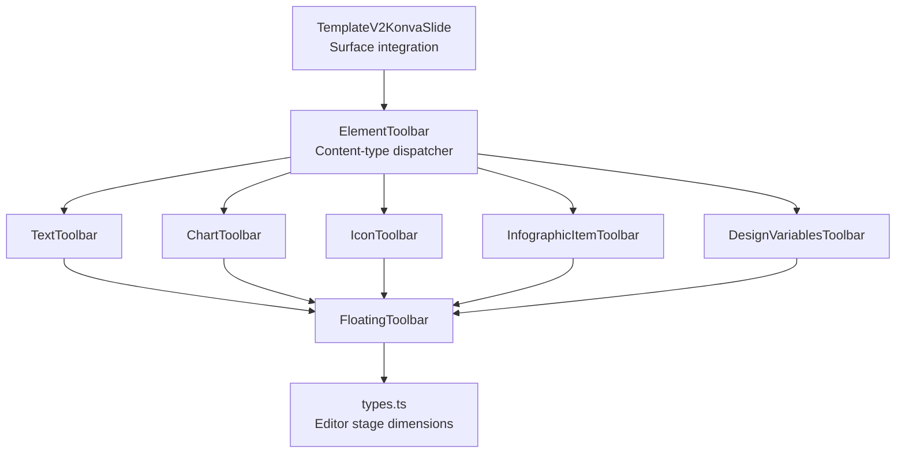
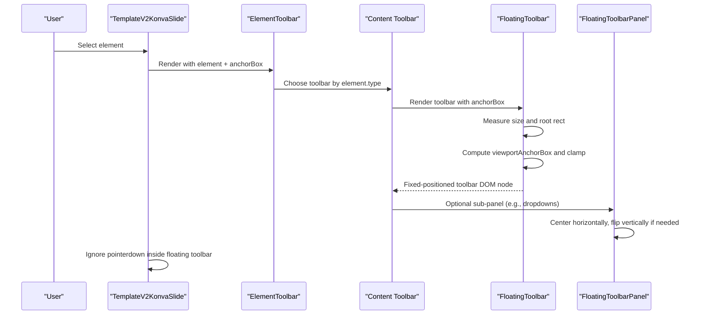
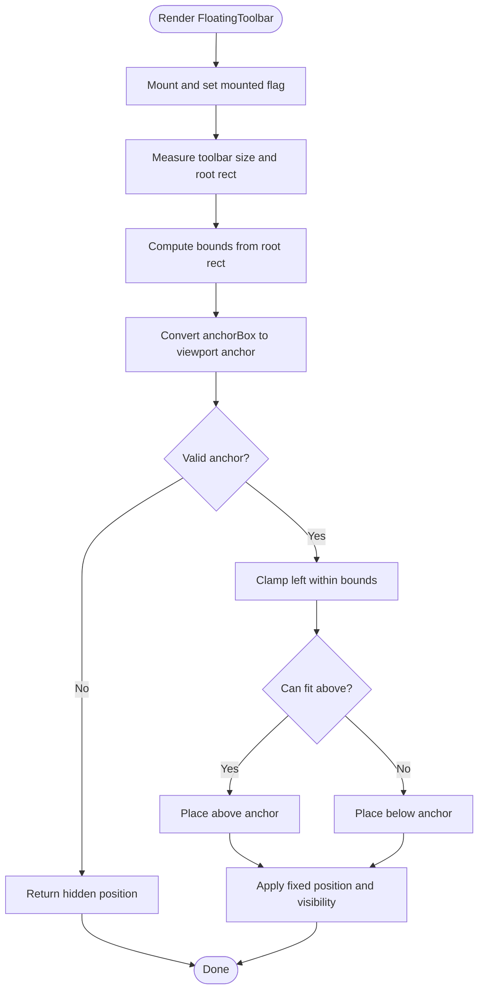
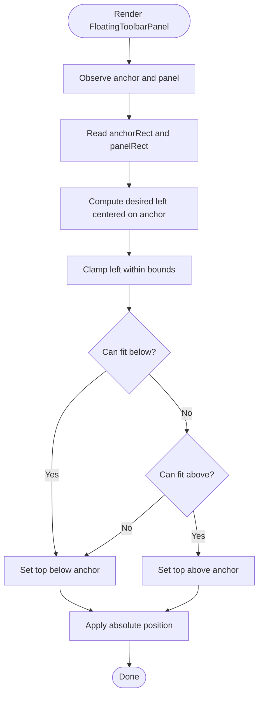
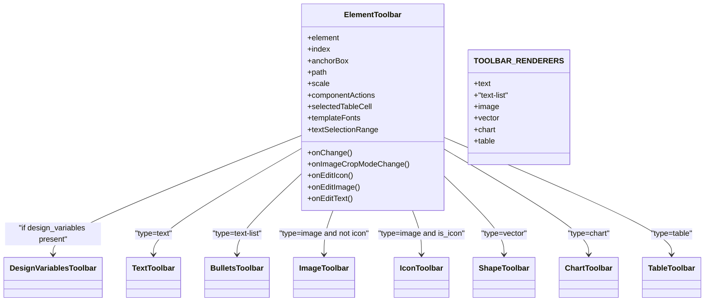
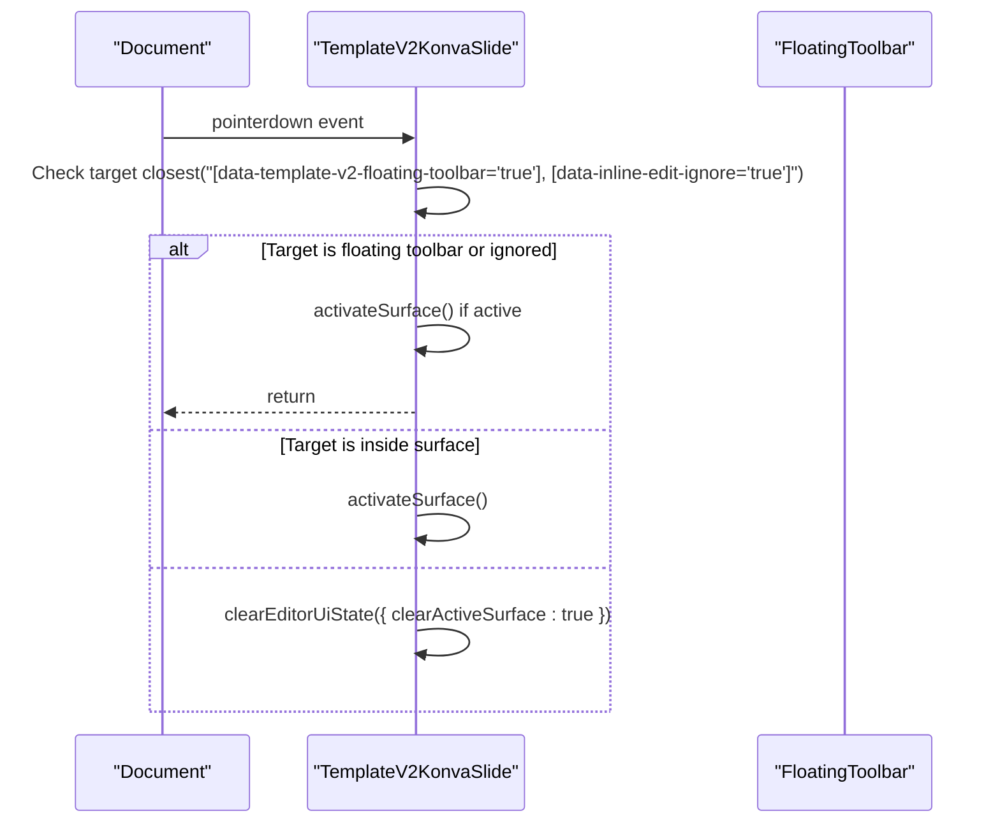
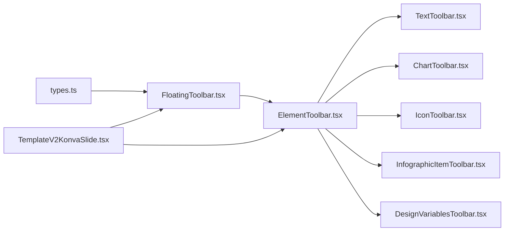

# Floating Toolbar

<cite>
**Referenced Files in This Document**
- [FloatingToolbar.tsx](file://servers/nextjs/components/slide-editor/toolbar/FloatingToolbar.tsx)
- [ElementToolbar.tsx](file://servers/nextjs/components/slide-editor/toolbar/ElementToolbar.tsx)
- [DesignVariablesToolbar.tsx](file://servers/nextjs/components/slide-editor/toolbar/DesignVariablesToolbar.tsx)
- [TemplateV2KonvaSlide.tsx](file://servers/nextjs/components/slide-editor/surface/TemplateV2KonvaSlide.tsx)
- [types.ts](file://servers/nextjs/components/slide-editor/types.ts)
- [TextToolbar.tsx](file://servers/nextjs/components/slide-editor/text/TextToolbar.tsx)
- [ChartToolbar.tsx](file://servers/nextjs/components/slide-editor/charts/ChartToolbar.tsx)
- [IconToolbar.tsx](file://servers/nextjs/components/slide-editor/images/IconToolbar.tsx)
- [InfographicItemToolbar.tsx](file://servers/nextjs/components/slide-editor/infographics/InfographicItemToolbar.tsx)
</cite>

## Table of Contents
1. [Introduction](#introduction)
2. [Project Structure](#project-structure)
3. [Core Components](#core-components)
4. [Architecture Overview](#architecture-overview)
5. [Detailed Component Analysis](#detailed-component-analysis)
6. [Dependency Analysis](#dependency-analysis)
7. [Performance Considerations](#performance-considerations)
8. [Troubleshooting Guide](#troubleshooting-guide)
9. [Conclusion](#conclusion)
10. [Appendices](#appendices)

## Introduction
This document explains the floating toolbar system used by the slide editor. It covers how floating toolbars are positioned, rendered, and managed across different slide elements. It also documents the ElementToolbar component, the design variables toolbar, and how toolbars adapt to different content types. Finally, it provides practical guidance for adding new toolbar items, customizing appearance, and handling positioning calculations.

## Project Structure
The floating toolbar system lives under the slide editor’s toolbar layer and integrates with the Konva-based slide surface:

- Floating positioning and rendering primitives: `FloatingToolbar` and `FloatingToolbarPanel`.
- Content-aware toolbar selection: `ElementToolbar`.
- Design-variable-driven overrides: `DesignVariablesToolbar`.
- Slide surface integration and pointer handling: `TemplateV2KonvaSlide`.
- Editor geometry constants: `EDITOR_STAGE_WIDTH`, `EDITOR_STAGE_HEIGHT`.
- Example content-specific toolbars that consume the floating primitives: text, chart, icon, infographic item.

**Diagram sources**
- [TemplateV2KonvaSlide.tsx:1021-1031](file://servers/nextjs/components/slide-editor/surface/TemplateV2KonvaSlide.tsx#L1021-L1031)
- [ElementToolbar.tsx:40-189](file://servers/nextjs/components/slide-editor/toolbar/ElementToolbar.tsx#L40-L189)
- [FloatingToolbar.tsx:75-189](file://servers/nextjs/components/slide-editor/toolbar/FloatingToolbar.tsx#L75-L189)
- [types.ts:1-3](file://servers/nextjs/components/slide-editor/types.ts#L1-L3)

**Section sources**
- [TemplateV2KonvaSlide.tsx:1021-1031](file://servers/nextjs/components/slide-editor/surface/TemplateV2KonvaSlide.tsx#L1021-L1031)
- [ElementToolbar.tsx:40-189](file://servers/nextjs/components/slide-editor/toolbar/ElementToolbar.tsx#L40-L189)
- [FloatingToolbar.tsx:75-189](file://servers/nextjs/components/slide-editor/toolbar/FloatingToolbar.tsx#L75-L189)
- [types.ts:1-3](file://servers/nextjs/components/slide-editor/types.ts#L1-L3)

## Core Components
- FloatingToolbar: Renders a fixed-position toolbar anchored to an element box, computes safe viewport placement, and portals itself into the document body.
- FloatingToolbarPanel: Renders a panel relative to its parent (the toolbar), auto-centering and flipping vertically when needed.
- ElementToolbar: Dispatches to the correct content-specific toolbar based on the selected slide element type.
- DesignVariablesToolbar: Overrides other toolbars when an element exposes design variables, presenting variable selectors instead.

Key responsibilities:
- Positioning: Convert editor-space anchor boxes to viewport coordinates, clamp within bounds, and choose above/below placement.
- Rendering: Use React portal to avoid z-index stacking issues; mark nodes to ignore inline editing and to identify floating toolbars.
- Adaptation: Provide per-content-type toolbars through a renderer map keyed by element type.

**Section sources**
- [FloatingToolbar.tsx:23-57](file://servers/nextjs/components/slide-editor/toolbar/FloatingToolbar.tsx#L23-L57)
- [FloatingToolbar.tsx:75-189](file://servers/nextjs/components/slide-editor/toolbar/FloatingToolbar.tsx#L75-L189)
- [FloatingToolbar.tsx:192-290](file://servers/nextjs/components/slide-editor/toolbar/FloatingToolbar.tsx#L192-L290)
- [ElementToolbar.tsx:16-38](file://servers/nextjs/components/slide-editor/toolbar/ElementToolbar.tsx#L16-L38)
- [ElementToolbar.tsx:40-189](file://servers/nextjs/components/slide-editor/toolbar/ElementToolbar.tsx#L40-L189)
- [DesignVariablesToolbar.tsx:14-75](file://servers/nextjs/components/slide-editor/toolbar/DesignVariablesToolbar.tsx#L14-L75)

## Architecture Overview
The floating toolbar architecture is layered:

- Surface layer: The slide surface tracks active surfaces, refreshes toolbar positions on resize, and ignores pointer events inside floating toolbars.
- Dispatcher layer: ElementToolbar selects the appropriate toolbar based on element type or design variables.
- Primitive layer: FloatingToolbar and FloatingToolbarPanel compute and apply positioning using DOM measurements and viewport constraints.
- Content layers: Text, chart, image/icon, table, shape, and infographic toolbars compose their UI inside the floating primitives.

**Diagram sources**
- [TemplateV2KonvaSlide.tsx:2848-2877](file://servers/nextjs/components/slide-editor/surface/TemplateV2KonvaSlide.tsx#L2848-L2877)
- [ElementToolbar.tsx:172-189](file://servers/nextjs/components/slide-editor/toolbar/ElementToolbar.tsx#L172-L189)
- [FloatingToolbar.tsx:99-189](file://servers/nextjs/components/slide-editor/toolbar/FloatingToolbar.tsx#L99-L189)
- [FloatingToolbar.tsx:219-290](file://servers/nextjs/components/slide-editor/toolbar/FloatingToolbar.tsx#L219-L290)

## Detailed Component Analysis

### FloatingToolbar
FloatingToolbar is the core primitive for all floating toolbars.

Responsibilities:
- Anchor resolution: Accepts an optional anchor box in editor space and converts it to viewport coordinates using the current Konva surface rectangle.
- Measurement: Measures the toolbar’s actual size and the nearest Konva surface root rectangle.
- Placement: Computes left/top within safe margins, chooses above/below placement, and hides the toolbar when no valid anchor exists.
- Portal rendering: Renders the toolbar via React portal at the document body level with high z-index.
- Context propagation: Provides bounds context to child panels so they can align relative to the same boundary.

Positioning algorithm highlights:
- Converts editor-space anchor to viewport space using scale factors derived from the Konva surface rect and editor stage constants.
- Clamps horizontal position to stay within the boundary.
- Chooses top placement if there is enough space above; otherwise places below.
- Uses ResizeObserver and window scroll/resize listeners to recompute on layout changes.

**Diagram sources**
- [FloatingToolbar.tsx:99-189](file://servers/nextjs/components/slide-editor/toolbar/FloatingToolbar.tsx#L99-L189)
- [FloatingToolbar.tsx:292-340](file://servers/nextjs/components/slide-editor/toolbar/FloatingToolbar.tsx#L292-L340)
- [FloatingToolbar.tsx:342-356](file://servers/nextjs/components/slide-editor/toolbar/FloatingToolbar.tsx#L342-L356)
- [FloatingToolbar.tsx:358-384](file://servers/nextjs/components/slide-editor/toolbar/FloatingToolbar.tsx#L358-L384)

Usage patterns:
- Wrap toolbar content inside FloatingToolbar and pass anchorBox computed from the selected element.
- Optionally provide fallbackWidth/fallbackHeight for initial sizing before measurement.
- Use className/style to customize appearance; use margin and panelGap to tune spacing.

**Section sources**
- [FloatingToolbar.tsx:23-57](file://servers/nextjs/components/slide-editor/toolbar/FloatingToolbar.tsx#L23-L57)
- [FloatingToolbar.tsx:75-189](file://servers/nextjs/components/slide-editor/toolbar/FloatingToolbar.tsx#L75-L189)
- [FloatingToolbar.tsx:292-384](file://servers/nextjs/components/slide-editor/toolbar/FloatingToolbar.tsx#L292-L384)
- [types.ts:1-3](file://servers/nextjs/components/slide-editor/types.ts#L1-L3)

### FloatingToolbarPanel
FloatingToolbarPanel renders a sub-panel (for example, dropdowns or nested controls) relative to its parent toolbar.

Responsibilities:
- Horizontal centering: Centers the panel over its parent anchor.
- Vertical flipping: Places the panel below by default; flips above if not enough space below and space is available above.
- Boundary awareness: Uses provided bounds context or falls back to viewport bounds.
- Event-safe positioning: Recomputes on resize and scroll, observing both anchor and panel.

**Diagram sources**
- [FloatingToolbar.tsx:192-290](file://servers/nextjs/components/slide-editor/toolbar/FloatingToolbar.tsx#L192-L290)

**Section sources**
- [FloatingToolbar.tsx:192-290](file://servers/nextjs/components/slide-editor/toolbar/FloatingToolbar.tsx#L192-L290)

### ElementToolbar
ElementToolbar is the content-type dispatcher. It maps each slide element type to a specific toolbar implementation.

Behavior:
- If the element has design variables defined, it renders DesignVariablesToolbar instead of the type-specific toolbar.
- Otherwise, it looks up a renderer by element.type and renders the corresponding toolbar.
- Supported mappings include text, text-list, image (including icons), vector, chart, and table.

**Diagram sources**
- [ElementToolbar.tsx:16-38](file://servers/nextjs/components/slide-editor/toolbar/ElementToolbar.tsx#L16-L38)
- [ElementToolbar.tsx:40-189](file://servers/nextjs/components/slide-editor/toolbar/ElementToolbar.tsx#L40-L189)
- [DesignVariablesToolbar.tsx:14-75](file://servers/nextjs/components/slide-editor/toolbar/DesignVariablesToolbar.tsx#L14-L75)

Adding a new toolbar item:
- Extend the TOOLBAR_RENDERERS map with a new key matching the element.type.
- Implement the corresponding toolbar component and render it inside the new entry.
- Ensure the toolbar uses FloatingToolbar (or FloatingToolbarPanel) for consistent positioning.

Example references:
- Text toolbar usage: [TextToolbar.tsx:375-415](file://servers/nextjs/components/slide-editor/text/TextToolbar.tsx#L375-L415)
- Chart toolbar usage: [ChartToolbar.tsx:134-209](file://servers/nextjs/components/slide-editor/charts/ChartToolbar.tsx#L134-L209)
- Icon toolbar usage: [IconToolbar.tsx:42-95](file://servers/nextjs/components/slide-editor/images/IconToolbar.tsx#L42-L95)
- Infographic item toolbar usage: [InfographicItemToolbar.tsx:37-59](file://servers/nextjs/components/slide-editor/infographics/InfographicItemToolbar.tsx#L37-L59)

**Section sources**
- [ElementToolbar.tsx:16-38](file://servers/nextjs/components/slide-editor/toolbar/ElementToolbar.tsx#L16-L38)
- [ElementToolbar.tsx:40-189](file://servers/nextjs/components/slide-editor/toolbar/ElementToolbar.tsx#L40-L189)
- [TextToolbar.tsx:375-415](file://servers/nextjs/components/slide-editor/text/TextToolbar.tsx#L375-L415)
- [ChartToolbar.tsx:134-209](file://servers/nextjs/components/slide-editor/charts/ChartToolbar.tsx#L134-L209)
- [IconToolbar.tsx:42-95](file://servers/nextjs/components/slide-editor/images/IconToolbar.tsx#L42-L95)
- [InfographicItemToolbar.tsx:37-59](file://servers/nextjs/components/slide-editor/infographics/InfographicItemToolbar.tsx#L37-L59)

### DesignVariablesToolbar
When an element defines design variables, this toolbar replaces the normal type-specific toolbar.

Behavior:
- Renders one selector per design variable.
- Computes the anchor box from the element’s position and size scaled by the editor scale.
- Applies style and width defaults suitable for compact variable selection.

Customization:
- Adjust fallbackWidth to accommodate longer option labels.
- Override inlineStyles.toolbar to match theme or brand colors.

**Section sources**
- [DesignVariablesToolbar.tsx:14-75](file://servers/nextjs/components/slide-editor/toolbar/DesignVariablesToolbar.tsx#L14-L75)
- [ElementToolbar.tsx:172-189](file://servers/nextjs/components/slide-editor/toolbar/ElementToolbar.tsx#L172-L189)

### Surface Integration and Pointer Handling
The slide surface manages activation and interaction with floating toolbars:

- Refresh loop: Periodically refreshes toolbar positions when floating toolbars are present.
- Pointer handling: Ignores pointer events targeting floating toolbars or inline-edit-ignored nodes; otherwise activates the surface.
- Data attributes: Floating toolbars and ignored nodes carry data attributes to simplify detection.

**Diagram sources**
- [TemplateV2KonvaSlide.tsx:2848-2877](file://servers/nextjs/components/slide-editor/surface/TemplateV2KonvaSlide.tsx#L2848-L2877)
- [FloatingToolbar.tsx:161-189](file://servers/nextjs/components/slide-editor/toolbar/FloatingToolbar.tsx#L161-L189)

**Section sources**
- [TemplateV2KonvaSlide.tsx:1021-1031](file://servers/nextjs/components/slide-editor/surface/TemplateV2KonvaSlide.tsx#L1021-L1031)
- [TemplateV2KonvaSlide.tsx:2848-2877](file://servers/nextjs/components/slide-editor/surface/TemplateV2KonvaSlide.tsx#L2848-L2877)
- [FloatingToolbar.tsx:161-189](file://servers/nextjs/components/slide-editor/toolbar/FloatingToolbar.tsx#L161-L189)

## Dependency Analysis
- FloatingToolbar depends on:
  - Editor stage constants for scaling: EDITOR_STAGE_WIDTH, EDITOR_STAGE_HEIGHT.
  - DOM APIs: getBoundingClientRect, ResizeObserver, window events.
  - React features: createPortal, useLayoutEffect, useRef, useState, useMemo, useContext.
- ElementToolbar depends on:
  - All content-specific toolbars (text, chart, image, icon, shape, table).
  - DesignVariablesToolbar for override behavior.
- Surface depends on:
  - Floating toolbar data attributes to detect and ignore interactions.
  - Selection utilities to compute absolute boxes for anchoring.

**Diagram sources**
- [types.ts:1-3](file://servers/nextjs/components/slide-editor/types.ts#L1-L3)
- [FloatingToolbar.tsx:18-21](file://servers/nextjs/components/slide-editor/toolbar/FloatingToolbar.tsx#L18-L21)
- [ElementToolbar.tsx:7-14](file://servers/nextjs/components/slide-editor/toolbar/ElementToolbar.tsx#L7-L14)
- [TemplateV2KonvaSlide.tsx:1021-1031](file://servers/nextjs/components/slide-editor/surface/TemplateV2KonvaSlide.tsx#L1021-L1031)

**Section sources**
- [FloatingToolbar.tsx:18-21](file://servers/nextjs/components/slide-editor/toolbar/FloatingToolbar.tsx#L18-L21)
- [ElementToolbar.tsx:7-14](file://servers/nextjs/components/slide-editor/toolbar/ElementToolbar.tsx#L7-L14)
- [TemplateV2KonvaSlide.tsx:1021-1031](file://servers/nextjs/components/slide-editor/surface/TemplateV2KonvaSlide.tsx#L1021-L1031)

## Performance Considerations
- Minimize re-renders: FloatingToolbar measures only after mount and uses useLayoutEffect to avoid layout thrashing.
- Efficient observation: ResizeObserver is used to observe both the toolbar and the root surface when available.
- Debounced updates: The surface refreshes toolbar positions via requestAnimationFrame to batch visual updates.
- Avoid heavy computations: Positioning logic uses simple arithmetic and clamping; keep custom toolbars lightweight.

[No sources needed since this section provides general guidance]

## Troubleshooting Guide
Common issues and resolutions:

- Toolbar not visible:
  - Ensure anchorBox is provided and valid; without a valid anchor, the toolbar is intentionally hidden.
  - Verify the nearest Konva surface root is detected; FloatingToolbar searches for `[data-template-v2-konva-surface]`.

- Toolbar overlaps edges:
  - Increase margin or reduce toolbar width.
  - Confirm that the surface bounds are correctly measured; check for scrolling containers affecting getBoundingClientRect.

- Interactions not working:
  - Floating toolbars ignore pointer events to prevent accidental deselection; ensure your controls do not rely on pointer events bubbling outside the toolbar.

- Incorrect scaling:
  - When computing anchorBox, multiply element.position and size by the editor scale factor.
  - For text toolbars, additional surface scaling factors are applied; follow similar patterns for other toolbars.

Relevant code paths:
- Visibility and positioning: [FloatingToolbar.tsx:99-189](file://servers/nextjs/components/slide-editor/toolbar/FloatingToolbar.tsx#L99-L189), [FloatingToolbar.tsx:292-340](file://servers/nextjs/components/slide-editor/toolbar/FloatingToolbar.tsx#L292-L340)
- Surface pointer handling: [TemplateV2KonvaSlide.tsx:2848-2877](file://servers/nextjs/components/slide-editor/surface/TemplateV2KonvaSlide.tsx#L2848-L2877)
- Text toolbar scaling pattern: [TextToolbar.tsx:375-415](file://servers/nextjs/components/slide-editor/text/TextToolbar.tsx#L375-L415)

**Section sources**
- [FloatingToolbar.tsx:99-189](file://servers/nextjs/components/slide-editor/toolbar/FloatingToolbar.tsx#L99-L189)
- [FloatingToolbar.tsx:292-340](file://servers/nextjs/components/slide-editor/toolbar/FloatingToolbar.tsx#L292-L340)
- [TemplateV2KonvaSlide.tsx:2848-2877](file://servers/nextjs/components/slide-editor/surface/TemplateV2KonvaSlide.tsx#L2848-L2877)
- [TextToolbar.tsx:375-415](file://servers/nextjs/components/slide-editor/text/TextToolbar.tsx#L375-L415)

## Conclusion
The floating toolbar system provides a robust, scalable foundation for contextual editing across diverse slide elements. FloatingToolbar centralizes positioning and rendering concerns, while ElementToolbar cleanly dispatches to content-specific toolbars. DesignVariablesToolbar enables dynamic customization without breaking the positioning model. By following the documented patterns—computing scaled anchor boxes, using FloatingToolbar for placement, and leveraging surface integration—you can extend the system with new toolbars and behaviors confidently.

[No sources needed since this section summarizes without analyzing specific files]

## Appendices

### How to Add a New Toolbar Item
Steps:
1. Define or reuse a toolbar component that composes FloatingToolbar and/or FloatingToolbarPanel.
2. In ElementToolbar, add a new entry to TOOLBAR_RENDERERS keyed by the element.type.
3. Pass anchorBox computed from the element’s position and size multiplied by scale.
4. Wire onChange handlers to update the element state through the parent surface.

References:
- Renderer map structure: [ElementToolbar.tsx:40-189](file://servers/nextjs/components/slide-editor/toolbar/ElementToolbar.tsx#L40-L189)
- Example toolbar composition: [ChartToolbar.tsx:134-209](file://servers/nextjs/components/slide-editor/charts/ChartToolbar.tsx#L134-L209)

**Section sources**
- [ElementToolbar.tsx:40-189](file://servers/nextjs/components/slide-editor/toolbar/ElementToolbar.tsx#L40-L189)
- [ChartToolbar.tsx:134-209](file://servers/nextjs/components/slide-editor/charts/ChartToolbar.tsx#L134-L209)

### Customizing Toolbar Appearance
- Use className and style props on FloatingToolbar to adjust colors, borders, and shadows.
- Adjust margin and panelGap to control spacing between toolbar and anchor or between panels.
- For design variables, tweak fallbackWidth and inlineStyles.toolbar to fit your content.

References:
- FloatingToolbar styling: [FloatingToolbar.tsx:75-189](file://servers/nextjs/components/slide-editor/toolbar/FloatingToolbar.tsx#L75-L189)
- DesignVariablesToolbar styling: [DesignVariablesToolbar.tsx:30-75](file://servers/nextjs/components/slide-editor/toolbar/DesignVariablesToolbar.tsx#L30-L75)

**Section sources**
- [FloatingToolbar.tsx:75-189](file://servers/nextjs/components/slide-editor/toolbar/FloatingToolbar.tsx#L75-L189)
- [DesignVariablesToolbar.tsx:30-75](file://servers/nextjs/components/slide-editor/toolbar/DesignVariablesToolbar.tsx#L30-L75)

### Handling Toolbar Positioning Calculations
Guidelines:
- Always convert editor-space coordinates to viewport coordinates using the Konva surface rect and editor stage constants.
- Provide fallback dimensions to avoid empty layouts before measurement completes.
- Respect margins and gaps to prevent overlap with edges or other UI.
- Use ResizeObserver and window events to keep positioning accurate during scroll and resize.

References:
- Viewport conversion and clamping: [FloatingToolbar.tsx:292-384](file://servers/nextjs/components/slide-editor/toolbar/FloatingToolbar.tsx#L292-L384)
- Editor stage constants: [types.ts:1-3](file://servers/nextjs/components/slide-editor/types.ts#L1-L3)

**Section sources**
- [FloatingToolbar.tsx:292-384](file://servers/nextjs/components/slide-editor/toolbar/FloatingToolbar.tsx#L292-L384)
- [types.ts:1-3](file://servers/nextjs/components/slide-editor/types.ts#L1-L3)