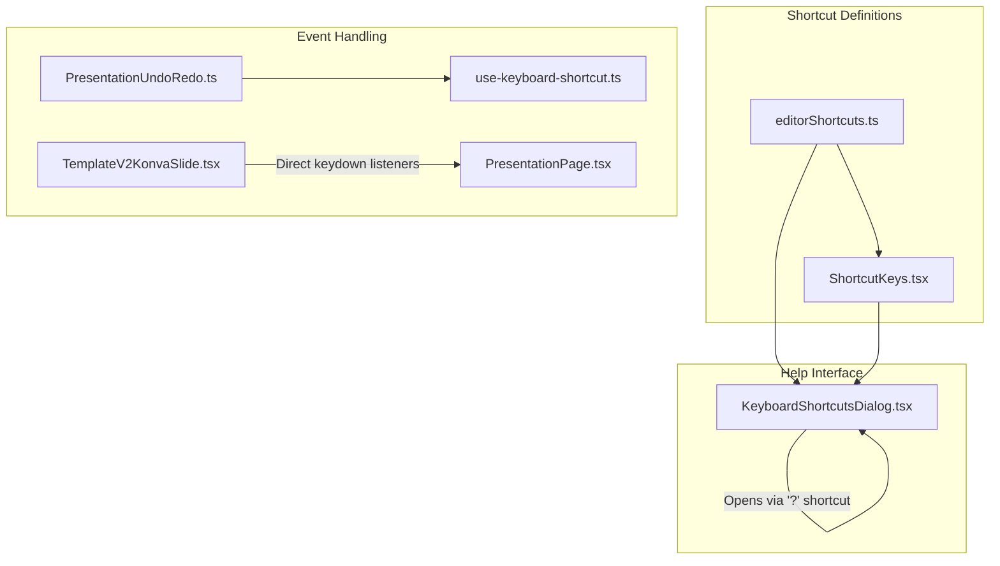
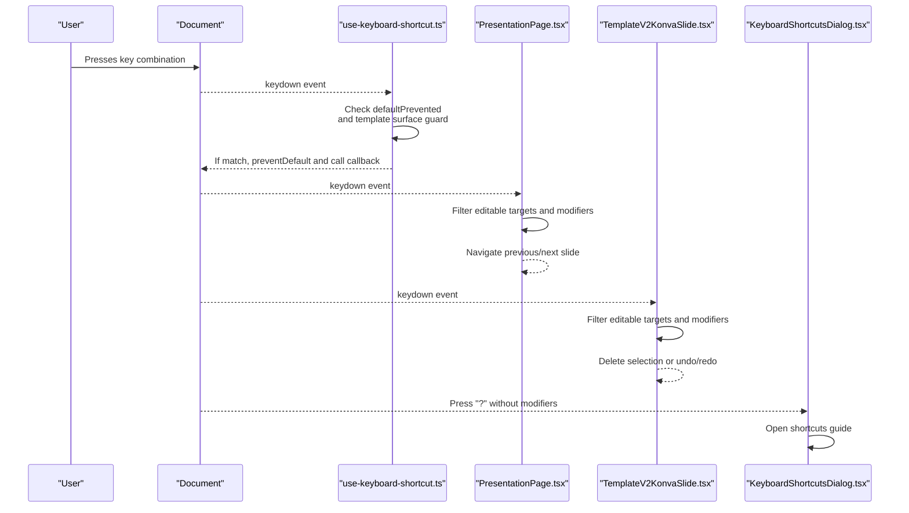
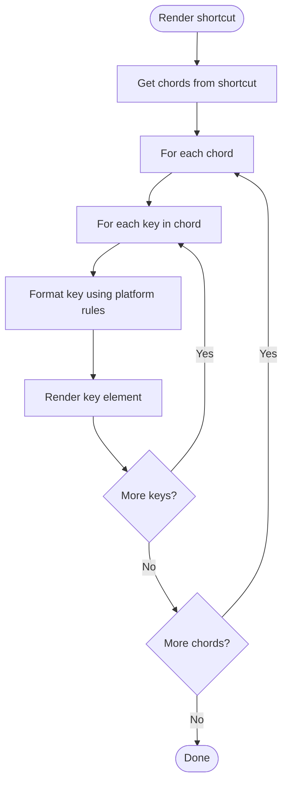
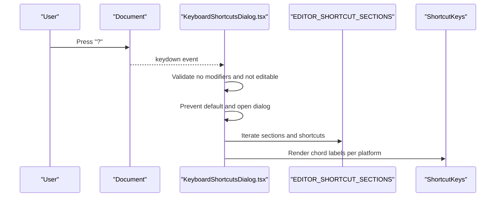
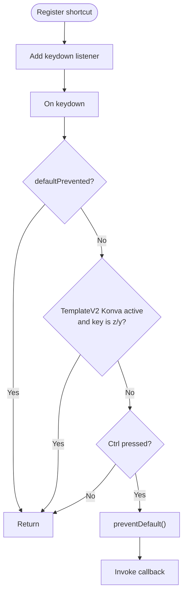
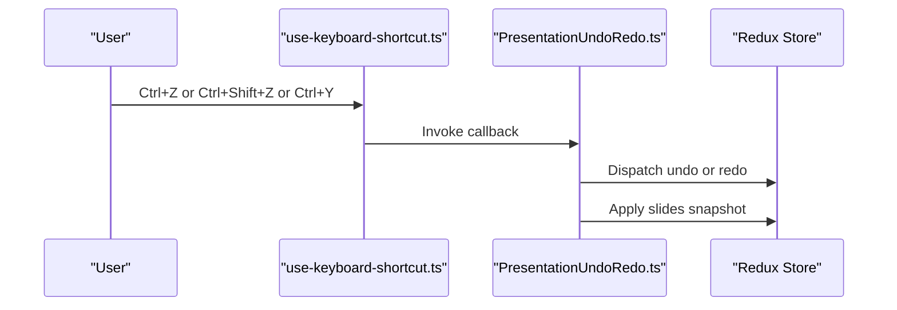
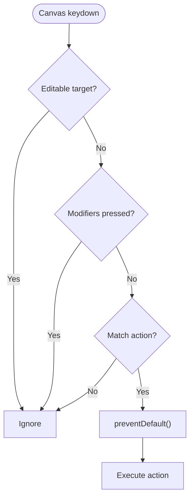
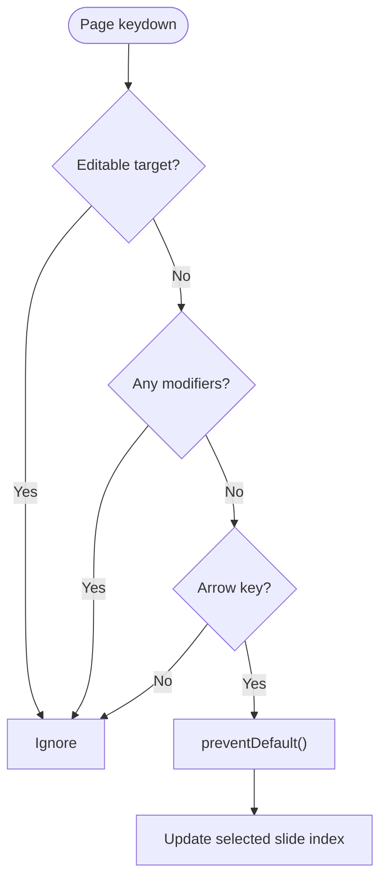
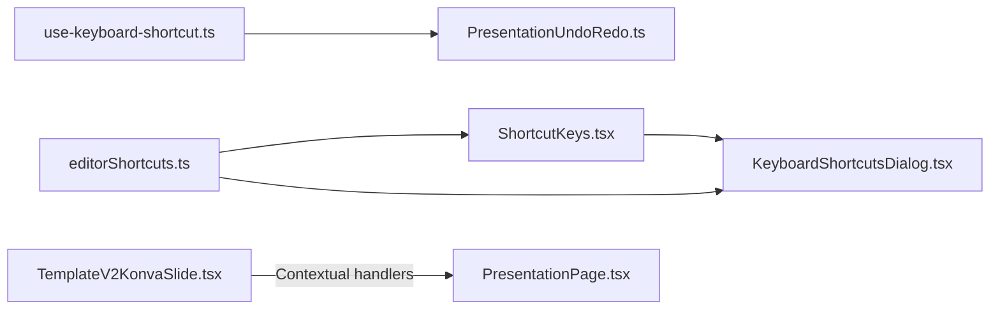

# Keyboard Shortcuts

<cite>
**Referenced Files in This Document**
- [editorShortcuts.ts](file://servers/nextjs/components/slide-editor/shortcuts/editorShortcuts.ts)
- [ShortcutKeys.tsx](file://servers/nextjs/components/slide-editor/shortcuts/ShortcutKeys.tsx)
- [KeyboardShortcutsDialog.tsx](file://servers/nextjs/app/(presentation-generator)/presentation/components/KeyboardShortcutsDialog.tsx)
- [use-keyboard-shortcut.ts](file://servers/nextjs/app/(presentation-generator)/hooks/use-keyboard-shortcut.ts)
- [PresentationUndoRedo.ts](file://servers/nextjs/app/(presentation-generator)/presentation/hooks/PresentationUndoRedo.ts)
- [TemplateV2KonvaSlide.tsx](file://servers/nextjs/components/slide-editor/surface/TemplateV2KonvaSlide.tsx)
- [PresentationPage.tsx](file://servers/nextjs/app/(presentation-generator)/presentation/components/PresentationPage.tsx)
</cite>

## Table of Contents
1. [Introduction](#introduction)
2. [Project Structure](#project-structure)
3. [Core Components](#core-components)
4. [Architecture Overview](#architecture-overview)
5. [Detailed Component Analysis](#detailed-component-analysis)
6. [Dependency Analysis](#dependency-analysis)
7. [Performance Considerations](#performance-considerations)
8. [Troubleshooting Guide](#troubleshooting-guide)
9. [Conclusion](#conclusion)

## Introduction
This document explains how keyboard shortcuts are defined, registered, and handled across the editor. It focuses on:
- The centralized shortcut data model and sections
- How shortcuts are displayed with platform-aware labels
- How global and context-aware shortcuts are registered
- How conflicts are resolved between different layers of the editor
- How to add custom shortcuts and implement a shortcut help interface

The system is split into two responsibilities:
- Data and presentation: defining shortcuts and rendering them consistently
- Event handling: listening for key events, filtering context, and dispatching commands

## Project Structure
The keyboard shortcut system lives primarily under the Next.js frontend:
- Shortcut definitions and utilities: `servers/nextjs/components/slide-editor/shortcuts`
- Shortcut help dialog: `servers/nextjs/app/(presentation-generator)/presentation/components`
- Shared keyboard hook: `servers/nextjs/app/(presentation-generator)/hooks`
- Editor surface and page-level handlers: `servers/nextjs/components/slide-editor/surface` and `servers/nextjs/app/(presentation-generator)/presentation/components`



**Diagram sources**
- [editorShortcuts.ts:56-176](file://servers/nextjs/components/slide-editor/shortcuts/editorShortcuts.ts#L56-L176)
- [ShortcutKeys.tsx:29-72](file://servers/nextjs/components/slide-editor/shortcuts/ShortcutKeys.tsx#L29-L72)
- [KeyboardShortcutsDialog.tsx:48-67](file://servers/nextjs/app/(presentation-generator)/presentation/components/KeyboardShortcutsDialog.tsx#L48-L67)
- [use-keyboard-shortcut.ts:10-46](file://servers/nextjs/app/(presentation-generator)/hooks/use-keyboard-shortcut.ts#L10-L46)
- [PresentationUndoRedo.ts:62-96](file://servers/nextjs/app/(presentation-generator)/presentation/hooks/PresentationUndoRedo.ts#L62-L96)
- [TemplateV2KonvaSlide.tsx:2768-2800](file://servers/nextjs/components/slide-editor/surface/TemplateV2KonvaSlide.tsx#L2768-L2800)
- [TemplateV2KonvaSlide.tsx:2892-2923](file://servers/nextjs/components/slide-editor/surface/TemplateV2KonvaSlide.tsx#L2892-L2923)
- [PresentationPage.tsx:621-656](file://servers/nextjs/app/(presentation-generator)/presentation/components/PresentationPage.tsx#L621-L656)

**Section sources**
- [editorShortcuts.ts:1-47](file://servers/nextjs/components/slide-editor/shortcuts/editorShortcuts.ts#L1-L47)
- [ShortcutKeys.tsx:10-27](file://servers/nextjs/components/slide-editor/shortcuts/ShortcutKeys.tsx#L10-L27)
- [KeyboardShortcutsDialog.tsx:37-67](file://servers/nextjs/app/(presentation-generator)/presentation/components/KeyboardShortcutsDialog.tsx#L37-L67)
- [use-keyboard-shortcut.ts:1-46](file://servers/nextjs/app/(presentation-generator)/hooks/use-keyboard-shortcut.ts#L1-L46)
- [PresentationUndoRedo.ts:8-99](file://servers/nextjs/app/(presentation-generator)/presentation/hooks/PresentationUndoRedo.ts#L8-L99)
- [TemplateV2KonvaSlide.tsx:2768-2800](file://servers/nextjs/components/slide-editor/surface/TemplateV2KonvaSlide.tsx#L2768-L2800)
- [TemplateV2KonvaSlide.tsx:2892-2923](file://servers/nextjs/components/slide-editor/surface/TemplateV2KonvaSlide.tsx#L2892-L2923)
- [PresentationPage.tsx:621-656](file://servers/nextjs/app/(presentation-generator)/presentation/components/PresentationPage.tsx#L621-L656)

## Core Components
- Shortcut data model: defines allowed keys, shortcut entries, and grouped sections.
- Platform label formatter: renders user-friendly labels like Ctrl/Cmd or arrows.
- Shortcut help dialog: listens for the help shortcut and displays grouped shortcuts.
- Shared keyboard hook: registers simple Ctrl-based shortcuts at the application level.
- Context-aware handlers: handle delete, undo/redo, and slide navigation in specific contexts.

Key responsibilities:
- Centralized definition: all shortcuts live in one file as structured data.
- Consistent display: platform-aware labels ensure correct symbols for macOS vs Windows/Linux.
- Layered event handling: global hooks, page-level listeners, and component-level listeners coexist with conflict rules.

**Section sources**
- [editorShortcuts.ts:1-47](file://servers/nextjs/components/slide-editor/shortcuts/editorShortcuts.ts#L1-L47)
- [editorShortcuts.ts:184-208](file://servers/nextjs/components/slide-editor/shortcuts/editorShortcuts.ts#L184-L208)
- [ShortcutKeys.tsx:29-72](file://servers/nextjs/components/slide-editor/shortcuts/ShortcutKeys.tsx#L29-L72)
- [KeyboardShortcutsDialog.tsx:48-67](file://servers/nextjs/app/(presentation-generator)/presentation/components/KeyboardShortcutsDialog.tsx#L48-L67)
- [use-keyboard-shortcut.ts:10-46](file://servers/nextjs/app/(presentation-generator)/hooks/use-keyboard-shortcut.ts#L10-L46)

## Architecture Overview
The shortcut system uses a layered architecture:
- Definition layer: `editorShortcuts.ts` declares all shortcuts and their chords.
- Presentation layer: `ShortcutKeys.tsx` and `KeyboardShortcutsDialog.tsx` render the help UI.
- Event layer:
  - Global hook: `use-keyboard-shortcut.ts` handles generic Ctrl shortcuts.
  - Page-level listener: `PresentationPage.tsx` handles arrow navigation between slides.
  - Surface-level listeners: `TemplateV2KonvaSlide.tsx` handles delete and undo/redo within the canvas.



**Diagram sources**
- [use-keyboard-shortcut.ts:10-46](file://servers/nextjs/app/(presentation-generator)/hooks/use-keyboard-shortcut.ts#L10-L46)
- [PresentationPage.tsx:621-656](file://servers/nextjs/app/(presentation-generator)/presentation/components/PresentationPage.tsx#L621-L656)
- [TemplateV2KonvaSlide.tsx:2768-2800](file://servers/nextjs/components/slide-editor/surface/TemplateV2KonvaSlide.tsx#L2768-L2800)
- [TemplateV2KonvaSlide.tsx:2892-2923](file://servers/nextjs/components/slide-editor/surface/TemplateV2KonvaSlide.tsx#L2892-L2923)
- [KeyboardShortcutsDialog.tsx:48-67](file://servers/nextjs/app/(presentation-generator)/presentation/components/KeyboardShortcutsDialog.tsx#L48-L67)

## Detailed Component Analysis

### Shortcut Data Model and Sections
The central data model defines:
- Allowed keys: modifier tokens like Mod, Shift, Alt; action tokens like Click; navigation keys like ArrowLeft; command letters like C, G, J, K, V, Y, Z; and the help token "?".
- Shortcut entries: each has an id, label, description, and chords (arrays of key tokens).
- Sections: group shortcuts by purpose such as selection, editing, arrange, navigation, and help.
- Lookup utility: find a shortcut by id across all sections.
- Label formatter: convert internal keys to platform-appropriate labels.

```mermaid
classDiagram
class EditorShortcutKey {
<<union>>
"Mod"
"Shift"
"Alt"
"Click"
"Backspace"
"Delete"
"ArrowLeft"
"ArrowRight"
"ArrowUp"
"ArrowDown"
"C"
"G"
"J"
"K"
"V"
"Y"
"Z"
"?"
}
class EditorShortcut {
+id
+label
+description
+chords
}
class EditorShortcutSection {
+id
+title
+description
+shortcuts
}
EditorShortcutSection "1" --> "*" EditorShortcut : "contains"
```

**Diagram sources**
- [editorShortcuts.ts:1-47](file://servers/nextjs/components/slide-editor/shortcuts/editorShortcuts.ts#L1-L47)

**Section sources**
- [editorShortcuts.ts:1-47](file://servers/nextjs/components/slide-editor/shortcuts/editorShortcuts.ts#L1-L47)
- [editorShortcuts.ts:56-176](file://servers/nextjs/components/slide-editor/shortcuts/editorShortcuts.ts#L56-L176)
- [editorShortcuts.ts:178-182](file://servers/nextjs/components/slide-editor/shortcuts/editorShortcuts.ts#L178-L182)
- [editorShortcuts.ts:184-208](file://servers/nextjs/components/slide-editor/shortcuts/editorShortcuts.ts#L184-L208)

### Platform-Aware Shortcut Labels
The label formatter ensures consistent visual representation:
- On non-macOS platforms, Mod maps to Ctrl.
- On macOS, Mod maps to Command, Shift to Shift symbol, Alt to Option, Backspace to Backspace symbol.
- Arrow keys are rendered as directional symbols.

The `ShortcutKeys` component renders chord combinations and supports compact mode for smaller displays.



**Diagram sources**
- [ShortcutKeys.tsx:29-72](file://servers/nextjs/components/slide-editor/shortcuts/ShortcutKeys.tsx#L29-L72)
- [editorShortcuts.ts:184-208](file://servers/nextjs/components/slide-editor/shortcuts/editorShortcuts.ts#L184-L208)

**Section sources**
- [ShortcutKeys.tsx:10-27](file://servers/nextjs/components/slide-editor/shortcuts/ShortcutKeys.tsx#L10-L27)
- [ShortcutKeys.tsx:29-72](file://servers/nextjs/components/slide-editor/shortcuts/ShortcutKeys.tsx#L29-L72)
- [editorShortcuts.ts:184-208](file://servers/nextjs/components/slide-editor/shortcuts/editorShortcuts.ts#L184-L208)

### Shortcut Help Interface
The help dialog:
- Detects the Apple platform automatically but allows manual override.
- Listens for the "?" shortcut when no modifiers are pressed and the target is not editable.
- Renders grouped shortcut sections with icons, descriptions, and platform-aware key labels.



**Diagram sources**
- [KeyboardShortcutsDialog.tsx:48-67](file://servers/nextjs/app/(presentation-generator)/presentation/components/KeyboardShortcutsDialog.tsx#L48-L67)
- [KeyboardShortcutsDialog.tsx:114-161](file://servers/nextjs/app/(presentation-generator)/presentation/components/KeyboardShortcutsDialog.tsx#L114-L161)
- [ShortcutKeys.tsx:29-72](file://servers/nextjs/components/slide-editor/shortcuts/ShortcutKeys.tsx#L29-L72)

**Section sources**
- [KeyboardShortcutsDialog.tsx:37-67](file://servers/nextjs/app/(presentation-generator)/presentation/components/KeyboardShortcutsDialog.tsx#L37-L67)
- [KeyboardShortcutsDialog.tsx:114-161](file://servers/nextjs/app/(presentation-generator)/presentation/components/KeyboardShortcutsDialog.tsx#L114-L161)
- [KeyboardShortcutsDialog.tsx:198-206](file://servers/nextjs/app/(presentation-generator)/presentation/components/KeyboardShortcutsDialog.tsx#L198-L206)

### Global Shortcut Registration Pattern
The shared hook provides a reusable pattern for registering Ctrl-based shortcuts:
- Ignores events already prevented.
- Skips certain keys when inside the TemplateV2 Konva surface to avoid conflicts.
- Matches the specified key when Ctrl is pressed, prevents default behavior, and invokes the callback.



**Diagram sources**
- [use-keyboard-shortcut.ts:10-46](file://servers/nextjs/app/(presentation-generator)/hooks/use-keyboard-shortcut.ts#L10-L46)

**Section sources**
- [use-keyboard-shortcut.ts:1-46](file://servers/nextjs/app/(presentation-generator)/hooks/use-keyboard-shortcut.ts#L1-L46)

### Undo and Redo Integration
The undo/redo feature demonstrates how shortcuts map to actions:
- Registers multiple shortcuts for undo and redo.
- Uses the shared hook to detect Ctrl+Z and Ctrl+Shift+Z or Ctrl+Y.
- Dispatches Redux actions and applies slide snapshots.



**Diagram sources**
- [use-keyboard-shortcut.ts:10-46](file://servers/nextjs/app/(presentation-generator)/hooks/use-keyboard-shortcut.ts#L10-L46)
- [PresentationUndoRedo.ts:62-96](file://servers/nextjs/app/(presentation-generator)/presentation/hooks/PresentationUndoRedo.ts#L62-L96)

**Section sources**
- [PresentationUndoRedo.ts:8-99](file://servers/nextjs/app/(presentation-generator)/presentation/hooks/PresentationUndoRedo.ts#L8-L99)

### Context-Aware Shortcuts in the Canvas
The canvas component handles context-sensitive shortcuts:
- Delete: ignores events in editable targets and when modifiers are pressed; deletes selected items or infographic items.
- Undo/Redo: only activates when the surface is active, not in editable targets, and when Ctrl/Cmd is pressed; prevents propagation to avoid conflicts.



**Diagram sources**
- [TemplateV2KonvaSlide.tsx:2768-2800](file://servers/nextjs/components/slide-editor/surface/TemplateV2KonvaSlide.tsx#L2768-L2800)
- [TemplateV2KonvaSlide.tsx:2892-2923](file://servers/nextjs/components/slide-editor/surface/TemplateV2KonvaSlide.tsx#L2892-L2923)

**Section sources**
- [TemplateV2KonvaSlide.tsx:2768-2800](file://servers/nextjs/components/slide-editor/surface/TemplateV2KonvaSlide.tsx#L2768-L2800)
- [TemplateV2KonvaSlide.tsx:2892-2923](file://servers/nextjs/components/slide-editor/surface/TemplateV2KonvaSlide.tsx#L2892-L2923)

### Slide Navigation Shortcuts
At the page level, arrow keys navigate between slides:
- Filters out events in editable targets and when any modifiers are pressed.
- Maps left/up to previous slide and right/down to next slide.



**Diagram sources**
- [PresentationPage.tsx:621-656](file://servers/nextjs/app/(presentation-generator)/presentation/components/PresentationPage.tsx#L621-L656)

**Section sources**
- [PresentationPage.tsx:621-656](file://servers/nextjs/app/(presentation-generator)/presentation/components/PresentationPage.tsx#L621-L656)

## Dependency Analysis
The following diagram shows how components depend on each other:



**Diagram sources**
- [editorShortcuts.ts:56-176](file://servers/nextjs/components/slide-editor/shortcuts/editorShortcuts.ts#L56-L176)
- [ShortcutKeys.tsx:29-72](file://servers/nextjs/components/slide-editor/shortcuts/ShortcutKeys.tsx#L29-L72)
- [KeyboardShortcutsDialog.tsx:48-67](file://servers/nextjs/app/(presentation-generator)/presentation/components/KeyboardShortcutsDialog.tsx#L48-L67)
- [use-keyboard-shortcut.ts:10-46](file://servers/nextjs/app/(presentation-generator)/hooks/use-keyboard-shortcut.ts#L10-L46)
- [PresentationUndoRedo.ts:62-96](file://servers/nextjs/app/(presentation-generator)/presentation/hooks/PresentationUndoRedo.ts#L62-L96)
- [TemplateV2KonvaSlide.tsx:2768-2800](file://servers/nextjs/components/slide-editor/surface/TemplateV2KonvaSlide.tsx#L2768-L2800)
- [PresentationPage.tsx:621-656](file://servers/nextjs/app/(presentation-generator)/presentation/components/PresentationPage.tsx#L621-L656)

**Section sources**
- [editorShortcuts.ts:56-176](file://servers/nextjs/components/slide-editor/shortcuts/editorShortcuts.ts#L56-L176)
- [ShortcutKeys.tsx:29-72](file://servers/nextjs/components/slide-editor/shortcuts/ShortcutKeys.tsx#L29-L72)
- [KeyboardShortcutsDialog.tsx:48-67](file://servers/nextjs/app/(presentation-generator)/presentation/components/KeyboardShortcutsDialog.tsx#L48-L67)
- [use-keyboard-shortcut.ts:10-46](file://servers/nextjs/app/(presentation-generator)/hooks/use-keyboard-shortcut.ts#L10-L46)
- [PresentationUndoRedo.ts:62-96](file://servers/nextjs/app/(presentation-generator)/presentation/hooks/PresentationUndoRedo.ts#L62-L96)
- [TemplateV2KonvaSlide.tsx:2768-2800](file://servers/nextjs/components/slide-editor/surface/TemplateV2KonvaSlide.tsx#L2768-L2800)
- [PresentationPage.tsx:621-656](file://servers/nextjs/app/(presentation-generator)/presentation/components/PresentationPage.tsx#L621-L656)

## Performance Considerations
- Minimal overhead: shortcut definitions are static data structures; rendering is lightweight.
- Event filtering: early checks for `defaultPrevented`, `isComposing`, editable targets, and modifiers reduce unnecessary processing.
- Scoped listeners: page-level and surface-level listeners are attached conditionally based on edit mode and render state.
- Avoid redundant work: the shared hook prevents duplicate handling for specific keys inside the Konva surface.

[No sources needed since this section provides general guidance]

## Troubleshooting Guide
Common issues and resolutions:
- Shortcuts not firing in text fields:
  - All handlers check for editable targets and ignore input in content-editable elements, inputs, textareas, and selects.
  - Ensure your custom handler follows the same pattern if you need to respect editing context.
- Conflicts between layers:
  - The shared hook skips certain keys when the TemplateV2 Konva surface is active to let the canvas handle them.
  - Canvas handlers use capture-phase listeners for undo/redo to prioritize them over lower layers.
- Help dialog not opening:
  - The "?" shortcut requires no modifiers and ignores editable targets.
  - Verify that the event is not prevented earlier in the chain.

**Section sources**
- [KeyboardShortcutsDialog.tsx:48-67](file://servers/nextjs/app/(presentation-generator)/presentation/components/KeyboardShortcutsDialog.tsx#L48-L67)
- [KeyboardShortcutsDialog.tsx:198-206](file://servers/nextjs/app/(presentation-generator)/presentation/components/KeyboardShortcutsDialog.tsx#L198-L206)
- [use-keyboard-shortcut.ts:10-46](file://servers/nextjs/app/(presentation-generator)/hooks/use-keyboard-shortcut.ts#L10-L46)
- [TemplateV2KonvaSlide.tsx:2892-2923](file://servers/nextjs/components/slide-editor/surface/TemplateV2KonvaSlide.tsx#L2892-L2923)

## Conclusion
The keyboard shortcut system combines a centralized data model with layered event handling:
- Define shortcuts declaratively in `editorShortcuts.ts`.
- Display them consistently using `ShortcutKeys.tsx` and the help dialog.
- Register shortcuts using the shared hook for app-level commands and direct listeners for context-specific behaviors.
- Resolve conflicts by checking editable targets, modifiers, and surface activity, and by using capture-phase listeners where necessary.

To extend the system:
- Add new shortcut entries and sections in `editorShortcuts.ts`.
- Use `useKeyboardShortcut` for simple Ctrl-based commands.
- Implement context-aware handlers in page or surface components, following existing patterns for filtering and prevention.
- Update the help dialog to reflect new shortcuts.

[No sources needed since this section summarizes without analyzing specific files]