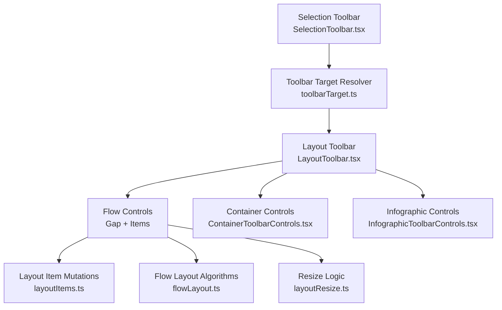
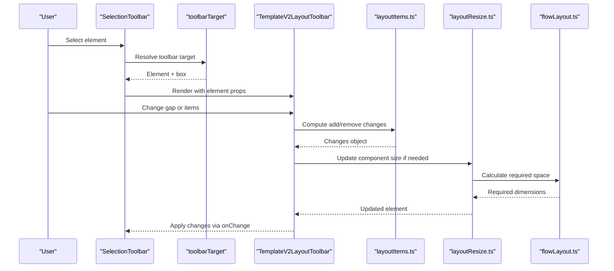
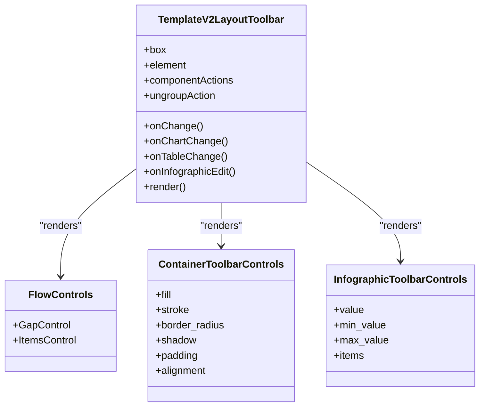
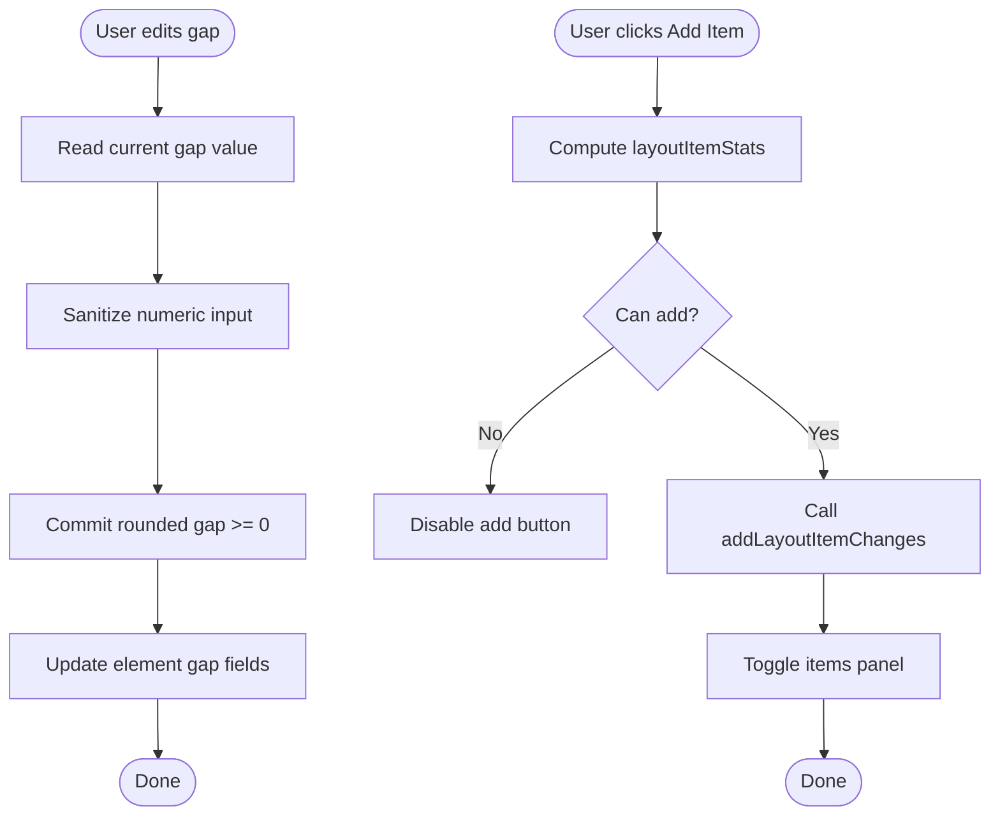
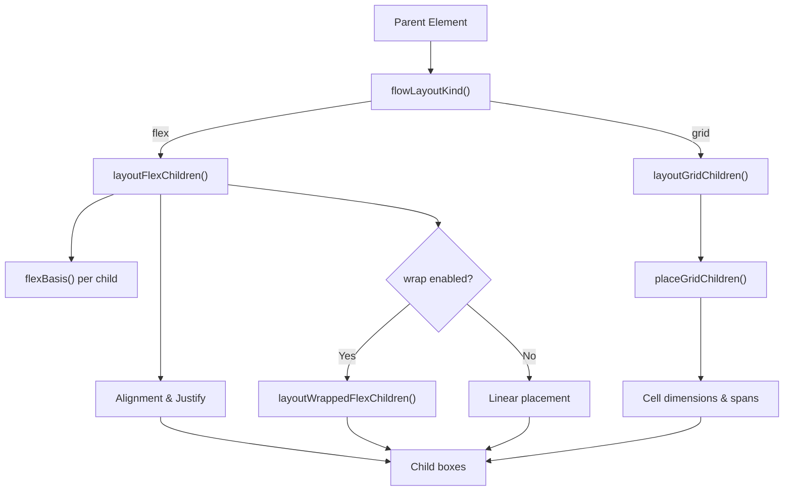
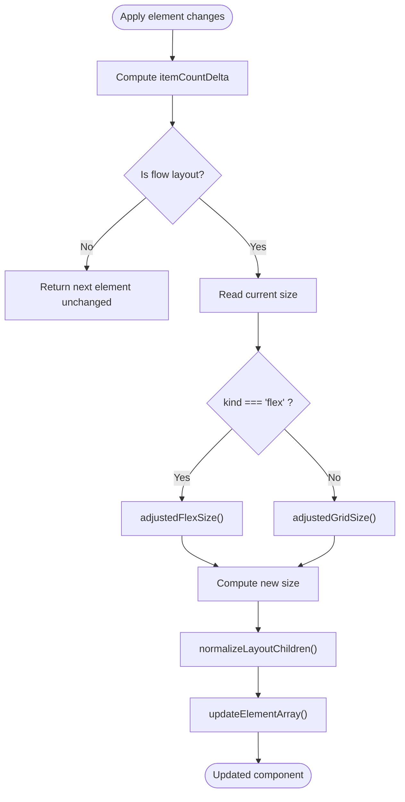
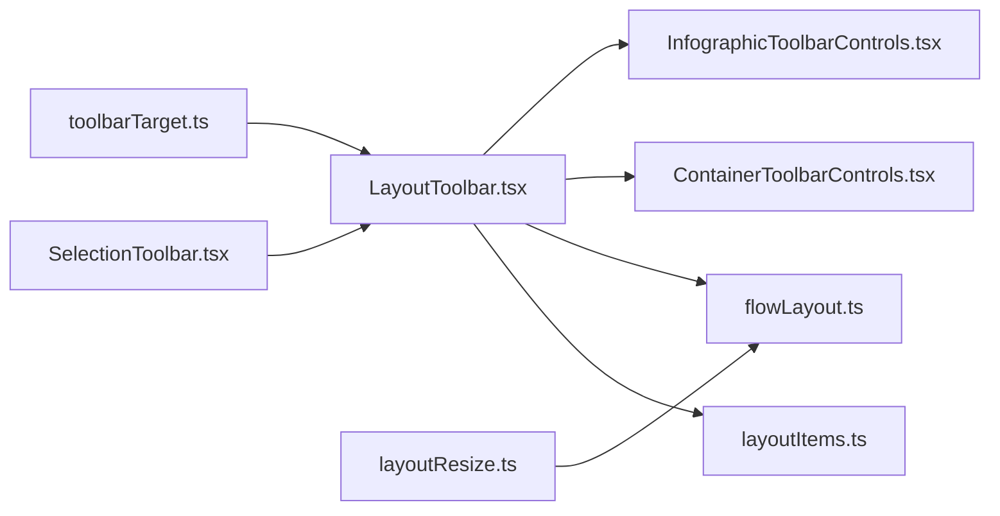

# Layout Manipulation Tools

<cite>
**Referenced Files in This Document**
- [LayoutToolbar.tsx](file://servers/nestjs/components/slide-editor/layout/LayoutToolbar.tsx)
- [flowLayout.ts](file://servers/nestjs/components/slide-editor/layout/flowLayout.ts)
- [layoutResize.ts](file://servers/nestjs/components/slide-editor/layout/layoutResize.ts)
- [layoutItems.ts](file://servers/nestjs/components/slide-editor/layout/layoutItems.ts)
- [ContainerToolbarControls.tsx](file://servers/nestjs/components/slide-editor/layout/ContainerToolbarControls.tsx)
- [InfographicToolbarControls.tsx](file://servers/nestjs/components/slide-editor/layout/InfographicToolbarControls.tsx)
- [SelectionToolbar.tsx](file://servers/nestjs/components/slide-editor/selection/SelectionToolbar.tsx)
- [toolbarTarget.ts](file://servers/nestjs/components/slide-editor/selection/toolbarTarget.ts)
- [README.md](file://servers/nestjs/components/slide-editor/README.md)
</cite>

## Table of Contents
1. [Introduction](#introduction)
2. [Project Structure](#project-structure)
3. [Core Components](#core-components)
4. [Architecture Overview](#architecture-overview)
5. [Detailed Component Analysis](#detailed-component-analysis)
6. [Dependency Analysis](#dependency-analysis)
7. [Performance Considerations](#performance-considerations)
8. [Troubleshooting Guide](#troubleshooting-guide)
9. [Conclusion](#conclusion)
10. [Appendices](#appendices)

## Introduction
This document explains the layout manipulation tools used by the slide editor. It focuses on how users modify layouts, resize elements, and adjust flow layouts through the UI. The main entry point for layout editing is the `TemplateV2LayoutToolbar` component, which adapts its controls based on the selected element type: flex/grid containers, regular containers, charts, tables, and infographics.

The system separates concerns into three layers:
- User interface controls that expose editable properties.
- Layout item mutation helpers that compute safe changes when adding or removing children.
- Flow layout algorithms that calculate child positions and sizes for flex and grid layouts.

## Project Structure
The layout tooling lives under the slide editor’s layout and selection modules:
- `layout/LayoutToolbar.tsx` renders the floating toolbar and dispatches user actions.
- `layout/flowLayout.ts` implements flex and grid layout algorithms.
- `layout/layoutResize.ts` adjusts parent/component sizes when layout item counts change.
- `layout/layoutItems.ts` computes add/remove changes for layout children.
- `layout/ContainerToolbarControls.tsx` provides container-specific visual styling controls.
- `layout/InfographicToolbarControls.tsx` provides infographic data and item controls.
- `selection/SelectionToolbar.tsx` integrates the layout toolbar into the selection workflow.
- `selection/toolbarTarget.ts` determines whether a selected element should show layout controls.

**Diagram sources**
- [SelectionToolbar.tsx:1-32](file://servers/nestjs/components/slide-editor/selection/SelectionToolbar.tsx#L1-L32)
- [toolbarTarget.ts:1-81](file://servers/nestjs/components/slide-editor/selection/toolbarTarget.ts#L1-L81)
- [LayoutToolbar.tsx:298-459](file://servers/nestjs/components/slide-editor/layout/LayoutToolbar.tsx#L298-L459)
- [ContainerToolbarControls.tsx:165-496](file://servers/nestjs/components/slide-editor/layout/ContainerToolbarControls.tsx#L165-L496)
- [InfographicToolbarControls.tsx:35-142](file://servers/nestjs/components/slide-editor/layout/InfographicToolbarControls.tsx#L35-L142)
- [layoutItems.ts:1-101](file://servers/nestjs/components/slide-editor/layout/layoutItems.ts#L1-L101)
- [flowLayout.ts:56-88](file://servers/nestjs/components/slide-editor/layout/flowLayout.ts#L56-L88)
- [layoutResize.ts:52-100](file://servers/nestjs/components/slide-editor/layout/layoutResize.ts#L52-L100)

**Section sources**
- [README.md:862-909](file://servers/nestjs/components/slide-editor/README.md#L862-L909)

## Core Components
- `TemplateV2LayoutToolbar`: Floating toolbar that detects the selected element type and shows appropriate controls. It supports ungrouping, gap adjustment, item count management, container styling, chart/table editing, and infographic editing.
- `FlowControls`, `GapControl`, `ItemsControl`: Subcomponents for flex/grid layout editing. They read gap values, compute add/remove capabilities, and call layout mutation helpers.
- `layoutItems.ts`: Computes safe mutations for adding/removing children, including cloning behavior and min/max child constraints.
- `flowLayout.ts`: Implements flex and grid layout algorithms, including intrinsic sizing, wrapping, alignment, gaps, spans, and text measurement.
- `layoutResize.ts`: Adjusts parent/component sizes when layout item counts change, supporting both wrapped and non-wrapped flex layouts and grid row adjustments.
- `ContainerToolbarControls.tsx`: Provides fill, stroke, border radius, shadow, and padding/alignment controls for container elements.
- `InfographicToolbarControls.tsx`: Provides value/range controls and item management for infographic elements.

**Section sources**
- [LayoutToolbar.tsx:94-112](file://servers/nestjs/components/slide-editor/layout/LayoutToolbar.tsx#L94-L112)
- [LayoutToolbar.tsx:125-288](file://servers/nestjs/components/slide-editor/layout/LayoutToolbar.tsx#L125-L288)
- [layoutItems.ts:9-52](file://servers/nestjs/components/slide-editor/layout/layoutItems.ts#L9-L52)
- [flowLayout.ts:56-88](file://servers/nestjs/components/slide-editor/layout/flowLayout.ts#L56-L88)
- [layoutResize.ts:52-100](file://servers/nestjs/components/slide-editor/layout/layoutResize.ts#L52-L100)
- [ContainerToolbarControls.tsx:165-496](file://servers/nestjs/components/slide-editor/layout/ContainerToolbarControls.tsx#L165-L496)
- [InfographicToolbarControls.tsx:35-142](file://servers/nestjs/components/slide-editor/layout/InfographicToolbarControls.tsx#L35-L142)

## Architecture Overview
The layout manipulation architecture follows a clear separation between UI, mutation logic, and layout computation:

**Diagram sources**
- [SelectionToolbar.tsx:1-32](file://servers/nestjs/components/slide-editor/selection/SelectionToolbar.tsx#L1-L32)
- [toolbarTarget.ts:60-81](file://servers/nestjs/components/slide-editor/selection/toolbarTarget.ts#L60-L81)
- [LayoutToolbar.tsx:298-459](file://servers/nestjs/components/slide-editor/layout/LayoutToolbar.tsx#L298-L459)
- [layoutItems.ts:18-52](file://servers/nestjs/components/slide-editor/layout/layoutItems.ts#L18-L52)
- [layoutResize.ts:52-100](file://servers/nestjs/components/slide-editor/layout/layoutResize.ts#L52-L100)
- [flowLayout.ts:210-336](file://servers/nestjs/components/slide-editor/layout/flowLayout.ts#L210-L336)

## Detailed Component Analysis

### TemplateV2LayoutToolbar
`TemplateV2LayoutToolbar` is the central UI controller for layout manipulation. It:
- Detects normalized layout types (`flex`, `grid`, `list-view`, `grid-view`, `container`).
- Renders flow controls (gap and items) for flex/grid-like elements.
- Renders container controls for container elements.
- Integrates chart, table, and infographic controls when applicable.
- Supports ungrouping and component actions via a menu.

Key responsibilities:
- Normalize element types to determine control visibility.
- Manage panel state for dropdowns like items, colors, and ranges.
- Delegate data mutations to specialized helpers.

**Diagram sources**
- [LayoutToolbar.tsx:298-459](file://servers/nestjs/components/slide-editor/layout/LayoutToolbar.tsx#L298-L459)
- [ContainerToolbarControls.tsx:165-496](file://servers/nestjs/components/slide-editor/layout/ContainerToolbarControls.tsx#L165-L496)
- [InfographicToolbarControls.tsx:35-142](file://servers/nestjs/components/slide-editor/layout/InfographicToolbarControls.tsx#L35-L142)

**Section sources**
- [LayoutToolbar.tsx:461-488](file://servers/nestjs/components/slide-editor/layout/LayoutToolbar.tsx#L461-L488)
- [LayoutToolbar.tsx:298-459](file://servers/nestjs/components/slide-editor/layout/LayoutToolbar.tsx#L298-L459)

### Gap Control and Items Control
- `GapControl` reads the current gap from the element and commits rounded, non-negative values. It supports keyboard increment/decrement and numeric input sanitization.
- `ItemsControl` uses `layoutItemStats` to determine add/remove capability, then calls `addLayoutItemChanges` or `removeLastLayoutItemChanges`. It toggles an items panel and displays the current child count.

**Diagram sources**
- [LayoutToolbar.tsx:145-208](file://servers/nestjs/components/slide-editor/layout/LayoutToolbar.tsx#L145-L208)
- [LayoutToolbar.tsx:210-281](file://servers/nestjs/components/slide-editor/layout/LayoutToolbar.tsx#L210-L281)
- [layoutItems.ts:9-52](file://servers/nestjs/components/slide-editor/layout/layoutItems.ts#L9-L52)

**Section sources**
- [LayoutToolbar.tsx:145-208](file://servers/nestjs/components/slide-editor/layout/LayoutToolbar.tsx#L145-L208)
- [LayoutToolbar.tsx:210-281](file://servers/nestjs/components/slide-editor/layout/LayoutToolbar.tsx#L210-L281)
- [layoutItems.ts:9-52](file://servers/nestjs/components/slide-editor/layout/layoutItems.ts#L9-L52)

### Layout Item Mutations
`layoutItems.ts` provides:
- `layoutItemStats`: Returns add/remove capability and current children array.
- `addLayoutItemChanges`: Clones the last child or a default text item, appends it, and updates `max_children`/`min_children`.
- `removeLastLayoutItemChanges`: Removes the last child if present.

Cloning behavior removes IDs and manual positioning flags, and renames copied text items.

**Section sources**
- [layoutItems.ts:9-52](file://servers/nestjs/components/slide-editor/layout/layoutItems.ts#L9-L52)
- [layoutItems.ts:67-96](file://servers/nestjs/components/slide-editor/layout/layoutItems.ts#L67-L96)

### Flow Layout Algorithms
`flowLayout.ts` implements:
- `flowLayoutKind`: Determines whether an element is flex or grid.
- `layoutFlowChildren`: Dispatches to flex or grid layout.
- `layoutFlexChildren`: Handles direction, gaps, padding, alignment, justify, grow/shrink/basis, wrap, and manual positioning.
- `placeGridChildren`: Assigns children to grid cells respecting column/row spans.
- `intrinsicFlowSize`: Computes minimum size for empty or content-driven layouts.
- Text measurement utilities estimate width/height for text elements.

**Diagram sources**
- [flowLayout.ts:56-88](file://servers/nestjs/components/slide-editor/layout/flowLayout.ts#L56-L88)
- [flowLayout.ts:210-336](file://servers/nestjs/components/slide-editor/layout/flowLayout.ts#L210-L336)
- [flowLayout.ts:338-418](file://servers/nestjs/components/slide-editor/layout/flowLayout.ts#L338-L418)
- [flowLayout.ts:161-208](file://servers/nestjs/components/slide-editor/layout/flowLayout.ts#L161-L208)

**Section sources**
- [flowLayout.ts:56-88](file://servers/nestjs/components/slide-editor/layout/flowLayout.ts#L56-L88)
- [flowLayout.ts:210-336](file://servers/nestjs/components/slide-editor/layout/flowLayout.ts#L210-L336)
- [flowLayout.ts:338-418](file://servers/nestjs/components/slide-editor/layout/flowLayout.ts#L338-L418)
- [flowLayout.ts:420-533](file://servers/nestjs/components/slide-editor/layout/flowLayout.ts#L420-L533)

### Resize Logic for Layout Elements
`layoutResize.ts` ensures that changing the number of layout items does not leave parents at invalid sizes:
- `updateComponentLayoutElement`: Applies changes to a nested element, computes item count delta, recalculates adjusted size, normalizes children, and returns updated component structure.
- `layoutElementWithAdjustedItemSpace`: Chooses flex or grid resizing strategy based on layout kind.
- `adjustedFlexSize`: Computes required main/cross space for wrapped/non-wrapped flex layouts.
- `adjustedGridSize`: Recomputes rows and adjusts height accordingly.
- `deleteLayoutChildFromArray`: Recursively deletes a child while respecting minimum children for flow layouts.

**Diagram sources**
- [layoutResize.ts:52-100](file://servers/nestjs/components/slide-editor/layout/layoutResize.ts#L52-L100)
- [layoutResize.ts:128-163](file://servers/nestjs/components/slide-editor/layout/layoutResize.ts#L128-L163)
- [layoutResize.ts:171-257](file://servers/nestjs/components/slide-editor/layout/layoutResize.ts#L171-L257)
- [layoutResize.ts:316-358](file://servers/nestjs/components/slide-editor/layout/layoutResize.ts#L316-L358)

**Section sources**
- [layoutResize.ts:52-100](file://servers/nestjs/components/slide-editor/layout/layoutResize.ts#L52-L100)
- [layoutResize.ts:128-163](file://servers/nestjs/components/slide-editor/layout/layoutResize.ts#L128-L163)
- [layoutResize.ts:171-257](file://servers/nestjs/components/slide-editor/layout/layoutResize.ts#L171-L257)
- [layoutResize.ts:316-358](file://servers/nestjs/components/slide-editor/layout/layoutResize.ts#L316-L358)

### Container and Infographic Controls
- `ContainerToolbarControls.tsx` exposes fill color/opacity, stroke color/width/opacity, border radius presets, shadow offset/blur/color/opacity, and alignment/padding controls. It uses compact numeric inputs and panel popovers.
- `InfographicToolbarControls.tsx` exposes value/range editing for meter-type infographics and item management for list-like infographics. It also integrates with infographic sizing utilities to update frame dimensions when data changes.

**Section sources**
- [ContainerToolbarControls.tsx:165-496](file://servers/nestjs/components/slide-editor/layout/ContainerToolbarControls.tsx#L165-L496)
- [InfographicToolbarControls.tsx:35-142](file://servers/nestjs/components/slide-editor/layout/InfographicToolbarControls.tsx#L35-L142)

## Dependency Analysis
The layout tools have clear dependency boundaries:
- `LayoutToolbar.tsx` depends on:
  - `layoutItems.ts` for item mutations.
  - `flowLayout.ts` for flow detection and sizing helpers.
  - `ContainerToolbarControls.tsx` and `InfographicToolbarControls.tsx` for specialized panels.
  - `SelectionToolbar.tsx` integration via props and toolbar target resolution.
- `layoutResize.ts` depends on `flowLayout.ts` for layout kind and placement helpers.
- `SelectionToolbar.tsx` and `toolbarTarget.ts` coordinate when layout controls are shown.

**Diagram sources**
- [LayoutToolbar.tsx:21-34](file://servers/nestjs/components/slide-editor/layout/LayoutToolbar.tsx#L21-L34)
- [layoutResize.ts:1-8](file://servers/nestjs/components/slide-editor/layout/layoutResize.ts#L1-L8)
- [SelectionToolbar.tsx:1-32](file://servers/nestjs/components/slide-editor/selection/SelectionToolbar.tsx#L1-L32)
- [toolbarTarget.ts:1-23](file://servers/nestjs/components/slide-editor/selection/toolbarTarget.ts#L1-L23)

**Section sources**
- [LayoutToolbar.tsx:21-34](file://servers/nestjs/components/slide-editor/layout/LayoutToolbar.tsx#L21-L34)
- [layoutResize.ts:1-8](file://servers/nestjs/components/slide-editor/layout/layoutResize.ts#L1-L8)
- [SelectionToolbar.tsx:1-32](file://servers/nestjs/components/slide-editor/selection/SelectionToolbar.tsx#L1-L32)
- [toolbarTarget.ts:60-81](file://servers/nestjs/components/slide-editor/selection/toolbarTarget.ts#L60-L81)

## Performance Considerations
- Flow layout calculations iterate over children once for basis and cross-size computations; wrapping adds another pass to group lines.
- Grid placement uses an occupied-cell set and may expand row limits dynamically; large grids can be expensive due to span checks.
- Resize logic recomputes required space only when item count changes, minimizing unnecessary recalculations.
- Text measurement estimates width/height using font metrics; avoid excessive reflows by batching text updates where possible.

[No sources needed since this section provides general guidance]

## Troubleshooting Guide
Common issues and resolutions:
- Gap input accepts negative or invalid values: Ensure sanitization and rounding are applied before committing.
- Adding items does nothing: Check `layoutItemStats.canAdd`; some elements may restrict additions.
- Removing items violates minimum children: `deleteLayoutChildFromArray` respects `min_children` for flow layouts.
- Flex layout wraps unexpectedly: Verify `wrap` flag and available main/cross sizes; check `adjustedFlexSize` wrapped path.
- Grid rows do not adjust: Confirm column/row declarations and that `adjustedGridSize` sees a row count change.

**Section sources**
- [LayoutToolbar.tsx:145-208](file://servers/nestjs/components/slide-editor/layout/LayoutToolbar.tsx#L145-L208)
- [layoutItems.ts:9-52](file://servers/nestjs/components/slide-editor/layout/layoutItems.ts#L9-L52)
- [layoutResize.ts:102-126](file://servers/nestjs/components/slide-editor/layout/layoutResize.ts#L102-L126)
- [layoutResize.ts:259-314](file://servers/nestjs/components/slide-editor/layout/layoutResize.ts#L259-L314)
- [layoutResize.ts:316-358](file://servers/nestjs/components/slide-editor/layout/layoutResize.ts#L316-L358)

## Conclusion
The layout manipulation tools provide a robust, modular system for editing flex/grid layouts, adjusting container styles, and managing infographic data. The `TemplateV2LayoutToolbar` acts as the orchestrator, delegating to specialized controls and relying on well-defined layout algorithms and resize logic. By following the documented patterns, developers can extend the toolbar, add new layout features, and customize behavior safely.

[No sources needed since this section summarizes without analyzing specific files]

## Appendices

### How to Add a New Layout Manipulation Feature
Steps to integrate a new control:
1. Identify the element type and ensure `normalizedLayoutType` recognizes it if needed.
2. Create a new control component (e.g., `NewFeatureControls.tsx`) similar to `ContainerToolbarControls.tsx`.
3. Wire the control into `TemplateV2LayoutToolbar` by checking element type and rendering the new panel.
4. If the feature affects layout geometry, implement mutation helpers in `layoutItems.ts` or `layoutResize.ts`.
5. If the feature requires layout recalculation, use `flowLayout.ts` helpers such as `flexBasis`, `childCrossSize`, or `placeGridChildren`.
6. Test edge cases: empty layouts, minimum/maximum children, wrapping, and grid spans.

**Section sources**
- [LayoutToolbar.tsx:461-488](file://servers/nestjs/components/slide-editor/layout/LayoutToolbar.tsx#L461-L488)
- [ContainerToolbarControls.tsx:165-496](file://servers/nestjs/components/slide-editor/layout/ContainerToolbarControls.tsx#L165-L496)
- [layoutItems.ts:18-52](file://servers/nestjs/components/slide-editor/layout/layoutItems.ts#L18-L52)
- [layoutResize.ts:52-100](file://servers/nestjs/components/slide-editor/layout/layoutResize.ts#L52-L100)
- [flowLayout.ts:105-159](file://servers/nestjs/components/slide-editor/layout/flowLayout.ts#L105-L159)

### Customizing Layout Behavior
- To change gap defaults or validation, modify `GapControl` commit logic.
- To alter item cloning behavior, edit `cloneChildForAppend` in `layoutItems.ts`.
- To adjust flex wrapping thresholds, tune `wrappedFlexRequiredSpace` in `layoutResize.ts`.
- To refine grid cell sizing, adjust `placeGridChildren` and `layoutGridChildren` in `flowLayout.ts`.

**Section sources**
- [LayoutToolbar.tsx:145-208](file://servers/nestjs/components/slide-editor/layout/LayoutToolbar.tsx#L145-L208)
- [layoutItems.ts:67-96](file://servers/nestjs/components/slide-editor/layout/layoutItems.ts#L67-L96)
- [layoutResize.ts:259-314](file://servers/nestjs/components/slide-editor/layout/layoutResize.ts#L259-L314)
- [flowLayout.ts:161-208](file://servers/nestjs/components/slide-editor/layout/flowLayout.ts#L161-L208)
- [flowLayout.ts:338-418](file://servers/nestjs/components/slide-editor/layout/flowLayout.ts#L338-L418)