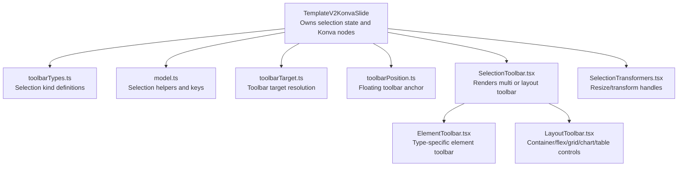
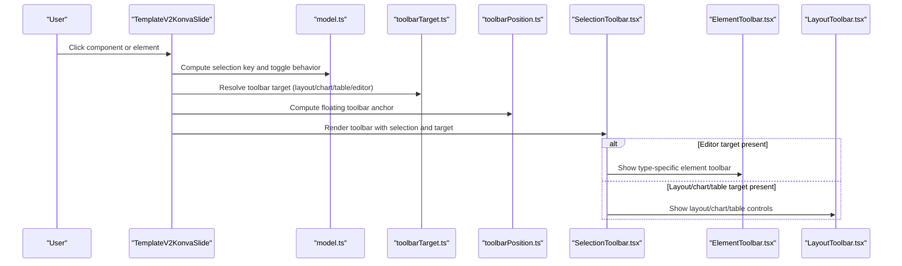
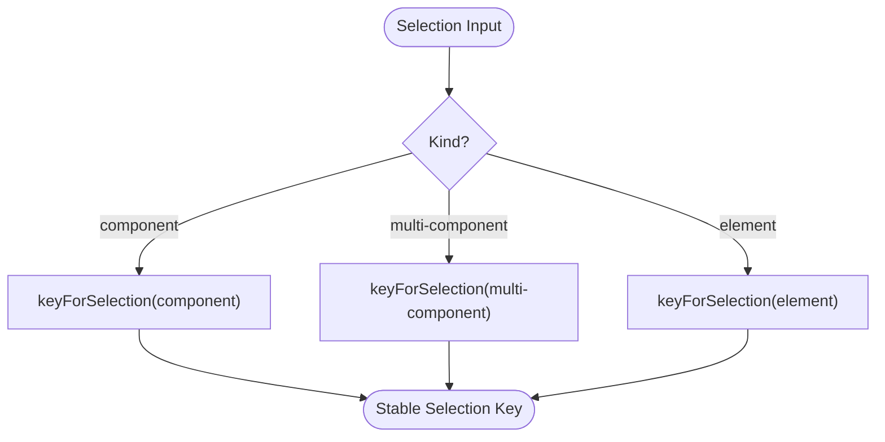
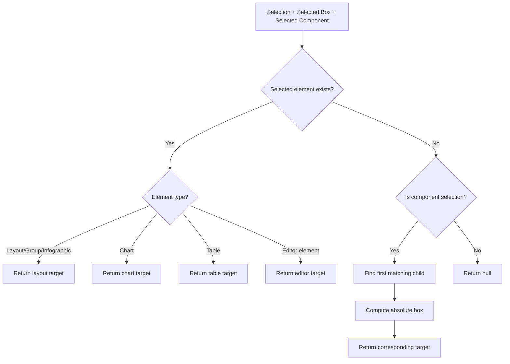
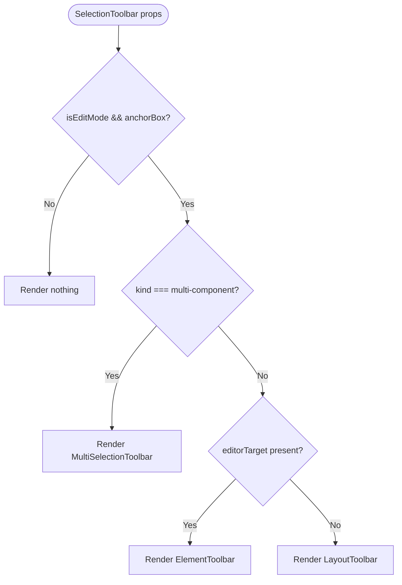
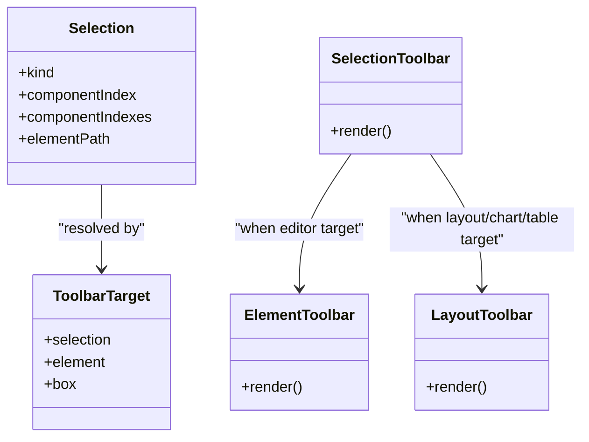
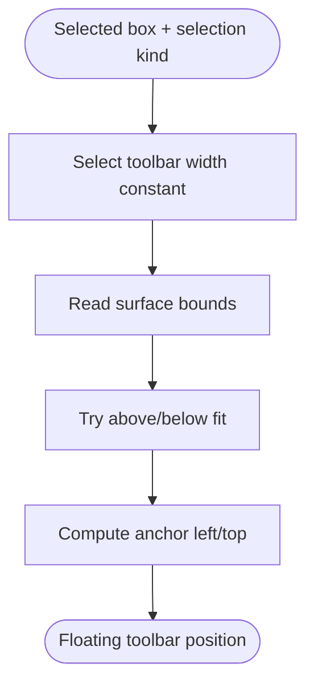
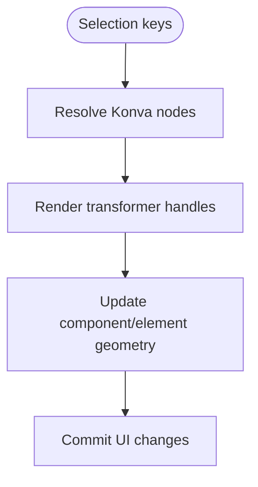
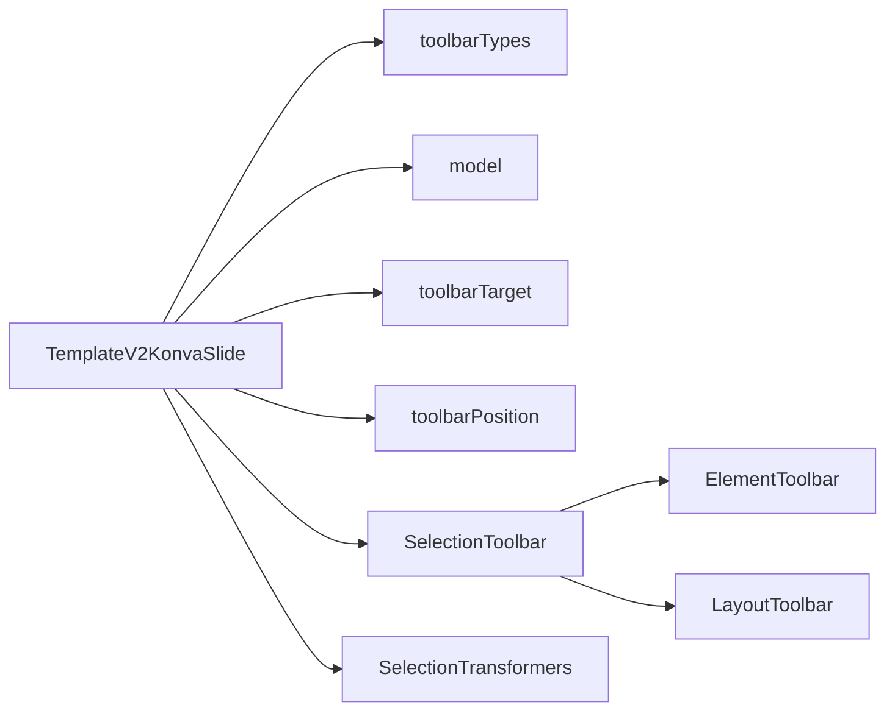

# Selection System

<cite>
**Referenced Files in This Document**
- [TemplateV2KonvaSlide.tsx](file://servers\nextjs\components\slide-editor\surface\TemplateV2KonvaSlide.tsx)
- [SelectionToolbar.tsx](file://servers\nextjs\components\slide-editor\selection\SelectionToolbar.tsx)
- [MultiSelectionToolbar.tsx](file://servers\nextjs\components\slide-editor\selection\MultiSelectionToolbar.tsx)
- [toolbarTarget.ts](file://servers\nextjs\components\slide-editor\selection\toolbarTarget.ts)
- [toolbarPosition.ts](file://servers\nextjs\components\slide-editor\selection\toolbarPosition.ts)
- [toolbarTypes.ts](file://servers\nextjs\components\slide-editor\selection\toolbarTypes.ts)
- [SelectionTransformers.tsx](file://servers\nextjs\components\slide-editor\selection\SelectionTransformers.tsx)
- [model.ts](file://servers\nextjs\components\slide-editor\model\model.ts)
- [LayoutToolbar.tsx](file://servers\nextjs\components\slide-editor\layout\LayoutToolbar.tsx)
- [ElementToolbar.tsx](file://servers\nextjs\components\slide-editor\toolbar\ElementToolbar.tsx)
- [README.md](file://servers\nextjs\components\slide-editor\README.md)
</cite>

## Table of Contents
1. [Introduction](#introduction)
2. [Project Structure](#project-structure)
3. [Core Components](#core-components)
4. [Architecture Overview](#architecture-overview)
5. [Detailed Component Analysis](#detailed-component-analysis)
6. [Dependency Analysis](#dependency-analysis)
7. [Performance Considerations](#performance-considerations)
8. [Troubleshooting Guide](#troubleshooting-guide)
9. [Conclusion](#conclusion)

## Introduction
This document explains the selection system used by the Template V2 slide editor. It covers how elements are selected, how single and multi-component selections work, how selection state is represented and transformed, and how the editor chooses which toolbar to display based on the current selection context. It also documents selection targets for components, charts, tables, and layout elements, and provides guidance for implementing custom selection behaviors and extending the selection model.

## Project Structure
The selection system spans several focused areas:
- Surface and editor surface: owns selection state, node references, and renders selection UI.
- Selection types and keys: defines selection kinds and stable identifiers.
- Toolbar target resolution: determines whether a component, chart, table, or layout element should receive a toolbar.
- Toolbar rendering: renders either an element-specific toolbar or a layout/component toolbar.
- Positioning and transformer handles: calculates floating toolbar placement and draws resize/transform handles.

**Diagram sources**
- [TemplateV2KonvaSlide.tsx:3118-3155](file://servers\nextjs\components\slide-editor\surface\TemplateV2KonvaSlide.tsx#L3118-L3155)
- [toolbarTypes.ts:1-29](file://servers\nextjs\components\slide-editor\selection\toolbarTypes.ts#L1-L29)
- [model.ts:1008-1065](file://servers\nextjs\components\slide-editor\model\model.ts#L1008-L1065)
- [toolbarTarget.ts:60-210](file://servers\nextjs\components\slide-editor\selection\toolbarTarget.ts#L60-L210)
- [toolbarPosition.ts:38-51](file://servers\nextjs\components\slide-editor\selection\toolbarPosition.ts#L38-L51)
- [SelectionToolbar.tsx:62-166](file://servers\nextjs\components\slide-editor\selection\SelectionToolbar.tsx#L62-L166)
- [ElementToolbar.tsx:172-189](file://servers\nextjs\components\slide-editor\toolbar\ElementToolbar.tsx#L172-L189)
- [LayoutToolbar.tsx:94-112](file://servers\nextjs\components\slide-editor\layout\LayoutToolbar.tsx#L94-L112)
- [SelectionTransformers.tsx:31-45](file://servers\nextjs\components\slide-editor\selection\SelectionTransformers.tsx#L31-L45)

**Section sources**
- [README.md:467-511](file://servers\nextjs\components\slide-editor\README.md#L467-L511)

## Core Components
- Selection kinds:
  - Component selection: selects one top-level component.
  - Multi-component selection: selects multiple components.
  - Element selection: selects a nested element path inside a component or root elements.
- Selection keys:
  - Stable string keys identify selections across the editor and external panels.
- Toolbar targets:
  - Layout target: container, flex, grid, group, list-view, grid-view, infographic.
  - Chart target: chart elements.
  - Table target: table elements.
  - Editor target: text, text-list, vector, icon image.
- Toolbar rendering:
  - Multi-selection toolbar shows count and grouping action.
  - Single selection routes to either element toolbar or layout toolbar depending on target.
- Positioning and transforms:
  - Floating toolbar position is computed from selection box, viewport bounds, and toolbar widths.
  - Transformer handles render resize/rotate/scale visuals for selected items.

**Section sources**
- [toolbarTypes.ts:1-29](file://servers\nextjs\components\slide-editor\selection\toolbarTypes.ts#L1-L29)
- [model.ts:1008-1065](file://servers\nextjs\components\slide-editor\model\model.ts#L1008-L1065)
- [toolbarTarget.ts:26-48](file://servers\nextjs\components\slide-editor\selection\toolbarTarget.ts#L26-L48)
- [SelectionToolbar.tsx:94-166](file://servers\nextjs\components\slide-editor\selection\SelectionToolbar.tsx#L94-L166)
- [toolbarPosition.ts:38-51](file://servers\nextjs\components\slide-editor\selection\toolbarPosition.ts#L38-L51)
- [SelectionTransformers.tsx:31-45](file://servers\nextjs\components\slide-editor\selection\SelectionTransformers.tsx#L31-L45)

## Architecture Overview
The editor surface owns selection state and passes it to selection toolbars and transformers. The toolbar target resolver inspects the selection and underlying element data to decide which toolbar to show. Positioning logic computes where the toolbar should float relative to the selected box and viewport.

**Diagram sources**
- [TemplateV2KonvaSlide.tsx:3118-3155](file://servers\nextjs\components\slide-editor\surface\TemplateV2KonvaSlide.tsx#L3118-L3155)
- [model.ts:1008-1065](file://servers\nextjs\components\slide-editor\model\model.ts#L1008-L1065)
- [toolbarTarget.ts:60-210](file://servers\nextjs\components\slide-editor\selection\toolbarTarget.ts#L60-L210)
- [toolbarPosition.ts:38-51](file://servers\nextjs\components\slide-editor\selection\toolbarPosition.ts#L38-L51)
- [SelectionToolbar.tsx:94-166](file://servers\nextjs\components\slide-editor\selection\SelectionToolbar.tsx#L94-L166)
- [ElementToolbar.tsx:172-189](file://servers\nextjs\components\slide-editor\toolbar\ElementToolbar.tsx#L172-L189)
- [LayoutToolbar.tsx:94-112](file://servers\nextjs\components\slide-editor\layout\LayoutToolbar.tsx#L94-L112)

## Detailed Component Analysis

### Selection State and Keys
- Selection kinds:
  - `component`: single component index.
  - `multi-component`: array of component indexes.
  - `element`: component index plus nested element path.
- Key generation:
  - `keyForSelection` produces stable keys like `component:<index>`, `multi-component:<indexes>`, or `element:<componentIndex>:<path>`.
- Toggle behavior:
  - `selectionWithComponentToggle` supports additive selection when modifier keys are active.
- Utility functions:
  - `keysForSelection`, `componentIndexesForSelection`, `selectionForComponentIndexes`, `selectionFromKey`.

**Diagram sources**
- [model.ts:1008-1065](file://servers\nextjs\components\slide-editor\model\model.ts#L1008-L1065)

**Section sources**
- [toolbarTypes.ts:1-29](file://servers\nextjs\components\slide-editor\selection\toolbarTypes.ts#L1-L29)
- [model.ts:1008-1065](file://servers\nextjs\components\slide-editor\model\model.ts#L1008-L1065)

### Toolbar Target Resolution
The target resolver decides which toolbar to show:
- Layout target:
  - If the selected element is a layout element, group, or infographic, return a layout target.
  - If a component is selected, find the first layout or infographic child and compute its absolute box.
- Chart target:
  - If the selected element is a chart, return a chart target.
  - If a component is selected, find the first chart child and compute its absolute box.
- Table target:
  - If the selected element is a table, return a table target.
  - If a component is selected, find the first table child and compute its absolute box.
- Editor target:
  - If a component contains exactly one editor-compatible element (text, text-list, vector, icon image), return an editor target.

**Diagram sources**
- [toolbarTarget.ts:60-210](file://servers\nextjs\components\slide-editor\selection\toolbarTarget.ts#L60-L210)

**Section sources**
- [toolbarTarget.ts:60-210](file://servers\nextjs\components\slide-editor\selection\toolbarTarget.ts#L60-L210)

### Toolbar Rendering Decision
Selection toolbar routing:
- If mode is not edit or no anchor box, do not render.
- If selection is multi-component, render the multi-selection toolbar with count and group action.
- If an editor target exists, render the element toolbar with the typed element.
- Otherwise, render the layout toolbar with layout/chart/table controls if available.

**Diagram sources**
- [SelectionToolbar.tsx:94-166](file://servers\nextjs\components\slide-editor\selection\SelectionToolbar.tsx#L94-L166)
- [MultiSelectionToolbar.tsx:13-60](file://servers\nextjs\components\slide-editor\selection\MultiSelectionToolbar.tsx#L13-L60)
- [ElementToolbar.tsx:172-189](file://servers\nextjs\components\slide-editor\toolbar\ElementToolbar.tsx#L172-L189)
- [LayoutToolbar.tsx:94-112](file://servers\nextjs\components\slide-editor\layout\LayoutToolbar.tsx#L94-L112)

**Section sources**
- [SelectionToolbar.tsx:94-166](file://servers\nextjs\components\slide-editor\selection\SelectionToolbar.tsx#L94-L166)
- [MultiSelectionToolbar.tsx:13-60](file://servers\nextjs\components\slide-editor\selection\MultiSelectionToolbar.tsx#L13-L60)

### Selection Targets and Toolbars
- Component selection:
  - Shows component actions such as delete, duplicate, layer ordering, and ungroup.
- Layout selection:
  - Container/flex/grid/group/list-view/grid-view controls including gap, padding, alignment, and item management.
- Chart selection:
  - Chart toolbar controls for data and appearance; can open chart editor via event.
- Table selection:
  - Table toolbar controls for rows/columns and cell editing.
- Element selection:
  - Text, text-list, vector, image/icon, shape, line, chart, table toolbars.

**Diagram sources**
- [toolbarTypes.ts:1-29](file://servers\nextjs\components\slide-editor\selection\toolbarTypes.ts#L1-L29)
- [toolbarTarget.ts:26-48](file://servers\nextjs\components\slide-editor\selection\toolbarTarget.ts#L26-L48)
- [SelectionToolbar.tsx:94-166](file://servers\nextjs\components\slide-editor\selection\SelectionToolbar.tsx#L94-L166)
- [ElementToolbar.tsx:172-189](file://servers\nextjs\components\slide-editor\toolbar\ElementToolbar.tsx#L172-L189)
- [LayoutToolbar.tsx:94-112](file://servers\nextjs\components\slide-editor\layout\LayoutToolbar.tsx#L94-L112)

**Section sources**
- [README.md:467-499](file://servers\nextjs\components\slide-editor\README.md#L467-L499)

### Floating Toolbar Positioning
- Computes anchor box and viewport position based on:
  - Selected box dimensions.
  - Toolbar width constants for different selection types.
  - Surface bounds and viewport constraints.
  - Whether the toolbar fits above or below the selection.

**Diagram sources**
- [toolbarPosition.ts:38-51](file://servers\nextjs\components\slide-editor\selection\toolbarPosition.ts#L38-L51)

**Section sources**
- [toolbarPosition.ts:38-51](file://servers\nextjs\components\slide-editor\selection\toolbarPosition.ts#L38-L51)

### Selection Transformers
- Renders Konva Transformer handles for resizing and transforming selected items.
- Supports multi-selection visual indicators and rotation anchors.
- Updates raw geometry after transform operations.

**Diagram sources**
- [SelectionTransformers.tsx:31-45](file://servers\nextjs\components\slide-editor\selection\SelectionTransformers.tsx#L31-L45)

**Section sources**
- [README.md:497-533](file://servers\nextjs\components\slide-editor\README.md#L497-L533)

## Dependency Analysis
- Surface depends on:
  - Selection types and keys for state representation.
  - Toolbar target resolver for UI routing.
  - Positioning utility for floating toolbar placement.
  - Selection toolbar for rendering actions.
  - Transformers for visual manipulation.
- Toolbar target resolver depends on:
  - Layout element detection and child traversal.
  - Chart/table detection and conversion to toolbar models.
  - Editor element detection for text/vector/icon images.
- Layout toolbar depends on:
  - Flow layout utilities and item controls.
  - Chart/table sub-toolbars for specialized editing.
- Element toolbar depends on:
  - Type-specific toolbars for text, bullets, image, shape, line, chart, table.

**Diagram sources**
- [TemplateV2KonvaSlide.tsx:3118-3155](file://servers\nextjs\components\slide-editor\surface\TemplateV2KonvaSlide.tsx#L3118-L3155)
- [toolbarTypes.ts:1-29](file://servers\nextjs\components\slide-editor\selection\toolbarTypes.ts#L1-L29)
- [model.ts:1008-1065](file://servers\nextjs\components\slide-editor\model\model.ts#L1008-L1065)
- [toolbarTarget.ts:60-210](file://servers\nextjs\components\slide-editor\selection\toolbarTarget.ts#L60-L210)
- [toolbarPosition.ts:38-51](file://servers\nextjs\components\slide-editor\selection\toolbarPosition.ts#L38-L51)
- [SelectionToolbar.tsx:94-166](file://servers\nextjs\components\slide-editor\selection\SelectionToolbar.tsx#L94-L166)
- [ElementToolbar.tsx:172-189](file://servers\nextjs\components\slide-editor\toolbar\ElementToolbar.tsx#L172-L189)
- [LayoutToolbar.tsx:94-112](file://servers\nextjs\components\slide-editor\layout\LayoutToolbar.tsx#L94-L112)
- [SelectionTransformers.tsx:31-45](file://servers\nextjs\components\slide-editor\selection\SelectionTransformers.tsx#L31-L45)

**Section sources**
- [README.md:467-511](file://servers\nextjs\components\slide-editor\README.md#L467-L511)

## Performance Considerations
- Avoid unnecessary rerenders:
  - Selection keys provide stable identity for nodes and toolbars.
  - Transformer updates only commit geometry changes when needed.
- Minimize heavy computations:
  - Toolbar target resolution uses early exits and simple checks.
  - Position calculation uses fixed constants and bounds checks.
- Debounce or batch UI updates:
  - Inline text editing buffers runs to avoid per-keystroke Redux commits.

[No sources needed since this section provides general guidance]

## Troubleshooting Guide
- Toolbar does not appear:
  - Ensure `isEditMode` is true and an anchor box is computed.
  - Verify that a valid toolbar target exists for the selection.
- Wrong toolbar shown:
  - Check target resolution order: layout/chart/table/editor.
  - Confirm element type detection matches expected values.
- Multi-selection toolbar missing:
  - Confirm selection kind is `multi-component`.
  - Ensure position is provided for portal rendering.
- Transformer handles not visible:
  - Verify node references are registered for selection keys.
  - Confirm selection keys match rendered nodes.

**Section sources**
- [SelectionToolbar.tsx:94-166](file://servers\nextjs\components\slide-editor\selection\SelectionToolbar.tsx#L94-L166)
- [MultiSelectionToolbar.tsx:23-60](file://servers\nextjs\components\slide-editor\selection\MultiSelectionToolbar.tsx#L23-L60)
- [toolbarTarget.ts:60-210](file://servers\nextjs\components\slide-editor\selection\toolbarTarget.ts#L60-L210)
- [SelectionTransformers.tsx:31-45](file://servers\nextjs\components\slide-editor\selection\SelectionTransformers.tsx#L31-L45)

## Conclusion
The selection system cleanly separates concerns between state representation, target resolution, toolbar rendering, positioning, and transformation. By using stable selection keys and explicit target types, the editor can reliably choose the correct toolbar for components, charts, tables, and layout elements. Extending the system involves adding new selection kinds, updating target resolution, and wiring new toolbars into the selection toolbar router.

[No sources needed since this section summarizes without analyzing specific files]