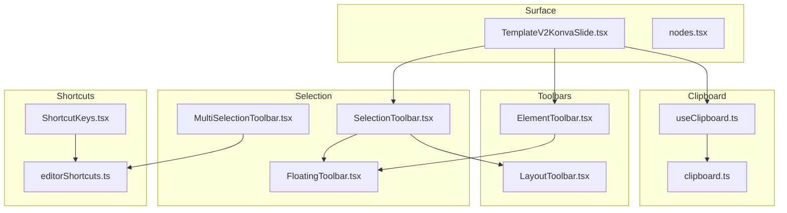
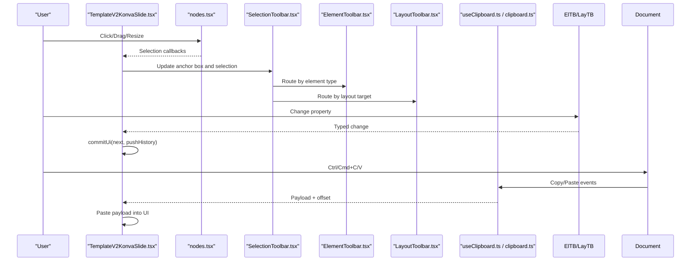
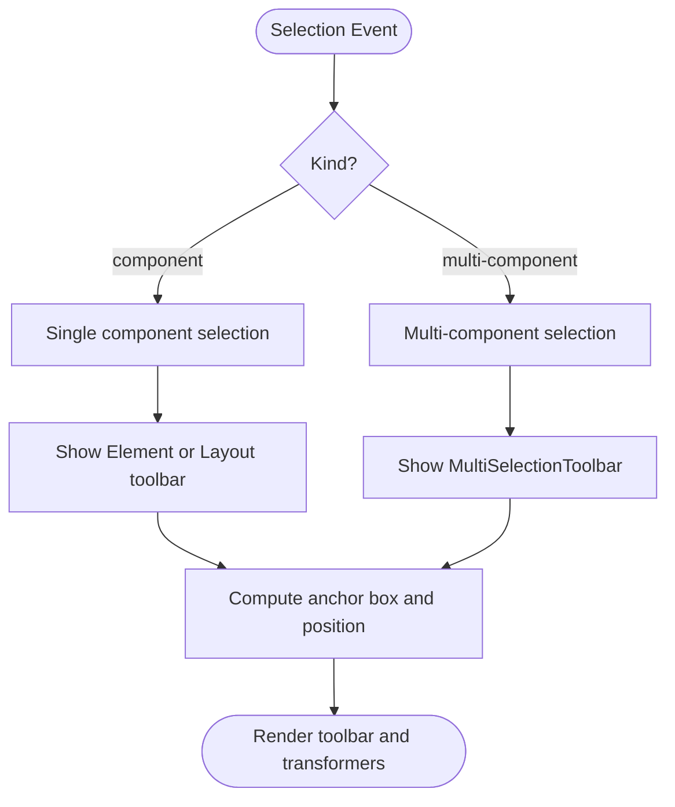
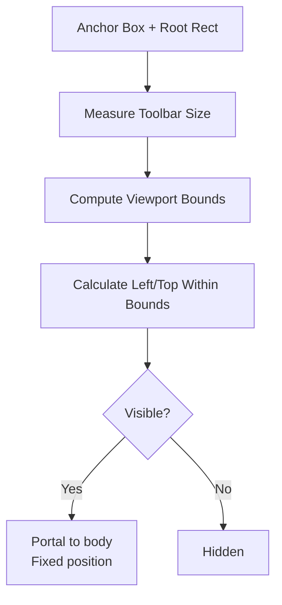
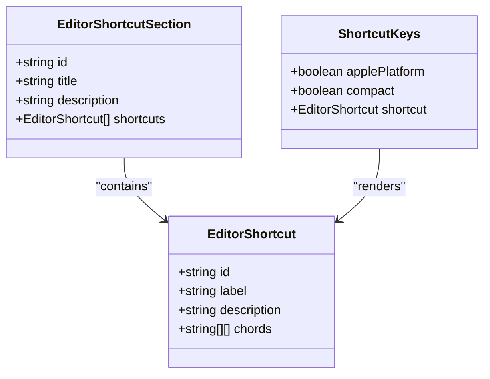
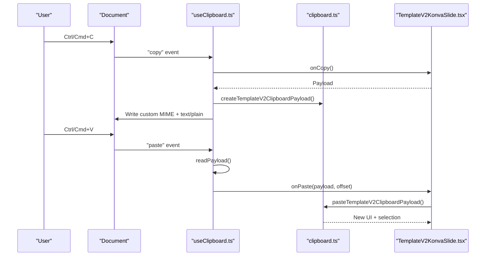
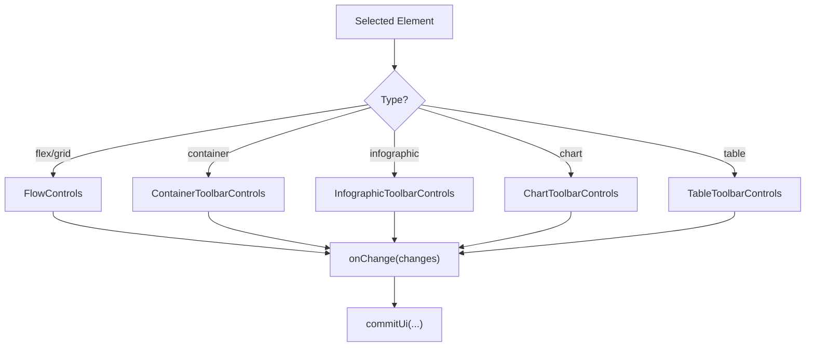
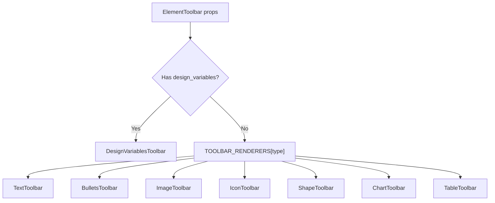
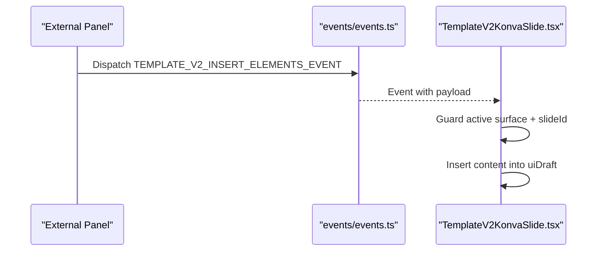
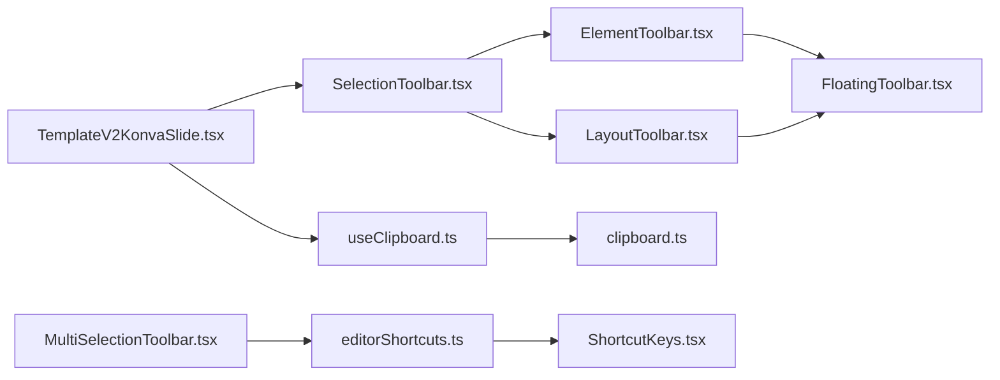

# User Interaction Tools

<cite>
**Referenced Files in This Document**
- [README.md](file://servers/nextjs/components/slide-editor/README.md)
- [types.ts](file://servers/nextjs/components/slide-editor/types.ts)
- [TemplateV2KonvaSlide.tsx](file://servers/nextjs/components/slide-editor/surface/TemplateV2KonvaSlide.tsx)
- [nodes.tsx](file://servers/nextjs/components/slide-editor/surface/nodes.tsx)
- [SelectionToolbar.tsx](file://servers/nextjs/components/slide-editor/selection/SelectionToolbar.tsx)
- [MultiSelectionToolbar.tsx](file://servers/nextjs/components/slide-editor/selection/MultiSelectionToolbar.tsx)
- [FloatingToolbar.tsx](file://servers/nextjs/components/slide-editor/toolbar/FloatingToolbar.tsx)
- [ElementToolbar.tsx](file://servers/nextjs/components/slide-editor/toolbar/ElementToolbar.tsx)
- [LayoutToolbar.tsx](file://servers/nextjs/components/slide-editor/layout/LayoutToolbar.tsx)
- [layoutItems.ts](file://servers/nextjs/components/slide-editor/layout/layoutItems.ts)
- [editorShortcuts.ts](file://servers/nextjs/components/slide-editor/shortcuts/editorShortcuts.ts)
- [ShortcutKeys.tsx](file://servers/nextjs/components/slide-editor/shortcuts/ShortcutKeys.tsx)
- [clipboard.ts](file://servers/nextjs/components/slide-editor/clipboard/clipboard.ts)
- [useClipboard.ts](file://servers/nextjs/components/slide-editor/clipboard/useClipboard.ts)
</cite>

## Table of Contents
1. [Introduction](#introduction)
2. [Project Structure](#project-structure)
3. [Core Components](#core-components)
4. [Architecture Overview](#architecture-overview)
5. [Detailed Component Analysis](#detailed-component-analysis)
6. [Dependency Analysis](#dependency-analysis)
7. [Performance Considerations](#performance-considerations)
8. [Troubleshooting Guide](#troubleshooting-guide)
9. [Conclusion](#conclusion)
10. [Appendices](#appendices)

## Introduction
This document explains the user interaction tools for the Template V2 slide editor. It focuses on how users select and manipulate slide elements, how floating toolbars appear and position themselves, how keyboard shortcuts are defined and displayed, how clipboard operations work, and how layout manipulation tools update slide structure. It also documents the event handling system that connects the canvas to other UI panels and provides guidance for extending the toolset with new interaction patterns.

## Project Structure
The slide editor is organized by feature:
- Surface rendering and Konva nodes
- Selection and floating toolbar positioning
- Element-specific toolbars
- Layout manipulation controls
- Clipboard data model and browser integration
- Keyboard shortcut definitions and display utilities

**Diagram sources**
- [TemplateV2KonvaSlide.tsx](file://servers/nextjs/components/slide-editor/surface/TemplateV2KonvaSlide.tsx)
- [nodes.tsx](file://servers/nextjs/components/slide-editor/surface/nodes.tsx)
- [SelectionToolbar.tsx](file://servers/nextjs/components/slide-editor/selection/SelectionToolbar.tsx)
- [MultiSelectionToolbar.tsx](file://servers/nextjs/components/slide-editor/selection/MultiSelectionToolbar.tsx)
- [FloatingToolbar.tsx](file://servers/nextjs/components/slide-editor/toolbar/FloatingToolbar.tsx)
- [ElementToolbar.tsx](file://servers/nextjs/components/slide-editor/toolbar/ElementToolbar.tsx)
- [LayoutToolbar.tsx](file://servers/nextjs/components/slide-editor/layout/LayoutToolbar.tsx)
- [clipboard.ts](file://servers/nextjs/components/slide-editor/clipboard/clipboard.ts)
- [useClipboard.ts](file://servers/nextjs/components/slide-editor/clipboard/useClipboard.ts)
- [editorShortcuts.ts](file://servers/nextjs/components/slide-editor/shortcuts/editorShortcuts.ts)
- [ShortcutKeys.tsx](file://servers/nextjs/components/slide-editor/shortcuts/ShortcutKeys.tsx)

**Section sources**
- [README.md:13-81](file://servers/nextjs/components/slide-editor/README.md#L13-L81)

## Core Components
- Slide surface and selection state owner: The main editable slide component manages local draft state, selection, undo/redo stacks, inline editing, image/icon/chart editors, and central commit functions. It exposes selection, drag, delete, duplicate, and clipboard helpers.
- Floating toolbar system: A portal-based floating container computes viewport-safe positions for toolbars anchored to selected elements or boxes.
- Toolbar routing: Element toolbars route by element type; layout toolbars handle container/flex/grid/group and chart/table controls.
- Clipboard pipeline: Pure payload creation/parsing plus a React hook that integrates copy/paste events, custom MIME, plain text prefix, and localStorage fallback.
- Shortcuts registry: Centralized definition of shortcut sections, labels, descriptions, and chords, with platform-aware label rendering.

Key responsibilities:
- Surface owns state transitions and dispatches updates to Redux via commit functions.
- Selection determines which toolbar renders and where it appears.
- Toolbars produce partial changes that merge back into raw UI.
- Clipboard serializes/deserializes components with unique IDs and offset paste.
- Shortcuts define user-facing commands and help UI.

**Section sources**
- [README.md:130-185](file://servers/nextjs/components/slide-editor/README.md#L130-L185)
- [README.md:467-500](file://servers/nextjs/components/slide-editor/README.md#L467-L500)
- [README.md:560-583](file://servers/nextjs/components/slide-editor/README.md#L560-L583)

## Architecture Overview
The editor follows a unidirectional flow:
1. User interacts with Konva nodes (click, drag, resize).
2. Surface updates selection and geometry.
3. Selection triggers appropriate toolbar(s).
4. Toolbar emits typed changes.
5. Surface merges changes and commits to history and Redux.
6. Clipboard and shortcuts integrate at the document level and surface level.

**Diagram sources**
- [TemplateV2KonvaSlide.tsx](file://servers/nextjs/components/slide-editor/surface/TemplateV2KonvaSlide.tsx)
- [nodes.tsx](file://servers/nextjs/components/slide-editor/surface/nodes.tsx)
- [SelectionToolbar.tsx](file://servers/nextjs/components/slide-editor/selection/SelectionToolbar.tsx)
- [ElementToolbar.tsx](file://servers/nextjs/components/slide-editor/toolbar/ElementToolbar.tsx)
- [LayoutToolbar.tsx](file://servers/nextjs/components/slide-editor/layout/LayoutToolbar.tsx)
- [useClipboard.ts](file://servers/nextjs/components/slide-editor/clipboard/useClipboard.ts)
- [clipboard.ts](file://servers/nextjs/components/slide-editor/clipboard/clipboard.ts)

## Detailed Component Analysis

### Selection System
- Single and multi-component selection are supported. Multi-select toggles modifier keys and groups selected components for transform and drag.
- Selection determines whether to render an element toolbar or a layout toolbar.
- Selection transformers provide resize handles tied to Konva nodes.

**Diagram sources**
- [SelectionToolbar.tsx](file://servers/nextjs/components/slide-editor/selection/SelectionToolbar.tsx)
- [MultiSelectionToolbar.tsx](file://servers/nextjs/components/slide-editor/selection/MultiSelectionToolbar.tsx)

**Section sources**
- [README.md:501-534](file://servers/nextjs/components/slide-editor/README.md#L501-L534)
- [SelectionToolbar.tsx:29-166](file://servers/nextjs/components/slide-editor/selection/SelectionToolbar.tsx#L29-L166)
- [MultiSelectionToolbar.tsx:13-61](file://servers/nextjs/components/slide-editor/selection/MultiSelectionToolbar.tsx#L13-L61)

### Floating Toolbar Implementation
- FloatingToolbar is a portal-based container that computes safe viewport positions based on an anchor box and root bounds.
- FloatingToolbarPanel centers child panels relative to their parent anchor and chooses above/below placement when needed.
- Both components mark themselves with data attributes so they can be ignored during inline editing.

**Diagram sources**
- [FloatingToolbar.tsx:75-189](file://servers/nextjs/components/slide-editor/toolbar/FloatingToolbar.tsx#L75-L189)
- [FloatingToolbar.tsx:292-340](file://servers/nextjs/components/slide-editor/toolbar/FloatingToolbar.tsx#L292-L340)

**Section sources**
- [FloatingToolbar.tsx:23-58](file://servers/nextjs/components/slide-editor/toolbar/FloatingToolbar.tsx#L23-L58)
- [FloatingToolbar.tsx:75-189](file://servers/nextjs/components/slide-editor/toolbar/FloatingToolbar.tsx#L75-L189)
- [FloatingToolbar.tsx:192-290](file://servers/nextjs/components/slide-editor/toolbar/FloatingToolbar.tsx#L192-L290)
- [FloatingToolbar.tsx:292-389](file://servers/nextjs/components/slide-editor/toolbar/FloatingToolbar.tsx#L292-L389)

### Keyboard Shortcuts Management
- editorShortcuts defines shortcut sections (selection, editing, arrange, navigation, help), each with labeled chords.
- ShortcutKeys renders platform-appropriate labels (Mac vs Windows/Linux) and supports compact mode.
- MultiSelectionToolbar uses the shortcut registry to show the group command hint.

**Diagram sources**
- [editorShortcuts.ts:1-47](file://servers/nextjs/components/slide-editor/shortcuts/editorShortcuts.ts#L1-L47)
- [editorShortcuts.ts:56-176](file://servers/nextjs/components/slide-editor/shortcuts/editorShortcuts.ts#L56-L176)
- [ShortcutKeys.tsx:29-72](file://servers/nextjs/components/slide-editor/shortcuts/ShortcutKeys.tsx#L29-L72)

**Section sources**
- [editorShortcuts.ts:1-47](file://servers/nextjs/components/slide-editor/shortcuts/editorShortcuts.ts#L1-L47)
- [editorShortcuts.ts:56-176](file://servers/nextjs/components/slide-editor/shortcuts/editorShortcuts.ts#L56-L176)
- [editorShortcuts.ts:178-209](file://servers/nextjs/components/slide-editor/shortcuts/editorShortcuts.ts#L178-L209)
- [ShortcutKeys.tsx:10-27](file://servers/nextjs/components/slide-editor/shortcuts/ShortcutKeys.tsx#L10-L27)
- [ShortcutKeys.tsx:29-72](file://servers/nextjs/components/slide-editor/shortcuts/ShortcutKeys.tsx#L29-L72)
- [MultiSelectionToolbar.tsx:11-12](file://servers/nextjs/components/slide-editor/selection/MultiSelectionToolbar.tsx#L11-L12)

### Clipboard Operations
- clipboard.ts defines the payload schema and pure functions to create and paste payloads, ensuring unique IDs and valid bounding boxes.
- useClipboard.ts wires document-level copy/paste events, custom MIME, plain text prefix, localStorage fallback, and keyboard shortcuts. It applies incremental offsets for repeated pastes.

**Diagram sources**
- [useClipboard.ts:21-90](file://servers/nextjs/components/slide-editor/clipboard/useClipboard.ts#L21-L90)
- [useClipboard.ts:151-186](file://servers/nextjs/components/slide-editor/clipboard/useClipboard.ts#L151-L186)
- [clipboard.ts:40-94](file://servers/nextjs/components/slide-editor/clipboard/clipboard.ts#L40-L94)
- [TemplateV2KonvaSlide.tsx](file://servers/nextjs/components/slide-editor/surface/TemplateV2KonvaSlide.tsx)

**Section sources**
- [clipboard.ts:1-33](file://servers/nextjs/components/slide-editor/clipboard/clipboard.ts#L1-L33)
- [clipboard.ts:40-94](file://servers/nextjs/components/slide-editor/clipboard/clipboard.ts#L40-L94)
- [clipboard.ts:96-197](file://servers/nextjs/components/slide-editor/clipboard/clipboard.ts#L96-L197)
- [useClipboard.ts:1-20](file://servers/nextjs/components/slide-editor/clipboard/useClipboard.ts#L1-L20)
- [useClipboard.ts:21-90](file://servers/nextjs/components/slide-editor/clipboard/useClipboard.ts#L21-L90)
- [useClipboard.ts:93-186](file://servers/nextjs/components/slide-editor/clipboard/useClipboard.ts#L93-L186)
- [useClipboard.ts:188-254](file://servers/nextjs/components/slide-editor/clipboard/useClipboard.ts#L188-L254)

### Layout Manipulation Tools
- LayoutToolbar routes to specific controls depending on the selected element type: flow controls (gap/items), container controls, infographic controls, chart controls, table controls, and component actions (ungroup/delete/duplicate/layering).
- layoutItems.ts provides helpers to add/remove children and maintain min/max constraints.

**Diagram sources**
- [LayoutToolbar.tsx:298-459](file://servers/nextjs/components/slide-editor/layout/LayoutToolbar.tsx#L298-L459)
- [layoutItems.ts:9-52](file://servers/nextjs/components/slide-editor/layout/layoutItems.ts#L9-L52)

**Section sources**
- [LayoutToolbar.tsx:41-112](file://servers/nextjs/components/slide-editor/layout/LayoutToolbar.tsx#L41-L112)
- [LayoutToolbar.tsx:125-208](file://servers/nextjs/components/slide-editor/layout/LayoutToolbar.tsx#L125-L208)
- [LayoutToolbar.tsx:210-281](file://servers/nextjs/components/slide-editor/layout/LayoutToolbar.tsx#L210-L281)
- [LayoutToolbar.tsx:298-459](file://servers/nextjs/components/slide-editor/layout/LayoutToolbar.tsx#L298-L459)
- [layoutItems.ts:1-101](file://servers/nextjs/components/slide-editor/layout/layoutItems.ts#L1-L101)

### Element Toolbars and Type Routing
- ElementToolbar routes by element.type to specialized toolbars: text, text-list, image/icon, vector/shape, chart, table, and design variables.
- Design variables override other element toolbars when present.

**Diagram sources**
- [ElementToolbar.tsx:16-36](file://servers/nextjs/components/slide-editor/toolbar/ElementToolbar.tsx#L16-L36)
- [ElementToolbar.tsx:40-170](file://servers/nextjs/components/slide-editor/toolbar/ElementToolbar.tsx#L40-L170)
- [ElementToolbar.tsx:172-189](file://servers/nextjs/components/slide-editor/toolbar/ElementToolbar.tsx#L172-L189)

**Section sources**
- [ElementToolbar.tsx:16-36](file://servers/nextjs/components/slide-editor/toolbar/ElementToolbar.tsx#L16-L36)
- [ElementToolbar.tsx:40-170](file://servers/nextjs/components/slide-editor/toolbar/ElementToolbar.tsx#L40-L170)
- [ElementToolbar.tsx:172-189](file://servers/nextjs/components/slide-editor/toolbar/ElementToolbar.tsx#L172-L189)

### Event Handling System
- Custom events connect editor surfaces to app UI outside the surface subtree.
- Events include insert elements, surface activation, and active-surface notifications.
- The surface listens for these events and guards them by active surface and slide ID.

**Diagram sources**
- [README.md:585-612](file://servers/nextjs/components/slide-editor/README.md#L585-L612)
- [TemplateV2KonvaSlide.tsx](file://servers/nextjs/components/slide-editor/surface/TemplateV2KonvaSlide.tsx)

**Section sources**
- [README.md:585-612](file://servers/nextjs/components/slide-editor/README.md#L585-L612)

### Data Models and Types
- types.ts defines the editor’s primary TypeScript contracts for supported slide elements and deck/slide structures.
- These types drive toolbar routing, validation, and conversion between raw and typed representations.

**Section sources**
- [README.md:85-128](file://servers/nextjs/components/slide-editor/README.md#L85-L128)
- [types.ts](file://servers/nextjs/components/slide-editor/types.ts)

## Dependency Analysis
- Surface depends on selection and toolbar systems to render interactive UI and process user actions.
- Selection depends on toolbar routing and positioning logic.
- Toolbars depend on layout helpers and element models to compute changes.
- Clipboard hook depends on pure clipboard model and document APIs.
- Shortcuts are consumed by UI components for consistent labeling and behavior hints.

**Diagram sources**
- [TemplateV2KonvaSlide.tsx](file://servers/nextjs/components/slide-editor/surface/TemplateV2KonvaSlide.tsx)
- [SelectionToolbar.tsx](file://servers/nextjs/components/slide-editor/selection/SelectionToolbar.tsx)
- [ElementToolbar.tsx](file://servers/nextjs/components/slide-editor/toolbar/ElementToolbar.tsx)
- [LayoutToolbar.tsx](file://servers/nextjs/components/slide-editor/layout/LayoutToolbar.tsx)
- [FloatingToolbar.tsx](file://servers/nextjs/components/slide-editor/toolbar/FloatingToolbar.tsx)
- [useClipboard.ts](file://servers/nextjs/components/slide-editor/clipboard/useClipboard.ts)
- [clipboard.ts](file://servers/nextjs/components/slide-editor/clipboard/clipboard.ts)
- [MultiSelectionToolbar.tsx](file://servers/nextjs/components/slide-editor/selection/MultiSelectionToolbar.tsx)
- [editorShortcuts.ts](file://servers/nextjs/components/slide-editor/shortcuts/editorShortcuts.ts)
- [ShortcutKeys.tsx](file://servers/nextjs/components/slide-editor/shortcuts/ShortcutKeys.tsx)

**Section sources**
- [README.md:130-185](file://servers/nextjs/components/slide-editor/README.md#L130-L185)
- [README.md:467-500](file://servers/nextjs/components/slide-editor/README.md#L467-L500)

## Performance Considerations
- Inline text editing buffers live runs and avoids committing Redux on every keystroke to prevent typing lag.
- Clipboard operations serialize payloads once and cache them in memory and localStorage for fast paste sequences.
- Floating toolbar measurements use ResizeObserver and window listeners to keep positioning accurate without excessive reflows.

[No sources needed since this section provides general guidance]

## Troubleshooting Guide
- Floating toolbar not visible: Ensure the anchor box is valid and within the Konva surface bounds; verify that the root rect measurement succeeds and that the toolbar has mounted before computing visibility.
- Copy/paste fails: Check that the surface is active, the target is not an editable input, and that the custom MIME or plain text prefix is present. Verify localStorage availability if relying on fallback.
- Layout items cannot be added/removed: Validate that the element has a valid children or elements array and that min/max constraints allow the operation.
- Shortcut labels look incorrect on Mac: Confirm that the platform detection returns true and that ShortcutKeys receives the correct shortcut object.

**Section sources**
- [FloatingToolbar.tsx:99-132](file://servers/nextjs/components/slide-editor/toolbar/FloatingToolbar.tsx#L99-L132)
- [useClipboard.ts:28-90](file://servers/nextjs/components/slide-editor/clipboard/useClipboard.ts#L28-L90)
- [useClipboard.ts:151-186](file://servers/nextjs/components/slide-editor/clipboard/useClipboard.ts#L151-L186)
- [layoutItems.ts:9-52](file://servers/nextjs/components/slide-editor/layout/layoutItems.ts#L9-L52)
- [ShortcutKeys.tsx:10-27](file://servers/nextjs/components/slide-editor/shortcuts/ShortcutKeys.tsx#L10-L27)

## Conclusion
The user interaction tools center around a robust selection system, a flexible floating toolbar framework, a centralized shortcuts registry, a resilient clipboard pipeline, and comprehensive layout manipulation controls. Together they enable precise, efficient editing of slide elements while keeping the codebase modular and extensible.

[No sources needed since this section summarizes without analyzing specific files]

## Appendices

### How Users Interact With Slide Elements
- Click to select single components; Shift+Click to toggle multi-selection.
- Drag to move; use transformer handles to resize/transform.
- Double-click text/list elements to open inline rich text editing.
- Use element toolbars for style and content edits; use layout toolbars for structural changes.

**Section sources**
- [README.md:501-534](file://servers/nextjs/components/slide-editor/README.md#L501-L534)
- [README.md:614-670](file://servers/nextjs/components/slide-editor/README.md#L614-L670)

### Extending the Toolset
To add a new interaction pattern:
- Define or extend types in types.ts for the new element or state shape.
- Add or update toolbar routing in ElementToolbar.tsx or LayoutToolbar.tsx.
- If needed, implement a new floating panel using FloatingToolbar.tsx.
- Integrate clipboard support by updating clipboard.ts payload handling and useClipboard.ts parsing if necessary.
- Register new keyboard shortcuts in editorShortcuts.ts and display them via ShortcutKeys.tsx.
- Wire up any external interactions through custom events documented in README.md.

**Section sources**
- [types.ts](file://servers/nextjs/components/slide-editor/types.ts)
- [ElementToolbar.tsx:40-170](file://servers/nextjs/components/slide-editor/toolbar/ElementToolbar.tsx#L40-L170)
- [LayoutToolbar.tsx:298-459](file://servers/nextjs/components/slide-editor/layout/LayoutToolbar.tsx#L298-L459)
- [FloatingToolbar.tsx:75-189](file://servers/nextjs/components/slide-editor/toolbar/FloatingToolbar.tsx#L75-L189)
- [clipboard.ts:40-94](file://servers/nextjs/components/slide-editor/clipboard/clipboard.ts#L40-L94)
- [useClipboard.ts:151-186](file://servers/nextjs/components/slide-editor/clipboard/useClipboard.ts#L151-L186)
- [editorShortcuts.ts:56-176](file://servers/nextjs/components/slide-editor/shortcuts/editorShortcuts.ts#L56-L176)
- [README.md:585-612](file://servers/nextjs/components/slide-editor/README.md#L585-L612)