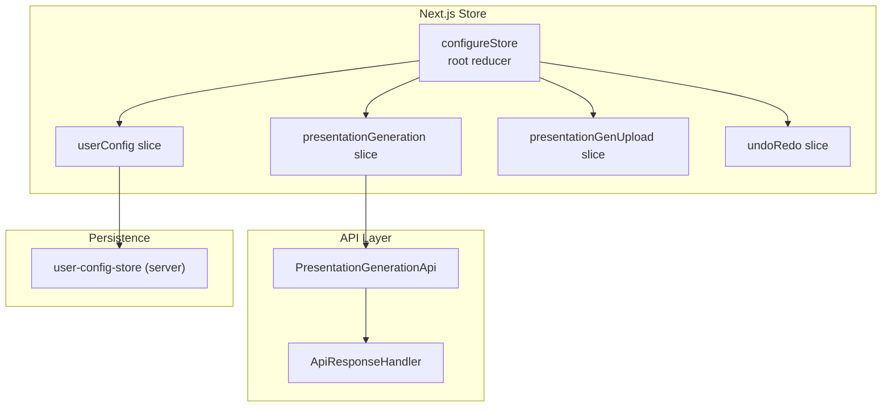
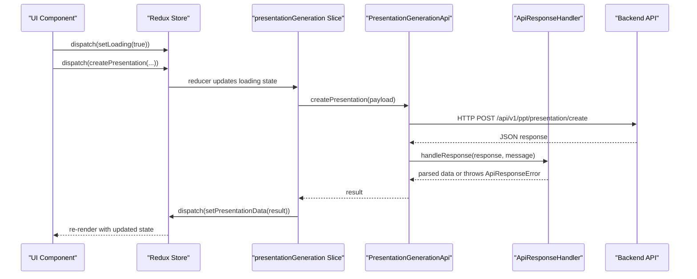
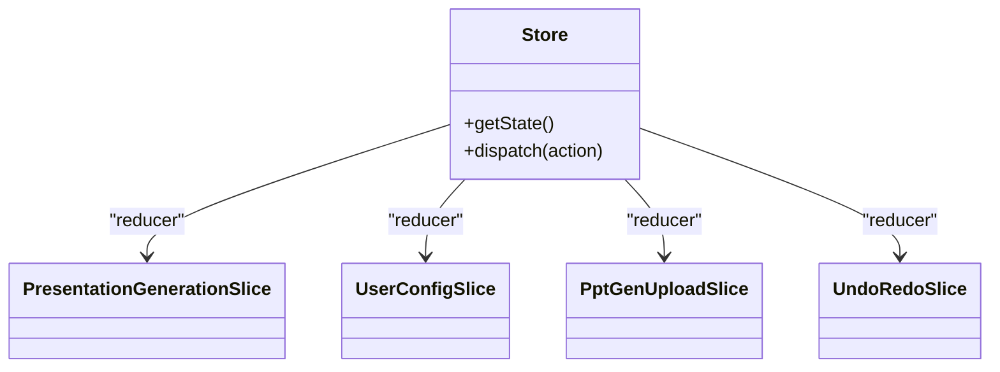
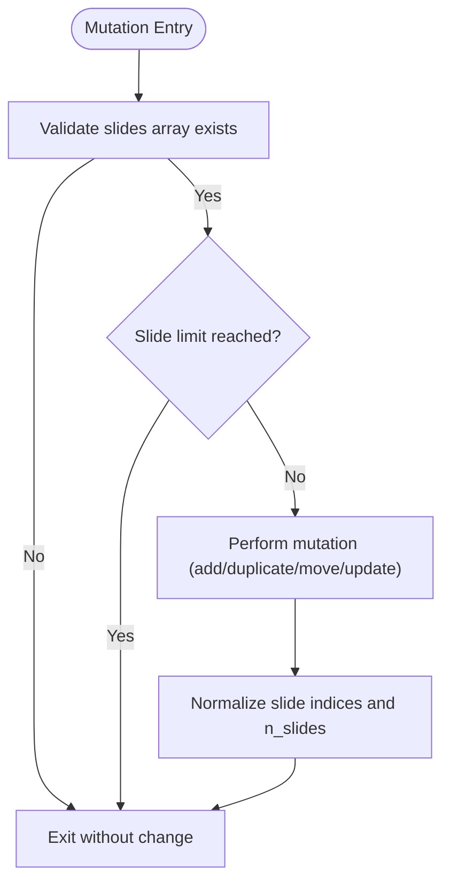
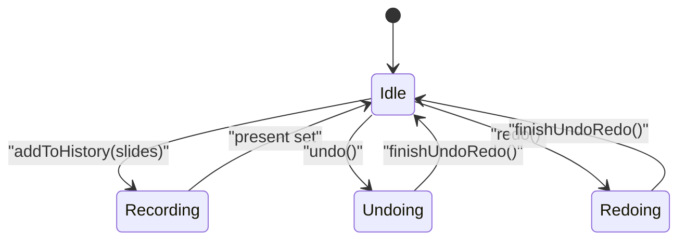
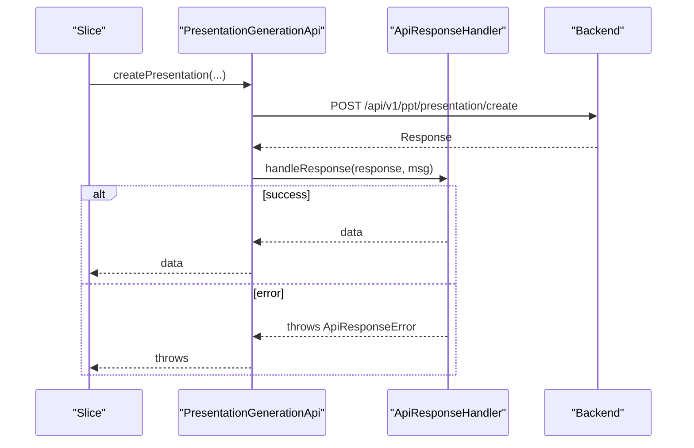
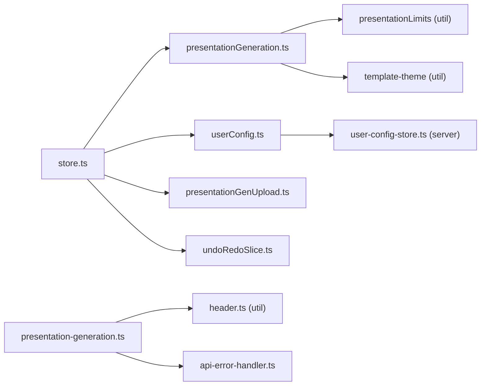

# State Management & Data Flow

<cite>
**Referenced Files in This Document**
- [store.ts](file://servers/nextjs/store/store.ts)
- [presentationGeneration.ts](file://servers/nextjs/store/slices/presentationGeneration.ts)
- [userConfig.ts](file://servers/nextjs/store/slices/userConfig.ts)
- [presentationGenUpload.ts](file://servers/nextjs/store/slices/presentationGenUpload.ts)
- [undoRedoSlice.ts](file://servers/nextjs/store/slices/undoRedoSlice.ts)
- [presentation-generation.ts](file://servers/nextjs/app/(presentation-generator)/services/api/presentation-generation.ts)
- [api-error-handler.ts](file://servers/nextjs/app/(presentation-generator)/services\api\api-error-handler.ts)
- [user-config-store.ts](file://servers/nextjs/lib/user-config-store.ts)
</cite>

## Table of Contents
1. [Introduction](#introduction)
2. [Project Structure](#project-structure)
3. [Core Components](#core-components)
4. [Architecture Overview](#architecture-overview)
5. [Detailed Component Analysis](#detailed-component-analysis)
6. [Dependency Analysis](#dependency-analysis)
7. [Performance Considerations](#performance-considerations)
8. [Troubleshooting Guide](#troubleshooting-guide)
9. [Conclusion](#conclusion)

## Introduction
This document explains the Redux Toolkit-based state management system used by the Next.js application for presentation generation, user configuration, and related workflows. It covers store architecture, slice organization, data flow patterns, backend API integration, caching strategies, error handling, performance considerations, state persistence, and debugging techniques.

## Project Structure
The Redux store is configured at the root of the Next.js app’s store directory and composes multiple slices:
- Store composition and typed selectors/dispatch are defined in a single file.
- Feature slices encapsulate domain-specific state and reducers.
- A dedicated undo/redo slice manages history for slide edits.
- An API service layer coordinates with backend endpoints and centralizes error handling.
- A server-side utility persists user configuration to disk with locking and backups.

**Diagram sources**
- [store.ts:1-19](file://servers/nextjs/store/store.ts#L1-L19)
- [presentation-generation.ts:23-360](file://servers/nextjs/app/(presentation-generator)/services/api/presentation-generation.ts#L23-L360)
- [api-error-handler.ts:12-173](file://servers/nextjs/app/(presentation-generator)/services\api\api-error-handler.ts#L12-L173)
- [user-config-store.ts:210-232](file://servers/nextjs/lib/user-config-store.ts#L210-L232)

**Section sources**
- [store.ts:1-19](file://servers/nextjs/store/store.ts#L1-L19)

## Core Components
- Store composition:
  - Root reducer combines four slices: presentationGeneration, pptGenUpload, userConfig, undoRedo.
  - Exports RootState and AppDispatch types for type-safe usage across the app.

- Slice responsibilities:
  - presentationGeneration: Presentation lifecycle, outlines, slides CRUD, streaming/loading flags, metrics, HTML selection context.
  - userConfig: LLM provider configuration and user role.
  - presentationGenUpload: Upload configuration and file list for presentation generation from documents.
  - undoRedo: History stack for slide edits with bounded size and skip logic during batch operations.

**Section sources**
- [store.ts:1-19](file://servers/nextjs/store/store.ts#L1-L19)
- [presentationGeneration.ts:52-78](file://servers/nextjs/store/slices/presentationGeneration.ts#L52-L78)
- [userConfig.ts:4-16](file://servers/nextjs/store/slices/userConfig.ts#L4-L16)
- [presentationGenUpload.ts:4-14](file://servers/nextjs/store/slices/presentationGenUpload.ts#L4-L14)
- [undoRedoSlice.ts:4-26](file://servers/nextjs/store/slices/undoRedoSlice.ts#L4-L26)

## Architecture Overview
The application follows a unidirectional data flow:
- UI components dispatch actions to slices.
- Slices update local state immutably via RTK/Immer.
- Async flows call the API service layer, which uses ApiResponseHandler for consistent error handling.
- Results are dispatched back into slices to reflect new state.
- User configuration is persisted on the server using a lock-backed atomic writer.

**Diagram sources**
- [presentation-generation.ts:74-143](file://servers/nextjs/app/(presentation-generator)/services/api/presentation-generation.ts#L74-L143)
- [api-error-handler.ts:34-89](file://servers/nextjs/app/(presentation-generator)/services\api\api-error-handler.ts#L34-L89)
- [presentationGeneration.ts:131-137](file://servers/nextjs/store/slices/presentationGeneration.ts#L131-L137)

## Detailed Component Analysis

### Store Composition and Types
- configureStore wires all slices under well-known keys.
- Exposes RootState and AppDispatch for type safety.

**Diagram sources**
- [store.ts:1-19](file://servers/nextjs/store/store.ts#L1-L19)

**Section sources**
- [store.ts:1-19](file://servers/nextjs/store/store.ts#L1-L19)

### Presentation Generation Slice
Responsibilities:
- Tracks presentation identity, loading/streaming states, outlines, errors, and generated presentation data.
- Manages slides: add, delete, duplicate, move, replace, update content/UI/images/icons.
- Provides helpers for nested content updates and image/icon metadata injection.
- Enforces slide count limits and normalizes theme data.

Key patterns:
- Defensive guards for invalid indices and slide counts.
- Index normalization after mutations to keep sequential order.
- Centralized clearing of chat selection when presentation changes.

**Diagram sources**
- [presentationGeneration.ts:165-276](file://servers/nextjs/store/slices/presentationGeneration.ts#L165-L276)

**Section sources**
- [presentationGeneration.ts:52-78](file://servers/nextjs/store/slices/presentationGeneration.ts#L52-L78)
- [presentationGeneration.ts:131-137](file://servers/nextjs/store/slices/presentationGeneration.ts#L131-L137)
- [presentationGeneration.ts:165-276](file://servers/nextjs/store/slices/presentationGeneration.ts#L165-L276)
- [presentationGeneration.ts:277-376](file://servers/nextjs/store/slices/presentationGeneration.ts#L277-L376)
- [presentationGeneration.ts:398-470](file://servers/nextjs/store/slices/presentationGeneration.ts#L398-L470)
- [presentationGeneration.ts:472-569](file://servers/nextjs/store/slices/presentationGeneration.ts#L472-L569)

### User Configuration Slice
Responsibilities:
- Stores LLM provider configuration and user role.
- Simple setters for updating config and role.

Usage:
- Read by settings pages and editor components to determine available providers and UI behavior.

**Section sources**
- [userConfig.ts:4-16](file://servers/nextjs/store/slices/userConfig.ts#L4-L16)
- [userConfig.ts:18-32](file://servers/nextjs/store/slices/userConfig.ts#L18-L32)

### Upload State Slice
Responsibilities:
- Holds upload configuration and selected files for generating presentations from documents.

Typical flow:
- UI collects files and config, then sets them into this slice before invoking API calls.

**Section sources**
- [presentationGenUpload.ts:4-14](file://servers/nextjs/store/slices/presentationGenUpload.ts#L4-L14)
- [presentationGenUpload.ts:16-34](file://servers/nextjs/store/slices/presentationGenUpload.ts#L16-L34)

### Undo/Redo Slice
Responsibilities:
- Maintains past/present/future stacks of slide snapshots.
- Limits history size and prevents duplicate entries by comparing immutable references.
- Supports skipping history entries during batch operations to avoid noisy history.

**Diagram sources**
- [undoRedoSlice.ts:28-139](file://servers/nextjs/store/slices/undoRedoSlice.ts#L28-L139)

**Section sources**
- [undoRedoSlice.ts:4-26](file://servers/nextjs/store/slices/undoRedoSlice.ts#L4-L26)
- [undoRedoSlice.ts:28-139](file://servers/nextjs/store/slices/undoRedoSlice.ts#L28-L139)

### API Integration and Error Handling
- PresentationGenerationApi encapsulates all backend calls for presentations, outlines, images, and icons.
- All methods use getHeader/getHeaderForFormData for authentication and headers.
- Responses are normalized through ApiResponseHandler, which:
  - Parses JSON or returns boolean for 204 responses.
  - Extracts user-friendly messages and metadata.
  - Detects ChatGPT auth-required scenarios and triggers reauth flow.
  - Throws a typed ApiResponseError with status, code, and retryable flag.

**Diagram sources**
- [presentation-generation.ts:74-143](file://servers/nextjs/app/(presentation-generator)/services/api/presentation-generation.ts#L74-L143)
- [api-error-handler.ts:34-89](file://servers/nextjs/app/(presentation-generator)/services\api\api-error-handler.ts#L34-L89)

**Section sources**
- [presentation-generation.ts:23-360](file://servers/nextjs/app/(presentation-generator)/services/api/presentation-generation.ts#L23-L360)
- [api-error-handler.ts:12-173](file://servers/nextjs/app/(presentation-generator)/services\api\api-error-handler.ts#L12-L173)

### Real-time Collaboration State Synchronization
- The current implementation does not include WebSocket or real-time collaboration channels in the client store.
- For future real-time sync, consider:
  - Introducing a collaboration slice that tracks presence, cursors, and conflict resolution.
  - Using operational transforms or CRDTs for concurrent edits.
  - Broadcasting deltas over WebSockets and reconciling with the existing undo/redo history.

[No sources needed since this section provides conceptual guidance]

## Dependency Analysis
- Store depends on slices; slices do not depend on each other directly.
- presentationGeneration slice depends on utilities for slide limits and theme normalization.
- API service layer depends on header utilities and error handler.
- User configuration persistence is handled server-side and is independent of the client store.

**Diagram sources**
- [store.ts:1-19](file://servers/nextjs/store/store.ts#L1-L19)
- [presentation-generation.ts:1-10](file://servers/nextjs/app/(presentation-generator)/services/api/presentation-generation.ts#L1-L10)
- [api-error-handler.ts:1-11](file://servers/nextjs/app/(presentation-generator)/services\api\api-error-handler.ts#L1-L11)
- [user-config-store.ts:210-232](file://servers/nextjs/lib/user-config-store.ts#L210-L232)

**Section sources**
- [store.ts:1-19](file://servers/nextjs/store/store.ts#L1-L19)
- [presentation-generation.ts:1-10](file://servers/nextjs/app/(presentation-generator)/services/api/presentation-generation.ts#L1-L10)

## Performance Considerations
- Prefer fine-grained selectors to minimize re-renders.
- Batch related mutations within a single action where possible to reduce history churn.
- Use the undo/redo skip mechanism during bulk operations to avoid excessive history entries.
- Avoid deep cloning large structures; rely on Immer’s structural sharing.
- Keep payload sizes small; send only changed fields to the backend.
- Debounce frequent updates (e.g., typing) before persisting or syncing.

[No sources needed since this section provides general guidance]

## Troubleshooting Guide
Common issues and resolutions:
- API errors:
  - ApiResponseHandler surfaces user-friendly messages and can trigger re-auth flows for ChatGPT.
  - Inspect ApiResponseError.status, code, and retryable to implement retries or fallbacks.
- Slide mutations:
  - Ensure indices are valid and within bounds; check MAX_NUMBER_OF_SLIDES constraints.
  - After any mutation, verify that slide indices are re-normalized.
- User configuration persistence:
  - Lock contention or stale locks may cause write failures; the server-side utility handles retries and stale lock cleanup.
  - Verify backup file integrity if primary config fails to parse.

**Section sources**
- [api-error-handler.ts:34-89](file://servers/nextjs/app/(presentation-generator)/services\api\api-error-handler.ts#L34-L89)
- [api-error-handler.ts:142-169](file://servers/nextjs/app/(presentation-generator)/services\api\api-error-handler.ts#L142-L169)
- [presentationGeneration.ts:165-276](file://servers/nextjs/store/slices/presentationGeneration.ts#L165-L276)
- [user-config-store.ts:88-146](file://servers/nextjs/lib/user-config-store.ts#L88-L146)
- [user-config-store.ts:182-208](file://servers/nextjs/lib/user-config-store.ts#L182-L208)

## Conclusion
The Redux Toolkit store cleanly separates concerns across slices, with a robust API layer and centralized error handling. The presentation generation workflow is well-supported by comprehensive slice reducers and a resilient server-side user configuration persistence mechanism. Future enhancements should focus on real-time collaboration features and advanced caching strategies while maintaining performance and reliability.