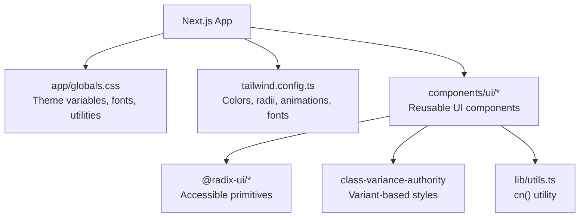
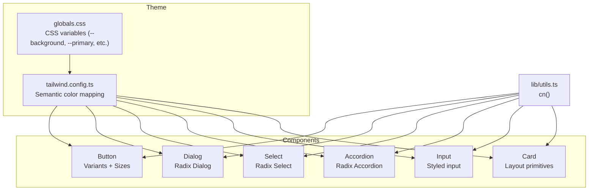
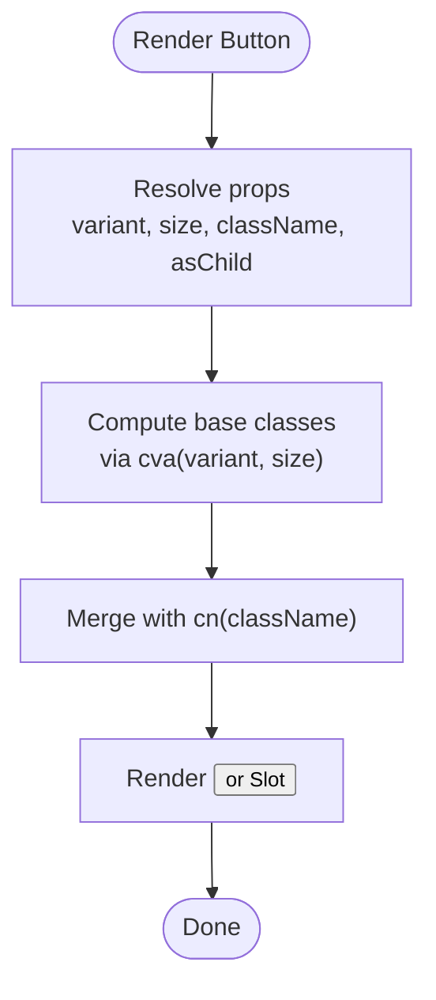
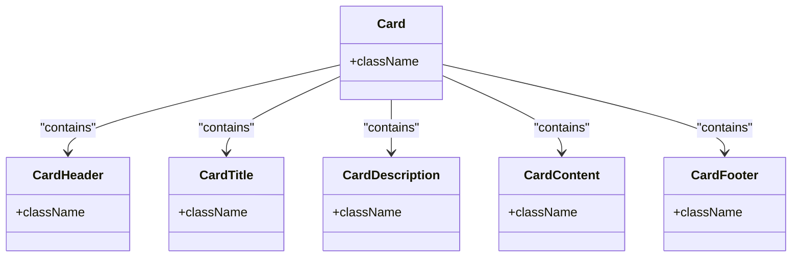
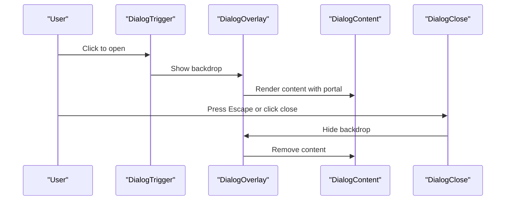
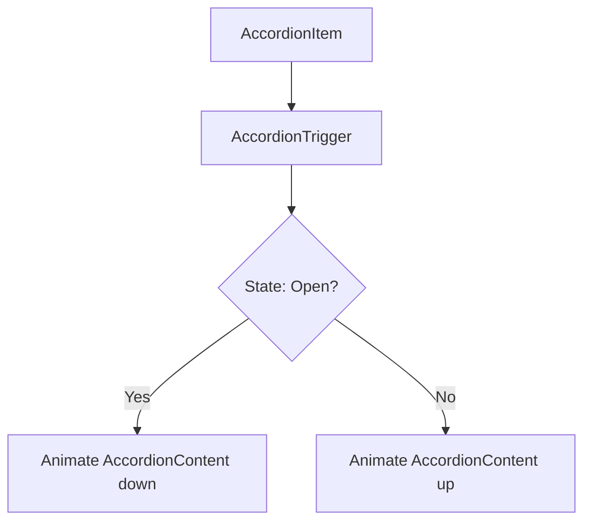
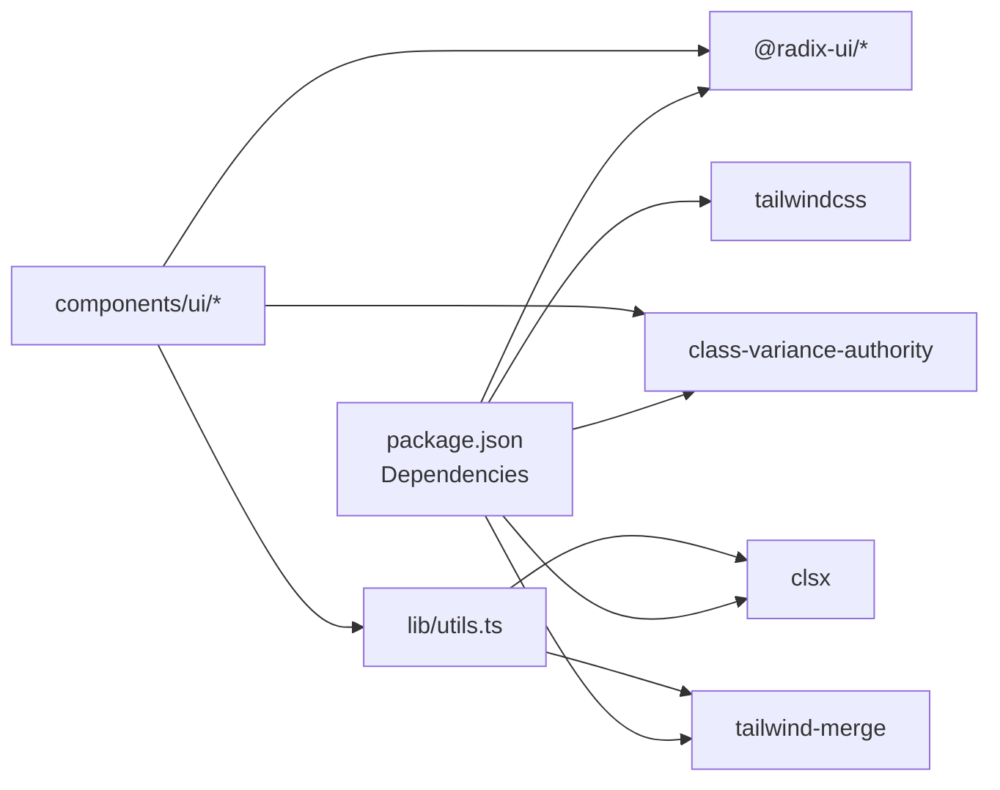

# UI Components & Design System

<cite>
**Referenced Files in This Document**
- [package.json](file://servers/nextjs/package.json)
- [tailwind.config.ts](file://servers/nextjs/tailwind.config.ts)
- [components.json](file://servers/nextjs/components.json)
- [globals.css](file://servers/nextjs/app/globals.css)
- [utils.ts](file://servers/nextjs/lib/utils.ts)
- [button.tsx](file://servers/nextjs/components/ui/button.tsx)
- [card.tsx](file://servers/nextjs/components/ui/card.tsx)
- [dialog.tsx](file://servers/nextjs/components/ui/dialog.tsx)
- [accordion.tsx](file://servers/nextjs/components/ui/accordion.tsx)
- [input.tsx](file://servers/nextjs/components/ui/input.tsx)
- [select.tsx](file://servers/nextjs/components/ui/select.tsx)
</cite>

## Table of Contents
1. [Introduction](#introduction)
2. [Project Structure](#project-structure)
3. [Core Components](#core-components)
4. [Architecture Overview](#architecture-overview)
5. [Detailed Component Analysis](#detailed-component-analysis)
6. [Dependency Analysis](#dependency-analysis)
7. [Performance Considerations](#performance-considerations)
8. [Troubleshooting Guide](#troubleshooting-guide)
9. [Conclusion](#conclusion)
10. [Appendices](#appendices)

## Introduction
This document describes the UI component library and design system built with Tailwind CSS, Radix UI primitives, and React within a Next.js application. It covers reusable component patterns, styling conventions, accessibility standards, composition approach, prop interfaces, customization options, theme system (CSS variables), typography scales, responsive breakpoints, guidelines for creating new components, integration with Next.js, performance considerations, and testing strategies.

## Project Structure
The UI layer is organized under the Next.js app directory:
- Global styles and theme variables are defined in the global stylesheet.
- Tailwind configuration extends colors, border radius, animations, and fonts.
- Shadcn-style components live under components/ui and are composed from Radix UI primitives.
- Utility functions merge class names safely to support variant-based styling.

**Diagram sources**
- [globals.css:19-93](file://servers/nextjs/app/globals.css#L19-L93)
- [tailwind.config.ts:12-92](file://servers/nextjs/tailwind.config.ts#L12-L92)
- [button.tsx:1-58](file://servers/nextjs/components/ui/button.tsx#L1-L58)
- [utils.ts:1-7](file://servers/nextjs/lib/utils.ts#L1-L7)

**Section sources**
- [globals.css:1-93](file://servers/nextjs/app/globals.css#L1-L93)
- [tailwind.config.ts:1-95](file://servers/nextjs/tailwind.config.ts#L1-L95)
- [components.json:1-20](file://servers/nextjs/components.json#L1-L20)

## Core Components
The library provides foundational UI building blocks that follow consistent patterns:
- Button: Variant-driven styling using class-variance-authority; supports multiple sizes and semantic variants.
- Card: Composed layout primitives (CardHeader, CardTitle, CardDescription, CardContent, CardFooter).
- Dialog: Accessible overlay and content management via Radix Dialog primitives.
- Accordion: Expandable sections with animated content.
- Input: Styled text input with focus ring and disabled states.
- Select: Fully accessible select menu with keyboard navigation and popper positioning.

Key implementation patterns:
- Use forwardRef to expose DOM refs.
- Merge classes with cn() to allow overrides.
- Leverage Radix primitives for accessibility and state management.
- Apply Tailwind utility classes consistently across components.

**Section sources**
- [button.tsx:1-58](file://servers/nextjs/components/ui/button.tsx#L1-L58)
- [card.tsx:1-77](file://servers/nextjs/components/ui/card.tsx#L1-L77)
- [dialog.tsx:1-128](file://servers/nextjs/components/ui/dialog.tsx#L1-L128)
- [accordion.tsx:1-58](file://servers/nextjs/components/ui/accordion.tsx#L1-L58)
- [input.tsx:1-26](file://servers/nextjs/components/ui/input.tsx#L1-L26)
- [select.tsx:1-165](file://servers/nextjs/components/ui/select.tsx#L1-L165)

## Architecture Overview
The UI architecture combines:
- Theme tokens as CSS custom properties for light/dark modes.
- Tailwind’s theme extension to map semantic color roles to CSS variables.
- Radix UI primitives for robust, accessible behavior.
- Class variance for declarative variants and sizes.
- A shared cn() utility to compose and merge Tailwind classes safely.

**Diagram sources**
- [globals.css:19-93](file://servers/nextjs/app/globals.css#L19-L93)
- [tailwind.config.ts:12-92](file://servers/nextjs/tailwind.config.ts#L12-L92)
- [utils.ts:1-7](file://servers/nextjs/lib/utils.ts#L1-L7)
- [button.tsx:1-58](file://servers/nextjs/components/ui/button.tsx#L1-L58)
- [dialog.tsx:1-128](file://servers/nextjs/components/ui/dialog.tsx#L1-L128)
- [select.tsx:1-165](file://servers/nextjs/components/ui/select.tsx#L1-L165)
- [accordion.tsx:1-58](file://servers/nextjs/components/ui/accordion.tsx#L1-L58)
- [input.tsx:1-26](file://servers/nextjs/components/ui/input.tsx#L1-L26)
- [card.tsx:1-77](file://servers/nextjs/components/ui/card.tsx#L1-L77)

## Detailed Component Analysis

### Button
- Purpose: Primary interactive element with semantic variants and sizes.
- Composition: Uses class-variance-authority to define variants (default, destructive, outline, secondary, ghost, link) and sizes (default, sm, lg, icon).
- Styling: Applies Tailwind utilities merged via cn(); uses semantic color tokens.
- Accessibility: Focus-visible outlines and ring; disabled states handled.
- Customization: Variants and sizes can be extended by adding new entries to the cva definition.

**Diagram sources**
- [button.tsx:7-35](file://servers/nextjs/components/ui/button.tsx#L7-L35)
- [button.tsx:43-54](file://servers/nextjs/components/ui/button.tsx#L43-L54)

**Section sources**
- [button.tsx:1-58](file://servers/nextjs/components/ui/button.tsx#L1-L58)

### Card
- Purpose: Container with header, title, description, content, and footer.
- Composition: Multiple forwardRef components for semantic structure.
- Styling: Uses semantic tokens (bg-card, text-card-foreground) and consistent spacing.
- Customization: Each part accepts className for overrides.

**Diagram sources**
- [card.tsx:5-18](file://servers/nextjs/components/ui/card.tsx#L5-L18)
- [card.tsx:20-77](file://servers/nextjs/components/ui/card.tsx#L20-L77)

**Section sources**
- [card.tsx:1-77](file://servers/nextjs/components/ui/card.tsx#L1-L77)

### Dialog
- Purpose: Accessible modal dialog with overlay, portal, and keyboard handling.
- Composition: Wraps Radix Dialog primitives; includes close button with sr-only label.
- Styling: Backdrop blur, fade/slide animations, and z-index layering.
- Customization: hideDefaultClose and overlayClassName allow flexible usage.

**Diagram sources**
- [dialog.tsx:8-14](file://servers/nextjs/components/ui/dialog.tsx#L8-L14)
- [dialog.tsx:16-58](file://servers/nextjs/components/ui/dialog.tsx#L16-L58)
- [dialog.tsx:89-114](file://servers/nextjs/components/ui/dialog.tsx#L89-L114)

**Section sources**
- [dialog.tsx:1-128](file://servers/nextjs/components/ui/dialog.tsx#L1-L128)

### Accordion
- Purpose: Collapsible sections with animated content.
- Composition: Root, Item, Trigger, and Content wrappers around Radix Accordion.
- Styling: Chevron rotation on open; animation classes for expand/collapse.
- Customization: Accepts className on each part.

**Diagram sources**
- [accordion.tsx:9-21](file://servers/nextjs/components/ui/accordion.tsx#L9-L21)
- [accordion.tsx:23-41](file://servers/nextjs/components/ui/accordion.tsx#L23-L41)
- [accordion.tsx:43-55](file://servers/nextjs/components/ui/accordion.tsx#L43-L55)

**Section sources**
- [accordion.tsx:1-58](file://servers/nextjs/components/ui/accordion.tsx#L1-L58)

### Input
- Purpose: Standardized text input with consistent styling and focus rings.
- Styling: Border, background, placeholder, disabled states, and focus-visible ring.
- Customization: Pass additional props and className to override defaults.

**Section sources**
- [input.tsx:1-26](file://servers/nextjs/components/ui/input.tsx#L1-L26)

### Select
- Purpose: Accessible dropdown select with keyboard navigation and popper positioning.
- Composition: Root, Group, Value, Trigger, Content, Label, Item, Separator, Scroll buttons.
- Styling: Consistent height, borders, focus rings, and animated open/close states.
- Customization: Position prop for placement; className overrides per part.

**Section sources**
- [select.tsx:1-165](file://servers/nextjs/components/ui/select.tsx#L1-L165)

## Dependency Analysis
External dependencies relevant to the UI layer:
- Radix UI primitives provide accessible, unstyled base components.
- class-variance-authority enables variant-based styling.
- clsx and tailwind-merge power the cn() utility for safe class merging.
- Tailwind CSS compiles utility classes and applies theme extensions.

**Diagram sources**
- [package.json:13-70](file://servers/nextjs/package.json#L13-L70)
- [utils.ts:1-7](file://servers/nextjs/lib/utils.ts#L1-L7)
- [button.tsx:1-58](file://servers/nextjs/components/ui/button.tsx#L1-L58)

**Section sources**
- [package.json:1-94](file://servers/nextjs/package.json#L1-L94)
- [utils.ts:1-7](file://servers/nextjs/lib/utils.ts#L1-L7)

## Performance Considerations
- Prefer CSS variables for theming to avoid reflows and enable fast dark mode toggling.
- Use Tailwind’s purge/content configuration to minimize CSS size.
- Avoid heavy inline styles; rely on utility classes and component-level className overrides.
- Defer non-critical animations and respect prefers-reduced-motion.
- Keep component trees shallow; use portals for overlays to limit re-renders.
- Lazy-load heavy libraries (e.g., charts, markdown editors) when not immediately needed.

[No sources needed since this section provides general guidance]

## Troubleshooting Guide
Common issues and resolutions:
- Classes not applying: Ensure cn() is used to merge Tailwind classes and that Tailwind scans the correct paths.
- Dark mode not switching: Verify .dark class is applied at root and CSS variables are defined for both themes.
- Focus ring missing: Confirm focus-visible styles are present and not overridden by global styles.
- Dialog not closing: Check that DialogClose is wired to handle user interactions and that aria attributes are preserved.
- Select positioning issues: Adjust position prop or container constraints to prevent clipping.

**Section sources**
- [globals.css:19-93](file://servers/nextjs/app/globals.css#L19-L93)
- [dialog.tsx:16-58](file://servers/nextjs/components/ui/dialog.tsx#L16-L58)
- [select.tsx:75-104](file://servers/nextjs/components/ui/select.tsx#L75-L104)

## Conclusion
The UI component library follows a consistent, accessible, and theme-driven approach. By leveraging Radix primitives, Tailwind CSS, and class-variance-authority, it offers a scalable foundation for building complex interfaces. The design system centralizes theme tokens, typography, and spacing, while providing composable components that are easy to extend and customize.

[No sources needed since this section summarizes without analyzing specific files]

## Appendices

### Theme System and Color Palette
- Theme tokens are defined as CSS variables for light and dark modes.
- Semantic roles include background, foreground, card, popover, primary, secondary, muted, accent, destructive, border, input, ring, and chart series.
- Border radius tokens are exposed via CSS variables and mapped in Tailwind.

**Section sources**
- [globals.css:19-93](file://servers/nextjs/app/globals.css#L19-L93)
- [tailwind.config.ts:12-60](file://servers/nextjs/tailwind.config.ts#L12-L60)

### Typography and Fonts
- Font families Syne and Manrope are loaded and aliased via CSS variables.
- Tailwind font-family extensions reference these variables.

**Section sources**
- [globals.css:1-22](file://servers/nextjs/app/globals.css#L1-L22)
- [tailwind.config.ts:83-86](file://servers/nextjs/tailwind.config.ts#L83-L86)

### Responsive Breakpoints
- Breakpoints follow Tailwind’s default scale unless customized elsewhere.
- Components use responsive utilities (e.g., sm:rounded-lg) where appropriate.

**Section sources**
- [dialog.tsx:43-46](file://servers/nextjs/components/ui/dialog.tsx#L43-L46)

### Integration with Next.js
- The project uses Next.js with TypeScript and React.
- Scripts for development, build, lint, and test are provided.
- Shadcn configuration points to Tailwind config and global CSS.

**Section sources**
- [package.json:1-12](file://servers/nextjs/package.json#L1-L12)
- [components.json:1-20](file://servers/nextjs/components.json#L1-L20)

### Testing Strategies
- Unit tests for logic and utilities should be colocated with source files.
- Component tests can leverage Cypress component testing for visual and interaction validation.
- Accessibility checks should verify focus management, roles, and keyboard navigation.

**Section sources**
- [package.json:6-12](file://servers/nextjs/package.json#L6-L12)